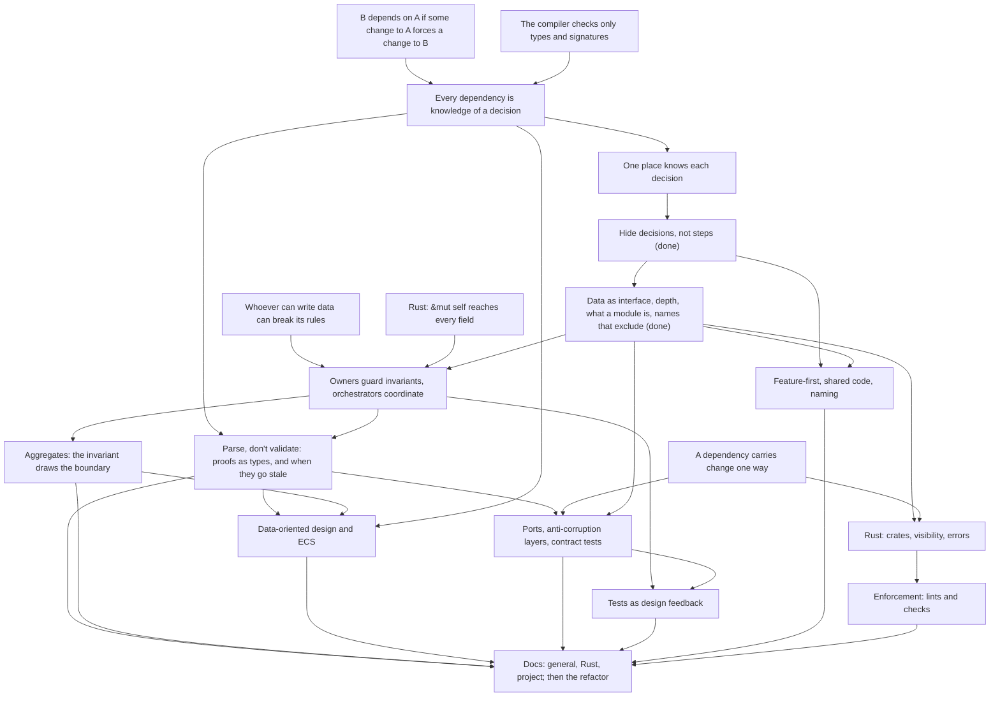

# Codebase architecture course

## Goal

Know where code goes in a project that doesn't fit a framework layout such as Rails' MVC. Design
patterns are out of scope, since he knows them. Topics he named: domain-driven design,
data-oriented design (his meaning) and data-driven design (also applicable), ECS for the Bevy front
end, wrapping third-party libraries, ports and adapters, and test-driven development.

The deliverable is `docs/conventions/file-structure.md`, one doc with three sections: general
guidance, Rust guidance, and this project's rules. It comes with lint rules wherever a tool can
check a rule, and the `rules` crate refactored to follow it. The general and Rust sections should
hold for his work too: critical finance services in Rust, Python and TypeScript, after years of
Rails. Reuse outside this repo is a nice-to-have. He copies the sections out by hand if they hold
up.

## How sessions work

- Teaching follows the `teach` skill, `.agents/skills/teach/SKILL.md`.
- One pi session per course session. Start with `/new`, `/name NN-topic`,
  `/md-log docs/course/architecture/sessions/NN-topic.md` (the file must exist first), then
  "continue the architecture course".
- Every session opens with a short retrieval quiz on the previous session's nodes, unless he did
  that session just before.
- Roles. He learns the concepts and makes every decision about the rules. The agent drafts the docs
  and the lint rules, and does the refactor. He reviews all of it before it's committed.
- Each node ends with a production exercise: he draws a split on real code with no options offered.
  When a node settles, he states the rule and the agent drafts it into the doc section it belongs
  to. The doc grows one node at a time.
- A derivation step is asked open-ended, in plain text, and he answers in his own words. Options let
  him get there by elimination (session 01). Quizzes are for checks whose wrong options are
  mistakes he could really make.
- No new card game features for this course. A concept with no problem in today's code becomes an
  open thread and waits until the card game course creates the problem.
- General and Rust concepts come first, the project section last. The refactor PRs already open
  are drafts. Each is reviewed after the node it exercises, then merged, reworked or closed. The
  open threads say which node each one waits for.
- After each node, the agent audits the crate against the doc as it stands, with no code changes.
  He reviews the list, and the findings go in the open threads. An audit is one pass and needn't
  find everything, since refactors surface the rest (his call, 01d). Auditors get the card-game
  course plan and open threads as the roadmap, since the repo has none.
- The refactor runs while the knowledge is fresh (his call, session 01a, revising his first pick of
  refactoring at the end). After a teaching session, a refactor session reworks the PRs its nodes
  judged and fixes the audit findings whose home those nodes settle. Findings whose home depends on
  a later node wait for it. The agent does the work, he reviews it.
- End at a node boundary, not mid-node. Commit once per node.

## Knowledge map

### Session 01d

No retrieval quiz (his call). The audit ran in two rounds of two agents, with reports in
`research/01d-audit/`. Round 1 had no roadmap. Round 2 added the card-game course plan and open
threads as one, his idea, to compare and to prepare later audits. Every report took `game` as one
module and led with it holding about fifteen independent decisions.

- I framed the first doc gap as "place" being undefined. He corrected it: a place is code you have
  to edit, as the doc says. The real gap was two sentences on cheap informal knowledge that
  disagreed for copies inside `game`. He drafted three versions, rejected his own second ("what I
  said is not true"), and landed on locality: informal knowledge is acceptable where its places
  sit close together, so changes stay cheap; a module keeps its decision local by definition;
  informal knowledge is inevitable, as statement order shows. Added: an order forced by a data
  dependency is formal.
- Asked whether a module holding more than one decision should change the text. Resolved as
  "decisions that change together count as one", which matches the names section.
- Rejected doc additions that fix no shown gap, asking "why do we need this change?" (`impl`
  files, tuple matches; I conceded both), and text owned elsewhere: "private", the glossary's
  scope, a misplaced-function rule, and the roadmap's location (a course plan is not a roadmap).
  On `loader` his reading held: a rule over public data can be copied, so it isn't a module.
  Added: files of only public types hide nothing; the project section points to `testing.md`.
- Audit 4 passed the five `update_order` calls as local. His answer: prefer formal over informal,
  which the doc already says.
- The Mourner bug was found by 2 of 4 auditors, the interaction state's `unreachable!` sites by
  none. He's fine with misses: changes made in steps surface other issues.

### Session 01c

No retrieval quiz (01b ended minutes before, his call). Probe on names: picked `state_check.rs` as
the name that excludes least, "because it is a step while the others are concepts", and passed
`player.rs`. With 01b's flags on `actions` and `resolve`, the edge: he sorted names by word
category (operation and step words bad, domain nouns good), not by what they exclude.

- D5 derivation: said a name tells "decisions for this subject live here"; his test, "does the
  name reflect the decision it holds", sharpened into exclusion (inclusion tells A where to look,
  exclusion when to stop). Quiz right (`turn` and `rules` fail), checking real functions himself.
  Said "no name passes" means independent decisions; added: or one decision with no term yet,
  told apart by the change test. Rule in his words; he removed the examples, asked for "existing
  or new" over "codebase", and pointed the project line at `docs/agents/domain.md`.
- Raised two doc gaps himself: every parent fails the name test (resolved: judge a name against
  its siblings), and every parent fails the one-decision clause (resolved: a child module counts
  as one item, a parent is judged by its own code). Both committed.
- #13 names exercise (too big, my fault; he did part): `verb` and `derived` right, with
  `history_from_event` as a counterexample to `derived`. Split `derived` by noun into Mana,
  Stats, Auras and Modifiers; the change test gives two parts. Judged `resolve` and `filter` by
  size and "unrelated"; both pass, and the misplaced functions are `scan_characters_with_filter`
  and `emit`. The entity habit from D4 persists, now as splitting by noun.
- `verb.rs` exercise, no options: a zones module owning zones, stamps and in-zone order behind
  `deck_to_hand`-style moves (sound), a damage module (sound, fatigue joins it), and an
  intermediate coordinator for move consequences. I dismissed the coordinator; he pushed back
  that nesting is allowed, and I conceded: nesting the zones module inside it enforces that only
  it moves cards. Emitting needs most of `Game`, the open problem.
- Verdicts: #13 close ("a middle step" to an undesired pattern, with duplicate names like
  `action.rs` and `game/actions.rs`); #15 merge after a light rework (one exhaustive kind-flag
  match, his agreement), commented on the PR. Named the definitions table: Binder, in the glossary.

### Session 01b

No retrieval quiz (01a ended minutes before). Probe: right on informal contracts in an interface
(`health`'s `Some` for characters in play), on conjoined helpers (judged by independence, not
length), and on privacy direction (only a type declared in a child hides its fields from the
parent). The edge: he weighed an interface by its methods and contracts, not the data they hand
out. Called `ObjectBag` deep despite `get_mut`, and left the meaning of `damage` out of the
interface. On names he also flagged `actions.rs` and `resolve.rs` as vague; resolved as a
refinement: a name is judged against the glossary, where both are narrow terms.

Goals he picked: when a file becomes its own module, the doc's definition of module, the #13 and
#15 reviews. He said he already holds split cost and interface measuring; I kept the second as a
node because the probe missed it.

- D1, data is interface: objected "why not say `Object` has its own interface, the `pub` fields?";
  resolved as `Object`'s depth being zero and the returned type's interface being part of the
  method's. Added unprompted that parameters count too. Quiz right (`Binder` after #15).
- D2, depth: asked whether `entered_board` only renames `update_order`, then found the trade
  himself: callers swap a policy for a fact they already know. Asked whether that reduces
  complexity or increases depth (both). Quiz right.
- D3, what a module is: derived that the privacy reading makes the `Location` edit look cheap,
  against degree and locality. Claimed files can hide (they can't hide data in the parent), and
  marked `game` as "all holders seen"; corrected by his own part 1. Rejected a definition that
  depends on the reader's capacity ("agents can also read code"); resolved as one decision per
  boundary. His rule, with "cannot be copied from outside" his own addition. Quiz right; noted
  `object.rs` holds two decisions and hides one.
- D4, file or module: mana pays, outcome doesn't (one writer, `set`/`get` mirror the field). His
  first rule ("complexity outside decreases enough") was by feel; sharpened together, and he
  questioned "narrower than its data" (counting items, not knowledge; conceded), "only one
  place", "field and a file", and used "module" for the defined term. Quiz right, noting the
  stack qualifies only if the order goes inside.
- D4 exercise, no options: game creation as a builder (sound; check the roadmap for N players);
  "Objects" as a module for triggers, modifiers and health (right decision, entity boundary: it
  bundles three decisions and needs most of `Game`'s data, which he noticed); zones owning the
  order of board entry (sound, a refactor candidate). Pattern: finds spread knowledge reliably,
  draws the boundary around an entity rather than a decision.

### Session 01a

Retrieval on session 01, 3 of 3: a unit assumed across crates is informal and must become formal;
Undying gets one `is_dead` question, not a constant or a floored `health`; one `transfer` command
beats a token that makes the order formal.

Taught node H (Parnas) by derivation. He derived "list the decisions, build around the likely to
change" unaided, and why steps leak: "the step code ceases to exist and only the representation is
kept alive", plus that a check predicts the act, so it copies the act's rule. He pushed back with
his boss's "every decision is likely to change"; resolved as: an interface is made of decisions
too, so something must be bet stable. Quizzes right: billing filter, reconciliation split.

- Validator exercise, no options, about 10 minutes for the follow-up (first part untimed): named
  the card text's shape as the decision, with formal and informal per change (rename vs new
  field). Missed the live gap until pointed at it. First proposals hid the wrong thing:
  `Binder`-style accessors mirror the shape, a DI trait for rules he had rated stable went against
  his own filter, a flat `get_effects` lost sequences, and storage labels (aura) leaked the shape
  back. His payload idea was sound; I had misread it and conceded.
- His rule: "Build modules around decisions, especially the ones likely to change or hard to get
  right", with steps as the coordinator's job. Committed with bullets from the session.
- Audit, two rounds of two agents, reports in `research/01a-hiding-and-depth/`. His doc calls:
  define a decision on its own, not by change; git history is rarely useful, domain reasoning
  comes first; no ranking rule; no load-time validation clause.
- PR review: #10 rework (spotted that the IDs and the table change together, wants one loading
  module); #14 light rework. Missed that a new `CardDef` field is informal for the walk. Mixed up
  #10 with #13's new `game/` files.
- Asked what DOD and data-driven design say, and whether Parnas is still relevant (researched:
  extended and qualified, never superseded). Raised "parse, don't validate" himself, including
  `ObjectId` in hand vs in play.

### Session 01

Probe, all right on real code: a dependency with no call (the in-play rule, the meaning of
`order`), check then apply as a split by steps, `Game` deep outside with no inner boundaries, and
`queries.rs` as a vague name. His note on the naming question: he applied the rule from session
00 "but I am not sure why or where it came from". So recognition holds on these strands, and the
edge is deriving the rules and producing with them.

Taught: the definition of a dependency (Page-Jones), the compiler checks only types and
signatures, every dependency is knowledge of a decision in formal or informal form, one place
knows each decision. Both rules are in `file-structure.md`, in his words, edited.

- Replays: he said they depend on the generator being seedable and repeatable. Corrected: they
  depend on the exact sequence, so a swap to another repeatable generator breaks them too.
- `Location` card kind: he thought `Game::health` uses a `match`. It's `Binder::health` that does;
  the in-play test uses `is_hero` and `is_minion` booleans.
- Decision inventory, no options, 22 minutes: three decisions, all about ordering or state.
  Reactions resolve above the card's own effects; a pick happens only while idle; an `ObjectId`
  always resolves. Missed `kill` as a third holder of the first, and the resolution loop's
  `!is_pending_interaction()` as what makes the second true. Judged formal versus informal by
  "could `insert` have a bug", not by "does the compiler check it".
- One place exercise, 15 minutes: chose a command over a query, and unprompted set one command
  that pushes and emits against a token that makes the order formal, noting that the token leaves
  the knowledge in every caller. Missed that `kill` pushes every death rattle before any `Died`,
  so a per-object helper would change the order of simultaneous deaths.
- His rule edits: tests also find informal breakage; informal knowledge is cheap inside a module;
  no example where it isn't practical; "still knows the decision".

### Session 00 probe

Background: deep Rails, so "where does this go" was always answered by the framework's layer-first
layout. His Game Boy Color emulator has the same god struct (`App`) as `Game` here.

Pain points he picked: splitting a growing module, code two features share, layer-first vs
feature-first, naming. In his own words: what should be its own module; splitting data from
behavior without OOP leaves "very small data structs with the full state and every behaviour on a
single super struct"; visibility once a module spans several files, where he either promotes it to
a crate to see the boundary or ends with `pub(crate)` everywhere.

Probe results:
- Rust visibility: solid. `pub(super)` reaches the parent's whole subtree, and he picked the facade
  setup (private `mod`, `pub(crate) use` re-export, `pub(super)` helpers). His note: the gap is
  "general concepts from the literature", not syntax.
- Information hiding: diagnosed the `game/` split at once (every file reads `Game`'s fields, so the
  files hide nothing from each other). Deep modules: right, had heard the idea, not the book.
- DDD: "I don't know" on aggregates (his note: object graph and use case both "could make sense").
  Recognized the bounded context but picked "I don't know" because he "could not come with a
  similar answer on my own". Anti-corruption layer was new as a term.
- Ports and adapters: right, with the reason ("deps point inwards and the core does not depend on
  stack code"). Errors in the port's terms: right. His note raised the coupling between core
  variants and `sqlx` errors; answered as one-way semantic coupling that the core's needs drive.
  Contract tests: right by reasoning, never heard of them.
- Wrapping libraries: my first question was ambiguous (re-exported vs owned mirror structs) and was
  regraded. The clear version was right: owned copies absorb syntax changes, not model changes.
- Feature-first: right on a facade between features. ECS: right on declared access, grouping by
  access pattern (his note: "what changes together stays together") and a single writer. He
  pushed back, correctly, that my first ECS question tested the mechanism, not how to organize
  components and systems.
- Naming: placed `can_attack` in `lookup.rs` by a rule from the contents ("lookup is derived
  information of the objects"). Regraded: his rule is good, but it lives in his head, not in the
  names, and `fulfill_character_filter` (also derived from objects) sits in `condition.rs`.
- Tests and structure: right that setup pain is design feedback (a narrower signature).

The edge is production, not recognition. Asked to break up `Game` with no options (10 minutes):
`Rng` apart (not card-game specific), `Binder` apart (immutable), and he rejected a `GlobalState`
of `TurnOrder` and `Outcome` because it doesn't deepen anything. All three are sound. He stalled on
a resolution module: owning `effect_stack` and `resolving_effect` seemed to require access to
`binder`, `objects`, `outcome` and `players`, so the interface looked huge. Two beliefs block him:
a module must own every behavior that touches its data, and a method on a small struct such as
`Player` makes it "an object rather than data". He also feared delegation boilerplate on `Game`.

## Course plan

Two roots carry the course. Every dependency is knowledge of a decision, and whoever can write data
can break its rules. Each guideline is derived from them so he can apply it to cases no doc
anticipated. Socratic teaching, quiz checks, and a production exercise per node.

1. Sessions 01 to 01c: coupling as shared knowledge, one place per decision, hiding decisions
   (Parnas, done in 01a), then in 01b data as interface, depth, what a module is and file or
   module, then in 01c names that exclude, nesting, and the #13 and #15 verdicts (done).
   Session 01d: the audit rerun in two rounds, the second with the roadmap (done). Session 01e
   refactors under all of it: rework #10, #14 and #15, close #13 and rebase the stack onto #11,
   and fix findings 10, 11, 14, 15 and likely 3. At its start he picks whether 7, 12 and the
   names that don't wait for the `game` split join it.
2. Session 02: ownership. An owner guards its invariants and an orchestrator coordinates owners;
   encapsulation vs OOP; aggregates (Evans, Vernon). Catherine West's nuance: one big state is
   fine, implicit reach and unowned invariants are the problem. Open with his own question: does
   the module owning `effect_stack` and `resolving_effect` need to apply effects, or only decide
   which comes next? Session 02a refactors under it: #16, #17, #18 and the ownership findings.
   Session 02b, its own node: parse, don't validate (Alexis King, 2019). A check's result carried
   forward as a type, not an assumption; who can build the proof, and when it goes stale. Material:
   `apply` checking `legal_actions` then `apply_action` relying on `expect` and `unreachable!`; an
   `ObjectId` in hand and one in play sharing a type, with `health`, `attack` and `mana_cost`
   returning `Option` on every call. He found the `ObjectId` case and finds its fix not obvious.
   Session 03 shows ECS queries as the ECS take on it, session 04 applies it at the boundary.
3. Session 03: data-oriented design and ECS organization (component granularity, single writer,
   plugins per feature), and the rules core beside Bevy (elevator-core's bridge).
4. Session 04: ports, anti-corruption layers, errors at the port, contract tests, tests as design
   feedback.
5. Session 05: feature-first vs layer-first, shared code (CCP, Metz vs Ousterhout's repetition),
   naming.
6. Session 06: Rust layer (a crate is Martin's package, visibility as enforcement, the borrow
   checker and layout, errors near their unit of fallibility) and enforcement tools.
7. Session 07 on: the project section and the rest of the refactor.

## Open threads

- The refactor PRs are drafts in a stack. #9 (clippy ban by public path) is merged, and #10 now
  targets main. Each waits for its node's review, and they merge bottom-up.
  - Session 01a, node H, reviewed. #10 loader split: rework into one loading module that exposes
    loading plus the IDs, with the IDs and the table in one module since they change together.
    #14 one walk over card text: rework lightly, moving the walk next to `CardDef` and
    destructuring exhaustively.
  - Session 01c, reviewed. #13: close. Its files of `impl Game` add names without boundaries,
    and `verb`, `derived` and the duplicate pairs (`action.rs` and `game/actions.rs`, two
    `filter.rs`, two `trigger`) fail the name test. Closing it means rebasing #14 to #18 onto #11.
    My default, unless he objects: carry its visibility narrowing, `ApplyError` next to
    `IllegalAction`, and `History` and `Trigger` under `game` into the PRs that build the real
    modules. #15: merge after a light rework, one exhaustive match on `CardDefKind` returning the
    kind flag so `filter.rs` stops chaining `||` (finding 14). Commented on the PR.
  - Session 02: #16 history private, #17 guarded effect stack, #18 modifiers answer stat questions.
  - Session 05: #11 printed card types in `cards/`.
- Audit after D5 (session 01d), reviewed by him. It replaces the 01a list, whose reports stay in
  `research/01a-hiding-and-depth/`. Reports in `research/01d-audit/audit-1.md` to `audit-4.md`;
  3 and 4 had the roadmap. The refactor works from this list. 01a's numbers are in parentheses.
  1. `game` is one module holding about fifteen independent decisions. Child types with private
     fields; `game` keeps the coordinator. Session 02.
  2. Death pass reports one death at a time, against ADR 0012: the Mourner bug, live (4). Filed
     on main as `docs/issues/dying-mourner-hears-older-death.md`.
  3. Characters in play computed in four or five places. One scan answers "all", random and draft
     candidates. A dead hero hears its own death twice; an eliminated hero stays a target (1).
  4. Order of play: `pub` stamp, five writers, three sorts, docstring against ADR 0012. Trigger
     order and death order are two questions (2).
  5. Effect stack order known at three push sites (3, #17).
  6. Draft walk copied in `legal_actions` and `can_finish_choices`; layout read in five places (5).
  7. `is_satisfied` answers "may stop" and "is full", so `AtMost` would offer no `Choose` (5).
  8. Mana check, payment and refill in three files; the glossary's Play split three ways (6).
  9. Resolution answers on `Object`; `pick_targets` never cleared; the validator accepts a reused
     pick ID (7, roadmap 06b).
  10. Validators walk card text by hand, missing `modifier_effects` and nested grants (8, #14).
  11. `loader` holds the card set, the IDs and validation; `Binder::new` stores unvalidated
      definitions (9).
  12. Validators copy resolution's rules: `Chosen` needs a draft, `ResolvePick` a `Reveal`.
  13. History recorded in `triggering.rs`, counted in `resolve.rs`, entries `pub` (10, #16).
  14. Card kinds: `is_*` combined in six places, kind filters copy `CardDefKind`,
      `has_deck_presence` asked as "goes to the graveyard". A new board kind panics in
      `find_dead` (11, #15).
  15. Trigger matching ends in `(_, _) => false` (12).
  16. Modifiers decided by four `_` filters (13, #18).
  17. Owner: `player_id` and the holding zone. Revealing from the enemy deck panics (14).
  18. Fatigue marks damage by hand, so damage triggers miss it. Card-game thread "One damage
      function".
  19. Interaction state decided with `_` arms in `view` and `pending_*`. 01a's three
      `unreachable!` sites weren't found again (15).
  20. Checkpoints at ten sites, two inside `play` (16, low).
  21. `ResolvingEffect`'s cursor is `pub`; its caller clones, then advances (roadmap 06b).
  22. `CardDef`, the loader and its errors are re-exported, unused outside the crate (low).
  23. Placeholder rule split between `definition` and `loader`, which import each other (low).

  Names every auditor failed: `game`, `cards`, `choice`, `ids`, `turn`, `cards::definition`,
  `cards::modifier` (not in the glossary), and `condition`, `lookup`, `resolve`, `triggering` and
  `zone_move` under `game/`. Split: `loader` (3 of 4); `filter`, `history` (not in the glossary)
  and `static_card_definition` (2 each); `effect`, `trigger` and `player` (1 each).

  Routed elsewhere: ObjectIds name hidden cards (a card-game thread already). Board auras reach
  minions in every zone, the hand included (`lookup.rs:158`), a rules question for the card-game
  course.
- Doc feedback deferred to session 02: a decision with no data of its own, or one that needs
  another module's data (four auditors); procedure versus domain order, and checkpoints (two).
- Main moved since this branch forked: CLAUDE.md became AGENTS.md (#20), `docs/issues/` arrived
  (#19), and #9 changed `clippy.toml`. This branch edits CLAUDE.md, so the 01e PR rebases first.
- His `verb.rs` design (session 01c), for the 01e refactor or session 02: a zones module owning
  the zones, the stamps and in-zone order behind moves such as `deck_to_hand` (maybe deepening
  `zones.rs`); a damage module, with fatigue calling it; and an intermediate coordinator for the
  consequences of a move (events, pushes, their order), with the zones module as its child so
  only it can move cards. Open: `emit` needs most of `Game`, so the coordinator would hand events
  back or take an emitter. Needs a name; "actions" collides with the glossary.
- The `derived.rs` split: by the change test, stats and cost with `modifiers` are one decision
  with no term yet (#18's bet), and auras are another. He proposed four noun modules.
- His D4 exercise ideas, for the 01e refactor or later: a builder for `Game` creation, so callers
  know only what they set (check the card-game roadmap for N players first); a `Board` that keeps
  its own entry order, replacing `Object.order` and the three sorts (audit finding 4; heroes and
  graveyard order complicate it). His "Objects" module is the modifiers question of #18, session
  02.
- After #15, `get` still hands out `&CardDef` with `pub` fields, read in `game/` for
  `play_effects`, `choices`, `mana_cost`, `triggers` and `modifier_effects` (D1). The 01d audit
  ran on main, without #15; finding 22 is the public half. Weigh `get` at #15's rework in 01e.
- Exhaustive destructuring (a struct pattern with no `..`) for functions that must visit every
  field: proposed for the Rust list, his decision pending. The enforcing clippy lint is nightly
  only. See `research/01a-hiding-and-depth/exhaustive-destructuring.md`. Session 06 at the latest.
- The "several filters decide together" sentence sits in the Rust section; he isn't sure
  `file-structure.md` is its home. Revisit in session 06.
- The Rust section of `file-structure.md` started early with "Making knowledge formal". Session 06
  extends it.
- "Own effects resolve after the reactions they cause": his design is one command next to the
  resolution loop, taking the whole batch, since `kill` pushes every death rattle before any
  `Died`. Compare it with #17 at that PR's review in session 02.
- For the teach skill: ask derivation steps open-ended, not as a quiz, since options let him
  eliminate. Propose the edit to him for review.
- `fulfill_character_filter` is half narrow already: the side check is a free function in
  `cards/filter.rs`, while the kind check goes from object to definition to `binder`. Material for
  sessions 02 and 04.
- One damage function (card-game open thread: fatigue bypasses `Game::damage`) is the single-writer
  idea. Session 02 or 03.
- Error placement: `ApplyError`, `CardDefError` and the loader's validation errors, against Sabrina
  Jewson's "near their unit of fallibility". Session 06.
- Quotes flagged secondary in `research/00-scope/literature.md` and
  `research/01-coupling-and-hiding/sources.md` (Ousterhout's book text, GOOS ch. 20, Acton,
  Page-Jones's later books) need checking before being quoted as exact. Unverified Rust items:
  Cargo's crate-cycle ban, and scoping `clippy::disallowed_*` to one module with `#[allow]`. Verify
  before session 06 teaches them.
- Bevy names changed since 0.17: buffered events are `Message`s, `Event` is for observers, 0.20 is
  current. Use these names in session 03.

## Dependency map

## Sessions

| # | Nodes | Topic | Status |
|---|-------|-------|--------|
| 00 | probe | Knowledge probe and plan | done (edge is production, not recognition; aggregates a gap; plan and doc layout agreed; three research reports) |
| 01 | U1, U2, R1, OP | Coupling as shared knowledge, one place per decision | done (recognition solid, edge is deriving; two rules in `file-structure.md`; PRs made drafts) |
| 01a | H | Hiding decisions, not steps; audit; review #10, #14 | done (derived H unaided; rule in `file-structure.md`; audit in two rounds, doc amended; #10 and #14 to rework; refactor moved to run per node) |
| 01b | D1 to D4 | Data as interface, depth, what a module is, file or module | done (edge was data handed out; module defined as one decision behind an enforced boundary; two rules in `file-structure.md`; D5 onward split off) |
| 01c | D5 | Names that exclude; review #13, #15 | done (edge was sorting names by word category; name and nesting rules in `file-structure.md`, project section started; #13 close, #15 light rework; Binder in the glossary; audit split off) |
| 01d | audit | Audit against the doc as it stands; his review of the findings | done (two rounds, roadmap in the second; locality replaces "cheap", decisions that change together count as one, files of public types; 23 findings replace the 01a list) |
| 01e | refactor | Rework #10, #14, #15; close #13 and rebase the stack; findings 10, 11, 14, 15, likely 3; PR of this branch to main | next |
| 02 | R2, R4, O, A | Ownership and aggregates: untangling the god struct | |
| 02a | refactor | #16, #17, #18 and the ownership findings | |
| 02b | PDV | Parse, don't validate: `apply` and `legal_actions`, `ObjectId` by zone | |
| 03 | DOD | Data-oriented design, ECS organization, the rules core beside Bevy | |
| 04 | R3, P, T | Ports, anti-corruption layers, contract tests, tests as feedback | |
| 05 | F | Feature-first, shared code, naming | |
| 06 | RS, E | Rust layer and enforcement | |
| 07+ | DOCS | Project section and the remaining refactor | |
