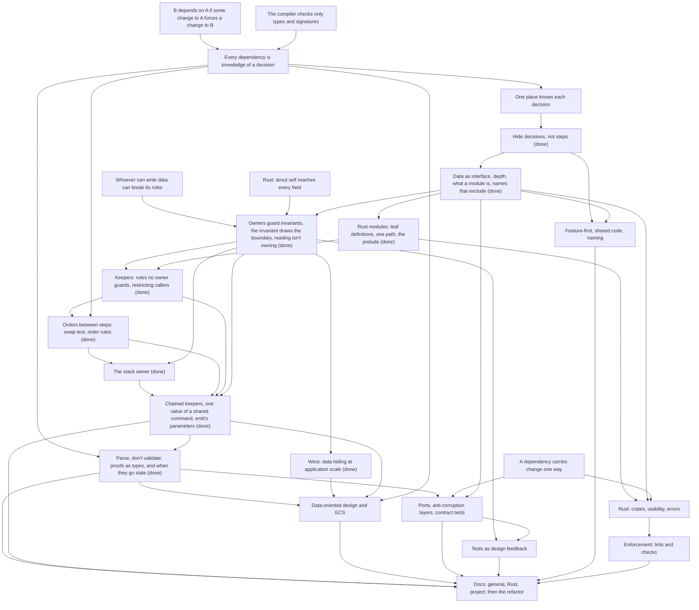

# Codebase architecture course

## Goal

Know where code goes in a project that doesn't fit a framework layout such as Rails' MVC. Design
patterns are out of scope, since he knows them. Topics he named: domain-driven design,
data-oriented design (his meaning) and data-driven design (also applicable), ECS for the Bevy front
end, wrapping third-party libraries, ports and adapters, and test-driven development.

The deliverable is `docs/conventions/file-structure.md`, one doc with three sections: general
guidance, Rust guidance, and this project's rules. It comes with lint rules wherever a tool can
check a rule, and the `rules` crate refactored to follow it. The general and Rust sections should
hold for his work too: critical finance services in Rust, Python and TypeScript, after years of
Rails. Reuse outside this repo is a nice-to-have. He copies the sections out by hand if they hold
up.

## How sessions work

- Teaching follows the `teach` skill, `.agents/skills/teach/SKILL.md`.
- One pi session per course session. Start with `/new`, `/name NN-topic`,
  `/md-log docs/course/architecture/sessions/NN-topic.md` (the file must exist first), then
  "continue the architecture course".
- Only the first session of a topic (02, 03, not 02a) opens with a short retrieval quiz. It may ask
  about any earlier session's nodes, such as 01 to 01e and 02 to 02g for 03. Skip it when he did
  the previous session just before.
- Roles. He learns the concepts and makes every decision about the rules. The agent drafts the docs
  and the lint rules, and writes the refactor tickets. He reviews all of it before it's merged. His
  exercise designs are answers, not settled designs: the refactoring agent picks the shape within
  the doc (his call, 02d).
- Each node ends with an exercise at the level of concepts, with no options offered: he classifies
  real code, picks its owner or keeper, or judges a design the agent drafts. No signatures or code.
  Solving the code is the agent's part (his call, 02c). When a node settles, he states the rule and
  the agent drafts it into the doc section it belongs to. The doc grows one node at a time.
- A derivation step is asked open-ended, in plain text, and he answers in his own words. Options let
  him get there by elimination (session 01). Quizzes are for checks whose wrong options are
  mistakes he could really make.
- No new card game features for this course. A concept with no problem in today's code becomes an
  open thread and waits until the card game course creates the problem.
- General and Rust concepts come first, the project section last. Draft PRs closed in 01e get
  redone after the node that reviews them. The open threads say which node each one waits for.
- After each node, the agent audits the crate against the doc as it stands, with no code changes.
  He reviews the list, and the findings go in the open threads. An audit is one pass and needn't
  find everything, since refactors surface the rest (his call, 01d). Auditors get the card-game
  course plan and open threads as the roadmap, since the repo has none.
- The refactor runs while the knowledge is fresh (his call, session 01a, revising his first pick of
  refactoring at the end). After a teaching session, a refactor session turns the findings whose
  home its nodes settle into tickets: `docs/issues/<effort>/`, with a `spec.md` every agent shares
  (his call, 01e). Findings whose home depends on a later node wait for it. A ticket states the
  problem, the code that shows it and the rule it breaks, never a shape, and carries only the
  rulings he cares about. Applying settled rules to existing code is the agent's part, with no
  exercise (his calls, 02e).
- AFK agents work the tickets, one PR each, one ticket at a time. They run one to five review
  rounds with subagents and state their intentions in the PR body. A behavior change is allowed
  when the PR justifies it, except a rules change or a known bug, which the card game course
  decides (his call, 02e). He checks the intentions against the code and merges. A
  choice of theirs he disagrees with marks a gap in the convention docs, which goes back into the
  doc (01e).
- End at a node boundary, not mid-node. Commit once per node.

## Knowledge map

### Background

- Years of Rails, where the framework's layer-first layout always answered "where does this go". His
  Game Boy Color emulator has the same god struct (`App`) as `Game` here (00).
- Pain points he named: what should be its own module, "very small data structs with the full
  state and every behaviour on a single super struct", and visibility across files, where he
  promotes a module to a crate or ends with `pub(crate)` everywhere (00).
- Across strands, recognition is solid and production with no options is the edge. He finds spread
  knowledge reliably but misses some of its holders (00, 01, 01a, 02, and in 02b the second call of
  `check_state`). The 02c probe went 5 of 5 again, and the 02d probe, on concepts the map had no
  evidence for, 2 of 2. The 02g probe: one right, one "I don't know", a misclick, a slip and the
  edge.

### Coupling and hiding decisions

- Holds dependency as knowledge of a decision, formal or informal, and one place per decision.
  Recognized a dependency with no call, check then apply as a split by steps, and `Game` as deep
  outside with no inner boundaries before being taught (01). Authored the locality rule for
  informal knowledge, correcting a framing of "place" as undefined, and added that an order
  forced by a data dependency is formal (01d).
- Derived Parnas unaided: list the decisions, build around the likely to change, and why steps
  leak ("the step code ceases to exist and only the representation is kept alive"; a check
  predicts the act, so it copies its rule) (01a). Resolved his boss's "every decision is likely to
  change" as: an interface is made of decisions too, so something must be bet stable. Judges
  likelihood by domain reasoning; git history is rarely useful to him.
- Prefers one command that takes knowledge away from callers over a token that makes an order
  formal, unprompted (01).
- Authored "dependency cost depends on stability" after reading the 02 owners rule as a fixed
  cost. The doc already held it in the boundary section, so it moved to the coupling section in
  his words (02a). Applied the stability test to his own design once asked for a forecast:
  queries that vary per card overturned his narrow history entry (02a).
- Orders between steps (02c): derived the experiment unaided ("I can change the order and see if
  something changes") with three outcomes sorted by symptom (breaks, behaviour changes, nothing).
  On `apply` with its legality check swapped, he first sorted the rules broken instead of the
  order, then found the callee's contract himself. Asked what "the procedure" means, which the doc
  never defined. Stated the doc rule, reordered it, cut the batch bullet, and asked whether the
  doc defines rule, decision and rule of the domain, which led to defining rule and dropping "of
  the domain". In the `apply` exercise he got both kinds right but called the drain free for every
  action except Play (Pick and EndTurn break). Asked whether trigger matching should leave `emit`;
  the swap test keeps it there, since a deferred match sees a different board.
- The 02c audit's gaps (02d). Right that the observer sees event order. Said swapping two steps
  and swapping only their reports break the same thing, then found the difference himself ("if u
  can emit a TurnEnded whatever then of course it no longer means the turn ended"). Asked why
  report order can't be an order rule of its own, settled by "decisions that change together count
  as one", then stated the rule and reworded my draft with "output". Filed an order through a
  stored field as an order rule at once, and asked whether the fix was "going back" (it is). On
  reachable states he argued today's cards are code, then challenged a double standard between
  adding a card and widening the validator. My framing of code as data in one place and interface
  in another was the confusion; caller against interface settled it.
- Probe (02c), all right: `play`'s push before `Played` as a domain rule with his own reason, the
  merged `kill` loops (missed in 01), the stack not applying effects, formal knowledge still
  costing an edit per place (missed with West, 02a), and a private-field payload for `Died`.
- Raised "parse, don't validate" himself, with `ObjectId` in hand vs in play (01a). Taught in
  02g, see Checks and proofs.
- Edge: inventories miss holders and guards. Missed `kill` as a third holder of reaction order,
  the resolution loop's `!is_pending_interaction()` as what makes "pick only while idle" true,
  and that `kill` pushes every death rattle before any `Died`, so a per-object helper would
  reorder simultaneous deaths (01). Missed that a new `CardDef` field is informal for the
  validator walk (01a). In 02c he recognized the merged `kill` loops in a quiz, then in production
  proposed reading each death rattle inside `destroy`, the same per-object helper.
- Edge: producing the hiding interface. In the validator exercise he named the card text's shape
  as the decision but missed the live gap until pointed at it, and his first proposals mirrored
  the shape (`Binder`-style accessors, a flat `get_effects` losing sequences, storage labels such
  as aura) or went against his own stability filter (a DI trait for stable rules). His payload
  idea was sound (01a).
- Could come back: judging formal vs informal by "could this have a bug" instead of "does the
  build catch it" (01). Replays: thought they need only a seedable, repeatable generator, not the
  exact sequence (01).

### Interfaces, depth and modules

- Diagnosed at once that the `game/` files hide nothing from each other, and knew deep modules
  as an idea, not the book (00). Right on informal contracts in an interface (`health`'s `Some`
  for characters in play) and on judging conjoined helpers by independence, not length (01b).
- Holds data as interface, including what it means and parameters (his addition), and depth as
  what callers no longer know: found the `entered_board` trade himself, callers swap a policy for
  a fact they already know (01b). Before D1 he weighed an interface by its methods and called
  `ObjectBag` deep despite `get_mut`.
- Holds the module definition as one decision behind an enforced boundary; "cannot be copied from
  outside" is his addition (01b). Rejected a definition that depends on the reader's capacity.
  Holds that a rule over public data can be copied, so `loader` wasn't a module, and that files of
  only public types hide nothing (01d). Noted that `object.rs` holds two decisions and hides one.
- File or module: mana pays, outcome doesn't (one writer, `set`/`get` mirror the field); the
  effect stack qualifies only if its order goes inside (01b).
- `emit`'s parameters (02d): said the 13 callers know what recording needs, missing that matching
  reads most of it, and expects it to change. Proposed a read type built from `&Game`, which has to
  split `&mut Game` instead, since `emit` writes History.
- Edge: draws the boundary around an entity or noun rather than a decision. His "Objects" module
  bundled triggers, modifiers and health and needed most of `Game`'s data, which he noticed
  (01b); he split `derived` by noun into Mana, Stats, Auras and Modifiers where the change test
  gives two (01c). The 02 location owner was drawn by an invariant, so this may be fading.
- Could come back: claimed files can hide data (01b), and misread `Game::health` as the `match`
  on card kind, which lives in `Binder::health` (01).

### Ownership and invariants

- Probe right (02): all of `game/` can break `order` through `get_mut`, not just today's callers;
  `&mut self` at a call site; private `Player` fields; how much of `draw` goes in `Zones`, judged
  by the data each design forces the owner to hold. Unsure whether "being a big state is good or
  bad". Asked how a pass's call is enforced, how a reader gets its data, and for Matsakis's four
  workarounds. Often rewrites code because he can't read one field while writing another.
- Node 1, invariant to owner (Meyer): derived unaided, the interface as the boundary; quiz right
  (`mana_mut`), tied to "can't be copied from outside" (02).
- Node 2, the invariant draws the boundary (aggregates): derived that neither owner can keep order
  of play, that the guarantee is then informal in every caller, and "private write to that
  module". Quiz right, noun and action traps included. In the exercise he designed the location
  owner but missed `pick_targets`. Probe before it: "I don't know" on what makes data share an
  owner ("I think its 4 but I would not have come with it on my own") (02).
- Node 3, reading isn't owning: right that `&self` can't write; proposed the lowest common
  ancestor unprompted; challenged "no data" against a method on `Game`, settled by the parent
  rule, `&self` hiding what it reads, and borrow pain. Quiz right (02).
- Edge: the reader-owns habit, "a decision lives with the data it reads". It made him put trigger
  matching in one owner of objects, zones and binder (02 probe), and say a reader inside an owner
  can't break it "as it only reads" (node 3). It traces to his 00 belief that a module must own
  every behavior that touches its data. Fixed in quizzes (02a retrieval included) and in
  production: in the `emit` exercise counting went into the history owner as a question about
  its own data (02a). Probably resolved.
- `emit` exercise (02a): found unprompted a second invariant, every reported event has an entry,
  kept by `emit` as the one command that reports. Missed the effect stack in `emit`'s writes ("I
  thought emit would return the PendingEffects"). Proposed a `Binder` clone inside `History`
  ("cheap to clone"), the card-game mirror habit in a new form, and named only representation
  and build-order costs, not the dependency. "I don't know" on counting without the binder,
  then produced three options (a filter closure, `&[CardDef]`, a narrow entry) and picked the
  narrow entry. Accepted the stats snapshot: "it changes what changes affect it".
- West (02a): had watched the talk. Found unaided that her systems are the doc's modules with no
  data. Called "depends on all of the types" a disagreement, though it is her own problem that
  ECS fixes. Said an ECS system knows the component's "interface, which is formal", missing that
  it knows the layout and that formal still costs an edit per place. Claimed hiding makes "any
  required change" cheaper, against the doc's "no design makes every decision cheap". Rejected
  her library and application split, in line with the doc's test. Quiz right on the real
  disagreement, hiding a representation that no invariant ties. Verdict on one big state: "not
  necessarily bad, the problem arises if code start depending on state that changes often",
  missing the write side.
- Keepers (02b): probe right on when the pass runs (an extra call in `draw` lands deaths
  mid-effect) and on what the coordinator's `&mut self` can break once fields are owners, in his
  words "it cannot access a single owner invariant, but it can break a rule that recieve several
  owners as parameters". Derived open-ended who can break "every reported event has an entry" and
  what each place must know. His "when only emit mutates its dependencies" overshot to every
  dependency instead of the writes the rule is about. Raised unprompted why only one of two writes
  is restricted and authored "if A then B, A needs restricting". Ruled the reverse history rule a
  false invariant. His question whether the "weak" bullet joins the new section exposed my draft
  contradicting "data tied by an invariant shares one owner".
- Order rules (02c): for `kill`'s "read every dying object's triggers before any leave", he answered
  the neighbouring stack position rule and called it an invariant, listed code running after
  `kill` as breakers, and picked `kill` as keeper. On a "Destroy a minion" card he guarded `Died`
  (finding 30's write, not this rule's), proposed reading the rattle inside `destroy`, and also
  "make destroy private", the answer. Named an order rule a "Khorikov invariant"; the doc says order
  rule, since an invariant is about stored data.
- Stack owner (02c): declined to list its rules ("too many"). His first design,
  `get_or_put_curr_effect` plus `advance`, left read-then-advance to the loop and hid the boundary
  where the pass runs. Revised it unaided to a `next_effect` that reads and advances plus a
  `current_finished` question, then picked a `Next` enum so the boundary is formal. Missed the
  push-side quiz by reading ADR 0013 as a queue (my wording); his reading showed the same leak.
  For the push side he proposed a no-data keeper with a token; the doc's ladder gives nesting.
- Keepers in 02d: derived unaided that an order rule restricts its later step, and that the
  reverse holds only when the domain needs it; quiz right. Nested the chain of keepers (`apply`,
  drain, state check, `kill`) as a tree unaided. For its last link, the location owner's shared
  move, he named the keeper but not the tool, a token. On one value of a shared command: "the
  interface restricts what the caller passes" unaided, "I don't know" on whether the token goes in
  the public `Event`, then proposed decoupling the internal event from the external one. Quiz right
  on a ledger case.
- 00 beliefs, probably resolved: a method on `Player` makes it "an object rather than data", and
  fear of delegation boilerplate on `Game`.

### Checks and proofs

- Probe (02g): right that 18 callers `expect`ing an `Option` hold the earlier check informally.
  "I don't know" on what a private-field `Funded` proves at use, noting it "depends on the
  signature of Funded", so he saw that freshness depends on what the proof holds. Right on the
  `&mut Ledger` proof after a misclick, adding that a `check_funds` taking `&mut` is misnamed. Called
  the private-constructor `NonEmpty` airtight, missing that its own module can skip `new`: a slip
  he explained himself.
- Edge found in the probe: where a proof's reach ends. He let the shell keep a `LegalAction` and
  `apply` skip the check, "thinking the point of a proof is that apply no longer checks", while his
  note already ruled out proofs from another game and kept ones. Asked "then what is the point":
  the check stays, the assumptions after it go.
- Node 1, validate or parse: derived unaided the type the check returns and `balance` takes. Quiz
  right on a validator returning the type it took. Asked whether a map lookup should hand its
  value forward, fearing a bigger check and `unsafe`: the lookup is the check, `OccupiedEntry` the
  std proof, and an owner's one `expect` (`ObjectBag::get`) the local fallback.
- Node 2, shape or owner: quiz right on which guarantees a layout holds. Stated "who builds the
  type is the one that guard its guarantes ... a check that is proven by shape can always be
  trusted".
- Node 3, reach: derived "only valid until that data changes, for the guarantee to hold the check
  must prevent the data to be changed", missing a reach that ends before the first write. Quiz
  right on which proofs can be stored, calling the wording confusing. In the `apply` exercise he
  first put references in the parsed Play, dropped before the executor writes; after one question,
  "&mut or owned values", objecting that extracting values makes a bad interface (answers to
  stable questions, not layouts). Couldn't word the rule, so I drafted it.
- Node 4, `ObjectId`: proposed the settled design, a zone-module function returning a proof that
  callers pass forward, but first as `HandObjectId(&ObjectId)`, borrowing the ID. Then a unique
  `HandObject` every move consumes, which I misread. Wanted to borrow one element of a zone (Rust
  borrows per variable and field, so ownership or a runtime check). Asked why a view borrows the
  whole game, which it shouldn't. Quiz right on what a trigger stores.
- Edge: borrow mechanics inside a proof's design, what it borrows and that a borrow can't reach
  into a write. The rest is recognition plus the rules he stated.

### Names

- Holds names as exclusion: a name passes when a reader can tell from it alone whether a function
  belongs (01c). Quiz right (`turn` and `rules` fail), checking real functions himself. Added that
  "no name passes" can also mean one decision with no term yet. Raised himself that every parent
  fails the name test and the one-decision clause.
- Right on `verb` and `derived` failing, with `history_from_event` as a counterexample (01c).
- Edge: judging names by a proxy. First by a rule in his head, applied "but I am not sure why or
  where it came from" (00, 01); then by word category, picking `state_check.rs` as excluding least
  "because it is a step while the others are concepts" (01c); then by size and "unrelated", which
  passed `resolve` and `filter` and missed `scan_characters_with_filter` and `emit` (01c). Not
  tested since.

### Rust modules and visibility

- Visibility syntax is solid: `pub(super)` reaches the parent's whole subtree, and the facade
  setup (private `mod`, `pub(crate) use`, `pub(super)` helpers). His gap is "general concepts from
  the literature", not syntax (00). Holds the privacy direction: only a child's type hides fields
  from the parent (01b).
- Authored leaf definitions, tying layout to the module definition: "by keeping definitions only
  on leafs we make so modules are always capable of hiding their decisions" (01e). Set the goal of
  one path per definition and caught `lib.rs`'s re-exports as a second path; proposed the public
  API as one module banned from internal use (01e).
- Restricting callers (02b): quiz right that no visibility reaches one sibling, so `record` would
  need a token, and weighed its cost unprompted ("not sure it is worth the cost for changes"). In
  the `check_state` exercise he placed "when the pass runs" in the loop, missing its two calls.
  Designed nesting plus tests unaided, then, after one question on `pub(super)`'s reach, a loop
  parent whose only children are the drain and the state check. Called the tests "formal
  knowledge" (they pin). Stated the three tool sentences of "Restricting callers". Argued a wide
  `pub(super)` is harmless since calls are formal: half right, since a wrong call compiles and
  locality decides. Feared nesting depth, settled by counting today's keepers. Quiz right on
  `apply_effect` as a third child.

### Other architecture topics, probed only

- DDD: "I don't know" on aggregates (object graph and use case both "could make sense"), now taught
  as node 2. Recognized the bounded context but couldn't produce it. Anti-corruption layer was new
  as a term (00).
- Ports and adapters right, with the reason (dependencies point inward). Errors in the port's
  terms right; raised the coupling between core variants and `sqlx` errors. Contract tests right
  by reasoning, never heard of them (00).
- Wrapping libraries: owned copies absorb syntax changes, not model changes (00).
- Feature-first right on a facade between features. ECS right on declared access, grouping by
  access pattern ("what changes together stays together") and a single writer (00).
- Tests: setup pain is design feedback, pointing to a narrower signature (00).
- Asked what data-oriented and data-driven design say, and whether Parnas still holds (01a).

### How he learns

- Derives well from open questions and says "I don't know" when he couldn't have produced an
  answer alone, even if he'd recognize it (00, 02). Treat a right quiz as recognition only.
- Pushes back with concrete counterexamples, and is often right: nesting the zones module inside
  the coordinator (01c), `&self` can't write (02), `impl` files and tuple matches as doc additions
  fixing no shown gap (01d). Misreading his idea is a real risk (his payload idea, 01a).
- Phrasings that failed: an ambiguous wrapping question, an ECS question testing the mechanism
  instead of organization (00), "narrower than its data", which counted items, not knowledge
  (01b), "place" framed as undefined (01d), "bet", which he asked to drop, "its interface"
  read as today's, and a leading question ("a design without the binder?") that pushed him off
  his right option (02a), "the procedure", which the doc never defined, ADR 0013's "oldest
  first", read as a queue (02c), "ladder" for the tools in "Restricting callers", and code called
  data in one place and interface in another (02d).
- Rule drafting: first drafts come by feel and sharpen in discussion (01b); he rewrites and
  rejects his own drafts (01d). Cuts wording that decides nothing, examples, and Rust terms from
  the General section (01c, 02). Rejects doc text that fixes no shown gap or is owned elsewhere.
  When he finds a rule too strict, his loosening can go vacuous: "contains the keeper's decision"
  holds for every ancestor (02b).
- Wants research on convention questions, critical review of his own proposals even when he likes
  them (01e), and sources not taken as truths (West, 02).
- Timings: a decision inventory took 22 minutes, a one-place exercise 15, the validator follow-up
  about 10, and breaking up `Game` stalled at 10 (00, 01, 01a).
- In review he spots data that changes together (IDs and the table in #10, 01a) but can mix up
  which PR added which files.
- A quiz miss can be a misclick on shuffled options (02b, the `Emitter` question). Ask before
  probing around a surprising miss.
- Rejects exercises that ask for signatures or code: "solving the existing code problems is your
  part, I am here to learn the subjects" (02c). Objected to a probe that retested taught material
  the map already showed. Lost track when I kept calling an amended answer "your test" without
  saying what changed.
- Objected again to a probe on facts about the code: "once again you are probing about existing
  code instead of concepts" (02d). Asks me to state a rule when he holds the idea but not the
  wording, then rewrites my draft (G1). Accepts doc text that answers an auditor's confusion even
  when he finds it inferable (G2).
- Rejected the 02e untangling exercises, classifying `Player`'s fields and judging a drafted tree:
  "I dont see the value to me here". He expected the agent to refactor. Then rejected a central
  untangling design: "why not let the agent solve each ticket on their own". Of four rulings I
  carried into the tickets, he kept only that matching stays with reporting. On behavior changes:
  "well justified, but I wouldnt ban it". The names and noun-boundary strands stay untested since
  01c.
- In 02g he lost the thread at "the other version of your design", with nothing quoted
  ("conversation is hard to follow when it is not clear what u are refering too"), and I misread
  his consumed-proof design until he corrected it. He cancelled a quiz to ask a question first. He
  asked me to word the node 3 rule and to suggest node 4's.

## Course plan

Two roots carry the course. Every dependency is knowledge of a decision, and whoever can write data
can break its rules. Each guideline is derived from them so he can apply it to cases no doc
anticipated. Socratic teaching, quiz checks, and a production exercise per node.

1. Sessions 01 to 01c: coupling as shared knowledge, one place per decision, hiding decisions
   (Parnas, done in 01a), then in 01b data as interface, depth, what a module is and file or
   module, then in 01c names that exclude, nesting, and the #13 and #15 verdicts (done).
   Session 01d: the audit rerun in two rounds, the second with the roadmap (done). Session 01e:
   the refactor as AFK tickets, plus the Rust rules for module layout and paths (done).
2. Sessions 02 to 02g: ownership. 02 settled invariant to owner, the invariant draws the boundary
   (aggregates), and reading isn't owning (done). 02a: node 3's exercise, redrawing `emit`, and
   West's argument (done). 02b: keepers, a rule no owner guards kept by the only code that can
   make its writes, and the Rust tools for restricting callers (done). 02c: orders between steps
   (the swap test, order rules and their keeper, a coordinator holding only orders that carry no
   decision) and the stack owner, which picks what resolves next and applies nothing (done). 02d:
   the 02c audit's gaps, a chain of keepers nesting one level per link (26), restricting one value
   of a shared command (30), `emit`'s parameters as one struct of borrows; checkpoints wait for a
   shell (done). 02e: the untangling as ten tickets in `docs/issues/untangle-game/`, which
   state problems and leave the shape to the agents, with no exercise and no audit (done, PR #37).
   02f: review the untangling PRs as they land, and put the doc gaps they surface into the doc.
   Unused material: `research/02b-pass-and-coordinator/scope.md` (Forge and XMage, the Process
   Manager). Session 02g, its own node: parse, don't validate (Alexis King,
   2019). A check's result carried forward as a type, not an assumption; who can build the proof,
   and when it goes stale. Material:
   `apply` checking `legal_actions` then `apply_action` relying on `expect` and `unreachable!`; an
   `ObjectId` in hand and one in play sharing a type, with `health`, `attack` and `mana_cost`
   returning `Option` on every call. He found the `ObjectId` case and finds its fix not obvious.
   Session 03 shows ECS queries as the ECS take on it, session 04 applies it at the boundary. Done in 02g; material in
   `research/02g-parse-dont-validate/scope.md`, findings in tickets 08, 11 and 12.
3. Session 03: data-oriented design and ECS organization (component granularity, single writer,
   plugins per feature), and the rules core beside Bevy (elevator-core's bridge).
4. Session 04: ports, anti-corruption layers, errors at the port, contract tests, tests as design
   feedback.
5. Session 05: feature-first vs layer-first, shared code (CCP, Metz vs Ousterhout's repetition),
   naming.
6. Session 06: Rust layer (a crate is Martin's package, visibility as enforcement, the borrow
   checker and layout, errors near their unit of fallibility) and enforcement tools.
7. Session 07 on: the project section and the rest of the refactor.

## Open threads

- Closed draft PRs, redone after their node from branches kept on the remote. Ticketed in 02e in
  `docs/issues/untangle-game/`: #16 history private (`history-private`) in ticket 03, #17 guarded
  effect stack (`effect-stack`) in 04, #18 modifiers answer stat questions (`modifiers-stats`) in
  08. Session 05: #11 printed card types in `cards/`
  (`cards-vocabulary`). #13 is closed for good (`game-by-question`); its visibility narrowing,
  `ApplyError` next to `IllegalAction`, and `History` and `Trigger` under `game` go into the PRs
  that build the real modules, unless he objects.
- Audit after D5 (session 01d), reviewed by him. It replaces the 01a list, whose reports stay in
  `research/01a-hiding-and-depth/`. Reports in `research/01d-audit/audit-1.md` to `audit-4.md`;
  3 and 4 had the roadmap. Findings 24 to 32 come from the 02b audit against the keeper and
  restricting-callers rules, in `research/02b-pass-and-coordinator/audit-1.md` and `audit-2.md`,
  reviewed by him. The refactor works from this list. 01a's numbers are in parentheses.
  Ticketed in 02e in `docs/issues/untangle-game/`: 1, 4 to 9, 13, 16, 19, 21 and 24 to 30, with
  32 as a fact in ticket 03. Not ticketed: 2, the hero bugs of 3, 9's uncleared answers and reused
  pick ID, and 18 (card-game bugs); 17's two owner sources (a rules question, left alone in ticket
  01); 20 and 31 (checkpoints); 22 (session 04). Ticketed in 02g, PR #38: 12 and 35 in ticket 12,
  33 in ticket 11, 34 in ticket 08. Merge #38 before ticket 01 launches.
  Fixed in 01e: 3 (#28, with both hero bugs left as they were), 10 (#14), 11 and 23 (#10),
  14 (#15), 15 (#23), and 22 in part (#10; `CardDef` is still public, now through the prelude).
  1. `game` is one module holding about fifteen independent decisions. Child types with private
     fields; `game` keeps the coordinator. Session 02e.
  2. Death pass reports one death at a time, against ADR 0012: the Mourner bug, live (4). Filed
     on main as `docs/issues/dying-mourner-hears-older-death.md`.
  3. Characters in play computed in four or five places. One scan answers "all", random and draft
     candidates. A dead hero hears its own death twice; an eliminated hero stays a target (1).
  4. Order of play: `pub` stamp, five writers, three sorts, docstring against ADR 0012. Trigger
     order and death order are two questions (2).
  5. Effect stack order known at three push sites (3, #17). Push keeper drafted in the stack
     owner thread (02c).
  6. Draft walk copied in `legal_actions` and `can_finish_choices`; layout read in five places (5).
  7. `is_satisfied` answers "may stop" and "is full", so `AtMost` would offer no `Choose` (5).
  8. Mana check, payment and refill in three files; the glossary's Play split three ways (6).
  9. Resolution answers on `Object`; `pick_targets` never cleared; the validator accepts a reused
     pick ID (7, roadmap 06b).
  10. Validators walk card text by hand, missing `modifier_effects` and nested grants (8, #14).
  11. `loader` holds the card set, the IDs and validation; `Binder::new` stores unvalidated
      definitions (9).
  12. Validators copy resolution's rules: `Chosen` needs a draft, `ResolvePick` a `Reveal`.
  13. History recorded in `triggering.rs`, counted in `resolve.rs`, entries `pub` (10, #16).
  14. Card kinds: `is_*` combined in six places, kind filters copy `CardDefKind`,
      `has_deck_presence` asked as "goes to the graveyard". A new board kind panics in
      `find_dead` (11, #15).
  15. Trigger matching ends in `(_, _) => false` (12).
  16. Modifiers decided by four `_` filters (13, #18).
  17. Owner: `player_id` and the holding zone. Revealing from the enemy deck panics (14).
  18. Fatigue marks damage by hand, so damage triggers miss it. Card-game thread "One damage
      function".
  19. Interaction state decided with `_` arms in `view` and `pending_*`. 01a's three
      `unreachable!` sites weren't found again (15).
  20. Checkpoints at ten sites, two inside `play` (16, low).
  21. `ResolvingEffect`'s cursor is `pub`; its caller clones, then advances (roadmap 06b). The
      stack owner's `next_effect` reads and advances in one command (02c).
  22. `CardDef`, the loader and its errors are re-exported, unused outside the crate (low).
  23. Placeholder rule split between `definition` and `loader`, which import each other (low).
  24. `enqueue_triggers` and `apply_action` can be private: each has one caller, in its own file.
  25. The pass: "if the pass runs, no resolving effect is part-way through". It also runs after an
      action with none (`fatigue_at_turn_start_can_end_the_game`). `check_state` is `pub(crate)`,
      and a finished resolving effect gets it twice (`resolve.rs:265`, then `:231`), which no
      test catches. His 02b exercise answer: a loop parent (not `loop`, a keyword) whose only children are
      the drain and the state check, `check_state` `pub(super)`, one call.
  26. Only `apply` starts the drain (ADR 0015). Moving the loop out of `resolve` opens the
      drain's entry to all of `game` unless `apply` moves in. Settled in 02d: `apply`, the
      drain, the state check and `kill` nest one level per link. The last link, removing the
      dying through the location owner's shared move, takes a token in the move's input (see
      30). The layout is the refactor's call. Session 02e.
  27. The effect stack and the resolving effect as one owner, popped and advanced only by the
      loop; `apply_effect` and `reveal` (low) run only as a step, through a `Step` token. Extends
      5 and 21. His effect stack question, answered in 02c: the owner picks what resolves next
      and applies nothing. See the stack owner thread.
  28. Only the state check kills. `kill`, `destroy` and `entomb` have one caller each and can nest
      in the pass's subtree; audit 2 keeps `destroy` with the location moves. "Own death
      triggers are read before any of the dying leaves" holds, untested. Extends 2. Session 02e.
      In 02c terms it is an order rule kept by `kill`, and the write to restrict is the removal.
  29. `outcome` and `Player.playing` are written only by the pass, yet open to every child of
      `game`. Move them into a type in the pass's leaf. Session 02e.
  30. Reporting one event variant (`Died`, `Played`, `GameEnded`) can't be restricted: `emit`
      takes the public `Event`, and the tools restrict commands, not arguments. A token in an
      internal input type might. A private-field payload in the variant works (E0451, checked),
      but changes the public `Event`. Settled in 02d: an internal input type for `emit` carries
      the token in those variants, and `emit` builds the public `Event` from it, which tests and
      log readers stay free to build. The same for the location owner's death move (28).
  31. Checkpoints: ten sites and no keeper. No decision behind the placement yet (his call, 02d).
      Revisit when a shell reads views, in session 03 or the card-game course, and review the
      `events.rs` tests that pin positions, such as `a_checkpoint_follows_a_card_leaving_the_hand`.
      Refines 20.
  32. `emit` reports `Died` after removal, and `health` is `None` off the board, so `kill` takes
      the history snapshot and it travels with the report. For #16's redo.
  33. `apply` checks `legal_actions` for a `bool`, and `apply_action` relies on it through
      `unreachable!`, `expect` and an unguarded payment: Play from a draft, cost, payment, hand
      removal, Choose, Pick. Ticket 11.
  34. `mana_cost`, `health` and `attack` answer `Option` to callers that already know the zone,
      and every caller in `src` `expect`s it. They are public, and `tests/spec/` asserts `None`.
      Ticket 08.
  35. `validate` returns `()`, and `Binder` stores the same `CardDef`s with `pub` fields.
      `Binder::get`, `resolve_character_selector` and `CardDef::health` and `attack` (`Option` by
      card kind) rely on facts only the validator checked. Ticket 12, with 12.

  Names every auditor failed: `game`, `cards`, `choice`, `ids`, `turn`, `cards::definition`,
  `cards::modifier` (not in the glossary), and `condition`, `lookup`, `resolve`, `triggering` and
  `zone_move` under `game/`. Split: `loader` (3 of 4, gone since #10); `filter`, `history` (not
  in the glossary) and `static_card_definition` (2 each); `effect`, `trigger` and `player` (1
  each). Names new since 01e, not audited: `binder/store`, `binder/sets/base`,
  `binder/validity`, `cards/sequences`, `prelude`.

  Routed elsewhere: ObjectIds name hidden cards (a card-game thread already). Board auras reach
  minions in every zone, the hand included (`lookup.rs:158`), a rules question for the card-game
  course. `setup` runs no drain, so triggers matched during setup wait for the first `apply`, now a
  card-game thread (02b). A chosen target that leaves play before its effect resolves: whether
  the effect fizzles is a rules question for the card-game course (02g).
- Doc feedback deferred to session 02: a decision with no data of its own, or one that needs
  another module's data (four auditors), answered in 02 by "a decision that combines several
  owners' data gets its own module with no data". Procedure versus domain order and the 02b
  audit's gap G3 were settled in 02c by "Orders between steps". Checkpoints (two) wait for a shell (31).
- The 02c audit, `research/02c-coordinator/audit-1.md`, checked and reviewed in 02d. Gaps G1 to
  G7 are settled in `file-structure.md` (G4 needed no change). Its orders O1 to O8 and the free
  orders feed the 02f review of the untangling PRs. 02e ran no audit, since each agent reports doc
  gaps in its PR. My check corrected it: `draw` emits before
  `update_order`; the `damage` matcher is `fulfill_trigger_pattern` (`triggering.rs:47-78`), not
  `condition.rs:63-72`; History stores object clones at `Died`, `Played` and `BoardEntered`, so
  the `summon` and `kill` swaps change what it stores, though nothing reads it. Orders it missed:
  `TurnStarted` before the mana refill (`mod.rs:255`), `entomb` stamping before the add
  (`zone_move.rs:139-143`), `remove_dead` sorting by `order` (`state_check.rs:48`), and Pick and
  Draft checkpointing in `apply_action` while Play does it in `play`.
- The design threads from here to the D4 ideas stayed out of the untangling tickets, so the agents
  find the shape (his call, 02e). Compare each PR against its thread at the 02f review.
- The stack owner (02c), for 02e and #17's redo in 02f. Private `effect_stack` and
  `resolving_effect`. `next_effect() -> Next { Effect(ObjectId, Effect), Finished, Empty }` reads
  and advances in one command. It returns `Finished` at every boundary between resolving effects,
  the first after an action included, and pops only on the next call, so the loop's exhaustive
  match runs the state check there (his pick over a `current_finished` question). Push side, my
  design from his shape, not yet judged by him: a keeper module with no data, the owner's sibling
  and the only caller of `push` (`pub(super)`), keeps "own effects under their reactions" and "one
  event's matches newest first". `emit` keeps recording, reporting and matching, since matching is
  an order rule tied to the report (a deferred match lets a played minion hear its own play), and
  hands the matches back instead of pushing them, so it no longer takes the stack. `play` and
  `kill` pass their own effects and the matches to the keeper. Answers findings 5, 21 and 27.
- The location owner (session 02, node 2), for 02e: one owner across all players holding the hero,
  hand, deck, board, graveyard, a pending pick's revealed cards and the entry order, behind one
  move command. It replaces `Object.order` and the three sorts (finding 4) and settles finding 17's
  holding zone. `pick_targets`, `choice_targets`, and `PendingPick`'s `source` and `pick_id` are
  resolution context, not object or player data (extends finding 9), for 02e.
- The history owner, drawn in 02a for #16's redo in 02f (extends finding 13). Private entries
  hold the player, turn, `DefId`, kind and a snapshot of attack, health and cost at that moment,
  replacing the `Object` clones. `record` stays open: the rule runs one way, so only `Observer::event` is restricted, as
  the crate's ban already does, and the reverse is a false invariant (02b). `count(query, asking, active,
  turn, &Binder) -> u8` holds one arm per query and depends on the binder, whose `get` is
  stable. A query over printed facts or a snapshot stat is one arm; a new stat also changes the
  snapshot. `HistoryQuery` is card text, so runtime context goes in parameters or the type
  becomes `HistoryQueryDef`, decided at the ticket. Take the snapshot in `kill`, before the dead leave the
  board (ADR 0012), and pass it with the report (finding 32). Check the ADR bar when it is built.
- His `verb.rs` design (session 01c), for session 02e: a zones module owning
  the zones, the stamps and in-zone order behind moves such as `deck_to_hand` (maybe deepening
  `zones.rs`); a damage module, with fatigue calling it; and an intermediate coordinator for the
  consequences of a move (events, pushes, their order), with the zones module as its child so
  only it can move cards. Open: `emit` needs most of `Game`, so the coordinator would hand events
  back or take an emitter. 02a drew `emit` as a module with no data that writes history, the
  effect stack and the observer, and reads objects, the binder, turn order, locations and the
  event: three `&mut` and five `&` through about fifteen callers. The order of its steps is
  free. In 02c `emit` kept matching and hands the matches back, so it no longer takes the stack.
  In 02d its parameters became one struct of borrows, built by one function from `&mut Game`:
  `&mut` History and shared borrows of the rest, so callers pass one value. Not named Viewer, a
  glossary term. Session 02e. Needs a name; "actions" collides with the glossary.
- The `derived.rs` split: by the change test, stats and cost with `modifiers` are one decision
  with no term yet (#18's bet), and auras are another. He proposed four noun modules.
- His D4 exercise ideas, for session 02e or later: a builder for `Game` creation, so callers
  know only what they set (check the card-game roadmap for N players first). His `Board` entry
  order became the location owner above. His "Objects" module is the modifiers question of #18,
  session 02f.
- `Binder::get` kept handing out `&CardDef` in #15, my call when he left the tickets to me: every
  interpreter reads card text as data (ADR 0004), and accessors would mirror the fields. Revisit
  if he disagrees, at the latest in session 04 with finding 22.
- Exhaustive destructuring (a struct pattern with no `..`) for functions that must visit every
  field: #14's walk in `cards/sequences.rs` uses it, per his 01a verdict. Adding it to the Rust
  list is still his decision. The enforcing clippy lint is nightly only. See
  `research/01a-hiding-and-depth/exhaustive-destructuring.md`. Session 06 at the latest.
- `Event` and `Observer` collide with names in Bevy 0.20's prelude. Named prelude imports keep
  that a nuisance, not an error. Renaming is a domain call for the Bevy session (03); `Viewer`
  is taken in the glossary. See `research/01e-module-layout/prelude-review.md`.
- Local variable names: he disagreed with some of the agents' names in 01e, and no convention
  covers them. Session 05, with naming.
- rust-analyzer ranks paths through `prelude` last only in builds since 2026-04-26. Before then,
  auto-import suggests `crate::prelude::X`, and `check::paths` catches it.
- The "several filters decide together" sentence sits in the Rust section; he isn't sure
  `file-structure.md` is its home. Revisit in session 06.
- The Rust section of `file-structure.md` started early with "Making knowledge formal", and 01e
  added "Modules" (leaf definitions) and "Paths" (one path, the prelude). Session 06 extends it
  with crates, errors and enforcement.
- "Own effects resolve after the reactions they cause": his design is one command next to the
  resolution loop, taking the whole batch, since `kill` pushes every death rattle before any
  `Died`. Compare it with #17 at that PR's review in session 02f. The 02c push keeper takes the
  batch.
- For the teach skill: ask derivation steps open-ended, not as a quiz, since options let him
  eliminate; size each production exercise to one invariant or one decision, since 01c's names
  exercise and 02's owners exercise were too big; keep "bet" out of session text, at his
  request (02a); check a surprising quiz miss for a misclick before probing around it (02b); keep exercises at the
  level of concepts, with no signatures or code, and probe only what the knowledge map doesn't
  already show (02c); probe concepts, never facts about the code, and define shorthand such as
  "ladder" or drop it (02d); don't turn applying settled rules to existing code into an exercise
  (02e); when referring to his design, quote the words meant, never "the other version" (02g). Propose the edits to him for review.
- `fulfill_character_filter` is half narrow already: the side check is a free function in
  `cards/filter.rs`, while the kind check goes from object to definition to `binder`. Material for
  sessions 02e and 04.
- One damage function (card-game open thread: fatigue bypasses `Game::damage`) is the single-writer
  idea. Session 02e or 03.
- Error placement: `ApplyError`, `CardDefError` and the loader's validation errors, against Sabrina
  Jewson's "near their unit of fallibility". Session 06.
- Quotes flagged secondary in `research/00-scope/literature.md` and
  `research/01-coupling-and-hiding/sources.md` (Ousterhout's book text, GOOS ch. 20, Acton,
  Page-Jones's later books) need checking before being quoted as exact. Unverified Rust item:
  Cargo's crate-cycle ban. Verify before session 06 teaches it. Verified in 01e: `disallowed_types`
  bans an item at every path, so it can't ban one path. Verified in 02b: a ban by definition path
  on a `pub(crate)` method, lifted by `#[allow]` on one module, and a stale path failing the checks.
- The per-zone proofs (02g), for ticket 08 and the 02f review. The location owner hands out a
  proof per zone that borrows only what its questions read: cost on the hand's, health in play,
  attack on the board. Callers that walk a zone get plain answers, an ID from outside or from
  storage gets one honest check, moves take a plain ID in one command, and stored references keep
  the plain `ObjectId`. "View" is a glossary term (what one player may see) and `game/view.rs`
  builds them, so the proofs need another name, ticket 08's call.
- Bevy names changed since 0.17: buffered events are `Message`s, `Event` is for observers, 0.20 is
  current. Use these names in session 03.

## Dependency map

## Sessions

| # | Nodes | Topic | Status |
|---|-------|-------|--------|
| 00 | probe | Knowledge probe and plan | done (edge is production, not recognition; aggregates a gap; plan and doc layout agreed; three research reports) |
| 01 | U1, U2, R1, OP | Coupling as shared knowledge, one place per decision | done (recognition solid, edge is deriving; two rules in `file-structure.md`; PRs made drafts) |
| 01a | H | Hiding decisions, not steps; audit; review #10, #14 | done (derived H unaided; rule in `file-structure.md`; audit in two rounds, doc amended; #10 and #14 to rework; refactor moved to run per node) |
| 01b | D1 to D4 | Data as interface, depth, what a module is, file or module | done (edge was data handed out; module defined as one decision behind an enforced boundary; two rules in `file-structure.md`; D5 onward split off) |
| 01c | D5 | Names that exclude; review #13, #15 | done (edge was sorting names by word category; name and nesting rules in `file-structure.md`, project section started; #13 close, #15 light rework; Binder in the glossary; audit split off) |
| 01d | audit | Audit against the doc as it stands; his review of the findings | done (two rounds, roadmap in the second; locality replaces "cheap", decisions that change together count as one, files of public types; 23 findings replace the 01a list) |
| 01e | refactor, RM | Refactor as AFK tickets; Rust module layout and paths | done (seven tickets merged, intentions matched the code; findings 3, 10, 11, 14, 15, 23 fixed; leaf definitions and one path per definition through `prelude.rs` in `file-structure.md`, enforced by Clippy on Rust 1.99 and `check::paths`; #11, #13, #16 to #18 closed) |
| 02 | R2, R4, O | Ownership: invariant to owner, the invariant draws the boundary, reading isn't owning | done (edge was deriving what makes data share an owner, and the reader-owns habit; three rules in General and one in Rust in `file-structure.md`; location owner designed; West's real position researched; exercise too big again) |
| 02a | O exercise, W | Redraw `emit`; West's argument against data hiding | done (retrieval 3 of 3; `emit` drawn as a module with no data; history owner with a stats snapshot after his own forecast overturned his narrow entry; "coupling costs as much as the decision changes" moved to the coupling section; West's real disagreement is hiding a representation no invariant ties, doc unchanged) |
| 02b | K | Keepers: rules no owner guards, restricting callers in Rust | done (probe right but for a misclick; "Rules no owner guards" in General with his implication rule; "Restricting callers" in Rust from his three sentences; nesting designed for `check_state`; two audits, findings 24 to 32; ADR 0015 in glossary terms; coordinator topics moved to 02c) |
| 02c | ORD, STK | Orders between steps; the stack owner | done (probe 5 of 5, which he called retesting; swap test from his experiment, the callee's contract found after the `apply` case; "Orders between steps" in `file-structure.md`, rule defined, "of the domain" dropped; per-object death rattle helper again in production; stack owner with a `Next` enum; push keeper drafted; exercises moved to the level of concepts; audit unreviewed) |
| 02d | C | Review the 02c audit; where `apply` lives, `emit`'s parameters, one event variant, checkpoints | done (a probe on code facts he objected to, then 2 of 2 on concepts; gaps G1 to G7 settled in `file-structure.md`, among them output as observable and reachable by accepted input; chained keepers nest one level per link; a rule about one value restricts who builds it, the token in an internal input; a struct of borrows for many callers; checkpoints wait for a shell; his exercise designs are not settled designs) |
| 02e | untangle | Untangle `Game` as tickets | done (exercises dropped at his call, since applying settled rules is the agent's part; ten tickets in `docs/issues/untangle-game/` state problems, not shapes, and carry one ruling, matching stays with reporting; one ticket at a time, one to five review rounds; behavior changes allowed when justified, except rules changes and known bugs; no audit; PR #37) |
| 02f | review | Review the untangling PRs; the doc gaps they surface | next, once he has run the untangling |
| 02g | PDV | Parse, don't validate: `apply` and `legal_actions`, `ObjectId` by zone | done (probe edge was a proof's reach, he let `apply` skip the check; four nodes, each a rule in "Parse, don't validate", plus a Rust bullet on proofs that borrow; `apply` exercise reached "&mut or owned values" after one question; `ObjectId`: identity in stored IDs, per-zone proofs from the location owner, his first proof borrowed the ID; no audit, findings 33 to 35 and 12 ticketed as 08, 11 and 12, PR #38) |
| 03 | DOD | Data-oriented design, ECS organization, the rules core beside Bevy | |
| 04 | R3, P, T | Ports, anti-corruption layers, contract tests, tests as feedback | |
| 05 | F | Feature-first, shared code, naming | |
| 06 | RS, E | Rust layer and enforcement | |
| 07+ | DOCS | Project section and the remaining refactor | |
