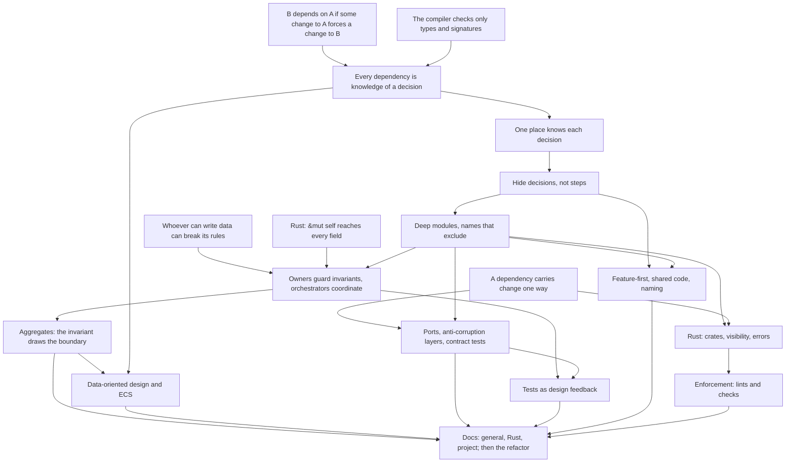

# Codebase architecture course

## Goal

Know where code goes in a project that doesn't fit a framework layout such as Rails' MVC. Design
patterns are out of scope, since he knows them. Topics he named: domain-driven design,
data-oriented design (his meaning) and data-driven design (also applicable), ECS for the Bevy front
end, wrapping third-party libraries, ports and adapters, and test-driven development.

The deliverable is `docs/conventions/file-structure.md`, one doc with three sections: general
guidance, Rust guidance, and this project's rules. It comes with lint rules wherever a tool can
check a rule, and the `rules` crate refactored to follow it. The general and Rust sections should
hold for his work too: critical finance services in Rust, Python and TypeScript, after years of
Rails. Reuse outside this repo is a nice-to-have. He copies the sections out by hand if they hold
up.

## How sessions work

- Teaching follows the `teach` skill, `.agents/skills/teach/SKILL.md`.
- One pi session per course session. Start with `/new`, `/name NN-topic`,
  `/md-log docs/course/architecture/sessions/NN-topic.md` (the file must exist first), then
  "continue the architecture course".
- Every session opens with a short retrieval quiz on the previous session's nodes, unless he did
  that session just before.
- Roles. He learns the concepts and makes every decision about the rules. The agent drafts the docs
  and the lint rules, and does the refactor. He reviews all of it before it's committed.
- Each node ends with a production exercise: he draws a split on real code with no options offered.
  When a node settles, he states the rule and the agent drafts it into the doc section it belongs
  to. The doc grows one node at a time.
- A derivation step is asked open-ended, in plain text, and he answers in his own words. Options let
  him get there by elimination (session 01). Quizzes are for checks whose wrong options are
  mistakes he could really make.
- No new card game features for this course. A concept with no problem in today's code becomes an
  open thread and waits until the card game course creates the problem.
- General and Rust concepts come first, the project section and the refactor last. The refactor PRs
  already open are drafts. Each is reviewed after the node it exercises, then merged, reworked or
  closed. The open threads say which node each one waits for.
- End at a node boundary, not mid-node. Commit once per node.

## Knowledge map

### Session 01

Probe, all right on real code: a dependency with no call (the in-play rule, the meaning of
`order`), check then apply as a split by steps, `Game` deep outside with no inner boundaries, and
`queries.rs` as a vague name. His note on the naming question: he applied the rule from session
00 "but I am not sure why or where it came from". So recognition holds on these strands, and the
edge is deriving the rules and producing with them.

Taught: the definition of a dependency (Page-Jones), the compiler checks only types and
signatures, every dependency is knowledge of a decision in formal or informal form, one place
knows each decision. Both rules are in `file-structure.md`, in his words, edited.

- Replays: he said they depend on the generator being seedable and repeatable. Corrected: they
  depend on the exact sequence, so a swap to another repeatable generator breaks them too.
- `Location` card kind: he thought `Game::health` uses a `match`. It's `Binder::health` that does;
  the in-play test uses `is_hero` and `is_minion` booleans.
- Decision inventory, no options, 22 minutes: three decisions, all about ordering or state.
  Reactions resolve above the card's own effects; a pick happens only while idle; an `ObjectId`
  always resolves. Missed `kill` as a third holder of the first, and the resolution loop's
  `!is_pending_interaction()` as what makes the second true. Judged formal versus informal by
  "could `insert` have a bug", not by "does the compiler check it".
- One place exercise, 15 minutes: chose a command over a query, and unprompted set one command
  that pushes and emits against a token that makes the order formal, noting that the token leaves
  the knowledge in every caller. Missed that `kill` pushes every death rattle before any `Died`,
  so a per-object helper would change the order of simultaneous deaths.
- His rule edits: tests also find informal breakage; informal knowledge is cheap inside a module;
  no example where it isn't practical; "still knows the decision".

### Session 00 probe

Background: deep Rails, so "where does this go" was always answered by the framework's layer-first
layout. His Game Boy Color emulator has the same god struct (`App`) as `Game` here.

Pain points he picked: splitting a growing module, code two features share, layer-first vs
feature-first, naming. In his own words: what should be its own module; splitting data from
behavior without OOP leaves "very small data structs with the full state and every behaviour on a
single super struct"; visibility once a module spans several files, where he either promotes it to
a crate to see the boundary or ends with `pub(crate)` everywhere.

Probe results:
- Rust visibility: solid. `pub(super)` reaches the parent's whole subtree, and he picked the facade
  setup (private `mod`, `pub(crate) use` re-export, `pub(super)` helpers). His note: the gap is
  "general concepts from the literature", not syntax.
- Information hiding: diagnosed the `game/` split at once (every file reads `Game`'s fields, so the
  files hide nothing from each other). Deep modules: right, had heard the idea, not the book.
- DDD: "I don't know" on aggregates (his note: object graph and use case both "could make sense").
  Recognized the bounded context but picked "I don't know" because he "could not come with a
  similar answer on my own". Anti-corruption layer was new as a term.
- Ports and adapters: right, with the reason ("deps point inwards and the core does not depend on
  stack code"). Errors in the port's terms: right. His note raised the coupling between core
  variants and `sqlx` errors; answered as one-way semantic coupling that the core's needs drive.
  Contract tests: right by reasoning, never heard of them.
- Wrapping libraries: my first question was ambiguous (re-exported vs owned mirror structs) and was
  regraded. The clear version was right: owned copies absorb syntax changes, not model changes.
- Feature-first: right on a facade between features. ECS: right on declared access, grouping by
  access pattern (his note: "what changes together stays together") and a single writer. He
  pushed back, correctly, that my first ECS question tested the mechanism, not how to organize
  components and systems.
- Naming: placed `can_attack` in `lookup.rs` by a rule from the contents ("lookup is derived
  information of the objects"). Regraded: his rule is good, but it lives in his head, not in the
  names, and `fulfill_character_filter` (also derived from objects) sits in `condition.rs`.
- Tests and structure: right that setup pain is design feedback (a narrower signature).

The edge is production, not recognition. Asked to break up `Game` with no options (10 minutes):
`Rng` apart (not card-game specific), `Binder` apart (immutable), and he rejected a `GlobalState`
of `TurnOrder` and `Outcome` because it doesn't deepen anything. All three are sound. He stalled on
a resolution module: owning `effect_stack` and `resolving_effect` seemed to require access to
`binder`, `objects`, `outcome` and `players`, so the interface looked huge. Two beliefs block him:
a module must own every behavior that touches its data, and a method on a small struct such as
`Player` makes it "an object rather than data". He also feared delegation boilerplate on `Game`.

## Course plan

Two roots carry the course. Every dependency is knowledge of a decision, and whoever can write data
can break its rules. Each guideline is derived from them so he can apply it to cases no doc
anticipated. Socratic teaching, quiz checks, and a production exercise per node.

1. Sessions 01 and 01a: coupling as shared knowledge, one place per decision, hiding decisions
   (Parnas), depth (Ousterhout), names that exclude. Material: the `game/` split, the
   `lookup`/`condition` drift. 01a opens with Parnas (a module built around a decision, the KWIC
   example, check then apply), then depth with the formal and informal interface, then names that
   exclude, then the review of #10, #13, #14 and #15.
2. Session 02: ownership. An owner guards its invariants and an orchestrator coordinates owners;
   encapsulation vs OOP; aggregates (Evans, Vernon). Catherine West's nuance: one big state is
   fine, implicit reach and unowned invariants are the problem. Open with his own question: does
   the module owning `effect_stack` and `resolving_effect` need to apply effects, or only decide
   which comes next?
3. Session 03: data-oriented design and ECS organization (component granularity, single writer,
   plugins per feature), and the rules core beside Bevy (elevator-core's bridge).
4. Session 04: ports, anti-corruption layers, errors at the port, contract tests, tests as design
   feedback.
5. Session 05: feature-first vs layer-first, shared code (CCP, Metz vs Ousterhout's repetition),
   naming.
6. Session 06: Rust layer (a crate is Martin's package, visibility as enforcement, the borrow
   checker and layout, errors near their unit of fallibility) and enforcement tools.
7. Session 07 on: the project section and the rest of the refactor.

## Open threads

- The refactor PRs, a stack of nine on main, are drafts. Each waits for its node's review, and they
  merge bottom-up, so an approved PR also waits for the ones below it. Rebasing waits until then.
  - Session 01a: #10 loader split, #13 `game/` split by question, #14 one walk over card text, #15
    card definitions answer their kind questions.
  - Session 02: #16 history private, #17 guarded effect stack, #18 modifiers answer stat questions.
  - Session 05: #11 printed card types in `cards/`.
  - Session 06: #9 clippy ban by public path.
- The Rust section of `file-structure.md` started early with "Making knowledge formal". Session 06
  extends it.
- "Own effects resolve after the reactions they cause": his design is one command next to the
  resolution loop, taking the whole batch, since `kill` pushes every death rattle before any
  `Died`. Compare it with #17 at that PR's review in session 02.
- For the teach skill: ask derivation steps open-ended, not as a quiz, since options let him
  eliminate. Propose the edit to him for review.
- `fulfill_character_filter` is half narrow already: the side check is a free function in
  `cards/filter.rs`, while the kind check goes from object to definition to `binder`. Material for
  sessions 02 and 04.
- One damage function (card-game open thread: fatigue bypasses `Game::damage`) is the single-writer
  idea. Session 02 or 03.
- Error placement: `ApplyError`, `CardDefError` and the loader's validation errors, against Sabrina
  Jewson's "near their unit of fallibility". Session 06.
- Quotes flagged secondary in `research/00-scope/literature.md` and
  `research/01-coupling-and-hiding/sources.md` (Ousterhout's book text, GOOS ch. 20, Acton,
  Page-Jones's later books) need checking before being quoted as exact. Unverified Rust items:
  Cargo's crate-cycle ban, and scoping `clippy::disallowed_*` to one module with `#[allow]`. Verify
  before session 06 teaches them.
- Bevy names changed since 0.17: buffered events are `Message`s, `Event` is for observers, 0.20 is
  current. Use these names in session 03.

## Dependency map

## Sessions

| # | Nodes | Topic | Status |
|---|-------|-------|--------|
| 00 | probe | Knowledge probe and plan | done (edge is production, not recognition; aggregates a gap; plan and doc layout agreed; three research reports) |
| 01 | U1, U2, R1, OP | Coupling as shared knowledge, one place per decision | done (recognition solid, edge is deriving; two rules in `file-structure.md`; PRs made drafts) |
| 01a | H, D | Hiding decisions, depth, names that exclude; review #10, #13, #14, #15 | next |
| 02 | R2, R4, O, A | Ownership and aggregates: untangling the god struct | |
| 03 | DOD | Data-oriented design, ECS organization, the rules core beside Bevy | |
| 04 | R3, P, T | Ports, anti-corruption layers, contract tests, tests as feedback | |
| 05 | F | Feature-first, shared code, naming | |
| 06 | RS, E | Rust layer and enforcement | |
| 07+ | DOCS | Project section and the rest of the refactor | |
