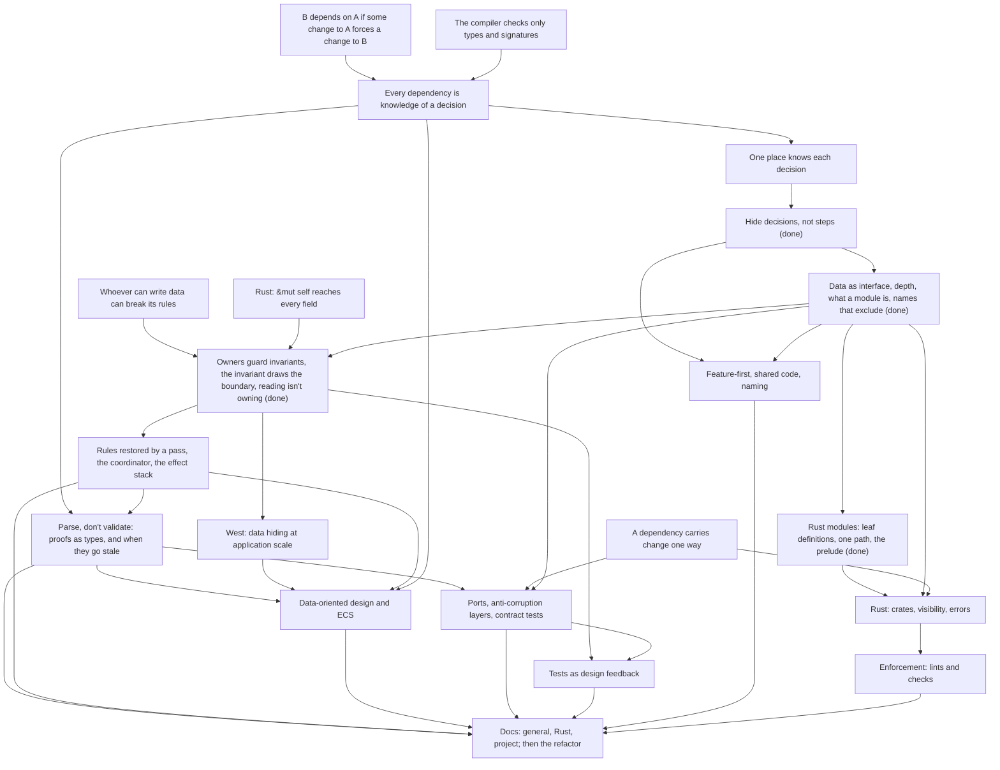

# Codebase architecture course

## Goal

Know where code goes in a project that doesn't fit a framework layout such as Rails' MVC. Design
patterns are out of scope, since he knows them. Topics he named: domain-driven design,
data-oriented design (his meaning) and data-driven design (also applicable), ECS for the Bevy front
end, wrapping third-party libraries, ports and adapters, and test-driven development.

The deliverable is `docs/conventions/file-structure.md`, one doc with three sections: general
guidance, Rust guidance, and this project's rules. It comes with lint rules wherever a tool can
check a rule, and the `rules` crate refactored to follow it. The general and Rust sections should
hold for his work too: critical finance services in Rust, Python and TypeScript, after years of
Rails. Reuse outside this repo is a nice-to-have. He copies the sections out by hand if they hold
up.

## How sessions work

- Teaching follows the `teach` skill, `.agents/skills/teach/SKILL.md`.
- One pi session per course session. Start with `/new`, `/name NN-topic`,
  `/md-log docs/course/architecture/sessions/NN-topic.md` (the file must exist first), then
  "continue the architecture course".
- Only the first session of a topic (02, 03, not 02a) opens with a short retrieval quiz. It may ask
  about any earlier session's nodes, such as 01 to 01e and 02 to 02e for 03. Skip it when he did
  the previous session just before.
- Roles. He learns the concepts and makes every decision about the rules. The agent drafts the docs
  and the lint rules, and writes the refactor tickets. He reviews all of it before it's merged.
- Each node ends with a production exercise: he draws a split on real code with no options offered.
  When a node settles, he states the rule and the agent drafts it into the doc section it belongs
  to. The doc grows one node at a time.
- A derivation step is asked open-ended, in plain text, and he answers in his own words. Options let
  him get there by elimination (session 01). Quizzes are for checks whose wrong options are
  mistakes he could really make.
- No new card game features for this course. A concept with no problem in today's code becomes an
  open thread and waits until the card game course creates the problem.
- General and Rust concepts come first, the project section last. Draft PRs closed in 01e get
  redone after the node that reviews them. The open threads say which node each one waits for.
- After each node, the agent audits the crate against the doc as it stands, with no code changes.
  He reviews the list, and the findings go in the open threads. An audit is one pass and needn't
  find everything, since refactors surface the rest (his call, 01d). Auditors get the card-game
  course plan and open threads as the roadmap, since the repo has none.
- The refactor runs while the knowledge is fresh (his call, session 01a, revising his first pick of
  refactoring at the end). After a teaching session, a refactor session turns the findings whose
  home its nodes settle into tickets: `docs/issues/<effort>/`, with a `spec.md` every agent shares
  (his call, 01e). Findings whose home depends on a later node wait for it.
- AFK agents work the tickets, one PR each. They review their work with subagents in a loop and
  state their intentions in the PR body. He checks the intentions against the code and merges. A
  choice of theirs he disagrees with marks a gap in the convention docs, which goes back into the
  doc (01e).
- End at a node boundary, not mid-node. Commit once per node.

## Knowledge map

### Background

- Years of Rails, where the framework's layer-first layout always answered "where does this go". His
  Game Boy Color emulator has the same god struct (`App`) as `Game` here (00).
- Pain points he named: what should be its own module, "very small data structs with the full
  state and every behaviour on a single super struct", and visibility across files, where he
  promotes a module to a crate or ends with `pub(crate)` everywhere (00).
- Across strands, recognition is solid and production with no options is the edge. He finds spread
  knowledge reliably but misses some of its holders (00, 01, 01a, 02).

### Coupling and hiding decisions

- Holds dependency as knowledge of a decision, formal or informal, and one place per decision.
  Recognized a dependency with no call, check then apply as a split by steps, and `Game` as deep
  outside with no inner boundaries before being taught (01). Authored the locality rule for
  informal knowledge, correcting a framing of "place" as undefined, and added that an order
  forced by a data dependency is formal (01d).
- Derived Parnas unaided: list the decisions, build around the likely to change, and why steps
  leak ("the step code ceases to exist and only the representation is kept alive"; a check
  predicts the act, so it copies its rule) (01a). Resolved his boss's "every decision is likely to
  change" as: an interface is made of decisions too, so something must be bet stable. Judges
  likelihood by domain reasoning; git history is rarely useful to him.
- Prefers one command that takes knowledge away from callers over a token that makes an order
  formal, unprompted (01).
- Raised "parse, don't validate" himself, with `ObjectId` in hand vs in play (01a).
- Edge: inventories miss holders and guards. Missed `kill` as a third holder of reaction order,
  the resolution loop's `!is_pending_interaction()` as what makes "pick only while idle" true,
  and that `kill` pushes every death rattle before any `Died`, so a per-object helper would
  reorder simultaneous deaths (01). Missed that a new `CardDef` field is informal for the
  validator walk (01a).
- Edge: producing the hiding interface. In the validator exercise he named the card text's shape
  as the decision but missed the live gap until pointed at it, and his first proposals mirrored
  the shape (`Binder`-style accessors, a flat `get_effects` losing sequences, storage labels such
  as aura) or went against his own stability filter (a DI trait for stable rules). His payload
  idea was sound (01a).
- Could come back: judging formal vs informal by "could this have a bug" instead of "does the
  build catch it" (01). Replays: thought they need only a seedable, repeatable generator, not the
  exact sequence (01).

### Interfaces, depth and modules

- Diagnosed at once that the `game/` files hide nothing from each other, and knew deep modules
  as an idea, not the book (00). Right on informal contracts in an interface (`health`'s `Some`
  for characters in play) and on judging conjoined helpers by independence, not length (01b).
- Holds data as interface, including what it means and parameters (his addition), and depth as
  what callers no longer know: found the `entered_board` trade himself, callers swap a policy for
  a fact they already know (01b). Before D1 he weighed an interface by its methods and called
  `ObjectBag` deep despite `get_mut`.
- Holds the module definition as one decision behind an enforced boundary; "cannot be copied from
  outside" is his addition (01b). Rejected a definition that depends on the reader's capacity.
  Holds that a rule over public data can be copied, so `loader` wasn't a module, and that files of
  only public types hide nothing (01d). Noted that `object.rs` holds two decisions and hides one.
- File or module: mana pays, outcome doesn't (one writer, `set`/`get` mirror the field); the
  effect stack qualifies only if its order goes inside (01b).
- Edge: draws the boundary around an entity or noun rather than a decision. His "Objects" module
  bundled triggers, modifiers and health and needed most of `Game`'s data, which he noticed
  (01b); he split `derived` by noun into Mana, Stats, Auras and Modifiers where the change test
  gives two (01c). The 02 location owner was drawn by an invariant, so this may be fading.
- Could come back: claimed files can hide data (01b), and misread `Game::health` as the `match`
  on card kind, which lives in `Binder::health` (01).

### Ownership and invariants

- Probe right (02): all of `game/` can break `order` through `get_mut`, not just today's callers;
  `&mut self` at a call site; private `Player` fields; how much of `draw` goes in `Zones`, judged
  by the data each design forces the owner to hold. Unsure whether "being a big state is good or
  bad". Asked how a pass's call is enforced, how a reader gets its data, and for Matsakis's four
  workarounds. Often rewrites code because he can't read one field while writing another.
- Node 1, invariant to owner (Meyer): derived unaided, the interface as the boundary; quiz right
  (`mana_mut`), tied to "can't be copied from outside" (02).
- Node 2, the invariant draws the boundary (aggregates): derived that neither owner can keep order
  of play, that the guarantee is then informal in every caller, and "private write to that
  module". Quiz right, noun and action traps included. In the exercise he designed the location
  owner but missed `pick_targets`. Probe before it: "I don't know" on what makes data share an
  owner ("I think its 4 but I would not have come with it on my own") (02).
- Node 3, reading isn't owning: right that `&self` can't write; proposed the lowest common
  ancestor unprompted; challenged "no data" against a method on `Game`, settled by the parent
  rule, `&self` hiding what it reads, and borrow pain. Quiz right (02).
- Edge: the reader-owns habit, "a decision lives with the data it reads". It made him put trigger
  matching in one owner of objects, zones and binder (02 probe), and say a reader inside an owner
  can't break it "as it only reads" (node 3). It traces to his 00 belief that a module must own
  every behavior that touches its data. Fixed in quizzes, not yet in production: the `emit`
  exercise is still owed.
- 00 beliefs, probably resolved: a method on `Player` makes it "an object rather than data", and
  fear of delegation boilerplate on `Game`.

### Names

- Holds names as exclusion: a name passes when a reader can tell from it alone whether a function
  belongs (01c). Quiz right (`turn` and `rules` fail), checking real functions himself. Added that
  "no name passes" can also mean one decision with no term yet. Raised himself that every parent
  fails the name test and the one-decision clause.
- Right on `verb` and `derived` failing, with `history_from_event` as a counterexample (01c).
- Edge: judging names by a proxy. First by a rule in his head, applied "but I am not sure why or
  where it came from" (00, 01); then by word category, picking `state_check.rs` as excluding least
  "because it is a step while the others are concepts" (01c); then by size and "unrelated", which
  passed `resolve` and `filter` and missed `scan_characters_with_filter` and `emit` (01c). Not
  tested since.

### Rust modules and visibility

- Visibility syntax is solid: `pub(super)` reaches the parent's whole subtree, and the facade
  setup (private `mod`, `pub(crate) use`, `pub(super)` helpers). His gap is "general concepts from
  the literature", not syntax (00). Holds the privacy direction: only a child's type hides fields
  from the parent (01b).
- Authored leaf definitions, tying layout to the module definition: "by keeping definitions only
  on leafs we make so modules are always capable of hiding their decisions" (01e). Set the goal of
  one path per definition and caught `lib.rs`'s re-exports as a second path; proposed the public
  API as one module banned from internal use (01e).

### Other architecture topics, probed only

- DDD: "I don't know" on aggregates (object graph and use case both "could make sense"), now taught
  as node 2. Recognized the bounded context but couldn't produce it. Anti-corruption layer was new
  as a term (00).
- Ports and adapters right, with the reason (dependencies point inward). Errors in the port's
  terms right; raised the coupling between core variants and `sqlx` errors. Contract tests right
  by reasoning, never heard of them (00).
- Wrapping libraries: owned copies absorb syntax changes, not model changes (00).
- Feature-first right on a facade between features. ECS right on declared access, grouping by
  access pattern ("what changes together stays together") and a single writer (00).
- Tests: setup pain is design feedback, pointing to a narrower signature (00).
- Asked what data-oriented and data-driven design say, and whether Parnas still holds (01a).

### How he learns

- Derives well from open questions and says "I don't know" when he couldn't have produced an
  answer alone, even if he'd recognize it (00, 02). Treat a right quiz as recognition only.
- Pushes back with concrete counterexamples, and is often right: nesting the zones module inside
  the coordinator (01c), `&self` can't write (02), `impl` files and tuple matches as doc additions
  fixing no shown gap (01d). Misreading his idea is a real risk (his payload idea, 01a).
- Phrasings that failed: an ambiguous wrapping question, an ECS question testing the mechanism
  instead of organization (00), "narrower than its data", which counted items, not knowledge
  (01b), and "place" framed as undefined (01d).
- Rule drafting: first drafts come by feel and sharpen in discussion (01b); he rewrites and
  rejects his own drafts (01d). Cuts wording that decides nothing, examples, and Rust terms from
  the General section (01c, 02). Rejects doc text that fixes no shown gap or is owned elsewhere.
- Wants research on convention questions, critical review of his own proposals even when he likes
  them (01e), and sources not taken as truths (West, 02).
- Timings: a decision inventory took 22 minutes, a one-place exercise 15, the validator follow-up
  about 10, and breaking up `Game` stalled at 10 (00, 01, 01a).
- In review he spots data that changes together (IDs and the table in #10, 01a) but can mix up
  which PR added which files.

## Course plan

Two roots carry the course. Every dependency is knowledge of a decision, and whoever can write data
can break its rules. Each guideline is derived from them so he can apply it to cases no doc
anticipated. Socratic teaching, quiz checks, and a production exercise per node.

1. Sessions 01 to 01c: coupling as shared knowledge, one place per decision, hiding decisions
   (Parnas, done in 01a), then in 01b data as interface, depth, what a module is and file or
   module, then in 01c names that exclude, nesting, and the #13 and #15 verdicts (done).
   Session 01d: the audit rerun in two rounds, the second with the roadmap (done). Session 01e:
   the refactor as AFK tickets, plus the Rust rules for module layout and paths (done).
2. Sessions 02 to 02e: ownership. 02 settled invariant to owner, the invariant draws the boundary
   (aggregates), and reading isn't owning (done). 02a: node 3's exercise, redrawing `emit`, then
   West's argument against data hiding at application scale, her real position in
   `verified-facts.md`, for him to judge against the doc. 02b: rules restored by a pass and the one
   module that runs it (Vernon's "whose job is it"), the coordinator (order of steps, no rules),
   and his question: does the module owning `effect_stack` and `resolving_effect` apply effects,
   or only decide which comes next? 02c: untangle `Game`, production with no options, then the
   audit. 02d writes the tickets: the untangling, the findings, and #16, #17 and #18 redone from
   their branches.
   Session 02e, its own node: parse, don't validate (Alexis King, 2019). A check's result carried
   forward as a type, not an assumption; who can build the proof, and when it goes stale. Material:
   `apply` checking `legal_actions` then `apply_action` relying on `expect` and `unreachable!`; an
   `ObjectId` in hand and one in play sharing a type, with `health`, `attack` and `mana_cost`
   returning `Option` on every call. He found the `ObjectId` case and finds its fix not obvious.
   Session 03 shows ECS queries as the ECS take on it, session 04 applies it at the boundary.
3. Session 03: data-oriented design and ECS organization (component granularity, single writer,
   plugins per feature), and the rules core beside Bevy (elevator-core's bridge).
4. Session 04: ports, anti-corruption layers, errors at the port, contract tests, tests as design
   feedback.
5. Session 05: feature-first vs layer-first, shared code (CCP, Metz vs Ousterhout's repetition),
   naming.
6. Session 06: Rust layer (a crate is Martin's package, visibility as enforcement, the borrow
   checker and layout, errors near their unit of fallibility) and enforcement tools.
7. Session 07 on: the project section and the rest of the refactor.

## Open threads

- Closed draft PRs, redone after their node from branches kept on the remote. Session 02d: #16
  history private (`history-private`), #17 guarded effect stack (`effect-stack`), #18 modifiers
  answer stat questions (`modifiers-stats`). Session 05: #11 printed card types in `cards/`
  (`cards-vocabulary`). #13 is closed for good (`game-by-question`); its visibility narrowing,
  `ApplyError` next to `IllegalAction`, and `History` and `Trigger` under `game` go into the PRs
  that build the real modules, unless he objects.
- Audit after D5 (session 01d), reviewed by him. It replaces the 01a list, whose reports stay in
  `research/01a-hiding-and-depth/`. Reports in `research/01d-audit/audit-1.md` to `audit-4.md`;
  3 and 4 had the roadmap. The refactor works from this list. 01a's numbers are in parentheses.
  Fixed in 01e: 3 (#28, with both hero bugs left as they were), 10 (#14), 11 and 23 (#10),
  14 (#15), 15 (#23), and 22 in part (#10; `CardDef` is still public, now through the prelude).
  1. `game` is one module holding about fifteen independent decisions. Child types with private
     fields; `game` keeps the coordinator. Session 02c.
  2. Death pass reports one death at a time, against ADR 0012: the Mourner bug, live (4). Filed
     on main as `docs/issues/dying-mourner-hears-older-death.md`.
  3. Characters in play computed in four or five places. One scan answers "all", random and draft
     candidates. A dead hero hears its own death twice; an eliminated hero stays a target (1).
  4. Order of play: `pub` stamp, five writers, three sorts, docstring against ADR 0012. Trigger
     order and death order are two questions (2).
  5. Effect stack order known at three push sites (3, #17).
  6. Draft walk copied in `legal_actions` and `can_finish_choices`; layout read in five places (5).
  7. `is_satisfied` answers "may stop" and "is full", so `AtMost` would offer no `Choose` (5).
  8. Mana check, payment and refill in three files; the glossary's Play split three ways (6).
  9. Resolution answers on `Object`; `pick_targets` never cleared; the validator accepts a reused
     pick ID (7, roadmap 06b).
  10. Validators walk card text by hand, missing `modifier_effects` and nested grants (8, #14).
  11. `loader` holds the card set, the IDs and validation; `Binder::new` stores unvalidated
      definitions (9).
  12. Validators copy resolution's rules: `Chosen` needs a draft, `ResolvePick` a `Reveal`.
  13. History recorded in `triggering.rs`, counted in `resolve.rs`, entries `pub` (10, #16).
  14. Card kinds: `is_*` combined in six places, kind filters copy `CardDefKind`,
      `has_deck_presence` asked as "goes to the graveyard". A new board kind panics in
      `find_dead` (11, #15).
  15. Trigger matching ends in `(_, _) => false` (12).
  16. Modifiers decided by four `_` filters (13, #18).
  17. Owner: `player_id` and the holding zone. Revealing from the enemy deck panics (14).
  18. Fatigue marks damage by hand, so damage triggers miss it. Card-game thread "One damage
      function".
  19. Interaction state decided with `_` arms in `view` and `pending_*`. 01a's three
      `unreachable!` sites weren't found again (15).
  20. Checkpoints at ten sites, two inside `play` (16, low).
  21. `ResolvingEffect`'s cursor is `pub`; its caller clones, then advances (roadmap 06b).
  22. `CardDef`, the loader and its errors are re-exported, unused outside the crate (low).
  23. Placeholder rule split between `definition` and `loader`, which import each other (low).

  Names every auditor failed: `game`, `cards`, `choice`, `ids`, `turn`, `cards::definition`,
  `cards::modifier` (not in the glossary), and `condition`, `lookup`, `resolve`, `triggering` and
  `zone_move` under `game/`. Split: `loader` (3 of 4, gone since #10); `filter`, `history` (not
  in the glossary) and `static_card_definition` (2 each); `effect`, `trigger` and `player` (1
  each). Names new since 01e, not audited: `binder/store`, `binder/sets/base`,
  `binder/validity`, `cards/sequences`, `prelude`.

  Routed elsewhere: ObjectIds name hidden cards (a card-game thread already). Board auras reach
  minions in every zone, the hand included (`lookup.rs:158`), a rules question for the card-game
  course.
- Doc feedback deferred to session 02: a decision with no data of its own, or one that needs
  another module's data (four auditors), answered in 02 by "a decision that combines several
  owners' data gets its own module with no data". Procedure versus domain order, and checkpoints
  (two), wait for 02b.
- The location owner (session 02, node 2), for 02c: one owner across all players holding the hero,
  hand, deck, board, graveyard, a pending pick's revealed cards and the entry order, behind one
  move command. It replaces `Object.order` and the three sorts (finding 4) and settles finding 17's
  holding zone. `pick_targets`, `choice_targets`, and `PendingPick`'s `source` and `pick_id` are
  resolution context, not object or player data (extends finding 9), for 02b.
- `check_state` is `pub(crate)` with two calls in `resolve.rs`; one module should decide when the
  pass runs. He asked how a pass's call is enforced. Session 02b.
- His `verb.rs` design (session 01c), for sessions 02a to 02c: a zones module owning
  the zones, the stamps and in-zone order behind moves such as `deck_to_hand` (maybe deepening
  `zones.rs`); a damage module, with fatigue calling it; and an intermediate coordinator for the
  consequences of a move (events, pushes, their order), with the zones module as its child so
  only it can move cards. Open: `emit` needs most of `Game`, so the coordinator would hand events
  back or take an emitter. Needs a name; "actions" collides with the glossary.
- The `derived.rs` split: by the change test, stats and cost with `modifiers` are one decision
  with no term yet (#18's bet), and auras are another. He proposed four noun modules.
- His D4 exercise ideas, for session 02c or later: a builder for `Game` creation, so callers
  know only what they set (check the card-game roadmap for N players first). His `Board` entry
  order became the location owner above. His "Objects" module is the modifiers question of #18,
  session 02d.
- `Binder::get` kept handing out `&CardDef` in #15, my call when he left the tickets to me: every
  interpreter reads card text as data (ADR 0004), and accessors would mirror the fields. Revisit
  if he disagrees, at the latest in session 04 with finding 22.
- Exhaustive destructuring (a struct pattern with no `..`) for functions that must visit every
  field: #14's walk in `cards/sequences.rs` uses it, per his 01a verdict. Adding it to the Rust
  list is still his decision. The enforcing clippy lint is nightly only. See
  `research/01a-hiding-and-depth/exhaustive-destructuring.md`. Session 06 at the latest.
- `Event` and `Observer` collide with names in Bevy 0.20's prelude. Named prelude imports keep
  that a nuisance, not an error. Renaming is a domain call for the Bevy session (03); `Viewer`
  is taken in the glossary. See `research/01e-module-layout/prelude-review.md`.
- Local variable names: he disagreed with some of the agents' names in 01e, and no convention
  covers them. Session 05, with naming.
- rust-analyzer ranks paths through `prelude` last only in builds since 2026-04-26. Before then,
  auto-import suggests `crate::prelude::X`, and `check::paths` catches it.
- The "several filters decide together" sentence sits in the Rust section; he isn't sure
  `file-structure.md` is its home. Revisit in session 06.
- The Rust section of `file-structure.md` started early with "Making knowledge formal", and 01e
  added "Modules" (leaf definitions) and "Paths" (one path, the prelude). Session 06 extends it
  with crates, errors and enforcement.
- "Own effects resolve after the reactions they cause": his design is one command next to the
  resolution loop, taking the whole batch, since `kill` pushes every death rattle before any
  `Died`. Compare it with #17 at that PR's review in session 02d.
- For the teach skill: ask derivation steps open-ended, not as a quiz, since options let him
  eliminate; size each production exercise to one invariant or one decision, since 01c's names
  exercise and 02's owners exercise were too big. Propose the edits to him for review.
- `fulfill_character_filter` is half narrow already: the side check is a free function in
  `cards/filter.rs`, while the kind check goes from object to definition to `binder`. Material for
  sessions 02c and 04.
- One damage function (card-game open thread: fatigue bypasses `Game::damage`) is the single-writer
  idea. Session 02c or 03.
- Error placement: `ApplyError`, `CardDefError` and the loader's validation errors, against Sabrina
  Jewson's "near their unit of fallibility". Session 06.
- Quotes flagged secondary in `research/00-scope/literature.md` and
  `research/01-coupling-and-hiding/sources.md` (Ousterhout's book text, GOOS ch. 20, Acton,
  Page-Jones's later books) need checking before being quoted as exact. Unverified Rust items:
  Cargo's crate-cycle ban, and scoping `clippy::disallowed_*` to one module with `#[allow]`. Verify
  before session 06 teaches them. Verified in 01e: `disallowed_types` bans an item at every path,
  so it can't ban one path.
- Bevy names changed since 0.17: buffered events are `Message`s, `Event` is for observers, 0.20 is
  current. Use these names in session 03.

## Dependency map

## Sessions

| # | Nodes | Topic | Status |
|---|-------|-------|--------|
| 00 | probe | Knowledge probe and plan | done (edge is production, not recognition; aggregates a gap; plan and doc layout agreed; three research reports) |
| 01 | U1, U2, R1, OP | Coupling as shared knowledge, one place per decision | done (recognition solid, edge is deriving; two rules in `file-structure.md`; PRs made drafts) |
| 01a | H | Hiding decisions, not steps; audit; review #10, #14 | done (derived H unaided; rule in `file-structure.md`; audit in two rounds, doc amended; #10 and #14 to rework; refactor moved to run per node) |
| 01b | D1 to D4 | Data as interface, depth, what a module is, file or module | done (edge was data handed out; module defined as one decision behind an enforced boundary; two rules in `file-structure.md`; D5 onward split off) |
| 01c | D5 | Names that exclude; review #13, #15 | done (edge was sorting names by word category; name and nesting rules in `file-structure.md`, project section started; #13 close, #15 light rework; Binder in the glossary; audit split off) |
| 01d | audit | Audit against the doc as it stands; his review of the findings | done (two rounds, roadmap in the second; locality replaces "cheap", decisions that change together count as one, files of public types; 23 findings replace the 01a list) |
| 01e | refactor, RM | Refactor as AFK tickets; Rust module layout and paths | done (seven tickets merged, intentions matched the code; findings 3, 10, 11, 14, 15, 23 fixed; leaf definitions and one path per definition through `prelude.rs` in `file-structure.md`, enforced by Clippy on Rust 1.99 and `check::paths`; #11, #13, #16 to #18 closed) |
| 02 | R2, R4, O | Ownership: invariant to owner, the invariant draws the boundary, reading isn't owning | done (edge was deriving what makes data share an owner, and the reader-owns habit; three rules in General and one in Rust in `file-structure.md`; location owner designed; West's real position researched; exercise too big again) |
| 02a | O exercise, W | Redraw `emit`; West's argument against data hiding | next |
| 02b | C | Rules restored by a pass, the coordinator, his effect stack question | |
| 02c | untangle, audit | Untangle `Game`, no options; audit against the doc | |
| 02d | refactor | Tickets: the untangling, the findings, #16 to #18 redone | |
| 02e | PDV | Parse, don't validate: `apply` and `legal_actions`, `ObjectId` by zone | |
| 03 | DOD | Data-oriented design, ECS organization, the rules core beside Bevy | |
| 04 | R3, P, T | Ports, anti-corruption layers, contract tests, tests as feedback | |
| 05 | F | Feature-first, shared code, naming | |
| 06 | RS, E | Rust layer and enforcement | |
| 07+ | DOCS | Project section and the remaining refactor | |
