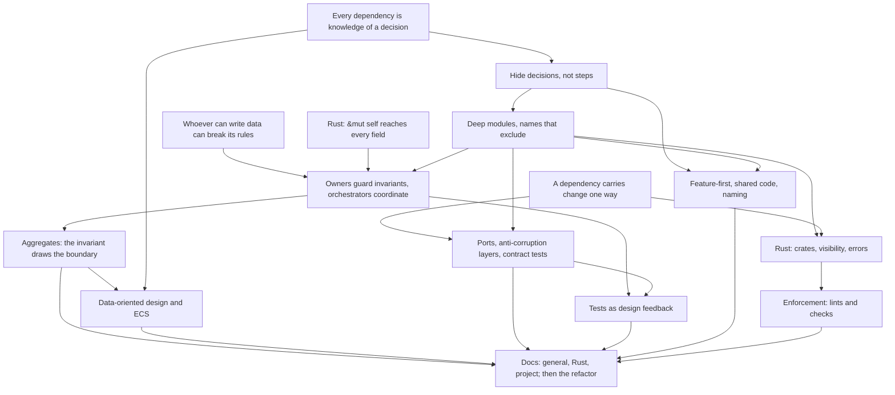

> [!quote] YOU

> [!note] SKILL loaded: teach

rn we are on the middle of learning about making a card game, but I would like to take a detour to learn about another topic on this codebase, can the skill handle the two? I want to learn more about on how to properly organize projects and file structures, basically codebase architecture but not focused on patterns as I think I understand then fairly well, I have dificulties with non-stardard projects where I cannot simply use MVC, subjects that may help here: domain driven design and data driven design, maybe ecs as this project will later use bevy, dependency wrapping, ports and adapters, test driven development, the goal here is to end up with a doc "file-structure.md" that would have guidelines on exactly where to put code, maybe some lint rules too, maybe more than one file if we decided it makes sense, and the project refactored to follow those standarts, I think we should not create new card game features for this, if we reach a point where there are concepts we cannot apply because the codebase does not have it as a problem I will advance with the card so more problems arise, I am pretty sure there are quite a few things to fix on current code tho, I would like what I learn to also be applicable to my work where I handle critical finance infrastructure, authoring services with thousands of users and moving hundreds millions of dolars weekly where nothing but the highest standards are acceptable, and to other rust projects, I am thinking we design the documents in a way that is clear what is general guidance, rust specific ones, and this project specific, the goal here is to learn the concepts so IA will be doing all the mechanical work

> [!abstract] PI

Yes, with one adjustment.

The teach skill's method isn't specific to card games. Probe, plan, teach, unconditional truths first, motivated discovery and quiz checks will work for architecture the same way they worked for triggers.

The bookkeeping is the problem. The skill's "Recording" and "Ending a session" sections write to `docs/course/COURSE.md`: its knowledge map, its sessions table and its next log. COURSE.md's "How sessions work" also sets the exercise roles: you write the design-bearing code and I write the tests. This detour has a different goal and a different split. You learn and decide, I write the docs and do the refactor, and you review.

Two decisions come first because they decide where things are stored.

1. **Where the detour's course state lives.**
   - a. A second course in `docs/course/architecture/`, with its own `COURSE.md` (goal, roles, knowledge map, plan, sessions table) and its own `sessions/`. The skill's close-out would then say "the active course's COURSE.md" instead of a fixed path, which is a two-line edit. I'd pick this. Each goal gets its own file, and the current COURSE.md is already 350 lines about card games.
   - b. A track inside the current COURSE.md, with sessions numbered `X1`, `X2`. The skill doesn't change, but two goals and two role splits share one file. The close-out would also have to know which knowledge map to update.

   Either way, the two maps link where they overlap. The card course's map already records habits that count as architecture findings: one fact computed in two places, and structure for cases no test reaches.

2. **Where the general and Rust layers live.** You want them at work and in other Rust repos, but `docs/conventions/` only governs this repo. One option is to write all three layers here and copy two of them out later. The other is to put the general and Rust layers somewhere every repo reads, like `~/.agents/skills/`, and keep only the project layer here. This can wait until the plan, but it decides how the doc splits, so I'm raising it now.

Interleaving works the way you describe. If a concept has no problem in this code to apply to, it becomes an open thread in the detour plan and waits until the card course creates that problem.

Two practical points:
- COURSE.md says your refactor PRs land before 06b. If any are still unmerged, a refactor of the file layout will conflict with them, so they should merge first.
- If you want this session logged, I'll create the log file once you've picked a location in 1. Then you run `/md-log <path>`.

After that comes the probe. I'll quiz you on each strand the lesson depends on: dependency direction and module boundaries, ports and adapters, DDD's bounded contexts and aggregates, Rust's module and visibility rules, test seams, and ECS. Then I'll ask a few questions to make the goal concrete. I already need to clarify one term. "Data driven design" can mean two different things:
- **Data-oriented design** arranges data around how the code processes it, which is why ECS stores components in arrays. Mike Acton and Richard Fabian are the usual references.
- **Data-driven design** defines behavior in data, which this course already does with cards.

I also need to know which languages your work services use, because that decides how language-neutral the general layer has to be.

Which option do you want for 1, and are the refactor PRs merged?

> [!quote] YOU

1 a second course, not sure how to structure but maybe docs/course/{architecture|card_game} ? 2 write here and if I like the results I copy paste and modify where needed. refactor prs are being worked by another agents, nothing seriously big, I think looging is good as 00 no? I work with Rust, Python, ts frontend and have deep knowledge in ruby on rails. I think we dont need to avoid going into rust specific stuff, solving project specific stuff is also valuable, dont focus too much on the reutilization part is more of a nice to have. I think we should not go into too project specific stuff before the little refactors that another agent is doing land

> [!abstract] PI

Now the references: the card-game COURSE.md, the teach skill, CLAUDE.md, and the two convention docs.

> [!abstract] PI

The setup is done but not committed yet. Please review it first.

**New layout:**
```
docs/course/
├── card-game/      COURSE.md, verified-facts.md, sessions/, research/   (moved with git mv)
└── architecture/   COURSE.md, verified-facts.md, sessions/00-probe-and-plan.md
```
You wrote `card_game`, but I used `card-game` because every other doc and directory name here uses kebab-case.

**Edits that follow from the move:**
- **`CLAUDE.md`** now says there are two courses. "Every session" now reads the session's own `COURSE.md`, and is `card-game` unless the session says otherwise. That also covers the other agents doing refactors. The test-first paragraph now limits "I write the design-bearing code" to the card game course.
- **The teach skill** now works from the session's course directory, which is the one its log sits in. That affects the verified-facts lookup, the close-out edits, the commit file list and the next-session commands, which now say "continue the card-game course" or "continue the architecture course".
- **`skills-and-docs.md` and `testing.md`** have their paths updated to the per-course layout.
- **The card-game `verified-facts.md`** has its 19 links to `research/` updated.
- **The old session logs** are untouched because logs are never edited, so their few internal links to the old paths are now stale.
- **`architecture/COURSE.md`** holds only the goal, the roles and the sessions table for now. The knowledge map and the plan come after the probe.

A grep finds no other references to the old paths outside the logs.

**Merge risk:** if another agent's branch edits `docs/course/COURSE.md`, git's rename detection should carry the edit over to the new path when it merges. A conflict is unlikely but possible.

To log this session, run:
```
/md-log docs/course/architecture/sessions/00-probe-and-plan.md
```
It backfills the whole conversation so far.

**Your answers, as I've applied them:**
- General and Rust concepts come first.
- Project-specific work waits for the refactor PRs.
- Reuse outside this repo is a side benefit.

Your Rails background helps here. Rails answers "where does this go" for you, and much of this course is learning to answer it when no framework does.

**Next, the probe.** I'll start with a few questions to pin down the goal. I still need to know which "data driven design" you mean, and what you mean by "dependency wrapping". Then come the quizzes on each strand. Tell me once you've linked the log and whether the diff looks good. I'll commit the move as its own commit after your OK.


> [!quote] YOU

instead of editing that there are two courses everywhere just write a README.md on course/ with this information, wdyt?


> [!abstract] PI

Agreed. That's the doc rule here: one owner per concept, and the other docs point to it in one line. There's a limit, though. The old path `docs/course/COURSE.md` no longer exists, so every file that named it still needs a pointer. What changes is what those pointers say. They point to the README instead of each describing two courses, and a third course would only touch the README.

I also caught a bug of mine while doing this. The teach skill said a session's course is "the one its log sits in", but I can't see `/md-log`'s path, so that rule would never work. The README now uses the opening message ("continue the architecture course") instead.


> [!abstract] PI

I agree, and it's done (uncommitted). `docs/course/README.md` now lists the two courses and says which `COURSE.md` a session reads. A session's opening message names its course, and a session that names none reads `card-game`.

It doesn't remove every edit. The old path `docs/course/COURSE.md` no longer exists, so each file that named it still needs a pointer. What changed is what those pointers say. They point to the README instead of describing both courses, so adding a third course would only touch the README.

I also fixed a mistake of mine along the way. The teach skill used to say a session's course is the one whose directory holds its log. That rule couldn't work, because I can't see the path you give `/md-log`. The skill now points to the README, which uses the opening message instead.

What's left in each file:
- **`CLAUDE.md`**: the intro and "Every session" point to the README. I also dropped "I write the design-bearing code, and you write the tests against my API" from the test-first paragraph. It restated the card game course's roles, which its `COURSE.md` already owns, and it's wrong for this course. Nothing is lost, but it's your text, so say if you want it back.
- **Teach skill**: one line points to the README. The close-out paths now use `<course>`.
- **`skills-and-docs.md`**: the Course section says there's one directory per course, listed in the README.
- **`testing.md`**: points to "the course's `COURSE.md`", and its References entry is now the README.

I left the title `# Card game systems course` in `CLAUDE.md` alone, since the repo is still that.

Once you've linked the log and you're happy with the diff, I'll commit the restructure on its own and start the probe.


> [!quote] YOU

I linked and happy


> [!question] Question
> When you wrote "data driven design", which did you mean?
>
> Two different ideas share almost the same name.
>
> Data-ORIENTED design (Mike Acton, Richard Fabian): lay data out by how the code processes it. Arrays of plain values grouped by access pattern, rather than objects that bundle data with behavior. ECS comes from this lineage: Bevy stores each component type in its own columns, and systems iterate over them. It shapes where code goes because data and the functions over it live apart.
>
> Data-DRIVEN design: behavior is defined in data that the code interprets, not hardcoded. This repo already does it with cards. `Effect` is the vocabulary in code, and a card's definition composes it.
>
> 1. Data-oriented design
> 2. Data-driven design
> 3. Both
> 4. Not sure, I heard the term


> [!example] Answer
> Other: It was Data-Oriented design but I did not know that there was this difference and I guess both are applicable


> [!question] Question
> What did you mean by "dependency wrapping"?
>
> Pick every reading you meant. They're related but answer different questions.
>
> 1. Wrap third-party libraries
> 2. Dependency injection
> 3. Dependency direction rules
> 4. Owning your dependencies


> [!example] Answer
> 1. Wrap third-party libraries


> [!quote] YOU

not that the other are usseles or that I dont know them, but that one is what I meant yes


> [!question] Question
> Which "where does this go" moments actually trip you up, in this repo or at work?
>
> Pick every one that gives you real trouble, not every one that sounds relevant. These set the priorities for the docs. Use Other for a moment that isn't listed, ideally with a concrete example.
>
> 1. Domain logic vs IO
> 2. Splitting a growing module
> 3. Code two features share
> 4. Cross-cutting types
> 5. Crate or package boundaries
> 6. Layer-first vs feature-first folders
> 7. Test code placement
> 8. Naming modules and files


> [!example] Answer
> 2. Splitting a growing module
> 3. Code two features share
> 6. Layer-first vs feature-first folders
> 8. Naming modules and files
> Other: modules, what should be its ows module and what should not. Spliting data from behaviour, I think I know how to not code rust as if it was OOP but then I get very small data structs with the full state and every behaviour on a single super struct like Game or App on my CGB emulator. How to properly handle visibility from module to module, when modules are single files it is fine but when they are not I normally split it into another crate so its easier to see the boundary or endup with things being pub(crate) accesible everywhere.


> [!question] Quiz
> In `crates/rules/src/game/condition.rs`, inside `impl Game { ... }`, the method `can_finish_choices` is declared `pub(super)`. Which code can call it?
>
> Module tree (simplified):
>
> ```
> crate
> ├── cards        (cards/mod.rs, cards/binder.rs, ...)
> ├── game         (game.rs, defines `pub struct Game`)
> │   ├── condition   (game/condition.rs: `impl Game { pub(super) fn can_finish_choices ... }`)
> │   ├── resolve     (game/resolve.rs)
> │   └── view        (game/view.rs)
> └── zones
> ```
>
> 1. `game.rs` only; sibling files such as `resolve.rs` cannot
> 2. Any module in the crate that imports `crate::game::Game`
> 3. `game.rs` and every module under `game/`, such as `resolve.rs`
> 4. Any module in the crate, because `Game` itself is `pub`


> [!success] Quiz — correct ✓
> Your answer: 3. `game.rs` and every module under `game/`, such as `resolve.rs`
> Correct answer: 3
>
> `pub(super)` means "visible in the parent module", here `game`. Rust visibility is inherited downward: anything visible in a module is visible in all of that module's descendants. So `game.rs`, `condition.rs`, `resolve.rs` and `view.rs` can all call it, and `cards` or `zones` cannot. A method's visibility is set by its own declaration and measured from the module that holds the `impl` block. Neither the type's visibility nor an import changes it.


> [!question] Quiz
> You split `zones.rs` into `zones/deck.rs`, `zones/hand.rs` and `zones/board.rs`. Helper functions in `deck.rs` must be callable from `hand.rs`, but not from `game`. `game` must still be able to use `Deck`. Which setup gives exactly that?
>
> Target:
> - `zones/hand.rs` can call `deck.rs`'s helpers
> - `game` can use `Deck`
> - `game` cannot call `deck.rs`'s helpers
>
> 1. Private `mod deck;` in `zones.rs`, helpers private `fn`, so siblings under `zones` share them
> 2. Private `mod deck;` in `zones.rs` plus `pub(crate) use deck::Deck;`, helpers `pub(super)`
> 3. `pub(crate) mod deck;` in `zones.rs`, with `Deck` and the helpers all `pub(crate)`
> 4. Move `zones` into its own crate, with `Deck` and the helpers all `pub`


> [!success] Quiz — correct ✓
> Your answer: 2. Private `mod deck;` in `zones.rs` plus `pub(crate) use deck::Deck;`, helpers `pub(super)`
> Correct answer: 2
>
> Note: I dont thing my gap is on rust syntax and instead is in general concepts from the literature
>
> `pub(super)` on the helpers makes them visible in `zones`, and so in every module under it, including `hand.rs`. Nothing outside `zones` sees them. The private `mod deck;` keeps outsiders from naming `zones::deck::...` at all, and the `pub(crate) use` re-export is the one door you choose to open for `Deck`. So `zones.rs` becomes the facade: its re-exports are the module's interface to the rest of the crate.
>
> `pub(crate)` everywhere leaks the helpers to `game`. A separate crate with `pub` helpers leaks them too, since `game` depends on that crate. A private `fn` is visible only in `deck` and its own children, not in sibling modules.


> [!question] Quiz
> The `game/` files split `impl Game` by topic: `condition.rs`, `lookup.rs`, `resolve.rs`, `state_check.rs`, `triggering.rs`, `zone_move.rs`. Judged by information hiding, what does this split achieve?
>
> `Game`'s fields are private, so only `game` and its descendants can read them:
>
> ```rust
> pub struct Game {
>     rng: Rng,
>     turn_order: TurnOrder,
>     players: Vec<Player>,
>     objects: ObjectBag,
>     binder: Binder,
>     history: History,
>     outcome: Option<Outcome>,
>     effect_stack: Vec<PendingEffect>,
>     resolving_effect: Option<ResolvingEffect>,
> }
> ```
>
> Fields each file reads directly:
> - condition.rs: `binder`, `objects`, `players`
> - lookup.rs: `binder`, `objects`, `players`
> - resolve.rs: `binder`, `effect_stack`, `history`, `objects`, `outcome`, `players`, `resolving_effect`, `rng`, `turn_order`
> - state_check.rs: `objects`, `outcome`, `players`
> - triggering.rs: `effect_stack`, `history`, `objects`, `turn_order`
> - zone_move.rs: `binder`, `effect_stack`, `objects`
>
> 1. A lot: the files only couple where one calls another's methods, and those calls are few
> 2. A lot: each file covers one topic, so each is cohesive and the topics are hidden from each other
> 3. Little for now: changing the methods from `pub(crate)` to `pub(super)` would make each file a real boundary
> 4. Little: every file reads `Game`'s fields directly, so a change to how a field is stored can reach any file


> [!success] Quiz — correct ✓
> Your answer: 4. Little: every file reads `Game`'s fields directly, so a change to how a field is stored can reach any file
> Correct answer: 4
>
> Information hiding (Parnas, 1972) asks which design decision each module hides from the rest. Here, each file can read every private field of `Game`. If `objects` changed from an `ObjectBag` to something else, `condition.rs`, `lookup.rs`, `resolve.rs`, `state_check.rs`, `triggering.rs` and `zone_move.rs` could all need edits. The files are chapters of one module, a table of contents, not boundaries.
>
> Method visibility doesn't fix that, because what crosses the files is field access, not method calls. `pub(super)` changes who outside `game` can call a method. It doesn't stop `resolve.rs` reading `self.objects`. Coupling through shared data counts as much as coupling through calls, and usually more, because it is invisible in signatures.


> [!question] Quiz
> In domain-driven design, what decides an aggregate's boundary?
>
> 1. The data that one use case reads and writes
> 2. An entity plus every object reachable through its references
> 3. The data that a business invariant spans, which must stay consistent within one operation
> 4. One table's rows plus the rows of the tables that point at it


> [!question] Quiz — I don't know
> Your answer: I don't know
> Correct answer: 3
>
> Note: I genually dont know, 2 and 3 could make sense to me
>
> Evans defines an aggregate as a cluster of objects treated as a unit for data changes, with a root as the only entry point. Vernon's rule of thumb is "model true invariants in consistency boundaries": the boundary is drawn around exactly the data a rule must check atomically. Everything else refers to other aggregates by ID and is allowed to be eventually consistent.
>
> Reachability makes the cluster grow without limit. A use case often spans several aggregates, which is why it is a poor boundary. Tables are a persistence detail, and the aggregate should decide the tables, not the other way round.


> [!question] Quiz
> In domain-driven design, what is a bounded context?
>
> 1. A boundary inside which one model applies and each term has exactly one meaning
> 2. An aggregate together with the services that operate on it
> 3. A layer of the application, such as the domain layer or the infrastructure layer
> 4. A deployable service that owns its own database and API


> [!question] Quiz — I don't know
> Your answer: I don't know
> Correct answer: 1
>
> Note: I think is 1 but I decided to click I dont know because I could not come with a similar answer on my own
>
> A bounded context is the boundary of one model and its ubiquitous language. Inside it, "account" or "card" means one thing. Across contexts the same word can mean different things, and that's expected: a payments context's "account" and a customer-support context's "account" are different models, and translation happens at the border.
>
> It is a language and model boundary, not a deployment unit. One service can hold several contexts, and a context can be split across processes, although in practice teams often align them. `docs/CONTEXT.md` is named after this idea: the repo declares itself one context, so it has one glossary.


> [!question] Quiz
> A payments core must record ledger entries, and today they go to Postgres. In ports and adapters, where does the `LedgerStore` trait live, and in whose terms is it written?
>
> Three pieces: the core (business rules), the Postgres adapter, and `main`, which wires them together. Assume each is its own Rust crate.
>
> 1. In the core, in storage terms such as rows and transactions; the Postgres crate implements it
> 2. In the core, in the core's terms; the Postgres crate depends on the core and implements it
> 3. In the Postgres crate, in storage terms; the core depends on it and calls the trait
> 4. In `main`, in neutral terms; both the core and the Postgres crate depend on `main`


> [!success] Quiz — correct ✓
> Your answer: 2. In the core, in the core's terms; the Postgres crate depends on the core and implements it
> Correct answer: 2
>
> Note: deps point inwards and the core does not depend on stack code
>
> The port belongs to the side that needs it. The core declares `LedgerStore` in its own vocabulary ("record this entry", "entries for this account"), and the Postgres crate depends on the core to implement it. The arrow points inward, so the core compiles and tests with no database crate at all. That's dependency inversion.
>
> If the trait lives in the adapter crate, the core depends on storage, which is the direction we're trying to avoid. `main` sits at the top and depends on everything, so nothing should depend on it. Declaring the port in the core but in storage terms (rows, transactions) keeps the arrow right but leaks the adapter's model into the core. The next adapter, such as an in-memory fake or an event store, then has to pretend to be SQL.


> [!question] Quiz
> The core's port is `trait LedgerStore { fn record(&self, entry: Entry) -> Result<(), E>; }`. What should `E` be?
>
> Requirements:
> - The core treats "this entry was already recorded" as success, because callers retry and a retry must be idempotent.
> - Any other failure is reported up, to be retried later.
>
> The Postgres adapter uses `sqlx`. It can see a unique-key violation, a timeout or a dropped connection.
>
> 1. A core-defined enum such as `AlreadyRecorded` / `Unavailable`, which the adapter maps `sqlx` errors into
> 2. `Box<dyn std::error::Error>`, so every adapter can return its own error type
> 3. `String` holding the driver's message, which the core matches on for "duplicate key"
> 4. `sqlx::Error`, so the core can inspect the exact database error code itself


> [!success] Quiz — correct ✓
> Your answer: 1. A core-defined enum such as `AlreadyRecorded` / `Unavailable`, which the adapter maps `sqlx` errors into
> Correct answer: 1
>
> Note: I think it is 1 but that is trick for me because there is some coupling here where for the core to see an error it must be able to happen on sqlx and for sqlx to return an error it must have to be previously created on the core
>
> Errors are part of the port, so they follow the same rule as the methods: written in the core's terms, with one variant per outcome the core reacts to differently. The adapter's job includes translation. A unique violation on the entry's key becomes `AlreadyRecorded`, and timeouts and dropped connections become `Unavailable`.
>
> `sqlx::Error` puts the arrow back outward, since the core now depends on the driver. `Box<dyn Error>` keeps the arrow right but erases the one distinction the core needs. Getting it back means downcasting to `sqlx::Error`, which is the same dependency hidden. Matching on a message string couples the core to the wording of one driver's errors. This is the most common way ports leak in practice: the method signatures are clean and the error type carries the adapter in through the back door.


> [!question] Quiz
> You have three `LedgerStore` implementations: Postgres, an in-memory fake used by the core's tests, and a new event-store adapter. How do you make sure all three honor "recording the same entry twice returns `AlreadyRecorded`"?
>
> 1. Core unit tests with a mock that returns `AlreadyRecorded` on the second call
> 2. One shared test suite, written against the trait, run once per implementation
> 3. An end-to-end test of the whole service against the production adapter
> 4. The trait's signature, since every implementation must return the core's error type


> [!success] Quiz — correct ✓
> Your answer: 2. One shared test suite, written against the trait, run once per implementation
> Correct answer: 2
>
> Note: honestly I never heard of this but it sounds so cool
>
> That's a contract test, also called a port test or role test: a function generic over `impl LedgerStore` that records an entry twice and asserts `AlreadyRecorded`, called from each adapter's test module. It pins the semantic part of the port, the part the compiler can't see. It's also what makes the in-memory fake trustworthy, because the fake passes the same suite as Postgres, so core tests that use it aren't testing a fantasy.
>
> A mock that returns `AlreadyRecorded` tests how the core reacts. It says nothing about whether any real adapter produces that error. An end-to-end test checks one adapter, and only the paths it happens to exercise. The type signature guarantees the error's type, not when each variant is returned.


> [!abstract] PI

That's a good sign. You reasoned your way to an answer from a concept you'd never heard of. Contract tests go on the list.

Next are folder layout and shared code, two of the pain points you picked.


> [!question] Quiz
> Feature-first layout: `payments/` and `refunds/` are sibling modules. Refunds needs to read a `Payment`. Which arrangement keeps the boundary meaningful?
>
> `Payment` carries payments' rules. Its status moves Pending to Settled to Refunded only through methods that `payments` controls. Refunds needs the amount and the settled status, and must trigger the transition to Refunded.
>
> 1. Merge both into one `payments/` folder, since any shared type means one feature
> 2. Move `Payment` into a `common/` module that every feature may import from
> 3. Copy the `Payment` struct and its methods into `refunds`, so the features stay independent
> 4. `refunds` uses only what `payments` exports from its facade, never its internals


> [!success] Quiz — correct ✓
> Your answer: 4. `refunds` uses only what `payments` exports from its facade, never its internals
> Correct answer: 4
>
> Feature folders don't forbid dependencies between features. They make each dependency go through a door the owner chose. `payments` exports what refunds may use, for example a read of amount and status plus a `refund(payment_id, ...)` operation that enforces the transition. The rule that Refunded is reachable only from Settled stays in one place.
>
> Moving `Payment` to `common/` separates the type from the rules that guard it, and `common/` tends to become a junk drawer every feature reaches into. Copying it creates two sources of truth that drift, which is your one-fact-in-two-places shape. Merging is sometimes right, but "any shared type" as the trigger would merge every feature into one, because features always reference each other's types.


> [!question] Quiz
> In John Ousterhout's "A Philosophy of Software Design", what makes a module deep?
>
> 1. It is nested several levels down, with submodules for each concern
> 2. It sits low in the dependency graph, with many modules built on top of it
> 3. Its interface is small compared with the functionality it hides behind it
> 4. Its code is split into many small functions that each do one thing


> [!success] Quiz — correct ✓
> Your answer: 3. Its interface is small compared with the functionality it hides behind it
> Correct answer: 3
>
> Note: never heard of it but have heard the deep module concept before
>
> Ousterhout pictures a module as a rectangle: the top edge is the interface, which is the cost every user pays, and the area is the functionality, which is the benefit. A deep module gives a lot of benefit for a small cost. Unix file I/O is his example: five calls (`open`, `read`, `write`, `lseek`, `close`) hide disks, caching, permissions and file systems.
>
> "Many small functions that each do one thing" is the opposite tendency, which he calls classitis. Each piece is shallow, and the interfaces between them add up to more complexity than they hide. Position in the dependency graph and nesting depth are unrelated to depth in his sense.


> [!question] Quiz
> In an ECS like Bevy, all state lives in one `World`, yet it doesn't become a god struct like `Game` or your emulator's `App`. Why?
>
> Example Bevy system:
>
> ```rust
> fn apply_poison(mut q: Query<(&mut Health, &Poisoned)>) {
>     for (mut health, poison) in &mut q {
>         health.0 -= poison.per_tick;
>     }
> }
> ```
>
> 1. The `World`'s fields are private, so systems can only go through `World`'s methods
> 2. Each system's signature declares the data it reads and writes, and it can touch nothing else
> 3. The `World` is split into one struct per entity type, each with its own methods
> 4. Systems are methods on components, so behavior is spread across the data types


> [!success] Quiz — correct ✓
> Your answer: 2. Each system's signature declares the data it reads and writes, and it can touch nothing else
> Correct answer: 2
>
> Note: bevy is magical to me their codebase architecture is genuinely impressive to me and I learned much from them already
>
> A god struct is a problem because each method on it can silently reach every field, so nothing tells you what a function depends on. An ECS flips it. Behavior is free functions, and each one declares its reach in its parameters: `apply_poison` touches `Health` and `Poisoned` and provably nothing else. Bevy uses those declarations to run systems in parallel, and they double as documentation of coupling.
>
> There's no struct per entity type: an entity is just an ID, and its "type" is whichever components it happens to have. Components are plain data, usually with no behavior. And systems never go through `World` methods. They receive narrow views of it.


> [!quote] YOU

still your questions does not talk about how to organize the systems and the data


> [!quote] YOU

still your last questios did not talk about how to organize the systems and the data , poorly designed components or systems are possible


> [!question] Quiz
> Moving the card game's board into Bevy ECS: what should decide how a minion's data is split into components?
>
> Fields to place: attack, health, damage taken, owner, the sprite handle, a hover highlight flag, the position on screen.
>
> Two drafts, for illustration:
> - one `Minion { attack, health, damage, owner, sprite, hovered, position }`
> - or several smaller components
>
> 1. Which fields the same systems read and write together
> 2. Which layer the fields belong to, so rules data and display data get one component each
> 3. Which entity kind the fields belong to, so each kind gets one component
> 4. Nothing in particular: one component per field, since smaller is always better


> [!success] Quiz — correct ✓
> Your answer: 1. Which fields the same systems read and write together
> Correct answer: 1
>
> Note: "what changes together stays together" rule
>
> This is data-oriented design's core rule: lay data out by how it is processed. Fields that the same systems always read and write together share a component. Fields that different systems use apart get their own. `damage` changes in combat and `hovered` changes on mouse move, so bundling them means every hover touches the combat data, and the two systems can't run in parallel. Bevy's `Transform` keeps translation, rotation and scale together because they're almost always used together.
>
> One component per entity kind is the OOP object rebuilt as a component. One per field ignores fields tied by an invariant, such as damage and health deciding death, which then have to be kept consistent across components. One per layer is a god component per layer.


> [!abstract] PI

Right. The rule you named also has a name in the literature: Robert Martin's Common Closure Principle. It applies the same idea to packages.


> [!question] Quiz
> Bevy, feature-first plugins: `combat`, `spells` and `health`. Combat attacks and spells both deal damage. Every damage must pass a prevention check, such as a shield, and be reported so triggers can react. How should damage reach `Health`?
>
> 1. Combat and spells emit damage events; one system in `health` applies prevention, writes `Health` and reports
> 2. Merge combat, spells and health into one plugin, since all three of them touch `Health`
> 3. `Health` gets a `take_damage` method with the prevention check, which combat and spells call on the component
> 4. Combat and spells each write `Health` in their own systems; system ordering decides which runs first


> [!success] Quiz — correct ✓
> Your answer: 1. Combat and spells emit damage events; one system in `health` applies prevention, writes `Health` and reports
> Correct answer: 1
>
> When a write must enforce rules, give it one owner. The `health` plugin owns `Health`, and the only door into it is a damage event. Prevention, the write and the report happen in one system. A fourth feature, such as fatigue, can't bypass the shield, because writing `Health` isn't something it can do. This is the aggregate idea from earlier showing up in ECS: the rule (prevention before damage) defines who may write. It is also your open card-game thread "one damage function", where fatigue bypasses `Game::damage`.
>
> Many writers ordered by schedule means each one must repeat prevention and reporting, and the next one forgets. A method on the component is better, but any system holding `&mut Health` can still write the field directly, and reporting needs access to events the component can't reach. Merging the features because they touch one type makes one big plugin, which is the god struct again.


> [!question] Quiz
> A service wraps its payment provider's SDK in `trait PaymentGateway`, whose methods and types mirror the SDK one to one: same names, same request and response structs, same error enum. What does this wrapper buy?
>
> 1. Little: callers still speak the SDK's model, so swapping providers still ripples through them
> 2. Full isolation: callers no longer import the SDK crate, so a swap touches only the wrapper
> 3. Nothing, and it's harmful: wrapping a library is always over-engineering
> 4. Version stability: the wrapper freezes the SDK's interface across upgrades


> [!failure] Quiz — incorrect ✗
> Your answer: 4. Version stability: the wrapper freezes the SDK's interface across upgrades
> Correct answer: 1
>
> A wrapper's value comes from translation, not indirection. If `PaymentGateway` returns the SDK's `ChargeResponse` with its 14 status codes, every caller still encodes the provider's model: its states, its error cases, its idea of what a charge is. A second provider with a different model forces changes in every caller anyway. The wrapper only moved the import. It does make a fake possible, but a fake of someone else's model.
>
> DDD calls the useful version an anti-corruption layer. The trait speaks your domain ("authorize this amount", returning the 3 outcomes your rules distinguish), and the adapter translates the provider's model into it. That's the `LedgerStore` error question again, applied to a third party. A mirror wrapper doesn't freeze anything either, because an SDK upgrade that changes the structs changes the mirror too. And wrapping isn't always wrong. It pays when the dependency is an external system with its own model, and not for vocabulary crates like `serde` or `enumset`.


> [!question] Quiz
> The wrapper now defines its own structs, field-for-field copies of the SDK's, and the adapter converts between them. Which of these future changes stop at the adapter, leaving every caller untouched?
>
> A. SDK v3 renames fields and splits one response struct in two. Behavior is unchanged.
>
> B. You move to a second provider. Its charges have a "pending review" state the first provider never had, and it reports declines with different reasons.
>
> 1. A only
> 2. Both A and B
> 3. B only
> 4. Neither


> [!success] Quiz — correct ✓
> Your answer: 1. A only
> Correct answer: 1
>
> Owned copies absorb syntax: renames and reshuffles in A are pure mapping changes inside the adapter. B is a change of model. The copied structs encode provider one's states and decline reasons, so "pending review" has nowhere to go without changing the shared types, and every caller that matches on status has to learn about it.
>
> So a field-for-field wrapper protects against version churn and nothing more. Protection against a model change comes only from writing the trait in your domain's terms, the outcomes your rules distinguish, so each provider's adapter translates its model into yours. That's the anti-corruption layer. Whether it's worth the cost depends on how likely B is. For a payment provider in a finance system it usually is. For `serde` it never is.


> [!question] Question
> Without options: how would you break up `Game`? Name the modules you'd pull out, which fields each would own, and what each hides from the rest. Rough is fine.
>
> ```rust
> pub struct Game {
>     rng: Rng,
>     turn_order: TurnOrder,
>     players: Vec<Player>,              // Player { id, mana, max_mana, interaction_state, zones, playing }
>     objects: ObjectBag,                // every card object, keyed by ObjectId
>     binder: Binder,                    // card definitions by DefId
>     history: History,                  // what happened, for History queries
>     outcome: Option<Outcome>,
>     effect_stack: Vec<PendingEffect>,  // waiting triggers and bodies
>     resolving_effect: Option<ResolvingEffect>,
> }
> ```
>
> Today every behavior is an `impl Game` method, split by topic into game/{condition, lookup, resolve, state_check, triggering, zone_move, view}.rs, and each file reads several of these fields directly.
>
> There's no right answer to grade. I want to see what you reach for and how you decide. Including "I don't know where to start" is a useful answer.


> [!example] Answer
> first of all, nice question. its not obvious to me and is really hard so I will record how long I thought about it. I think rng module is fine, it is not card game specific so I wouldnt join it with anything else. Binder is imutable state so I see it as different from the rest also. TurnOrder and Outcome could be its own GlobalState module, but I guess this does not deepeens the module in any way so no point in joining it, thinking about this effect stack and resolving effect could be a single module that holds how to resolve a effect but it would have to be able to access binder, objects, outcome, players and so on so the interface is very large, not sure its a good idea, Players has the same problem, I fear that transforming any to modules would result in I having to create boilerplate on game so that public methods are still acceseble in Game, and I fear that moving behaviour to player would make it much more like an object than data. this took 10 min


> [!question] Quiz
> You write a new rules function `can_attack(&self, object_id) -> bool`: is this minion allowed to attack right now? Under today's file names in `game/`, which file does it belong in?
>
> Today's `game/` files and some of what they hold:
> - `condition.rs`: `scan_for_valid_choices`, `fulfill_character_filter`, `can_finish_choices`
> - `lookup.rs`: `mana_cost`, `health`, `attack`, `triggers`, `friendly_aura`
> - `resolve.rs`: `apply`, `apply_action`, `apply_effect`, `is_pending_interaction`
> - `state_check.rs`: `check_state`
> - `zone_move.rs`: `draw`, `play`, `summon`, `kill`, `damage`
>
> 1. `condition.rs`, because whether a minion can attack is a condition
> 2. `resolve.rs`, because legality is decided where actions are applied
> 3. Either fits equally well, because the names say what kind of operation, not what concept
> 4. `lookup.rs`, because it reads state and returns a derived value


> [!failure] Quiz — incorrect ✗
> Your answer: 4. `lookup.rs`, because it reads state and returns a derived value
> Correct answer: 3
>
> Note: I think lookup cause today lookup is basically derived information of the objects
>
> `condition` and `lookup` name kinds of operation: things that check, things that read. Almost any rules function checks or reads something, so both names admit it, and nothing in them tells you what stays out. That's the naming problem behind "where does this go": a name has to exclude, not just include. Names that sort code by kind (`utils`, `helpers`, `lookup`, `types`, `managers`) are layer-first naming inside a module, the same Rails reflex as `models/` and `controllers/`.
>
> A name that decides placement names a concept or a decision, for example `combat`, `choices` or `zones`. Then `can_attack` has an obvious home, and `fulfill_character_filter` visibly doesn't belong next to it. `resolve.rs` holds `is_pending_interaction`, which is legality-ish, and that's an example of how operation-kind names let unrelated things drift together.


> [!question] Quiz
> To check one filter rule, such as "an enemy-minion filter skips the caster's own minions", a test has to build a whole `Game`, with decks, a seed, turns played and minions summoned. What does that setup cost tell you about the design, as opposed to the tests?
>
> Today the check is a method on `Game`:
>
> ```rust
> impl Game {
>     pub(crate) fn fulfill_character_filter(&self, filter: CharacterFilter, asking: PlayerId, object_id: ObjectId) -> bool {
>         // reads self.objects and self.binder to get the object's owner and kind
>     }
> }
> ```
>
> 1. The design needs a `trait GameState` so the test can pass a mock `Game` in
> 2. Nothing about the design; the tests need a builder in `support.rs` to hide the setup
> 3. The rule depends on more than it uses; with narrower inputs a test could build just those
> 4. Nothing about the design; rules like this are only meaningful in a full game


> [!success] Quiz — correct ✓
> Your answer: 3. The rule depends on more than it uses; with narrower inputs a test could build just those
> Correct answer: 3
>
> The filter rule really uses three facts: the object's kind, its owner, and who is asking. Because it's a method on `Game`, its reach is the whole struct, so the only way to call it is to build the whole world. That's the god-struct cost showing up in tests. A function such as `matches(filter, kind, owner, asking) -> bool` takes those three facts, can be unit-tested in one line, and states its real dependencies in its signature, the way a Bevy system does.
>
> This is what TDD people mean by "listen to the tests": pain in the setup is design feedback. A builder treats the symptom. It's still worth having for crate tests, but it hides the coupling instead of removing it. A mock trait over `Game` keeps the wide dependency and adds a fake of it. And "only meaningful in a full game" holds for whole-game behavior, not for a three-input predicate.


> [!abstract] PI

A correction to that last question. I drew `fulfill_character_filter`'s signature from memory and got it wrong. The real one already takes the owner:

```rust
fn fulfill_character_filter(&self, asking: PlayerId, owner: PlayerId, object_id: ObjectId, filter: &CharacterFilter) -> bool {
    fulfill_side_filter(side, asking, owner) && self.fulfill_character_kind_filter(object_id, kind)
}
```

Your code is already halfway to the narrow version. The side check is a free function in `cards/filter.rs` that takes exactly the three facts it uses. Only the kind check needs `Game`, because it goes from object to definition to `binder`. The point of the question still holds, but only for that half.

That ends the probe. Here's the map:

| Strand | Holds | Edge |
|---|---|---|
| Rust visibility | `pub(super)` subtrees, facade re-exports | not the gap, as you said |
| Information hiding, deep modules | Diagnoses the `game/` split, rejected `GlobalState` by depth | Recognizes the concepts, but stalls when drawing a split himself |
| Data vs behavior | ECS's declared access, narrowing a function's inputs | **Misconception:** a method on a small struct is OOP. Assumes a module must own all behavior that touches its data |
| DDD | | **Gap:** aggregates (picked between object graph and use case), bounded context recognized but not produced, anti-corruption layer as a term |
| Ports and adapters | Dependency direction, port in the core's terms, errors in the port | Contract tests were new, though derived on the spot |
| Wrapping libraries | Copied types absorb syntax changes only, not model changes | Solid once made concrete |
| Feature-first, shared code | Facade between features, single writer | Recognizes, untested when unprompted |
| ECS organization | Grouping by access pattern, single writer | Same as above |
| Naming | Has placement rules ("lookup = derived values") | The rules aren't in the names, and two files drift |
| TDD and structure | Setup pain is design feedback | |

The overall pattern: you hold most concepts when they're offered. The edge is producing a decomposition without help, and two things block it. One is the missing aggregate idea, which gives a criterion for what belongs together. The other is the belief that methods on small structs are OOP.

Next I'm sending researchers to map the literature before I plan, so the plan rests on checked sources rather than my memory.


> [!abstract] PI

Here's the plan. I'll wait for your OK before teaching anything.

### The approach

Your probe showed you hold most concepts when they're offered. What's missing is the reasoning that lets you produce a decomposition yourself. So the plan builds from a few truths you can accept at face value, and derives every guideline from them. A guideline you can derive, you can apply to a case no doc anticipated.

The first root is one universal statement: **every dependency is knowledge of a decision**. A name, a field layout, an error variant, a call order: if module B relies on it, then when A changes that decision, B changes too. From that root come Parnas's rule (hide decisions, not processing steps), Ousterhout's depth, and names that exclude code instead of only including it. Your `game/` diagnosis and the `lookup` versus `condition` drift both fall out of it.

The second root is **whoever can write data can break the rules about it**. From it comes ownership: the module that writes the fields guards their invariants, and an orchestrator coordinates the owners without taking over their rules. That's where I expect your god-struct knot to come undone. It's also where "a method on `Player` is OOP" gets replaced with a precise rule. Catherine West's finding fits here: one big state is fine, and the trouble is implicit reach plus invariants that nobody owns. DDD's aggregates are this root with a name and a literature attached.

The rest builds on those two:
- **Data-oriented design and ECS** apply both roots to data layout. That covers how to organize components and systems, and how your rules core meets Bevy. A real project, elevator-core, shows the bridge: one resource holds the simulation and one system translates.
- **Ports and adapters, anti-corruption layers and contract tests** get a short treatment, since you mostly hold them.
- **Tests as design feedback** work like this: the cost of a test's setup measures how far the code under test reaches.
- **Feature-first, shared code and naming** come next.
- **Rust specifics** last. A crate is what Martin means by a package. Visibility is the strongest check you have. The borrow checker pushes on layout. Error types belong near the operation that can fail.
- **Enforcement** covers which rules a tool can check, at module level and at crate level.

Each lesson is Socratic and ends with a production exercise: you draw a split on real code with no options offered, because that's your edge. When a node settles, you state the rule and I draft it into the doc layer it belongs to. The docs grow one node at a time instead of being written at the end. The project-specific layer and the refactor come last, after the other agents' refactor PRs land.

### The map



### Sessions, roughly

| # | Nodes | Topic |
|---|---|---|
| 01 | R1, H, D | Coupling as shared knowledge, hiding decisions, depth, names that exclude |
| 02 | R2, R4, O, A | Ownership and aggregates: untangling the god struct |
| 03 | DOD | Data-oriented design, ECS organization, the rules core next to Bevy |
| 04 | R3, P, T | Ports, anti-corruption layers, contract tests, tests as feedback |
| 05 | F | Feature-first, shared code, naming |
| 06 | RS, E | Rust layer and enforcement |
| 07+ | DOCS | Project layer and refactor, once the refactor PRs land |

### One decision for you: where the docs live

- **a. `docs/conventions/architecture/` with `general.md`, `rust.md` and `project.md`.** One layer per file, so you copy two files out and leave one behind. `CLAUDE.md` gets one line saying when to read them. I recommend this.
- **b. One `docs/conventions/file-structure.md` with three sections.** Copying it out means splitting it first.

The research reports are in `docs/course/architecture/research/00-scope/`, and the facts I'll teach from are in that course's `verified-facts.md`.

Does the plan look right, and which option do you want for the docs?


> [!quote] YOU

I prefer b, sounds good.


> [!abstract] PI

Option b it is: one `docs/conventions/file-structure.md` with a section for each layer. I'll record that in the course plan. The doc gets created with its first rule in session 01.

The plan is approved, so this session has done its job. One pi session per course session means 01 starts fresh with `/new`.


> [!question] Question
> Close session 00 now?
>
> Closing does the following:
> - Writes the knowledge map from the probe, the plan, the dependency map, the open threads and the sessions table into `docs/course/architecture/COURSE.md`.
> - Creates the empty log for 01.
> - Commits COURSE.md, verified-facts.md, the research reports and this log in one commit, with no review stop, as the teach skill's close-out says.
>
> Then you start 01 with `/new`.
>
> 1. Close 00 now (Recommended)
> 2. Not yet


> [!example] Answer
> 1. Close 00 now (Recommended)
