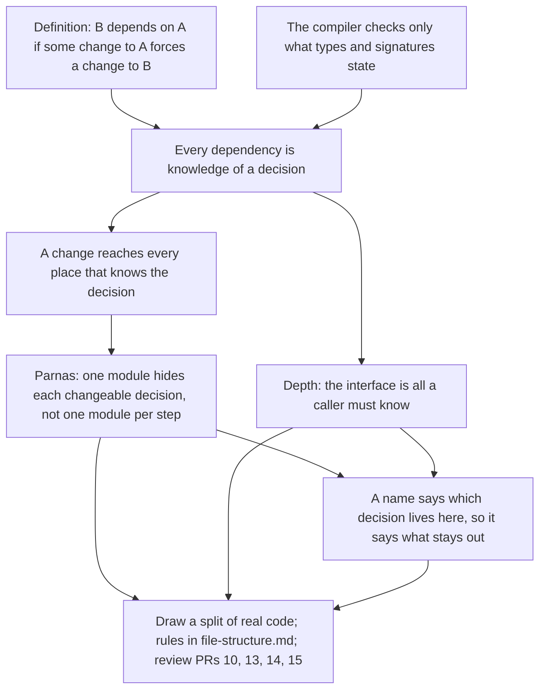

> [!quote] YOU

continue the architecture course


> [!abstract] PI

Session 01 covers coupling as shared knowledge, hiding decisions, and depth. I'll start with two retrieval questions on what session 00 explained.


> [!question] Quiz
> Retrieval from session 00. A bank's rule: an account's balance may never go below its overdraft limit. A transfer debits account A and credits account B. In DDD terms, what goes inside one Account aggregate?
>
> Session 00 asked what decides an aggregate's boundary, and you picked "I don't know" between "everything reachable from an entity" and "the data an invariant spans". This is the same idea on a new case.
>
> 1. One account's balance and limit, with any other account held by its ID only
> 2. Both accounts and the transfer, since the one transfer use case writes all three
> 3. The accounts table plus every row in the entries table that points at it
> 4. One account plus its customer, its branch and every object it references


> [!success] Quiz — correct ✓
> Your answer: 1. One account's balance and limit, with any other account held by its ID only
> Correct answer: 1
>
> Note: invariant spans only account and limit so I think 1
>
> The invariant draws the boundary. "Balance never below the limit" spans one account's balance and limit, so those two must change together, in one operation, behind one guard. Nothing about the rule needs account B, so B stays outside and A refers to it by ID (Vernon's "reference other aggregates by identity").
>
> The transfer touches two aggregates, which is why a use case is a poor boundary. Two accounts in one aggregate would make every transfer lock both, and a bank-wide aggregate would follow from chaining transfers. A transfer is coordinated across two aggregates, with eventual consistency or a saga between them. Reachability grows the cluster without limit (customer, branch, the branch's other accounts...). Tables come after the model, not before it. Session 02 builds this properly.


> [!question] Quiz
> Retrieval from session 00. Your service checks identity through a KYC provider's SDK. Your rules distinguish three outcomes: Approved, Rejected, Pending. You expect to add a second provider, whose checks have an extra "manual review" state. Which wrapper keeps that switch out of the callers?
>
> Session 00 asked what a one-to-one wrapper over a payment SDK buys, and you picked "version stability". This is the same idea on a new case.
>
> 1. A trait returning owned copies of provider one's response structs, filled in by the adapter
> 2. A trait re-exporting provider one's SDK types, so callers never import the SDK crate
> 3. A trait returning your three outcomes, which each adapter maps its provider's states into
> 4. A trait returning the provider's raw JSON response, so any provider's shape fits it


> [!success] Quiz — correct ✓
> Your answer: 3. A trait returning your three outcomes, which each adapter maps its provider's states into
> Correct answer: 3
>
> Only the trait written in your terms survives a change of model. Provider two's adapter maps "manual review" to Pending, and no caller learns that provider two exists. That's the anti-corruption layer: the translation is the value, and the trait is the shape your rules need.
>
> Owned copies of provider one's structs absorb renames and reshuffles, but they encode provider one's states, so "manual review" has nowhere to go without changing the shared types. Re-exporting moves the import and nothing else. Raw JSON hides the type and leaves every caller parsing a provider's model, so the knowledge is still spread across them, just untyped.


> [!quote] YOU

about the prs, they are all created on gh, I am not sure if I should merge them, no retrieval quiz needed I just did 00


> [!abstract] PI

Got it, no more retrieval questions this session.

**The PRs.** I'd hold them for now and not merge yet. Three reasons:

1. They restructure the code before you've settled the rules for where code goes, and those rules are what this course produces. If you merge nine PRs of layout first, the project section will end up either justifying layout someone else picked or redoing it.
2. Most of them line up with a course node, so reviewing one is a ready-made production exercise. #13 (split `game/` by question) and #16 (history private) are today's material. #13 renames `lookup.rs` and `zone_move.rs`, and it keeps every `impl Game` under `game/`, so every file still reads all of `Game`'s fields. That's the problem you diagnosed in session 00. #17 (a guarded effect stack) is exactly the question session 02 opens with. #10, #11 and #14 fit session 05, and #9 fits session 06.
3. #13 says it only moves code, with no behavior change, so holding it costs nothing at runtime. I haven't read the other eight closely, so I can't say the same for them.

The cost is that a stack goes stale when main moves. If the card-game course keeps landing changes on main alongside this one, rebasing nine PRs gets painful. In that case, merging the move-only ones now is the better trade.

Either way, one line in `COURSE.md` has to change. It says project work waits until these PRs land. If you hold them, nothing can move: the PRs wait for the course and the course waits for the PRs. At close-out I'd rewrite it so each PR gets reviewed after the node it exercises, and is then merged, reworked or closed.

Which do you want: hold them and review them node by node, or merge now? Once you answer, I'll start probing today's topics: coupling, hiding decisions and depth.


> [!quote] YOU

I am fine with then going stale, later we rebase. lets continue here without caring about them, rewrite it so each PR
 gets reviewed after the node it exercises, and is then merged, reworked or closed. and rn mark all of then as draft to signify that


> [!abstract] PI

All nine open PRs (#9 to #18) are drafts now; the list output above confirms `draft=true` on each. Next I'm editing `COURSE.md` and adding the checked facts from the research.


> [!question] Quiz
> Two functions in today's code. Neither calls the other. Which of these changes would force edits in both functions?
>
> `game/lookup.rs`, inside `health(object_id)`:
>
> ```rust
> let is_in_play_hero =
>     self.binder.is_hero(obj.def_id) && self.hero_id(obj.player_id) == object_id;
> let is_in_play_minion = self.binder.is_minion(obj.def_id)
>     && self.get_player(obj.player_id).zones.board.contains(&object_id);
> ```
>
> `game/condition.rs`, inside `scan_characters_with_filter(asking, filter)`:
>
> ```rust
> characters.extend(self.players.iter()
>     .filter(|player| self.fulfill_character_filter(asking, player.id, player.zones.hero, filter))
>     .map(|player| player.zones.hero));
> characters.extend(self.players.iter().flat_map(|player| {
>     player.zones.board.as_slice().iter()
>         .filter(|id| self.fulfill_character_filter(asking, player.id, **id, filter))
> }));
> ```
>
> `zones.hero` is one `ObjectId`. `Board` wraps a private `Vec<ObjectId>` behind `add`, `remove`, `as_slice` and `contains`.
>
> Pick every change that forces edits in both.
>
> 1. A new card puts minions in a "reserve" zone, where they stay in play and can be targeted
> 2. `Board` swaps its `Vec<ObjectId>` for a fixed array of seven slots, keeping the same methods
> 3. A two-hero mode gives each player two heroes instead of one
> 4. Health buffs from auras start to multiply the base health instead of adding to it


> [!success] Quiz — correct ✓
> Your answer: 1. A new card puts minions in a "reserve" zone, where they stay in play and can be targeted, 3. A two-hero mode gives each player two heroes instead of one
> Correct answer: 1, 3
>
> Reserve and two heroes both change the same decision: "the characters in play are each player's one hero plus the minions on the boards". Both functions encode that decision, so both change. `health` would return `None` for a reserve minion, and the scan would never offer it as a target. With two heroes, `hero_id(player) == object_id` and `player.zones.hero` both assume one hero per player.
>
> No call or import ties the two together, yet they're coupled, because they share knowledge of one decision. The same decision is written in more places, too: `board_characters` in `game.rs`, the death pass in `state_check.rs`, and the aura loop in `modifiers`.
>
> The `Board` storage change stops at `Board`, because both functions reach it only through methods that don't reveal the `Vec`. Multiplying auras is a decision that only `health` (through `modifiers`) knows, so the scan never notices it.


> [!abstract] PI

Right on both, and you didn't pick the decoy that `Board` set. Next I'm making it harder.


> [!question] Quiz
> You add a new zone move, `return_to_hand`, which takes a minion off the board and puts it in its owner's hand. You forget to call `update_order`. It compiles and every existing test passes. What does `return_to_hand` depend on that it got wrong?
>
> From today's code:
>
> ```rust
> pub(crate) struct Object {
>     // ...
>     /// unique idx updated when object move between zones
>     pub order: usize,
> }
>
> impl ObjectBag {
>     /// Gives the object a fresh order, larger than every order handed out before.
>     pub(crate) fn update_order(&mut self, object_id: ObjectId) -> usize { ... }
> }
> ```
>
> - `draw`, `add_to_hand`, `bury`, `emtomb` and summoning each call `self.objects.update_order(id)` after they move an object.
> - `board_characters`, `triggers` and the death pass in `state_check.rs` sort by `order`.
> - `return_to_hand` calls none of the sorting code.
>
> 1. Nothing: it calls no sorting code, so only the three sorters depend on `order`
> 2. The sort in `board_characters`, since a stable sort keeps tied orders in old positions
> 3. The layout of `Object`, since `order` is a `pub` field any zone move can write
> 4. The meaning of `order` as "when it last changed zones", which no signature states


> [!success] Quiz — correct ✓
> Your answer: 4. The meaning of `order` as "when it last changed zones", which no signature states
> Correct answer: 4
>
> Every zone move shares one decision: `order` records when the object last changed zones, so sorting by it means sorting by recency. That decision lives in a doc comment and in the habit of five functions. No type or signature carries it. `return_to_hand` has to honor it as much as `bury` does. If the meaning changed, say to "when it entered play", every zone move would need editing. That's the test for a dependency, and it holds here with no call at all.
>
> "Nothing" judges dependency by calls, and this case shows why calls are the wrong measure. The field layout isn't the issue. `return_to_hand` would break the same way if `order` were private behind a setter it forgot to call. The sort is fine. It sorts correctly by a value that's wrong.
>
> Ousterhout calls this the informal part of an interface: behavior, side effects and usage constraints the compiler can't check. Here it's a usage constraint, "call `update_order` after every move".


> [!question] Quiz
> A new card reads "Costs 3 mana. If you can't pay, it costs 3 health instead." Which code changes, and what does Parnas's criterion say about the split between `legal_actions` and `apply_action`?
>
> `game.rs`, `legal_actions`, for each card in hand when the player is idle:
>
> ```rust
> let mana = self.mana(player_id);
> for object_id in hand.iter().copied() {
>     let mana_cost = self.mana_cost(object_id).expect("objects in hand always have mana cost");
>     if mana_cost > mana {
>         continue;
>     }
>     // ... push Action::Play or Action::Draft
> }
> ```
>
> `game/resolve.rs`, `apply_action`:
>
> ```rust
> Action::Play { object_id } => {
>     // ... copy draft choices onto the object, if any
>     let mana_cost = self.mana_cost(object_id)
>         .expect("[legal_actions] guarantees a play action object_id has mana");
>     self.get_player_mut(player_id).mana -= mana_cost;
>     self.play(player_id, object_id, obs);
> }
> ```
>
> `resolve.rs`'s module doc: "The mutation half of `Game::apply`."
>
> 1. Both change, which is fine. Checking and applying are two decisions, each hidden in its own file
> 2. Both change. The files split by step, check then apply, so each step knows the payment rule
> 3. Only `legal_actions`. `apply_action` subtracts whatever cost the check approved
> 4. Only `resolve.rs`. `mana_cost` already hides the payment rule from `legal_actions`


> [!success] Quiz — correct ✓
> Your answer: 2. Both change. The files split by step, check then apply, so each step knows the payment rule
> Correct answer: 2
>
> The payment rule, "a card is paid for with mana equal to its cost", is one decision written twice. `legal_actions` encodes it as `mana_cost > mana` and `apply_action` as `mana -= mana_cost`. The new card changes that decision, so both places change. `legal_actions` has to admit the card when health can pay, and `apply_action` has to take health instead of mana.
>
> That's Parnas's step decomposition, the split he called "almost always incorrect". One file is "everything we check" and the other is "everything we do", so every rule with a check part and a do part gets cut in half. "Checking" and "applying" are steps, not decisions, and no rule of the game lives entirely inside either one. Ousterhout calls it temporal decomposition, and his example has the same shape: a reader and a writer that both know the file format.
>
> `mana_cost` hides how the cost is computed (modifiers, history). It doesn't hide how the cost is paid. `apply_action` doesn't subtract "whatever was approved" either, because nothing is passed from the check to the mutation. It recomputes the cost and assumes the check matched.
>
> ADR 0002 still holds. `legal_actions` stays the one definition of legality at the interface. Parnas's criterion is about what's behind it. `legal_actions` could ask a payment module "can this player pay?" and `apply_action` could tell it "pay". Then the rule lives in one place.


> [!abstract] PI

Three for three, so recognition of coupling and step decomposition holds even on code you didn't write the question for. I'll move to depth and push harder.


> [!question] Quiz
> Judge `Game` by Ousterhout's depth. What is it, and where is its problem?
>
> What a shell (a UI, a bot, a test) sees is `Game`'s `pub` interface:
>
> ```rust
> Game::new(seed, decks) / Game::with_deck_order(seed, decks)
> game.legal_actions(player) -> Vec<Action>
> game.apply(player, action, observer) -> Result<(), ApplyError>
> game.applied(player, action) -> Result<Game, ApplyError>
> // plus reads: hand, deck, player_board, mana, health, attack, outcome, ...
> ```
>
> Behind it are roughly 2,000 lines across `game.rs` and nine files under `game/`. Those cover legality, payment, drafts, effects, triggers, death and views. Every file under `game/` can read and write all nine of `Game`'s private fields.
>
> 1. Deep from outside; inside, its files have no interfaces between them, so nothing is hidden
> 2. Shallow; about 2,000 lines behind a handful of functions is too much for one module
> 3. Shallow; its nine files expose many `pub(crate)` methods, so its interface is wide
> 4. Deep, so no problem; worrying about god structs is worrying about size, not design


> [!success] Quiz — correct ✓
> Your answer: 1. Deep from outside; inside, its files have no interfaces between them, so nothing is hidden
> Correct answer: 1
>
> Seen from the shell, `Game` is a very deep module. Two calls, `legal_actions` and `apply`, hide legality, payment, drafts, effects, triggers and death. A bot author needs to know almost none of that. Ousterhout would call it deep, and size doesn't count against it. He says outright that classes of 200 to 2,000 lines are fine.
>
> The problem is one level down. Inside `game/` there are nine files but no modules in Parnas's sense, because none of them has an interface that hides anything from the others. All of them can write all nine fields. Decisions such as "what's in play", "how a card is paid for" and "what `order` means" have no home, so they get written wherever they're needed. Depth measures one boundary. A god struct is deep on its outer boundary and has no inner boundaries.
>
> The `pub(crate)` methods widen what the rest of the crate can call, but that's a second issue. Even with every method at `pub(super)`, the files would still share every field. "Too many lines" mistakes size for depth. "No problem" ignores the change cost you saw in the last three questions.


> [!question] Quiz
> A teammate wants to rename `game/lookup.rs` and offers two names: `queries.rs` or `stats.rs`. Which is the better choice, and why?
>
> What `lookup.rs` holds today:
>
> - `mana_cost`, `health`, `attack`
> - `modifiers`, `friendly_aura`, `hostile_aura` (feed the three above, and granted triggers)
> - `triggers`, `death_rattles`, `play_effects`
> - `def_id`, `hero_id`, `playing`, `object`
>
> Every function takes `&self` and returns a value computed from `Game`'s fields.
>
> 1. `queries.rs`, since `&self` versus `&mut self` is the split Rust's borrow rules care about
> 2. Either one, as long as the module doc spells out exactly what belongs inside
> 3. `queries.rs`, since it's the one name that fits every function the file holds today
> 4. `stats.rs`, and the functions it leaves out, such as `triggers` and `hero_id`, go elsewhere


> [!success] Quiz — correct ✓
> Your answer: 4. `stats.rs`, and the functions it leaves out, such as `triggers` and `hero_id`, go elsewhere
> Correct answer: 4
>
> Note: an earlier quiz told me about this but I am not sure why or where it came from
>
> `queries.rs` fits everything because it excludes nothing. Any `&self` function in the crate is a query. It's `lookup.rs` under a new name, and the next read-only function lands there whatever its concept. Ousterhout's red flag Vague Name covers this case: a name "broad enough to refer to many different things".
>
> `stats.rs` names one decision: how attack, health and cost are computed from printed values and modifiers. It doesn't fit `triggers`, `hero_id` or `playing`. That misfit is the useful part, because it shows the file holds several decisions under one name. Ousterhout's Hard to Pick Name flag says the same. If no simple name fits a module, "the underlying object may not have a clean design." The Go blog puts it as: if no name is "a meaningful prefix for the package's contents, the package abstraction boundary may be wrong."
>
> So a name doesn't have to cover what's in the file today. It has to say what stays out, and whatever doesn't fit moves. A module doc can't rescue a vague name, because callers and the file tree see the name and not the doc. Splitting by `&self` and `&mut self` sorts code by kind of operation. That's the read/write version of check/apply, and it cuts rules in half the same way.


> [!quote] YOU

what is the plan here? how will u teach me concepts? should I infer then by what u asking and explaining ont the quises?


> [!abstract] PI

No, you shouldn't have to piece the concepts together from the quizzes. Up to now I haven't been teaching. Those questions were the probe: they find where your understanding ends, so the lesson starts there and not below it. The explanations after each answer are feedback on that one question, and they did teach in passing, which is why it felt like you were supposed to infer things. The teaching starts once you approve the plan below. Each concept is then built step by step from a couple of starting facts, so you can see why it holds and not just that it holds.

**What the probe found.** All seven answers were right, including the two retrieval ones.

- You spot coupling with no call or import behind it: the in-play rule written in several files, and the meaning of `order`.
- You spot a split by steps in real code (check, then apply).
- You tell a module's outer depth apart from its missing inner boundaries.

Your note on the naming question is the most useful result. You applied the rule, but you hold it as a fact someone handed you, without its reason. That's exactly what this session should fix. The rule came from session 00's explanation. Its sources are Ousterhout's Vague Name and Hard to Pick Name red flags and the Go team's package-naming advice, but a source isn't a reason. The plan derives it.

So for these topics, recognition holds. What's missing is being able to derive the rules and then use them unprompted, which matches session 00's finding.

**The approach.** We start from two facts you can accept as stated:

1. The definition of a dependency: module B depends on module A when some change to A would force a change to B to keep the program correct. This is Page-Jones's definition from 1992.
2. The compiler checks only what types and signatures state. Anything else a caller relies on, it can't check.

Everything else follows from those two:

- **Every dependency is knowledge of a decision.** A call is one way to hold that knowledge. A duplicated rule, a shared meaning or a required call order are others, and the compiler sees none of them.
- **A change reaches every place that knows the decision.** So the cheap layout is one where each decision likely to change is known in one place.
- **Parnas's rule.** Give each such decision a module that hides it. Splitting by processing step puts the same decision in every step, which is what you saw with check and apply.
- **Depth.** An interface is everything a caller must know, including what no signature states. A module is deep when that knowledge is small compared with what it hides.
- **Names that exclude.** A module's name is the first thing its interface tells you: which decision lives there. A decision's name says what stays out. A name for a kind of operation (`queries`, `utils`, `validators`) takes the matching slice of every decision, which is a split by steps done through naming. This is where your naming rule gets its reason.

**How each step runs.** I pose the problem behind it, and you try to reach the idea before I state it. Since you've been reasoning well, it's mostly that way, and I narrate only the history, such as Parnas's original example. Then:

1. I show how the step rests on the ones before it, and a quiz checks that it landed.
2. A production exercise follows with no options: you draw the split on real code.
3. You state the rule in your own words.
4. I draft it into `docs/conventions/file-structure.md`, you review it, and it gets committed.

The last step reviews PRs #10, #13, #14 and #15 against those rules.

**The map:**



That's probably more than one session. We'll stop wherever a step finishes, likely after Parnas's rule or after depth, and the rest carries over.

Does this plan work for you, or do you want to change the scope or order before we start?


> [!quote] YOU

more then one session yes


> [!abstract] PI

Then let's start. The first step is the root everything else hangs from.

**Step 1: what a dependency is**

**Why start here.** "Where does this go?" is a question about cost. A placement is good when the changes you'll make later stay cheap. Rails answered it for you with a fixed layout. Without one, you need to know what a placement should minimize. The usual answer is "coupling", but coupling is usually measured by what the code shows: imports, calls, shared types. In the probe you found two dependencies that show none of those: the in-play rule and the meaning of `order`. A measure that misses both is measuring the wrong thing, so we need a definition that ignores how the code happens to look.

**The definition.** Page-Jones gave one in 1992, under the name connascence:

> I define two software elements A and B to be connascent if there is at least one change that could be made to A that would necessitate a change to B in order to preserve overall correctness.

In this course's words, B depends on A when some change to A would force a change to B to keep the program correct. Three parts of it do the work:

- **"Some change."** One possible change is enough. The definition is about what could happen, not what has happened, so a dependency exists before anyone trips on it.
- **"To keep the program correct."** That's correctness, not compilation. The compiler is one witness, and a failing test or a wrong game is another.
- **It's per change.** B can depend on A for one change and not for another. The `Board` storage swap reached nothing, and the in-play rule reached several files.

Nothing in the definition mentions imports, calls or files. That's why it catches the in-play rule. Imports and calls are evidence of a dependency, not what defines one.


> [!question] Quiz
> By the definition, which of these claims are true?
>
> Definition: B depends on A when some change to A would force a change to B to keep the program correct.
>
> `Rng` is SplitMix64, and every shuffle and random selector draws from it. `Board` wraps a private `Vec<ObjectId>` behind `add`, `remove`, `as_slice` and `contains`. `apply_action` subtracts the card's cost from mana and never calls `legal_actions`. `apply` calls `legal_actions` first and passes only listed actions on to `apply_action`.
>
> Pick every true claim.
>
> 1. `zone_move.rs` depends on `Board` storing a `Vec`, since it imports `Board` and calls `board.add`
> 2. Stored replays (a seed plus the actions taken) depend on `Rng`'s algorithm, though they hold no code
> 3. `apply_action` depends on `legal_actions` rejecting unaffordable cards, though it never calls it
> 4. A change to A that breaks B's tests but not B's build is no dependency of B on A


> [!success] Quiz — correct ✓
> Your answer: 2. Stored replays (a seed plus the actions taken) depend on `Rng`'s algorithm, though they hold no code, 3. `apply_action` depends on `legal_actions` rejecting unaffordable cards, though it never calls it
> Correct answer: 2, 3
>
> Note: 1 no because the the underline could be any container. 2 yes cause it depends that the rng is seedable and the same seed repeats the same values. 3 yes cause it go to negative mana with a bug on legal_actions. 4 trick one but I think it indirectly applies here, tests are pinning corecteness and if a change on A broke B's test then B correctess depends on A.
>
> Replays are the definition at its widest. Switch SplitMix64 for another generator and every stored seed shuffles differently, so the action lists no longer fit the games. Either the replays get migrated or the old generator stays. The dependent "element" is data on a server, with no code in it. That's why the definition talks about elements and not modules.
>
> `apply_action` depends on the check through a decision, not a call. If `legal_actions` stopped rejecting unaffordable cards, `mana -= mana_cost` would underflow, which panics in a debug build. The docstring "nothing here re-checks legality" states that dependency in prose, the only place it's written.
>
> The import of `Board` is evidence of some dependency, on the method names and their meaning, but not of every one. The storage choice is hidden, so no change to it forces anything in `zone_move.rs`. Dependency is per change. And breaking tests is breaking correctness. The build is one witness, and a test is another.


> [!abstract] PI

Your reasoning on all four matches the definition. One refinement on the replays. They depend on more than "seedable, and the same seed repeats". Swap SplitMix64 for PCG, which is also seedable and also repeats, and every stored replay still breaks. What a replay depends on is the exact sequence each seed produces. So it depends on every decision that shapes that sequence: the generator, the swap order inside `shuffle`, and even the order in which the game draws from `Rng` (deck 0 shuffled before deck 1). Nobody would list those as the interface of `Rng`, but a replay relies on all of them. That's the first root doing its job: it finds dependencies you wouldn't have listed.

**Step 2: what the compiler can see**

**Why we need it.** The definition is about correctness, and you've now seen several dependencies that broke correctness while the build stayed green: `order`'s meaning, the in-play rule, `apply_action` trusting the check. We need to know exactly which dependencies the compiler catches, because the rest are the ones that hurt.

**The fact.** The compiler checks only what types and signatures state: names, types, visibility, borrows, and whether a `match` covers every variant. Anything else a caller relies on is invisible to it. That covers what a value means, what must be called before what, and which rule another function already enforced.

**How it connects to step 1.** Every dependency now falls into one of two kinds. When a change in A breaks a dependency the compiler sees, the build points at every place in B that has to change, so finding them costs nothing. When a change breaks one the compiler doesn't see, a test or a player finds it, or nobody does. Ousterhout calls these the formal and informal parts of an interface. Page-Jones says the implicit kind "will probably incur the greatest development and maintenance costs."

This is also why Rust code pushes decisions into types. Doing that moves a dependency from the kind the compiler can't see into the kind it can.


> [!question] Quiz
> Which of these changes would `cargo build` flag at every place that has to change?
>
> Facts about today's code:
>
> - `Binder::health`, `attack` and `has_board_presence` `match` on `CardDefKind` with one arm per variant. `is_minion` and `is_hero` use `matches!`.
> - `Game::health` decides in-play with `binder.is_hero(..) && hero_id(..) == id || binder.is_minion(..) && board.contains(..)`. The target scan and `board_characters` walk each player's `zones.hero` and `zones.board`.
> - `select_random` indexes a slice with `rng.below(values.len())`.
> - `order` is a `usize` that every zone move bumps.
>
> Pick every change where the build flags all the places that must change.
>
> 1. Changing `order` to mean "when it entered play", bumped only on summon
> 2. Changing `Rng::below(n)` to return a value in `1..=n` instead of `0..n`
> 3. Adding a `Location` card kind that sits in play in its own zone, like a minion
> 4. Renaming `Board::contains` to `Board::has`


> [!success] Quiz — correct ✓
> Your answer: 4. Renaming `Board::contains` to `Board::has`
> Correct answer: 4
>
> Note: 3 would partially because health in-play does use match
>
> Only the rename is entirely formal. The name is in every caller's code, so the build lists every site.
>
> `Location` is the instructive one, because the build flags part of it. The exhaustive `match`es in `Binder` fail to compile, so `health`, `attack` and `has_board_presence` get decided for the new kind. But the in-play rule is written with `is_hero` and `is_minion` booleans and with walks over `zones.hero` and `zones.board`. None of those mention `CardDefKind`, so all of them compile and quietly treat a location as not in play. The build finds the places that name the decision and misses the places that only know it.
>
> `below` keeps its signature, so nothing is flagged. `values[idx]` with `idx == len` panics at runtime, sometimes, depending on the seed. `order` keeps its type, so nothing is flagged either, and the sorts quietly change meaning.
>
> So a green build proves only that the formal dependencies still hold.


> [!question] Quiz
> Across every case so far, what did B have that made it change when A changed?
>
> The cases, each as "B depends on A":
>
> - The callers of `Board::contains`, on its name.
> - `health` and the target scan, on the rule "in play means each player's one hero plus the minions on the boards".
> - Every zone move, on `order` meaning "when it last changed zones".
> - `apply_action`, on `legal_actions` rejecting unaffordable cards.
> - Stored replays, on the exact sequence `Rng` and `shuffle` produce per seed.
>
> Pick the one thing every case shares.
>
> 1. A call into A, or an import of a type that A defines
> 2. A copy of some of A's code, which drifts when A is edited
> 3. Knowledge of something A decided, held in B's code or data
> 4. Mutable state that A and B both read and write at runtime


> [!success] Quiz — correct ✓
> Your answer: 3. Knowledge of something A decided, held in B's code or data
> Correct answer: 3
>
> Note: very interesting. I think this would be too easy to infer by looking at the options because the other options seemed obviously wrong to me.
>
> Each B holds knowledge of a decision A made. The callers know a name. `health` and the scan know a rule. The zone moves know a meaning. `apply_action` knows that a check already happened. The replays know a sequence. When A changes that decision, everything that holds the old knowledge is now wrong, and that's exactly what the definition detects.
>
> None of the other three covers every case. Calls and imports are missing from the in-play rule, `order` and the replays. Shared runtime state is missing from the rename and the replays. A copy of code is one way to hold knowledge, as `health` and the scan both encode the in-play rule, but a name, an assumption or a stored sequence is knowledge with no copied code at all.


> [!abstract] PI

You're right. Each wrong option was ruled out by a case listed right there in the details, so you could get there by elimination without doing the derivation. That's my mistake. From now on, when a step is a derivation, I'll ask it open-ended in plain text and you answer in your own words. Quizzes will be for checks, where the wrong options are mistakes someone could really make.

That gives the first derived step:

> **Every dependency is knowledge, held by B, of a decision A made.**

Combined with step 2, that knowledge comes in two forms:

- **Formal.** The knowledge is written as a reference: a name, a type, a `match` over variants. The compiler sees it, so a change to the decision fails the build at every place that holds it.
- **Informal.** The knowledge is written as an assumption or a copy: a rule re-encoded, a meaning relied on, an order obeyed. The compiler can't see it, so a change to the decision compiles and goes wrong somewhere.

Coupling, then, isn't "who calls whom". It's which places hold knowledge of which decisions, and in which form.

**Exercise (no options).** Parnas's method starts with exactly this inventory. In his words, "begin with a list of difficult design decisions or design decisions which are likely to change." So build that list for `crates/rules`:

1. Name decisions the rules crate makes that are likely to change, or that were hard to get right. The three we found count (in-play, the meaning of `order`, how a card is paid for). Find at least three more.
2. For each one, list the files that hold knowledge of it.
3. Mark each piece of knowledge formal or informal.

A decision can be a representation, a rule of the game, a meaning, an order things must happen in, or a policy. Grep as much as you like, and rough is fine. Like last time, tell me how long it took. When you're done, I'll compare your list with mine, and then you state the rule for this step in your own words.


> [!quote] YOU

1. "card play reactions should resolve before the play effects" is kept in at least two places, game effect_stack is a stack meaning what comes first exits last, zone move play then must push the card effects on the stack before emiting the event in order to make sure any trigger is pushed on top, informal. 2. "a pick only happens while the player is Idle" on the pick function the PlayerInteractionState goes back to the default and the reveal function overrides the previous state because it is not important, informal. 3. "A ObjectId is only created on object insert" any code that calls ObjectBag get and get_mut trusts that ObjectBag can retrieve an object for that ObjectId, object.rs has the actual code that makes the rule be true which are the insert get and get_mut functions, I think it is informal because if insert was bugged (it was once) the get could panic on the expect, took 22 min


> [!abstract] PI

All three are real decisions, and all three are informal knowledge the compiler can't see, which is the hardest kind to find. One refinement each.

**1. Reactions resolve before the card's own effects.** Right, and the same knowledge appears in a third place. `kill` pushes every death rattle first and then emits `Died`, so reactions to a death also land on top of the dying card's own effects. That gives one decision, "an object's own effects go below the reactions its event causes", in three places:

- `play`, where pushing comes before the emit;
- `kill`, where the same ordering holds;
- `drain_effect_queue`, which pops from the top.

Both functions encode it purely through statement order. Swap two lines in `play` and everything compiles.

**2. A pick happens only while the player is idle.** Right. `reveal` overwrites the state and `pick` resets it to the default, so both assume that nothing else was pending. What I'd add is where the assumption is *made true*. That place is neither of those two functions. It's the loop in `resolve.rs`, which resolves effects only `while !self.is_pending_interaction()`. The guarantee lives in one file and the reliance in another, and the guarantee isn't stated anywhere. That's the shape of `apply_action` trusting `legal_actions` again.

**3. An `ObjectId` always resolves.** The decision is right, but the reason you gave for "informal" isn't the test. Whether `insert` could have a bug doesn't decide formal or informal, since any code can have a bug. The test is whether the compiler checks the knowledge. Part of this one it does check. `ObjectId(u64)` has a private field, so only `cards/object.rs` can create one, and that guarantee is formal. The callers also rely on two things the compiler can't see:

- **Objects are never removed from the bag.** Add an `ObjectBag::remove` and no `get` call fails to build. Every one of them can panic, and nothing tells you which.
- **The ID comes from this game's bag.** An ID from another `Game` compiles fine against this one.

So it's a mix, and it shows a useful lever. The private constructor already turned part of an informal promise into a formal one.

**My list**, for comparison:

| Decision | Where it's known | Form |
|---|---|---|
| A character dies at health ≤ 0 | `find_dead`, `remove_dead`, `decide_outcome` (`hero_health > 0`) | informal, copied |
| Damage adds to `damage` and is reported | `damage`, and the fatigue branch of `draw`, which writes it by hand | informal, copied |
| What counts as a visible step (checkpoints) | `resolve.rs`, `zone_move.rs` (`play`), `state_check.rs` | informal |
| How a draft is searched | `legal_actions` in `game.rs`, `can_finish_choices` in `condition.rs` (same loop), `apply_action` in `resolve.rs` | enum formal, search copied |
| Max mana grows by 1 to 10 | `start_turn` only | in one place |
| Events are reported only through `emit` | `emit` only | made formal by a clippy `disallowed_methods` ban |

The last two matter as much as the rest. They're decisions that already live in one place, and the ban on `Observer::event` turns "only `emit` reports" into something the build checks.

Your three share a pattern. All of them are about *when* things happen: ordering and state. Ordering knowledge is the hardest to see, because it lives in the sequence of statements and not in any name.

**Your turn.** State the rule for this step in your own words, the one you'd want in the general section of `file-structure.md`. One or two sentences on how to judge whether two pieces of code are coupled.


> [!quote] YOU

Two pieces of code are coupled if one have knowledge of a decision made by the other. That means changing that decission would require a change on the other piece of code. The coupling could be formal or informal, formal coupling is written as a reffrence, checked in a way that changing the decision points out the other places that should be changed to mantain correctess, informal coupling is written as an assumption or copy and requires that the correctness issue to be caught on manual review. That way we should aim to minimize informal coupling. Rust has several ways to transform informal coupling into formal, the prefered way is to put the knowledge on the types.


> [!abstract] PI

Your rule holds, and it already has the core idea: coupling is knowledge of a decision, in formal or informal form. I'd change three things before it goes in the doc.

**1. "Caught on manual review" is too narrow.** Tests catch informal breakage too. You said so yourself on the definition question: a broken test is broken correctness. Tests don't make knowledge formal, though. A failing test tells you *that* something broke, not every place that holds the decision. So the precise wording is that only a test, a review or a bug finds the places.

**2. "Minimize informal coupling" needs "across module boundaries".** Every function body is full of informal knowledge. The order of two statements in `play` is one example, and making all of it formal is impossible. Inside one module it's also cheap. Whoever changes the decision is already in that file, with that module's tests next to it. The cost appears when the other holder sits in another module, where nobody changing the decision is looking. Page-Jones's rule says exactly this: "minimize connascence across encapsulation boundaries by maximizing connascence within encapsulation boundaries." The next step builds on it.

**3. "Put the knowledge in the types" is general, not Rust-only.** TypeScript and typed Python do it too. I wrote it as an order of preference. A type comes first, because it's checked at every use and can't be forgotten. A lint comes second, for knowledge a type can't hold, like this repo's ban on `Observer::event`. A test comes last, and it only detects. Rust's own tools for this go in the Rust section.

I've written the draft to `docs/conventions/file-structure.md`:

```markdown
## General

### Coupling is shared knowledge of a decision

Two pieces of code are coupled when one holds knowledge of a decision the other made. Changing that
decision then forces a change to both to keep the program correct. A call or an import is one way
to hold that knowledge. A copied rule, a relied-on meaning and a required call order are others,
with no call between the two.

The knowledge is formal or informal:

- Formal knowledge is a reference: a name, a type, an exhaustive match over every case. When the
  decision changes, the build fails at every place that holds it.
- Informal knowledge is an assumption or a copy. When the decision changes, the build passes, and
  only a test, a review or a bug finds the places that hold it.

Informal knowledge inside one module is fine. Across a module boundary, make it formal: put it in a
type, or in a lint where a type can't hold it. Where neither can, pin it with a test.

## Rust

### Making knowledge formal

- A private field or constructor, so only the owning module can create the value, and holding one
  proves the module made it.
- A newtype for a value with a meaning, such as an ID or an amount, so it can't be mixed up with a
  bare integer.
- An exhaustive `match` with no `_` arm, so a new variant fails to build at every place that has to
  decide about it.
- A clippy `disallowed_methods` or `disallowed_types` ban, for "only this place may call that".
```

Above those sections is a "When to use" section: read it before creating, splitting, moving or naming a module, a file or a crate. `CLAUDE.md` gets a matching line in its required-reading list.

I kept repo examples out of the General and Rust sections, since you'll copy those out by hand. Examples from this repo can go in the project section later.

Do you accept the three changes? Edit any wording you like. Once you approve, I'll commit `file-structure.md` and the `CLAUDE.md` line as this step's commit. After that comes the next step: why one place per decision is the cheap layout.


> [!quote] YOU

I accept, your are allowed to change it to make the text better, then unslop and write it, we still on session 1 right?


> [!abstract] PI

Committed as `6a4f038`. `git status` shows nothing left over for those two files.

**Step 4: what makes a change expensive**

**Why we need it.** Step 3 tells you what coupling is. It doesn't yet tell you how to compare two layouts of the same code. Both layouts make the same decisions, since the game's rules don't change when you move code around. So whatever makes one layout cheaper to change than the other has to be about *where the knowledge of each decision sits*.

**Open question, in your own words.** Take one decision likely to change, such as the in-play rule. What about where its knowledge sits decides how much changing it will cost? Name every factor you can think of, and say which layout would make the change cheapest.


> [!quote] YOU

in play is defined in several places in slight different ways that means to change it we have to find each one and modify it in a slight different way, putting then all at the same place would make the change cheaper


> [!abstract] PI

You found three of the factors:

- **How many places hold it.** Several, so several edits.
- **Whether you can find them.** Yes, you have to go looking. That's the formal/informal split from step 3. If the knowledge were formal, the build would list the places for you. Because it's informal, a search finds them, and a search can miss one.
- **Whether the copies match.** Each copy is written a little differently, so each one needs its own edit. Copies that differ in form today can also disagree in substance tomorrow, and nothing would tell you.

Your fix, putting them all in one place, adds the fourth factor: **how far apart the places are.** Several places in one module cost less than the same number spread over four files, because they're all in the file you already have open.

These have names in the literature. connascence.io calls them degree (how many), locality (how far apart) and strength (how hard to discover or refactor, which is roughly our formal and informal). Weirich's version of the rule: "As the distance between software elements increases, use weaker forms of connascence."

"One place" isn't enough on its own, though. Say you write `fn characters_in_play(&self) -> Vec<ObjectId>` and move the rule into it. `health`, the target scan, the death pass and `board_characters` still need to know what's in play, and they'll call the new function. So they still depend on something.

**Follow-up, in your own words.** What do those callers know after the move, and why does a change to the in-play rule (a reserve zone, two heroes) cost less than it does today?


> [!quote] YOU

they all share the definition of in play and if that definition changes they automatically react to it and they cant disagree between themselfs, the contract is only the function signature, being a single function makes it "cost" only a single change.


> [!abstract] PI

Mostly right: callers share one definition, they can't disagree with each other, and a change costs one edit. One correction, though. The contract isn't only the signature. `-> Vec<ObjectId>` doesn't say:

- that heroes are included;
- that the list is sorted by `order`, which `emit` relies on, since it walks the list to stack triggers in order;
- that a minion at 0 health still counts until the state check removes it.

Callers rely on all three, so the informal part didn't disappear. What changed is *what* the callers know. Today they know the answer: "each player's hero plus the boards". After the move they know only the question, "which characters are in play, in order", stated once, at the function. The answer is what changes, with a reserve zone or two heroes. The question stays put. That's why a change to the answer costs one edit.

> **Step 4: a change to a decision costs one edit for each place that knows it, plus the search for those places. The cheapest layout has one place that knows the answer, and every other place asks a stable question by name.**

A check on that:


> [!question] Quiz
> A new keyword arrives: stealth. A stealthed minion is in play (it fights, emits auras and can die), but enemy effects can't target it. What's the right change?
>
> Assume the in-play rule now lives in one place:
>
> ```rust
> /// Every character in play, sorted by `order`.
> fn characters_in_play(&self) -> Vec<ObjectId>
> ```
>
> Its callers are the target scan, the death pass, the aura loop in `modifiers` and `emit`, which walks it to stack triggers. Only the target scan cares about stealth.
>
> 1. Add the stealth check inside `characters_in_play`, since every caller shares that one definition
> 2. Add a `targetable_characters` built on `characters_in_play`, and have the target scan call it
> 3. Copy `characters_in_play` into the target scan, then add the stealth check to that copy
> 4. Add a `stealth: bool` parameter to `characters_in_play` that every caller must pass


> [!success] Quiz — correct ✓
> Your answer: 2. Add a `targetable_characters` built on `characters_in_play`, and have the target scan call it
> Correct answer: 2
>
> Stealth shows that there were two questions all along: "which characters are in play?" and "which characters can this player target?". Their answers matched until now, and stealth makes them differ. Each question gets one home. `targetable_characters` asks the in-play question and filters it, so the in-play rule still lives in one place and the stealth rule lives in another. The death pass, auras and `emit` keep asking about in-play and never learn that stealth exists.
>
> Putting the check inside `characters_in_play` answers the wrong question for three of the four callers. Stealthed minions would stop dying, stop emitting auras and stop triggering. Copying brings back two places that know the in-play rule, which is the layout you just priced. The flag makes every caller hold knowledge of stealth, a decision only targeting needs. The death pass would have to pass `true` and know why.
>
> One place per answer works only when the place answers one question. When two questions happen to share an answer, merging them is coupling waiting to happen.


> [!abstract] PI

Right. You kept the in-play rule in one place and gave stealth its own home.

**Exercise (no options).** Apply this step to your own first finding: an object's own effects go below the reactions its event causes. Today that knowledge is in three places:

- `play` pushes the card's effects, then emits `Played`;
- `kill` pushes the death rattles, then emits `Died`;
- `drain_effect_queue` pops from the top, so whatever was pushed last resolves first.

Redraw it so one place knows the answer:

1. What question or command do `play` and `kill` use in place of "push, then emit"?
2. Where does the answer live, and what does it hide?
3. After the change, what do `play`, `kill` and the resolution loop each still know?

Rough is fine, and time it again. Then state the rule for this step in your own words, for the doc.


> [!quote] YOU

I think a function that returns the order is incorrect. a fucntion that pushes the card effects then emits the event sounds good. but it would need to recieve obs as parameter too. I guess I would make the function that pushes the effects return the event so that one needs to be done first, and if it was a function on the drain_effect_queue it would reduce the locallity, that would make it formal but the knowledge is still spread as the callers need to know that to emit the event they need to first push the effects, it hides that it is a stack underneath, it simply enforces the correct order, resolution loop only knows that it should pop from back to front


> [!abstract] PI

You did more here than the exercise asked. You found two different fixes and saw how they differ.

**What you got right**

- **No query.** Callers don't need to *know* an order. They need something *done* in an order, so the interface is a command. That generalizes step 4: callers use a stable question **or command** by name.
- **Design A, one function that pushes and then emits.** Callers know only "queue my effects and report my event". The order lives inside the function. Passing `obs` is fine, because it's formal and in the signature.
- **Design B, the push returns the event the emit needs.** This makes the order formal, since you can't emit without the token. As you said, every caller still holds the knowledge that two steps exist and which comes first. Degree is unchanged and only the strength dropped.

That contrast is the useful part. **Making knowledge formal and removing it from callers are different fixes.** Formal means the build catches a caller that gets it wrong. Removed means callers have nothing to get wrong. Remove it when one command can express what every caller wants. Use B for what's left, where a caller has to do something between the two steps.

**A catch in A.** Look at `kill` again. It pushes the death rattles of *every* dying object first, and only then emits each `Died`. So all the reactions to all the deaths sit above all the rattles. A per-object "push, then emit" helper would interleave them (rattle 1, reactions to death 1, rattle 2, reactions to death 2), and simultaneous deaths would resolve in a different order. The command has to take the whole batch: queue all these objects' own effects, then report all these events. It's the stealth lesson again. A single place works only if its interface fits every caller's question, and you find that out by reading every caller.

**Locality.** I read "a function on the drain_effect_queue" as putting the command next to the resolution loop. Then the push order and the pop order sit together, and they're two halves of one decision: own effects resolve after the reactions they cause. If that's what you meant, yes. That module would know the whole answer, and `play` and `kill` would know only the command. If you meant something else, say so.

**Your turn.** State the rule for step 4 in your own words, for the doc. Also, roughly how long did the exercise take?


> [!quote] YOU

15 min. A change to a decision costs one edit for each place that knows it, plush searching for all places. That way the fewer places that know the answer the cheapest the change, ideally only one place knows the answer while others know how to ask a stable question for it or issue a stable command for it to execute.


> [!abstract] PI

Your rule goes in as written, lightly edited. I've also drafted two points from this step that you derived but didn't put in the rule. The new section in `docs/conventions/file-structure.md`, under General:

```markdown
### One place knows each decision

A change to a decision costs one edit for each place that knows it, plus the search for those
places. The build does the search only when the knowledge is formal. So the fewer places know the
answer, the cheaper the change. Ideally one place knows it, and every other place asks it a stable
question or gives it a stable command, by name.

- Give each question its own home, even when two questions share an answer today, such as "which
  accounts are open" and "which accounts can be charged". The second can be built on the first.
  The day their answers differ, each changes alone.
- Prefer taking knowledge away from callers to making it formal. A caller that must call two
  functions in order still holds the order, even when a type enforces it. One command that does
  both leaves the caller nothing to get wrong. Make formal only what callers must still know.
```

What I added:

- **"The build does the search only when the knowledge is formal."** This ties the search cost to the first rule.
- **The first bullet** is the stealth lesson. I used a finance example so the section still makes sense when you copy it out.
- **The second bullet** is your design A versus design B, stated as a preference.

Do you accept the two bullets? Once you do, I'll commit the section. That closes step 4, and Parnas comes next: what a module is when you build it around decisions.


> [!quote] YOU

remove the ", such as "which accounts are open" and "which accounts can be charged"" no pratical exemples there and I would change "still holds the order" to "still knows the decission". then commit, I will go to sleep and come back tomorrow
