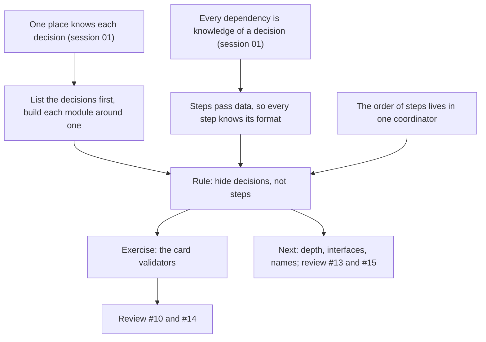

> [!quote] YOU

continue the architecture course


> [!question] Quiz
> Retrieval. A payments system has a `ledger` crate that stores each amount as `amount: i64` in cents. A separate `statements` crate formats amounts for customers by dividing by 100. The team adds JPY, which has no minor unit, so the ledger will store JPY amounts in whole yen. What does `statements` hold, and what does the rule from session 01 say about it?
>
> `statements` never calls into `ledger`. It reads the stored rows, which use a struct defined in `ledger`:
>
> ```rust
> pub struct Entry { pub account: AccountId, pub amount: i64 }
> ```
>
> 1. No knowledge of the ledger, since it reads stored rows and never calls the ledger
> 2. Formal knowledge of the unit, since the `i64` field type is checked at every read
> 3. Informal knowledge of the unit, and across a crate boundary it should become formal
> 4. Informal knowledge of the unit, which is cheap to hold anywhere the build can't check


> [!success] Quiz — correct ✓
> Your answer: 3. Informal knowledge of the unit, and across a crate boundary it should become formal
> Correct answer: 3
>
> `statements` holds the ledger's decision "amounts are in hundredths" as an assumption: the `/ 100`. JPY changes that decision, the build stays green, and statements show ¥1,500 as ¥15. The knowledge sits in another crate, and whoever changes the ledger isn't looking there, so the rule says to make it formal. One option is a type such as `Money { minor_units, currency }` that knows its own scale, so formatting asks it and never assumes.
>
> The `i64` type is formal knowledge that the field is an integer, not of what the integer means. Cents and yen are both `i64`. Not calling the ledger doesn't remove the dependency, since `statements` reads its data and relies on its meaning. "Informal is cheap" holds only inside one module, where the person changing the decision is already editing the code that relies on it.


> [!question] Quiz
> Retrieval. A new keyword, Undying: a character with Undying stays alive at 0 health or less until the end of the turn. Which change follows "one place knows each decision"?
>
> Death is decided in three places today:
>
> - `find_dead` (state_check.rs): a board minion with `self.health(id) <= 0` dies.
> - `remove_dead` (state_check.rs): a playing player whose `self.hero_health(p) <= 0` loses their hero.
> - `decide_outcome` (state_check.rs): a player is alive while `playing(p) && hero_health(p) > 0`.
>
> `health(id)` is also what views show, and what effects such as "deal damage equal to its health" would read.
>
> 1. A `DEATH_THRESHOLD` constant, which all three places compare the character's health to
> 2. `health(id)` returning at least 1 for Undying, so all three checks stay as they are
> 3. An `is_dead(id)` question holding the threshold and Undying, which all three places ask
> 4. An Undying check beside each of the three health comparisons, each one tested separately


> [!success] Quiz — correct ✓
> Your answer: 3. An `is_dead(id)` question holding the threshold and Undying, which all three places ask
> Correct answer: 3
>
> The decision is "when is a character dead". Today it's written three times, as `<= 0`, `<= 0` and `> 0`. Undying changes that decision, so the right fix gives it one home, and the three places ask that home a question. After that, Undying is one edit and so is the next keyword that bends death.
>
> The constant centralizes a value, not the decision. Every place still knows the rule "health compared with a threshold means dead", and Undying can't be expressed as a threshold, so all three places change anyway. Flooring `health` merges two questions, "how much health does it have" and "is it dead". The death checks would pass, but views would show 1 and "damage equal to its health" would read the wrong number. That's the stealth lesson: two questions that share an answer today each keep their own home. Copying the check three times is the layout we priced in session 01, with three edits and a search, and tests can't list the places.


> [!question] Quiz
> Retrieval. Callers move money by calling `debit(from, amount)` and then `credit(to, amount)`, in that order. No caller ever does anything between the two calls. Which proposal does the session 01 rule prefer, and why?
>
> Proposal A: `debit` returns a `Debited` value with a private constructor, and `credit` takes it by value, so `credit` can't be called without a prior `debit`.
>
> Proposal B: one `transfer(from, to, amount)` command that debits and then credits.
>
> 1. B, since A's token is a runtime value, so the compiler can't check the order
> 2. A, since the token makes the order formal, and formal knowledge is the goal
> 3. B, since callers then hold no knowledge of the two steps or their order
> 4. A, since B moves the order inside `transfer`, where no type enforces it


> [!success] Quiz — correct ✓
> Your answer: 3. B, since callers then hold no knowledge of the two steps or their order
> Correct answer: 3
>
> The rule prefers taking knowledge away from callers to making it formal. With A, every caller still knows that two steps exist and which comes first. The compiler just catches the ones that get it wrong. With B, callers know only "transfer", and there's nothing left for them to get wrong.
>
> A's token does make the order formal: a private constructor plus pass-by-value is checked at compile time, so "the compiler can't check it" is false. But formal isn't the goal. It's the fallback for knowledge callers must still hold, such as when a caller has to do something between the two steps. Inside `transfer`, the order is informal, and that's cheap, because whoever changes it is editing that one function.


> [!abstract] PI

Three for three. Session 01's two rules held overnight, so we can build on them.

**Where you are.** Session 01's probe already covered today's topics. You recognized a split by steps (check then apply), told outer depth apart from missing inner boundaries, and picked the name that excludes. The edge is deriving these rules and using them unprompted. So today we derive each rule first, then you apply it to real code with no options.

**The approach.** Session 01's rule, one place per decision, judges a layout once it exists. It doesn't tell you where to draw the boundaries in the first place, and that's your first pain point: splitting a module that keeps growing. Parnas's rule answers that question. We get to it in three steps:

1. **List decisions first.** If each decision should live in one place, then the boundaries have to come from a list of decisions, drawn before any code is split. You derive this one, and then I show you that Parnas wrote the same thing in 1972.
2. **Why splitting by steps leaks.** I narrate his KWIC example: one program, split two ways, five changes priced against each split. Then you work out why a split by steps puts the same decision into every step. That's the reason behind what you spotted in check then apply.
3. **Where the steps go.** The steps don't disappear. Their sequence moves into one small coordinator that knows the order and none of the formats.

Then comes a quiz check, a production exercise on the card validators in `loader.rs`, your rule for the doc, and a review of #10 and #14, which are the two PRs this rule judges. Depth, interfaces and names come after that, with #13 and #15. That part probably spills into the next session.



Does this work, or do you want to change the order or scope before we start?


> [!quote] YOU

shouldnt we do review and refactor pass on the existing code after all to make sure it comply with the doc?


> [!abstract] PI

Yes, and the plan already includes one, at the end. The course goal lists three deliverables: the doc, its lint rules, and the `rules` crate refactored to follow it. Sessions 07 on are "the project section and the rest of the refactor". The nine draft PRs are a first try at that refactor, made before the doc existed, and each one gets reviewed after the node that judges it.

**Why the refactor waits for the end.** The doc has two of about eight rules so far, and refactoring against a half-finished doc means moving the same code more than once. Take death. Rule 2 says it gets one home, like the `is_dead` question in the quiz. Which module that home belongs in depends on today's rule (what decision the module is built around) and on session 02 (who guards "the dead leave the board"). If we refactor it now, session 02 may move it again. On top of that, any change to main now conflicts with the nine-PR stack.

**A middle option: an audit after each node, with no code changes.** I go through the crate against the doc as it stands and list every place that breaks a rule. You review the list, and the findings go in `COURSE.md`'s open threads. The refactor at 07 then starts from that reviewed list, not from a fresh read. It also tests each rule on the whole crate while the rule is fresh. If a rule can't decide a real case, we fix the rule right then, not at session 07. The cost is time per node, mostly mine, plus your review. The decision inventory in session 01 already covered most of the audit for its two rules: the in-play rule, the death check, fatigue damage, the draft search and the ordering of an object's own effects.

So there are three options:

1. **Keep the plan.** Review the PRs per node, then audit and refactor at the end.
2. **Add an audit per node and still refactor at the end.** This is my pick.
3. **Refactor per node,** as each rule lands.

If you pick 2, I'd run the audit for session 01's rules together with today's, at the end of the Parnas node. Parnas groups those findings into modules, so the list comes out shaped like the refactor.

Which one do you want?


> [!quote] YOU

2. Add an audit per node and still refactor at the end. This is my pick.


> [!abstract] PI

I've added option 2 to `COURSE.md` under "How sessions work". It gets committed with the session close. In today's plan, the audit comes after the validator exercise and before the PR review.

**Step 1: what boundaries are drawn around**

**Why we need it.** Rule 2 judges a layout after the fact: for each decision, count the places that know it. That's useful when you review code. It doesn't help when you're about to split a module that keeps growing, or start a new one, because the boundaries have to be drawn before there's anything to count. That's your first pain point from session 00. So we need a way to draw boundaries that makes rule 2 come out right by construction.

**Open question, in your own words.** You're about to split a module that has grown too big, into several modules. Starting from rule 2:

1. What do you write down before drawing any boundary, and what is each new module built around?
2. Does everything on that list get its own module? If not, which items do, and why does rule 2 let the others stay where they are?


> [!quote] YOU

1 the decisions? but they are so many per module that I am not sure how to filter, 2 I guess I would build around decisions that are likely to change


> [!abstract] PI

Both right. You've just stated Parnas's criterion from 1972: "one begins with a list of difficult design decisions or design decisions which are likely to change. Each module is then designed to hide such a decision from the others."

You left out the why in part 2, and it's also the answer to your filtering worry. Rule 2 prices a decision only by its changes: one edit per place that knows it, plus the search. A decision that never changes costs nothing in edits, however many places know it. So the full list doesn't matter. Only the decisions that will cost you something do. Four filters cut the list down:

1. **Likely to change.** Evidence: it has changed before (check `git log`), the roadmap or the domain says it varies (new card kinds, new keywords, a second payment provider), or it comes from outside your control (a file format, a provider's API, a regulation, a fee table set by finance).
2. **Difficult.** Parnas's other category. A decision that's hard to get right is likely to be revised, and every place that holds a copy is one more chance to get it wrong. The draft search, a recursive walk over choices written twice, is one.
3. **Merge what changes together.** Many small decisions are parts of one bigger one. "Heroes count", "board minions count" and "sorted by `order`" are all parts of "what's in play", and a reserve zone would change them together. Your line from session 00, "what changes together stays together", is this filter. It turns dozens of items into a handful.
4. **Leave the rest where it is.** A stable, easy decision, such as "a deck is a list with the top at index 0", needs no module of its own.

Parnas's own list for his example had five items, all of this kind: the input format, keeping every line in memory, packing four characters per word, indexing the shifts rather than storing them, and sorting once rather than on demand. They're representations and timing choices, not just rules. A decision doesn't have to be a game rule to deserve a module.

Does that settle the filtering question? If so, a quick check comes next, then the second step: why a split by steps leaks.


> [!quote] YOU

it kinda does, there is a thing that my boss says often that the system must be flexible for changes and prepared to handle them, so if I asked this question to him he would say every decision is likely to change


> [!abstract] PI

He's right on two counts. Change is the normal state of a system, and nobody can say for sure in advance which decision moves next, so the filter is a bet, not a fact. But his version is also a design you can try, so let's test it.

**Open question, in your own words.** Take him at his word: every decision is likely to change, so every decision gets its own module to hide it.

1. What do the callers of those modules know?
2. When one of those decisions changes, what has to stay put for the change to stay inside its module?


> [!quote] YOU

1 the contract we set for them, like what the public interface is and their side effects, 2 that api and the side effects


> [!abstract] PI

Right on both. Now put your two answers together. The contract is itself made of decisions: names, parameter and return types, side effects, the order calls must come in. Every caller holds knowledge of those decisions. So hiding one decision always means exposing others, the ones that make up the interface. And a change stays inside a module only if those exposed decisions don't change.

That's where "every decision is likely to change" breaks. "Every decision" includes the interface's decisions, so nothing is left stable to build an interface from, and then no change stays inside any module. A design can't make every decision cheap to change. It sorts them: the decisions you bet will move go behind an interface, and the ones you bet will stay put become that interface.

There's a second reason. An interface holds still only against the changes it was designed for. In session 00's KYC case, the trait with your three outcomes absorbs a second provider, because that's the change it was built around. It doesn't absorb a regulator who demands a fourth outcome. So you can't design for any change at all, but you can design for a named set of changes. Parnas tested his two splits that way: he listed the changes, then counted the modules each one touched.

So here's what you could tell your boss. Being flexible means each change we expect costs one edit, and getting there means naming those changes. For the changes nobody expected, rule 2 is the insurance: a decision known in one place is cheap to hide the day it starts moving. A surprise change counts as evidence, and it puts its decision on the list.

Hiding everything has one more cost, which the depth step covers. Every module adds an interface to learn, and a module that hides a tiny decision has an interface about as big as what it hides. Ousterhout's lecture notes say "Every class and method introduces complexity with its interface."

A check on the filter:


> [!question] Quiz
> A team is about to split a 3,000-line `billing` module. Each decision below is known in several places today. Pick every decision that should get a module that hides it.
>
> The team's notes on each decision are part of the option.
>
> 1. Invoice IDs are stored as 64-bit integers. Set at launch, nothing planned
> 2. Card charges go through provider X. A second provider is under negotiation
> 3. Each invoice belongs to exactly one customer. True since launch, nothing planned
> 4. Fee formula: a percentage plus a fixed amount. Finance revises it every quarter
> 5. Invoice PDF layout: logo, lines and totals. Marketing redesigns it once a year


> [!success] Quiz — correct ✓
> Your answer: 2. Card charges go through provider X. A second provider is under negotiation, 4. Fee formula: a percentage plus a fixed amount. Finance revises it every quarter, 5. Invoice PDF layout: logo, lines and totals. Marketing redesigns it once a year
> Correct answer: 2, 4, 5
>
> Note: 1 its knowledge spread on multiple places but unlikely to change, 2 to prepare for the second provider to not duplicate the knowledge, 3 same as 1, 4 changes often shouldnt be spread in multiple places, 5 same as 4
>
> Three decisions have evidence that they'll move: the fee formula changes on a schedule, the layout changes yearly, and a second provider is coming. Each gets a module whose interface holds still while the decision inside moves: `fee(charge) -> Money`, `render(invoice) -> Pdf`, and a charges port written in the team's own terms.
>
> The other two are stable and easy, so rule 2 prices them at zero edits, however many places know them. They don't vanish, though. They become part of the interfaces. `Invoice { customer_id, .. }` states "one customer per invoice" right in a type every module sees, and that's the right place for a decision you bet won't move. Being a representation doesn't earn a decision a module either. Parnas's storage format got one because it was likely to change, not because it was a representation.


> [!abstract] PI

Right, and your notes give the reason for each one. The first step has landed.

**Step 2: why a split by steps leaks**

**Why we need it.** Step 1 says to build modules around decisions. But the split nearly everyone reaches for first is by steps: read, then process, then write. Or, in this repo, check, then apply. You spotted that pattern in session 01. What you don't have yet is the reason it fails. Parnas's paper shows it by running both splits through the same changes.

**The program.** KWIC builds a keyword-in-context index. It reads lines of words. For each line it produces every circular shift, made by moving the first word to the end over and over: "hide decisions not steps" gives "decisions not steps hide", "not steps hide decisions" and so on. Then it prints every shift of every line in alphabetical order.

**Split 1, by steps (a flowchart):**

- Input reads the lines and stores them in memory in a packed format.
- Circular Shift builds an index of where each shift starts inside that storage.
- Alphabetizing sorts the index.
- Output walks the sorted index and reads the stored lines to print.
- Master Control calls the four in order.

**Split 2, by decisions:**

- Line Storage hides how lines are stored. Others ask it for "word w of line r" through functions.
- Input reads lines and hands them to Line Storage.
- Circular Shifter offers the shifts as if they were lines, through functions of its own (Parnas's CSCHAR).
- Alphabetizer offers "the i-th shift in order".
- Output prints by asking the Alphabetizer and the Circular Shifter.
- Master Control calls them in order.

Both programs run the same steps, in the same order, and produce the same output. Then he priced his list of changes:

| Change | Split 1 | Split 2 |
|---|---|---|
| How lines are stored in memory | every module | Line Storage only |
| Store the shifts instead of an index | Circular Shift, Alphabetizing, Output | Circular Shifter only |
| Sort lazily, not all at once | hard: Output expects a finished index | Alphabetizer only |

His summary of the interfaces: in split 1 they "are the fairly complex formats and table organizations", and in split 2 they "consist primarily in the function names and the numbers and types of the parameters."

**Open question, in your own words.** Answer in general, not just for KWIC. Why does a split by steps put the same decision into several modules? Think about what one step hands to the next, and what both sides have to know about it. Then say whether that explains check then apply too.


> [!quote] YOU

I would say that steps may pass the decisions of previous steps forward instead of trying to keep them inside one module, e.g. the stored format is passed from the input to every later step, circular shift too, it decides to use indexes and had to pass that decision forward, I guess this happens because every step decides its output and must pass its forward thus creates a contract with the next steps that use it because the step code ceases to exist and only the representation is kept alive. The problems are not on the executing steps per say, as every code is that, but by passing knowledge ahead. this explains check then apply yes, but not trough data representation, instead the knowledge passed ahead is that data in valid, but mana cost is valid if it it can be applied, and applying is on a forward step, so it must duplicate what apply means.


> [!abstract] PI

That's the derivation, and your phrase "the step code ceases to exist and only the representation is kept alive" is the core of it. I'll sharpen it and then build step 3 on it.

**What you found.** A step's output is data at rest, and data can't hide anything. Every reader of that data has to know its layout, because the code that chose the layout is gone by the time anyone reads it. In split 2 the modules don't hand each other tables. They call functions, so the code that interprets each format stays alive inside the module that chose it, and the format never leaves.

Data at rest leaks a second decision too: **when** it was computed. A finished table has to be finished before anyone reads it. That's Parnas's lazy-sort row. Output in split 1 needs a complete index. Output in split 2 asks "the i-th shift" and can't tell whether the Alphabetizer sorted an hour ago or is sorting right now.

**Check then apply.** That's right, and it's a second form of the same leak. What the check passes forward is "this action is valid", and "valid" means "applying it will work". A check is a prediction of a later step, and predicting what a step will do means knowing its rule. So the payment rule ends up in both places.

**Step 3: where the steps go.** You also said the problem isn't steps, since all code runs in steps, but passing knowledge forward. That's the last piece. Split 2 runs exactly the same steps in the same order. The order is a decision too ("sort before printing"), and Master Control is the one place that knows it. It knows no formats, because it only calls functions. So steps survive as the body of one small coordinator, and they stop being module boundaries.

In this repo, `apply` is that coordinator already: check, then apply, then resolve. The fix for the payment rule keeps that sequence. It moves the rule to one place that both halves ask: `legal_actions` asks "can this player pay for it?", and `apply_action` says "pay for it".

> **Hide decisions, not steps. List the decisions likely to change or hard to get right, and build each module around one. The order of steps lives in one coordinator that knows no formats.**

A check on the whole rule:


> [!question] Quiz
> A reconciliation job is split by steps. The bank announces a new statement layout, and during the migration it sends files in both layouts. Which redesign keeps this change inside one module?
>
> Today:
>
> - `parse.rs` splits each fixed-width line of the bank's file into `[String; 12]`, the twelve raw columns in the bank's order.
> - `match.rs` reads column 3 (amount, implied cents) and column 7 (date) to match lines against ledger entries.
> - `report.rs` reads columns 1, 3 and 9 to print the unmatched lines.
> - `reconcile()` calls parse, then match, then report.
>
> The new layout (v2) reorders the columns and writes amounts with a decimal point. Files in v1 and v2 both arrive for months.
>
> 1. A `version` field on each parsed row, which match and report each branch on
> 2. Named column constants in one file, one set per layout, used by match and report
> 3. A `statement` module that reads both layouts and answers amount, date and reference
> 4. Each step parsing the columns it needs itself, so no step reads another's output


> [!success] Quiz — correct ✓
> Your answer: 3. A `statement` module that reads both layouts and answers amount, date and reference
> Correct answer: 3
>
> Note: 3 hides the decision of where on the file this data lives
>
> The decision likely to change is the bank's layout. The `statement` module is built around it: it alone knows the column positions, the two versions and both amount encodings, and it offers `match` and `report` questions such as amount, date and reference. The v2 migration, and the day v1 retires, each change that one module. `reconcile()` still calls parse, match and report in order. The steps survive in the coordinator, and only the layout stops travelling.
>
> The constants centralize column numbers, not the layout. `match` and `report` still know there are two layouts, pick a set of constants, and parse the amount themselves, so the decimal change reaches both. The `version` field passes the migration forward as data, so every later step branches on it, which is the KWIC leak again. Parsing per step removes the shared table but copies the layout into every step, which is rule 2's worst case: several places, informal, with no build to find them.


> [!abstract] PI

Right, and your note names the decision exactly: where in the file each piece of data lives. The rule has landed. Now you apply it to real code.

**Exercise (no options).** The card validators check card text before a game starts. They're in `crates/rules/src/cards/loader.rs`, from `validate` down to the end of `validate_pick_order` (lines 565 to 723). The types they read are in:

- `cards/definition.rs`: `CardDef`, `CardDefKind`, `MinionCardDef`, `TriggerDef`, `CharacterSelector`
- `effect.rs`: `Effect`, `EffectSequence`
- `cards/modifier.rs`: `ModifierEffect`

Evidence for the filter: the card game course keeps adding card text, meaning new effects, new keywords and new card kinds.

1. List the decisions these validators hold knowledge of. Then filter them: which ones are likely to change or hard to get right?
2. For each one that passes the filter, which validators know it, and in what form, formal or informal?
3. Draw the split. Name the modules or functions, say what each one hides, and say what each validator asks it.

Rough is fine. Grep and read as much as you like, and tell me how long it took.


> [!quote] YOU

1: A) they know what is valid for their subject and what is not. B) they know where the data they want to validate is on the definition. C) they know all possible existing effects. D) they know that ModifierEffect has a GrantTrigger variant and its signature. E) validator knows what the definition of a valid card.
A is unlikelely to change, all invalid rules today should remain invalid. B is very likely to change, card definition is incomplete and there are many improvement that could be made, a serializable format is planned to. C bery likely to change, its is common to add new effects. D unlikely to change, unless granting a trigger flow changes completely. E is likely to change as the definition grows and is hard to get right
so B, C and E
2: B all of them, depending on the change it is formal, e.g. renaming a field, while some are informal, e.g. adding a new field.
C only chosen_id, depends too, adding a new effect is formal, changing a existing effect to include a selector is informal, I guess that is another decission it knows of, each effects have or dont have a selector.
E validate, Informal in the sense that if the definition changes only a inner function would change and not itself.
3: hidding the data shape internal on a interface would be good, e.g. what the binder does today. I would move the information on how to get a selector from the effect to the effect module so it hides there and increases locality. I would split the validation module from the definition module, maybe even having a ValidationPayloadDatatype with the fields that need to be validated or a dependency injected struct that implements an interface to hide A


> [!abstract] PI

Good work. You found the decision that matters, B, and your formal/informal split on it is exactly right. Renaming a field breaks the build at every validator. Adding a new field that holds effects compiles, and every validator silently skips it. C is also right, with the same nuance: adding an `Effect` variant breaks the exhaustive matches, but giving an existing effect a selector doesn't. One correction there: `validate_pick_order` matches every variant too, so `chosen_id` isn't the only holder. Moving "which effects carry a character selector" onto `Effect` is a sound move, since the resolver in `resolve.rs` knows the same thing.

Three pushbacks on part 3:

1. **"Like the binder" hides the wrong thing.** `Binder` has one accessor per field (`friendly_aura_effects`, `triggers`, `play_effects`...). It hides how definitions are stored, but it mirrors their shape. A validator calling it still has to know which fields can hold effects and which ones nest. So the interface has to answer the validators' question at their level, not hand them the fields.
2. **Hiding A behind an injected trait goes against your own filter.** You rated A unlikely to change, and each rule already lives in one validator. A trait with dependency injection adds an interface and hides nothing that's moving. That's your boss's "flexible for everything" again.
3. **B is already broken.** That's the strongest evidence for your filter. Hard to get right turns out to mean wrong today.

**Follow-up, open-ended.** Two parts:

1. Read `validate_choice_on_trigger` and `validate_picks` again. Card text can grant a trigger in places other than `def.triggers` and a minion's auras. Look at `CardDef::modifier_effects`, and at what `Effect::Buff` and `Effect::AddFriendlyAura` carry. Does a `Chosen` selector inside a trigger granted there get rejected?
2. Name the one function that `validate_choice_not_found`, `validate_choice_on_trigger` and `validate_picks` would all call, so that a new place where card text carries effects costs one edit. Give its signature and what it returns.

Also, how long did the first part take?


> [!quote] YOU

I did not track I guess u could check the timestamps on the messages if u have them. 1 I see yes, there are some effects that are not being checked. I guess it would be like "fn get_effects(CardDef) -> &[Effects] that way where are all the effects knowledge would be hidden and all would share the same function, this took 10 min why are u asking the times?


> [!abstract] PI

**Why I ask for times.** `COURSE.md` records how long each production exercise takes. Your edge is producing designs, not recognizing them, and time is a rough signal of whether producing is getting faster. Session 00's split of `Game` took 10 minutes and stalled. Session 01's decision inventory took 22 and the design for own-effects ordering took 15. It's only a signal, so if tracking it bothers you, we drop it. I don't see message timestamps, so your 10 minutes for this part is the only figure I have.

**Part 1.** Right. A trigger granted through `modifier_effects`, or carried inside a `Buff` or `AddFriendlyAura` payload, at any depth, goes unchecked. So a `Chosen` selector in one of those triggers passes validation, and then at resolution it either panics or reads another card's targets. That's a live bug on main. PR #14 found it, and we'll review it after the audit.

**Part 2.** One function that walks card text for every validator is the right split. It hides "where effects live in a card", which is the decision you rated very likely to change. The signature needs one more pass, and the method is session 01's stealth lesson: one place works only if its interface fits every caller's question, and you find that out by reading every caller. So check `get_effects(&CardDef) -> &[Effect]` against two of them:

- `validate_pick_order`: each `ResolvePick` must come after its `Reveal`.
- `validate_choice_not_found` and `validate_choice_on_trigger`: a `Chosen` selector is allowed in play effects and rejected in a trigger.

What does a flat list of every effect lose for each of them, and what should the function return instead? Then, with the split settled, state the rule for this node in your own words, for the general section of `file-structure.md`.


> [!quote] YOU

it should return a struct with what can trigger it and what is it, like CardDefEffect { Play | FriendlyAura | HostileAura | Trigger , Effect } I would like to discuss more about why did u reject my suggestions. lets call them ideas 1 (binder) and 2 (interface), on 1 isnt it better then acessing the fields directly? it is a thin module yes, and if the underline data changes it gets outdate, but it seems like the correct module for our get_effects to live, I also agree it doesnt really solves the problem unless it hides the direct access to the effects. 2 makes the validator defines what he wants but then the calle has to know what to pass but since it would be one field it would prevent the places to disagree


> [!abstract] PI

Fair challenge. I'll go through both ideas, and on idea 2 I misread you, so I'll start there.

**Idea 2: I misread it.** I read "a dependency injected struct that implements an interface to hide A" and rejected a trait for the validity rules. What you describe now is different. The validator defines the data it wants, and one function builds that payload from the card. That's sound, and it's the same idea as the walk, in data form: the payload is the walk's output. One builder knows the shape of card text, every validator reads the payload, and the validators can't disagree because they all read one result. You're right.

That also corrects something I said earlier, "data can't hide anything". What data can't hide is its own layout, since every reader knows it. A payload works when its layout stays stable while the decision behind it moves. "Play sequences and trigger sequences" is stable. Which fields and nestings hold them is the part that moves, and the builder hides it. KWIC's split 1 failed because the table's layout was itself the decision likely to change. So the test for data you pass along is whether its layout is a decision likely to change.

"The validator defines what it wants" is a real principle. It's the core of ports and adapters, session 04: the side that needs something defines the interface in its own terms. The trait with injection is the part I'd still hold back. A trait pays off when a second implementation exists. These validators are tested with plain `CardDef`s from the table, so nothing needs a fake today. Add the trait the day a second implementation shows up. Rule 2 makes that cheap, because a decision known in one place can be hidden later.

**Idea 1: half right.** Whether an accessor beats a field depends on whether it hides a decision. `Binder` has both kinds:

- Some methods hide something. They all hide the lookup (a map behind an `Arc`, keyed by `DefId`, which panics on a miss). Several also hide a kind-dependent answer: `health` (spells have none), `friendly_aura_effects` (only minions have auras), `has_board_presence`. Those really are better than field access, because a new card kind gets decided inside `Binder`'s exhaustive matches.
- Others just return a field: `play_effects`, `triggers`, `choices`, `mana_cost`, `modifier_effects`. For the shape decision these are no better than the field. The caller knows exactly what the field would tell it, and a change to the field now costs the accessor plus its callers. That's the "gets outdated" you noticed.

`Binder` is still the wrong home for the walk, for two reasons:

1. The validators run on a `Vec<CardDef>` inside `load_and_validate`, and that happens before any `Binder` exists.
2. The walk is the one place that knows the shape of card text, and that shape is defined in `definition.rs`. Whoever adds a field that holds effects is editing that file. If the walk sits next to it, they see it. Anywhere else, a new field compiles and the walk silently skips it, which is today's bug, now in one place. Rule 1 said informal knowledge is cheap inside one module, so put the walk inside the module that owns the shape. You also said yourself that an accessor only works if callers can't go around it, and `CardDef`'s fields are `pub`. Visibility as enforcement is session 06.

**Your struct.** `{ Play | FriendlyAura | HostileAura | Trigger, Effect }` fixes the choice validators, but two problems remain:

1. **One item per effect loses the sequences.** `validate_pick_order` needs order within one sequence. A `Reveal` in one trigger and a `ResolvePick` in another both come out labelled Trigger, and once they're flattened the pick looks resolved. The unit has to be a sequence: `{ origin, effects: &[Effect] }`.
2. **The aura labels leak the shape back.** With them, callers learn that auras exist and grant triggers, which is exactly what the walk was meant to hide. A trigger granted by an aura runs as a trigger, so no rule cares where it was stored. Label by what the rules ask about, play or trigger, and a new nesting place then adds no label.

So the walk is `effect_sequences(def) -> Vec<Sequence>`, with `Sequence { origin: Play | Trigger, effects: &[Effect] }`. #14 does almost exactly that, down to the names. Where #14 put the walk is a point for its review.

If that settles ideas 1 and 2, state the rule for this node in your own words, for the general section of `file-structure.md`.


> [!quote] YOU

I see, and agree, what does Data Oriented Design / Data Driven Design says about this? or nothing?


> [!abstract] PI

Both have something to say about it, and at first glance data-oriented design seems to say the opposite.

**Data-oriented design (DOD).** Acton's central claim is that every program, and every part of a program, transforms data from one form into another. Fabian groups code by the transform over a table, not by domain noun. So a DOD program is a set of steps that read and write tables whose layouts are public. That's the shape of KWIC's split 1, and it's deliberate.

It doesn't contradict Parnas, though. It prices the trade differently:

- **The cost of hiding.** Hiding data behind a function call per element, like Parnas's "word w of line r", costs a call per element and blocks batch processing. In an engine's hot loop, that's exactly the cost DOD exists to avoid. So DOD exposes the layout and designs it carefully around how it's accessed. Fabian: "Data is the type, frequency, quantity, shape, and probability."
- **Cutting change cost another way.** It keeps tables small and normalized, each one about a single thing. Fabian calls normalizing a tendency to "split data by dependency". A layout change then reaches only the few transforms that read that table. That's rule 2's "how many places" factor, kept low without hiding anything.
- **It still hides decisions, one level up.** In Bevy, components are small public structs, and every system declares which components it reads and writes. The engine hides storage (tables or sparse sets) and scheduling, which lets it run systems in parallel. So Parnas applies at the engine level and DOD at the gameplay level.

My synthesis, not a quote from either author: both agree that coupling is shared knowledge of a data layout. Parnas removes the sharing. DOD keeps it, makes it explicit and keeps each shared piece small. Which one wins depends on whether access cost matters. In the rules core it mostly doesn't, so Parnas wins most cases. In the Bevy front end it can, and that's session 03.

**Data-driven design.** This one bears directly on today's exercise. Card text is data-driven (ADR 0004): content is written as data, and the core interprets it. The format is data at rest by design, since the whole point is that a card is written in it and not in code. So its layout can't be hidden from the code that interprets it: the validators, the resolver and the lookups. It works like a language, and every interpreter knows the grammar. Two moves keep that cheap:

1. **Make each interpreter's knowledge formal.** Exhaustive matches over `Effect` mean a new effect fails the build at every interpreter. The code already does this.
2. **Keep the traversal in one place.** An interpreter has to know what each effect means, not where effects nest. That's the walk you just designed.

The file format you mentioned adds a second representation. The loader then becomes the one place that knows the file layout, and it translates files into `CardDef`. The file layout and the in-memory shape become two decisions with separate homes, so the file format can be versioned without touching any interpreter.

When you're ready, state the rule for this node, for the doc.


> [!quote] YOU

Build modules around decisions, specially the ones likely to change or hard to get right.
And as a note:
Steps are the coordinators job, and a bad core split as they make decisions span multiple steps, we do not need to build around then.
btw that is Plarna? a book?


> [!abstract] PI

**Parnas.** It's a paper, not a book. David L. Parnas, "On the Criteria To Be Used in Decomposing Systems into Modules", *Communications of the ACM* 15(12), December 1972, pages 1053 to 1058. It's six pages, and the KWIC example and the table of changes come from it. It's also where "information hiding" gets named as a criterion for splitting a system. It's free to read: https://www.win.tue.nl/~wstomv/edu/2ip30/references/criteria_for_modularization.pdf

**Your rule.** I've drafted it into `docs/conventions/file-structure.md`, under General, after "One place knows each decision". Your sentence opens the section, your note becomes the step and coordinator bullets, and three bullets come from what we settled today:

```markdown
### Build modules around decisions, not steps

Before drawing a boundary, list the decisions the code makes. Build modules around them,
especially the ones likely to change or hard to get right. Each module hides its decision behind an
interface that holds still when the decision moves.

- A decision is likely to change when it has changed before, when the roadmap or the domain says
  it varies, or when it comes from outside your control: a file format, a provider's API, a
  regulation. Merge the decisions that change together. Leave stable, easy decisions where they
  are. A decision that never changes costs no edits, however many places know it.
- An interface is made of decisions too, the ones its callers know. Hiding one decision exposes
  others, so expose the ones you expect to stay put. No design makes every decision cheap to
  change.
- Don't split by processing step. A step hands its output forward as data, so every later step
  knows that data's layout, and when it was computed. A step that checks what a later step will do
  has to know that step's rule. Either way, one decision lands in several modules.
- Steps still run, inside one coordinator that calls the modules in order. It knows the order and
  nothing about any format.
- Passing data between modules is fine when its layout is a decision you expect to stay put. The
  module that builds the data keeps the decision that moves.
```

What I added beyond your words:

- **The filter bullet** answers your "so many decisions" worry. It also carries the reason stable decisions can stay where they are.
- **The interface bullet** is the answer to your boss.
- **The last bullet** is your payload idea plus the DOD and data-driven discussion. Without it, the step bullet would read as "never pass data", which is wrong.

Edit any wording you like. Once you approve it, I'll commit it. Then comes the audit of the crate against all three rules, and then the review of #10 and #14.


> [!quote] YOU

approved, one more question 1972 is really old, how do u know it still relevant, any work has superseded it?


> [!abstract] PI

Committed as `58da38e`, and `git status` shows nothing left over for that file.

**Is a 1972 paper still relevant?** I didn't want to answer from memory, so I had a researcher check. The full report is in `research/01a-hiding-and-depth/parnas-legacy.md`, and the checked facts are in `verified-facts.md`. The short answer is that nothing has superseded it. Later work either extends it or marks where it stops working.

**Parnas extended it himself:**

- 1976: program families.
- 1978: the "uses" relation, for systems you can extend or cut down.
- 1984: with Clements and Weiss, a module guide for the A-7E aircraft's flight software. It includes the line "system details that are likely to change independently should be the secrets of separate modules". That's today's rule with "merge what changes together" built in.

**Current authors build on it:**

- Ousterhout's book rests on it. His course notes call it "More than 40 years old, but still one of the most important papers in all of systems."
- Martin ties his Single Responsibility Principle ("one reason to change") to it. In his 2014 post he says it "seems to align with Parnas' formulation."
- Brooks argued against it in the 1975 *Mythical Man-Month*. The 1995 edition has a section titled "Parnas Was Right, and I Was Wrong about Information Hiding."
- In 2001, Sullivan and others ran KWIC through an economic model of modularity and got results "consistent with Parnas's conclusions."

**Its limits are real:**

1. **Speed.** Parnas says so in the same paper: "If we are not careful the second decomposition will prove to be much less efficient than the first", because of all the calls between modules. His answer was that a module doesn't have to be a subroutine. Compilers now inline small functions, which does that for you. The cost still matters in hot loops, and that's where DOD takes over.
2. **Cross-cutting decisions.** Some decisions touch many modules whatever split you pick, such as logging or permission checks. Kiczales called these aspects that "cross-cut the system's basic functionality" (1997). Tarr named the problem "tyranny of the dominant decomposition" (1999): a split chosen to limit some changes can lose "the ability to limit the impact of other changes". That's the interface bullet you just approved: no design makes every decision cheap to change.
3. **Predicting change is hard.** Parnas in 2002: "The principle is now clear. It is still hard to apply." By his own account, though I only have this secondhand, his KWIC design had one flaw: every module assumed the data was strings of strings, and nobody hid that.

**One refinement from his 2002 retrospective, also secondhand.** Hiding can pay off even for decisions unlikely to change, because it lets you reuse an algorithm or swap in a faster one. That doesn't contradict the filter bullet, which is about which decisions drive the boundaries. It's a reason to sometimes hide more than the minimum. If you want it in the doc, I'd check the chapter's exact wording first.

**My own reason, which you can check against the derivation.** The rule rests on what a change costs, and that cost hasn't changed since 1972. Tools changed only the formal half: compilers, IDE renames and tests find formal knowledge cheaply. Informal knowledge is as hard to find as ever. The validator bug is the 1972 failure in this repo's Rust code: one decision, the shape of card text, known in several places, and nothing to list them.

Next is the audit of the crate against the three rules. Say go and I'll start, or ask more about Parnas first.


> [!quote] YOU

thanks, I feel I started to understand Parnas work so I got currios about its relevance or different views on these topics, lets continue, spawns subagents to do the auditing and make then write reports as to not overload your context, then evaluate what they written, a wrong/missing finding might indicated the doc is incorrect or poorly written


> [!abstract] PI

Running the audit that way also tests the doc. Here's the setup:

- **Two auditors, working independently, with the same prompt, over the whole `rules` crate.** If they disagree, the doc is ambiguous. If both miss something, the doc doesn't lead a reader to it.
- **The doc is their only standard.** They can read the source, the glossary, the ADRs, the tests (for what's promised) and the git history under `crates/` (as evidence of what changes). They can't read `docs/course/`, the session logs or the PRs, because those contain the findings from session 01 and from #14, and reading them would spoil the test.
- **Each one writes a report** to `research/01a-hiding-and-depth/audit-1.md` or `audit-2.md` and replies with only the path and a few counts. Their exploration stays out of my context, and I read just the reports.
- **The reports include a "doc feedback" section**: every case where the doc didn't let them decide, where two rules pulled different ways, or where a term like "module" or "boundary" was unclear.

Then I compare both reports against each other and against the session 01 inventory.


> [!abstract] PI

Both reports are in, saved as `research/01a-hiding-and-depth/audit-1.md` and `audit-2.md`. I read both, checked their strongest claims against the code, and compared them with the session 01 inventory.

**They agree with each other.** Nine findings overlap: the effect stack order, the order stamp, the draft rules, checkpoint placement, unit context stored on `Object`, the validator walk, characters in play, history written in one place and read in another, and a `Binder` that doesn't prove the cards were validated. Two readers working only from the doc reached the same list, so the rules can be applied consistently. I found no finding I'd call wrong.

**Things they found that I hadn't:**

- **A live bug against ADR 0012.** When a Recruit and a younger Mourner die in the same pass, `kill` removes them and reports them one at a time. So the dying Mourner still hears the Recruit's death, and it draws. ADR 0012 says the dead are removed together before any death is reported. Auditor 1 reproduced this with a throwaway program outside the repo, and I confirmed it by reading `kill`. The existing test uses an older Mourner, which dies first, so the test misses it.
- **One function answering two questions.** `check_choice_count_fulfilled` answers both "is this choice done?" and "may it take another target?". The answers match only because `Exactly` is the only bound. The commented-out `AtMost` would break it: with zero targets chosen, "done" is already true, so no target would ever be offered. That's the stealth lesson, found from the doc alone.
- **Two latent bugs that no current card reaches.** A dead hero stays in `board_characters`, so its own death triggers would match twice. `pick_targets` is never cleared, so a trigger that reveals twice would reuse the first pick.

**What both missed.** Three items from the session 01 inventory:

- the payment rule (check, then apply);
- the death threshold (`<= 0` written in three places);
- fatigue damage written by hand instead of through `damage`.

Git shows all three as stable, and all three are things card games commonly vary: alternative costs, keywords that bend death, damage reduction. The doc says a decision is likely to change when "the roadmap or the domain says it varies". The auditors had no roadmap, so they relied on git and the ADRs. The filter is only as good as the evidence it's given. On the payment rule, both also saw the check/apply split and chose not to report it, because ADR 0002 seemed to sanction it.

**Where the doc fell short, with my proposed fix for each.** These are your rules, so each one is your call:

1. **"Module" is undefined.** Both auditors treated a file as a module. By privacy, `game/` is one 2,000-line module. By who edits what, it's nine. That decides whether most `game/` findings count. It's the depth node's question, so I'd settle it there, next.
2. **"Formal" has two definitions.** The doc says "a reference, such as a name", and it also says "the build fails". Reading `.order` by name is a reference, yet changing what it means breaks no build. Fix it with session 01's per-change test: knowledge is formal for a given change when that change fails the build at every place that holds it. A name is formal for a rename and informal for a change of meaning.
3. **"Decision", "question" and "home" blur together.** Fix: a decision is everything one change in requirements moves together, and it gets a module. A question is one thing callers ask, and it gets a function. One decision can answer several questions. To tell a copy from a second question: if changing one answer must always change the other, it's one question asked twice.
4. **The step bullet names the problem but not the fix.** Fix: "Keep the steps when the interface needs them, and move each rule they share into one module that both ask." ADR 0002 fixes the interface, and the doc governs what's behind it.
5. **Coordinator versus a caller that has to follow an order.** Fix: an order belongs to whoever decides it. If it's the callee's precondition (validate before bind), take it away with one command. If it's the procedure itself (the resolution order), it lives in the coordinator.
6. **The filter's evidence.** "Has changed before" barely filters in a young codebase. Fix: name the evidence. That means reversals and superseded decisions, TODOs, and what other systems in the same domain vary. The project section then says where this repo's roadmap lives.
7. **Tests versus one place.** Both auditors wondered whether "pin it with a test" also satisfies rule 2. Fix: a test finds that something broke, not where, so it doesn't reduce the number of places.
8. **The Rust list reads as mandates,** as in "every amount needs a newtype". Fix: one line saying these are ways to make knowledge formal where the rules call for it, not rules of their own.
9. **`_` arms in filters.** The exhaustive-match bullet is about matches that must decide something for every variant. A filter that picks out one variant may use `_` or `matches!`. Fix: say so.

Answer in plain text, for example "2 ok, 3 change X". Tell me too where the Mourner bug goes. It changes behavior, so my pick is an open thread in the card-game course, fixed test-first there. After that, I record the audit findings in the open threads and we review #10 and #14.


> [!quote] YOU

1 yes, isnt the definition of Module here the same as a Rust Module? 2 I would remove the "A name is formal for a rename and informal for a change of meaning." specific case. 3 I would like you to not define in relation to change and instead as something of its own, question I agree. 4 fine. 5 yes. 6 I think git is rarely a usefull metric, reasoning about the domain should be the primary way to understand if something changes. 7 yes. 8 yes. 9 yes. I think u should ammend the doc and rerun the agents, do a /handoff about the mourner bug another agent will add a proper issue about it


> [!abstract] PI

**Is "module" the same as a Rust module?** Almost, with one catch. A Rust module is a namespace plus a privacy scope, and privacy reaches downward. A private item is visible in its own module and in every module nested inside it. `Game`'s fields are private to `game`, so all nine files under `game/` can read and write them, even though each file is its own Rust module. That's nine Rust modules behind one hiding boundary. The doc's "module" means code behind one interface that hides something. In Rust that's the module declaring the private item, together with everything nested inside it. Auditor 3 hit the same wall (its doc feedback 10). The general section also has to work for TypeScript and Python, where a module is a file and privacy is an export list or just a naming convention. Settling that definition is the first job of the depth node.

**Mourner handoff:** `/var/folders/qf/fxzlyqdx4kdcr7pj0jjlnz680000gp/T/handoff-mourner-death-pass.md`. It covers the ADR, the code path, why the current test misses the bug, the related hero case, and the suggested skills (`to-tickets`, and `tdd` only if the fix gets built).

**The doc is amended per your answers, not committed yet.** Changed passages:

```markdown
A decision is a choice the code makes where another was possible: a representation, a rule, a
meaning, an order or a policy.

- Knowledge is formal for a change when that change fails the build at every place that holds it.
  A name, a type or a match that lists every case can make it formal.
- Knowledge is informal for a change when the build still passes after it, and only a test, a
  review or a bug finds the places that hold it. An assumption or a copy is informal for every
  change.

... Where neither can, pin it with a test. A test shows that a change broke something, not where
the decision is known, so it doesn't reduce the places that know it.

- A question is one thing callers ask about a decision, and one decision can answer several. Give
  each question its own function, even when two share an answer today. [...] When a change to one
  answer must always change the other, they are one question asked twice, and the two places are
  a copy.
- Judge whether a decision is likely to change by reasoning about the domain: what other systems
  in it already vary, what the roadmap plans, and what comes from outside your control, such as a
  file format, a provider's API or a regulation. [...]
- [...] Either way, one decision lands in several modules. Keep the steps where the interface
  needs them, and move each rule they share into one module that both ask.
- [...] It knows the order and nothing about any format. An order belongs to whoever decides it.
  When it is a precondition of the callee, such as validating input before storing it, take it
  away from callers with one command. When it is the procedure itself, it lives in the
  coordinator.

Rust: These are ways to make knowledge formal where the general rules call for it, not rules of
their own. [...] This is for matches that decide something for every variant. A filter that only
cares about some variants can use `_` or `matches!`, and a new variant passes it silently.
```

**Round 2** (`audit-3.md`, `audit-4.md`) ran with one change to the prompt besides the doc: I told the auditors to use what they know about card games as domain evidence, since the doc now asks for that. Results:

- **The payment rule is now found by both.** Domain reasoning flagged it ("spell mana, overload"), and "move each rule they share" told them what to do about it.
- **The other two misses were my error.** The death threshold sits entirely in `state_check.rs`, and fatigue's copy of damage sits entirely in `zone_move.rs`. The doc calls informal knowledge inside one module cheap, and auditor 3 says exactly that about fatigue. My session 01 inventory overcounted both.
- **Domain reasoning found new things.** First, owner versus side: `Object.player_id` and "the zone holding it" are two representations of one fact, so a Mind Control effect would split them. Second, the interaction state is destructured with `unreachable!` in three modules, which is session 01's "a pick only happens while idle". Third, the card-kind filter copies `CardDefKind`'s variants.
- **The round 1 doc issues are gone.** Nobody flagged two definitions of formal, the decision/question blur, tests versus one place, or the Rust list read as mandates.

**Round 2 doc feedback, with my proposed fixes.** Your call on each:

- **A. Formal for which change?** Add: "Judge each place against the changes you expect to the decision."
- **B. What counts as a "place", and "inside one module".** Auditor 4 noticed that the two validator walkers share `loader.rs`, but the decision they copy is made in `definition.rs`. Fix: "Informal knowledge in the module that makes the decision is cheap." That also answers how to count places: places in the deciding module are cheap, and the rest cost.
- **C. Domain reasoning admits nearly everything,** because every card game varies something. Add a ranking: "When the domain varies nearly everything, start with the decisions known informally in the most modules." Optionally, also count a decision already reversed once, such as a superseded ADR, as evidence. That's not git, but given your view on history, it's your call.
- **D. Filters that decide together.** Each stat filters modifiers with `_ => None`, so together they decide what every modifier means, while no single match does. Add: "When several filters together decide what each variant means, give that decision one exhaustive match, on the type whose variants it decides." #18 does exactly this.
- **E. Copy or second question?** Replace "must always change the other" with "when no plausible change would make them differ". That ties the test to domain reasoning.
- **F. An order the domain defines,** such as the effect stack's order, which is set by an ADR, not by a module. Add: "An order that is a rule of the domain is a decision, and gets a module like any other." How to recognize the coordinator waits for session 02 (orchestrators).
- **G. "Keep the steps where the interface needs them" was unclear.** Fix: "When an interface needs separate steps, such as a check and an act, keep them as entry points, and move each rule they share into one module that both ask."
- **H. Optional: data loaded at runtime.** Card text breaks at startup, not at build time. Add: "For data the program loads, such as content or config, a validator that runs at load does the build's job."

Three items are deferred to their nodes: what a module is, including child modules reading private fields (the depth node, next); recognizing the coordinator and state written by several modules (session 02); and `has_deck_presence` being asked to mean "goes to the graveyard" (names, in the depth node).

My recommendation is not to run another audit round yet, and to rerun once the depth node defines "module". That definition decides how many `game/` findings count at all. After your answers, I'll show you the merged findings list for `COURSE.md`, and then we review #10 and #14.


> [!quote] YOU

A and B yes, C sounds like overthinking, D fine but I am not sure that doc is the correct place for it. E good. F yes. G remove the ", such as a check and an act". H no. applys this edits and then lets move on as per your recomendation


> [!abstract] PI

I've applied A, B, D, E, F and G. D went into the Rust section's exhaustive-match bullet, next to the filter sentence it qualifies. Since you're not sure this doc is the right home for it, I'll record that as an open thread to revisit when session 06 covers the Rust layer. The doc isn't committed yet.

**Merged audit findings for `COURSE.md`'s open threads.** Here are all four reports reduced to one list, with the PR or node that already touches each item:

1. **Characters in play** are known in five modules. A dead hero also matches its own death triggers a second time; no hero has triggers yet. Proposed fix: one query next to the zones.
2. **Order of play.** The stamp is `pub`, written at six sites and sorted at three. The code renews it on every zone move, while ADR 0012 says it's set on board entry. Proposed fix: keep it private in `ObjectBag` and give readers one question to ask.
3. **Effect stack order.** A bare `Vec` is pushed in three modules, and `play` and `kill` must push before they emit. Proposed fix: an `EffectStack` type (#17, session 02).
4. **Death pass.** `kill` removes and reports deaths one at a time, against ADR 0012. That's the Mourner bug, handed off for a card-game issue.
5. **Draft rules.** The walk is copied in `game.rs` and `condition.rs`, and `check_choice_count_fulfilled` answers both "done?" and "may take more?", which `AtMost` would split. Proposed fix: a `Draft` type.
6. **Mana.** The check is in `legal_actions`, the payment in `apply_action`, and the refill in `start_turn`, all over bare fields. Proposed fix: a mana type that answers "can pay" and takes "pay" and "refill".
7. **Unit context on `Object`.** `choice_targets` and `pick_targets` are handed forward, and `pick_targets` is never cleared (no current card reaches this). Proposed fix: move them into `ResolvingEffect`, as ADR 0015 describes.
8. **Card text walk.** The validators miss `modifier_effects` and grants inside `Buff` and `AddFriendlyAura`, and `lookup.rs` walks the text separately. Proposed fix: one walk next to `CardDef`. #14 puts it in `validate.rs`.
9. **Validated table.** `Game::setup` has to call `load_and_validate`, `Binder::new` takes any `Vec`, and `load_all` is exported. Proposed fix: a type only the loader can build.
10. **History** is recorded in `triggering.rs` with a `_ => None` arm and counted in `resolve.rs` with the turn filter copied. Proposed fix: `history.rs` records and counts (#16).
11. **Card kinds.** The filter maps kinds with `||`, `CardKindFilter` copies `CardDefKind`'s variants, and `has_deck_presence` is asked to mean "goes to the graveyard". Proposed fix: named questions on the definition (#15, plus names in the depth node).
12. **Trigger matching** ends in `(_, _) => false`. Proposed fix: match on the pattern exhaustively.
13. **Modifiers.** Each stat filters modifiers with `_`, so no single match decides what a variant means (#18, session 02).
14. **Owner versus side.** `player_id` and the zone that holds the object are two representations of one fact, and a Mind Control effect would split them.
15. **Interaction state** is destructured with `unreachable!` in three modules. Proposed fix: `player.rs` owns the transitions.
16. **Checkpoints** are placed in three files. Low confidence: `play` would have to become loop steps first.

The full reports stay in `research/01a-hiding-and-depth/`. Do you approve the list, and the doc? If yes, I'll commit the doc, write the list into `COURSE.md`, and start the review of #10 and #14.


> [!quote] YOU

approved


> [!abstract] PI

Done. The doc is committed as `f65f338`, and `git status` is clean for it. The 16 findings, the deferred doc feedback and the open thread on where D belongs are in `COURSE.md`, which gets committed with the session close.

**PR review: #10 and #14.** This is the production half of the node. You judge both PRs against the three rules, with no options. The facts:

**#10, "Split the card loader into def ids, the built-in table and validation".** Moves code only. `cards/loader.rs` (902 lines) becomes:

- `cards/def_ids.rs`: the `def_ids!` macro, the generated `static_card_definition` constants and `ALL_DEF_ID`.
- `cards/loader.rs`: `CardDefLoader` and the built-in card table.
- `cards/validate.rs`: `CardDefError`, `validate`, every validator, and their tests.
- `PLACEHOLDER` moves next to `DefId` in `definition.rs`, which removes an import cycle with the loader.

**#14, "One walk over nested card text for every validator".** This fixes the validator bug. Everything is in `cards/validate.rs`:

```rust
enum SequenceOrigin { Play, Trigger }
struct Sequence<'a> { origin: SequenceOrigin, effects: &'a [Effect] }

fn effect_sequences(def: &CardDef) -> Vec<Sequence<'_>> {
    // play_effects as Play; each of def.triggers as Trigger;
    // def.modifier_effects plus minion auras (exhaustive match on CardDefKind)
    // go through collect_modifier, which follows GrantTrigger (exhaustive match on ModifierEffect).
    // collect_sequence also descends into Buff and AddFriendlyAura payloads (exhaustive on Effect).
}
fn effects_by_origin(def, origin) -> impl Iterator<Item = &Effect>  // used by the choice validators
```

`validate_pick_order` runs once per `Sequence`. It reads the `CardDef` fields by name (`def.play_effects`, `def.triggers`, `def.modifier_effects`), without destructuring the whole struct. `game/lookup.rs` still has its own walk for live triggers (audit finding 8). The diff is `gh pr diff 10` and `gh pr diff 14` if you want to read it.

For each PR, in your own words:

1. Which decision does each module or function it creates hide? Is the split by decisions, or by steps?
2. Per rules 1 and 2: where does knowledge of the card text's shape live after #14, and is it formal for the changes you expect? Think of a new `CardDef` field that holds effects, a new effect that carries a nested sequence, and a new card kind.
3. Your verdict on each PR: merge, rework (say what), or close.


> [!quote] YOU

#10 only moves code so it hides neither more nor less than before, it also seem to split by step rather than decision "validate" is a step, but it gets it right because now that it means for a card to be valid lives on its own module, in a way it focus on spliting code but we not discussed about size, I see that it changed placeholder for pub(crate) to pub(super) , we didnt touch visibility yet, but it seems like a good change. #10 seems harmless to me, its not how I would make this module rn, specially by creating more files inside game/ , I would not merge it as is and I think it can be reworked, like choosing file names that reflect concepts or decisions instead of steps, putting all in a single module folder and hiding the loader internals and validation to the outside, exposing only a single method like load_card_definitions and the ids to the outside, also I dislike the split between the def_ids and the CardVec buildup, those are only used together (except for tests) and always change together they should live on the same module. #14 idea is greate and really fixes the issue, it hides where are the effects on the cards, exposes if they are on triggers or not, I would change it and split the effect sequences function into another module as to hide its inner collect helpers, knowledge on where the effects of a card live is now hidden from the validadors, it is formal for adding a new effect or a new card kind, it is not for modifying existing ones tho, I would rework this one too but way less heavily


> [!abstract] PI

Good review. Your verdicts hold, and I have one correction and three additions.

**#10**

- **Correction:** #10 doesn't touch `game/`. The new files under `game/` come from #13, which we review in the depth node.
- **It doesn't hide exactly as much as before. It hides less.** A split forces things that were private inside one file to cross into siblings. `validate` went from private to `pub(super)`, and `ALL_DEF_ID` widened to `pub(in crate::cards)`. That's knowledge that used to sit inside its own module and now crosses a boundary. Only `PLACEHOLDER` got narrower.
- **Your rework is rules 2 and 3 applied correctly.** A card's ID and its table entry are added together, so they're one decision and belong in one module. A single entry point that returns loaded, valid definitions hides both the table and the validation. That's depth, the next node, and so is your point about size.
- **One thing to watch about "validate".** You're right that it's a real decision. It's also the check half of a check-and-act pair. "A `ResolvePick` follows its `Reveal`" and "no `Chosen` in a trigger" are preconditions of the resolver, so the validator knows the resolver's rules. A load-time check is worth having for data-driven content, so there's nothing to change today. But when the resolver's rules change, the validator has to change with them.

**#14**

- **Right about what it hides and what it exposes.** On moving the walk out: the `collect_*` helpers are private functions in the same file as the validators, so only a separate module hides them. Rule B points to `definition.rs`, the module that decides the shape, so whoever adds a field that holds effects sees the walk in the same file.
- **Formal: you're right on new effects, new modifier effects and new card kinds, and right that modifying an existing effect is informal**, because `Effect::Draw { .. }` still compiles after `Draw` gains a nested payload. You missed one case: **a new `CardDef` field that holds effects.** The walk reads `def.play_effects` and the other fields by name, so a new field compiles and gets skipped silently. That's the original bug's shape again, in one place now.
- **A Rust tool fixes both.** A struct pattern with no `..`, such as `let CardDef { kind, play_effects, triggers, modifier_effects, id: _, name: _, mana_cost: _, choices: _ } = def;`, makes every new field fail the build at the walk. `Effect::Draw { selector: _, amount: _ }` does the same for a changed variant. It also leaves `lookup.rs`'s separate walk for live triggers (audit finding 8) as the second holder of the shape.

I've recorded both verdicts in `COURSE.md`: rework #10 into one loading module that exposes loading plus the IDs, and rework #14 lightly, moving the walk next to `CardDef` and destructuring exhaustively. Two questions:

1. Should the struct pattern with no `..` go into the Rust section's "Making knowledge formal" list? Proposed wording: "A struct pattern with no `..`, so a new field fails the build in a function that must visit every field, such as a walk over nested data."
2. Node H is done. Do you want to start the depth node now, or close the session here?


> [!abstract] PI

I've updated the PR stack thread in `COURSE.md` with those verdicts. #13 and #15 now wait for the depth node.


> [!quote] YOU

1 I am not sure, reasearch what other rust devs say about it, should we make it formal with lint rules? 2 it will be another session, should I do the reworks now on another session or not?


> [!abstract] PI

I had a researcher check this. The report is saved as `research/01a-hiding-and-depth/exhaustive-destructuring.md`, and the checked facts are in `verified-facts.md`.

**1. Exhaustive destructuring (a pattern with no `..`).**

- **It's a recognized idiom, but a niche one.** Practitioner posts recommend it under the name "exhaustive destructuring". Their use cases are functions that have to handle every field: validation walks, `From` conversions between layers, and hand-written `PartialEq` or `Display`. I found no recommendation in the Rust API Guidelines or from Rust project members.
- **Its cost is verbosity, and the warnings are against overuse.** One reply puts it as "exhaustive destructuring everywhere leads to a lot of supplementary code". Plain `..` is the mainstream default. Clippy even has a restriction lint, `unneeded_field_pattern`, that pushes the opposite way.
- **No lint on your toolchain can enforce it.** A lint that requires the idiom, `clippy::rest_pattern_accessible_field`, was merged into Clippy in July 2026. As far as we could check, it's on nightly only, and this repo pins 1.96.0. Even without a lint, the compiler enforces the pattern wherever someone writes it: a missing field fails with E0027. What a lint would add is stopping someone from later "simplifying" the pattern to `..`. Once the lint ships, it could be scoped with `#[deny]` to just the functions that need it.

My take: it fits the Rust list as a tool for functions that must visit every field, which matches the "menu, not rules" line. It shouldn't be applied everywhere, and the lint question belongs in session 06 (enforcement), once the lint is on stable. Your call: add it now, or decide in session 06. I've recorded it as an open thread either way.

**2. Reworks: I'd hold them.**

- You picked "refactor at the end", working from the audit list.
- The #10 rework is about depth: one deep loading module. The depth node may change how you'd draw it.
- The stack merges bottom-up, and #9 at the bottom waits for session 06. A rework now means rebasing a stack that can't merge yet.
- The #14 bug has no urgency, since every built-in card passes validation today.

So the reworks happen in the refactor phase, alongside the audit findings. Ideally that's one dedicated session per PR, and I do the mechanical work while you review.

If you agree, I'll close the session: update `COURSE.md`, create the next log (`01b-depth-and-names`) and commit. Want me to close it?


> [!abstract] PI

I've added the open thread to `COURSE.md`.


> [!quote] YOU

ops I already merged #9, I think holding all refactors until the end is bad, we could be applying the knowledge learned on the sessions while they are fresh, your call when we should do them tho


> [!abstract] PI

#9 being merged is fine. GitHub retargeted #10 to main, and it's still mergeable. I've updated `COURSE.md` to match.

**Refactoring while the knowledge is fresh: agreed.** You're right, it's the better trade. I've rewritten the rule in `COURSE.md`: after a teaching session, a refactor session reworks the PRs its nodes judged and fixes the audit findings whose home those nodes settle. Findings that depend on a later node wait for it.

**My call on timing:**

- **01b (next): depth and names.** It defines "module" and reviews #13 and #15. I'd skip a separate refactor session for node H alone, because #10's rework is depth-shaped ("one deep loading module"). Reworking it now and again after depth would do the work twice.
- **01c: the first refactor session.** It reworks #10, #13, #14 and #15 under both nodes. It also fixes the findings H and D settle: the card text walk (8), the validated table (9), card kinds (11), trigger matching (12), and probably the characters-in-play query (1).
- **After session 02: a refactor session for ownership.** It covers #16, #17 and #18, plus the effect stack, order of play, draft, mana, unit context, history, modifiers and interaction-state findings. All of those need "who owns this state" settled first.

Separately, main has moved: #19 added `docs/issues` and #20 renamed `CLAUDE.md` to `AGENTS.md`. This branch, `file-structure`, holds the doc commits, so it needs a PR to main at some point. 01c is a natural moment for that.

Shall I close the session now?


> [!quote] YOU

before that, that is one topic I would like us to explore, the "Parse dont Validate" pattern for rust, that this project specially breaks with the apply and legal_actions, when should we do it?


> [!abstract] PI

Good topic, and it fits this course. Alexis King's 2019 post "Parse, don't validate" makes this argument: a validator checks the data and hands back the same type, so the fact that the check passed gets lost. A parser hands back a more precise type, so the check's result travels forward as something the compiler can see. In this course's terms, it's rule 1 applied to the check-then-act split. Validating hands "this is valid" forward as informal knowledge, and parsing makes that knowledge formal.

This project breaks it in three places the audit already found:

- **`apply`** asks `legal_actions(player).contains(&action)` and then passes the same `Action` to `apply_action`. That function can't know a check happened, so it recomputes the cost and leans on `expect` and `unreachable!`. That's the payment rule copied, plus "the draft exists" assumed.
- **The card table.** `load_and_validate` returns a `Vec<CardDef>`, the same type `load_all` returns, and `Binder::new` takes either one (finding 9).
- **The draft.** `apply_action` destructures the interaction state with `unreachable!`, because legality was checked somewhere else (finding 15).

**When: I'd make it a node in session 04, next to ports,** for two reasons:

1. **It needs ownership first.** A parsed legal action is proof only for the game state it was checked against. Once the state changes, the proof goes stale. Who can construct that proof, and when it stops being valid, is session 02's question about owners and invariants. Teach parsing before that, and the `apply` case has a hole in the middle.
2. **Its standard home is the boundary.** Actions arrive from a shell or the network, and card definitions will arrive from files. Parsing at the edge of the core belongs with ports, anti-corruption layers and errors at the port. It's also the piece most useful at work: in a finance service, a request parsed into a type that can't hold an invalid amount is this same pattern.

The card table could get it earlier, in the 01c refactor, since finding 9's fix ("a type only the loader can build") is already parsing in practice. Doing it there gives session 04 a worked example to build on.

If that works for you, I'll add it to the plan as a session 04 node at close-out, depending on session 02's ownership node and on ports. Then I'll close the session.


> [!quote] YOU

I believe it also applies to how we handle ObjectIds, a card in hand and a card in play have the same types, and the solution is not obvious to me so I think further discussion on the concept would be good, should it be its own node or together with 4? your call and I see fixing 9 now as good.


> [!abstract] PI

**My call is to give it its own node, as session 02b, right after ownership.** You're right about `ObjectId`, and that case is why it doesn't fit inside session 04:

- **It isn't a boundary problem.** An ID in hand and an ID in play are the same type everywhere in the core. So `health`, `attack` and `mana_cost` each re-check the zone and return `Option` on every call. That's validating, repeated wherever the question is asked. The parsed version asks once ("is this in play?"), gets back a type that proves it, and the stat questions take that type and return a plain value.
- **The hard part is staleness, which comes from ownership.** That proof is true only until the next zone move. Who can build it, how long it lives, and whether Rust's borrows can tie it to the state it came from all need session 02's owners and invariants. That's also why the fix isn't obvious to you yet. It rests on a node we haven't taught.
- **It feeds two later sessions.** Session 03 shows ECS queries as the ECS take on the same idea: `Query<&Health, With<OnBoard>>` only ever yields entities on the board. Session 04 applies parsing at the boundary, to actions from the shell and card files. Folding it into 04 would cut it down to that boundary case, while the in-core case is the one that bothers you.

**Finding 9:** I read "fixing 9 now" as doing it early, in the 01c refactor, together with #10's rework, since they touch the same loader. If you meant right now, in this session, say so.

I've added both to the course plan in `COURSE.md`: the 01b, 01c, 02a and 02b sessions, with your `ObjectId` case as 02b's material. Shall I close the session now?


> [!quote] YOU

and the legal_actions apply when? give me how to start the next session then close this one and commit
