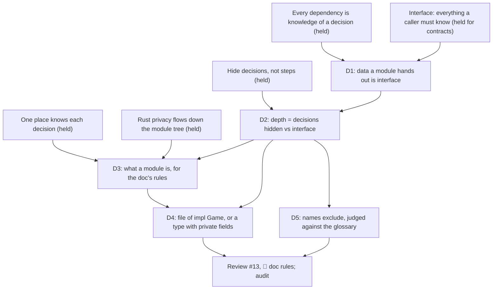

> [!quote] YOU

continue the architecture course


> [!question] Quiz
> Which of these are part of `Game::health`'s interface, meaning a caller in another module must know it to use the function correctly?
>
> ```rust
> pub fn health(&self, object_id: ObjectId) -> Option<i32> {
>     let obj = self.object(object_id);
>     let is_in_play_hero =
>         self.binder.is_hero(obj.def_id) && self.hero_id(obj.player_id) == object_id;
>     let is_in_play_minion = self.binder.is_minion(obj.def_id)
>         && self.get_player(obj.player_id).zones.board.contains(&object_id);
>     (is_in_play_hero || is_in_play_minion).then(|| {
>         // printed health + BuffHealth modifiers (own, granted, and every
>         // aura on every board) - damage
>     })
> }
>
> // state_check.rs
> let health = self.health(object_id).expect("board objects always have health");
> ```
> Pick every one that applies.
>
> 1. It walks every board to collect aura modifiers
> 2. It finds an in-play hero by comparing with `hero_id`
> 3. It takes an `ObjectId` and returns an `Option<i32>`
> 4. It returns `Some` for every character in play


> [!success] Quiz — correct ✓
> Your answer: 3. It takes an `ObjectId` and returns an `Option<i32>`, 4. It returns `Some` for every character in play
> Correct answer: 3, 4
>
> A function's interface is everything a caller must know to use it. The signature is the formal part, and the compiler checks it. "Returns `Some` for every character in play" is informal: no type states it, yet `find_dead` and `hero_health` rely on it through `expect`. If it changed, they would panic. The `hero_id` comparison and the aura walk are implementation. You could store heroes on the board or cache auras, and no caller would change.


> [!question] Quiz
> Two teammates each extract helpers from `legal_actions` (about 90 lines today). Which proposal makes the design worse, measured by what a reader must hold in their head?
>
> **(a)** One function per arm of the `match` on the interaction state:
> ```rust
> match &self.get_player(player_id).interaction_state {
>     Idle => self.idle_actions(player_id),
>     PendingPick { options, .. } => pick_actions(options),
>     Draft { of_object_id, chosen } => self.draft_actions(*of_object_id, chosen),
> }
> ```
>
> **(b)** Pull the body of the draft arm's `for choice in ...` loop into a helper:
> ```rust
> for choice in self.binder.choices(def_id) {
>     if self.try_choice(*of_object_id, choice, chosen, &mut actions, &mut all_choices_fulfilled)
>         .is_break()
>     {
>         break;
>     }
> }
> // try_choice: counts chosen for this choice, returns Continue if it is
> // fulfilled; otherwise pushes the Choose actions that can still finish,
> // sets *all_choices_fulfilled = false, and returns Break.
> ```
> Use the note field if you want to say why.
>
> 1. (a) makes it worse
> 2. (b) makes it worse
> 3. Both make it worse
> 4. Neither makes it worse


> [!success] Quiz — correct ✓
> Your answer: 2. (b) makes it worse
> Correct answer: 2
>
> Each arm in (a) reads disjoint data (the player, the options, the draft), so each helper can be understood without the others and the dispatcher reads as a table. The split adds three small interfaces, and each one hides its arm's logic. (b)'s helper writes two of its caller's locals and signals the caller's `break`. You can't understand it without the loop around it, and you can't understand the loop without it. Ousterhout calls this pair "conjoined": the split added an interface and hid nothing, because both sides still have to be read together. Length isn't the measure. Independence is.


> [!abstract] PI

Now the verified facts:


> [!abstract] PI

Both right. The next one is harder.


> [!question] Quiz
> You want every file under `game/`, other than the history code itself, to be unable to touch the history entries except through `record` and `count`. Which layout makes the compiler enforce that?
>
> Today `Game` (in `game.rs`) has a private field `history`, and `triggering.rs` and `resolve.rs` (both children of `game`) read and push its entries directly.
>
> In every option, `HistoryEntry` and the `record`/`count` logic stay the same. Only where the types and fields are declared changes.
>
> 1. Keep the field on `Game`, and mark the functions in `game/history.rs` `pub(super)` and every other function there private
> 2. Keep `entries: Vec<HistoryEntry>` as a private field of `Game`, and move every function that touches it into `impl Game` in `game/history.rs`
> 3. Declare `struct History { entries }` with `entries` private in `game/history.rs`, with `record` and `count` in an `impl History` there
> 4. Declare `struct History { entries }` with `entries` private in `game.rs`, next to `Game`, with `record` and `count` in an `impl History` there


> [!success] Quiz — correct ✓
> Your answer: 3. Declare `struct History { entries }` with `entries` private in `game/history.rs`, with `record` and `count` in an `impl History` there
> Correct answer: 3
>
> Rust privacy flows down the module tree. A private item is visible in its own module and in every descendant, but not in the parent or in siblings. Every file under `game/` is a descendant of `game`, so a field declared in `game.rs` is visible to all of them, whether it sits on `Game` or on a `History` next to it. Moving `impl Game` blocks or narrowing functions changes who can call those functions. It doesn't change who can read the field. Only a type declared inside `game/history.rs` keeps its private fields out of reach of `game.rs` and its other children.


> [!abstract] PI

Three for three. I'll push further.


> [!question] Quiz
> Measured as Ousterhout's cost (what callers must know) against benefit (what it hides), is `ObjectBag` deep or shallow?
>
> ```rust
> pub(crate) struct Object {
>     pub def_id: DefId,
>     pub object_id: ObjectId,
>     pub player_id: PlayerId,
>     pub damage: u8,
>     pub modifiers: Modifiers,
>     pub friendly_aura: Modifiers,
>     pub choice_targets: Vec<ChoiceTarget>,
>     pub pick_targets: Vec<PickTarget>,
>     /// unique idx updated when object move between zones
>     pub order: usize,
> }
>
> pub(crate) struct ObjectBag {
>     next_id: u64,
>     order_id: usize,
>     objects: BTreeMap<ObjectId, Object>,
> }
>
> impl ObjectBag {
>     pub(crate) fn insert(&mut self, def_id: DefId, player_id: PlayerId) -> ObjectId;
>     pub(crate) fn get(&self, object_id: ObjectId) -> &Object;
>     pub(crate) fn get_mut(&mut self, object_id: ObjectId) -> &mut Object;
>     pub(crate) fn update_order(&mut self, object_id: ObjectId) -> usize;
> }
> ```
> Callers across `game/` do things like `self.objects.get_mut(id).damage += amount` and `obj.pick_targets.push(...)`.
>
> 1. Deep: it is small, and small modules with few methods are deep
> 2. Shallow: four methods are too few to hide anything worth hiding
> 3. Deep: four methods hide the map, the ID counter and the order counter
> 4. Shallow: `get_mut` puts every field of `Object` and its rules in the interface


> [!failure] Quiz — incorrect ✗
> Your answer: 3. Deep: four methods hide the map, the ID counter and the order counter
> Correct answer: 4
>
> The interface is everything a caller must know, and that includes the types a method hands out. `get_mut` returns `&mut Object` with every field `pub`, so a caller has to know `Object`'s whole layout plus every rule about it: that `order` is unique and only `update_order` should set it, what `damage` means, when `pick_targets` gets cleared. None of those rules live in `ObjectBag`. The four signatures look small, but the real top edge of the rectangle is four methods plus nine writable fields and their invariants. The map and the counters are hidden, but that's a sliver of the decisions behind those fields. Method count measures neither cost nor benefit.


> [!abstract] PI

That's the first miss, so now I'll pin down its shape. One variant of the same module:


> [!question] Quiz
> Variant of `ObjectBag`: `get_mut` is removed and replaced by commands. `get` still returns `&Object`, and `Object` keeps its `pub` fields. What must a caller in `game/` still know to use this module correctly?
>
> ```rust
> impl ObjectBag {
>     pub(crate) fn insert(&mut self, def_id: DefId, player_id: PlayerId) -> ObjectId;
>     pub(crate) fn get(&self, object_id: ObjectId) -> &Object;   // read-only
>     pub(crate) fn damage(&mut self, object_id: ObjectId, amount: u8);
>     pub(crate) fn add_pick_target(&mut self, object_id: ObjectId, target: PickTarget);
>     pub(crate) fn clear_targets(&mut self, object_id: ObjectId);
>     pub(crate) fn update_order(&mut self, object_id: ObjectId) -> usize;
> }
> ```
> `Object` is the same struct as before: `def_id`, `player_id`, `damage`, `modifiers`, `pick_targets`, `order` and so on, all `pub`.
>
> Pick every one that applies.
>
> 1. That `pick_targets` gets cleared through `clear_targets`
> 2. The field layout of `Object`
> 3. What a value in `damage` means
> 4. That only `update_order` may write `order`


> [!failure] Quiz — incorrect ✗
> Your answer: 2. The field layout of `Object`, 4. That only `update_order` may write `order`
> Correct answer: 1, 2, 3
>
> `get` still hands out `&Object`, so every reader sees the layout and has to know what each field means: `damage` is damage taken, not current health. Those stay in the interface. The write rules move inside: no caller can write `order` anymore, so "only `update_order` writes it" is now something the compiler enforces, not something callers must remember. `clear_targets` is a command, and when to call it is part of the interface, because a caller has to know to call it after resolving. Removing `get_mut` shrank the interface from "layout plus every write invariant" to "layout plus meanings, plus the commands and when to call them".


> [!question] Quiz
> PR #13 names these files under `game/`. Which names exclude nothing, so any future function in `game/` could plausibly land there?
>
> What each holds in #13:
> - `actions.rs`: `legal_actions`, `apply`, `apply_action`
> - `resolve.rs`: the resolution loop, `apply_effect`, selectors, amounts
> - `verb.rs` (was `zone_move.rs`): draw, play, summon, kill, bury, damage
> - `draft.rs`: the draft search
> - `filter.rs` (was `condition.rs`): the card and character filter match
> - `derived.rs` (was `lookup.rs`): cost, attack, health, modifiers, auras
>
> Pick every one that applies.
>
> 1. `actions.rs`
> 2. `filter.rs`
> 3. `verb.rs`
> 4. `derived.rs`
> 5. `draft.rs`
> 6. `resolve.rs`


> [!failure] Quiz — incorrect ✗
> Your answer: 1. `actions.rs`, 3. `verb.rs`, 4. `derived.rs`, 6. `resolve.rs`
> Correct answer: 3, 4
>
> `verb.rs` and `derived.rs` name kinds of operation: every `&mut self` method is a verb, and every computed `&self` answer is derived. Like `queries.rs`, they exclude nothing, so they collect a slice of every decision. The other four name something in the domain: `Action`, the resolution of effects, the draft, and the filter types. Each one lets you say what doesn't belong. A damage function isn't a draft, and a stat isn't a filter.


> [!abstract] PI

I'm not counting `actions.rs` and `resolve.rs` as plain misses yet, because both are borderline and your reason matters. Here's what the probe found so far:

- **Solid:** the interface includes informal contracts (`health`'s `Some` for characters in play). You judge splits by independence, not length (conjoined helpers). Rust privacy flows down the module tree, so only a type declared in a child hides its fields from the parent.
- **The edge:** you measure an interface by its methods and their contracts. The data those methods hand out doesn't count for you: its layout, what each field means, and the rules for writing it. That's why `ObjectBag` looked deep to you.
- **Names:** you flag `verb` and `derived` correctly. You also flagged `actions` and `resolve`.

Before I plan, one question in plain text: **why did you flag `actions.rs` and `resolve.rs`?** What future function could land in each that shouldn't be there? Your answer tells me whether this is a stricter rule than mine, which may be right, or a different reading of what makes a name vague.


> [!quote] YOU

so actions is a domain term but is also a vague name, many things could be actions, vame for resolve


> [!question] Question
> What should you be able to do at the end of this node? Pick all that matter.
>
> Probe result: interface contracts, conjoined splits, Rust privacy direction and names are solid. The edge is counting the data a module hands out (its layout, field meanings and write rules) as part of the interface, as in `ObjectBag::get_mut`.
>
> The node's planned scope: depth (cost vs benefit), what a "module" means for the doc's rules (the audit's open question: `game/` has eight files of `impl Game`, so is it one module or eight?), names that exclude, then reviewing #13 and #15.
>
> 1. Decide when a file should become its own module (a type with private fields) and when it stays a file of `impl Game`
> 2. Judge whether a split adds or removes complexity before making it
> 3. Measure an interface correctly, including the data it hands out
> 4. Review #13 and #15 and decide their rework
> 5. Settle the doc's definition of "module" so the audit can be rerun


> [!example] Answer
> 1. Decide when a file should become its own module (a type with private fields) and when it stays a file of `impl Game`
> 4. Review #13 and #15 and decide their rework
> 5. Settle the doc's definition of "module" so the audit can be rerun


> [!quote] YOU

I did not get why the last question, I believe I am already capable of 2 and 3 because of 01a, but if u dont thing so they maybe we can include on scope, you are the teacher here


> [!abstract] PI

**Why I asked.** The teach skill checks your goal before planning, because the same topic can be taught for different ends. Here your picks change the order. Goal 1 (file vs module) becomes the sink of the plan, and depth becomes a means to it, not a topic of its own.

**On 2 and 3.** I agree on 2. You judged the conjoined split correctly, and session 01a covered the rest. I disagree on 3, and the probe is my evidence: `ObjectBag` looked deep to you, and you left the meaning of `damage` out of the interface. Goal 1 also depends on it. Deciding whether code becomes a type with private fields means comparing what the type would hide with what it would still hand out. If you can't measure the second, you can't make the call. So I'm keeping 3 in scope as a node on the way to 1, not as a goal of its own. It's one short node.

## The plan

**Approach.** You already hold the roots: every dependency is knowledge of a decision, one place knows each decision, hide decisions rather than steps, and Rust privacy flows down the tree. We build up from them in four nodes:

1. **D1, data is interface.** A caller that reads a field holds knowledge of the layout decision. This follows from session 01's definition, and it's Parnas's complaint about his first decomposition, whose interfaces "are the fairly complex formats and table organizations". This closes the `ObjectBag` gap.
2. **D2, depth.** Benefit is the decisions hidden, cost is everything callers must know, including D1's data. Ousterhout's "simple interface over simple implementation" follows from it. Short, since you hold most of it.
3. **D3, what a module is.** This is the audit's open question, asked open-ended: what does the doc's rule "informal knowledge inside one module is cheap" actually need from a boundary? You derive whether `game/` is one module or nine, and you settle the doc's definition.
4. **D4, file or module.** When does code become a type with private fields, and when does it stay a file of `impl Game`? It builds on D2 and D3, with Ousterhout's cost of subdividing as the counterweight. Production exercise on `game/` with no options. This is goal 1.
5. **D5, names.** A short check: a name is the first piece of the interface, and it's judged against the glossary (your refinement from today).
6. **Review #13 and #15** under D1 to D5. Then you state the rules, I draft them into `file-structure.md`, and I run the audit.

One boundary to watch: "an owner guards its invariants" is session 02. D4 stays on the depth side (a type is worth it when it hides more than it hands out), and anything about who may write state goes to 02's open thread.



Does this plan work for you, or do you want to change the scope or the order?


> [!quote] YOU

sounds good


> [!abstract] PI

## D1: the data a module hands out is part of its interface

**Why we need this first.** Every later node weighs an interface: depth compares it with what's hidden, and the file-or-module call compares it with the alternative. Today you weigh an interface by its methods and their contracts. If the data a module hands out doesn't count, `ObjectBag` looks deep, and so does any module that exposes a struct with `pub` fields. Every judgment after that would be skewed.

**Your derivation.** Start from session 01's definition: B depends on A if some change to A forces a change to B to keep the program correct.

Take `cards/object.rs`, which holds `Object` and `ObjectBag`. Keep all four method signatures exactly as they are: `insert`, `get`, `get_mut`, `update_order`.

1. Name two changes inside `cards/object.rs` that would force edits in `game/`, without touching any of those four signatures. Make one a change to how something is represented, and the other a change to a rule.
2. From that, what is actually in `ObjectBag`'s interface? Say it in your own words.

Answer in plain text.


> [!quote] YOU

1 damage from u8 to i32, order no longer being updated when an object changes zones. I am not sure I agree yet, why not the ObjectBag interface returns Object and the Object interface is the pub fields ? like I kinda get it but I also cannot explain it


> [!abstract] PI

Your two changes are right, and the second one shows more than you meant it to.

- **`damage` from `u8` to `i32`** is a representation change. `get_mut(id).damage += amount` in `zone_move.rs` breaks, and so does `obj.damage as i32` in `health`. In this case the build finds them.
- **"`order` no longer renewed on a zone move"** is a rule change. Look where that rule lives today: not in `cards/object.rs`. The five `update_order` calls sit in `game/`. The module that owns `order` doesn't hold the rule about it. That's what "shallow" looks like from the inside.

**Your question: why not say `ObjectBag`'s interface is four methods, and `Object` has its own interface, the `pub` fields?**

You can describe it that way, and it's accurate. Now apply depth to each one:

- **`Object`'s interface is its entire implementation.** Every field is `pub`, and there are no methods. Interface equals implementation, so it hides nothing and its depth is zero.
- **`ObjectBag`'s interface contains `Object`'s.** A caller can't use `get_mut` without knowing what it returns. The method's interface is "give me an ID, get back a `&mut Object`", and "an `Object`" means nine writable fields plus the rules for each. So the two-interface description doesn't shrink anything. It moves the same cost under a second name.

Ousterhout's measure is the caller's cost, and the caller pays for everything it must know to get its job done. Which module a piece is filed under doesn't change that bill. An extreme version makes this visible: `fn config(&mut self) -> &mut HashMap<String, String>`. It's one method with a tiny signature, and the whole config schema is in its interface, because every caller has to know which keys exist and what each value means.

So the rule:

> **What a module's methods hand out is part of its interface. A returned type brings its fields, the meaning of each field, and the rules for writing it.**

This is also Parnas's complaint about his first decomposition. Its interfaces "are the fairly complex formats and table organizations", meaning data handed between modules, not calls.

Does that answer your objection? If it does, I'll check it with a quiz on another module.


> [!quote] YOU

it does, params count too them no?


> [!abstract] PI

Yes, parameters count the same way. The interface is everything a caller must know, and a caller has to build every argument it passes. So a parameter brings its type's layout, the meaning of each field, and any precondition on the value.

- `Binder::new(defs: Vec<CardDef>)`: the caller has to know `CardDef`'s whole layout to build one. It also has to know an unwritten precondition, "these defs have been validated" (audit finding 9).
- `Game::with_deck_order(seed, decks: [Vec<DefId>; 2])`: the caller has to know that index 0 is the top of the deck, and that there are two players.

The data crosses the boundary in both directions, so it counts in both directions. Now the check, on a module we'll review later:


> [!question] Quiz
> After PR #15, `Binder`'s only methods are `new` and `get`. What is `Binder`'s interface to code in `game/`?
>
> Recap: a module's interface includes the data its methods take and hand out. A type brings its fields, what each field means, and the rules for building or writing it. That holds for parameters as well as return values.
>
> ```rust
> impl Binder {
>     pub(crate) fn new(defs: Vec<CardDef>) -> Self;
>     pub(crate) fn get(&self, def_id: DefId) -> &CardDef;
> }
>
> pub struct CardDef {
>     pub id: DefId,
>     pub name: String,
>     pub kind: CardDefKind,          // Spell / Minion { attack, health, auras } / Hero { health }
>     pub mana_cost: u8,
>     pub modifier_effects: Vec<ModifierEffect>,
>     pub play_effects: EffectSequence,
>     pub triggers: Vec<TriggerDef>,
>     pub choices: Vec<CharacterChoice>,
> }
> impl CardDef {
>     // after #15: health, attack, is_spell, is_minion, is_hero,
>     // has_board_presence, has_deck_presence, aura effects, choice(id)
> }
> ```
>
> 1. Two methods: `new` and `get`
> 2. Two methods, plus `CardDef`'s methods, `pub` fields and what each field means
> 3. Two methods, plus `CardDef`'s methods
> 4. `CardDef`'s `pub` fields only, since `Binder` itself hides the map


> [!success] Quiz — correct ✓
> Your answer: 2. Two methods, plus `CardDef`'s methods, `pub` fields and what each field means
> Correct answer: 2
>
> `get` hands out `&CardDef`, and `new` takes `Vec<CardDef>`, so all of `CardDef` is in the interface. That covers its methods and also its `pub` fields: a caller in `game/` can still `match def.kind` or read `def.triggers` directly, and that knowledge counts whether or not anyone uses it today. Adding methods to `CardDef` doesn't shrink the interface while the fields stay `pub`. It adds a second way to ask the same thing. The map is hidden, and that's real, but it's one small decision next to the card text's whole shape.


> [!abstract] PI

D1 landed.

## D2: depth

**Why now.** You can measure both sides of a module now. The benefit is the decisions it hides, and the cost is everything callers must know, including the data that crosses the boundary. Depth is the ratio of the two. Ousterhout derives a working rule from it, and I want you to derive it before I tell you what it is.

**The question.** Suppose a piece of complexity has to live somewhere. Take the rule "an object gets a fresh `order` stamp when it enters the board". You can put it in one of two places:

- **In the implementation:** `ObjectBag` exposes `move_to_board(id)`, which stamps internally. The module gets more complex, and callers learn one command.
- **In the interface:** `ObjectBag` stays simple with `update_order(id)`, and callers must remember to call it on board entry, and only then.

As a general rule, not just for this case, which side should complexity go to, and why? Answer in terms of who pays the cost and how many times. Plain text.


> [!quote] YOU

does move_to_board(id) do the move or just stamps?


> [!abstract] PI

Good catch. My example was loose. `ObjectBag` doesn't hold the zones, since they're on `Player`, so it can't do the move. Here's a cleaner version:

- **In the implementation:** `ObjectBag` exposes `entered_board(id)`. The caller reports what happened, and `ObjectBag` decides what that means for `order`: today, a fresh stamp. If the rule changes, say to stamp on every zone move or never, only `ObjectBag` changes.
- **In the interface:** `ObjectBag` exposes `update_order(id)`, and every caller has to know when the rule wants it called.

Either way the move itself stays with whoever owns the zones. Only the stamping rule changes sides.

The question is the same. As a general rule, which side should complexity go to, and why, in terms of who pays and how many times?


> [!quote] YOU

rn the methods would be identical with only the name changing, it does change where the decision of entering the board updates the order leaves, in the implementation that decision stays inside the module but it creates another one, every board move must be comunicated to the ObjectBag which is very similar than what we had before just without the "updates the order", I think it should go inside the implementation because it reduces the cost of changes, is this reducing complexity? or incresing depth? or both?


> [!abstract] PI

You found the trade yourself: the call sites stay the same, but what the callers must know changes. Compare the two obligations:

- **`update_order`:** callers must know *when stamping is required*. That's a policy, and policies change. ADR 0012 and the code already disagree about it (audit finding 2).
- **`entered_board`:** callers must know *that they just put something on the board*. They already know that, because they're the ones moving it. It's a fact of what they're doing, and no new policy decision comes with it.

So you're right that a new obligation appears. What makes it cheap is that it asks callers for something they already know, instead of something someone decided.

**Is it reducing complexity, or increasing depth?** Both. They're one change seen from two sides:

- **Depth.** The benefit went up, because one more decision is hidden. The cost went down, because callers now hold a fact instead of a policy. The ratio improves from both ends.
- **Complexity.** In Ousterhout's sense it's what a developer must know to make a change, plus how many places a change touches. The stamp policy went from five call sites in `game/` to one function, so system complexity dropped.
- **The price.** `ObjectBag`'s implementation got a bit more complex, because it now holds a rule.

**Who pays, how many times.** Interface cost is paid by every caller: five places today, each future zone move, and every reader who has to work out when to call it. Implementation cost is paid once, by whoever maintains the module. So complexity should go down into the implementation. Ousterhout puts it as "it is more important for a module to have a simple interface than a simple implementation", and his reason is the same as yours: most modules have more users than developers.

Check:


> [!question] Quiz
> Which of these changes pulls complexity down into the module, rather than pushing it up to callers?
>
> Rule just derived: complexity goes into the implementation, because the interface is paid by every caller and the implementation once. The good obligations to leave callers are facts they already know, not policies someone decided.
>
> 1. `legal_actions` lists every card in hand, and the shell drops the ones the player can't pay for
> 2. `health` returns printed health and a modifier list, and callers sum them with damage
> 3. `apply` takes a `strict: bool` saying whether an illegal action returns `Err` or is ignored
> 4. `draw` applies fatigue itself on an empty deck, instead of returning how many cards it drew


> [!success] Quiz — correct ✓
> Your answer: 4. `draw` applies fatigue itself on an empty deck, instead of returning how many cards it drew
> Correct answer: 4
>
> Fatigue is a rule of the game, and `draw` is where it belongs. Callers only ask for a draw, which is what they already know they want, and the empty-deck case never reaches them. The other three push a decision up. `strict` makes every caller choose a policy the core should own. Filtering in the shell copies the payment rule outside the core. Returning parts of the health calculation makes every caller know how health is computed. Each one shrinks the implementation and grows the interface, and that's the trade the rule says not to make.


> [!abstract] PI

That one landed too.

## D3: what a module is

**Why we need it.** The doc's rules talk about modules, and one rule rests entirely on the word:

> Informal knowledge in the module that makes the decision is cheap, because whoever changes the decision is already editing that module.

Two audit agents couldn't apply it to `game/`. Eight files each add `impl Game` and read `Game`'s private fields. By privacy that's one module of about 1,700 lines. By file it's nine. Depending on which reading you take, a handful of findings are either violations or fine. Until the doc says what a module is, every audit is guesswork.

**A concrete case.** The in-play rule ("which objects are characters in play") is known informally in four files under `game/`:

- `lookup.rs`: `health` checks `is_hero` with `hero_id`, or `is_minion` and on the board
- `game.rs`: `board_characters` chains the heroes with the boards
- `condition.rs`: `scan_characters_with_filter` walks heroes, then boards
- `state_check.rs`: `find_dead` walks the boards and `expect`s `health`

Someone adds a `Location` card kind that sits on the board but isn't a character, and changes the rule in `lookup.rs`.

**Your derivation, open-ended:**

1. Test both readings against the rule's reason. If a module is the privacy boundary (`game` and all its descendants), is that edit cheap? If a module is a file, what can a file hide from its siblings?
2. So what does a boundary have to give for "informal knowledge inside is cheap" to be true? Name each property it needs.
3. From that, write your definition of a module, as the doc should use the word.

Plain text, your own words.


> [!quote] YOU

1: adding location still needs multiple changes and caring only about privacy would consider it cheap which I disagree because of the degree and locality of the changes, in rust a module being a file means it can hide implementation and decide its own interface. 2 I think it must be able to decide its own interface and be capable to hide implementation behind it. 3 anything that can do that, in Rust files and folders can, this closely matches Rust definitions of Module. I am not sure about the answers, question 1 seemed reasonable but then there are jumps to 2 and 3 that I dont feel confident with


> [!abstract] PI

Your part 1 is right. Under the privacy reading the `Location` edit counts as cheap, but it still touches four files that nobody pointed you to. Degree and locality are exactly what the rule's reason ignores at this size. The jump to 2 and 3 felt shaky because one claim in your part 1 is off, and 2 and 3 were built on it. I'll fix that claim first, then take the jump in smaller steps.

**What a file under `game/` can and can't hide.** You're right that `lookup.rs` is a Rust module. Its private functions are invisible to its siblings. But the in-play rule isn't stored in a function. It's a reading of data: `zones.hero`, `zones.board` and the def kind. That data lives in `Game`'s fields, and every file under `game/` can read those fields, because privacy flows down. So `lookup.rs` can hide its helpers, but it can't hide the decision. Any sibling can re-derive the rule from the fields, and three of them did. This is D1 again: when the data is in reach, its meaning is in the interface, whether or not a function wraps it.

**The smaller steps.** The rule's reason, "whoever changes the decision is already editing that module", breaks into two claims:

- **(a) Nobody outside holds the knowledge.** Otherwise the edit misses places outside the module.
- **(b) Whoever edits inside sees every place that holds it.** Otherwise "already editing that module" doesn't mean "already looking at every copy".

Now score the two readings:

| | (a) bounded | (b) all holders seen |
|---|---|---|
| A file under `game/` | ? | ? |
| `game` as a whole (privacy) | ? | ? |

Fill in the four cells, yes or no with a few words each. Then answer: what would a boundary need to be to get a yes in both columns?


> [!quote] YOU

A file under game/ is not bounded because the data is acessible and so other places could have writen the same rule, all holders are also not seen because the decision may be scatered. game complies with bounded because everything is private to the outside, but all holders seen is true because they all inside the module even though they are scattered in multiple files. So a module is something capable to fully hide its decisions and in a way that other modules are not able to copy it


> [!abstract] PI

Three of the four cells are right. The fourth contradicts your own part 1.

You marked `game` yes on (b), "all holders seen", because the holders are inside the module. But in part 1 you said the `Location` edit isn't cheap because of degree and locality. Four files, about 1,700 lines, and the person editing `lookup.rs` has no reason to open `state_check.rs`. Being inside the boundary bounds the search, which is (a). It doesn't mean the editor is looking at every copy, which is (b). If being inside were enough, your part 1 objection would vanish, and it shouldn't, because it's correct.

So the table is:

| | (a) bounded | (b) all holders seen |
|---|---|---|
| A file under `game/` | no: siblings read the data | no |
| `game` as a whole | yes: privacy | **no: too big to read as a whole** |

Your definition, "fully hide its decisions so that other modules can't copy it", is (a), and (a) is the compiler's half. (b) is the human half, and nothing in your definition supplies it yet.

Parnas has a word for the human half. He calls a module "a responsibility assignment rather than a subprogram": one person's job, sized so that person can hold all of it.

**Revise your definition so it earns a yes in both columns.** Then say what that means for `game`, which gets (a) but not (b). Plain text.


> [!quote] YOU

"fully hide its decisions so that other modules can't copy it" and small enough for a human to understand the ripples of the decision? I very much dislike a definition that depends on the capability of its reader, specially now that agents can also read code


> [!abstract] PI

You're right to reject it, and agents aren't the only reason. The two audit agents read every line of `game/` and still disagreed about which places hold which decision. Reading capacity wasn't what they lacked. So "small enough for a reader" is fuzzy, and it's also aimed at the wrong thing. Let's find a structural property that gets (b) without asking who the reader is.

**Look at why `game` fails (b).** It's not the line count as such. The in-play rule's four holders sit among the code for stamps, drafts, mana, history and triggers, and nothing marks which lines belong to which decision. Whoever edits the rule has to sort the module's code by decision before editing. That sorting is the search (b) needs gone.

**Now take a boundary that hides exactly one decision,** or a few that always change together. Every line inside exists to serve that decision. Whoever changes the decision edits that module, and everything they need to check is in it, because there's nothing else in there. (b) then holds by construction, at any size and for any reader. This is Parnas's own description of his second decomposition: "Every module ... is characterized by its knowledge of a design decision which it hides from all others."

So a definition with no reader in it:

> **A module is a boundary the compiler enforces (in Rust, a `mod` whose private items include the data) that hides one decision, or a few that change together. Informal knowledge inside it is cheap because all of its code serves that decision.**

For `game`, the verdict is that it's one module by the compiler and it hides many decisions. So the doc's cheapness claim doesn't apply inside it, and the decisions in it need modules of their own. That's D4.

Does this definition hold up for you? If it does, state it in your own words for the doc, changing anything you'd put differently. If it doesn't, push on it.


> [!quote] YOU

A module is a enforced boundary that hides one decision, or a few that change together, that cannot be copied from outside. - in Rust, a mod whose private items include their data. - Informal knowledge inside it is cheap because all of its code serves that decision.
The copy part is because if the interface exposes the data or recieves the data then it just hides its copy of the decision but it can be copied elsewhere. I agree with it, but I would put the rust and informal knowledge part as points and not on the definition itself


> [!question] Quiz
> Using your definition, which of these are modules in the doc's sense?
>
> Your definition: **a module is an enforced boundary that hides one decision, or a few that change together, that cannot be copied from outside.**
>
> - `turn.rs`: `TurnOrder { active_idx, turn_count, players }`, all private. Methods: `new`, `get_active_player_id`, `end_turn`, `turn_count`.
> - `rng.rs`: `Rng { state }`, private. Methods: `new`, `next_u64`, `below`, `shuffle`.
> - `cards/object.rs`: `ObjectBag` with a private map and counters. Methods: `insert`, `get`, `get_mut -> &mut Object`, where `Object` has nine `pub` fields.
> - `game/lookup.rs`: `impl Game` with `health`, `attack`, `mana_cost`, `triggers`, a private `modifiers` helper. Reads `Game`'s private fields.
> - `game` as a whole: `Game`'s fields are private to `game` and its children. It holds the in-play rule, stamps, drafts, mana, history, triggers and more.
>
> Pick every one that applies.
>
> 1. `game` as a whole
> 2. `rng.rs`
> 3. `cards/object.rs`
> 4. `game/lookup.rs`
> 5. `turn.rs`


> [!success] Quiz — correct ✓
> Your answer: 2. `rng.rs`, 5. `turn.rs`
> Correct answer: 2, 5
>
> Note: game is not as discussed, object is not because it holds the decisions about the object shape and the decision on how to create/store one
>
> `TurnOrder` hides seat order and turn counting, and `Rng` hides the generator algorithm. Each holds one decision, behind private fields that nobody else can read or write, so neither decision can be copied out. `ObjectBag` hides its map, but `get_mut` hands out every field of `Object`, so the decisions about those fields are known wherever they're used. `lookup.rs` can't hide anything it reads, because its data lives in `Game`, which its siblings read too. `game` passes the compiler's half: nothing outside reaches its fields. It fails the one-decision half, though, because it holds a dozen. It's a Rust module, not a module in the doc's sense.


> [!abstract] PI

Rewrapping the shortened paragraph:


> [!abstract] PI

Here's the draft in `docs/conventions/file-structure.md`:

**General, right after the definition of a decision:**

> A module is an enforced boundary that hides one decision, or a few that change together, so that code outside it can't copy the decision.
>
> - Data a module takes in or hands out is part of its interface: its layout, what each field means and the rules for writing it. A decision whose data crosses the boundary isn't hidden, because any caller can copy it.
> - Informal knowledge inside a module is cheap, because all of its code serves its decision. A boundary that holds many decisions doesn't get this, since its code has to be sorted by decision before a change.

**The old cheapness sentence** in the coupling section now reads "Informal knowledge in the module that hides the decision is cheap. In any other module, make it formal." The reason lives only in the bullet above.

**Rust, new `### Modules` subsection:**

> A module in the general sense is a `mod` whose private items include the data its decision is stored in. Privacy flows down the module tree: a child reads its parent's private fields, and a parent can't read a child's. So child files that add `impl` blocks to their parent's type are part of the parent's module, and a decision hides from the parent only in a type declared in a child.

The first bullet holds D1, "data is interface", through your "can't copy" clause. D2, "simple interface over simple implementation", isn't written down yet. I'd fold it into D4's rule, since that's where it decides things.

Review it, and I'll commit it as this node's doc change. Edit any wording you'd say differently.


> [!quote] YOU

should we change "A boundary that holds many decisions" to "A boundary that holds many unrelated decisions" , I would make the rust part two points, one with "A module in the general sense is a mod whose private items include the data its decision is stored in." and other "Privacy flows down the module tree: a child reads its parent's private fields, and a parent can't read a child's. So child files that add impl blocks to their parent's type are part of the parent's module, and a decision hides from the parent only in a type declared in a child."


> [!abstract] PI

The Rust part is now two bullets, as you wrote them.

On "unrelated": I agree the sentence needs a qualifier, because without one it contradicts the definition, which allows a few decisions that change together. My concern is that "unrelated" is a word the doc never defines, and Ousterhout alone gives four different senses of "related". The doc's own test is change: "a few that change together". So I'd suggest:

> A boundary that holds many decisions **that change independently** doesn't get this, ...

It uses the same criterion as the definition right above it, so a reader judges both with one test. Pick "unrelated", "that change independently", or something else, and I'll apply it and commit.


> [!quote] YOU

independently better yes


> [!abstract] PI

Committed as `bea11ed`.

## D4: a file of `impl Game`, or a type with private fields?

**Why.** This is your goal 1. `game` is one Rust module with a dozen decisions in it, so by your own definition it needs modules inside it. But each one costs something. Ousterhout lists what subdividing adds: more interfaces, code to manage the parts, separation that makes them harder to see together, and sometimes duplication. In session 00 you feared delegation boilerplate on `Game`, and that's the second cost. So not every decision earns a type. We need a test for which ones do.

**Two candidates from `game/`:**

**(A) Mana.** `Player` has `mana: u8` and `max_mana: u8`, both `pub(super)`. Three places know the rules:
- `legal_actions`: `if mana_cost > mana { continue; }`
- `apply_action`: `player.mana -= mana_cost`
- `start_turn`: `max_mana = (max_mana + 1).min(10); mana = max_mana`

The candidate is `struct Mana { current, max }` with private fields, `can_pay(cost)`, `pay(cost)` and `refill()`, declared in a child module.

**(B) Outcome.** `Game` has `outcome: Option<Outcome>`. It's written in one place, `decide_outcome` in `state_check.rs`. It's read by `legal_actions` (`is_some()` returns no actions) and by the public `outcome()` getter. The candidate is `struct OutcomeSlot { outcome }` with private fields, `set(outcome)` and `get()`, declared in a child module.

**Open-ended, in your own words:**

1. For each candidate, what does the type hide that the field doesn't already hide, and what does it cost? Does it pay for itself?
2. Generalize: what test tells you a decision under `game/` should become a type with private fields, and when it should stay a field plus a file of `impl Game`?


> [!quote] YOU

1: Mana one hides what means to pay and refill mana, I think it pays for itself. Outcome hides almost nothing, the underline representation could change to something other than the enum, but in rust this is not a gain as enum are heavily optimized, it exposes similar things then before, being abble to access and set an outcome, I think it does not pay for itself.
in both cases they cost a new interface and replacing the old calls
2: it should become its own module when its involved in several decisions and they move inside the module in a way that the complexity inside the module increases and the complexity outside decreases enough to justify its interface


> [!abstract] PI

Your answer to 1 is right on both counts. One refinement on Outcome. The reason it doesn't pay isn't that enums are well optimized. It's that one place, `decide_outcome`, already knows the rule, and `set`/`get` mirror the field one to one. The type would remove no copies, and its interface would be as big as its implementation. That's shallow in Ousterhout's exact sense.

Your rule in 2 has the right core: complexity moves inside, and what leaves the outside has to be worth the new interface. Two things to tighten:

- **"Involved in several decisions"** pulls against the definition you just committed, where a module hides one decision. I think you meant that the decision is *known in several places*. Mana is one decision known in three functions. Is that what you meant?
- **"Enough to justify"** makes the call on feel, and you rejected a reader-dependent definition an hour ago. Your two answers already contain checkable signals:
  1. **Copies to remove.** Mana's rules are known in three places today, and Outcome's write rule in one.
  2. **An interface narrower than the data.** `can_pay`/`pay`/`refill` are commands and questions in the domain's words, and callers never touch the two numbers. `set`/`get` just mirror the field.
  3. **No data handed out** (D1). If callers still needed `mana` and `max_mana` as raw numbers, the type would hide nothing.

So a sharper version:

> Make a decision its own type with private fields when its knowledge sits in more than one place today, and an interface of questions and commands, narrower than its data, can replace that knowledge. If one place already knows it, or the interface would mirror the fields, leave it as a field and a file.

Is that your rule? Keep it, edit it, or push back. One thing I'd like your view on: should "more than one place today" also count "will be known in more than one place by planned work"?


> [!quote] YOU

I was thinking about multiple actually because now many hides the refill and pay decision, but even without refill I think it would be justfiable, so one decision is fine. there are some new things on your definition I would not have though of myself, can u explain? "narrower than its data" on mana u are comparing 3 functions with 2 integers and saying the 3 functions are narrower, it does not sound right to me. "If one place already knows it" shouldnt be "only one"? "leave it as a field and a file." field and file? should outcome become its own file? if not I would just say "leave it". "Make a decision its own type with private fields" u are restating the definition of module, wdyt of "Make a decision its own Module"? I think "will be known in more than one place by planned work" should count yes, is your context too full? should we defer to another session?


> [!abstract] PI

Taking your points in order.

**One decision or two.** Agreed, one is fine. Pay and refill are rules of the same mana pool, and "a few that change together" already covers that.

**"Narrower than its data".** You're right that it reads wrong. I was counting knowledge, not items. Two raw `u8`s look small, but a caller holding them has to know every rule for writing them: the cap at 10, that refill sets current to max, that a payment must not underflow, that current never exceeds max. The three functions ask callers to know none of that. So the measure is "asks callers to know less than the data would", not "has fewer items".

**"If one place" should be "if only one place".** Yes.

**"A field and a file".** That was unclear. "Leave it where it is" says what I meant.

**"Its own module".** Yes. Now that the doc defines the word, use it. The Rust section says what that takes in Rust.

**Planned work counts.** Agreed. The doc already lists "what the roadmap plans" as evidence that a decision is likely to change.

Revised:

> Make a decision its own module when its knowledge sits in more than one place, today or in planned work, and an interface of questions and commands can replace that knowledge while asking callers to know less than the data would. If only one place knows it, or the interface would mirror the fields, leave it where it is.

**On my context.** I'm not at a limit, but the conversation is long, and the remaining work is heavy: D4's check and production exercise, D5, reading the #13 and #15 diffs, then the audit with its agents. The reviews in particular need fresh diffs in context. My suggestion is to finish D4 here (your OK on the rule, a quiz, and the no-options exercise on `game/`), then close at that node boundary. The next session takes D5, the #13 and #15 reviews, and the audit. Does that split work, and is the rule above yours?


> [!quote] YOU

yes, lets split the D5 onwards on another session


> [!abstract] PI

I added the rule as the last bullet under "Build modules around decisions, not steps". Now a check:


> [!question] Quiz
> By the rule, which of these should become their own module?
>
> The rule: **make a decision its own module when its knowledge sits in more than one place, today or in planned work, and an interface of questions and commands can replace that knowledge while asking callers to know less than the data would. If only one place knows it, or the interface would mirror the fields, leave it where it is.**
>
> - **History.** `triggering.rs` builds entries and pushes onto `self.history.entries`. `resolve.rs` walks the entries to count, for example, minions that died this turn.
> - **The effect stack.** `effect_stack: Vec<PendingEffect>` gets pushes in `zone_move.rs` (`play`, `kill`) and `triggering.rs` (`enqueue_triggers`), and pops in `resolve.rs`. The order rules ("newest resolves first", own effects after the reactions they cause) live in that push order.
> - **`Player::playing`.** A `bool` set to `true` in `Player::new` and to `false` in exactly one place, `remove_dead`. It's read through `Game::playing(player_id)`.
> - **`Player::id`.** A `PlayerId` set in `Player::new` and never written again. It's read in a few places to map a player to its ID.
>
> Pick every one that applies.
>
> 1. `Player::playing`
> 2. The effect stack
> 3. `Player::id`
> 4. History


> [!success] Quiz — correct ✓
> Your answer: 2. The effect stack, 4. History
> Correct answer: 2, 4
>
> Note: 2 if we could put the order decision inside the module
>
> History's layout is known where entries are built and where they're counted. `record(event)` and questions like `died_this_turn(kind)` would replace both, and callers would stop knowing the entry format (that's #16). The effect stack's order rules are known at every push site in three files. Commands such as "push these reactions, then the card's own effects" let callers stop knowing the order (#17, session 02). `playing` has one writer and one reader, and a type would offer `set_out()` and `is_playing()`, which mirror the bool. `id` has no rule to hide at all. Both stay where they are.


> [!abstract] PI

Your note is the second condition of the rule. A `Stack` type with only `push` and `pop` would mirror the `Vec`, and every push site would still know the order. It earns a module only if the order goes inside, behind commands. Whether it can is #17's question for session 02.

## D4 production exercise

No options this time. Time yourself if you like.

Pick **three decisions under `game/` that we haven't discussed today**, so not mana, outcome, history, the effect stack, `playing` or `id`. For each one:

1. Name the decision and where its knowledge sits today (files or functions).
2. Your verdict by the rule: its own module, or leave it where it is.
3. If it gets a module: its questions and commands, and what callers stop knowing. If it doesn't: which condition of the rule it fails.

Plain text.


> [!quote] YOU

"What it takes to create a game" lives in 3 functions inside game.rs, two there are public making this live on every caller also, going to a N player game or adding/changing one parameter means editing every test on the public interface, I think it deserves its own module prepared for this changes, something like a builder pattern with a .shuffle() and .add_player(DeckDefs) , that way callers stop needing to know everything a game can take and know only what they pass to it.
"How to get the object triggers" rn we have a function for it on lookup but anything inside game can copy this decision, but I think Objects deserve their own module where all the internal logic on how to get triggers, modifiers, effects, health are hidden, this might need duplicating the data as objects need their definitions to know this things.
"How to move something between zones" this lives in several functions and any change on what happens during this moves means visiting all of them, I see value in zones getting its own module to hide the decisions on what means to move zones, it would have to access the objects somehow the update the order, or maybe the order could stay on the zones and how to sort would be on the zone. these 2 seem big and deep modules that might benefit for having other modules inside


> [!abstract] PI

Good work, and one of the three is better than I expected. Taking them in turn:

**1. Creating a game: sound.** The decision is what a game takes: the seed, the decks, the player count, shuffled or not. Every caller of `new` and `with_deck_order` knows that parameter list, which means every test, the bench and the shell. A change to it touches all of them. The build finds them, but the degree is huge. A builder with private fields lets callers know only what they set, and a new option with a default touches no caller. One distinction: dealing 3 cards and starting player 0's turn are known only in `setup`, so those stay as they are inside it. Planned work counts here. Check the card-game roadmap before you bet on N players, though, since the rule wants evidence and not a guess.

**2. "Objects": the right decision, the wrong boundary.**
- You're right that the knowledge is spread out. `health`, `attack` and `mana_cost` each filter modifiers on their own (audit finding 13), and `triggers` combines printed and granted triggers.
- But "Objects" is a noun, not a decision. A module built around it would bundle at least three decisions that change independently: how stats combine modifiers, how triggers are collected, and the in-play rule. Your own definition rejects that.
- The data problem you spotted is the giveaway. `health` needs the zones (in play?), every aura on every board, and the definitions. An `Objects` module would need most of `Game` passed in, or a copy of it, and a copy is a second place that knows. When a module has to reach for data it doesn't hold, the boundary is drawn around an entity and not around a decision.
- The decision-shaped version is narrower: a modifiers module that answers stat questions from a list of modifiers, which is #18. Grouping by noun is the OO habit you were wary of in session 00, and session 02 takes it apart properly.

**3. Zone moves: sound, with an idea worth keeping.**
- The `order` stamp is written in five functions and read by three sorts (audit finding 2). The knowledge really is in several places.
- Your idea of keeping `order` on the zones is a good one. ADR 0012 defines the order of play as the order of board entry, which is a property of the board. A `Board` that keeps its own entry order would remove `Object.order` entirely, and the three sorts would become questions to the board. Heroes and graveyard order make it harder, so it's a candidate for the refactor, not a verdict.
- One limit: a move also emits events, and events enqueue triggers, which need the whole game. So the zones module can hide the representation and the stamp, while the sequence "move, then emit" stays with the coordinator, per the 01a rule on steps.

**The pattern:** you find the spread-out knowledge reliably. When you draw the boundary, check that it surrounds one decision and the data that decision needs, and not an entity.

Now the doc bullet for D4, last under "Build modules around decisions, not steps":

> - Make a decision its own module when its knowledge sits in more than one place, today or in planned work, and an interface of questions and commands can replace that knowledge while asking callers to know less than the data would. If only one place knows it, or the interface would mirror the fields, leave it where it is.

If you approve it, I'll commit it, then close the session: update `COURSE.md` (knowledge map, open threads including your builder and board-order ideas, next session's plan: D5, the #13 and #15 reviews, the audit), create the next log, and commit. OK to proceed?


> [!quote] YOU

yes


> [!abstract] PI

Now the `COURSE.md` edits.
