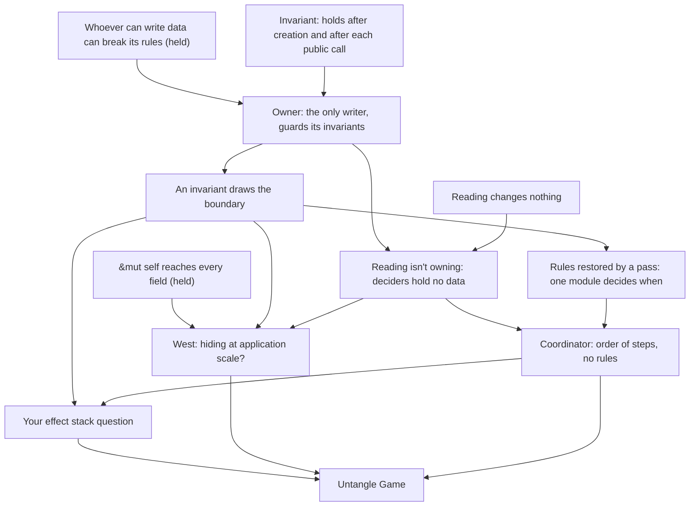

> [!quote] YOU

continue the architecture course


> [!question] Question
> What do you want from session 02 (ownership and aggregates)? Pick all that apply.
>
> The course plan has four nodes: who can write data can break its rules; in Rust, `&mut self` reaches every field; owners guard invariants and orchestrators coordinate; aggregates, where the invariant draws the boundary. Some open threads were also deferred to this session. The options below are those items. Tell me if something else matters more.
>
> 1. Untangle `Game`
> 2. Your effect stack question
> 3. Aggregates for finance work
> 4. Catherine West's view
> 5. Decisions that need other modules' data
> 6. Your `verb.rs` design


> [!example] Answer
> 1. Untangle `Game`
> 2. Your effect stack question
> 4. Catherine West's view
> 5. Decisions that need other modules' data


> [!question] Quiz
> Which code can break the `order` rule for the objects inside a `Game` without a compile error?
>
> The rule: each object's `order` is unique, and it increases every time the object changes zone. `ObjectBag::update_order` follows it.
>
> ```rust
> // cards/object.rs
> pub(crate) struct Object {
>     pub def_id: DefId,
>     pub damage: u8,
>     /// unique idx updated when object move between zones
>     pub order: usize,
>     // ...
> }
>
> pub(crate) struct ObjectBag {
>     next_id: u64,
>     order_id: usize,
>     objects: BTreeMap<ObjectId, Object>,
> }
>
> impl ObjectBag {
>     fn next_order(&mut self) -> usize { /* order_id += 1 */ }
>     pub(crate) fn get_mut(&mut self, id: ObjectId) -> &mut Object { /* ... */ }
>     pub(crate) fn update_order(&mut self, id: ObjectId) -> usize {
>         let order = self.next_order();
>         self.get_mut(id).order = order;
>         order
>     }
> }
>
> // game/mod.rs
> pub struct Game {
>     objects: ObjectBag,
>     // ...
> }
> ```
>
> `update_order` has five callers today, all in `game/zone_move.rs`.
>
> 1. Only `ObjectBag`'s own methods, since `next_order` and `order_id` are private
> 2. Any code in `game/` and its children, through `get_mut` and the `pub` field
> 3. Only the five callers of `update_order` in `game/zone_move.rs`
> 4. Any code in the crate, through `get_mut` and the `pub` field


> [!success] Quiz — correct ✓
> Your answer: 2. Any code in `game/` and its children, through `get_mut` and the `pub` field
> Correct answer: 2
>
> `objects` is a private field of `Game`, so only `game/mod.rs` and its child modules can reach it. Any of them can call `get_mut` and write `order` directly, because the field is `pub`. Keeping the counter private guards the next value to hand out, not the field. Today's five callers are the code that writes it now, not all the code that could. The build accepts a sixth writer anywhere in `game/`.


> [!quote] YOU

its ok to break this into multiple sessions as we did for 01


> [!abstract] PI

Agreed. I'll split the session at node boundaries, as we did for 01. Once the probe shows where your edge is, the plan will say where the cuts go.

Next probe question.


> [!question] Quiz
> `damage` writes only `self.objects` and calls `emit`. What does the compiler assume about it at a call site?
>
> (Splitting into sub-sessions is fine. I'll place the cuts in the plan once the probe is done.)
>
> ```rust
> // game/zone_move.rs
> impl Game {
>     pub(crate) fn damage(&mut self, target: ObjectId, amount: u8,
>                          source: ObjectId, obs: &mut impl Observer) {
>         let object = self.objects.get_mut(target);
>         object.damage += amount;
>         self.emit(Event::Damaged { target, amount, source }, obs);
>     }
> }
> ```
>
> A caller elsewhere in `game/` holds `let board = &self.players[0].zones.board;` and calls `self.damage(...)` while `board` is still in use.
>
> 1. It may write any field of `Game`, but the call is accepted because `board` is only read
> 2. It writes only `objects`, so the call is accepted while `board` is alive
> 3. It writes `objects` and whatever `emit` writes, so the call is accepted while `board` is alive
> 4. It may write any field of `Game`, so the call is rejected while `board` is alive


> [!success] Quiz — correct ✓
> Your answer: 4. It may write any field of `Game`, so the call is rejected while `board` is alive
> Correct answer: 4
>
> Note: often I have to modify the way the code is written because I cannot read a field in game and write another
>
> The borrow checker checks one function at a time, against signatures alone. `&mut self` means "may write every field of `Game`", whatever the body actually touches. The caller's shared borrow of `self.players` conflicts with that, so the call is rejected. A reader gets the same answer from the signature: it can't tell which invariants `damage` might break without reading the body, and the body of everything it calls.


> [!question] Quiz
> Suppose `Player`'s fields become private and `Player` gets the method below. What does that change?
>
> Today `Player`'s fields are `pub(super)`, and `Game` writes `player.mana` directly in `start_turn` and `apply_action`.
>
> ```rust
> // game/player.rs
> pub(super) struct Player {
>     mana: u8,
>     max_mana: u8,
>     // ... other fields, all private
> }
>
> impl Player {
>     pub(super) fn spend_mana(&mut self, amount: u8) -> Result<(), NotEnoughMana> {
>         if amount > self.mana {
>             return Err(NotEnoughMana);
>         }
>         self.mana -= amount;
>         Ok(())
>     }
> }
> ```
>
> 1. Nothing changes for `Game`, since its `&mut self` still reaches `Player`'s fields
> 2. `Player` becomes an object in the OOP sense, and its data is no longer plain data
> 3. Only `player.rs` can break the mana rules now, and `Game` asks `Player` to spend
> 4. Only `Game` can break the mana rules now, since it is the only caller of `spend_mana`


> [!success] Quiz — correct ✓
> Your answer: 3. Only `player.rs` can break the mana rules now, and `Game` asks `Player` to spend
> Correct answer: 3
>
> The private fields are hidden from `game/mod.rs` and every sibling module, so every write to `mana` has to go through `Player`'s own methods, and only `player.rs` can break the rules. `&mut self` on `Game` reaches the `players` field, but privacy still stops it at `Player`'s private fields. `Player` is still a plain struct you can clone, compare and print. What changed is who can write it, not what kind of thing it is.


> [!question] Quiz
> You're splitting `Game`'s data into owners, each with private fields. Which test says two pieces of data must share one owner?
>
> "Share one owner" means the same private struct holds both, or a parent owner holds the two children that hold them.
>
> ```rust
> pub struct Game {
>     rng: Rng,
>     turn_order: TurnOrder,
>     players: Vec<Player>,   // mana, max_mana, zones, interaction_state, playing
>     objects: ObjectBag,     // damage, modifiers, order, choice_targets, pick_targets
>     binder: Binder,
>     history: History,
>     outcome: Option<Outcome>,
>     effect_stack: Vec<PendingEffect>,
>     resolving_effect: Option<ResolvingEffect>,
> }
> ```
>
> 1. They share an owner when they describe the same domain noun
> 2. They share an owner when one function reads both of them
> 3. They share an owner when one action changes both of them
> 4. They share an owner when a rule between them must hold after every change


> [!question] Quiz — I don't know
> Your answer: I don't know
> Correct answer: 4
>
> Note: I think its 4 but I would not have come with it on my own
>
> An owner can guard a rule only if it can write every piece of data the rule mentions. If the rule spans two owners, each can change its half and break the rule without the other knowing. So a rule that must hold after every change pulls its data into one owner. Readers don't: any number of functions can read from several owners through their questions. Nouns don't either: a domain noun can hold several independent rules, the way `Object` holds damage, order and pick targets. Actions don't: `play` changes mana, the hand, the effect stack and history, and no rule ties them together.


> [!quote] YOU

by rule here u mean decision?


> [!abstract] PI

Close, but narrower. In the doc, a decision is any choice the code makes where another was possible: a representation, a rule, a meaning, an order or a policy. By "rule" I meant one kind of decision, an **invariant**. An invariant is a statement about stored data that must be true whenever no code is in the middle of changing it. For example:

- `mana ≤ max_mana`
- each object's `order` is unique
- `resolving_effect` is `None` once its effects are finished

The doc already touches on this. "Data as interface" lists "the rules for writing it" as part of a data's interface. Those rules are the invariants.

Not every decision is an invariant:

- "Index 0 of the deck is the top" is a meaning. It says how to read the data, not which values are allowed.
- "Fatigue damage should fire damage triggers" is a behavior rule. It says what a change must do, not what a state must look like.

Hiding these is about who *knows* them, the Parnas side.

For an invariant, one more thing matters: who can *write* the data it talks about, because any writer can break it. So the ownership test reads: two pieces of data must share an owner when an invariant ties them together. Otherwise each half can change without the other knowing.

Your note ("4, but I wouldn't have come up with it") matches the pattern from earlier sessions: you recognize the rule but can't yet derive it. I'll build that derivation in the teaching phase.

Let me know if this clears it up, and I'll continue the probe.


> [!quote] YOU

yes, it does


> [!abstract] PI

Next probe question.


> [!question] Quiz
> A `Zones` owner holds one player's hand, deck, board and graveyard in private fields. How much of today's `draw` goes inside it?
>
> Today's `draw`, per card:
>
> ```rust
> // game/zone_move.rs, inside impl Game
> let player = self.get_player_mut(player_id);
> if let Some(object_id) = player.zones.deck.pop_front() {
>     player.zones.hand.add(object_id);
>     self.emit(Event::Drew { player_id, object_id }, obs); // history, observer, trigger matching
>     self.objects.update_order(object_id);
> } else {
>     let hero_id = player.zones.hero;
>     self.objects.get_mut(hero_id).damage += 1;            // fatigue
>     self.emit(Event::FatigueDamaged { /* ... */ }, obs);
> }
> ```
>
> `emit` records history, reports to the observer, and matches every character's triggers. Hero damage lives in `objects`, not in `Zones`.
>
> 1. Moving the top card to the hand as one command that reports an empty deck. The caller emits and applies fatigue
> 2. Only `pop_front` and `add`. The caller moves the card from the deck to the hand, then emits and applies fatigue
> 3. All of `draw`, events and fatigue included, since every branch starts from the deck


> [!success] Quiz — correct ✓
> Your answer: 1. Moving the top card to the hand as one command that reports an empty deck. The caller emits and applies fatigue
> Correct answer: 1
>
> Note: in 2 he did not need to hold both zones and in 3 he would need to hold more than just the 2 zones
>
> The invariant that `Zones` can guard is "a card sits in one zone at a time". That holds only if no caller can take a card out of the deck without putting it somewhere. So the move from deck to hand is one command inside `Zones`. With only `pop_front` and `add`, every caller knows the rule and can drop a card between the two calls. Events and fatigue write data `Zones` doesn't own: history, the effect stack, and the hero's damage. Putting them inside would mean `Zones` owns those too, which is how `Game` grew. An owner holds the code that can break its own invariants, not every piece of code that starts from its data.


> [!question] Quiz
> Every field of `Game` becomes an owner type with private fields, and `Game`'s own field list stays as it is. Which statement holds?
>
> Before, `Player`, `ObjectBag`, the stack and the rest have fields that every module in `game/` can write. After, each one is a struct whose fields only its own module can write, with commands and questions as its interface.
>
> ```rust
> pub struct Game {
>     rng: Rng,
>     turn_order: TurnOrder,
>     players: Vec<Player>,
>     objects: ObjectBag,
>     binder: Binder,
>     history: History,
>     outcome: Option<Outcome>,
>     effect_stack: EffectStack,  // was Vec<PendingEffect> plus Option<ResolvingEffect>
> }
> ```
>
> 1. `Game` is still one big state, and its `&mut self` methods can still break every invariant
> 2. `Game` is now OOP encapsulation, which data-oriented design avoids
> 3. `Game` is no longer one big state, and its owners guard their invariants
> 4. `Game` is still one big state, and its owners guard their invariants


> [!success] Quiz — correct ✓
> Your answer: 4. `Game` is still one big state, and its owners guard their invariants
> Correct answer: 4
>
> Note: very nice question, I am not sure being a big state is good or bad
>
> How the state is laid out and who can write it are separate questions. `Game` still holds the whole game in one tree of values, and you can still clone it, compare it and hand out views of it. What changed is that each field's type now decides who can write its insides, so `Game`'s `&mut self` reaches the owners but stops at their private fields. Encapsulation in this sense means "only one module can break this invariant". It doesn't require objects that send messages, inheritance, or behavior spread across entities.


> [!question] Quiz
> Say objects, zones and the binder each become an owner with private fields. Where does trigger matching go?
>
> Trigger matching runs on every event. For each character in play, in order of play, it reads:
> - the character's triggers: printed ones from the binder, granted ones from the object's modifiers
> - the event's subject: its owner, its kind (binder) and where it is (zones)
>
> It decides which triggers match and pushes them onto the effect stack. It writes nothing else.
>
> ```rust
> // game/triggering.rs, today
> pub(crate) fn emit(&mut self, event: Event, obs: &mut impl Observer) {
>     self.history_from_event(&event);
>     obs.event(&event);
>     for object_id in self.characters_in_order_of_play() {
>         let obj = self.objects.get(object_id);
>         self.enqueue_triggers(obj.player_id, object_id, &event); // matches, then pushes
>     }
> }
> ```
>
> 1. Into `Game`'s own code, since only `Game` can reach every owner
> 2. Into the objects owner, since triggers are part of each object
> 3. Into a module with no data of its own, which reads what it needs through the owners' questions
> 4. Into one owner of objects, zones and the binder, since matching reads all three


> [!failure] Quiz — incorrect ✗
> Your answer: 4. Into one owner of objects, zones and the binder, since matching reads all three
> Correct answer: 3
>
> Note: todays that is the game, but could not be? I see a large intersection on what it would own with game, but I think game would have more things
>
> Matching writes none of the data it reads, so it can't break any of their invariants and has no reason to own them. Reading needs only the owners' questions. Merging the three owners because matching reads them is how `Game` grew: reading is not a reason to own. Putting it in the objects owner would give that owner a decision that needs the binder and zones, so it would have to reach outside itself. Putting it in `Game` mixes a domain rule (which triggers match an event) into the coordinator, whose only job is the order of the steps. Matching is a decision, so it gets a module of its own. It just has no data of its own.


> [!quote] YOU

ok, agree, but how it reads the data then? all by parameters?


> [!abstract] PI

Mostly, yes: by parameters. It also helps to return the result instead of writing it. A sketch, with the names left open:

```rust
// a matching module, holding no data
pub(crate) fn matched(
    event: &Event,
    characters: &[ObjectId],  // in order of play
    objects: &ObjectBag,
    binder: &Binder,
) -> Vec<PendingEffect>

// the coordinator
let matched = matching::matched(&event, &characters, &self.objects, &self.binder);
self.effect_stack.push_matched(matched);
```

Three details make it work:

- **Shared references to the owners, not their fields.** With `&ObjectBag`, the function can call only `ObjectBag`'s `&self` questions. It can't write, so it can't break the bag's invariants. It still depends on whatever those questions hand out, which is the session 01 kind of coupling. So the owners should answer questions ("this object's triggers") rather than hand out raw fields.
- **Returning the answer.** Matching decides which triggers fire, and the stack's owner does the push. The write stays with the owner of the data being written.
- **It fixes the borrow pain from your earlier note.** In the coordinator's body, `&self.objects` and `&self.binder` are borrows of separate fields, and they end before the `&mut` push. The conflict came from calling a `&mut self` method of `Game` while a field was borrowed, not from reading one field and writing another.

Two alternatives you'll run into:

- **A view struct** that bundles the references, such as `struct Table<'a> { objects: &'a ObjectBag, binder: &'a Binder, .. }`. It's worth it when the same parameter list repeats across many functions. It's one of Matsakis's four workarounds.
- **`&Game` whole.** It's legal, and it can't break anything. But the signature then says "reads anything", so neither a reader nor the borrow checker can tell what the function depends on. An explicit parameter list is formal knowledge of the dependencies.

About your note ("today that is the game, but could it not be?"): the owner you pictured, objects plus zones plus the binder, is most of `Game`. The overlap is large because almost every decision reads those three: health, cost, legality, the view, matching. If reading forced owning, every one of those decisions would land in that one owner, and it would grow back into `Game`. Reading is a reason to depend on an owner. Only writing is a reason to be one.

That was the first miss in the probe. It's the session 00 belief in a new form: "a decision lives with the data it reads". Before I plan, I want to check whether it's a slip or a habit, so I'll keep probing around it.


> [!quote] YOU

ok, it does make sense, I have questions I would like to know what the Matsakis's four workarounds are, it does not need to be now, I am just curious, but your call when does it make sense, and, should a Module with no data contain a struct for its functions or not in Rust


> [!abstract] PI

**Matsakis's four workarounds.** These are from his 2018 post "After NLL: Interprocedural conflicts", verified earlier in the course. All four deal with the same problem: a `&mut self` method borrows the whole struct.

1. **Inline the method.** Paste its body into the caller, so the borrow checker sees the separate fields inside one body. The cost is duplicated code.
2. **Factor a sub-struct.** Move the fields the method uses into their own struct and put the method there. `self.objects.damage(t)` then borrows only `objects`. He notes this "doesn't always work", namely when methods need overlapping sets of fields.
3. **Free functions over fields.** For example `fn damage(objects: &mut ObjectBag, ..)`, called as `damage(&mut self.objects, ..)`. He calls it "a significant ergonomic regression": long parameter lists, and call sites that name fields.
4. **View structs.** A struct of references to some of the fields, with methods on it. He calls it "fairly heavy weight": one lifetime-parameterized struct per view.

He has also floated "view types", a way to write in a signature which fields a method may touch. It's a blog idea, not part of the language.

Two of the four are where this session is heading. Number 2 is ownership, and the fields "factor nicely" when they split along invariants, which is the test from the probe. Number 3 is the dataless module from my last answer. So these aren't only borrow-checker tricks.

**A struct for a module with no data.** By default, no. Use free functions in the module. A struct exists to hold data, and usually to guard that data's invariants. With no fields, it guards nothing. The module already gives you the namespace and the privacy. `struct Matcher; impl Matcher { fn matched(..) }` adds a name to type at every call and tells you nothing the module path doesn't. It's a habit from languages where every function must live in a class. A Rails service object with no state is the same habit.

A struct earns its place in two cases, and in both it really does hold something:

- **It holds borrows.** Several functions take the same three or four references, and a view struct like `Table<'a>` bundles them. That's workaround 4. Its data is the references.
- **It implements a trait.** You need to swap implementations, so a zero-sized type implements a trait. That's the port case, session 04.

This is a reasoned default, not a quoted rule. If you want it in the Rust section of the doc, it fits when the ownership node settles.

Ready to continue the probe?


> [!quote] YOU

I think it fits the doc, ready


> [!abstract] PI

Noted. I'll draft the rule about dataless modules into the Rust section once the ownership node settles, in your words.


> [!question] Quiz
> Take the rule "every character on a board has health above 0". Objects, zones and the binder are separate owners. Which statement holds?
>
> A character's health is computed on read:
>
> $$
> \text{health} = \text{printed (binder)} + \text{health buffs (object's modifiers, other board characters' auras)} - \text{damage (object)}
> $$
>
> Today, `damage` only adds to `object.damage` and emits `Damaged`. The state check runs between effects. It finds every board character at health ≤ 0 and kills them all together, so their death triggers all go on the stack before any `Died` is matched (ADR 0012).
>
> 1. It holds after each state check, so the objects owner runs that pass
> 2. It must hold after every change, so objects, zones and the binder need one owner
> 3. It holds after each state check, so a pass restores it and no owner guards it
> 4. It must hold after every change, so `damage` removes a character as soon as its health reaches 0


> [!success] Quiz — correct ✓
> Your answer: 3. It holds after each state check, so a pass restores it and no owner guards it
> Correct answer: 3
>
> Note: so the function mantains the invariant, this sounds a bit weak cause how do me fomally enforce it is called
>
> The game's rules let health drop to 0 or below in the middle of resolving: deaths happen together at the state check, so that simultaneous deaths behave as ADR 0012 says. So this rule isn't an invariant that holds after every change. It's a rule that a pass restores at known points. That kind of rule doesn't need one owner of all its data, because nobody guards it at each write. A coordinator runs the pass at the right moment. Guarding it inside `damage` would kill characters one at a time, and it would miss health that drops without any damage, such as when an aura's source leaves the board. The objects owner can't run the pass alone, because the pass reads zones and the binder and writes zones and the effect stack.


> [!abstract] PI

You're right that it's weaker. An owner guards its rule at every write. A pass only makes the rule true at the moments it runs. So the guarantee moves to a different question: who runs the pass, and when. A precise point on wording: this isn't an invariant, since it doesn't hold after every change. It's a rule that a pass restores at known points.

The doc already has a rule for "who calls it, and when". The moment the state check runs is an order, and the doc says: "An order that is a rule of the domain is a decision, and gets a module like any other." Here the domain rule is that the state check runs between pending effects. In the doc's order of preference, the ways to enforce it are:

1. **Take it away from callers.** One module, the resolution loop, decides when the pass runs, and `check_state` is private to it. Today it's `pub(crate)`. Its two calls sit in `resolve.rs`, but any code in `game/` could call it, or forget to. With one caller, the knowledge is still informal, but it has high locality, which the doc accepts.
2. **Make it formal with a type.** The loop holds a state that only `check_state` can turn into what `apply` is allowed to return. That's the typestate idea, part of "parse, don't validate" in session 02b.
3. **Pin it with a test.** This one already exists. The random playout's `assert_accessors` fails on "a minion at {health} health is on the board" before every step, across 200 seeds. As the doc says, it shows that a change broke the rule, not where.

So a rule restored by a pass is acceptable when exactly one place decides when the pass runs. Today that place isn't enforced. That gap is a finding for the untangling.

One or two more probe questions, then the plan.


> [!quote] YOU

i see


> [!question] Quiz
> After the untangling, `Game` coordinates its owners. How much of `start_turn` stays in `Game`'s own code?
>
> Today:
>
> ```rust
> // game/mod.rs
> fn start_turn(&mut self, obs: &mut impl Observer) {
>     let active = self.turn_order.get_active_player_id();
>     self.emit(Event::TurnStarted { player_id: active }, obs);
>     let player = self.get_player_mut(active);
>     player.max_mana = (player.max_mana + 1).min(10);
>     player.mana = player.max_mana;
>     self.draw(active, 1, obs);
> }
> ```
>
> Owners after the untangling: `TurnOrder` (seats and turn count), `Player` (mana and max mana, private), `Zones` (private). The test playouts check `mana ≤ 10` before every step.
>
> 1. The order of the steps: emit, refill, draw. The cap and the refill go into `Player`, the move into `Zones`
> 2. All of it, since starting a turn involves players, zones and events at once
> 3. None of it. `TurnOrder` starts turns, so the whole of `start_turn` moves into it
> 4. The order of the steps and the cap of 10. `Player` stores what `Game` hands it, and `Zones` does the move


> [!success] Quiz — correct ✓
> Your answer: 1. The order of the steps: emit, refill, draw. The cap and the refill go into `Player`, the move into `Zones`
> Correct answer: 1
>
> The cap is an invariant on `Player`'s own data (`max_mana ≤ 10`, `mana ≤ max_mana`), so `Player` guards it, for example with a single `refill()` command. If `Game` computes the cap and `Player` stores whatever it gets, every caller of the setter can break the rule, and `Player` guards nothing. The coordinator knows when things happen, not what values are allowed. Keeping all of it in `Game` is how `Game` grew. Moving it into `TurnOrder` would make the seats owner write mana, zones and events, which it doesn't own.


> [!abstract] PI

The researcher is checking West's talk, Meyer's definition of a class invariant, Evans on the application layer and on aggregates, Vernon's definition of an invariant, and command-query separation. I'll present the plan when it reports back.


> [!abstract] PI

The researcher's report is saved in `research/02-ownership/scope.md`, and the facts it confirmed are in `verified-facts.md`. One finding changes what I planned to teach.

**A correction about West.** The course plan sums her up as "one big state is fine; implicit reach and unowned invariants are the problem". That's my summary, and it's off. Her actual text:

- She describes the all-public tree and says "I'm genuinely not advocating this." She also names its cost: "you might have no idea where to look".
- She argues that at application scale, data hiding "is NOT generally useful", because most behavior "ends up spanning many data types".
- She keeps data hiding "to maintain invariants" as "invaluable" in the small.

So she pushes against part of what we're about to build. That makes her node an argument for you to judge, not a footnote.

## The plan

You already hold the two roots: whoever can write data can break it, and `&mut self` reaches every field. Your edge is two derivations: what makes data share an owner, and why a reader doesn't own. So we start from the definition of an invariant, derive those two step by step with open-ended questions, then put West's argument against them. After that come passes and the coordinator, your effect stack question as the first application, and untangling `Game` as the production exercise.

1. **Invariant → owner.** Meyer's definition: an invariant holds after creation and after each public routine, "not necessarily … in between". From it and "writers can break", the owner follows. You hold most of this, so it's one quick check.
2. **An invariant draws the boundary.** You derive it. This is the aggregate idea. Vernon: aggregates are "consistency boundaries and not driven by a desire to design object graphs". It gets one paragraph, since you didn't pick aggregates as a goal. *Exercise:* list the invariants over the data in `Player`, `Zones` and `ObjectBag`, and draw the owners. Material: `order`, `player_id` vs the zone that holds the object, pick targets.
3. **Reading isn't owning.** You derive it. A decider has no data, takes the owners by `&` and returns its answer. *Exercise:* redraw `emit` (your goal 5). The doc gets your Rust rule on modules with no data.
4. **West's argument.** I present her case with quotes, and you judge where she and the doc really disagree. This answers "is one big state good or bad".
   — *cut* —
5. **Rules restored by a pass.** One module decides when the pass runs, and Vernon's "whose job is it" applies. Short, since you raised it.
6. **The coordinator.** It holds the order of the steps and no rules. Short, mostly checking the doc.
7. **Your effect stack question.** Open-ended.
   — *cut* —
8. **Untangle `Game`.** Production, no options, then the audit.

**Split:** this session covers 1 to 4, 02a covers 5 to 7, and 02b covers 8. The planned ticket session and parse-don't-validate shift to 02c and 02d.

**Doc:** a new General subsection about owners grows one node at a time. The Rust section gets two bullets: an owner is a leaf struct with private fields, and a module with no data uses free functions, with a struct only to hold borrows or to implement a trait.



Go ahead, or change the scope or the split first?


> [!quote] YOU

I think keeping west arguments is very good, I value hearing arguments agains the decisions we are learning, this is good to not interpret those as truths. I think the plan is good, but I liked what we did for 01 where we collect issues along the session and then solved then at the end in several prs, along with the session project, in this case the game untangle


> [!quote] YOU

wait, we were going to fix then imediately? I think it is not good because evolving the doc and applying it can be different sessions and it helps keeping the scope small here


> [!abstract] PI

No, nothing gets fixed during the teaching. The flow is the same as in 01:

- **02 and 02a (teaching):** the doc grows one node at a time. Each exercise is a design you draw in chat, with no code changes. Whatever we notice goes into the open threads.
- **02b:** you design the untangling of `Game` with no options offered, and then I audit the crate against the doc as it stands then. Still no code.
- **02c (tickets):** the untangling, the findings we collected, and #16 to #18 become tickets. AFK agents implement them as several PRs, and you review and merge.

That keeps evolving the doc and applying it in separate sessions, as you want. I'll record the split in `COURSE.md` when we close.

---

## Node 1: invariant → owner

**Why we need this now.** Untangling `Game` means giving each piece of data an owner. Before drawing owners, we need to say exactly what an owner is for. That rests on one definition.

**The definition (Meyer, 1992).** An invariant is a property of some data that must hold:

- right after the data is created, and
- every time one of its public routines returns.

In his words, it is "not necessarily satisfied in between these states". So inside a routine, halfway through its statements, the invariant may be false. That's allowed, because no outside code can look at the data until the routine returns.

Take `mana ≤ max_mana`. A `refill` that first raises `max_mana` and then sets `mana` passes through states where the invariant may not hold. That's fine. What counts is the state when `refill` returns.

**Your turn, open-ended, in your own words.** Start from two things you already hold:

- whoever can write data can break its invariants
- an invariant must hold every time a public routine returns.

Answer these:

1. Today, what is the smallest set of code you'd have to read to be sure `mana ≤ max_mana` holds after every action?
2. What change to the code would make that set as small as it can be? What would the set be then?
3. In that version, which code is "public" in Meyer's sense? In other words, at which boundary does the invariant have to hold?


> [!quote] YOU

1 all game/ because anyone there can access and mutate mana. 2 making it private data in a module to hold this decision, so only that small module could break it. the interface, that may include mana but never it in between a routine


> [!abstract] PI

All three are right. Some refinements:

- **2.** The set becomes the code of one module, `player.rs`. Nothing else can break the invariant.
- **3.** Yes. The boundary is the module's interface: every routine callable from outside `player.rs`, whether it's marked `pub(super)`, `pub(crate)` or `pub`. A private helper inside the module may leave `mana > max_mana` for a moment, as long as every interface routine that calls it puts things right before returning. Your "the interface may include mana" is right too: answering a question about mana is fine. Only the in-between state must never be seen.

**How this connects.** An owner isn't a new kind of thing. It's the module from 01b, "one decision behind an enforced boundary", where the decision includes the rules for writing its data. What's new is where the rules are checked: at that same boundary, each time an interface routine returns.


> [!question] Quiz
> `Player`'s fields are private, and its invariant is `mana ≤ max_mana ≤ 10`. Which method stops `player.rs` from being the only code that can break it?
>
> Recap: an owner's invariant must hold right after creation and every time one of its interface routines returns. Inside a routine it may be false for a while.
>
> ```rust
> // game/player.rs
> impl Player {
>     pub(super) fn mana(&self) -> u8 { self.mana }
>
>     pub(super) fn mana_mut(&mut self) -> &mut u8 { &mut self.mana }
>
>     /// Raises max mana by one, up to 10, then fills mana.
>     pub(super) fn refill(&mut self) {
>         self.raise_max();
>         self.mana = self.max_mana;
>     }
>
>     // private: leaves mana as it was, so mana > max_mana is possible
>     // until refill's next line runs
>     fn raise_max(&mut self) {
>         self.max_mana = (self.max_mana + 1).min(10);
>     }
> }
> ```
>
> 1. `mana_mut`
> 2. `mana`
> 3. `raise_max`
> 4. `refill`


> [!success] Quiz — correct ✓
> Your answer: 1. `mana_mut`
> Correct answer: 1
>
> Note: this is the one that exposes the capability to write to mana externaly, connecting to point one since it no longer hides the data and anyone externally can copy it, it no longer holds the decision/rule/invariant
>
> `mana_mut` hands out write access. After it returns, the caller holds a `&mut u8` and can write any value, so every caller becomes a writer again. That's the same hole as `ObjectBag::get_mut` with `order`. `mana` returns a copy, which is a question and can't break anything. `refill` passes through states where the invariant may not hold, but it holds again when `refill` returns, and that's the only moment that counts. `raise_max` is private, so it isn't part of the interface: it may leave the invariant broken, as long as every interface routine that calls it restores it before returning.


> [!abstract] PI

Right, and your note connects it to 01b. Once write access is handed out, the decision can be copied from outside, so the module no longer holds it.

You already showed the production side of node 1 in the probe (`draw`, `start_turn`, `spend_mana`). So node 1 doesn't get its own exercise. Its rule goes into the doc together with node 2's, since both belong in one subsection.

---

## Node 2: what draws an owner's boundary

**Why we need this now.** An owner of one struct is easy: make the fields private. Untangling `Game` is harder, because some rules tie together data that sits in two structs today. That's the question you couldn't derive in the probe, so let's derive it.

**The case.** Order of play (ADR 0012) is "the order objects entered the board, kept as a stamp set at each entry". It decides the order of deaths in one pass and the order of triggers matched by one event. Today:

```rust
// cards/object.rs: the stamp lives on the object
pub(crate) struct Object { pub order: usize, /* ... */ }
impl ObjectBag {
    pub(crate) fn update_order(&mut self, id: ObjectId) -> usize { /* next stamp */ }
}

// zones.rs: board membership lives in the player's zones
pub(crate) struct Board { minions: Vec<ObjectId> }

// game/zone_move.rs: the caller keeps the two in step
fn summon(&mut self, player_id: PlayerId, object_id: ObjectId, obs: &mut impl Observer) {
    self.get_player_mut(player_id).zones.board.add(object_id);
    self.character_entered(player_id, object_id, obs); // calls self.objects.update_order(object_id)
}
```

Now suppose that, as part of the untangling, `Zones` and `ObjectBag` each become an owner with private fields, and nothing else changes.

**Your turn, open-ended:**

1. Can either owner alone guarantee "order of play matches the order of board entry" every time one of its interface routines returns? Why or why not?
2. Then where does the guarantee live, and what kind of knowledge is it (formal or informal)?
3. What would have to be true of the data for one module to guarantee the rule? State it as a general rule, not just for this case.


> [!quote] YOU

1 no cause that would require privately owning both data. 2 on the code that modify them, the knowledge is informal because one must know to not randomly call update_order and to always call it when summoning minions. 3 private write to that module?


> [!abstract] PI

All three are right. Some refinements:

- **1.** Exactly. Each owner can only promise things about its own data.
- **2.** Yes. The guarantee lives in every caller that moves a card, and it's informal: "always call `update_order` after a zone move, and never otherwise". Today five call sites know that. That's audit finding 4.
- **3.** "Private write to that module" is the core of it. Stated generally: **all the data an invariant mentions must be written only by one module. So data tied by an invariant shares one owner.** The converse matters as much: data that no invariant ties together may live in separate owners.

**What it gives you in this case.** There are two ways to put the stamp and the board under one writer:

- (a) Move the stamp into the board, so the board keeps its own entry order.
- (b) Have a parent owner hold both, so that its "enter the board" command does both writes.

You designed both in earlier sessions without this rule: in 01b, "a `Board` that keeps its own entry order", and in 01c, "a zones module owning the zones, the stamps and in-zone order". The rule now says why those designs were sound.

**The cost.** Merging makes an owner bigger, and every invariant inside it can then be broken by more code. So before you merge, check that the rule is real. Vernon calls rules nobody needs "false invariants", "artificial constraints imposed by developers". Stamping on every zone move, not only on board entry, may be one. The audit flagged that the docstring disagrees with ADR 0012.

**The DDD name.** This is the aggregate. Evans gives its root "enforcement responsibility" for invariants "of the aggregate as a whole". Vernon: "aggregates are chiefly about consistency boundaries and not driven by a desire to design object graphs." In your session 00 note you weighed "object graph" against "use case". The answer is neither: the invariant draws the boundary.


> [!question] Quiz
> You're drawing owners with private fields. Which pairs of data must share one owner?
>
> The rule you derived: all the data an invariant mentions must be written only by one module, so data tied by an invariant shares one owner.
>
> Domain facts:
> - `mana ≤ max_mana`.
> - Playing a card needs mana at least its cost. `legal_actions` checks this, then `apply` pays.
> - A card is never in two places at once. Reveal moves cards from the deck into the player's pending pick.
> - A character on a board at health ≤ 0 is removed at the next state check.
> - An object's `pick_targets` record what a pending pick chose, for the card's later effects. `damage` is how much damage the object has taken.
>
> 1. The deck and the pending pick's revealed cards
> 2. `mana` and the hand
> 3. An object's `damage` and its `pick_targets`
> 4. A character's `damage` and the board it sits on
> 5. `mana` and `max_mana`


> [!success] Quiz — correct ✓
> Your answer: 1. The deck and the pending pick's revealed cards, 5. `mana` and `max_mana`
> Correct answer: 1, 5
>
> `mana ≤ max_mana` ties the first pair. "Never in two places" ties the deck to the revealed cards: if they had separate owners, a caller could add a card to the pick without taking it off the deck. The others share no invariant. Mana against cost is checked before an action, and after paying, mana can be any value whatever the hand holds. That `play` changes both is an action, not a rule. Health at 0 is restored by a pass at the state check, not held after every change, so damage and the board don't need one writer. `damage` and `pick_targets` describe the same noun, an object, but no rule connects them, so they can split.


> [!abstract] PI

Both right, including the two traps: a noun (`Object`) holding pieces that no rule ties together, and an action (`play`) changing pieces that no rule ties together.

---

## Exercise for nodes 1 and 2 (no options)

Draw the owners for the data below. It's limited to these three structs. The stack, history, turn order and outcome come in later nodes.

```rust
// game/player.rs
struct Player {
    id: PlayerId,
    mana: u8,
    max_mana: u8,
    interaction_state: PlayerInteractionState, // Idle | PendingPick { source, pick_id, options } | Draft { of_object_id, chosen }
    zones: Zones,
    playing: bool,
}

// zones.rs
struct Zones { hero: ObjectId, hand: Hand, deck: Deck, board: Board, graveyard: Graveyard }

// cards/object.rs
struct Object {
    def_id: DefId, object_id: ObjectId, player_id: PlayerId,
    damage: u8, modifiers: Modifiers, friendly_aura: Modifiers,
    choice_targets: Vec<ChoiceTarget>,  // written when a drafted card is played, read by `Chosen` selectors
    pick_targets: Vec<PickTarget>,      // written by `pick` on the source object, read by `ResolvePick`
    order: usize,
}
struct ObjectBag { next_id: u64, order_id: usize, objects: BTreeMap<ObjectId, Object> }
```

The writers are in `game/zone_move.rs`, `game/resolve.rs` and `game/mod.rs`. Read whatever you need.

1. **Invariants.** List the ones you find over this data. For each, say which fields it mentions, and whether it must hold after every change or a pass restores it. Flag any you suspect are false, meaning nobody needs them.
2. **Owners.** Say which data each owner holds, and which of its commands write more than one field at once.
3. **What doesn't fit.** Anything that won't sit cleanly in one owner.

Take your time. A rough list is fine, and we'll sharpen it together.


> [!quote] YOU

1 mana invariant: mana <= max_mana , A object_id is never in two zones, almost everyone that writes to zones, hey I think this exercise is too big


> [!abstract] PI

You're right, it's too big. That's my fault, the same mistake as the 01c names exercise. I'll note it for the close-out.

Both items you listed are right. And "almost everyone that writes to zones" is the problem stated in one line: the "never in two places" rule is informal knowledge spread across every writer.

**Smaller version, only the invariant you found:** "a card is never in two places".

1. List every place a card's `ObjectId` can be stored today, where storing it there means "the card is here". A field that only *points* at a card, such as an effect's `source`, doesn't count. Check `PlayerInteractionState` and `Object` too, not just `Zones`.
2. Using the rule from node 2, which owner should hold those places? Name one or two of its commands.


> [!quote] YOU

1 Deck Hand Board Graveyard hero PlayerInteractionState::PendingPick , I would say ObjectBag is another thing, it does not change when a object_id moves zones, it just stores all objects. I would keep ObjectBag as is, but merge all the others together in a single owner with just a move_object_id command, it would be specially usefull once we need to check if the move is possible, e.g. board is full


> [!abstract] PI

Good design. One owner with one move command: no caller can then add a card without removing it, and a rule like "the board is full" has an obvious home. Some details:

**1. You missed one place: `Object.pick_targets`.** When a player picks, `pick` takes the picked card and the others out of `options` and stores them only in the source object's `pick_targets`. They stay there until `ResolvePick` moves them to the hand or the bottom of the deck. Between those two moments, `pick_targets` is the only place those cards are. It's never cleared either (audit finding 9), so after `ResolvePick` it still lists cards that are now somewhere else.

**On `ObjectBag`.** "It doesn't change when an object moves" is the right test. Today it fails twice: `pick_targets` (above) and `order`, which is stamped on every move. Node 2 already settled `order`: the stamp joins the owner of the locations, as you designed in 01b and 01c. Once both leave, your test passes, and `ObjectBag` stays as it is.

Two small follow-ups, open-ended:

1. One location owner per player, or one for all players? Think about where a card can go when a Reveal targets the enemy's deck and `ResolvePick` sends the picked card to the caster's hand.
2. `PendingPick` holds the revealed cards, plus `source` and `pick_id`. Which of those three belong in your owner, and where do the picked cards wait between `pick` and `ResolvePick`?


> [!quote] YOU

1 one for all, otherwise a card "steal a random card from your oponent" would need its invariant in a function and would not be able to reuse the existing card move command.
2 only the revealed cards, on the owner, not mutable from outside


> [!abstract] PI

Both right.

1. Yes. A card that moves between players would put the "never in two places" rule back into whatever function does the steal, which is exactly the informal knowledge we're removing. The rule spans every player's places, so one owner holds all of them.
2. Yes. The revealed cards are a place, so they belong to the location owner. The picked cards and the others stay there, and only the owner's moves can change them. `ResolvePick` then moves them out with the same command as any other move. `source` and `pick_id` describe the *question* being asked, not where cards are. They belong with the resolution, which is your effect stack question in 02a. ADR 0015 already says "who may act is derived from the pending question".

Two items for the open threads, for the 02b untangling:

- One location owner across all players. It holds the hero, hand, deck, board and graveyard, the revealed cards, and the entry order, behind one move command.
- `pick_targets`, `choice_targets`, and `PendingPick`'s `source` and `pick_id` are resolution context, not object or player data. This extends audit finding 9.

Nodes 1 and 2 are settled. **State their rule in your own words**, as one rule or several. Here's what we established, so you can check your wording against it:

- the definition of an invariant (Meyer)
- an owner is the only module that writes the data its invariants mention
- handing out `&mut` makes the caller a writer
- data tied by an invariant shares one owner, and data that no invariant ties may split
- check that a rule is real before merging owners for it.

I'll draft your rule into a new General subsection of `file-structure.md`.


> [!quote] YOU

that is a lot, not sure I covered everything
my draft:
An invariant is a decision that tie two pieces of data in a way that it holds true whenever its acessible from outside its module.
A module that does not privately own the data for an invariant one of its functions keep is weak, as not breaking that invariant becomes informal knowledge.
A Invariant Owner is a module that privately owns both pieces of data, that way it can enforce the invariant for all commands on its interface.
exposing writable access to that data, makes the invariant breakable from the outside.
Two pieces of data should not share the same owner if there is not an invariant that ties them together.


> [!abstract] PI

Good draft. It covers the core. Four points, two of them for you to decide:

1. **"ties two pieces of data"** is too narrow. An invariant can be about one piece of data: `max_mana ≤ 10`, or each `order` stamp being unique. I'd write "a decision about stored data that holds whenever code outside its module can see it". Your "accessible from outside" is a good translation of Meyer's "observable states", so I'd keep that idea.
2. **"privately owns both pieces"** should read "all the data the invariant mentions", for the same reason.
3. **"should not share"** (your call). What we established is "*need* not share". "Should not" goes further. Take `Object`: no invariant ties `def_id`, `damage` and `modifiers` together, so "should not" would split them into three owners. You'd get three interfaces with nothing hidden behind them, and Ousterhout's "the act of subdividing creates additional complexity" applies. With "need not", whether to split falls back on the rules the doc already has: decisions that change together, and file or module. Session 03 (ECS) will argue for splitting data by component, so your stronger version may come back then. Against today's doc I'd write "need not". Which do you want?
4. **False invariants** (your call). Your draft leaves out "check that the rule is real before merging owners for it". You could add one sentence, such as "Merge owners only for a rule the domain needs", or drop it as a detail. Include it or not?

Placement: a new General subsection after "Build modules around decisions, not steps". I'll call it "Owners guard invariants" unless you prefer another name, and use lowercase "owner" to match the doc's other defined terms ("module", "decision").

Answer in short form, like "3 need, 4 include", and I'll draft it.


> [!quote] YOU

3 so this bullet holds a ambiguos rule? I would drop it then. 4 can u explain more? 1 and 2 agree


> [!abstract] PI

**On 3.** It isn't ambiguous so much as empty. It says only that this rule doesn't decide the case, and other rules do. A sentence that decides nothing is the kind you cut in 01d ("why do we need this change?"), so I'll drop it.

**On 4, false invariants.** The rule you just wrote has a side effect: every invariant you assume pulls its data into one owner. An invariant the domain doesn't need still pulls, and the owner grows for nothing. A bigger owner means more code inside it that can break each real invariant, and more of the borrow conflicts you described.

An example from this code. "Every death in history matches a card in a graveyard" sounds like a rule. History records `CharacterDied`, and dead minions go to the graveyard. But the game doesn't need it, and it's already false: a hero dies and gets a `CharacterDied` entry, yet `goes_to_graveyard` is `false` for heroes. If you treated it as an invariant, history would have to join the location owner, and the owner of "never in two places" would grow to hold every history entry, for a rule no game rule depends on.

Vernon names this as the main reason aggregates grow too large: they get "designed with false invariants in mind, not real business rules", "artificial constraints imposed by developers". The check is short: before merging owners for a rule, find what in the domain depends on it, such as an ADR, a glossary term or a test. If nothing does, it doesn't draw a boundary.

So the sentence would be something like: "Merge owners only for an invariant the domain needs. A rule nothing depends on still pulls its data into one owner." Include it or not?


> [!quote] YOU

who is Vernon, first time I am hearing of him. I would change it to "Merge owners only for an invariant the domain needs. A rule nothing depends on unecessarily grows its Owner."


> [!abstract] PI

Vaughn Vernon is a DDD author. He wrote *Implementing Domain-Driven Design* (2013), the standard follow-up to Evans's book, and a three-part essay, *Effective Aggregate Design* (2011). The essay is where the aggregate rules I've been quoting come from, such as "Model True Invariants In Consistency Boundaries" and "Design Small Aggregates". He calls them rules of thumb and lists reasons to break them.

Your sentence works, so I'm taking it as is. Here's the draft in `file-structure.md`, placed after "Build modules around decisions, not steps":


> [!abstract] PI

The draft, in `docs/conventions/file-structure.md`:

> ### Owners guard invariants
>
> An invariant is a decision about stored data that holds whenever code outside its module can see it. Inside one of the module's functions it may be false for a while. Any code that can write the data can break it.
>
> An owner is a module that privately owns all the data an invariant mentions, so it keeps the invariant through every command on its interface. Data tied by an invariant shares one owner.
>
> - A module that keeps an invariant over data it doesn't privately own is weak. Not breaking the invariant becomes informal knowledge in every other writer.
> - Handing out write access to the data, such as a mutable reference, makes the invariant breakable from outside.
> - Merge owners only for an invariant the domain needs. A rule nothing depends on unnecessarily grows its owner.

Here's how it maps to your draft:

- **Your lines 1 and 3:** reworded with your points 1 and 2 (one or more pieces of data, all the data the invariant mentions). "Data tied by an invariant shares one owner" states your line 3 as the boundary rule.
- **Meyer's "may be false inside":** I added "Inside one of the module's functions it may be false for a while", so that `refill`-style code doesn't read as a violation.
- **"Any code that can write the data can break it":** this is the root you started from, stated once.
- **"mutable reference":** I kept it language-neutral, since the General section should hold for Python and TypeScript too.

The Rust section needs nothing new. Its first "Modules" bullet already says a module "is a `mod` whose private items include the data its decision is stored in".

Review it, and I'll commit this node's doc change once you approve. Then we move on to node 3, reading isn't owning.


> [!quote] YOU

I would remove the ", such as a mutable reference," sounds very rust still, and would change "every other writer" to "every other possible writer"


> [!abstract] PI

Both changes are applied. Since they're exactly your edits, I'm committing node 1–2's doc change now, together with the session's research report and the verified facts.


> [!abstract] PI

Committed as `b8560d6`. Only the session log is still uncommitted, as expected.

---

## Node 3: reading isn't owning

**Why we need this now.** Owners cover the data and its invariants. But most of `game/` writes almost nothing: `health`, `attack`, `mana_cost`, `legal_actions`, trigger matching and `view` mostly read. In the probe your instinct was "a decision lives with the data it reads". Let's test that against the rule you just wrote.

**The case.** `health` reads three owners' data:

```rust
// game/lookup.rs, today
pub fn health(&self, object_id: ObjectId) -> Option<i32> {
    // printed health:             binder (card definition)
    // damage, own modifiers:      objects
    // auras from other characters on the board, and "is it in play": locations
    // amounts that count history: history
    // ...
}
```

**Your turn, open-ended:**

1. Suppose `health` goes inside the objects owner, because most of what it reads is object data. What does the objects owner now need from outside? And what happens to the set of code that can break the objects owner's invariants? Use the rule's first paragraph.
2. Where would you put `health` instead? What would its signature take and return?


> [!quote] YOU

1 it needs the binder, auras and history from outside. it cannot break the invariant as it only reads so the count stays equal. 2 I dont know, my idea is that its body is composed of decisions as such to maximaze locallity I would say it should live on the Lowest Common Ancestors of the owners of that data, and if it is not a leaf then on a leaf module under that parrent


> [!abstract] PI

**1.** The first half is right: binder, auras and history all come from outside. The second half misses something, and your own edit to the doc shows it: "every other *possible* writer". Code inside the owner's module can write the private data. If someone edits `health` tomorrow to write a field, the build accepts it, and the owner's interface doesn't change. The same edit outside the module fails to compile. So `health` doesn't write today, but it joins the set of code you have to trust. Putting a reader inside an owner has two costs:

- The set of possible writers grows by one, for nothing.
- The owner now depends on the binder, history and the locations owner. A change to history's interface forces an edit inside the objects owner.

**2.** Your lowest-common-ancestor idea is a good refinement of where in the tree the code goes. Rust even forces it: an owner's interface marked `pub(super)` is visible only in its parent's subtree, so the lowest module that can see all four owners is their common ancestor. Here that's `game`, so a leaf under `game/`.

What's missing is what kind of module it is: a module with no data of its own, which reads through the owners' questions. You saw the same shape for trigger matching earlier.

**Your turn:** write `health`'s signature as it would look in that leaf. What does it take, and what does it return?


> [!quote] YOU

its a function with no struct, recieving all data via params and returning the health, option if there can none, but never mutating. based on what you said a function that only reads should never live inside a struct? because it would unnecessary have write access to its struct fields? that is nto true actually as &self makes so it cannot write its module data. after we clarify this I have another question


> [!abstract] PI

You're right, and I overstated it. With `&self`, the function can't write. To make it a writer, someone has to change its signature to `&mut self`, and that change is visible in review. So the "possible writer" cost of a reader inside an owner is small. The argument that holds is the other one, about dependencies.

The corrected picture:

- **A question about an owner's own data belongs in the owner**, as a `&self` method. Examples: `Player::mana()`, or the locations owner's "which cards are on this player's board". These questions are part of the owner's interface, next to its commands.
- **A decision that reads several owners' data lives outside all of them**, in a module with no data. `health` reads the binder, objects, locations and history. Put inside the objects owner, it makes that owner depend on three others, so a change to history's interface forces an edit inside the objects owner. Outside, it depends on them and they don't depend on it.

So the line isn't "readers never go in structs". It's this: **an owner answers questions about its own data, and a decision that combines several owners' data lives in a module with no data.** Reading is a reason to depend on an owner, not a reason to be one.

Your answer to 2 is right: a free function, every input as a parameter, returning `Option<i32>`, mutating nothing. In Rust that means shared references to the owners, or just the values it needs.

What's your other question?


> [!quote] YOU

I agree with "an owner answers questions about its own data" but I am not sure about "and a decision that combines several owners' data lives in a module with no data." , vs putting it on the owner of these owners, e.g. game


> [!abstract] PI

Fair challenge. Your lowest-common-ancestor rule already puts `health` *under* `Game`. The question is whether it sits *inside* `Game`'s own code, reading the private fields directly, or in its own leaf under `game/` that takes the owners as parameters. Putting it on `Game` is what the code does today, so the costs show up there:

1. **The doc's parent rule.** From 01c: "Judge a parent by its own code, which should hold one decision, often how its children combine." Putting one decision on `Game` is fine. But `Game` already holds one, the order of steps for each action. Health, attack, cost, legality, trigger matching and the view are each another independent decision. Put them all on `Game` and you get audit finding 1, "about fifteen independent decisions".
2. **The signature hides the dependencies.** `Game::health(&self)` says "may read anything in `Game`". This is West's ECS point: every system "depends on _all_ of the types". A leaf function taking `&ObjectBag, &Locations, &Binder, &History` lists its dependencies, so they're formal.
3. **The borrow pain from your note.** `game.health(id)` borrows all of `Game`, so it can't be called while a caller holds `&mut self.locations`. A function over four shared references can be.

What you'd keep from your version: the shell still asks `game.health(id)`, since that's the crate's public API. So `Game` keeps a one-line method that calls the leaf. That's a pass-through, but it sits at the crate's edge, which is where the API has to be.

There's one more Rust detail. Once `Game` itself moves to a leaf and the `expect` in `game/mod.rs` goes away, sibling leaves can't read `Game`'s private fields at all. The parameter version is then the only one that compiles.

So the rule I'd propose: **a decision that combines several owners' data gets its own module with no data, under their lowest common ancestor. The ancestor's own code keeps its one decision.** Does that settle it, or do you still see a case for `Game`?


> [!quote] YOU

agreed, I would drop the "The ancestor's own code keeps its one decision." tho


> [!abstract] PI

Dropped. The doc already says that in "A child module counts as one item…", so the sentence would say it twice.

Quick check before the exercise:


> [!question] Quiz
> The locations owner holds every player's zones. Where does each of these two functions go?
>
> The rules so far: an owner answers questions about its own data. A decision that combines several owners' data gets its own module with no data, under their lowest common ancestor.
>
> ```rust
> // returns every hero, then every minion on a board
> fn characters_in_play(...) -> Vec<ObjectId>
>
> // characters in play whose side (from the object's owner, in objects)
> // and kind (from the binder) match the filter
> fn scan_characters_with_filter(asking: PlayerId, filter: &CharacterFilter, ...) -> Vec<ObjectId>
> ```
>
> Owners: locations (zones), objects (`player_id`, damage, modifiers), binder (card definitions).
>
> 1. Both in the locations owner
> 2. Both in a module with no data
> 3. `characters_in_play` in the locations owner, `scan_characters_with_filter` in a module with no data
> 4. Both as methods on `Game`, since it holds the locations, the objects and the binder


> [!success] Quiz — correct ✓
> Your answer: 3. `characters_in_play` in the locations owner, `scan_characters_with_filter` in a module with no data
> Correct answer: 3
>
> Note: btw, lets stop this session on this node, that is by far our longest session already
>
> `characters_in_play` reads only the locations owner's data, so it's a question that owner answers. `scan_characters_with_filter` combines three owners: locations for "in play", objects for the side, and the binder for the kind. Put inside the locations owner, it would make that owner depend on objects and the binder. Moving both out leaves the locations owner unable to answer questions about its own data, so every caller would rebuild "in play" from raw zones. That's the copy finding 3 removed in #28. On `Game`, it becomes one more independent decision in the parent's own code, with a signature that hides what it reads.


> [!abstract] PI

Two additions to `docs/conventions/file-structure.md`:

**General, at the end of "Owners guard invariants":**

> - An owner answers questions about its own data.
> - A decision that combines several owners' data gets its own module with no data, under their lowest common ancestor. Inside one of the owners, it would make that owner depend on the others.

**Rust, in "Modules", after the leaf bullets:**

> - A module with no data holds free functions that take what they read as parameters. A struct earns its place only when it holds borrows that several of the functions share, or implements a trait.

The second sentence of the first block is the reason we settled on: dependencies, not write access. The Rust bullet is the rule you said fits the doc, plus "take what they read as parameters", from the discussion about `&Game` versus explicit owners.

Since this session ran long, I'd also make the remaining sessions smaller:

| Session | Content |
|---|---|
| **02a** | The `emit` exercise (node 3), then West's argument (node 4) |
| **02b** | Rules restored by a pass, the coordinator, your effect stack question (nodes 5 to 7) |
| **02c** | Untangle `Game` (node 8), then the audit |
| **02d** | Tickets: the untangling, the collected findings, and #16 to #18 redone |
| **02e** | Parse, don't validate |

Review the doc text and the split. Once you approve, I'll commit the doc and close the session.


> [!quote] YOU

approved


> [!abstract] PI

Now the close-out edits to `COURSE.md`.
