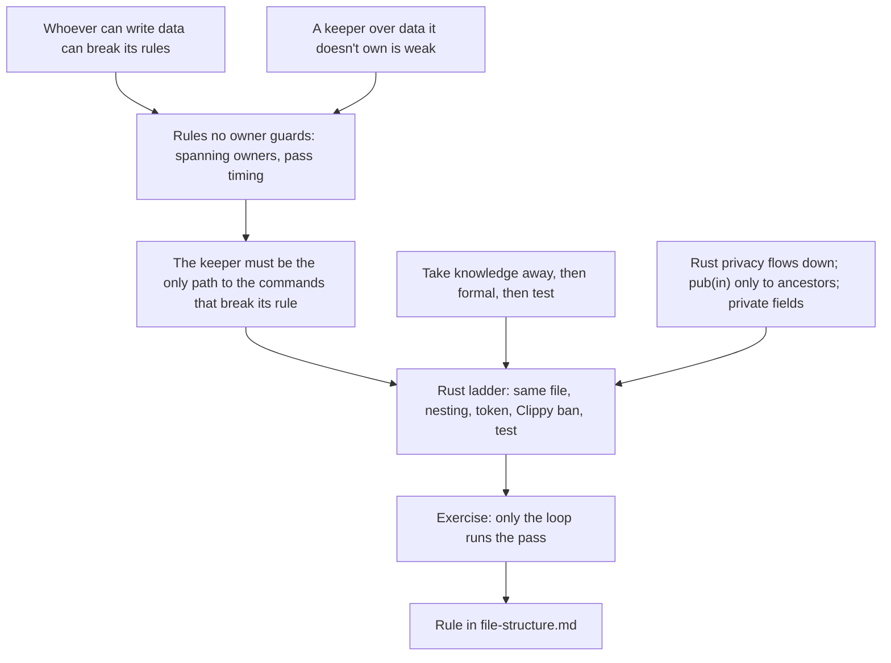

> [!quote] YOU

continue the course


> [!quote] YOU

the architecure course


> [!question] Quiz
> A developer adds `self.check_state(obs)` at the end of `draw`, so a hero killed by fatigue dies at once. What changes?
>
> Today:
> - The loop steps the resolving unit (one card's effects or one trigger) until it finishes, then runs the state check, then takes the next unit (ADR 0012, ADR 0015).
> - `check_state` removes every character at health ≤ 0 together, then decides the outcome. It is `pub(crate)`, called twice in `resolve.rs`.
> - `draw` runs from `apply_effect` for a Draw effect, from `start_turn`, and from setup.
>
> ```rust
> pub(crate) fn draw(&mut self, player_id: PlayerId, count: u8, obs: &mut impl Observer) {
>     for _ in 0..count {
>         // deck to hand and emit Drew, or fatigue damage and emit FatigueDamaged
>     }
>     self.check_state(obs); // new line
> }
> ```
>
> 1. Nothing observable changes in any game
> 2. Deaths can land in the middle of a unit, before its later effects run
> 3. Only setup and turn start change, where no loop pass follows
> 4. Health at 0 or below becomes an invariant that `draw` must guard


> [!success] Quiz — correct ✓
> Your answer: 2. Deaths can land in the middle of a unit, before its later effects run
> Correct answer: 2
>
> When the pass runs is the rule itself: after each unit, never inside one (ADR 0012, ADR 0015). A Draw effect runs inside a unit, so a card like "deal 2 to all minions, draw a card, deal 1 to all minions" would now kill its first victims before the third effect, and they would miss its damage. The pass removes the same characters whenever it runs, but when it runs is what players see. Turn start barely changes: the loop runs a pass right after `start_turn` anyway, before it takes the first unit. Setup never starts at 0 health. The rule is still restored by a pass, not guarded at each write. It now has a second place that decides when, and the build doesn't notice.


> [!abstract] PI

Right. Next strand.


> [!question] Quiz
> After the untangling, `play` is a `&mut self` method on `Game`, whose fields are all owners with private fields. What can `play` break?
>
> ```rust
> pub struct Game {
>     locations: Locations,   // private fields; commands such as move_to_board
>     objects: Objects,       // private fields
>     history: History,       // private fields; `record` meant to be called only by emit
>     stack: EffectStack,     // private fields
>     // ...
> }
>
> impl Game {
>     fn play(&mut self, player_id: PlayerId, object_id: ObjectId, obs: &mut impl Observer) {
>         // calls commands on the owners, then emits
>     }
> }
> ```
>
> "An owner's invariant" means a rule over one owner's own data, such as the location owner's entry order. "A rule spanning owners" means a rule over several owners' data, such as "every reported event has a history entry", kept by `emit`.
>
> 1. No owner's invariant; any rule spanning several owners
> 2. Only the owners it calls today; no rule spanning several owners
> 3. Every owner's invariant; any rule spanning several owners
> 4. No owner's invariant; no rule spanning several owners


> [!success] Quiz — correct ✓
> Your answer: 1. No owner's invariant; any rule spanning several owners
> Correct answer: 1
>
> Note: it cannot access a single owner invariant, but it can break a rule that recieve several owners as parameters
>
> `&mut self` reaches every field, but once each field is an owner with private data, reaching the field only reaches its commands, and every command keeps that owner's invariant. So `play` can't break any owner's own rule. A rule over several owners' data has no owner to guard it. Its keeper is a module with no data, such as `emit`, and the rule holds only while every writer goes through that keeper. `play` can call `history.record` without reporting, or push onto the stack in a different order than the ADR says. Nothing private stops it. So the coordinator, which holds `&mut` to everything, is exactly where rules spanning owners break.


> [!abstract] PI

Right, and your note says the same thing. Next, the Rust side of `emit`.


> [!question] Quiz
> `draw` builds one `Emitter` at its start, from `self`'s fields, and uses it for every card it draws. What happens?
>
> ```rust
> struct Emitter<'a, O: Observer> {
>     history: &'a mut History,
>     stack: &'a mut EffectStack,
>     obs: &'a mut O,
>     objects: &'a Objects,
>     binder: &'a Binder,
>     turn_order: &'a TurnOrder,
>     locations: &'a Locations,
> }
>
> fn draw(&mut self, player_id: PlayerId, count: u8, obs: &mut impl Observer) {
>     let mut emitter = Emitter {
>         history: &mut self.history, stack: &mut self.stack, obs,
>         objects: &self.objects, binder: &self.binder,
>         turn_order: &self.turn_order, locations: &self.locations,
>     };
>     for _ in 0..count {
>         let card = self.locations.deck_to_hand(player_id);   // &mut self.locations
>         emitter.emit(Event::Drew { player_id, object_id: card });
>         self.objects.update_order(card);                    // &mut self.objects
>     }
> }
> ```
>
> 1. It fails to compile: one struct can't hold both `&` and `&mut` borrows
> 2. It compiles, since the emitter borrows each field separately, not `self`
> 3. It fails to compile: the moves need `&mut` to fields the emitter holds by `&`
> 4. It compiles, and each emit sees the fields as they were when it was built


> [!failure] Quiz — incorrect ✗
> Your answer: 1. It fails to compile: one struct can't hold both `&` and `&mut` borrows
> Correct answer: 3
>
> Disjoint field borrows inside one body are fine, so building the emitter compiles. The trouble is that it stays alive across the loop. While it holds `&self.locations` and `&self.objects`, nothing in `draw` can take `&mut` to those fields, and `deck_to_hand` and `update_order` need exactly that (E0502). A reference is a live view, not a copy, so a snapshot can't happen. One struct can hold both kinds of borrow. A struct of borrows works only when its readers and writers don't overlap with the caller's own writes for its whole lifetime. `emit` reads the very owners the moves write, so a long-lived emitter can't coexist with the moves. It would have to be rebuilt at every call.


> [!abstract] PI

Not quite. One check to see what kind of miss that was:


> [!question] Quiz
> Does `pay` compile?
>
> ```rust
> struct Game { players: Vec<Player>, binder: Binder, /* ... */ }
>
> struct Pay<'a> {
>     player: &'a mut Player,
>     binder: &'a Binder,
> }
>
> impl Pay<'_> {
>     fn run(&mut self) { /* reads self.binder, writes self.player */ }
> }
>
> fn pay(game: &mut Game) {
>     let mut p = Pay { player: &mut game.players[0], binder: &game.binder };
>     p.run();
> }
> ```
>
> 1. No: one struct can't hold both a `&mut` and a `&` borrow
> 2. Yes: the two borrows are of different fields of `game`
> 3. No: both borrows come from `game`, so `&mut` excludes `&`
> 4. No: one lifetime `'a` can't cover a `&mut` and a `&` borrow


> [!success] Quiz — correct ✓
> Your answer: 2. Yes: the two borrows are of different fields of `game`
> Correct answer: 2
>
> Note: I think here it does, but I did not get the last question rly
>
> It compiles. I checked it with rustc 2024. Inside one function body the borrow checker tracks fields separately, so `&mut game.players` and `&game.binder` don't conflict. A struct holding both kinds of reference is fine, and one lifetime `'a` can cover both. This is Matsakis's view struct. It fails only when the caller then writes a field the struct is still reading, which is what happened with the long-lived `Emitter` in `draw`.


> [!abstract] PI

Here's the `Emitter` question again, step by step.

1. **Building it is fine.** That's what you just got right. The fields are disjoint, so `&mut self.history` and `&self.objects` can sit in one struct.
2. **The problem is how long it lives.** `emitter` is alive from the line that builds it to its last use, inside the loop. That whole time it holds `&self.locations` and `&self.objects`.
3. **The loop writes those same fields.** `self.locations.deck_to_hand(...)` needs `&mut self.locations` while the emitter still holds `&self.locations`. That's E0502, "cannot borrow as mutable because it is also borrowed as immutable". I compiled a small version to confirm it.
4. **The fix is a short-lived bundle.** Build it fresh for each emit, so its borrows end right after the call. `self.emit(event, obs)` on `Game` does exactly that today: `&mut self` borrows everything for the length of the call, then lets go.

This matters for the session because `emit` reads the same owners that the moves write. So no caller can hold an emitter across its own moves. Whatever emits has to be able to reach all those owners at the moment of each emit. Today that's anything with `&mut Game`. That's the open thread about `emit`'s parameter list.

So your miss was about the question, not about Rust: you hold the mixed-borrow struct. Does the step-by-step make sense? Once you say so, I'll ask one or two more probe questions and then present the plan.


> [!quote] YOU

yes, I thought that was the option I picked


> [!abstract] PI

That's a misclick then. The shuffle moved the option you meant. So the borrow strand is solid.


> [!abstract] PI

Probe done. Next, what you want from this session. The researcher is scoping the literature in the background meanwhile.


> [!question] Question
> Which of 02b's parts do you most want to come out of the session with? Pick any.
>
> The 02b plan, from COURSE.md:
>
> 1. Rules restored by a pass: one module decides when the pass runs. This answers your 02 question on how a pass's call gets enforced. `check_state` is `pub(crate)` today, and a finished unit runs it twice (resolve.rs:231 and :265).
> 2. The coordinator: the code that orders the calls and holds no rules. The auditors flagged a gap in the doc here, since it can't tell "procedure" (which goes in the coordinator) from "an order that is a rule of the domain" (which gets its own module). Checkpoint placement got deferred to this point too.
> 3. `emit`'s parameter list: it writes three owners and reads five, and its callers are about 12 coordinator-like functions (`draw`, `play`, `kill`, ...).
> 4. Your question: does the module owning `effect_stack` and `resolving_effect` apply effects, or only decide which comes next?
>
> It's probably more than one session. Whatever doesn't fit moves to a follow-up session.
>
> 1. All four as planned, equal weight
> 2. A test for procedure vs domain order (2)
> 3. Enforcing "only X may call Y" in Rust (1, 3)
> 4. My effect stack question (4)
> 5. emit's parameter list and where events get dispatched (3)


> [!example] Answer
> 3. Enforcing "only X may call Y" in Rust (1, 3)


> [!abstract] PI

You picked enforcement. Before I plan, I'll check the Rust mechanisms against the compiler and Clippy, since the course has never verified some of them.


> [!abstract] PI

Your edges on the three strands I probed:

- **Pass timing:** right that when the pass runs is the rule itself, and that a second caller changes the game. Not yet tested: producing the enforcement. That's your open question from session 02.
- **Coordinator with `&mut self`:** right, and in your own words, that it can't break an owner's invariant but can break a rule spanning owners. How to stop that is the gap.
- **Borrows:** solid. Your miss was a misclick.

I also checked the Rust mechanisms myself, on rustc and Clippy 1.92, and added the results to `verified-facts.md`:

- `pub(in path)` only accepts an ancestor module (E0742).
- A struct with a private field can only be built in its own module's subtree (E0423).
- Clippy's `disallowed_methods` bans a `pub(crate)` method by its definition path. Either an `#[expect]` on one statement or an `#[allow]` on one module lifts the ban there only.

## Plan

You picked enforcing "only X may call Y", so this session is that, start to finish. The probe showed the reason it matters: the coordinator holds `&mut` to everything. Any rule that no owner guards can therefore be broken by a call from the wrong place. Rules spanning owners, which `emit` keeps, are one kind. Pass timing, which the loop keeps, is the other.

1. **A rule no owner guards has a keeper, and the keeper must be the only path.** You derive it from two things you hold: whoever can write data can break its rules, and a module that keeps a rule over data it doesn't own is weak. Asked open-ended, on `emit`: who can break "every reported event is recorded" today, and what does each of them have to know? Then the same question on the pass.
2. **The Rust ladder for "only X may call Y".** I'll present this part mostly myself, since it's compiler facts:
   - Private in the same file.
   - Nesting with `pub(super)`. `pub(in path)` reaches no further.
   - A token with a private constructor.
   - A Clippy ban with `#[expect]` at the one caller.
   - A test, which pins the behavior but restricts nothing.

   Then you derive how to choose among them from the doc's order: take knowledge away first, then make it formal, then test. You've seen nesting before: it's your 01c idea of making the zones module a child of the coordinator.
3. **Exercise, sized to one decision:** "only the loop runs the pass". You design the enforcement for `check_state`, no options. If there's time, a second one: `History::record` only from `emit`.
4. You state the rule, I draft it into `file-structure.md` (General, plus the Rust list), and then I run the audit against the doc.

The other parts move to a follow-up session, 02c: the coordinator, procedure vs domain order, checkpoints, `emit`'s parameter list, and your effect stack question. Untangling `Game` becomes 02d, the tickets 02e, and parse, don't validate 02f. The researcher I started is gathering material for that follow-up.



## A problem with git

This worktree has come unregistered. `main/.git/worktrees/main.file-structure` no longer exists, so every git command here fails with "not a git repository". It worked at the start of this session, and I didn't run anything that touches worktrees. `git worktree list` in `main` no longer shows this directory. The branch `architecture-02` is intact at `4eac664`, and your files here are intact, the session log's changes included. The session doesn't need git until the close-out commit. The fix re-registers the directory as a worktree of `architecture-02` without touching the files, but it changes git metadata in `main/.git`, so I won't run it without your OK. Did you remove or prune it on purpose?

Does the plan work for you, roots and the split included?


> [!abstract] PI

The researcher's report is saved at `docs/course/architecture/research/02b-pass-and-coordinator/scope.md`. The facts it confirmed are in `verified-facts.md`, and the Evans 2003 book quotes are marked secondary. Most of it feeds the follow-up session. One part bears on today: MTG rule 704.2 says state-based actions "are not controlled by any player". Forge and XMage both run them from one place, their priority loop. That's the same answer as "only the loop runs the pass".

Two answers I still need from you:

1. Does the plan work, including the roots and the split into a follow-up session?
2. The git worktree: did you remove it on purpose, and may I re-register it?


> [!quote] YOU

1 it does. 2 it was an acident


> [!abstract] PI

Re-registering the worktree. This only creates its metadata under `main/.git/worktrees/` and rebuilds the index from `architecture-02`. Your files stay as they are.


> [!abstract] PI

The worktree is back. `git worktree list` shows this directory on `architecture-02` at `4eac664`. `git status` lists only the session log, `verified-facts.md` and the new research folder.

## Node 1: who keeps a rule no owner guards

**Why we need it.** In the probe you said `play` can't break an owner's invariant, but it can break a rule spanning several owners. Owners guard their own rules with private fields. A rule over several owners' data has no owner, so privacy alone protects nothing. Today's code has two such rules:

- **A rule spanning owners.** Your 02a invariant: "every reported event has a history entry". `emit` keeps it, and `emit` has no data. It records the entry in `History`, reports through `obs.event`, then pushes the matched triggers.
- **A rule restored by a pass.** "No character at health ≤ 0 between units". The loop keeps it by deciding when `check_state` runs.

Some facts for the first one. In the untangled design from 02a, `History` has a `record` command, meant to be "called only by `emit`", and nothing enforces that yet. The coordinator's verbs (`draw`, `play`, `kill`, ...) hold `&mut` to every owner and the observer.

**Your turn, in your own words:**

1. In the untangled design, which code can break "every reported event has a history entry", and through which calls?
2. What does each of those places have to know so that it doesn't break it?
3. So when does `emit`'s guarantee actually hold?


> [!quote] YOU

any code that has mutable access to history or observer by calling then dirrectly.
2 when emiting an event always call emit and not those other functions directly
3 when only emit mutates its dependencies


> [!abstract] PI

1 and 2 are right. Every place with `&mut` to the history or the observer holds "always go through `emit`" as informal knowledge. The build doesn't catch a direct call.

3 goes too far, and the precision matters for node 2. `emit` also reads locations, objects and the binder, and the coordinator has to keep writing those. `draw` moves a card from deck to hand, which is a write to locations, a dependency of `emit`. That move can't break "every reported event has a history entry". The rule only mentions two writes: appending a history entry and reporting an event. So the guarantee holds when **only `emit` can make the writes the rule is about**: `History::record` and `Observer::event`. The rest of its dependencies stay open to everyone.

**The pass has the same shape.** The rule is "no character at health ≤ 0 between units". `damage` may drop health to 0 at any time, because the rule allows that mid-unit. What breaks it is running the pass at the wrong moment, or not running it. So the guarantee holds when only the loop can call `check_state`. Not running it is a separate failure: the loop has to remember to call it. That knowledge sits in one place, so its locality is high, and the playout test pins it.

**How this hangs off what you hold.** The doc already says: "A module that keeps an invariant over data it doesn't privately own is weak. Not breaking the invariant becomes informal knowledge in every other possible writer." A keeper with no data is that case exactly. The doc's preferred fix applies too: take the knowledge away from the other places. If nobody else can make those calls, nobody else needs to know not to.

So the node is: **a rule no owner guards has a keeper, and the keeper must be the only code that can make the writes the rule is about.** Quick check on a third rule from the code:


> [!question] Quiz
> ADR 0014: "A dying object's own death triggers are pushed before its death is reported." `kill` keeps this rule. For the guarantee to hold, what must only `kill` be able to do?
>
> Today's `kill`:
>
> ```rust
> pub(crate) fn kill(&mut self, object_ids: &[ObjectId], obs: &mut impl Observer) {
>     for &object_id in object_ids {
>         for death_rattle in self.death_rattles(object_id) {
>             self.effect_stack.push(PendingEffect { source: object_id, effects: death_rattle.def.effects });
>         }
>     }
>     for &object_id in object_ids {
>         if self.card_def(object_id).leaves_zone_on_death() {
>             self.destroy(self.objects.get(object_id).player_id, object_id, obs);
>         }
>         self.emit(Event::Died { object_id }, obs);
>     }
> }
> ```
>
> Other code also pushes effects (`play`, `enqueue_triggers`) and moves characters off the board (`zone_move`, for example returning a minion to hand). A card could also say "trigger a friendly minion's death rattle" without killing it.
>
> 1. Remove a character from the board
> 2. Read a character's death triggers
> 3. Report a `Died` event
> 4. Push any effect onto the stack


> [!success] Quiz — correct ✓
> Your answer: 3. Report a `Died` event
> Correct answer: 3
>
> The rule ties two things: a death being reported, and that object's death triggers already being on the stack. Code that reports `Died` without pushing them first breaks it, so reporting `Died` has to be `kill`'s alone. Pushing other effects is legal everywhere (play effects, triggers), and so is pushing a death rattle with no death ("trigger a friendly minion's death rattle"), since no death is reported. Moving a character off the board without a death, such as returning it to hand, reports no `Died`. Reading the death triggers writes nothing, so it can't break any rule. Only the writes the rule is about get restricted. Restricting more would block legitimate callers.


> [!quote] YOU

in this last question, the rule is about two writes, but we only restrict the second, I get why this works in this case


> [!abstract] PI

You're right to push on it, and it generalizes. It also catches something I overstated a moment ago.

**Why only one write.** The rule is one-directional: "if X's death is reported, X's death triggers were pushed before it". The only way to break it is to make the "if" part true without the other part, meaning report `Died` without the push. A push with no report leaves the "if" false, so the rule still holds. In general:

- For a rule of the form "if A, then B happened first", restrict A, the write that makes the condition true. Leave B open.
- If the rule also runs the other way ("B only together with A"), then B alone breaks it too, and you restrict both.

**What I overstated.** Your 02a rule, "every reported event has a history entry", has the same one-directional shape: if reported, then recorded. By that logic only `Observer::event` needs restricting, and that's exactly the ban the crate already has in `clippy.toml`. I said earlier that `History::record` needs restricting as well. That's only true if the rule also runs the other way: "every history entry was reported". That would be a rule of its own. It keeps history queries from counting something the shells never saw. Whether the game needs it is a domain call, and Vernon's false-invariant check applies: is there an ADR or a test that depends on it?

So, two questions:

1. Does the game need the reverse rule, "every history entry was reported"?
2. State the node's rule in your own words: a rule no owner guards, its keeper, and which writes get restricted.


> [!quote] YOU

1 I dont think so and I thing see why it becoming true.
2 "A rule no owner guards has a keeper, and the keeper must be the only code that can make the writes the rule is about."
"The rule can be seen as implications, if A then B, in such cases A needs restricting."


> [!abstract] PI

The draft:

> ### Rules no owner guards
>
> A rule over several owners' data has no owner. Neither does a rule the domain lets be false for a while. A pass restores it at known points, so it isn't an invariant.
>
> A rule no owner guards has a keeper, the one module whose code keeps it, such as a command that makes the rule's writes together or the module that decides when its pass runs. The keeper must be the only code that can make the writes the rule is about. Any other code that can make them holds "go through the keeper" as informal knowledge.
>
> - Read the rule as implications, if A then B. A write that makes A true without B breaks it, so restrict A and leave B open. A rule that also runs the other way restricts both.

Any changes? Once it reads right to you, we go to node 2, the Rust tools for "only this code can make that write".


> [!quote] YOU

should the existing bullet point about rules with no owners join here? wdyt?


> [!abstract] PI

Two existing bullets in "Owners guard invariants" touch this. My take differs for each.

**"A module that keeps an invariant over data it doesn't privately own is weak..."**: yes, merge it. The new paragraph's last sentence says the same thing from the keeper's side, so leaving both puts one idea in two places. Its point for single-owner data shouldn't be lost, though: when the data could have an owner, give the rule one instead of a keeper. That's 02's mana cap, which `Player` should guard, not `Game`.

**"A decision that combines several owners' data gets its own module with no data..."**: keep it where it is. It's about where a combining decision lives, read-only ones included, such as trigger matching. It pairs with the bullet before it, "An owner answers questions about its own data". The new subsection is about who may write.

Your question also exposed a mistake in my draft. "A rule over several owners' data has no owner" contradicts "Data tied by an invariant shares one owner". Under the doc, a domain invariant over two owners' data merges them into one owner. A rule stays without an owner only in two cases:

- **Its data can't share one.** `emit`'s rule ties history to the reports that go to the observer, and the observer lives outside `Game` (ADR 0006). The death order ties pushes to reports in the same way.
- **The domain lets it be false for a while,** and a pass restores it.

Proposed version, replacing the draft and deleting the "weak" bullet:

> ### Rules no owner guards
>
> A rule has no owner when its data can't share one, such as data outside the program's state, or when the domain lets it be false for a while and a pass restores it at known points. A rule a pass restores isn't an invariant.
>
> A rule no owner guards has a keeper, the one module whose code keeps it, such as a command that makes the rule's writes together or the module that decides when its pass runs. The keeper must be the only code that can make the writes the rule is about. Any other code that can make them holds "go through the keeper" as informal knowledge, so a keeper is weaker than an owner. Give a rule an owner whenever its data can share one.
>
> - Read the rule as implications, if A then B. A write that makes A true without B breaks it, so restrict A and leave B open. A rule that also runs the other way restricts both.

The "such as data outside the program's state" example is there because "can't share one" is vague without it. Cut it if you'd rather keep General free of examples. Shall I apply it?


> [!quote] YOU

sounds good


> [!abstract] PI

Committed as `5847d0c`, the doc change only.

## Node 2: the Rust tools for "only this code can make that write"

One compiler fact to check before I state it.


> [!abstract] PI

Confirmed. A method's privacy follows the module of its `impl` block, not its type. A private method in an `impl Game` inside `resolve.rs` can't be called from `zone_move.rs` (E0624).

**Why we need this.** The keeper must be the only code that can make the rule's writes. Today every `impl Game` file under `game/` sees every `pub(super)` and `pub(crate)` method, so "only the loop" or "only `kill`" holds only as informal knowledge.

**The compiler facts.** I checked each one with rustc and Clippy, and they're in `verified-facts.md`:

1. A private item is visible in its module and that module's descendants. For a method, "its module" is the module holding the `impl` block.
2. `pub(super)` reaches the parent and the parent's whole subtree. `pub(in path)` accepts only an ancestor (E0742). So no visibility can name a single sibling. It can only open a whole subtree.
3. A struct with a private field can only be built inside its module's subtree (E0423).
4. Clippy's `disallowed_methods` bans a method by its definition path. An `#[expect]` on one statement, or an `#[allow]` on one module, lifts the ban there only.

**What each one can say.** "Only X":

| Tool | The keeper says | Requires |
|---|---|---|
| A. Private in the keeper's module | only the keeper | the command's code lives in the keeper's module |
| B. Nesting: the command's module is a child of the keeper, command `pub(super)` | only the keeper's subtree | the module tree follows the call rule |
| C. Token: the command takes a value with a private field that only the keeper's subtree can build | only code holding a token | a parameter on the command, which can live anywhere |
| D. Clippy ban, `#[expect]` at the keeper's calls | only the marked statements | `just check::all`, not `cargo build` |
| E. A test | nothing, it pins behavior | |

**How it connects.** A and B are your 01b "enforced boundary" applied to a command instead of to data. You've used B before, in 01c: the zones module as a child of the coordinator, its moves `pub(super)`, "so only the coordinator can move cards". D is what the crate already does for `Observer::event`, with its one `#[expect]` in `emit`.


> [!question] Quiz
> `History::record` is in `game/history.rs` and `emit` is in `game/triggering.rs`. Suppose the game did need "every history entry was reported", so `record` must be callable from `emit` only. What makes the build stop `zone_move.rs` from calling `record`, while `emit` still can?
>
> Layout:
>
> ```
> game/
>   mod.rs          // mod declarations only
>   history.rs      // impl History { fn record(...) }
>   triggering.rs   // emit
>   zone_move.rs    // draw, play, kill, ...
>   resolve.rs      // the loop
> ```
>
> Facts:
> 1. A private item is visible in its module and that module's descendants.
> 2. `pub(super)` reaches the parent and the parent's whole subtree. `pub(in path)` accepts only an ancestor (E0742).
> 3. A struct with a private field can be built only in its module's subtree (E0423).
> 4. Clippy `disallowed_methods` bans by definition path, and an `#[expect]` lifts it on one statement.
>
> 1. Declaring `record` as `pub(in crate::game::triggering)`
> 2. Declaring `record` private to `history`
> 3. Declaring `record` as `pub(super)`
> 4. Giving `record` a parameter only `triggering` can build


> [!success] Quiz — correct ✓
> Your answer: 4. Giving `record` a parameter only `triggering` can build
> Correct answer: 4
>
> Note: it works, but I am not sure it is worth the cost for changes
>
> `triggering` and `zone_move` are siblings, and no visibility can open an item to one sibling only. `pub(super)` opens `record` to all of `game`, `zone_move` included. `pub(in crate::game::triggering)` is E0742, because `triggering` isn't an ancestor of `history`. A private `record` hides it from `emit` too. A token works whatever the layout: `record(&mut self, entry, _: Reported)`, where `Reported` has a private field and lives in `triggering`, so only `triggering`'s subtree can build one. The Clippy ban would also work, but it's checked by `just check::all`, not by the build. Nesting `history` under `triggering` would work too, but the tree would then follow one call rule.


> [!quote] YOU

continue


> [!abstract] PI

You're right to weigh the cost. Here it is in the doc's terms. With a token, `History`'s signature carries knowledge of `emit`'s rule. `history.rs` then imports a type from `triggering.rs`, so the owner depends on its keeper, the reverse of the usual direction. Rename or split `emit` and `History` has to change. The other tools put that knowledge somewhere else: in the keeper's own file, in the module tree, or in `clippy.toml`. Weighing where each tool puts it is the exercise.

## Exercise: only the loop runs the pass

The rule, from ADR 0012 and ADR 0015: "if the pass runs, we're between units". The state check runs after a unit finishes and before the next one is taken. Design only, no code. The refactor comes in the ticket session.

Today:

- `game/state_check.rs`: `impl Game { pub(crate) fn check_state(&mut self, obs: &mut impl Observer) }`. It calls the private `remove_dead` (kill, emit, `player.playing = false`) and `decide_outcome` (writes `outcome`, emits `GameEnded`).
- `game/resolve.rs` holds `apply` (`pub`), `apply_action` (`pub(super)`), `apply_effect` (`pub(crate)`) and the loop. The loop is two private methods:

```rust
fn drain_effect_queue(&mut self, obs: &mut impl Observer) {
    while !self.is_pending_interaction() && self.outcome().is_none() {
        self.continue_resolving_effect(obs);
        // finished a unit
        if self.resolving_effect.is_none() {
            self.check_state(obs);                                   // call 1
            if let Some(pending_effect) = self.effect_stack.pop() {
                self.resolving_effect = Some(pending_effect.into());
            }
        }
        // no more units
        if self.resolving_effect.is_none() && self.effect_stack.is_empty() { break; }
    }
}

fn continue_resolving_effect(&mut self, obs: &mut impl Observer) {
    while !self.is_pending_interaction()
        && let Some(resolving) = &mut self.resolving_effect
        && !resolving.is_finished()
    {
        // clone the current effect, advance, apply_effect, checkpoint
    }
    if let Some(resolving) = &mut self.resolving_effect && resolving.is_finished() {
        self.resolving_effect = None;
        self.check_state(obs);                                       // call 2
    }
}
```

- Siblings under `game/`: `condition`, `lookup`, `player`, `resolve`, `state_check`, `triggering`, `view`, `zone_move`. `mod.rs` holds `Game` and its fields, under an `#[expect(definition_in_module_root)]`.

**Your turn:**

1. Where does the knowledge of "when the pass runs" sit today?
2. Pick the tool, or tools, that make the loop the only code that can run the pass. Write the module tree and the signatures that change, and say what your choice costs compared with the others.


> [!quote] YOU

1 the loop. 2 I would have the check_state on a module on the loop subtree with pub(super) to reduce the possible callers and then tests to pin the behavior


> [!abstract] PI

**1.** Right, the loop. But it's two places in the loop, and a finished unit runs the pass twice. `continue_resolving_effect` is called only from `drain_effect_queue`. When a unit finishes, call 2 sets `resolving_effect` to `None` and runs the pass. Control then returns to `drain_effect_queue`, which sees `None` and runs call 1. The second pass finds nothing today, so it's harmless. Still, it's the same "when" known twice, and that's a finding. It's also the old inventory pattern of missing a holder.

**2.** Nesting plus tests is a sound pick, and the tests are the right complement. Visibility stops wrong callers. It can't stop the loop from forgetting to call. The playout's "no minion at ≤ 0 health between steps" check already pins part of that.

One gap to close. `pub(super)` opens `check_state` to the parent's whole subtree, so who can call depends on what else lives under that parent. Two questions:

1. Which module is `state_check`'s parent in your design, and what else sits in that parent's subtree? Check it against today's `resolve`.
2. What does your choice cost compared with the others? For example: what has to change if the loop moves or gets renamed, under nesting, a token and a Clippy ban?


> [!quote] YOU

1 It could be a loop parrent having children module like effect_queue_drain and state_check as children
2 if the loop moves the check state must move together and there is the formal knowledge on the tests


> [!abstract] PI

**1.** That closes the gap. With a loop module whose only children are `effect_queue_drain` and `state_check`, a `pub(super)` `check_state` reaches exactly those two. Compared with today, your design pulls the loop out of `resolve`, leaving `apply`, `apply_action` and `apply_effect` outside the loop's subtree. So the caller from the first probe question, `apply_effect`, can no longer run the pass. Two notes for the ticket. `loop` is a Rust keyword, so the module needs another name. And `apply` sits outside, so it can reach the drain only if the drain's entry is opened wider, to `pub(in crate::game)`.

Also, I've been saying "unit" all session, taking it from ADR 0015, and the glossary lists "unit" under _Avoid_. The term is **resolving effect**, so the rule is "the pass runs only after a resolving effect finishes".

**2.** Right, that's nesting's cost: the tree encodes the call rule, so the two move together. One correction on wording. In the doc, a test isn't formal knowledge. Formal means the build fails at every place that holds the knowledge. A test shows that something broke, not where the knowledge sits. Here the tests pin the loop's own timing, the forgetting side that visibility can't cover.

The comparison you skipped:

| | A wrong caller | "Who may call" lives in | When the loop moves or is renamed |
|---|---|---|---|
| Nesting | can't see `check_state` | the module tree | `state_check` moves with it |
| Token, say `AfterResolvingEffect`, built only in the loop | sees it, can't call it | `check_state`'s signature, and the loop | `state_check`'s import changes, and the compiler finds it |
| Clippy ban | sees it and can call it, and `check::all` fails | `clippy.toml` and each `#[expect]` | the path changes. A stale path warns "does not refer to a reachable function", so it fails under `-D warnings` (checked just now) |

Nesting wins here. `check_state` has one rightful caller and no reason to live anywhere else. It's also the only tool that takes the knowledge away entirely: other code can't even see the command, and the doc prefers that. The other two have their own cases:

- **A token** earns its place when the command has to live outside the keeper's subtree, like `History::record`, which belongs to `History`.
- **A Clippy ban** fits when neither the tree nor a signature should carry the rule. `Observer::event` is a method on a public trait that shells implement. A token there would leak into every shell, so the crate uses a ban.

**Your turn:** state the Rust rule for choosing among them.


> [!quote] YOU

1 fix the adr too. 
Enforce the rule trough nesting when it has one rightful caller and no reason to live anywhere else.
 A token earns its place when the command has to live outside the keeper's subtree.
A Clippy ban fits when neither the tree nor a signature should carry the rule.


> [!abstract] PI

I've drafted your rule as a new subsection at the end of the Rust section in `file-structure.md`, after "Making knowledge formal":

> ### Restricting callers
>
> No visibility opens an item to one sibling only. `pub(super)` opens it to the parent's whole subtree, and `pub(in path)` accepts only an ancestor. So a keeper that must be the only caller of a command picks its tool by where the command lives.
>
> - Enforce the rule through nesting when the command has one rightful caller and no reason to live anywhere else. Its module and the keeper's share a parent that holds nothing else, and the command is `pub(super)`.
> - A token earns its place when the command has to live outside the keeper's subtree. The command takes a value with a private field, which only the keeper's subtree can build.
> - A Clippy ban fits when neither the tree nor a signature should carry the rule. An `#[expect]` marks each rightful call.

I added the opening paragraph so the reader knows why nesting needs a parent that holds nothing else. In each bullet, the sentence after yours says how to set up that tool.

**About fixing ADR 0015:** it conflicts with `docs/adr/README.md`, which says: "A record states the decision as it stands... Never rewrite an old record to match the present." Superseding doesn't fit either. A new record is for a changed decision, and a rename misses the bar, since it's neither hard to reverse nor a trade-off. The glossary already maps it: "unit" is listed under _Avoid_ for both pending effect and resolving effect, so a reader can translate. Options:

1. Leave ADR 0015 as it is. The glossary's _Avoid_ list does the translating.
2. Add an exception to `docs/adr/README.md`: wording-only edits that bring a record in line with the glossary are allowed, as long as the decision doesn't change. Then I fix 0015.

Which one do you want? And does the Rust draft read right?


> [!quote] YOU

do 2, agree with draft. one thing I would like to discuss tho, I dont see having the pub(super) exposing a rule to the whole subtree as being that bad cause where it is called is formal knowledge, just the rule is informal knowledge


> [!quote] YOU

dont update the readme just do it


> [!abstract] PI

ADR 0015 is fixed, and `docs/adr/README.md` is untouched. I made four wording-only edits and changed nothing in the decision:

- "the unit being resolved" became "the resolving effect", and "the stack of waiting units" became "the effect stack".
- "steps the resolving unit ... takes the next waiting unit ... only between units ... as one unit" became "resolving effect ... next pending effect ... only between resolving effects ... as one pending effect".
- "queues its play effects as a unit" became "as one pending effect".
- In the last considered option: "carries its unit, which rebuilds the unit" became "carries the pending effect it came from, which rebuilds the pending effect".

Review it in the diff. I'll commit it together with the Rust rule once we've settled your point. That point could still change the draft.

**Your point about `pub(super)`.** You're half right, and the half that's right is already in the doc.

What's off is "where it is called is formal". A call is formal knowledge of `check_state`'s name and signature: rename it and every call fails the build. But the decision at stake here is when the pass runs, and the change to fear is a wrong call being added. A wrong call compiles. Probe question 1 is the example: `self.check_state(obs)` at the end of `draw`. It also slips past the playout test. That test checks for minions at ≤ 0 health between steps, and an extra pass only removes them sooner. So for this decision, the knowledge every other file in the subtree holds is "don't call it". That's informal for every change, and it lives in each author's head, not in the code. A grep finds every call cheaply, but only when someone thinks to look.

What's right: the doc accepts informal knowledge where its locality is high, meaning its places sit close together in code that serves the same decision. So how wide `pub(super)` may open depends on that subtree:

- **Today's `game/`**: about ten files and fifteen decisions, with `apply_effect` among them. Low locality, so restrict.
- **Your loop parent**: the drain and the pass, both serving "when the pass runs". High locality. A third child that served the same decision would be fine too.

That suggests loosening one clause in the draft. "Share a parent that holds nothing else" is stricter than the doc's locality rule needs. It could become "share a parent whose subtree serves only the keeper's decision". Do you want that wording, or the strict one?


> [!quote] YOU

I want the "share a parent whose subtree serves only the keeper's decision", dont this will result in a too nested structure because we will have modules for every rule with multiple owners?


> [!abstract] PI

Applied: "Its module and the keeper's share a parent whose subtree serves only the keeper's decision, and the command is `pub(super)`."

**Will it nest too much?** No. Three filters stand between "a rule with several owners" and "a new directory":

1. **Most such rules get an owner, not a keeper.** "Data tied by an invariant shares one owner" still comes first. Two owners tied by a rule the domain needs get merged. A keeper exists only when the data can't share an owner, such as the observer, which lives outside `Game`, or when a pass restores the rule.
2. **Most keepers don't nest.** Nesting is for a command with one rightful caller and no reason to live anywhere else. A token or a Clippy ban adds no level.
3. **Nesting adds no modules.** The keeper and the command's module exist anyway. Nesting puts them under one parent, one directory deeper, and rules that serve the same decision share that parent.

The keepers in today's code:

| Rule | Keeper | Restricted write | Tool |
|---|---|---|---|
| Every reported event has a history entry | `emit` | `Observer::event` | Clippy ban, already there. A public trait method, so it can't nest |
| The pass runs only after a resolving effect finishes | the loop | `check_state` | nesting, your design |
| One loop resolves everything (ADR 0015) | `apply` and the loop | starting the drain | the same loop subtree |
| Death triggers pushed before the death is reported (ADR 0014) | `kill` | reporting `Died` | open, see below |

That's one nested directory for the whole crate.

The last row is a real limit, not a nesting problem. `Died` is a variant of `Event`, and no tool on our ladder restricts building one enum variant. Visibility can't, a Clippy `disallowed_methods` ban targets methods, and a token field inside a public event would leak to shells. That one goes to the audit as a finding.

If that settles your concern, I'll commit the Rust rule and the ADR 0015 wording together. After that come the audit against the doc and the findings.


> [!quote] YOU

yes lets do it


> [!abstract] PI

While the auditors run, a check on the rule as worded:


> [!question] Quiz
> In your design the loop parent has two children, `effect_queue_drain` and `state_check`, with `check_state` marked `pub(super)`. A teammate proposes moving `apply_effect` in as a third child, since only the loop calls it. By the rule as now worded, what follows?
>
> The rule: "Enforce the rule through nesting when the command has one rightful caller and no reason to live anywhere else. Its module and the keeper's share a parent whose subtree serves only the keeper's decision, and the command is `pub(super)`."
>
> The keeper's decision: the pass runs only after a resolving effect finishes.
>
> `apply_effect` matches on `Effect` and calls `draw`, `reveal`, `zone_move`, `damage` and `summon`, one arm per effect kind (ADR 0004).
>
> ```
> loop_parent/          // name TBD
>   mod.rs              // mod declarations
>   effect_queue_drain.rs
>   state_check.rs      // pub(super) fn check_state
>   apply_effect.rs     // proposed
> ```
>
> 1. It fits the rule: `pub(super)` still hides `check_state` from a sibling like `apply_effect`
> 2. It fits the rule: only the loop calls `apply_effect`, so it serves the loop's decision
> 3. It breaks the rule: `apply_effect` serves what each effect means, not when the pass runs
> 4. It breaks the rule: a third child makes `pub(super)` reach all of `game`


> [!success] Quiz — correct ✓
> Your answer: 3. It breaks the rule: `apply_effect` serves what each effect means, not when the pass runs
> Correct answer: 3
>
> `pub(super)` opens `check_state` to the parent's whole subtree, so a third child can call it. That is exactly the probe's bug: a Draw effect running the pass mid-effect. Its reach stays the parent's subtree and doesn't grow to `game`. The rule's test is the subtree's decision, not who calls whom. `apply_effect` holds what each effect means, one arm per kind, and that changes with every new effect kind. "When the pass runs" changes only with the ADR. Two decisions that change independently, so `apply_effect` lives outside, and the loop calls it from there.


> [!abstract] PI

Right. The auditors are still running, and I'll bring you their findings to review when both reports are in.


> [!abstract] PI

Audit 1 is in, at `research/02b-pass-and-coordinator/audit-1.md`. I've read it and have a view on each finding. I'll bring both reports to you together once audit 2 finishes.


> [!abstract] PI

Both audits are in, at `research/02b-pass-and-coordinator/audit-1.md` and `audit-2.md`. I merged the two, checked the claims I could against the code, and put my recommendation on each. New findings continue the open-threads numbering from 24.

## Findings

| # | Finding | Recommendation |
|---|---|---|
| 24 | `enqueue_triggers` and `apply_action` can be private today. Each has one caller, in its own file (both audits) | Accept, ticket in 02e |
| 25 | The pass. My wording was too narrow. The drain's first turn also runs the pass after an action with no resolving effect (`EndTurn`, then fatigue), and `fatigue_at_turn_start_can_end_the_game` depends on it. The right rule: "if the pass runs, no resolving effect is part-way through". Your tree still holds. Merge the two calls into one. The double pass slips past every test, since a repeated pass changes nothing | Accept. It replaces the open thread "`check_state` is `pub(crate)`" |
| 26 | Only `apply` starts the drain (ADR 0015). Your tree opens the drain's entry to all of `game` unless `apply` moves into the loop's subtree | Defer to 02c. Where `apply` lives is the coordinator question |
| 27 | An owner for the effect stack and the resolving effect, which only the loop pops and advances. `apply_effect` runs only as a step of the resolving effect, through a `Step` token, and `reveal` likewise (low). Extends 5 and 21 | Defer to 02c. This is your effect stack question |
| 28 | Only the state check kills. `kill`, `destroy` and `entomb` each have one caller today (checked), so they can nest in the pass's subtree. The audits disagree on `destroy`: audit 2 keeps it with the location moves. Also, "own death triggers are read before any of the dying leaves" holds today, and no test covers it. Extends 2 | Accept for 02d. `destroy`'s home depends on the location owner |
| 29 | `outcome` and `Player.playing` are written only by the pass, yet any child of `game` can write them. Move them into a type in the pass's leaf | Accept for 02d |
| 30 | Reporting one event variant (`Died`, `Played`, `GameEnded`) can't be restricted. `emit` takes the public `Event`, and every tool restricts a command, not an argument | Defer to 02c, with `emit`'s parameter list. See gap G2 |
| 31 | Checkpoints have no keeper across ten sites. A Clippy ban like the one on `event` (low). Refines 20 | Defer to 02c, where checkpoints already go |
| 32 | `emit` reports `Died` after removal (ADR 0012), and `health` is `None` off the board. So the 02a stats snapshot can't be taken in `emit`. `kill` takes it before removal, and it travels with the report | Accept as a note on the history owner thread, for the #16 redo |
| - | Reverse history rule (audit 1, finding 1) | Reject. You ruled it a false invariant, and `record` stays open |
| - | `setup` runs no drain, so start-of-turn triggers from setup would wait for the first `apply` (low) | Route to the card-game course, which has no such trigger yet |
| - | Orders nothing depends on (`Revealed`, `Picked`, `Drew`) | No action |

## Doc gaps

- **G1.** Both auditors hit this. The tools restrict commands, but `Game`'s fields are open to every child file, so a raw field write gets past every tool. **Recommend** one line in "Restricting callers": "A field of a parent's type is open to every child, so first move the data into a type with private fields, making the write a command."
- **G2.** One variant of a shared command (30). **Recommend** no change now. A token can sit in `emit`'s input type if that type is internal rather than the public `Event`. That's a 02c design.
- **G3.** Order rules, such as "read death triggers before removal", are neither invariants nor pass rules. **Recommend** deferring to 02c, which covers procedure vs domain order.
- **G4.** For a pass rule, A is running the pass, not a data write. **Recommend** adding "For a rule a pass restores, that write is running the pass" after "the writes the rule is about".
- **G5.** Your own tree trips the wording. `state_check` holds "what the pass removes", not "when it runs", so the subtree doesn't serve only the keeper's decision. **Recommend:** "share a parent whose other children serve only the keeper's decision". It says children because a grandchild is hidden behind its own parent, and the doc already counts a child as one item.
- **G6.** No test for when a ban "should" be used. **Recommend** no change. General already orders the tools: take knowledge away, then a type, then a lint. Audit 2's "ban by private path unverified" is out of date, since I verified it this session. I'll fix that open thread.
- **G7.** "The token assumes the keeper is the caller." **Recommend** rejecting. For the drain the keeper is `apply`, which is also the caller.
- **G8.** A private item in the keeper's own file isn't a listed tool, and 24 uses it. **Recommend** a first bullet: "A command whose only rightful caller shares its file is private."

Reply in short form, for example "24 ok, G1 no".


> [!quote] YOU

g1 I think this is already covered by the doc no? g4 I dont get it. g5 I dont get it. g8 yes


> [!abstract] PI

**G1:** you're right. Modules already says "code in a parent is open to every child", and with "the keeper must be the only code that can make the writes", that settles it: a write to a field of `Game` is open to every child file, so the data has to move into a type with private fields first. The auditors stumbled because "Restricting callers" opens with "the only caller of a command" and they didn't connect it back to Modules. No change.

**G8:** added as the first bullet. "A command whose only rightful caller shares its file is private."


> [!abstract] PI

**G4, with an example.** Take the pass's rule as a reader of the doc would meet it: "no character at health ≤ 0 between resolving effects". The doc says to restrict "the writes the rule is about". The writes this rule seems to be about are the ones that lower health: `damage`, an aura leaving. Those can't be restricted, since damage may drop health to 0 at any time. The write that actually breaks this rule is running the pass at the wrong moment: "if the pass runs, no resolving effect is part-way through". Audit 2 got stuck on exactly that, because nothing in the doc points to the pass. The proposed sentence would say: "For a rule a pass restores, the write to restrict is running the pass." If you think "the module that decides when its pass runs", already in the keeper paragraph, makes that clear enough, we skip it.

**G5, with your tree.**

```
loop_parent/
  effect_queue_drain.rs   // the keeper: decides when the pass runs
  state_check.rs          // the command: decides what the pass removes and who won
```

The rule says the parent's subtree "serves only the keeper's decision". `state_check.rs` is in that subtree, and it serves a different decision: what dies, not when. Read literally, your own tree fails the rule. It's the same test `apply_effect` failed in the quiz, except that `state_check` has to be there, because it's the command being protected. So the test should exclude the two modules the rule names, and apply only to anything else under that parent. Proposed wording: "Its module and the keeper's share a parent whose **other** children serve only the keeper's decision."

Do you want either change?


> [!quote] YOU

g4 okay, change the doc and let me review. g5 I think we are being too strict here, I would change to "contains the keeper's decision"


> [!abstract] PI

G4 is in. Here's the keeper paragraph as it reads now, with the new sentence second to last:


> [!abstract] PI

> A rule no owner guards has a keeper, the one module whose code keeps it, such as a command that makes the rule's writes together or the module that decides when its pass runs. The keeper must be the only code that can make the writes the rule is about. Any other code that can make them holds "go through the keeper" as informal knowledge, so a keeper is weaker than an owner. For a rule a pass restores, the write to restrict is running the pass. Give a rule an owner whenever its data can share one.

**G5, a critical look at "contains the keeper's decision".** It's always true. Any ancestor of the keeper contains the keeper's decision, and that includes `game` itself. Today's layout would pass: `state_check.rs` and `resolve.rs` share the parent `game`, and `game` contains the loop. So would `apply_effect` as a third child, the case the quiz ruled out. Under that wording the clause restricts nothing.

You may still have a point that the strict wording blocks a real case. Audit finding 27 has the loop guarding two commands: the pass, and popping the effect stack. Both modules want to nest under the loop. When we protect `check_state`, the stack owner is an "other child". It serves stack order, not "when the pass runs", so the strict wording forbids it.

A middle version that lets that case through and still keeps `game` and `apply_effect` out:

> Its module and the keeper's share a parent that holds only the keeper and the commands it guards, and the command is `pub(super)`.

`apply_effect` stays out through the bullet's first clause, "no reason to live anywhere else". It's the interpreter, with a decision of its own, so if the loop guards it at all, that's a token case. Is several guarded commands under one keeper the case you had in mind, or something else?


> [!quote] YOU

yes good


> [!abstract] PI

Committed as `9f1d7ec`. Both nodes are done and the audit is reviewed. You replied only on G1, G4, G5 and G8, so I'm treating the rest as you approved them: findings 24 to 32 as recommended, the three rejections, G2 and G3 deferred to 02c, and no change for G6 and G7. Tell me if any of those should go differently.

That's a node boundary. Shall I close the session? The close-out would update `COURSE.md` with:

- the knowledge map
- findings 24 to 32 and the corrections to the history owner thread
- the renumbered plan: 02c the coordinator, `emit`'s parameter list, your effect stack question and checkpoints; 02d the untangling; 02e the tickets; 02f parse, don't validate

Then it commits along with the session log.


> [!quote] YOU

yes


> [!abstract] PI

Closing session 02b. What changes in `docs/course/architecture/COURSE.md`:

- **Knowledge map.**
  - Under ownership: the keeper node. You derived who can break `emit`'s rule, first overshooting to all of its dependencies. You authored the implication rule, ruled the reverse history rule a false invariant, and your question on the "weak" bullet exposed my contradiction.
  - Under Rust: your nesting design for `check_state`. It started with "the loop" as the inventory, missing the two calls. You stated the three tool sentences, made the half-right `pub(super)` argument, which locality settles, and proposed the looser wording that turned out vacuous.
  - Under how you learn: a quiz miss can be a misclick on shuffled options.
- **Open threads.**
  - Findings 24 to 32 from the two audits.
  - The `check_state` thread folded into 25.
  - The history owner thread: `record` stays open, and `kill` takes the snapshot (32).
  - The deferred doc gaps G2 and G3 go to 02c.
  - The Clippy facts verified this session come off the unverified list.
  - `setup` running no drain goes to the card-game course's open threads.
- **Plan and sessions table.**
  - 02b is done.
  - 02c: the coordinator, procedure vs domain order, checkpoints, `emit`'s parameter list and restricting one event variant, where `apply` lives, and your effect stack question.
  - 02d: the untangling, then 02e the tickets, then 02f parse, don't validate.
  - Session references in the threads move to match.
- **Dependency map.** The new keeper node, done, sits before the coordinator node.

To start the next session:

```
/new
/name 02c-coordinator
/md-log docs/course/architecture/sessions/02c-coordinator.md
continue the architecture course
```

I'll commit once the edits are in: `COURSE.md`, `verified-facts.md`, the 02b research reports, the card-game open thread, this log, and the empty 02c log.
