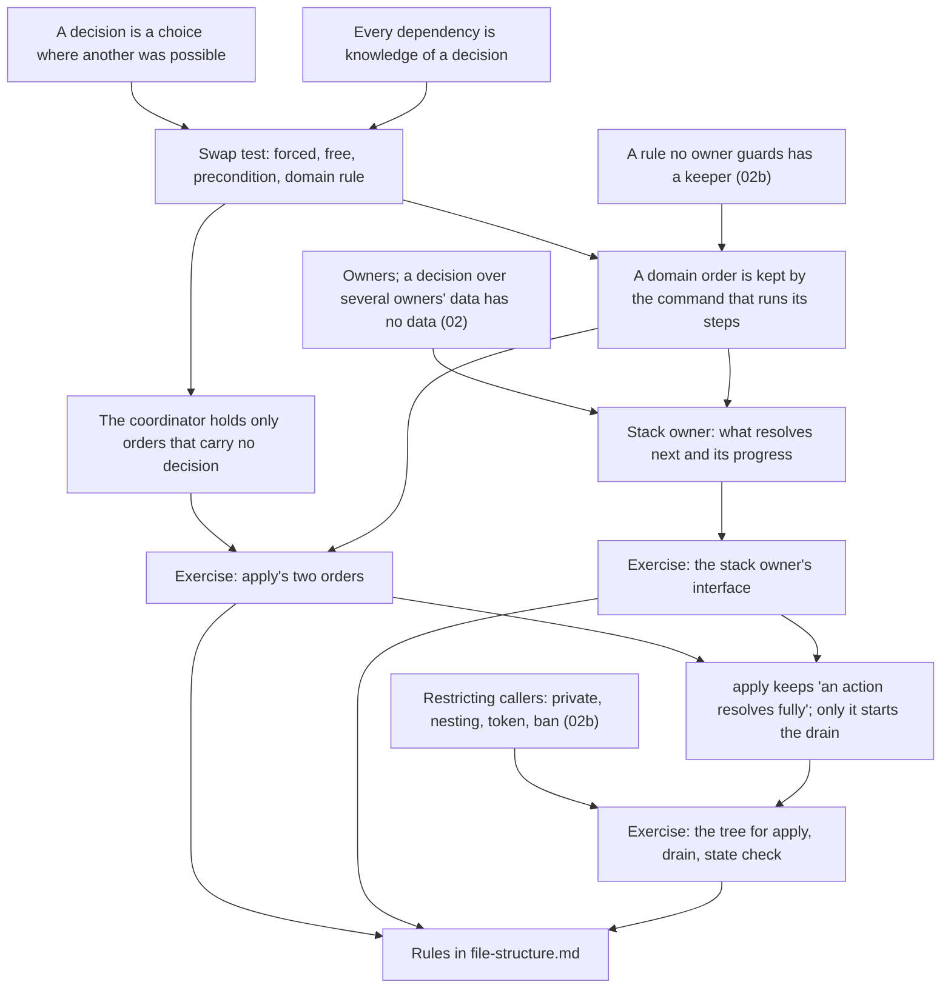

> [!quote] YOU

continue the architecture course


> [!abstract] PI

Session 02c covers the coordinator. 02b was the session just before, so no retrieval quiz. First a short probe of the strands this node rests on, then you pick the scope.


> [!question] Quiz
> In `play`, the card's play effects go onto the effect stack before `emit(Played)`. In the doc's terms, what kind of order is that?
>
> ```rust
> // zone_move.rs, play
> if !self.play_effects(object_id).is_empty() {
>     self.effect_stack.push(PendingEffect::new(object_id, self.play_effects(object_id).to_vec()));
> }
> self.emit(Event::Played { player_id, object_id }, obs); // matches triggers, pushes them
> ```
> The stack resolves newest first.
>
> The doc, "Build modules around decisions, not steps": "An order belongs to whoever decides it. When it is a precondition of the callee, such as validating input before storing it, take it away from callers with one command. When it is the procedure itself, it lives in the coordinator. An order that is a rule of the domain is a decision, and gets a module like any other."
>
> 1. The procedure itself
> 2. An order nothing depends on
> 3. A rule of the domain
> 4. A precondition of `emit`


> [!success] Quiz — correct ✓
> Your answer: 3. A rule of the domain
> Correct answer: 3
>
> Note: I dont see it as precondition because emit works without it, I see it as a rule of the domain because it is a design decision that reactions trigger before the play effects
>
> Swap the two lines and the triggers reacting to the play go under the play effects, so the card's own effects resolve first. Nothing crashes. The game just plays differently. Another order was possible and the game's rules picked this one (ADR 0015: "the triggers that react to the play resolve first"), so it's a decision of the domain. `emit` works the same either way, so it isn't `emit`'s precondition. Something does depend on the order, which is exactly why it isn't free.


> [!abstract] PI

Right, and your reasons match the explanation. Harder one.


> [!question] Quiz
> A developer merges `kill`'s two loops into one per-object loop, as below. Two minions, A and B, die in the same pass, A first in order of play. What changes?
>
> Today:
> ```rust
> // zone_move.rs, kill
> for &id in object_ids {            // 1: every death rattle first
>     for rattle in self.death_rattles(id) { self.effect_stack.push(/* rattle */); }
> }
> for &id in object_ids {            // 2: then remove and report, one by one
>     if self.card_def(id).leaves_zone_on_death() { self.destroy(/* .. */ id, obs); }
>     self.emit(Event::Died { object_id: id }, obs);
> }
> ```
> Merged:
> ```rust
> for &id in object_ids {
>     for rattle in self.death_rattles(id) { self.effect_stack.push(/* rattle */); }
>     if self.card_def(id).leaves_zone_on_death() { self.destroy(/* .. */ id, obs); }
>     self.emit(Event::Died { object_id: id }, obs);
> }
> ```
> - `death_rattles(id)` reads the object's own "when this dies" triggers, printed or granted by a modifier such as an aura, from the board as it is now.
> - `emit` matches triggers on every character still in play and pushes the matches.
>
> 1. B's death rattles stop resolving, since B leaves before they're read
> 2. B can hear A's death, and A's aura can strip a death rattle it granted B
> 3. Nothing observable, since every death is still reported in order of play
> 4. Only the stack order, since the same effects still get pushed


> [!success] Quiz — correct ✓
> Your answer: 2. B can hear A's death, and A's aura can strip a death rattle it granted B
> Correct answer: 2
>
> After merging, `Died(A)` is emitted while B is still on the board, so B's "when a minion dies" trigger matches it. ADR 0012 rules that out: a dying watcher hears no other death. Then, if A's aura granted B a death rattle, A is gone by the time B's rattles are read, so B loses it. The stack order changes as well, with rattles and death reactions interleaving, but that's not all: different effects get pushed. B's rattles are still read before B leaves, only after A has. So the two loops encode a rule of the domain, "every dying object's death triggers are read before any of the dying leave", and nothing but the shape of the code says so.


> [!abstract] PI

Right. Next strand: your effect stack question.


> [!question] Quiz
> After the untangling, an `EffectStack` owner holds `effect_stack` and `resolving_effect` privately. One design also puts `apply_effect`, the code that carries out one effect, inside that owner. What does that cost?
>
> Today `apply_effect(owner, source, &effect, obs)` is a `&mut self` method on `Game`. Depending on the effect it deals damage, draws, summons, reveals, reads modifiers and history, and emits events, so it touches locations, objects, players, history, the binder and the observer.
>
> The doc, "Owners guard invariants": "A decision that combines several owners' data gets its own module with no data, under their lowest common ancestor. Inside one of the owners, it would make that owner depend on the others."
>
> 1. The stack's order becomes breakable from outside the owner
> 2. Nothing, since carrying out effects is the stack owner's job
> 3. The stack owner then depends on every owner an effect touches
> 4. The loop can no longer run the state check between effects


> [!success] Quiz — correct ✓
> Your answer: 3. The stack owner then depends on every owner an effect touches
> Correct answer: 3
>
> Carrying out an effect combines data from locations, objects, players, history and the binder, so it's a decision with no data of its own. Inside the stack owner, every change to those owners' interfaces reaches the stack, and the stack, a small owner of one ordering decision, would need `&mut` to nearly the whole game. Its order stays private either way, so it isn't breakable from outside. The loop can still run the pass between resolving effects; that depends on who runs the loop, not on where `apply_effect` lives. Forge and XMage split it the same way: the stack picks the top, and separate code interprets the effect with the whole game in reach.


> [!abstract] PI

Three right, so these were too easy. Going harder.


> [!question] Quiz
> After the untangling, `emit` is a free function in a module with no data, taking what it reads and writes as parameters. Thirteen call sites report events through it. A later card-game change makes trigger matching also read a `Modifiers` owner, which `emit` didn't take before. What does that change cost?
>
> ```rust
> // the 02a design, roughly
> fn emit(
>     event: Event,
>     history: &mut History,
>     stack: &mut EffectStack,
>     obs: &mut impl Observer,
>     objects: &Objects,
>     binder: &Binder,
>     turn_order: &TurnOrder,
>     locations: &Locations,
> )
> ```
> Callers: `play`, `kill`, `draw`, `reveal`, `pick`, `bury`, `add_to_hand`, `damage`, `end_turn`, `start_turn`, `decide_outcome` and two more. Each is a `&mut self` method on `Game`, whose fields are the owners.
>
> 1. An edit in `emit` only, since its signature is formal knowledge
> 2. An edit in `emit` and at all thirteen call sites, found only by tests
> 3. An edit in `emit` and at all thirteen call sites, each found by the build
> 4. An edit in `emit` and in the one coordinator that builds its arguments


> [!success] Quiz — correct ✓
> Your answer: 3. An edit in `emit` and at all thirteen call sites, each found by the build
> Correct answer: 3
>
> Every call site passes `emit`'s owners by name, so each one knows which owners `emit` reads and writes. That knowledge is formal: adding `modifiers: &Modifiers` fails the build at all thirteen, and the build does the search. Formal makes the search free, not the edits. The doc: "A change to a decision costs one edit for each place that knows it, plus the search for those places." So formal knowledge is cheap to find, but each place still costs an edit. No coordinator builds the arguments today; each caller does, so it's thirteen places, not one. How `emit` gets its data is the open question for this node: callers hand events back, a struct of borrows built per call, or something else.


> [!abstract] PI

Four right. Next, the Rust side of restricting who reports what.


> [!question] Quiz
> You want "only the state check reports `Died`" to fail the build when broken. Every event goes through one `emit(event: Event, ..)`, and other code must keep reporting the other variants. Which change does it?
>
> ```rust
> // event.rs, re-exported through the prelude
> pub enum Event {
>     Drew { player_id: PlayerId, object_id: ObjectId },
>     Played { player_id: PlayerId, object_id: ObjectId },
>     Died { object_id: ObjectId },
>     // ten more
> }
> ```
> Today `Died` is built only in `kill`, which only the state check calls, but nothing stops any child of `game` from building it.
>
> 1. Make `emit` `pub(super)` and nest its module under the state check
> 2. Give `Died` a payload type with a private field, defined in the state check's leaf
> 3. Mark the `Died` variant `pub(super)` and nest `event.rs` under the state check
> 4. Add a test that every `Died` follows a death pass


> [!success] Quiz — correct ✓
> Your answer: 2. Give `Died` a payload type with a private field, defined in the state check's leaf
> Correct answer: 2
>
> Note: i.e. the token solution
>
> The tools restrict who can call a command or build a value, not which argument a caller passes. So the restriction has to sit in the value: `Died(Death)`, where `Death` has a private field, can be built only in the module that defines `Death` and its children (E0451 elsewhere, checked on rustc). That's the token tool moved into an argument. Variants can't take a visibility: "enum variants and their fields always share the visibility of the enum" (E0449). Nesting `emit` under the state check locks every other event out too. A test pins today's behavior and restricts nothing. The catch with the payload: `Event` is public, so outside crates would see `Died(Death)` instead of `Died { object_id }`, and that's why audit gap G2 put the token in an internal input type instead.


> [!abstract] PI

Right, and yes: it's the token, moved into an argument.

Five right, all recognition. Your edge has been production, so the next probe is open-ended, answered in your own words:

`kill`'s two loops encode an order rule: **every dying object's death triggers are read before any of the dying leave the board.**

```rust
// zone_move.rs, today
pub(crate) fn kill(&mut self, object_ids: &[ObjectId], obs: &mut impl Observer) {
    for &id in object_ids { /* push death_rattles(id) onto effect_stack */ }
    for &id in object_ids { /* destroy(id) if it leaves the board; emit(Died { id }) */ }
}
pub(crate) fn destroy(&mut self, player_id: PlayerId, object_id: ObjectId, obs: &mut impl Observer) { /* off the board, maybe to the graveyard */ }
// lookup.rs
pub(crate) fn death_rattles(&self, object_id: ObjectId) -> Vec<Trigger> { /* reads the board as it is now */ }
// game/mod.rs: effect_stack is a plain field of Game
```

1. Is this rule an invariant, a rule a pass restores, or something else? Answer in the doc's terms.
2. Who can break it today?
3. What should keep it, and what exactly has to be restricted?


> [!quote] YOU

what are u doing this for? it seems u are probing things that were taught on other sessions


> [!abstract] PI

You're right. Four of the five quizzes checked things you were taught in 02 and 02b: owners, keepers, formal knowledge costing an edit per place, and the token. The teach skill asks me to probe the prerequisites before building on them. But the knowledge map already said your recognition is solid and your edge is production, so the quizzes mostly confirmed what we knew. I should have gone straight to production.

The open question is different. Its third part isn't something we've covered: it's audit gap G3. An order rule like `kill`'s isn't an invariant and isn't a rule a pass restores, and the doc doesn't say who keeps it. That makes it the first step of today's lesson, not a probe, so I'll ask it again when we get there.

I'll stop probing. Here's what 02c has queued, from `COURSE.md`:

1. **Procedure vs domain order.** A test that tells them apart, which the doc lacks, and who keeps a domain order (G3). The `kill` question opens this one.
2. **Your effect stack question (27).** What the stack owner holds and what it hides. Where the push-order rules go: today three push sites each know part of the stack's order (finding 5).
3. **Where `apply` lives (26).** Only `apply` starts the drain, and your 02b loop subtree would open the drain to all of `game`.
4. **`emit`'s parameter list.** Thirteen callers each pass `emit`'s owners. The options are handing events back, a struct of borrows per call, or something else.
5. **Restricting one event variant (30, G2).** You have the tool already. What's left is whether the token goes in the public `Event` or in an internal input type.
6. **Checkpoints (31).** Ten sites, no keeper. What decision they share.

1 to 3 form a chain: order rules, then the loop and the stack, then `apply`'s home. 4 to 6 each stand alone. My suggestion is 1 to 3 today and 4 to 6 in the next session, but you pick. A short reply like "1-3" or "1, 2, 6" works.


> [!quote] YOU

agree


> [!abstract] PI

Good. I'm planning 1 to 3 now. A researcher is checking the literature on order coupling (connascence of execution, Seemann's temporal coupling, whether any source gives a test for domain vs procedural order). I'll present the plan once that report is in, since it may change one of the roots.


> [!quote] YOU

comparing to other sessions how advanced is todays topic? if u had to rank/classify then


> [!abstract] PI

About as advanced as 02b. It's in the top tier, but most of its concepts are applications of ones you already hold. On a 1 to 5 scale:

| Level | Sessions | What makes them that level |
|---|---|---|
| 1 Foundations | 01, 01a | Roots: coupling as knowledge, Parnas hiding. Classic sources cover them fully |
| 2 Core | 01b, 01c | Depth, what a module is, names. Ousterhout and Page-Jones cover most of it |
| 3 Applied | 01d, 01e | Audit and refactor. Rust layout rules, applying what was taught |
| 4 Advanced | 02, 02a | Invariants and aggregates (DDD, Meyer, Vernon), then West's critique. Literature exists but needs interpreting |
| 5 Frontier | 02b, 02c | Rules no owner guards, and now order rules. The literature names the problem but gives no rule we can use, so the doc writes its own |

How 02c differs from 02b:

- **Conceptually lighter.** Node 1's test for domain vs procedural order comes straight from the doc's definition of a decision: "a choice the code makes where another was possible". Its keeper part reuses 02b's keeper. Node 2's split, a stack owner that only picks what's next plus an interpreter with no data, you already answered right in the probe.
- **Harder in production.** Node 2's exercise is designing the stack owner's interface. That's your recorded edge: producing a hiding interface without mirroring the data's shape (validator in 01a, `Binder`-style accessors).
- **Likely to change the doc.** Node 3 nests `apply`, the drain and the state check: two keepers in a chain. The nesting bullet you approved in 02b names one keeper and its commands, so it may not cover a chain.

As for the literature: connascence of execution and temporal coupling name order coupling. I don't know of a source that gives a test for telling a domain order from a procedural one. The researcher is checking, and I'll tell you if it finds one.


> [!abstract] PI

The researcher found no source that gives a test. The closest is Khorikov, on a reordering inside an application service: "nothing would change in terms of the Atm's invariants". Two other findings bear on the plan. Seemann treats temporal coupling as broken encapsulation, and his fix removes the order from callers, which matches the doc's "take knowledge away first". And MTG (603.10a, "looks back in time") and Hearthstone (the Death Phase) each write their death order as a rule, and they pick differently. So `kill`'s order is a rule of the domain, and other games really do choose another one. The report is saved at `research/02c-coordinator/order-rules.md`.

## Plan

You derive each node from what you already hold, I check it with a quiz, and each node ends with an exercise on real code with no options. The research comes in after each derivation, as a comparison.

**Node 1: procedure vs domain order (G3).**
1. Open question: what makes an order a decision, and how could you tell by changing the code? Start from the doc's definition of a decision, "a choice the code makes where another was possible". The answer I expect is a test. It sorts orders into those forced by data, those that are free, a callee's precondition, and a rule of the domain.
2. From that: what can the coordinator hold if it "holds no rules"?
3. The `kill` question, asked again: an order rule is neither an invariant nor a pass rule, so who keeps it, and what gets restricted?
4. Exercise: `apply` runs the legality check, then `apply_action`, then the drain. Classify both orders and say who keeps each. You state the rule and I draft it into the doc.

**Node 2: the effect stack (27, your question).** The probe showed you hold that the stack doesn't interpret effects. What's left:
- what invariant ties `effect_stack` to `resolving_effect`
- what decision the owner hides
- whether "newest first" leaks to the three push sites (finding 5)

Exercise: design the owner's interface for the loop's side, sized to that one invariant.

**Node 3: where `apply` lives (26).** If node 1's exercise lands where I expect, `apply` keeps a domain order, and only it may start the drain (ADR 0015). Exercise: draw the tree for `apply`, the drain and the state check, and pick the Rust tool. That's two keepers in a chain, and the nesting bullet only covers one, so the doc may change.

We end at a node boundary. If time runs out, node 3 moves to the next session, with items 4 to 6.



Go ahead?


> [!quote] YOU

yes


> [!abstract] PI

## Node 1: procedure vs domain order

**Why we need it.** The doc puts an order in one of three places:

- a precondition of the callee: taken away from callers with one command
- the procedure: lives in the coordinator
- a rule of the domain: a decision, with a module of its own

The doc gives no way to tell which kind an order is. Two auditors couldn't place checkpoints, or `kill`'s "push the death triggers, then report the death". Without a test, each unclear order lands in the coordinator by default. That's Newman's warning about orchestration: the coordinator becomes "a central point where logic starts to live", and `Game` is already that.

**Your turn, open-ended.** The doc defines a decision as "a choice the code makes where another was possible". Take two steps that run as A then B:

1. What could you do to the code to find out whether their order is a decision?
2. What outcomes can that experiment have? For each, name the doc's kind of order, or say it's none of them.

Some orders you've already met, if you want material to try your answer on:

- `emit`: record history, report to the observer, match triggers (02a)
- `play`: push the play effects, then `emit(Played)`
- `apply`: the legality check, then `apply_action`
- the drain: pop the next pending effect, then resolve it


> [!quote] YOU

first idea I did not verify:
1 "I can change the order and see if something changes"
2 if the program breaks than it is a precondition, if the program does not break but behaviour changes then it is a rule of the domain, otherwise it is simply part of the procedure


> [!abstract] PI

The experiment is right: swap the two steps. It follows straight from "where another was possible": you try the other order and see what you get. One caveat on "see if something changes". Run the swap as a thought experiment over every game state, not as a test run. Merging `kill`'s loops only shows with two deaths in one pass plus a watcher, and the tests may never set that up.

Your three outcomes need one more check. Here's `apply` with its two steps swapped:

```rust
// apply, swapped: act first, check after
self.apply_action(player_id, action, obs);
if !self.legal_actions(player_id).contains(&action) { return Err(/* .. */); }
self.drain_effect_queue(obs);
```

What happens depends on which illegal action arrives:

- **A card that isn't in the hand:** `play` hits `.expect("legal actions guarantee playable cards are in hand")` and panics.
- **A card in hand that costs more than the player's mana:** `mana -= mana_cost` on a `u8` panics in a debug build. In a release build it wraps, and the player ends up with about 250 mana.
- **`EndTurn` from the player who isn't active:** no panic. The other player's turn just ends.

The order is the same in all three cases, and your test calls it a precondition in two of them and a domain rule in the third. Yet `play`'s push before `emit(Played)` also changes behavior without breaking, and that one really is a domain rule.

**Question:** what is different between the two? In the doc's words, what does a swap do in the `apply` case that it doesn't do in the `play` case?


> [!quote] YOU

"only the active player can end its own turn" is a domain rule that it breaks, but the reorder also break other rules that are preconditions "a action only plays cards in hand" and "a played card cost less than the current mana"


> [!abstract] PI

All three are rules of the domain. A card's cost against current mana is as much a game rule as whose turn can end. All three are also legality, which `legal_actions` decides in one place (ADR 0002). So the swap does break domain rules, but `play`'s swap breaks one too: "the triggers that react to the play resolve first". Asking "which rule breaks" doesn't separate the two cases. Both break one.

Look at where the `apply` case breaks instead. These lines are inside `apply_action`:

```rust
.expect("legal actions guarantee playable cards are in hand");          // in play
.expect("[legal_actions] guarantees a play action object_id has mana"); // in apply_action
self.get_player_mut(player_id).mana -= mana_cost;                       // assumes cost <= mana
```

And this is `play`'s swap:

```rust
self.emit(Event::Played { player_id, object_id }, obs); // reactions pushed first
self.effect_stack.push(PendingEffect::new(object_id, play_effects)); // play effects on top
```

**Question:** those `expect`s are assumptions that `apply_action` makes about its input. What does the swap do to `apply_action` that `play`'s swap doesn't do to `emit` or to the push?


> [!quote] YOU

the apply swap break invariants between the input and the code inside apply_action, I am not sure how to call this, like the contract of the interface. on apply_action there is an rule that the card passed to the function has cost <= mana, and the swap breaks that rule, while the play swap breaks the domain rule but does not break any rule that makes the program panic


> [!question] Quiz
> In today's code, `start_turn` refills the active player's mana, then draws a card. Swap the two. What does the test say?
>
> ```rust
> fn start_turn(&mut self, obs: &mut impl Observer) {
>     let active_player_id = self.turn_order.get_active_player_id();
>     self.emit(Event::TurnStarted { player_id: active_player_id }, obs);
>     let player = self.get_player_mut(active_player_id);
>     player.max_mana = (player.max_mana + 1).min(10);
>     player.mana = player.max_mana;             // A: refill
>     self.draw(active_player_id, 1, obs);       // B: draw, or fatigue on an empty deck
> }
> ```
> - `draw` moves the top card to the hand and emits `Drew`, or deals fatigue and emits `FatigueDamaged`.
> - Trigger patterns today: `Died`, `Played`, `Damaged`. History records only `Died`, `Played` and `BoardEntered`.
> - No checkpoint runs inside `start_turn`; the next one follows in `apply_action`.
>
> 1. A rule of the domain: the game plays differently
> 2. A precondition of `draw`: it gets input its contract rules out
> 3. Forced by data: `draw` takes the refill's output
> 4. Free: nothing observable changes


> [!success] Quiz — correct ✓
> Your answer: 4. Free: nothing observable changes
> Correct answer: 4
>
> `draw` never reads mana, so it gets the same input either way and keeps its contract. Neither `Drew` nor `FatigueDamaged` matches any trigger, history ignores both, and no checkpoint falls between the two steps, so no observer can tell which ran first. The order is free today. "Refill, then draw" sounds like a game rule, but the test asks what the code does, not how the rulebook phrases it. It's free relative to what reads the state today: a card like "whenever you draw, gain 1 mana" would make the swap play differently, and then the order becomes a rule of the domain. That's the doc's "Judge each place against the changes you expect", applied to orders.


> [!abstract] PI

Right.

**Next, open-ended.** The doc has three places for an order: the callee's one command, the coordinator, and a module of its own. Your test has four outcomes. Which outcomes go to which place? And what does that leave the coordinator holding, given the doc says it "knows the order and nothing about any format" and holds no rules?


> [!quote] YOU

do my test has 4 outcomes? u told my test was wrong and in my test there were only 3, I dont even know what the test is correctly


> [!abstract] PI

You're right, I muddled that. Your test wasn't wrong. It needed two changes, and I called the result "your test" without saying what had changed. Here's the split:

- **Yours:** the experiment (swap the two steps and see what changes) and three outcomes: it breaks, behavior changes, nothing changes.
- **Changed:** "it breaks" now means a step gets input its contract rules out. A panic is only one way that shows, and `EndTurn` showed a silent one.
- **Added:** "it doesn't compile", your own 01d point about orders forced by data. Your three outcomes didn't cover it.

So this is the whole test:

> Swap steps A and B, leave each step as it is, and reason over every game state. Then:
> 1. **It doesn't compile**, because B takes A's output. Forced by data. Not a decision.
> 2. **A step gets input its contract rules out.** A precondition of that step.
> 3. **Every step keeps its contract, and the game plays differently.** A rule of the domain.
> 4. **Nothing observable changes.** Free. Not a decision.

Examples so far:

| Swap | Outcome |
|---|---|
| `curr_effect()` then `apply_effect(&effect)` | 1, forced |
| legality check then `apply_action` | 2, precondition |
| push the play effects then `emit(Played)` | 3, domain rule |
| refill mana then draw | 4, free |

**The question again.** The doc has three places for an order:

- a precondition goes into one command of the callee's
- the procedure goes in the coordinator
- a rule of the domain gets a module of its own

Which of the four outcomes go to which place? And what does that leave the coordinator holding, given the doc says it holds no rules?


> [!quote] YOU

what is procedure here?


> [!abstract] PI

The doc never defines it, and that's the gap the auditors hit. "The procedure itself" in the doc only means the sequence of steps the coordinator runs, as opposed to the orders that belong to someone else. It doesn't say which orders those are.

So drop the word and ask it this way. The coordinator is the code that calls the modules one after another. The doc says it holds no rules, so every order it contains must be one that is no one's decision. Of the four outcomes:

1. forced by data
2. a precondition of a step
3. a rule of the domain
4. free

which can sit in the coordinator without the coordinator holding a decision? Where do the others go? Your answer becomes the definition of "the procedure" that the doc is missing.


> [!quote] YOU

what is free goes into the coordinator, a rule of the domain gets its own module, a precondition gets a command on the callee's, forced by data can live apart


> [!abstract] PI

Three of the four are right as you put them: free orders in the coordinator, a precondition as one command of the callee's, and a rule of the domain in its own module.

"Forced by data can live apart" is right too. Since the build carries the order, the two steps don't need a shared home. But it can also sit in the coordinator. When a coordinator calls A and passes the output to B, it knows B's signature, not a decision. So:

> **The procedure** is the orders that carry no decision: forced by data, or free. The coordinator holds only those, which is why it can hold no rules.

Khorikov reaches the same place from the other side. For him, two calls in an application service that can be reordered without changing "the Atm's invariants" are "a strong sign there are no leaking implementation details". When an order does matter, he moves it into the domain. Evans calls the same layer "thin".

## The keeper of an order rule

Back to the open question from the start of the session. `kill`'s two loops are outcome 3, a rule of the domain: **every dying object's death triggers are read before any of the dying leave the board.**

```rust
// zone_move.rs
pub(crate) fn kill(&mut self, object_ids: &[ObjectId], obs: &mut impl Observer) {
    for &id in object_ids { /* push death_rattles(id) onto effect_stack */ }
    for &id in object_ids { /* destroy(id) if it leaves the board; emit(Died { id }) */ }
}
pub(crate) fn destroy(&mut self, player_id: PlayerId, object_id: ObjectId, obs: &mut impl Observer) { /* off the board */ }
// lookup.rs
pub(crate) fn death_rattles(&self, object_id: ObjectId) -> Vec<Trigger> { /* reads the board as it is now */ }
// game/mod.rs: effect_stack is a plain field of Game
```

1. Is this rule an invariant, a rule a pass restores, or something else? Answer in the doc's terms.
2. Who can break it today?
3. What should keep it, and what exactly has to be restricted?


> [!quote] YOU

unslop the definition removing the :, there is a lot here " Khorikov reaches the same place from the other side. For him, two calls in an application service that can be reordered without changing "the Atm's invariants" are "a strong sign there are no leaking implementation details". When an order does matter, he moves it into the domain. Evans calls the same layer "thin"." can u break it down, khorikov? atm? why evans calls this thin? 
1. I guess its an invariant, when effect_stack is observable on the outside of the module the death_rattles are bellow what they triggered
2. kill which is fine. destroy because he has mutable access to the effect_stack being called from kill. emit triggered from kill. any other code that runs between kill and loop that runs the effects.
3. I think kill could keep it, the effect stack should restrict the capability for the order to be broken, so mutable access to the effect stack is fine but only for push and pop, no remove or reorder so that the order is not broken


> [!abstract] PI

The definition without the colon:

> The procedure is every order that carries no decision, whether forced by data or free. The coordinator holds only the procedure, so it holds no rules.

## Khorikov, the ATM, and why Evans says "thin"

**Khorikov.** Vladimir Khorikov writes the Enterprise Craftsmanship blog and wrote *Unit Testing Principles, Practices, and Patterns*. In "Domain services vs Application services" (2016) he separates two kinds of code. Domain code makes business decisions. Application services only call that code in order.

**The ATM.** His example is a cash machine. The `Atm` entity has `DispenseMoney` and `CalculateAmountWithCommission`. The application service `WithdrawMoney` runs four steps:

```
_atm.DispenseMoney(amount);
decimal amountWithCommission = _atm.CalculateAmountWithCommission(amount);
_paymentGateway.ChargePayment(amountWithCommission);
_repository.Save(_atm);
```

He swaps the first two lines and notes that "nothing would change in terms of the `Atm`'s invariants". That's outcome 4, free, so the order can stay in the application service.

Then he adds a requirement: if the charge fails, no cash comes out. Now the charge must run before the dispense, behind an `if`. He says that `if` "does represent domain logic", and he moves the steps into a domain service, `AtmService.WithdrawMoney`. That's outcome 3, a rule of the domain, and it gets its own module. That module owns no data. It runs the steps in the order the rule demands, which is the same shape as `kill`.

**Evans's "thin".** In Evans's layered architecture, the application layer sits above the domain layer. He writes that it "is kept thin. It does not contain business rules or knowledge, but only coordinates tasks and delegates work" to the domain. It's thin because it holds no decisions, so all that's left in it is a list of calls. In our terms it holds only the procedure. The quote comes from his 2003 book through Fowler, and I haven't checked it against the book.

## Your answers on `kill`

**1.** You answered a neighbouring rule. "The death rattles sit below what they triggered" is about stack position, so that the reactions resolve first. It's real, and it's the rule behind your open-thread design "own effects resolve after the reactions they cause". It belongs to node 2, with the push order at the three push sites.

The rule I asked about is the read: every dying object's death triggers are read before any of the dying leave. Is it an invariant? An invariant is a decision about stored data, so you should be able to check it by looking at the state. Merge the loops with an aura that grants B a death rattle. After `kill`, the stack lacks B's granted rattle, and nothing in the state records that it should have been there. The rule is about the order `kill` made its writes in, not the state they left. It isn't a pass rule either. A pass fixes the state later, but a rattle that was never read can't be read once B is off the board. So it's a third kind, a rule over a sequence of writes. Khorikov calls his version an invariant. In the doc's terms it isn't one.

**2.** For the read rule, code that runs after `kill` can't break it, since the read has already happened. What breaks it is taking a dying character off the board before all the rattles are read. `destroy` is `pub(crate)`, and the board is a plain field open to every child of `game`. Today only `kill` calls `destroy`.

**3.** Right, `kill` keeps it. "Push and pop only" protects the stack's own order, which is node 2's question. Even then, a caller can still push in the wrong order.

**Try 3 again with a concrete case.** A new card says "Destroy a minion", and its effect calls `destroy(target)` directly.

- What happens to the target's death rattle?
- Read the rule as "if A then B", as the doc says. Which write is A, and who should be the only code allowed to make it?


> [!quote] YOU

I would not trigger, but "if Died is emited then it death rattle was triggered before" should hold, so we would restrict the emit which is fair, I think the death rattle rule should not related to kill but to destroy instead "A destroyed minion triggers deathrattle" so we could put it there or make destroy private


> [!quote] YOU

it would not trigger*


> [!abstract] PI

"It would not trigger" is right, and no `Died` comes out either, because `kill` emits it and `destroy` doesn't. That's why restricting `emit(Died)` doesn't catch this card: nothing is emitted. Your implication "if `Died` is emitted, its rattle was read first" is real. It's finding 30, item 5 for next session, but it guards a different write from the one this card makes.

**Reading the rattle inside `destroy`** is the merged loop from the second probe question. Take A and B dying in one pass, where A's aura grants B a death rattle:

1. `destroy(A)`: reads A's rattles, removes A. A's aura is gone now.
2. `destroy(B)`: reads B's rattles, and the granted one is already missing.

The rule spans every object dying in the pass: all of them are read before any of them leave. So only code that sees the whole batch can keep it. `kill` takes the slice, and `destroy` sees one object. "A destroyed minion triggers its death rattle" holds for a single death, but for simultaneous deaths it breaks the rule.

**"Make `destroy` private"** is the answer. As an implication: if a dying character has left the board (A), then the triggers of all the dying were read first (B). A is the removal, so only `kill` may remove. Today `kill` and `destroy` share `zone_move.rs`, so `destroy` can go private, or nest under the pass as finding 28 proposes. The "Destroy a minion" card then can't call `destroy`. It has to go through `kill`, for example by leaving the target to the state check. How destroy effects work is a card-game question.

So a rule of the domain about order is kept by the one command that runs its steps. That command has to see everything the rule spans, and the step that makes A is restricted to it.

## Exercise: `apply`'s two orders

No options. For each order, say which outcome of the test it is. If it carries a decision, say who keeps it and what has to be restricted.

```rust
pub fn apply(&mut self, player_id: PlayerId, action: Action, obs: &mut impl Observer) -> Result<(), ApplyError> {
    if !self.legal_actions(player_id).contains(&action) {
        Err(ApplyError::IllegalAction(/* .. */))
    } else {
        self.apply_action(player_id, action, obs);   // play, pick, end turn, draft, choose, cancel
        self.drain_effect_queue(obs);                // resolve until a question is pending, the game is over, or nothing is left
        Ok(())
    }
}
```

1. The legality check, then `apply_action`.
2. `apply_action`, then `drain_effect_queue`.

`drain_effect_queue` is private in `resolve.rs` today, the same file as `apply`.


> [!quote] YOU

"if a card is played then all of its effects are resolved" is a domain rule, any order between other actions and the queue drain are free.
"if a action is played then it was validated to be legal" is a precondition
Since the first one is a domain rule on the order then it is a Khorikov Invariant


> [!abstract] PI

**1. Legality check, then `apply_action`.** Right, it's a precondition. You didn't say who keeps it: `apply` does, as the one command that takes it away from callers. The restriction is that only `apply` calls `apply_action`. It's `pub(super)` today with one caller in its own file, so it can go private. That's finding 24.

**2. `apply_action`, then the drain.** Right, it's a domain rule. "Other actions are free" doesn't hold, though. Run the swap on two of them:

- **Pick.** With the drain first, it does nothing, since the question is still pending. Then the answer lands, and `apply` returns with the paused card left where it stopped. It resumes inside the next `apply`, after whatever that action does.
- **EndTurn.** A hero killed by fatigue at turn start isn't removed until the next `apply`, so the game doesn't end when it should. `fatigue_at_turn_start_can_end_the_game` fails.

So the rule is broader than played cards. It's ADR 0015's: everything an action causes resolves before `apply` returns, unless a question is pending or the game is over. A played card that reveals is that exception: it returns with its effects half done. The keeper is `apply`, and the write to restrict is starting the drain. That's ADR 0015's "only `apply` starts the drain" (finding 26). Today the drain is private in `resolve.rs`. But being private only shuts out other files. The loop and `apply_effect` share that file, so they can still call it. Node 3 picks that up.

**3. "Khorikov invariant."** The case does match his. A rule of the domain about order, kept by one command that owns no data, is his `AtmService.WithdrawMoney`, and our `kill` and `apply`. Calling it an invariant clashes with the doc, though. There, an invariant is a decision about stored data, and the doc says "a rule a pass restores isn't an invariant". A second meaning would make "an owner guards an invariant" ambiguous. I'd call it an **order rule**, but the name is your call.

**State the rule for the doc.** In your words, say:

- where an order goes, given the test
- who keeps an order rule, and what gets restricted

I'll draft it into the sections it belongs to.


> [!quote] YOU

To see where to put a decision about the order of two pieces of code, swap the two and reason over every game state
If nothing observable changes, then it is not a decision and is free to go anywhere.
If it doesnt compile, its because its order is forced by data, and so it is free to go anywhere.
If a step gets an input its contract rules out, its because its a precondition and lives in a command on the callee.
If every step keeps its contract but behaviour changes, then it is a rule of the domain.
A Order Rule is a rule of the domain about an order, it holds a decision about multiple owners and thus lives on a module of its own, without data.

The coordinator holds only orders that are free, it holds no decisions.


> [!abstract] PI

Now the doc edits. Your wording, with three changes I flag below.


> [!abstract] PI

The draft is in `docs/conventions/file-structure.md`. In "Build modules around decisions, not steps", the coordinator bullet now ends:

> It knows the order and nothing about any format. It holds only orders that carry no decision, so it holds no rules.

A new section follows it:

> ### Orders between steps
>
> An order between two steps belongs to whoever decides it. To find out who, swap the two steps and reason over every state the program can reach.
>
> - If the swap doesn't compile, the second step takes the first one's output. The order is forced by data and carries no decision.
> - If nothing observable changes, the order is free and carries no decision.
> - If a step gets input its contract rules out, the order is a precondition of that step. Take it away from callers with one command of the callee's, such as one that validates input and then stores it.
> - If every step keeps its contract and the behavior changes, the order is a rule of the domain, an order rule. It is a decision like any other.
>
> An order that carries no decision can sit anywhere, the coordinator included.

"Rules no owner guards" gets three additions, in bold:

> A rule a pass restores isn't an invariant. **Neither is an order rule, since no stored data records the order its steps ran in.**
>
> A rule no owner guards has a keeper, the one module whose code keeps it, such as a command that makes the rule's writes together, **the command that runs an order rule's steps,** or the module that decides when its pass runs. [...]
>
> - **The keeper of an order rule runs its steps over everything the rule spans, such as a whole batch, not one item at a time.**

Three changes from your wording:

1. **"Every game state" became "every state the program can reach".** The General section carries no game terms.
2. **"The coordinator holds only orders that are free" became "orders that carry no decision".** Forced orders can sit there too, and "free" is already the name of one outcome.
3. **I dropped "it holds a decision about multiple owners and thus lives on a module of its own, without data".** It isn't always true: if every step writes one owner's data, that owner's command keeps the rule, and "Give a rule an owner whenever its data can share one" already says so. When the steps span owners, "a decision that combines several owners' data gets its own module with no data" covers the rest. What your statement didn't cover was who keeps an order rule and that the keeper sees the whole batch. The keeper lines above add that.

Do you want any of it changed?


> [!quote] YOU

I would remove the  │ - The keeper of an order rule runs its steps over everything the rule spans, such as a whole batch, not one
 │   item at a time. , I also reordered the bullets, btw, does the doc define rule vs decision vs domain rule


> [!abstract] PI

I removed the bullet. It can go: once the rule is stated over the whole batch, "the command that runs an order rule's steps" already has to take the batch. Your new order with free first reads fine.

**Does the doc define them?** Only partly.

- **Decision** is defined, in the first line of General: "a choice the code makes where another was possible: a representation, a rule, a meaning, an order or a policy". So a rule is one kind of decision.
- **Invariant** is defined: "a decision about stored data that holds whenever code outside its module can see it".
- **Rule** isn't defined. The doc uses it for decisions about what the program must do or what must hold, such as an invariant, a pass rule, or an order rule. The usage is consistent, but the doc never says so.
- **Rule of the domain** isn't defined, and it appears only in the new section. I think that label is wrong there. Outcome 3 is identified by the behavior changing, not by who made the decision. Take a technical order from your finance work: "flush the cache before releasing the lock". Swap it and another thread reads stale data. Each step keeps its contract and the behavior changes, so it lands in outcome 3, and it isn't a rule of the domain. It still belongs where outcome 3 sends it: one command runs both steps, and nothing else releases that lock.

My recommendation:

1. Change outcome 3 to "If every step keeps its contract and the behavior changes, the order is a decision, an order rule." That drops "of the domain".
2. Define rule in the opening paragraph, after the decision sentence: "A rule is a decision about what the program must do or what its data must hold."

The coordinator line already says "holds no rules", and with 2 that has a definition behind it. Do you want 1, 2, both, or neither?


> [!quote] YOU

both, but I would remove the "the order is a decision" if bullet 3 is also a decision cause we did not define it there


> [!abstract] PI

Both are in. The new definition sits after the decision sentence:

> A decision is a choice the code makes where another was possible: a representation, a rule, a meaning, an order or a policy. A rule is a decision about what the program must do or what its data must hold.

The fourth outcome now reads:

> - If every step keeps its contract and the behavior changes, the order is an order rule.

No other convention doc uses "procedure" or "rule of the domain", so nothing else needs changing. Node 1 is done. May I commit the doc change? Suggested message: "Orders between steps: the swap test, order rules and their keeper; rule defined".


> [!quote] YOU

commit


> [!abstract] PI

Committed as `e37302c`. An auditor is checking the crate against the new section in the background, with no code changes. I'll bring you its findings at the end of the node.

## Node 2: the effect stack

**Why we need it.** Your question from 02b: does the module that owns `effect_stack` and `resolving_effect` apply effects, or only decide what comes next? The probe settled the first half. Applying effects combines nearly every owner's data, so it's a module with no data, and the stack doesn't apply them. That leaves what the stack owner does own and keep. Today nothing guards its data: the two fields are plain fields of `Game`, and `ResolvingEffect`'s cursor is `pub` (finding 21).

Everything that touches the two fields:

```rust
// game/mod.rs
effect_stack: Vec<PendingEffect>,              // PendingEffect { source, effects }
resolving_effect: Option<ResolvingEffect>,     // ResolvingEffect { source, effects, idx }, all pub

// effect.rs
fn curr_effect(&self) -> Option<&Effect> { self.effects.get(self.idx) }
fn is_finished(&self) -> bool { self.effects.len() <= self.idx }
fn advance(&mut self) { self.idx += 1; }

// resolve.rs, the loop
fn drain_effect_queue(&mut self, obs) {
    while !self.is_pending_interaction() && self.outcome().is_none() {
        self.continue_resolving_effect(obs);
        if self.resolving_effect.is_none() {
            self.check_state(obs);
            if let Some(p) = self.effect_stack.pop() { self.resolving_effect = Some(p.into()); }
        }
        if self.resolving_effect.is_none() && self.effect_stack.is_empty() { break; }
    }
}
fn continue_resolving_effect(&mut self, obs) {
    while !self.is_pending_interaction() && let Some(resolving) = &mut self.resolving_effect && !resolving.is_finished() {
        let effect = resolving.curr_effect().expect(/* .. */).clone();
        let source = resolving.source;
        resolving.advance();
        self.apply_effect(owner_of(source), source, &effect, obs);
        obs.checkpoint(/* .. */);
    }
    if let Some(resolving) = &mut self.resolving_effect && resolving.is_finished() {
        self.resolving_effect = None;
        self.check_state(obs);
    }
}

// push sites: play (zone_move.rs:67), kill (zone_move.rs:100), enqueue_triggers (triggering.rs:39)
```

**Open question.** List the rules the stack owner has to keep over these two fields, reading them off the loop. For each one, say:

- which fields it mentions
- whether it's an invariant or an order rule

Node 1's swap test helps on the loop's orders, for example reading the current effect and then advancing.


> [!abstract] PI

The audit is in, at `research/02c-coordinator/audit-1.md`: eight orders that matter, 13 free ones, and seven doc gaps. I'll check its claims against the code and bring it to you at the end of node 2, as planned. The stack question above still stands.


> [!quote] YOU

"List the rules the stack owner has to keep over these two fields" I wont, too many


> [!abstract] PI

Fair. That was an owner's worth of rules in one question, and the course says to size each one to a single rule. Here's the list, so you can skip straight to the design:

1. **Each effect of the resolving effect runs once, in order.** Today the loop reads the current effect, then advances. Run the swap test: advancing first reads the next effect and skips one, every step keeps its contract, and the behavior changes. That makes it an order rule. It mentions only `resolving_effect`.
2. **A pending effect starts only when nothing is resolving.** The pop sits inside `if self.resolving_effect.is_none()`. Popping outside it overwrites a paused or half-done effect, and it's lost. This one mentions both fields.
3. **A finished resolving effect is cleared at once.** This is an invariant: if `resolving_effect` is `Some`, it's part-way through. Without it, the drain never pops again and never breaks, so it loops forever. It mentions only `resolving_effect`.
4. **The newest pending effect starts first** (ADR 0014). It's `Vec::pop` today and mentions only `effect_stack`.

Running the state check between resolving effects isn't on the list. That's the loop's rule, and the loop is its keeper (finding 25).

All four fit in one owner's data, so the owner keeps them with its own commands, and no keeper is needed.

**Exercise, one owner, no options.** Write the signatures of the commands the loop calls on this owner, so that no code outside it can break rules 1 to 3. Add one line each on what the command does and returns. Keep in mind that the loop has to know when a resolving effect finishes, since it runs the state check right then.


> [!quote] YOU

one owner with both fields private, fn push_effect recieves source and effects and add it to the list, fn get_or_put_curr_effect returns the current resolving effect or pop the top of the stack puts it on the resolving effect and returns it, none if there is none, fn advance updates the resolving effect idx and returns something if the resolving effect is finished


> [!abstract] PI

Your owner keeps rule 2: `get_or_put_curr_effect` pops only when nothing is resolving. If `advance` also clears the finished effect, it keeps rule 3, and its "finished" return tells the loop when to run the state check. `push_effect` is the push side, and I'm setting it aside for now (finding 5).

Two problems, each with a case.

**Rule 1 can still break.** "Get, then advance" is two calls that the loop must make in order, which is the same knowledge the loop holds today. Take a Reveal:

```rust
let effect = stack.get_or_put_curr_effect();   // Reveal
self.apply_effect(/* .. */ effect);            // posts a pending pick
if self.is_pending_interaction() { return; }   // wait for the answer
stack.advance();                               // never reached
```

When the answer arrives, `get_or_put_curr_effect` returns the same Reveal, and it reveals twice. Your owner can't stop this, because the loop decides when `advance` runs. The doc's line from 01 applies: "A caller that must call two functions in order still knows the decision."

**The merged command hides the boundary where the pass runs.** The loop must run the state check after a resolving effect finishes, and also before the first pop after an action. Today that's the check at `:231`, which `fatigue_at_turn_start_can_end_the_game` depends on. With `get_or_put`, the loop can't tell starting a new effect from continuing a paused one:

- **Pass before every `get_or_put`.** After a Pick, the pass runs in the middle of the paused card. That breaks the pass rule.
- **Pass only on `advance`'s "finished" signal.** No pass runs between the action and the first pop. Once start-of-turn triggers exist, a hero killed by fatigue at turn start stays in play while the trigger resolves.

**Revise the signatures** so that neither case can happen, whatever order the loop calls them in.


> [!quote] YOU

push stays, then a function next_effect that advances idx and returns the effect, when the resolving_effect is finished it pops another and put it in and when there is no effects left it returns None, and a fn current_finished that compares the idx with the resolving effect and returns true if it is finished


> [!abstract] PI

This version keeps rule 1. `next_effect` reads and advances in one command, so the Reveal case can't happen: the cursor is past the Reveal before it's applied. The boundary works too, as long as the loop asks before each step:

```rust
while !self.is_pending_interaction() && self.outcome().is_none() {
    if self.stack.current_finished() { self.check_state(obs); }
    match self.stack.next_effect() {
        Some((source, effect)) => { self.apply_effect(/* .. */); obs.checkpoint(/* .. */); }
        None => break,
    }
}
```

- **After an action.** Nothing is resolving, so the pass runs before the first pop, as long as `current_finished` counts "nothing resolving" as finished. Define it that way, or the fatigue case breaks again.
- **After a Pick.** The paused card is part-way through, so there's no pass, and `next_effect` continues with `ResolvePick`.
- **After a card's last effect.** `current_finished` is true, so the pass runs, and then `next_effect` pops the next pending effect.

Rule 3 drops out, and that's fine. It only existed because today's loop uses `is_none()` to decide when to pop. Your owner answers that question itself.

One choice is left, and it's yours. The loop has to remember to ask `current_finished` before every `next_effect`. If it forgets, the next effect starts with no pass, and it still compiles. The alternative is that `next_effect` reports the boundary itself and doesn't pop until it's called again:

```rust
enum Next { Effect(ObjectId, Effect), Finished, Empty }
```

An exhaustive `match` then forces the loop to handle `Finished`, so the boundary becomes formal. The cost is one more variant for the loop to handle. Keep the question, or switch to the enum?


> [!quote] YOU

I like the enum


> [!abstract] PI

Enum it is. I'll record the design in the open threads for the untangling.

Now the push side. One check: does "newest first" stay inside the owner?


> [!question] Quiz
> The stack owner now has private fields, `push`, and `next_effect` returning `Next`. The game then goes back to ADR 0013's order: triggers matched by one event resolve oldest first in order of play, not newest first. Which code has to change?
>
> ```rust
> // triggering.rs, emit, after recording and reporting
> for id in self.characters_in_order_of_play() {   // oldest first
>     self.enqueue_triggers(owner_of(id), id, &event);   // stack.push(...) for each match
> }
> ```
> ADR 0014 today: "Triggers matched by one event are pushed in order of play, oldest first, so the newest resolves first." The owner's `next_effect` takes the newest pending effect when the current one finishes.
>
> 1. Nothing, since the owner's private fields hide the resolution order
> 2. `emit`'s push loop, which has to push newest first
> 3. The loop, which has to reverse each batch before resolving it
> 4. The owner's `next_effect`, which has to take the oldest pending effect


> [!failure] Quiz — incorrect ✗
> Your answer: 4. The owner's `next_effect`, which has to take the oldest pending effect
> Correct answer: 2
>
> Within one event's batch, the resolution order comes from `emit`'s push order combined with the owner's "newest first". To get oldest first, `emit` must push newest first. The owner can't do it: it sees single pushes, not batches, so making `next_effect` take the oldest would turn the whole stack into a queue and break "consequences first" too. So `emit` knows that the stack is newest first. `play` and `kill` know it as well: each pushes its own effects before the reactions so that the reactions resolve first. Private fields hide the representation, but the push interface still makes every pusher know the pop order. That's finding 5. The order has already changed once (0013 to 0014), and the ADRs list other games doing it three more ways, so by the doc's stability test it's likely to change.


> [!quote] YOU

I tought we wanted to do consequences last too


> [!abstract] PI

That's a different change from the one the question meant, and my wording made it easy to misread. ADR 0013 kept consequences first, on a stack just like today. It differed only within one event's batch: those triggers resolved oldest first. So `next_effect` stays as it is, and `emit` pushes newest first.

Your reading, a queue with consequences last, is a fair case to test too, and it shows the same leak:

- `next_effect` takes the oldest. That one's in the owner, as you said.
- `play` must push the reactions before its own effects, or the card's own effects resolve first, against ADR 0015.
- `kill` must push the `Died` reactions before the death rattles, or the Bomber's rattle resolves before the Mourner draws, against ADR 0014.

Either way, changing the pop order reaches the push sites. Each pusher knows "newest first", because it orders its pushes to get the resolution order it wants. That's finding 5, and private fields don't fix it.

Hiding it means pushers state what they want ("these are reactions to that, resolve them first") instead of a push order. Your open-thread design is one way to do that: "own effects resolve after the reactions they cause" as one command taking the whole batch. Designing that is a production exercise of its own. Two ways to go from here:

1. **Design the push side now.** Then node 2 ends with the whole stack owner.
2. **Record it for 02d with finding 5 and your design thread.** Then review the audit, and do node 3 (where `apply` lives) if there's time, or close.

Which one?


> [!quote] YOU

1


> [!abstract] PI

## The push side

Each push site gets an order today by pushing in reverse and counting on "newest first":

1. **Consequences first.** What a resolving effect causes resolves before anything already waiting (ADR 0014). This is how the stack itself works, so it's the owner's decision.
2. **Reactions before own effects.** Triggers that react to a play resolve before the card's play effects (ADR 0015). Triggers that react to a death resolve before the dying object's own death rattles (ADR 0014). `play` and `kill` get this by pushing their own effects first.
3. **Newest first within one event.** The triggers one event matches resolve newest first in order of play (ADR 0014). `emit` gets this by pushing them oldest first.

Today's `play`, with what each line relies on:

```rust
self.effect_stack.push(PendingEffect::new(object_id, play_effects));  // own effects, pushed first
self.emit(Event::Played { player_id, object_id }, obs);               // matches triggers, pushes each one
// rule 2 holds only because the stack pops newest first
```

**Exercise, no options.** Design the owner's push side so that no pusher needs to know the stack pops newest first. Rules 2 and 3 have to keep holding. Give the signatures with one line each, then say what `play` calls.


> [!quote] YOU

one way I see it done is using a token. we could hide these two in their own no data module too


> [!abstract] PI

That's a sound shape, and it matches the doc. Rules 2 and 3 become order rules with a keeper of their own, a module with no data. If only that keeper can push, then "newest first" is known in two places, the keeper and the stack owner, and they sit side by side. That's the doc's locality: informal knowledge is acceptable where its places are close together and serve the same decision. Rule 3 also needs order of play, which is the location owner's data, so a module with no data is the right home under "a decision that combines several owners' data".

On the tool, the doc's ladder puts nesting before a token. Push has one rightful caller, the keeper. A token earns its place only when the command has to live outside the keeper's subtree, and nothing forces that here. So the stack owner and the keeper share a parent, and `push` is `pub(super)`.

Now make it concrete:

1. What does the keeper offer? Signatures, one line each.
2. What does `play` call?
3. Where do the reactions come from? Today `emit` matches triggers and pushes each match itself, inside the call.


> [!quote] YOU

I dislike this exercices, I lose a bunch of time drawing this very complex signatures instead of use discussing the concepts, remember that solving the existing code problems is your part, I am here to learn the subjects, and doing this tedios exercises is making me want to quit


> [!abstract] PI

You're right. The roles in `COURSE.md` already say that solving the code is my part, and I kept giving it to you as exercises. Here's the push side as my design, for you to accept or reject at the level of concepts:

- **The stack owner** has private fields, `next_effect() -> Next`, and a `push` that only its sibling can call (nesting, `pub(super)`).
- **A keeper module with no data** is the only caller of `push`. It takes what a step caused and orders it. Own effects go under their reactions (rule 2), and one event's reactions go newest first in order of play (rule 3).
- **`emit` stops pushing.** It returns the matched triggers, and `play` or `kill` hands its own effects plus those matches to the keeper. That also takes `&mut` to the stack out of `emit`'s parameters, which bears on item 4 next session.

"Newest first" is then known in two places, side by side: the owner and the keeper. I'll record this for 02d with finding 5 and your "own effects after reactions" thread.

To stop this happening again, I'd change "How sessions work" so that exercises stay at the level of concepts: you classify an order, pick the owner or the keeper, or judge a design I draft. No signatures, no code. I'll make that edit in `COURSE.md` at close-out unless you'd word it differently.

What next?

1. **Review the audit.** Its seven doc gaps are rule decisions, and some are good, like whether the order of events counts as observable.
2. **Node 3.** Where `apply` lives, kept to concepts.
3. **Close the session.**


> [!quote] YOU

could/should we move the matching of triggers out of emit?


> [!abstract] PI

Matching can move out mechanically. It shouldn't, and node 1's test shows why. The push can move out, though, and that's the split in my design.

**Swap test on matching.** Move matching from the moment of the report to the end of the step, and look at `play`:

```rust
// play, today
hand.remove(card);
emit(Played);   // matches now: the played minion is in neither hand nor board
summon(card);   // now it's on the board
```

If matching runs after `summon`, the played minion is on the board when `Played` is matched. A minion with "whenever you play a minion" then hears its own play. Each step keeps its contract and the game plays differently, so this is an order rule: an event is matched against the state at the moment it's reported. ADR 0012 is the same rule seen from the dying side: the dead leave, then `Died` is reported, so the matcher sees a board without them.

**One command per rule.** "Every reported event is matched" is an implication: if an event is reported, its matches are found. The doc's keeper is the one command that reports. Move matching out, and each of the 13 callers holds "match after reporting" as informal knowledge. The first caller that forgets has a trigger that silently never fires.

**Pushing passes the test.** Move the push of the matches to the end of the step and nothing changes. Nothing reads the stack until the loop pops between steps, so when the push happens is free. Only the push order matters, and that's rules 2 and 3, which go to the push keeper.

So `emit` keeps recording, reporting and matching, all tied to the moment of the event, and hands the matches back. The keeper pushes them in order.

**Where this meets the literature.** This is the line between Dahan and Bogard from 02b. Bogard records events and dispatches them later, before the commit. That works for him because his handlers act on the committed state, not on the state at the moment the event was raised. Here the moment matters, so matching stays at the report, as in Dahan's "raise immediately". The push can wait, like Bogard's dispatch.

The earlier question still stands: review the audit, node 3, or close?


> [!quote] YOU

I think we should close here


> [!abstract] PI

Closing session 02c. Here's what changes in `docs/course/architecture/COURSE.md`:

- **How sessions work.** Exercises stay at the level of concepts: you classify real code, pick its owner or keeper, or judge a design I draft. No signatures or code, since solving the code is my part (your call, this session). The teach-skill open thread also gets "probe only what the knowledge map doesn't already show".
- **Knowledge map.**
  - Coupling: the swap test. You derived the experiment yourself, and after the `apply` case you found the callee's contract. You asked what "the procedure" means, stated the doc rule, and the definition of rule came from your question. You also asked whether matching should leave `emit`.
  - Ownership: order rules and the stack owner. On `kill` you first answered the neighbouring stack-position rule. On "Destroy a minion" you proposed the per-object death rattle helper again, plus "make `destroy` private", which was the answer. Your stack owner went through two revisions to a `Next` enum.
  - The probe went 5 of 5 again, which you rightly called retesting.
  - How you learn: you reject signature exercises and probes that retest taught material, and "your test" confused you after I had amended it.
- **Open threads.**
  - A new thread for the stack owner: `next_effect() -> Next`, plus the push keeper I drafted from your shape. `emit` keeps matching and hands the matches back. This answers findings 5, 21 and 27.
  - The unreviewed 02c audit, and findings 26, 30 and 31, move to 02d.
  - Session references shift by one.
- **Plan and sessions table.**
  - 02c is done.
  - 02d: review the audit; where `apply` lives; `emit`'s parameter list; restricting one event variant; checkpoints.
  - Then the untangling (02e), the tickets (02f), and parse, don't validate (02g).
- **Dependency map.** Orders between steps and the stack owner are marked done, ahead of the remaining coordinator node.

`verified-facts.md` gains three facts: Khorikov's ATM, the names for order coupling, and the MTG and Hearthstone death rules. The research report and the audit in `research/02c-coordinator/` go in the same commit.

To start the next session:

```
/new
/name 02d-apply-emit-checkpoints
/md-log docs/course/architecture/sessions/02d-apply-emit-checkpoints.md
continue the architecture course
```

I'll commit once the edits are in.
