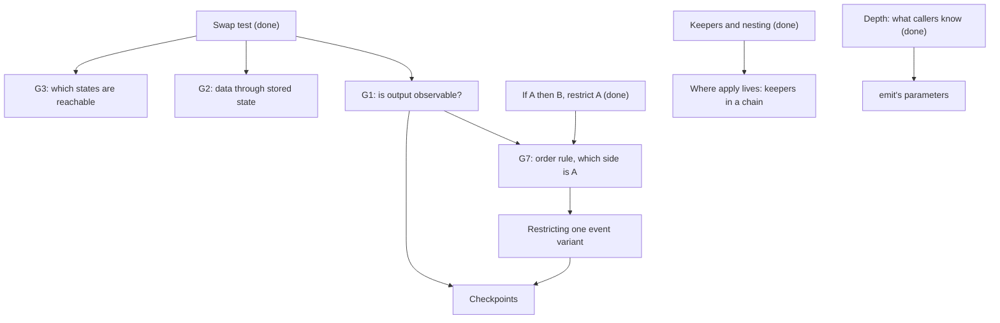

> [!quote] YOU

continue the architecture course


> [!question] Question
> Today's agenda has five items. How do you want to run it?
>
> The 02d agenda from COURSE.md:
>
> 1. Review the 02c audit. It's checked and mostly accurate. Its seven doc gaps (G1 to G7) are rule decisions for you, such as "does the order of events count as observable?" and "for an order rule, which side gets restricted?".
> 2. Where `apply` lives (finding 26). `apply` is the only caller of the drain, and the drain's loop is the only caller of `check_state`. That makes a chain of keepers, and the nesting bullet may not cover it.
> 3. `emit`'s parameter list, now that it hands the matches back instead of pushing them.
> 4. Restricting one event variant, such as only `kill` reporting `Died` (finding 30). The tools restrict who calls a command, not which value it gets.
> 5. Checkpoints (finding 31). There are ten call sites, and nothing keeps "a checkpoint marks the end of a step".
>
> Gaps G1 and G7 decide what items 2, 4 and 5 have to restrict, which is why I'd start with them. Whatever we pick, we stop at a node boundary.
>
> 1. Gaps first, then nodes in order, stop whenever (Recommended)
> 2. Nodes first, gaps after
> 3. Only the audit gaps today


> [!example] Answer
> 1. Gaps first, then nodes in order, stop whenever (Recommended)


> [!abstract] PI

Before the gaps, two probe questions on strands your knowledge map has no evidence for: the event stream as output, and checkpoints. Nothing below was taught earlier.


> [!question] Quiz
> `EndTurn` emits `TurnEnded`, then `TurnStarted`. Swap the two emits. `Game`'s state after the action is identical. Who can tell the difference?
>
> ADR 0006: `apply` takes `&mut impl Observer` and calls `event` for each thing that happens, in order, and `checkpoint` at set moments. `Game` keeps no event log and holds no observer.
>
> No trigger pattern matches `TurnEnded` or `TurnStarted` today.
>
> 1. Nobody, since `Game` keeps no event log and its state is identical
> 2. Only `History`, which records an entry for the events it counts
> 3. Only a trigger whose pattern matches one of the two events
> 4. The program around the core, through the observer `apply` reports to


> [!success] Quiz — correct ✓
> Your answer: 4. The program around the core, through the observer `apply` reports to
> Correct answer: 4
>
> The observer belongs to the caller of `apply`, and ADR 0006 says it receives the events in order. So the order of events is part of the core's output, even though the core never stores it. A shell that animates "turn ends, then turn starts" sees the swap, and so does `events.rs`, which asserts the order. Triggers and History are readers inside the core. They can make an order matter, but the observer can see it without them.


> [!question] Quiz
> `play` reports a checkpoint after `Played` and before `summon`, then another one after `summon`. Delete the first one. What changes?
>
> ```rust
> // play, today
> hand.remove(card);
> push(play effects);
> emit(Played);
> obs.checkpoint(Views::new(self));   // delete this one
> if has_board_presence {
>     summon(card);                   // emits BoardEntered
>     obs.checkpoint(Views::new(self));
> }
> ```
> Glossary: a checkpoint is a moment during an action when each player's view can be read.
>
> 1. Nothing, since a shell reads each player's view only after `apply` returns
> 2. The shell loses the view with the card out of the hand and not yet on the board
> 3. Dead objects leave at a different moment, since a checkpoint runs the state check
> 4. Triggers matching `BoardEntered` see a different board, since matching waits for a checkpoint


> [!warning] Quiz — cancelled
> (user skipped)


> [!abstract] PI

You closed the checkpoint question. Should I skip it and go to the gaps, or do you want to raise something first?


> [!quote] YOU

i did not mean to, "The shell loses the view with the card out of the hand and not yet on the board" is the correct one, I must point out that once again you are probing about existing code instead of concepts that is not why we are here


> [!abstract] PI

You're right on both points. Your checkpoint answer is correct, and that question tested a fact about the code, not a concept. I'll record "probe concepts, not facts about the code" with the other teach-skill feedback. From here on, the code shows up only as an example of a concept.

**Plan.** We go through the four gaps that need a concept, each as an open question you answer in your own words:

1. G1: does output count as observable?
2. G7: for an order rule, which side gets restricted?
3. G2: does data handed through stored state force an order?
4. G3: which states count as reachable?

G4 to G6 are wording fixes. I'll draft each one for a yes or no. Then come the nodes. G1 feeds checkpoints, and G7 feeds restricting one event variant, since it decides what an order rule restricts.



**G1.** The swap test says an order is free if nothing observable changes after the swap. A module has state that callers read through questions. It can also send output while it runs, like events to an observer, and nothing in its state remembers that output afterwards.

Should "observable" cover output? If it does, what follows for two reports in one command whose swap leaves the state identical, like "deaths reported, then game over"?


> [!quote] YOU

I think so, I supose the swap is not free because the order is observable


> [!abstract] PI

Yes. Output counts as observable: the observer belongs to `apply`'s caller, and the caller sees the order. So "deaths reported, then game over" is not a free order. Each step keeps its contract and the output changes, so it's an order rule, kept by the state check.

That raises a worry from the audit. If every output order counts, does every pair of reports in a command become its own order rule to keep? One distinction answers it.

**G1, follow-up.** Each event reports the step that just happened. So there are two different swaps:

1. Swap the two steps, each with its report.
2. Leave the steps where they are and swap only the two reports.

What does each swap break? And does that make the order of reports a decision of its own, separate from the order of steps?


> [!quote] YOU

If I understood this correctly both break the same thing, the expected order on the observer, I think so, there are tests that assert the order of the reports, and I believe it is important for things like animations that must play correctly


> [!abstract] PI

You're right that the order matters, for the reason you gave: tests pin it and animations depend on it. The part to look at again is whether both swaps break the same thing. Take `EndTurn`, which is two steps, each followed by its report:

```
end the turn      report TurnEnded
start the next    report TurnStarted
```

Swap 2 moves only the reports:

```
end the turn
report TurnStarted     <- here
start the next
report TurnEnded
```

At the moment `TurnStarted` reaches the observer, has the next turn started? What would a trigger matched there, or a checkpoint taken there, see? Then compare that with swap 1, where each report still sits right after its own step.


> [!quote] YOU

ok but these are different things, u are breaking that and end of turn emits a turn ended report, if u can emit a TurnEnded whatever then of course it no longer means the turn ended


> [!abstract] PI

Yes, those are two different breaks, and that's the distinction:

- **Swap 2** breaks the report itself. `TurnEnded` means "the turn just ended", so a report emitted anywhere else no longer says that. It's the report's own contract, the same class as a precondition.
- **Swap 1** keeps every report true and changes only which step runs first. The output changes, so that order is an order rule.

So the order of reports isn't a decision of its own. A report belongs to the step it reports, and the only decision is the order of the steps. The reports make that order observable, even between two steps that leave the same state either way, like the deaths and the game over.

How would you state this as the rule for the doc? Cover what counts as observable and where a report's order comes from. Your words, a sentence or two.


> [!quote] YOU

I am not sure I agree yet, why shouldnt I say that the order of the reports is an order rule here? cant we have both?


> [!abstract] PI

You can say the report order is ruled. It isn't free, and nothing I said contradicts that. My claim is narrower: it isn't a second decision next to the step order. The doc's own test settles it: "decisions that change together count as one". Try changing one without the other:

- Change the step order, and the report order changes with it.
- Change the report order alone, and you get swap 2, a report that lies.

No legal change moves one and leaves the other in place. So it's one decision, the step order, seen from two sides: the state and the stream.

Counting it twice costs something concrete. Here's how each reading restricts the code:

- **As report-pair rules**, every pair of reports needs a keeper ("`GameEnded` only after `Died`", "`TurnStarted` only after `TurnEnded`", ...). Each one restricts emitting a variant relative to another, which is finding 30's problem once per pair.
- **As step order plus report meaning**, you need two rules. The order of the steps is kept by whoever runs them, and that's a command the tools can restrict. The other rule is one per variant: only the step that does X reports X. That rule is node 4.

So "both" isn't wrong about the facts. It names one decision twice and doubles the keeping. Does that convince you, or do you see a case where the report order could change while the step order stays put?


> [!quote] YOU

I see.
When the order is observable trough reports the order of the steps becomes an order rule, due to the decision to emit those reports the order of the reports and the order of the steps change together, and so are the same decision.


> [!abstract] PI

That's the rule. Here it is drafted into "Orders between steps" in `docs/conventions/file-structure.md`, after the four swap outcomes:


> [!abstract] PI

```
Output counts as observable, such as the reports a step sends while it runs. A report belongs to
the step it reports, so the order of the reports changes with the order of the steps, and the two
are one decision. Steps that leave the same state either way still have an order rule when their
reports show which ran first.
```

Tell me if the wording is off. I'll commit with the other gaps once you've reviewed them.

**G7.** "Rules no owner guards" has your implication rule: read a rule as "if A then B", restrict A, and leave B open. An order rule says step X runs before step Y, for example "the pass's deaths are reported, then the game-over step runs".

Write "X before Y" as "if A then B". Which step is A, so which one gets restricted? And is there a second rule hiding in "X before Y" that would run the other way?


> [!quote] YOU

Output counts as observable. An output belongs to the step that outputs it, so the order of the outputs changes with the order of the steps, and the two are one decision.
Steps that leave the same state either way still have an order rule when their outputs show their order.
Wdyt?
If Y then there was X, Y is the one that gets restricted, there could be an If X then do Y when Y always happens after X


> [!abstract] PI

Your version is better. It says "output" throughout, while mine switched between output and "report", and the General section never defines "report". I've put it in as you wrote it.

G7 is right too. "X before Y" reads as "if Y runs, X ran first", so Y is the step to restrict. The reverse, "if X runs, Y follows", is a second rule. It holds only when the domain needs Y after every X, and then the rule restricts both steps. I've drafted that under your implication bullet in "Rules no owner guards".


> [!abstract] PI

The new bullet:

```
- An order rule, X before Y, reads as "if Y runs, X ran first", so restrict Y. When Y must also
  follow every X, the rule runs both ways.
```

If both drafts read right to you, next is a one-question check on G7, then G2.


> [!quote] YOU

looks good


> [!question] Quiz
> The order rule: "the pass's deaths are reported, then the game-over step runs." Which steps does its keeper have to restrict?
>
> Your rule: an order rule, X before Y, reads as "if Y runs, X ran first", so restrict Y. When Y must also follow every X, the rule runs both ways.
>
> Here X is reporting the pass's deaths, and Y is the game-over step.
>
> 1. Neither step, since one command already runs both
> 2. Both steps, since an order rule runs both ways
> 3. Only the game-over step
> 4. Only the step that reports the deaths


> [!success] Quiz — correct ✓
> Your answer: 3. Only the game-over step
> Correct answer: 3
>
> "If the game-over step runs, the pass's deaths were reported first" is the rule, so the game-over step is A, the one to restrict. The reverse, "if deaths are reported, the game-over step follows", is also true today, because the state check runs both every pass. But the domain doesn't need it: most passes end no game, and a design that checks for game over only when a hero dies would be just as correct. So the rule runs one way. One command running both steps today doesn't restrict anything. Any other code that can run the game-over step can still run it before the deaths are reported.


> [!abstract] PI

Right. "If the game-over step runs, the deaths were reported first" is the only direction the domain needs, so only the game-over step is restricted.

**G2.** The swap test files an order as forced by data when the swap doesn't compile, because the second step takes the first one's output as input. Those orders carry no decision, so they can sit anywhere, the coordinator included.

Now say the first step stores its output in a field instead of returning it, and the second step reads that field. Example: "end the turn" writes the next player into the turn order, and "start the turn" reads the active player from there. Swap them, and it compiles. The second step then runs on whatever the field held before.

Is that order forced by data, free to sit anywhere? If not, what is it, and what would make it forced again?


> [!quote] YOU

not anymore, now they are a rule of the domain, informal knowledge that one must come after the other


> [!abstract] PI

Right, the swap test no longer files it as forced. Nothing fails the build, the second step keeps its contract, and the game plays differently, so it's an order rule. The doc dropped "of the domain" in 02c, so "order rule" is the name. Every place that runs both steps holds that order as informal knowledge.

The second half: what change to the two steps would make the order forced by data again? And is there a fix the doc would prefer over that one?


> [!quote] YOU

wdym? a change that is not going back to what we had before?


> [!abstract] PI

Yes, going back is the answer. The question was badly framed, since the fix is the setup we started from. There is one nuance: the turn order has to stay in the game after the action, so "end the turn" can't simply stop storing it. It can store it and also return the next player, and "start the turn" takes that player as a parameter. Then the swap doesn't compile again.

The doc prefers a different fix, from "One place knows each decision": take the knowledge away from callers instead of making it formal. One command, "end the turn and start the next", runs both steps, and no caller knows the order. That command is the order rule's keeper, so the existing rules already cover the fix.

The gap needs only one clarifying sentence in the "doesn't compile" bullet:

```
- If the swap doesn't compile, the second step takes the first one's output. The order is forced
  by data and carries no decision. Output passed through stored state forces nothing, since the
  swap compiles.
```

Does that state it the way you would?


> [!quote] YOU

I find it somewhat odd that we need to clarify this, I thought it could be easily infered but if agents got confused then we add it


> [!abstract] PI

It came from a real auditor's question, and the sentence is short, so I'll add it.


> [!abstract] PI

**G3.** The swap test says to reason over every state the program can reach. In this game a card's behavior is data (ADR 0004): a new card is a new entry in the card set, with no code change, and the validator decides which entries the program accepts.

One audit case: an order is free with today's cards. But a card the validator already accepts and nobody has written yet (an aura that grants a deathrattle, dying in the same pass as the minion it grants it to) would make that same order lose a deathrattle.

So which states count as reachable: the ones today's cards can produce, or the ones any data the validator accepts can produce? Why?


> [!quote] YOU

I lean towards the second, but I think in todays code it is todays cards, but if the card was read from input than any card the validator can accept, today cards are code still


> [!abstract] PI

Your distinction does matter in one place. Here is why I think it doesn't change the answer here. Take the change itself: a designer adds the aura that grants a deathrattle.

- **What they edit:** one entry in the card set, `binder/sets/base.rs`. The rules code isn't touched.
- **The build:** it passes. The entry is a `CardDef` value, and nothing in the type system knows about the order in `kill`.
- **The validator:** it accepts the card, since it already accepts that shape.
- **Who would notice:** nobody reviews `kill`, because nobody changed it. A deathrattle goes missing in some game.

Now do the same with the card read from a JSON file. Every line comes out the same. So whether the card set lives in a Rust file or in input, the rules code works with whatever card data it's given, and the build can't see which cards exist. What decides what the rules must handle is the validator: it's the contract between card data and rules. Judged by the doc's "against the changes you expect", new cards are the change this project expects most, and they arrive without an edit to the rules.

Here's where your point holds. If card text were code, say each card a function with no validator, then a new card would be a code change. Its author would be expected to check the rules it touches, and today's set would be the right scope. That isn't the design, because of ADR 0004.

Does that move you to the second answer? Or is there a case where the card set being Rust source lets the rules rely on today's cards?


> [!quote] YOU

the problem if your suggestion is that what differs someone changing base.rs to add a new card vcs changing the validator, why does rule have to guard against one but not the other


> [!abstract] PI

Because they sit on opposite sides of an interface. The validator is the rules' interface for card data: it says which card text the rules promise to run. Adding a card in `base.rs` is a caller using that interface. Changing the validator changes the interface itself.

It's the same asymmetry as a function signature:

- **A caller passes a new value of the declared type.** The function must handle it, and nobody re-reads the body, since that's what the type promised.
- **Someone widens the type.** That's a change to the function. Whoever makes it owes a check of the body against the new inputs. It's their change, and the body is right there.

Widening the validator is the second case. Whoever lets a new shape of card text through is promising that the rules run it, so the rules' orders are theirs to re-check. Adding a card that fits the shapes already accepted is the first case, and that author has no reason to open `kill`.

So the rules don't guard against validator changes, in the same way a function doesn't guard against its signature changing. Reachable means every state some accepted input can produce. The scope moves when the interface moves, and that's an edit to the rules.

Does that settle it for you? If it does, state the reachable rule in your words and I'll draft it.


> [!quote] YOU

I dont know, it still odd to me that u are defining code as data in one place and as interface on the other, how would u state it


> [!abstract] PI

You're right that I switched labels, and it's my framing that's off, not the idea. The line isn't code versus data, since both sides are code. It's which side of a module's interface the code sits on:

- `kill`, the validator and the rest of the rules code are one side. The validator says which card text the rules accept, so it belongs to the rules.
- `base.rs` is the other side. It's code that hands the rules their input, the way a caller hands a function an argument. Every module's callers are code too.

So "data" was a red herring. The card set gets the same treatment as any caller: its code can change, and a change that stays within what the rules accept doesn't make anyone open the rules.

How I'd state it, as a paragraph after the swap-test sentence in "Orders between steps":

```
A state is reachable when some input the module accepts produces it, whether or not a caller
sends that input today. A caller can send a new accepted input without touching the module, so
nothing prompts a review of it. Widening what the module accepts is a change to the module.
```

Does that read right to you, or does it still feel like a double standard?


> [!quote] YOU

sounds good, and way better


> [!abstract] PI

Added. That leaves three wording gaps. For each I have a draft or a "no change". Answer in one line, like "1 yes, 2 no".

1. **G5, one order kept at two sites.** The state check runs both before the next pending effect is popped and when a resolving effect finishes. Swap the order at either site alone, and the other site still holds it, so the swap looks free. Draft, appended to the paragraph that opens the section:
   ```
   An order kept at several sites looks free at each, since the others still hold it. Swap it at
   every site together.
   ```
2. **G6, iterations.** The section speaks of two steps. But the order between iterations of one loop, such as the order the dead are processed in, is the same question. Draft, also appended there:
   ```
   Two runs of one step, such as two iterations of a loop, count as two steps.
   ```
3. **G4, whose precondition.** Paying reads the card's cost, and the cost question answers "none" for a card that's not in hand. Swap paying with leaving the hand, and the payment gets "none" and panics. The auditor couldn't tell whether the precondition belongs to the cost question, whose contract allows "none", or to the payment, whose contract doesn't. My take is no change: the bullet already says "a step gets input its contract rules out", and here that step is the payment.


> [!quote] YOU

3 agree. what your suggestion on the other two?


> [!abstract] PI

I'd add both. Each one closes a hole where an auditor following the test as written gets a wrong answer.

- **G5, yes.** Testing one site at a time can miss an order entirely, not just misfile it. Each site's swap really is free while the other site exists, so both get filed as free. A refactor that trusts both verdicts moves one site and deletes the other, and the order is gone. Finding 25 already wants the duplicate state check removed, so this path is live. Swapping at every site together is the only way to see the order.
- **G6, yes.** The most important order rules in this crate are orders between iterations: the order in which one event's triggers are pushed (ADR 0014), and the order in which the dead are processed. An auditor who reads "two steps" literally can skip both. It costs one sentence.

Want them as drafted, or reworded?


> [!quote] YOU

both agree


> [!abstract] PI

I moved the reachable paragraph below the four outcomes, so the outcomes come straight after "swap the two steps". The text is unchanged. Committing the gap review:


> [!abstract] PI

Committed as `fd5d66c` on `architecture-02`. That finishes the gap review.

**Node: where `apply` lives (finding 26).** Here is the problem.

Today `apply` and the drain share `resolve.rs`, and the drain is private there. So ADR 0015's "only `apply` starts the drain" holds by visibility. Your 02b design puts the drain and the state check under a loop parent, so that only the loop can run the pass. But `apply` sits outside that parent. For `apply` to reach the drain's entry, the entry has to open to all of `game`, and the ADR's rule turns informal. Fixing one link breaks the one above it.

The chain is longer than two links:

- `apply` is the only rightful caller of the drain.
- The drain is the only rightful caller of the state check.
- The state check is the only rightful caller of `kill`.
- `kill` is the only rightful caller of the removal of the dying.

That makes four keepers, each the only rightful caller of the next. The nesting bullet says:

> Its module and the keeper's share a parent that holds only the keeper and the commands it guards, and the command is `pub(super)`.

How would you keep every link enforced? And does the bullet, as written, allow your answer?


> [!quote] YOU

as a nested tree, and I think so, my 02b is not to be taken as fact it is the job of the agent that will refactor this to choose what to do


> [!abstract] PI

Fair. Your 02b design was an answer to an exercise, not a settled shape. The refactoring agent picks the layout within whatever the doc allows. I'll record it that way.

You're also right that the bullet allows the tree. What makes it work is the General rule that a child module counts as one item in its parent. So when a guarded command keeps a rule of its own, its module is a parent, holding that keeper and the commands it guards. From the level above, that whole module still counts as one command. A chain of keepers nests one level per link, and each level holds exactly one keeper.

1. **Doc line?** The 02b auditor flagged exactly this as a gap ("chained keepers"), so by your G2 test it earns a sentence. Draft, appended to the nesting bullet:
   ```
   When a guarded command keeps a rule of its own, its module is the parent of the commands it
   guards, so a chain of keepers nests one level per link.
   ```
2. **Exercise.** The tree has to stop somewhere. The last link is "only `kill` removes the dying from the board". The board belongs to the location owner (session 02), and its move command serves every move in the game: draw, play, bury, and the deaths. That command can't nest under `kill`. What keeps this link, and why does the tree stop there?


> [!quote] YOU

1 yes. it cannot own it so instead a module with no data is the keeper


> [!abstract] PI

Added. On 2: you're right that `kill` stays the keeper, a module with no data, since it combines the board and the effect stack and can own neither. But that names the keeper, and the link already had one. The question was what stops other code from calling the owner's move to take a dying minion off the board.

The tree stops because the move command has a reason to live elsewhere: the owner serves every move in the game. The doc's next rung covers that case: "a token earns its place when the command has to live outside the keeper's subtree". The command takes a value that only `kill`'s subtree can build.

There's a catch, though. Put the token on the move command, and draw, play and bury can't call it either. The rule is about one kind of move, a death, made through a command every move shares. That's the same shape as node 4: "only `kill` reports `Died`" is one kind of report, made through `emit`, which every report shares. Both rules restrict one value of a shared command.


> [!abstract] PI

Committed as `5e33fba`. Since that catch is already node 4's problem, I'll take node 4 now and do `emit`'s parameters after it. Splitting `emit` would change its parameter list anyway.

**Node: restricting one value of a shared command.** Every tool on the ladder restricts who can call a command: nesting, a token in the signature, a Clippy ban. None of them can restrict which value a caller passes. Yet these rules are each about one value:

- "Only `kill` reports `Died`" goes through `emit`, which every report shares.
- "Only `kill` removes the dying" goes through the location owner's move command, which every move shares.

What change makes the ladder apply to a rule like this? And once you've made it, what else has to change so that a caller can't get around the rule through the shared command?


> [!quote] YOU

ladder? the interface restricts what the caller passes


> [!abstract] PI

By "ladder" I meant the three tools in the doc's "Restricting callers" section, in their order: nesting, then a token, then a Clippy ban. That's my shorthand and the doc doesn't use it, so I'll drop it.

Your answer is right. A type can restrict the value itself. If only `kill`'s subtree can build a `Died` value, the shared command can stay open to everyone: any code may call `emit`, and only `kill` has a `Died` to pass it. It's the token idea again, with the private field moved from beside the value into the value. A rule about one value is kept by restricting who can construct that value.

One follow-up. `Event` has two roles. `emit` takes it as input, and it's also the public output the shell receives. Where should the type that only `kill` can build go: into `Event` itself, or somewhere else? Why?


> [!quote] YOU

I dont know, we can always split event if needed


> [!abstract] PI

That's a real gap, so here's the reasoning. It comes down to who else builds `Event` values.

- **The spec tests.** `events.rs:393` builds the expected stream: `Event::Died { object_id: captain }`. Put a private token in `Died`, and every test that writes out an expected death stops compiling.
- **The program around the core.** ADR 0006 gives it the log and the log's readers. A log read back from a file has to build `Event` values too.

Both are legitimate builders. The rule "only `kill` reports `Died`" is about how the core reports internally, and it's a decision the shell has no part in. A token inside the public `Event` would push that internal decision into the interface of every outside reader, and it would block the outside builders who have every right to build one.

So the restriction belongs in the type `emit` takes, not in the type it hands out. You split them: an input type that only the core sees, whose `Died` value only `kill`'s subtree can build, and the public `Event` that `emit` produces from it. Your "split if needed" is the answer. It's needed as soon as one value carries a rule and the type has readers outside.

It's the same for the board: the location owner's move command takes a value of its own input type, and only `kill` can build the death variant of it.

How would you state this as the rule for the doc? Cover how a rule about one value gets kept, and where the restriction goes.


> [!quote] YOU

or we could debouple the internal event from the external event and the token would live only on the inner one, how would u state it


> [!abstract] PI

Same design, said better. "Decouple" names it more exactly than my "split". As two drafts, one per section:

**General**, a bullet in "Rules no owner guards", after the implication bullets:

```
- A rule about one value of a shared command, such as one kind of report, restricts who can build
  that value. The restriction goes in the command's input, not in a type it hands out, since
  readers outside may build that type too.
```

**Rust**, a bullet at the end of "Restricting callers":

```
- For a rule about one value of a shared command, put the token inside the value: the variant
  holds a type with a private field. When the command's input is also public output, decouple
  them. An internal input type carries the token, and the command builds the public type from it.
```

The General one has no Rust terms, which matches how you've been cutting that section. Do they read right, or do you want to reword either one?


> [!quote] YOU

remove the report part


> [!abstract] PI

Cut and committed as `49b46e6`. One check on a case from your domain:


> [!question] Quiz
> A ledger service has one shared command, `post(entry)`, that every job uses. Rule: only the settlement job may post a reversal entry. Entries are also the service's public API, and clients deserialize them. Where does the restriction go?
>
> 1. In an internal input type for `post`, whose reversal variant only the settlement job can build
> 2. In a check inside `post` that rejects a reversal unless the settlement job sent it
> 3. On `post` itself, so that only the settlement job's module can call it
> 4. In the public entry type, whose reversal variant only the settlement job can build


> [!success] Quiz — correct ✓
> Your answer: 1. In an internal input type for `post`, whose reversal variant only the settlement job can build
> Correct answer: 1
>
> The rule is about one value of a shared command, so it restricts who can build that value. Restricting `post` itself would block every other job's entries. Putting the restriction in the public entry type would stop clients from deserializing reversals, even though they build that type legitimately. A check inside `post` would need to know its caller, which a signature can't tell it, so the rule would stay informal. An internal input type carries the restriction, and `post` builds the public entry from it.


> [!abstract] PI

Right. And `post` can't tell who called it, which is why the check inside `post` stays informal.

**Node: `emit`'s parameter list.** You can stop at this boundary or any later one.

In 02a you drew `emit` as a module with no data. Since 02c it hands its matches back instead of pushing them. The Rust section says a module with no data takes what it reads as parameters. For `emit`, that's:

- **writes:** History, the observer
- **reads:** objects, the binder, turn order, every player's board, the event itself

Thirteen call sites pass all of that, one for each place that reports something: draw, play, damage, the deaths, and so on.

What decision does each of those 13 callers know through that parameter list? Do you expect it to change?


> [!quote] YOU

all that is needed to write history/events on the observer, I expect it to change yes


> [!abstract] PI

Mostly, yes. One correction: the biggest part of that list is for matching, not for History or the observer. The observer needs only the event. Most of the reads are there to find the triggers that react: the boards in order of play, and each object's triggers through the binder. So what the callers know is what recording and matching read. It will change: a trigger whose condition counts History, or one that reads health ("if it survives"), widens the set. Each widening is formal, since the build finds every caller, but it's still 13 edits for one decision.

How would you take that knowledge away from the 13 callers, without going back to `emit` taking all of `Game` as `&mut self`? That would let it write every field.


> [!quote] YOU

making a viewer type and implementing from &Game for it? btw my 2a is the same as what I talked before, it is not settled design


> [!abstract] PI

Noted. 02a stays an exercise answer, like 02b, and the refactoring agent picks the shape. I'll record both that way.

Your design does what's needed. The conversion is the one place that knows what `emit` reads. Callers pass one value, and a new read edits only the conversion. It's also what ECS calls declared access: a Bevy system can bundle its parameters into one struct with `#[derive(SystemParam)]`, which keeps them out of every caller.

Three adjustments:

1. **It can't be built from `&Game`.** `emit` also writes History, and a value built from `&Game` holds a shared borrow of all of `Game`, so there's no way to get `&mut` History at the same time. Build it from `&mut Game` instead, split into `&mut` History and shared borrows of the rest. That's still one place.
2. **It restricts writes too.** The type holds `&mut` to History only, so `emit` can write nothing else, which is exactly what `&mut self` gave up.
3. **The name.** Viewer is a glossary term for a player who views, so this type needs a different name. That's the refactor's call.

The Rust section's criterion doesn't name this reason. It says a struct earns its place "only when it holds borrows that several of the functions share, or implements a trait". Draft, added to that bullet:

```
It also earns it when many callers would pass the same parameters. One function builds it from
the owners, so only that function knows what the module reads and writes.
```

Does that state it the way you would?


> [!quote] YOU

yes


> [!abstract] PI

Committed as `1ae9c41`.

**Node: checkpoints (finding 31).** A checkpoint hands the shell a view, so it's output. By your G1 rule, where checkpoints go is observable, and it's a decision. Today ten sites report one, spread over four concerns:

- action handling, five sites, one per kind of action that has no card to resolve
- `play`, two sites: after the card leaves the hand, and after the minion enters
- the resolution loop, one site: after each step of a resolving effect
- the state check, two sites: after a pass that removed something, and at the game's end

The pattern the tests imply: "if a checkpoint is reported, a step just ended", and the reverse. Nothing keeps it. Any code holding the observer can report one, and nothing makes a new step report one.

What decision do those ten sites share? What would let one place know it?


> [!quote] YOU

I had spread then at random, I dont think there is any meaningfull decision behind them yet, at least none that I agreed with


> [!quote] YOU

and this comes mostly because we cannot see the value yet as there is no sheel


> [!abstract] PI

That fits the course rule: a concept with no problem in today's code waits until the card-game course creates the problem. With no shell reading views, nothing tells you where a step should end, so any keeper would be guarding a choice nobody made.

One thing to record with it: some tests in `events.rs` pin checkpoint positions, for example `a_checkpoint_follows_a_card_leaving_the_hand`. Those tests make promises you never agreed to. I'll add an open thread: checkpoint placement has no decision behind it yet (your call), revisit it when a shell reads views (session 03 with Bevy, or the card-game course), and review those tests then.

That's the end of today's agenda. The audit against the new doc text is already planned for 02e, after the untangling. Close the session here?


> [!quote] YOU

yes


> [!abstract] PI

Closing session 02d. Here's what changes in `docs/course/architecture/COURSE.md`:

- **How sessions work.** Your exercise designs are answers, not settled designs. The refactoring agent picks the shape within the doc (your call, today).
- **Knowledge map.**
  - Coupling, the audit gaps:
    - On output, you first said both swaps break the same thing, then found the difference yourself: a report sent anywhere else stops meaning what it says.
    - "Why not both" was settled by "decisions that change together count as one". You reworded the rule with "output".
    - You filed an order through a stored field as an order rule at once.
    - On reachable states, you challenged a double standard between adding a card and widening the validator. My code-as-data framing caused the confusion, and caller against interface settled it.
  - Ownership:
    - You derived unaided that an order rule restricts its later step, and nested the chain of keepers as a tree.
    - For the last link, you named the keeper but not the token.
    - On one value of a shared command, you got "the interface restricts what the caller passes" unaided. You said "I don't know" on where the token goes, then proposed decoupling the internal event from the external one.
  - Interfaces: on `emit`'s callers, you missed that matching reads most of the list. Your read type needed `&mut` split, because `emit` writes History.
  - How you learn: you objected again to a probe on code facts, asked what "ladder" meant, and asked me to state rules you held but hadn't worded.
- **Open threads.**
  - The 02c audit is marked reviewed, with my corrections and the four orders it missed.
  - Finding 26 is settled as a nested chain plus a token for the location owner's death move.
  - Finding 30 is settled as an internal input type carrying the token. `Event` stays free for tests and log readers to build.
  - Finding 31 waits for a shell, together with the `events.rs` tests that pin checkpoint positions.
  - `emit`'s parameters become one struct of borrows.
  - Your 02b loop parent is marked as an exercise answer.
  - The teach-skill thread gains "probe concepts, never code facts" and "define shorthand or drop it".
- **Plan, map and sessions table.** 02d is done, and its coordinator node is marked done in the dependency map. 02e, untangling `Game` and then the audit, is next.

`file-structure.md` already holds today's five commits. `verified-facts.md` and the glossary don't change.

To start the next session:

```
/new
/name 02e-untangle-game
/md-log docs/course/architecture/sessions/02e-untangle-game.md
continue the architecture course
```

I'll commit once the edits are in.
