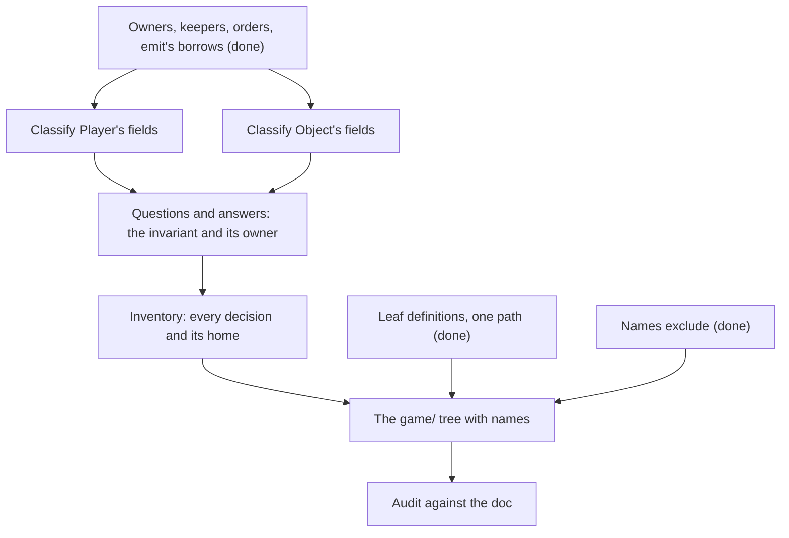

> [!quote] YOU

continue the architecture course


> [!question] Question
> What should today's untangling of `Game` produce?
>
> Session 02e: untangle `Game`, then the audit. No retrieval quiz, since 02e isn't the first session of its topic.
>
> Most of `game/`'s decisions already have a home from 02 to 02d: the location owner, the history owner, the stack owner and push keeper, `emit`, the pass with `outcome` and `playing`, and the chain apply > drain > pass > kill. A few have none yet:
> - the pending pick or draft and the answers stored on `Object` (`choice_targets`, `pick_targets`)
> - mana (check, payment and refill sit in three files)
> - what's left of `Player` and `Object` once every field has moved out
> - turn start and end, characters in play, rng and selectors, setup
>
> In 02d you ruled that the layout is the refactor's call, so I've kept file layout out of the first option.
>
> 1. Every decision with its home and nesting constraints; layout and file names stay the refactor's call (Recommended)
> 2. That, plus a full file tree with names that I judge
> 3. Only the decisions with no home yet
> 4. First a lesson on doing a god-struct refactor in steps (ticket order, staying green), then the homes


> [!example] Answer
> 2. That, plus a full file tree with names that I judge


> [!abstract] PI

No probe quiz this time. The knowledge map already covers every strand the untangling uses, and your edge is producing answers, which the exercises test anyway. Two strands haven't been checked in a while: drawing a boundary around a noun instead of a decision (last seen in 01c), and judging names by a proxy (01c). Step 1 and the tree check both.

**Approach**

1. **Classify `Player` and `Object`.** One exercise per struct. You group the fields by decision, and where a group already has a settled home, you name it. A boundary drawn around a noun would show up here.
2. **A card's questions and the player's answers.** The pending pick or draft lives on `Player`, and the answers live on `Object` (`choice_targets`, `pick_targets`). You work out which invariant ties them, and from that, the owner. The exercise covers one invariant.
3. **The inventory, drafted by me.** It lists every decision in `game/` with its data, its home, and the session that settled it. Mana, turn start and end, characters in play, rng and selectors, setup and view get proposed homes here. You judge it, including the push keeper from 02c, which you haven't judged yet.
4. **The full `game/` tree with names, drafted by me.** You judge where each module sits (lowest common ancestor, one nesting level per link) and test each name against its siblings. Names with no glossary term are your domain calls, and they go into the glossary.
5. **Doc gaps.** If one shows up, I add it to `file-structure.md` once you've stated the rule.
6. **The audit.** Subagents check the crate against the doc as it stands, then you review their findings. If we run short on time, the audit moves to the next session so we stop at a node boundary.



Shall I start with `Player`?


> [!quote] YOU

honestly I dont see the point in this one, I thought u would be doing the refactors to the code, I dont see the value to me here


> [!abstract] PI

You're right. The untangling applies rules we've already settled to code that already exists, and in 02c you made solving the code my job. Having you classify `Player`'s fields would retest what the knowledge map already shows.

Here's what I'd do instead:

1. **I design the untangling myself, following the doc.** That covers where each decision lives and the `game/` tree. A subagent then reviews my design against the doc. The audit becomes part of that review, so it reports doc gaps along with design problems.
2. **You only get what the doc can't decide.** There are three kinds:
   - Rule gaps, where the doc gives no answer or two answers. Those are your calls, and they go into the doc.
   - Names with no glossary term, which are domain calls. I know of two today: `emit`'s module, and the decision that covers stats and cost together with modifiers.
   - Any change to the public API in `prelude.rs`.
3. **Tickets as in 01e.** They go in `docs/issues/untangle-game/` with a shared `spec.md`, which pulls 02f forward into this session. AFK agents work them, one PR each, and you check the intentions they state against the code. When you disagree with one of their choices, that's a doc gap. That's where the refactor teaches you something.

One thing to settle first: should AFK agents take one ticket each, as in 01e, or should I make the changes in this session on a branch while you review as I go?


> [!quote] YOU

I dont see why would u plan everything for other agents to then pick each part up, why not let the agent solve each ticket on their own


> [!abstract] PI

Agreed. A ticket should describe a problem, and the agent working it should find the shape. If I design everything up front, the agents just follow my design, never use the doc, and we never find out where the doc falls short. That signal is the reason to run the refactor through agents at all. We've already seen this go wrong once: in 01e my ticket 02 told the agent to put `CardDef` in `definition/mod.rs`, which broke a rule.

So each ticket will carry:

- **The problem.** The finding, its evidence in the code, and the doc rule it breaks.
- **Your rulings.** These are rules, not shapes. For example, "the reverse history rule is a false invariant", "matching stays with reporting", and "checkpoints wait for a shell".
- **Nothing else.** The designs in the open threads, like the location owner, the `Next` enum and the struct of borrows, stay out. They're your exercise answers, not specs, and an agent might find a better shape.

Some work still stays with me, because you handed it to me in 01e: picking which findings go in, drawing the ticket boundaries, and setting the order. Almost every ticket edits `game/`, so most of them will run one after another, each building on the code the previous one merged. That makes the effort slower than running them in parallel. I'll also skip a separate audit. Each agent checks its own area against the doc and reports any gaps in its PR, which follows your 01d call that refactors surface the rest.

If that works for you, I'll read the issue tracker conventions, write the tickets, and bring them to you for review before anything is committed.


> [!quote] YOU

that works, make each agent do 1 to 5 review passes on their pr before judging it finished, I dont see a problem in doing them sequentially


> [!abstract] PI

I've drafted `docs/issues/untangle-game/spec.md`. Every agent runs at least one review round and at most five, and the tickets go one at a time, each starting from main once the ticket before it is merged. A subagent is collecting current evidence from the code for the ten tickets. I'll write them once its report is in.


> [!abstract] PI

Now the tickets.


> [!abstract] PI

The ten tickets are drafted. A subagent is checking them against the code, the ADRs and the doc for false claims, places where a ticket dictates the shape of the fix, and conflicts between tickets. I'll fix what it finds and then bring you the set for review.


> [!abstract] PI

The effort is ready for your review. It's a spec plus ten tickets, nothing committed:

- `docs/issues/untangle-game/spec.md`
- `docs/issues/untangle-game/issues/01-zones-and-order-of-play.md` to `10-game-leaf.md`

| # | Problem the ticket states | Findings |
|---|---|---|
| 01 | Eight functions write the zones, and five moves refresh the order stamp. Both are `pub`, and three places sort by the stamp. | 4 |
| 02 | The pending pick or draft is stored on `Player`, and its answers on `Object`. Revealed cards sit in no zone. Three `_` arms. | 9, 19 |
| 03 | History entries are `pub`, and two files know their layout. | 13, 32 (#16) |
| 04 | Three push sites each know the stack order, and the cursor is `pub`. | 5, 21, 24 (#17) |
| 05 | `emit` takes `&mut Game`. Any caller can report `Died`, `Played` or `GameEnded`. Own death triggers are known twice. | 30 |
| 06 | The resolution loop's rules hold only by convention: only `apply` starts it, the state check runs twice, any code can kill or end the game, and elimination is known twice. | 25 to 29 |
| 07 | Mana is checked, paid and refilled in three places. | 8 |
| 08 | Four `_` filters decide stats. Modifiers, auras and damage are `pub`. | 16 (#18) |
| 09 | Two walks over a draft, and one answer serves two questions. | 6, 7 |
| 10 | What's left in `Game`. `mod.rs` should hold only `mod` declarations, with visibility as narrow as it compiles. This PR deletes the effort folder. | 1 |

**Rulings I carried over.** Check that these are really yours. Everything else in the tickets is a problem or a fact.
- Only one direction of the history rule is real. An entry without a reported event is fine, so recording needs no restricted caller (02b).
- Trigger matching stays inside the command that reports the event, because a match made later sees a different board (02c).
- `Event` stays public and unchanged (02d).
- Checkpoints stay where they are (02d).

**Left out on purpose.** The spec lists these under "Left for later sessions" and "Known bugs to leave alone":
- parse, don't validate (02g)
- validators copying resolution rules (12)
- the `CardDef` export (22)
- the Mourner bug, both hero bugs, `pick_targets` never being cleared, the panic when revealing from the opponent's deck, fatigue bypassing `damage`, and setup running no drain

**What the verification pass caught, all fixed:**
- Eight wrong facts. For example, `emit` doesn't read history, the call count was off, and heroes never leave the board.
- Tickets 05, 06 and 08 dictated the kind of boundary. Their titles and "Done when" sections now state only the problem.
- Tickets 01 and 02 both claimed the revealed cards. Ticket 02 now owns them.
- `Object.damage` was in no ticket. It now goes to 08.
- Three decisions no ticket covered: the elimination copy (06), who may act (02), and own death triggers (05).

Once you've reviewed, here are the steps:
1. Commit the effort on `architecture-02`.
2. `architecture-02` is 13 commits ahead of main. Those commits include the 02b to 02d changes to `file-structure.md`, which the agents need. Push it and open a PR to main. Merge that PR before you launch ticket 01.
3. Launch each ticket once the one before it is merged:
   > Work ticket `docs/issues/untangle-game/issues/NN-<slug>.md`, following `docs/issues/untangle-game/spec.md`. Work fully AFK.

The agents push branches and open PRs on your behalf. Those PRs are still yours to check before you merge.


> [!quote] YOU

I think from the rulling you caried over only  - Trigger matching stays inside the command that reports the event, because a match made later sees a different board (02c). is the only we really care, the others I would let the agent decide


> [!abstract] PI

Done. Only the matching ruling is left, in tickets 04 and 05. I removed the other three:

- **History direction.** Ticket 03 has no rulings now.
- **`Event` unchanged.** Gone from the spec's constraints and from ticket 05. The Clippy ban line in 05 went with it.
- **Checkpoints.** Gone from the spec's constraints and from tickets 06 and 10.

The spec's general refactor frame still pins two of those in practice:

- **`Event`.** The prelude must keep every name and signature, and `tests/spec/` must pass unchanged apart from imports. `Event` is in the prelude, and the tests build it, so an agent can't change it without breaking a constraint.
- **Checkpoints.** An observer sees them, so moving one is a behavior change. Some tests in `tests/spec/events.rs` also pin their positions. The behavior reviewer still reports checkpoint moves, but it only reports them. The agent decides what to do.

Should ticket 05's agent be allowed to change `Event` and edit the tests that build it, or does the no-behavior-change frame stay as it is?


> [!quote] YOU

I think every behaviour change should be well justified, but I wouldnt ban it


> [!abstract] PI

Behavior changes are now allowed if they're justified. They're no longer banned. Here's what changed in the spec:

- **New section "Behavior changes".** Behavior means anything an observer or caller can see: events and their order, checkpoints, RNG draws, listener and candidate order, panics, validation results, and the public API.
- **A justification has three parts:** what the observer or caller now sees, why the doc calls for the change over today's behavior, and which tests changed. Test changes go in their own commit.
- **Accidental changes.** When a test in `tests/spec/` needs more than an import path change, the agent either undoes the change or justifies it. The behavior reviewer's findings work the same way.
- **Tickets.** Each "Done when" now reads "the checks pass, and the PR justifies every behavior change". Each "Keep as it is" section is split in two:
  - "Leave alone": rules questions, known bugs and later sessions.
  - "Behavior to watch": allowed with justification. For example, when a move stamps relative to its event, the second state check, the order of the legal-action list, `Game`'s public signatures and the RNG draw order.

I kept one category off limits: the rules of the game. That covers what a card does, who acts or picks, which triggers fire and the order they resolve in, what dies and when, and stat values. The known bugs fall under it too. My reasoning is that you make those calls in the card game course, test-first, and a refactor agent shouldn't make them for you.

Is that split right, or should rules changes also be open when justified?


> [!quote] YOU

sounds good


> [!abstract] PI

The effort is committed as `b4ebc20` on `architecture-02`, which holds only `docs/issues/untangle-game/`.

Two steps are left before ticket 01 can launch:

1. **Push and open a PR.** I'd push `architecture-02` and open its PR to main. It carries the 02b to 02d changes to `file-structure.md`, the course logs and the tickets.
2. **Close the session.** I'd record 02e as the session that wrote the tickets and change 02f to "review the untangling PRs and the doc gaps they surface". 02g, parse don't validate, stays the next teaching session. I'd also note in the knowledge map that you dropped the untangling exercises, and that tickets now state problems and carry only rulings you care about.

Should I push and open the PR, then close?


> [!quote] YOU

do that


> [!abstract] PI

PR #37 is open: https://github.com/EMachad0/CardGameEngine/pull/37. It carries the doc changes from 02a to 02d, ADR 0015 restated in glossary terms, the course files and the untangle-game effort. Merge it before you launch ticket 01.

To close the session, here's what changes in `COURSE.md`:

- **How sessions work.**
  - A ticket states the problem, the code that shows it and the rule it breaks, never the shape of the fix.
  - Tickets carry only the rulings you care about.
  - Applying settled rules to existing code is my part, with no exercise.
  - Agents run one to five review rounds, and the tickets run one at a time.
  - A behavior change is allowed when it's justified. Rules changes and known bugs are the exception, since the card game course decides those.
- **Knowledge map, "How he learns".**
  - You rejected the untangling exercises, and then a central design.
  - Of the four rulings, you kept only "matching stays with reporting".
  - Your view on behavior changes: "well justified, but I wouldnt ban it".
  - The names and noun-boundary strands are still untested since 01c.
- **Course plan.**
  - 02e is done: it became the ten problem tickets, with no exercise and no audit.
  - 02f becomes the review of the untangling PRs as they land, with the doc gaps they surface going into the doc.
  - 02g, parse don't validate, is the next teaching session.
- **Open threads.**
  - Findings 1, 4 to 9, 13, 16, 19, 21 and 24 to 30 are ticketed, and so are #16, #17 and #18. The rest are listed with where each one waits.
  - The earlier design threads stayed out of the tickets, so 02f compares each PR against its thread.
  - The teach skill thread gains "don't turn applying settled rules into an exercise".
- **Sessions table.** The 02e row is marked done, and the 02f row is rewritten.

Start the next session with:

```
/new
/name 02g-parse-dont-validate
/md-log docs/course/architecture/sessions/02g-parse-dont-validate.md
continue the architecture course
```

If PRs from the tickets land before then, start 02f first, with its own log. I'll commit and push once the edits are in.
