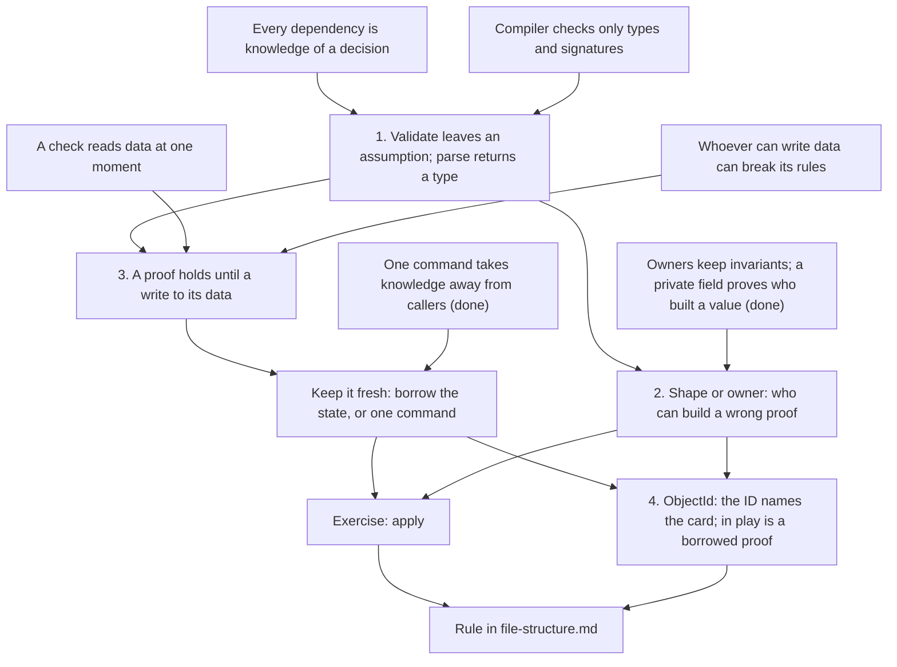

> [!quote] YOU

continue the architecture course


> [!question] Quiz
> Which statement fits those 18 callers?
>
> A payments service has `fn balance(id: AccountId) -> Option<Money>`, which returns `None` when the account is closed. 18 of its 20 callers run only after an earlier step in the same request has confirmed the account is open. They call `.expect("account is open")` on the result.
>
> 1. Each holds formal knowledge of the earlier check, since the Option makes it handle the closed case
> 2. Each holds informal knowledge of the earlier check, and the Option doesn't change that
> 3. Each holds knowledge of balance's signature only, since the check happens in another function
> 4. Each holds no knowledge of the earlier check, since expect stops the request if the check was skipped


> [!success] Quiz — correct ✓
> Your answer: 2. Each holds informal knowledge of the earlier check, and the Option doesn't change that
> Correct answer: 2
>
> The Option makes "this account may be closed" formal: the build forces each caller to say something about None. What each caller says is `expect`, which is the assumption "an earlier step checked this". If someone removes or moves that check, or accounts can now close in the middle of a request, the build still passes at all 18 sites. That makes it informal knowledge. The panic tells you at runtime that the assumption broke. It doesn't tell you where the assumption is held, and the code still relies on it. The caller holds knowledge of the check even though the check lives in another function, because it relies on what the check found.


> [!question] Quiz
> What does holding a `Funded` prove at the moment `debit` runs?
>
> A payments module exposes `check_funds(acct, amount) -> Result<Funded, Error>`. `Funded` has a private field, so only the payments module can build one. `debit(f: Funded)` trusts it and doesn't re-check the balance. Any code in the service can call `debit` and `withdraw_fee`, which also lowers the balance.
>
> 1. That the balance covers the amount now, since only the payments module can build one
> 2. That the balance covers the amount now, as long as Funded can't be cloned or copied
> 3. That the balance covered the amount when check_funds ran, not that it still does
> 4. Nothing about the balance, since a type can't carry a fact about runtime data


> [!question] Quiz — I don't know
> Your answer: I don't know
> Correct answer: 3
>
> Note: both 1 to 3 sound right depending on the signature of Funded
>
> The private field proves who built the value: the payments module ran check_funds. The fact it records is about the balance at that moment. The balance is stored data, and any code that can write it, here withdraw_fee or a second debit, can make that fact false while the Funded value still exists. Making it single-use stops two debits from sharing one Funded, but a fee can still drain the account between the check and the debit. So the type does carry a runtime fact. That fact is about the state the check read, and nothing ties it to the state as it is now.


> [!question] Quiz
> Which design compiles and guarantees the balance still covers the amount when the debit runs?
>
> About your note: you're right that it depends on what Funded holds. I meant a Funded with only a private marker and no borrow. This question is about the version where it holds a borrow.
>
> An in-memory `Ledger` holds the balances. Every option uses a `Funded` with a private field, which only `check_funds` builds.
>
> 1. check_funds(&self) returns Funded<'_> holding &Ledger; debit is a method on Funded
> 2. check_funds(&self) returns Funded holding no borrow and not Clone; Ledger::debit(&mut self, f: Funded)
> 3. check_funds(&mut self) returns Funded<'_> holding &mut Ledger; debit is a method on Funded
> 4. check_funds(&self) returns Funded<'_> holding &Ledger; Ledger::debit(&mut self, f: Funded<'_>)


> [!failure] Quiz — incorrect ✗
> Your answer: 4. check_funds(&self) returns Funded<'_> holding &Ledger; Ledger::debit(&mut self, f: Funded<'_>)
> Correct answer: 3
>
> A proof stays fresh only if nothing can write the checked data while it lives. A shared borrow gives you that, but nothing can write through `&Ledger`, so debit can't be a method on that proof. It also can't be passed to `Ledger::debit(&mut self, ...)`, because the proof's shared borrow of the ledger is still alive at the call (E0502). A proof with no borrow compiles, but `withdraw_fee` can run between the check and the debit, so it can go stale. That leaves the version that holds `&mut Ledger`: while it lives, no other code can touch the ledger, and the debit goes through the proof itself. The cost is that the whole ledger is locked for as long as the proof exists.


> [!quote] YOU

missclick my bad, I think check_funds that recieves &mut is not a good name tho


> [!question] Quiz
> Which code can produce a NonEmpty that holds no elements?
>
> Two Rust types for a non-empty list:
>
> A: `pub struct NonEmpty<T>(Vec<T>);` has a private field. Its only public constructor is `new(v: Vec<T>) -> Option<Self>`, which returns `None` for an empty Vec.
>
> B: `pub struct NonEmpty<T> { pub head: T, pub tail: Vec<T> }`
>
> 1. With A, code inside its defining module; with B, any code, since its fields are public
> 2. With A, no code; with B, no code, since both rule out empty lists when built
> 3. With A, code inside its defining module; with B, no code
> 4. With A, no code; with B, any code, since its fields are public


> [!failure] Quiz — incorrect ✗
> Your answer: 2. With A, no code; with B, no code, since both rule out empty lists when built
> Correct answer: 3
>
> A's guarantee comes from its owner. The field is private, so code outside can only call `new`, but the defining module and its descendants can write `NonEmpty(Vec::new())` directly, or later add a method that empties the Vec. The rule holds only as long as that module keeps it. B's guarantee comes from its shape. Every value of B has a `head`, so no code anywhere can build an empty one, the defining module included, and its fields can be public because there's no rule left to break. Alexis King calls B constructive modeling: the type declaration itself enforces the guarantee. A is a newtype with a smart constructor, which she describes as a trust boundary that limits where the guarantee can be broken to the defining module.


> [!abstract] PI

You picked "with A, no code; with B, no code". Was that a misclick, or what you meant? If you meant it, I'd like to hear your reasoning for A, since that's the part where it differs from the correct answer.


> [!quote] YOU

I missed the case where the defining module could do NonEmpty(Vec::new()) because NonEmpty::new(Vec::new()) would return None


> [!abstract] PI

That's a narrow slip, not a gap in the model. You were reasoning about who can call `new`, and the defining module can skip `new` altogether. You already have what fixes it from session 02: an owner keeps its invariant only through its own code. A's guarantee is that kind of rule. B's guarantee holds without any code keeping it.


> [!question] Quiz
> Where should a type that proves an action legal be built and used?
>
> A game core exposes `legal_actions(&self, player) -> Vec<Action>`, which a shell uses to show buttons, and `apply(&mut self, action)`. The shell can hold on to an action for a while, and it can send two actions in a row, such as two card plays chosen from the same list of buttons.
>
> Suppose the core adds `LegalAction`, which has a private field and proves an action is legal.
>
> 1. Built by legal_actions and kept by the shell; apply takes it and skips the check
> 2. Built by legal_actions and kept by the shell; apply takes it by value, so it's used once, and skips the check
> 3. Built by the shell from the buttons it shows; apply takes it and skips the check
> 4. Built inside apply from the shell's plain Action, and used only by apply's own steps


> [!failure] Quiz — incorrect ✗
> Your answer: 1. Built by legal_actions and kept by the shell; apply takes it and skips the check
> Correct answer: 4
>
> Note: being used once is not the only constraint, a legal action from another game must not be accepted and a previously legal action that was kept must not be accepted too
>
> A legality proof is about one game state. Anything the shell holds outlives that state: if it plays one card, the second action from the same list was checked against a game where the mana hadn't been spent yet. Taking the proof by value stops one action from being used twice. It doesn't stop two different actions, each checked against the same old state. The shell can't build the proof at all, because the private field keeps construction inside the core. So the proof is built where it can't go stale: inside apply, right after the check, and handed only to apply's own steps. Nothing writes the game between the check and the use. The shell sends a plain Action, which apply parses.


> [!quote] YOU

I get what u saying but then the apply must validate if the action is legal as today, then what is the point


> [!abstract] PI

The check stays, and that's the point. Parsing doesn't remove the check. It changes what the check gives back.

**Why `apply` still checks.** Everything the shell holds comes from outside the core and has outlived the state it was checked against. Your note lists the two cases: a proof from another game, and an older one that was kept. Something at `apply` has to reject both, so the check, or a cheaper stand-in for it, happens at `apply` in every design.

**What parsing changes is what happens after the check.** Today `apply` asks `legal_actions(..).contains(&action)`, gets a `bool`, and hands the same plain `Action` to `apply_action`. That function then works everything out again, relying on about seven `expect` and `unreachable!` sites: the draft exists, the card is in hand, the player can pay, a pick is pending, the picked object is one of the options, every choice was filled. Each one is the situation from the first question, the 18 callers of `balance`: informal knowledge that some earlier check passed. With parsing, the check returns a `LegalAction` that carries what it found, such as the draft, the card's cost and the pick's options. The executor takes that type, so it has nothing left to assume. The check stays in one place, and the assumptions drop from about seven to zero. In King's words, "the difference between validation and parsing lies almost entirely in how information is preserved".

**Your note describes a real design.** A proof that names its game and a version of the state can be held by the shell. `apply` then compares versions instead of re-checking legality, and it also rejects a kept action that would still be legal. That's still a check at `apply`, just a cheaper one. It's the same idea as a row version in a database, or an HTTP `If-Match` header carrying an ETag.

One question before I go on. Your note argues that a kept action must be rejected, but the option you picked says `apply` skips the check. Did you pick it on purpose, because you had a proof like your versioned one in mind, or did you pick it thinking the point of a proof is that `apply` no longer checks?


> [!quote] YOU

I picked it thinking the point of a proof is that apply no longer checks, so no check is impossible?


> [!abstract] PI

Not impossible, but it takes one condition: nothing can write the game between the check and the use, and the proof can't come from another game.

- **In one process, it can be done.** Think back to `Funded` holding `&mut Ledger`. The shell would get an object that holds `&mut Game` together with the list of legal actions. Picking an action would consume that object and run the action. Nothing can write the game while the shell holds it, so `apply` needs no legality check. It only needs to know the pick came from this list: an index check, or a brand, a lifetime that ties a proof to one game instance at compile time. Brands are the GhostCell technique, and they're awkward to use.
- **With a real shell, it can't.** A Bevy front end keeps the list across frames, and a network client keeps it across messages. Neither can hold a borrow that long, so the state can change underneath, and `apply` has to check something, even if it's only a version.

Your intuition that the consumer no longer checks is right, but only within a limit. Every step after the parse skips its checks. That holds from the check until the proof is used or something writes the data it's about, and only in code that can't forge the proof. King says this as "Push the burden of proof upward as far as possible, but no further". "No further" means the point where the state can change, or where the holder of the proof can't be trusted. For `apply`, that point is `apply` itself.

That covers what I needed from the probe. Before I plan, I want to check the goal. My reading from 01a is that you want three things:

1. When a check's result should become a type, and how far that type can reach (staleness, and who can build it).
2. The `ObjectId` case, a card in hand against a card in play, whose fix you said wasn't obvious.
3. A rule for `file-structure.md`.

Does that match? And one scope question: should staleness also cover data that lives outside the program, like a database row in your finance services? No borrow can guard that, so the tools are different: a lock held until the write, or a check and write in one statement. Or should we stay with in-memory state for now?


> [!quote] YOU

yes, lets stay with in-memory state to keep this short


> [!abstract] PI

## Plan for 02g

**Where you are.** You hold validating as informal knowledge: you got the `balance` and `expect` question right. You also hold that a proof's freshness depends on what it holds, and you raised that yourself. The miss on `NonEmpty` was a slip. The real edge is how far a proof reaches. You picked a design where `apply` trusts a proof the shell kept, because you thought skipping the check was the point. My last reply covered this in prose, but nothing has checked it yet.

**Approach.** Four short nodes. The first two mostly confirm what the probe showed, so they're quick. The weight goes on the third, how far a proof reaches, since that's where your edge is. It ends with the `apply` case as an exercise. The fourth is the `ObjectId` case, which you said wasn't obvious. The question there is whether "in play" belongs in the ID's type at all. I'll ask the derivation steps open-ended. You state the rule, and I draft it into the General section, plus a Rust bullet for proofs that borrow.

1. **Validate or parse.** A check that returns nothing leaves its result as an assumption in every later step. A check that returns a type carries the result forward. King puts it as "strengthen the argument rather than weaken the return type": an `Option` returned on every call means validating again at every call. Quick confirmation, one quiz.
2. **Who can build a wrong proof.** A proof by shape can't hold a wrong value at all, like `NonEmpty { head, tail }`. A proof kept by an owner, through a private field, holds only as long as that module's own code keeps it. This connects to session 02's owners. One quiz.
3. **How far a proof reaches.** It rests on a new root: a check reads data at one moment. Together with "whoever can write data can break its rules", that gives you the result: a proof holds until something writes the data it's about. You derive what ends its reach. Then the in-memory tools: a proof that borrows the state (shared for questions, exclusive when the writes go through the proof), or no proof at all, with check and act in one command. Card definitions are the contrast: nothing writes them after loading, so their proof never goes stale. Exercise: `apply`. What does the proof carry, and where does its reach end?
4. **`ObjectId`, in hand or in play.** You derive what would happen to every stored ID (targets, triggers, history) if the zone were part of the ID's type. That leads to the ID naming a card for its whole life, while "in play" becomes a short-lived proof the location owner hands out. ECS queries in session 03 are the same idea.

**Audit.** I'd skip a separate one. The code brief I already have lists the sites: `apply_action`'s assumptions, the zone lookups returning `Option`, `validate` returning `()`, and finding 12. I'd add them to the open threads as findings for a refactor after the untangling lands. Same reason as 02e: the untangling is still in progress.



Does this plan work for you, including skipping the audit?


> [!quote] YOU

yes


> [!abstract] PI

## Node 1: validate or parse

In the probe, the 18 callers of `balance` each relied on "an earlier step checked the account is open", and the build couldn't see that. `apply` has the same shape. The check returns a `bool`, and about seven sites in `apply_action` take for granted that it passed. So the problem isn't a missing check. The check ran, and its result was thrown away.

Over to you, in your own words: how would you change `balance` and the check before it, so that none of the 18 callers is left relying on something the build can't see?


> [!quote] YOU

a type returned by the first check pass the information that the check was passed, balance when recieving that does its operation unchecked and returns the value without the acount is not open option so the callers dont need to check


> [!abstract] PI

That's the whole move. King calls it strengthening the argument instead of weakening the return type. `balance(id) -> Option<Money>` weakens the return type, so every call validates again and every caller has to say what `None` means. `balance(account: OpenAccount) -> Money` strengthens the argument instead: the check runs once, and the type carries its result to every caller.

One refinement. The type can carry more than "the check passed". It can carry what the check learned. A check that looked up the account can hand over the account it found. This is where `apply` will need it: its check finds the draft and the card's cost, and the executor needs both.


> [!question] Quiz
> Is validate_iban parsing or validating?
>
> `fn validate_iban(s: String) -> Result<String, IbanError>` returns the input unchanged when it's a valid IBAN, and an error otherwise. The payment step that runs later takes `iban: String`.
>
> 1. Validating: it returns the input instead of (), and a check should return nothing
> 2. Parsing: the Result makes the failure case formal, so callers must handle a bad IBAN
> 3. Parsing: it returns the value only on success, so holding the result shows the check passed
> 4. Validating: it returns the type it took, so a later String can't show the check passed


> [!success] Quiz — correct ✓
> Your answer: 4. Validating: it returns the type it took, so a later String can't show the check passed
> Correct answer: 4
>
> Note: it does not pass information about the check forward
>
> What separates parsing from validating is whether the result's type says more than the input's type did. It doesn't matter whether the function returns a value. A String that came out of validate_iban has the same type as one read straight from the request, so the payment step can't tell them apart, and the build can't either. Holding the result proves something only to the code right after the call, and only informally, which is the same situation as the 18 callers of balance. The Result does make failure formal at the call, but that knowledge ends there. Returning () would be no better, since the problem is that the type stays the same. A parse returns an Iban type that only the parser can build, so the payment step takes Iban and the assumption is gone.


> [!abstract] PI

Right. The result's type has to carry the check forward.

Node 1 has settled. Can you state its rule in your own words, the way it should read in the General section? I'll draft it into a new section after "Rules no owner guards", and nodes 2 and 3 will add to that same section.


> [!quote] YOU

When checking a validation, formaly pass what you learned forward so that it can be reused without checking again" bad wording but it would be something like that


> [!abstract] PI

I drafted it into `docs/conventions/file-structure.md`, as a new section before "Names exclude":

> ### Parse, don't validate
>
> A check validates when it returns nothing, or hands back the type it was given. What it learned is lost, and every later step that relies on it holds "the check passed" as informal knowledge. A check parses when it returns what it learned in a new type that later steps take. That knowledge is then formal, and the later steps have nothing left to assume.
>
> - A question that answers "maybe" to callers who already know the answer repeats the check on every call. Take the parsed type instead, and answer plainly.

I kept King's title so a reader can search for it. Your "reused without checking again" is the last sentence, and the bullet is the `balance` case. Who can build the type is node 2, so it's not here yet. Can I commit this as it stands, or do you want to change something?


> [!quote] YOU

yes, I have one question, later, how do rust deal with this type, e.g. getting the value from a map, we know the value exists due to the check, should the check grab the value there and pass it forward? I fear this grows the check too much? and later there are only unsafe ways to get the value from the map even though we know the check was passed the compiler does not


> [!abstract] PI

Committed as `2eee857`.

On the map: yes, the check should grab the value. It doesn't make the check any bigger, and you never need `unsafe`.

**The lookup is the check.** `contains_key` followed later by `get` is the validate pattern: two lookups, and the second returns an `Option` the compiler can't rule out. The parse version looks up once and keeps the result:

```rust
let Some(account) = accounts.get(&id) else { return Err(NotFound) };
// pass `account: &Account` forward; no Option, no expect
```

`contains_key` already did the same hash lookup as `get`, so keeping its result costs nothing. The rule is to carry what the check learned. A check that had to find the value to answer has learned the value. What it shouldn't do is fetch data it never needed, just because a later step will want it.

**The standard library already does this.** `map.entry(k)` returns `Entry::Occupied(e)` or `Entry::Vacant(e)`. An `OccupiedEntry` is a proof that the key is present: `e.get()` returns `&V` with no `Option`, and it can also write through `get_mut`, `insert` and `remove`, because it holds `&mut` to the map. That's the `Funded` that holds `&mut Ledger` from the probe, shipped in std.

**The limit, which is node 3.** `&Account` borrows the map, so you can't keep it across a write to the map, and the borrow checker enforces that. If a later step has to find the value again after some writes, you're back to carrying the key and looking it up again. Then the `Option` is honest, because the map really could have changed.

**When the owner knows the key can't go missing.** This repo already has the safe answer, in `ObjectBag::get`. `ObjectId` can only be minted by the bag, and the bag never removes an entry, so `get` is infallible. It holds one `expect` inside the owner instead of one at every caller. That's still informal knowledge, but it sits in one place, inside the module that keeps the rule, which is the doc's locality condition. No `unsafe`, and it's a proof kept by an owner, which is node 2.

Ready for node 2?


> [!quote] YOU

redady


> [!abstract] PI

## Node 2: who can build a wrong proof

Node 1's rule says later steps take "a new type". That type proves something only if no code can build a wrong one. Otherwise a later step trusts a value the check never saw. So the question for any proof type is which code can build a value that breaks it. The probe's `NonEmpty` showed the two answers:

- **By shape.** `{ head, tail }` has no way to be empty. No code can build a wrong value, the defining module included, so the fields can even be public. King calls this constructive modeling, and she prefers it "whenever practical".
- **By owner.** A private field plus a constructor that checks. Code outside can only go through the check. The defining module can skip it, so the guarantee lasts only as long as that module's code keeps it. King calls this a trust boundary: it shrinks the code that can break the guarantee to one module.

The second is session 02's owner again. The proof type is stored data, its guarantee is an invariant, and "whoever can write data can break its rules" applies to the owner's own code too. So the trade is the one the doc already makes about locality. A proof by shape is formal everywhere. A proof by owner is formal outside the module and informal inside it. That's fine when the module is small and serves that one decision.

Shape isn't always available. Some guarantees can't be expressed in a type's layout, and those need an owner.


> [!question] Quiz
> Which guarantees can a type's shape alone hold, with no module keeping them?
>
> "Shape alone" means no value of the type can break the guarantee, whatever code builds it, the defining module included. Select every one that fits.
>
> 1. Every player ID in the turn order names a player still in the game
> 2. An IBAN's check digits match the rest of the number
> 3. A pending interaction is either a pick with its options or a draft with its choices, never both
> 4. A list of transactions stays sorted by date
> 5. A card's mana cost is never negative


> [!success] Quiz — correct ✓
> Your answer: 3. A pending interaction is either a pick with its options or a draft with its choices, never both, 5. A card's mana cost is never negative
> Correct answer: 3, 5
>
> An enum whose variants each hold their own data can't hold a pick and a draft at once, and an unsigned integer has no negative values. In both, the illegal state has no representation. The other three are relations between values: an ID and a set of live players, check digits and the digits they're computed from, each date and the one after it. A layout can't express a relation like that. Some value of the type will always break it, so a module has to keep it: an owner with a private field, checking on construction and on every write.


> [!abstract] PI

Right. Both of those hold by layout, and the other three are relations that need an owner.

Node 2 has settled. In your own words, what should the section say about who can build the parsed type?


> [!quote] YOU

Who builds the type is the one that guard its guarantes. It is the piece of code that needs to be trusted. A check that is proven by shape can always be trusted as no one can build it wrong.


> [!abstract] PI

I added it as a second bullet in the section:

> - The code that can build or write the parsed type is the code trusted to keep its guarantee. When the type's shape rules out every wrong value, no code can build a wrong one, and nothing needs trusting. Prefer shape wherever the guarantee fits a layout. A relation between values doesn't, so the type needs an owner that keeps the guarantee as an invariant.

Two changes from your wording. "Build" became "build or write", because a parsed type with writable data can be broken after it's built, as with session 02's owners. And "a check proven by shape" became "the type's shape", since the shape belongs to the type, not to the check. The last sentence says when shape isn't enough, which is what the quiz just showed. Can I commit it?


> [!quote] YOU

yes


> [!abstract] PI

## Node 3: how far a proof reaches

Node 2 settled who can build a wrong proof. But the probe's `Funded` was built correctly, by the right module, and it was still false by the time `debit` ran. A correct build isn't enough. Something else can end a proof.

One new root, which I think you can take as-is: **a check reads data at one moment, so its result is a fact about that data as it was at that moment.**

Put it together with session 02's root, "whoever can write data can break its rules". In your own words: when does a proof stop being true for the code that uses it? From that, where does a proof's reach have to end?


> [!quote] YOU

A check that guarantess something about a piece of data can only be valid until that data changes, for the guarantee to hold the check must prevent the data to be changed while it is valid


> [!abstract] PI

That's the core of it. A proof holds until a write to the data it's about. I'd add two things to finish the derivation.

**There are two ways to keep it true, not one.** Your version is to stop the writes while the proof lives. Rust does this when the proof borrows the state:

- A proof that holds `&Game` allows questions only. Nothing can write the game while it lives.
- A proof that holds `&mut Game` sends every write through itself: the `OccupiedEntry` and `Funded` cases.

The other way is to let the reach end before the first write. The check and the use sit in one command with nothing that writes between them, and the proof never leaves that command. Nothing outside can write in the meantime, because the command holds `&mut self`. That's the doc's "one command takes knowledge away from callers", and it's where `apply` is heading.

**A proof is about particular data.** Used on data it never read, such as another game, it proves nothing. You raised this in the probe. In one process it comes down to keeping the proof inside the code that holds that one game.

The flip side is that the root also says when a proof never goes stale: when nothing writes the data it's about.


> [!question] Quiz
> Which proofs can be stored in a struct and used several turns later without going stale?
>
> Each option is the fact a proof type would carry. Select every one that stays true no matter what the game does between the check and the use.
>
> 1. Every card definition in a table loaded once at startup and never written again passes validation
> 2. A player has enough mana to play a given card
> 3. A pick ID names the pick that is pending
> 4. A given object is on the board
> 5. An ID names an entry in a store that adds entries but never removes any


> [!success] Quiz — correct ✓
> Your answer: 1. Every card definition in a table loaded once at startup and never written again passes validation, 5. An ID names an entry in a store that adds entries but never removes any
> Correct answer: 1, 5
>
> Note: wording was confusing but I think these ones
>
> A proof goes stale only when something writes the data it's about. Nothing writes the card table after it's loaded, so a proof that it passed validation holds for the whole program. That's why a type like Binder can carry it anywhere. The store does get written, but only by additions, and an addition can't make "this ID names an entry" false. Read narrowly, the data that fact is about never changes. Zone moves write the board, playing a card or a turn starting writes mana, and resolving the pick writes the pending pick. A proof about any of those holds only until the next such write, so it can't be stored.


> [!abstract] PI

Noted on the wording. If you can say which part was confusing, I'll record it so I don't phrase it that way again.


> [!abstract] PI

## Exercise: `apply`, the Play action

One decision only: the Play action. Answer in concepts, with no signatures.

What happens today:

- `apply` asks `legal_actions(player).contains(&action)` and gets a `bool`.
- It then hands the same plain `Action::Play { object_id }` to `apply_action`, and the executor relies on:
  1. whether a draft is open, and if one is, that it's for this card (`matches!`, then `let ... else { unreachable!() }`);
  2. the card being in hand, to read its cost (`mana_cost(..).expect`) and later to remove it (`hand.remove(..).expect`);
  3. the player being able to pay, since the mana is subtracted with no guard;
  4. the draft having written a target for every choice the card text asks for. Resolution `expect`s each one when the effect runs.

Two questions:

1. What should the parsed Play carry, so that the executor relies on none of those four?
2. Where does its reach end?


> [!quote] YOU

references to the data about all of these checks that would make those be possible to not check, 2 once its droped apply_action would do it to then mutate the state


> [!abstract] PI

Your second answer points at the problem with the first. Follow it one step further.

The executor's first write is the payment, which subtracts the cost from the player's mana. Your proof holds references into the game, so it has to be dropped before that write can happen. After the drop, what does the executor still have of the card's cost, its place in the hand and the draft's choices? And what would the proof need to carry instead, so the executor keeps them while it writes?


> [!quote] YOU

hmmm, &mut or owned values, extracting the values seems bad because the stores would have to permit those values to be extracted which may result in a bad interface


> [!abstract] PI

Both are right: a proof that holds `&mut` and does the writes itself, or one that carries owned values. Your worry about the interface is the right worry. It applies to one kind of value, though, and not to the values Play needs.

- **The risk you mean.** If the parsed Play carried a store's internals, like the draft's `Vec<(ObjectId, ChoiceId)>` as stored or a position in the hand's `Vec`, that layout would become part of the store's interface. The doc already says this: data a module hands out is part of its interface.
- **What Play actually needs is answers.** The cost is a number, and "what does this card cost" is already a question the stores answer. The choices are which target the player picked for each choice, which is a fact about the player's decisions, not about how the draft stores them. Playing ends the draft anyway, so its contents can move into the parsed Play as the answer to "what did the player choose", in whatever shape the parse defines. Carrying answers to stable questions is the doc's "every other place asks it a stable question". A store answering a question isn't a store exposing its layout.
- **The `&mut` version** extracts nothing. The proof's own steps call the owners' commands. It's the `OccupiedEntry` shape. It costs more, because the proof becomes the executor.

**Reach**, the settled answer: the proof lives inside `apply`, from the check to the steps that use it. It's never stored and never handed back to the shell. Each fact it carries ends at the first write to its data: paying ends "can pay", and removing the card ends "in hand". The step that uses a fact is the write that ends it, which is why the order works.

One example of reach that matters for the rules: the choices stay true forever, since what the player picked never changes. "That target is still on the board" is a board fact, though, and it goes stale if reactions resolve before the effect does. Whether a removed target fizzles is a rules question for the card game course. The point here is that a proof can carry facts with different reaches.

Node 3 has settled. In your own words, what should the section say about how long a parsed type stays true and where it can go?


> [!quote] YOU

Not sure how to put the phrase, it depends on the types it holds and a proof can carry facts with different reaches


> [!abstract] PI

Here's a draft from your two points. Three bullets go in the General section, after the shape one:

> - A parsed type holds facts about data as the check read it. Each fact stays true until something writes the data it is about, so one type can carry facts with different reaches. A fact about data nothing writes never goes stale, and its type can be stored and passed anywhere.
> - Keep each fact true wherever its type can go. Either the type stops writes to the data while it exists, or it never leaves the command that checked it, and no step of that command writes the data before the step that uses the fact.
> - Don't hand a parsed type to code that can keep it while the data changes, or use it on other data. Take that code's input plain, and parse it where it arrives.

The last one is the probe's shell case, King's "but no further".

And one bullet goes in Rust's "Making knowledge formal":

> - A proof that borrows the data it describes, so the borrow checker keeps it fresh. A shared borrow allows only reads while the proof lives. An exclusive borrow sends every write through the proof, as `HashMap`'s `OccupiedEntry` does.

I left out your worry about extracting values. "Data a module hands out is part of its interface" already covers it, and the doc gives each concept one home. Rewrite whatever you like, or tell me to commit.


> [!quote] YOU

sounds good commit


> [!abstract] PI

Committed as `4f1b18d`.

## Node 4: `ObjectId`, in hand or in play

This is your case from 01a. Today one `ObjectId` names a card in every zone it passes through. So `health`, `attack` and `mana_cost` each check the zone again and return `Option`, and every caller in `src` `expect`s the result. That's the `balance` case from node 1. Your instinct back then was that a card in hand and a card in play shouldn't share a type.

So try it. Put the zone into the ID's type: a hand ID, a board ID, and so on. A zone move consumes the old ID and returns the new one. Many places store IDs: the targets a draft picked, a trigger's source, history entries, a pending pick's options, the order of play.

In your own words, using node 3: what happens to those stored IDs when a card moves? And what does that tell you about which fact belongs in a stored ID, and which fact needs a proof with a short reach?


> [!quote] YOU

If they are simply Ids they get stale after a zone move so I think I would do a HandObjectId(&ObjectId) and put a function on the zone module that checks and returns it so that callers can use that information ans pass it forward, including to the zone module zone moving functions


> [!abstract] PI

Most of this is right. The zone module checks and hands out the proof, callers pass it forward, and stored IDs stay plain. Two points.

**Which IDs go stale.** A plain `ObjectId` doesn't. It names the card, and nothing ever writes which card an ID names. That's the "ID in a store that never removes entries" case from node 3's quiz. What would go stale is a zone written into a stored ID's type: a board ID kept in a trigger lies once the minion dies. So the stored fact is identity, and "in hand" or "in play" needs a proof with a short reach. I think that's what you meant, but say so if not.

**What the proof borrows.** `HandObjectId(&ObjectId)` borrows the ID. In your own words: which writes does that borrow block? What would the proof have to borrow so that "in hand" stays true while it lives? And then, given node 3's quiz on `Funded`, what happens when you pass it to the zone module's move?


> [!quote] YOU

I hand HandObject(ObjectId) would go stale after the move. I am not sure about the borrow, Idealy I would like to borrow just one element of the zone store so that other moves could still happen, the zone module would have to drop it to move it which I think is fine because the informal knowledge is held inside the module


> [!abstract] PI

Agreed that `HandObject(ObjectId)` goes stale after the move. Your wish to borrow one element runs into a Rust fact and a question about who holds the knowledge.

**The Rust fact.** In safe Rust, a borrow of one element of a `Vec` or a `HashMap` blocks every structural write to the whole collection: no push, no remove. Those writes can move the element in memory. So while a proof borrows one card in the hand, nothing can draw into the hand or play out of it. Borrowing one element doesn't leave the other moves open.

**The question.** Take the other version of your design: the proof holds no borrow, and the zone module's move consumes it, relying on an `expect` inside. Between the check that built the proof and the call to the move, other code runs. Which code decides whether something moves this card during that gap, the zone module or its callers? And so where does the knowledge "nothing moved it" actually sit?


> [!quote] YOU

version of your design? conversation is hard to follow when it is not clear what u are refering too


> [!abstract] PI

Sorry, that was vague. I meant one part of your last message: you said the zone module would drop the proof to move the card, and that this is fine because the informal knowledge stays inside the module. Here's that design made concrete, with no borrow, since a borrow blocks every move:

- The proof is `HandObject(ObjectId)`. Only the zone module can build one.
- The zone module's move takes a `HandObject` and `expect`s that the card is in the hand.

Now a sequence:

1. Code A asks the zone module for a `HandObject` for card 7. Card 7 is in the hand, so A gets one.
2. A then calls other code, and that code could move card 7, for example by discarding it.
3. A passes the `HandObject` to the zone module's move.

Who decides whether step 2 moves card 7: the zone module, or A and the code A calls? So where does the knowledge "nothing moved card 7 since the check" sit?


> [!quote] YOU

2 would consume HandObject because it would have to move the card and to move the card it passes the HandObject to the zone module
I think u missunderstood my design


> [!abstract] PI

You're right, I misread it. In your design no move happens without a `HandObject`, so step 2 can only move card 7 by handing a `HandObject` for card 7 to the zone module, which consumes it. My sequence assumed moves that need no proof, and your design has none.

Then the question shifts to this: in your design, how many `HandObject`s for card 7 can exist at the same time, and what stops the zone module from building a second one while A still holds the first?


> [!quote] YOU

Ideally it would mint only one, I think we could use &mut to this, but it should not borrow the entire container mutably as that would stop other things, since vec and hashmap cannot do this maybe other data structures can?


> [!abstract] PI

Your instinct, only one per card, is right. Safe Rust gives you two ways to get it, and neither is a cleverer container.

**The borrow checker tracks borrows by variable and field, never by element.** Indexing goes through a method that borrows the whole collection. `get_disjoint_mut` gives you `&mut` to several elements at once, but it still borrows the collection, so nothing can push or remove while those borrows live. GhostCell's token works the same way, which its paper names as the cost: one token covers every cell it brands. So no structure gives you a compile-time lock on card 7 while other code removes card 3 from the same hand.

**What does work:**

1. **Ownership.** The hand holds the card values themselves. Moving card 7 takes its value out of the hand, and the move into the board takes that value. A value lives in exactly one place, so only one exists, and the compiler checks it with no borrow at all. The hand is written only at the moment of the move.
2. **A runtime check per element.** Hold each card behind something that records whether it's taken out (`Rc<RefCell<_>>`), or give IDs a generation that a removal bumps (slot maps). Both work, and both are a check at the moment of use. That's validating again, with the `Option` back.

**The question that settles it is a domain question.** Does any caller need the proof to stay alive while other cards move? Look at where proofs are used:

- Reads (the state check, the view, `legal_actions`) want "in play" for many cards at once and write nothing. A shared view from the location owner fits: many can exist at once, and the questions on it return plain values.
- Moves check and write together. "Move card 7 from hand to board" can be one command of the location owner that looks the card up once and moves it. No proof has to outlive anything, and the doc's "one command takes knowledge away from callers" applies.
- In `apply`'s Play, nothing moves a card between the check and the removal. Paying writes mana, not zones.

The one case where a fact has to survive other moves is a draft target. There the domain says the target can move, so the right answer is to check again. That's the fizzle question for the card game course, not a proof to protect.

So you get "only one" from ownership if you want it, but no caller needs a long-lived exclusive proof. Reads take a shared view, and moves are one command.


> [!quote] YOU

what about reading a mana card, and lets say a card has mana only if its in hand


> [!abstract] PI

Cost then becomes a question that exists only on a hand view, so the `Option` disappears by shape instead of by checking.

- **The location owner hands out views per zone.** A hand view answers `mana_cost`. A view of a character in play answers `health`. A board view also answers `attack`. Each view borrows the game, so many can exist at once and nothing writes while they live.
- **Code that walks a zone gets views directly, with no check.** `legal_actions` and the shell's view of the hand both iterate the hand and read the cost as a plain number:

  ```rust
  for card in game.hand(player) {   // each `card` is a hand view borrowing the game
      let cost = card.mana_cost();  // a number, no Option
  }
  ```

- **Code holding a bare ID checks once.** `in_hand(id)` returns an optional hand view. That's the one honest check, for an ID that came from outside or from storage, where the card may really have moved.
- **For Play**, `apply`'s parse gets the hand view, reads the cost, and copies the number into the parsed Play. The view ends, and then the executor pays. The cost travels as an answer, not as a borrow.

This is node 2's "prefer shape" in action. Today `mana_cost` exists for every ID and answers "maybe". With views, asking the cost of a card on the board isn't something you can write, because that view has no such question. The `Option` and all the `expect`s go away together.

If that answers it, I'll run one quick check on node 4 and then ask you for its rule.


> [!quote] YOU

it does, but your in_hand(id) is basically what I was proposing but you cannot move with it, and that is fine


> [!abstract] PI

Yes, it is your proposal: the zone module checks and hands callers a proof they pass forward. There are two differences, both from node 3. The proof borrows the game, which keeps it fresh. And because a borrow can't reach into a write, moving goes through a separate command that takes a plain ID. You accepted that trade.


> [!question] Quiz
> What should the trigger store, and what happens when it resolves?
>
> A minion's trigger reads "At the end of your turn, deal damage equal to this minion's attack to a random enemy." When the trigger fires, it goes on the effect stack, and other effects may resolve before it does. The location owner hands out board views, which borrow the game, and a board view answers `attack` with a plain number.
>
> 1. A board view taken when the trigger fired; at resolution it reads attack from that view with no check
> 2. The plain ID; at resolution it asks the location owner for a board view and handles the minion being gone
> 3. A board-ID type minted when the minion entered the board; at resolution it reads attack with no check
> 4. The plain ID; at resolution it reads attack through the ID and expects it, since triggers resolve right away


> [!warning] Quiz — cancelled
> (user skipped)


> [!quote] YOU

why does hand view borrows the game? and just just what it needs to handle the questions


> [!abstract] PI

Fair challenge. "Borrows the game" was shorthand, and you're right to push on it. A view should borrow only what its questions read. That's 02d's struct-of-borrows rule: one function builds it from the owners, so the view's fields list exactly what it depends on.

For the hand view, that means:

- the location data, because "in hand" is the fact the view proves, and borrowing it is what blocks the moves that would make it stale;
- whatever the cost reads: the card's printed cost in the binder, and the modifiers that change it.

A narrower borrow blocks fewer writes. While hand views are alive, code could still write mana, for example.

There's one Rust catch. A method like `game.hand(player)` that takes `&self` borrows all of `Game` for as long as the view lives, whatever fields the view holds, because the borrow checker reads the signature, not the body. To block only what the view reads, build it from the fields themselves, in code that can see them, or in a function that takes those borrows as parameters. Same as 02d: one function builds it from the owners.

Whether narrowing pays depends on whether some code has to write a field the view doesn't read while views are alive. The read passes (`legal_actions`, the shell's view, the state check) write nothing while they hold views. The state check gathers the dead first and kills after. So today `&Game` would cost nothing. The narrow version is still the honest one, and it's the refactoring agent's call. I'll run the node 4 check again next.


> [!quote] YOU

ok


> [!question] Quiz
> What should the trigger store, and what happens when it resolves?
>
> A minion's trigger reads "At the end of your turn, deal damage equal to this minion's attack to a random enemy." When the trigger fires, it goes on the effect stack, and other effects may resolve before it does. The location owner hands out board views, which borrow the data they read, and a board view answers `attack` with a plain number.
>
> 1. The plain ID; at resolution it reads attack through the ID and expects it, since triggers resolve right away
> 2. A board view taken when the trigger fired; at resolution it reads attack from that view with no check
> 3. The plain ID; at resolution it asks the location owner for a board view and handles the minion being gone
> 4. A board-ID type minted when the minion entered the board; at resolution it reads attack with no check


> [!success] Quiz — correct ✓
> Your answer: 3. The plain ID; at resolution it asks the location owner for a board view and handles the minion being gone
> Correct answer: 3
>
> The stored fact has to be one nothing writes, and the minion's identity is that fact. Whether it's on the board is written by every zone move, and effects resolving before the trigger can kill it. A stored board view would need a borrow that outlives those writes, which the compiler rejects. A board-ID type compiles, but it goes stale the moment the minion dies, because nothing ties it to the board. Expecting the attack bets that nothing resolves first, which the effect stack doesn't promise. So the trigger keeps the plain ID and checks once at resolution. That check is honest, because the minion really can be gone. What the game does then (use its last known attack, or do nothing) is a rules question for the card game course.


> [!abstract] PI

Right.

Node 4 has settled. Node 3's bullets already say a parsed type can only be stored when nothing writes its data. What node 4 adds is how to treat a reference to something whose state changes. Do you want to state that as a rule for the section, or do you think node 3 already covers it?


> [!quote] YOU

how would u state it what is your sugestion?


> [!abstract] PI

My suggestion is one bullet after node 3's:

> - A stored reference names its target by a fact nothing writes, such as its identity. A fact a write can change, such as where the target is, stays out of the reference's type. Parse it where it's used.

I'd add it even though it follows from node 3. Following from node 3 didn't make it obvious: in 01a, your first idea was a type per zone, and two of the quiz's wrong options were exactly that trap. A reader who meets the zone-typed ID idea needs the conclusion stated, not just the premises.

I'd leave out the other half, that a question answerable in only one state belongs on that state's view. Node 1's "maybe" bullet already covers it. Add it as written, change it, or skip it?


> [!quote] YOU

add it


> [!abstract] PI

Committed as `cdfe3cf`. All four nodes are done, and the section now holds the rule from each.

Two things before I close:

1. **End here?** At close-out I'd add this session's findings to the open threads, for a refactor after the untangling lands, with no separate audit as agreed. They are: `apply`'s check returning a `bool` and the seven assumptions after it; `mana_cost`, `health` and `attack` returning `Option` where per-zone views fit; `CardDef`'s `health` and `attack` being `Option` by card kind, a shape problem; and `validate` returning `()`, with the `Binder`'s proof stopping at `&CardDef` (this extends finding 12).
2. **Next session.** No untangling PR exists yet, so 02f has nothing to review. I'd make the next session 03, data-oriented design and ECS, and run 02f whenever the PRs land. Or do you want to wait for the PRs and do 02f first?


> [!quote] YOU

do u think any of the findings deservs issues to be solved with the entangling? should they be created now or later? I think I should do the untangling now right?


> [!abstract] PI

Yes, start the untangling now. 02f can't happen until there are PRs, and the course runs the refactor while the knowledge is fresh.

On the findings, I'd ticket most of them now, inside the untangling. The reason is a line in the spec. Its "Left for later sessions" section tells every agent to leave exactly these alone: "`Game::apply` checks `legal_actions` [...] The same holds for `ObjectId` [...] `health`, `attack` and `mana_cost` return `Option` on every call." Tickets 02, 07 and 08 point to that section too. If the untangling starts with it in place, ticket 01 builds the location owner around `Option` lookups. A later ticket would then rebuild that interface into per-zone views. Those findings now have a home in the doc, so the reason for deferring them is gone.

My proposal:

- **Spec.** Drop the `apply`/`ObjectId` bullet from "Left for later sessions". Keep the `CardDef` prelude bullet, which belongs to session 04.
- **Existing tickets get the problems, not shapes**, as 02e agreed:
  - 01 (zones) and 08 (stats): the zone questions answer "maybe", and every caller `expect`s.
  - 02 (questions and answers): `apply_action`'s `unreachable!`s on the interaction state.
  - 07 (mana): the unguarded payment that relies on the legality check.

  The agents already read `file-structure.md`, so the new section reaches them without any shape from me.
- **A new ticket 11, last in order,** for the card side: the validators copy resolution's rules (finding 12), `validate` returns `()`, and `CardDef`'s `health` and `attack` are `Option` by card kind. It touches `cards/` as well as `resolve.rs` and `lookup.rs`, so it goes after the tickets that rework those files.

I'd do it in this session, before close-out. It's a handful of edits, and you review them before I commit. Should I go ahead?


> [!quote] YOU

yes, create the ticked dont solve it, open a pr with the changes


> [!abstract] PI

PR #38 is open: https://github.com/EMachad0/CardGameEngine/pull/38

What's in it:

- **The four doc commits from this session**, cherry-picked onto a new branch, `architecture-02g`, cut from `origin/main`. `architecture-02` was behind main (it's missing the bench PR), so I switched this worktree to the new branch. The old branch still has those commits locally and nothing else changed.
- **One ticket commit:**
  - The spec no longer defers `apply`, the zone questions or the validators.
  - Ticket 08 now covers the zone questions, and ticket 01 notes that 08 builds on its boundary.
  - New ticket 11, `legal-actions`, covers `apply`'s assumptions. Tickets 02 and 07 point to it.
  - New ticket 12, `card-text`, covers `validate` returning `()`, the `expect`s on validated facts, `CardDef`'s `Option` by card kind, and finding 12.

**One change from what I proposed.** I'd said the `apply` assumptions would go into 02 and 07. Writing them out, they turned out to be a single decision: what the legality check learned, which has to come from `legal_actions`, the one definition of legality under ADR 0002. Split across 02 and 07, each agent would remove its own `expect` and no ticket would build the parse. So they got their own ticket, 11, which runs after 10. The PR body says this too. If you'd rather have the split, tell me and I'll change it.

**Merge #38 before you launch ticket 01.** Agents branch from `main`, and they need the new section.

That leaves the close-out. Do we end here? And for the start block: the untangling will take a while, since twelve tickets run one at a time. I'd make the next session 03 (data-oriented design and ECS) and run 02f whenever enough PRs have landed. Or should the next session be 02f?


> [!quote] YOU

02f I will do the untangligh first


> [!abstract] PI

I'll close the session now. Here's what changes in `COURSE.md`:

- **Knowledge map.** A new "Checks and proofs" strand with the evidence from today:
  - The probe showed your edge was how far a proof reaches: you picked a design where the shell keeps the proof and `apply` skips the check.
  - Nodes 1 and 2 landed. The miss on `NonEmpty` was a slip.
  - In node 3 you derived "valid until the data changes". The exercise reached "&mut or owned values" after one question, and you raised the concern about extracting values.
  - In node 4 your first proof borrowed the ID instead of the zone, you wanted to borrow a single element, and you asked why the view borrowed the whole game.

  The remaining edge is borrow mechanics when designing a proof. Under "how he learns": "the other version of your design" lost you, I misread your consumed `HandObject` design, and the stored-proofs quiz was badly worded.
- **Course plan and sessions table.** 02g is done. 02f, reviewing the untangling PRs, is next, after you run the tickets. 03 comes after that.
- **Open threads.**
  - New findings 33 to 35 (`apply`'s assumptions, the zone questions, the card text), ticketed as 11, 08 and 12. Finding 12 is now ticketed.
  - PR #38 has to merge before ticket 01 launches.
  - The per-zone proofs clash with the glossary's View, which is ticket 08's naming call.
  - A chosen target that leaves play before its effect resolves is routed to the card game course.
  - A note for the teach skill: quote your design when I refer to it.
- **Dependency map.** PDV is marked done.
- **Also in the commit.** I'm saving the researcher's report in full to `research/02g-parse-dont-validate/scope.md` and adding the facts I used to `verified-facts.md`: King's quotes, "Names are not type safety", and GhostCell's cost.

The commit lands on `architecture-02g`, the branch for PR #38, and isn't pushed.

To start the next session once the untangling PRs are in:

```
/new
/name 02f-untangling-review
/md-log docs/course/architecture/sessions/02f-untangling-review.md
continue the architecture course
```

I'll commit once the edits are in.
