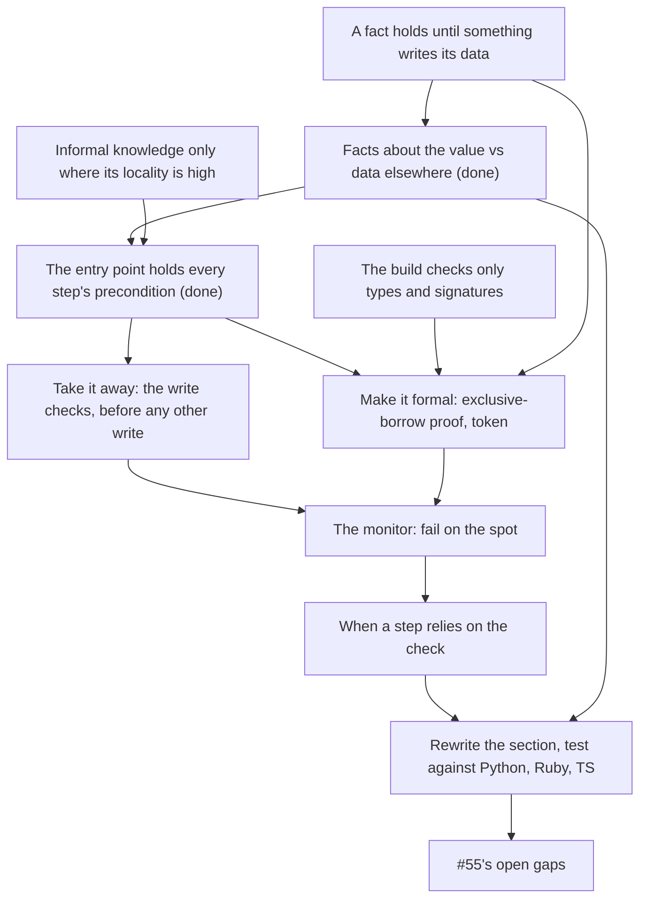

> [!quote] YOU

continue the architecture course


> [!quote] YOU

first of all, that was your mistake, u teached something that does not hold, I thought we were basing the course on the literate, why this happened?


> [!abstract] PI

You're right, and it's on me. I went back to the 02g log and the research report to find where it went wrong.

The literature never made the claim. King writes in Haskell, where values can't change, so a parsed `NonEmpty` can't go stale. Nothing can write the list it came from. She mentions mutation once: "Avoid denormalized representations of data, especially if it's mutable". The 02g research report pointed the other way. TOCTOU, Gankra's "temporal validity" and GhostCell's costs all describe proofs going stale. The researcher also flagged that "a proof that borrows the state" has no source, and said its sentence about the cost was its own inference.

I went past the sources when I moved from Haskell's fixed values to Rust state that changes. In node 3 I derived "two ways to keep it true": a proof that borrows, or a reach that ends before the first write. I taught both as settled, and two of the steps were wrong:

1. In the `apply` exercise you answered "&mut or owned values" and I said "Both are right". I checked `&mut` against `OccupiedEntry`, where one check makes one proof. I never checked it against `legal_actions`, which lists every action at once, and two proofs can't each hold `&mut` to the same data. In node 4 you said a `&mut` proof "should not borrow the entire container mutably as that would stop other things". You had hit the same limit, and I didn't follow up.
2. "It never leaves the command" only holds by convention. The doc has said since 02b that no tool restricts a type to one function. I still wrote that the later steps "have nothing left to assume".

Why it got through: the course derives its rules from the two roots and then checks them against sources. When I derive a step myself, no source is there to catch it. This step rested on a Rust claim I never compiled against the real case. The teach skill says to verify any claim I'm unsure of. I wasn't unsure, so I didn't check. The node 3 quiz tested a claim that does hold, so the node looked settled.

Proposed changes to the teach skill, for you to review. I haven't applied them:

- Mark each rule as sourced or derived. If a derived rule rests on a claim about the language, compile a probe on the real case before teaching it as settled.
- When a source moves to another setting, like Haskell's fixed values to Rust state that changes, name the assumption that doesn't carry over and check it first.

Should I make those edits now, or go on with 02h? 02h rewrites the section around what Rust can actually enforce.


> [!quote] YOU

dont, instead I will take more care and bring more counterexamples if I am unsure something holds, lets make sure to properly write the parse dont validate section now, one thing I would like to discuss here is how this holds on languages that have no mutability control like python e ruby


> [!question] Question
> What should the Python and Ruby part of this session produce?
>
> Context: per COURSE.md, the General section of file-structure.md should hold for your finance work in Rust, Python and TypeScript. The doc in this repo has General, Rust and project sections only, and you copy sections out by hand. Pick every outcome you want.
>
> 1. General section tested against Python, Ruby and TypeScript (Recommended)
> 2. Practical tools for Python and Ruby, in the session only
> 3. A per-language note in file-structure.md
> 4. The database case


> [!example] Answer
> 1. General section tested against Python, Ruby and TypeScript (Recommended)


> [!question] Quiz
> Which change keeps `pay` correct without trusting that no step between `payment` and `pay` writes the mana?
>
> A single-threaded Ruby game. `Mana#payment(cost)` is the check: it returns a frozen `Payment` holding the cost, or nil when the current mana is below the cost. Only `Mana` builds a `Payment`. `Mana#pay(payment)` subtracts the payment's cost from the current mana. One method, `apply`, asks for a payment, runs a few other steps, then calls `pay`.
>
> 1. The `Payment` holds the `Mana` object instead of the cost
> 2. Deep-freeze the `Payment` before the other steps run
> 3. A Sorbet signature makes `pay` take only a `Payment`
> 4. `pay` compares the cost with the current mana and fails on a shortfall


> [!success] Quiz — correct ✓
> Your answer: 4. `pay` compares the cost with the current mana and fails on a shortfall
> Correct answer: 4
>
> Note: I think u should do more research on this topic, specifically about rust. I talked about ruby and python not to deviate from the plan but because I dont think "parse" holds when there are no types and we cant share information guarantiying it is not stale, and we can code games just fine.
>
> The fact "the mana covers this cost" is about the mana, not about the Payment. Freezing the Payment stops writes to the Payment, which nothing threatened. Holding the live Mana object lets `pay` see the current value, but the fact "covers the cost" was decided at the check and nothing re-decides it. A Sorbet signature proves a Payment was built, so the check ran, but types don't stop writes. Only the write itself can see the mana as it is when it writes, so only a comparison inside `pay` removes the trust in the steps between.


> [!abstract] PI

You're right that this needs more research before I write anything. Here is my read of your point. It's a hypothesis until the research is in.

Your Python and Ruby argument splits "parse" into three claims, and they hold to different degrees:

1. **The check returns what it learned, not a yes or no.** The rule it decides then has one definition. This holds in any language, with or without types. It comes from the one-place rule, not from the type system.
2. **The step can't run without the check.** This needs a type checker plus a constructor only the check can call. Plain Ruby and Python don't have that. In TypeScript, any cast gets past a brand: the docs show `expr as any as T` with "no runtime checking".
3. **The fact is still true when the step uses it.** For data that something can write in between, no language guarantees this. My unverified reading is that Rust manages it only while the proof holds exclusive access to the data, by an exclusive borrow as `OccupiedEntry` does, or by owning it.

Games in Ruby and Python work because the command that writes checks its own precondition and fails on a miss, which is the quiz answer you just picked. Databases fix check-then-act the same way. CWE-367 and the PostgreSQL docs give three fixes: a conditional write, a lock taken before the check, or a version comparison. All three put the check inside the write. If that holds up, the core of the General section becomes "the write checks its own input". Parsing then becomes a tool for claims 1 and 2, and for claim 3 only on data nothing writes.

Two researchers will now check the Rust side in parallel:

- **Rust std and the ecosystem.** How APIs carry a check into a later write (`Entry`, `PeekMut`, `pop_if`, `get_disjoint_mut`, typestate by move), branded indices (`indexing`, `generativity`, GhostCell), and where view types (partial borrows) stand.
- **Games.** Generational indices for stale references (West's talk, slotmap, Bevy's `Entity`), what Bevy does with a command whose entity is gone, and whether open-source card engines (Fireplace in Python, SabberStone, Forge, XMage) recheck an action at apply time after listing the legal ones.

The first report, on Python, Ruby, TypeScript and databases, confirms the language facts above. I'm saving it to `research/02h-parse-dont-validate-revisited/languages.md`.


> [!abstract] PI

Both researchers are running. I'll wait for their reports before going further.


> [!abstract] PI

The research is in. The reports are in `research/02h-parse-dont-validate-revisited/`: `languages.md`, `rust.md` and `games.md`.

**No source has a check that reads data and hands a fresh proof to a later write.** Everyone checks again at the write:

- Rust's std never carries a fact learned by a read into a later write. Either one `&mut` borrow covers both the check and the write (`Entry`, `PeekMut`, `get_disjoint_mut`), or the check runs inside the write as a predicate (`pop_if`, `take_if`, `retain`, `compare_exchange`).
- Fireplace, a Hearthstone simulator in Python, checks again inside `play` and raises `InvalidAction`. Forge and XMage check again when a spell is cast and roll back if it fails. SabberStone is the one engine that trusts its own list: `Options(bool skipPrePhase = true)` skips the second check for the actions it listed.
- For a reference held across writes, West, `slotmap` and Bevy's `Entity` use an id with a generation, and the lookup fails if the entity is gone. XMage's `MageObjectReference` compares a zone-change counter the same way. Bevy's commands "check whether the entity exists at the time of execution".
- Databases give the same answer. The first mitigation in CWE-367 is "not perform a check before the use".

**Branded indices and view types don't change this.** The `indexing` crate keeps only the in-bounds fact across writes: "All outstanding indices remain valid (in bounds), but elements have shifted". It calls itself an experiment, and its last release was in 2019. View types are a nightly experiment with no accepted RFC. The partial-borrow crates never let anyone write a field that a proof is reading.

**No source covers keeping a parsed fact about data elsewhere fresh.** King mentions mutation once: "Avoid denormalized representations of data, *especially* if it's mutable... Strive for a single source of truth." A token that holds a hand position or a cost is a copy of data its owner holds. That sentence backs your objection to #55's tokens.

So your point holds: Ruby and Python games work because the write checks its own input, and every engine except SabberStone does exactly that.

Before I plan the rewrite, I want to know how far your claim reaches. Answer in your own words, in plain Ruby with no type checker. Take two values, both frozen and both built only by their own check:

- an `Email` from `Email.parse(string)`, holding a frozen copy of the validated address
- the `Payment` from the quiz, holding the cost

These are the three claims from before:

1. The rule has one definition.
2. The step can't run without the check.
3. The fact is still true when the step uses it.

Which of them hold for the `Email`, and which for the `Payment`?


> [!quote] YOU

can u restate the question with the payment example again, and on 1 what rule and on 3 what fact


> [!abstract] PI

Here it is again, with the rule, the step and the fact named for each value. Both are plain Ruby with no type checker, and in both the class makes `new` private, so only the check builds the value.

**Email**

```ruby
email = Email.parse(input)   # the check: returns an Email or raises
send_welcome(email)          # the step: sends to email.address
```

- Rule: what counts as a valid address.
- Fact: "this address is valid".
- `Email` holds a frozen copy of the address.

**Payment**

```ruby
payment = mana.payment(cost)  # the check: a Payment, or nil if current mana < cost
# ... other steps run here ...
mana.pay(payment)             # the step: subtracts payment.cost from current mana, no check
```

- Rule: when a player can pay a cost, which is when current mana is at least the cost.
- Fact: "the current mana covers this cost".
- `Payment` is frozen and holds the cost.

**The three claims, for each value:**

1. The rule has one definition: only one place in the code decides it, not the check and the step each deciding it separately.
2. The step can't run without the check: no code path reaches the step with input that didn't come out of the check.
3. The fact is still true when the step uses it.

Which hold for `Email`, and which for `Payment`?


> [!quote] YOU

by what I am reading from your summary we should not check when we recieve the input, just where we use it? this goes against one of the first adrs which is fine just pointing it, then if parse dont validade does not comtemplate that what is parse dont validate.
1 holds for email. 2 both. 3 email. I think the difference here is that email is imutable, if the input changed it is not the same email while on the mana case the current mana can change freely


> [!abstract] PI

**On checking at receipt.** No, the check at receipt stays, and ADR 0002 holds. The two checks do different jobs.

- **At receipt**, `apply` checks legality before it changes anything. That's how "a rejected action leaves the game unchanged" can hold. If the only checks were at the writes, a refusal at the third write would leave the first two done, and we'd need rollback. Forge and XMage do exactly that, with `rollbackAbility` and `restoreState(bookmark, ...)`. King's case against shotgun parsing is the same problem: code that finds bad input midway has to "roll back whatever modifications it already executed".
- **At the write**, the owner's command guards its own data. For example, `pay` refuses to take mana below zero. Once `apply`'s legality check has passed, this guard can only fail through a bug, so it fails on the spot. ADR 0002 rejects a second definition of legality, and this isn't one as long as both checks ask the owner the same question: `legal_actions` asks `Mana` whether the mana covers the cost, and `pay` calls that same function.

What the research rules out is relying on the receipt check at the write, treating its answer as still true when the write happens.

**What parse, don't validate covers.** King writes in Haskell, about input, and Haskell values can't change. Her claim has two parts:

1. Check the input before acting on it, rather than scattering checks through the processing.
2. Keep what the check learned in a type that later code takes, so that code neither checks again nor assumes.

Your `Email` is the case she covers. The fact is about the value itself, the value can't change, so the type can carry the fact anywhere. `Payment` falls outside her case, because its fact is about mana that the `Payment` doesn't hold. Part 1 still applies, since you check before acting. Part 2 doesn't, because no type can keep that fact true while other code can write the mana. 02g's mistake was stretching part 2 to cover it.

**Your answers:**

- **3**, right. Your reason is the heart of the distinction. The `Email`'s fact is about its own data, which can't change ("if the input changed it is not the same email"). The `Payment`'s fact is about mana, which can change at any time.
- **2** holds for neither in plain Ruby. A private `new` does mean every `Email` came from `parse`, except that `send` can call private methods (the Ruby docs: "Unlike send, `public_send` calls public methods only"). But nothing stops a call like `send_welcome("bob@x.com")` or `mana.pay(5)`. Such a call fails only when it runs, with `NoMethodError`, or doesn't fail at all if the raw value happens to answer the same methods. Claim 2 needs a type checker that fails the build, as Rust's does.
- **1**: in this setup the `Payment`'s rule also has one definition. Only `payment` compares the mana with the cost, and `pay` subtracts without checking. Did you rule it out because `pay` should check again, as in the quiz?


> [!quote] YOU

"this inst one as long as both checks ask the owner the same question" u can clearly see this is duplication. yes, I did rule it out because pay should check again


> [!quote] YOU

I agree about 2


> [!abstract] PI

You're right, it is duplication. The same comparison runs twice, and the second run exists only because nothing carries the first answer forward fresh. My "as long as" sentence hid that.

What does it duplicate, though? ADR 0002 rejects two definitions of legality that drift apart. One function called from two places can't drift. So the duplicate is the work and the second call site, not the rule. If you see a change that would force an edit in both places, that's the counterexample that would make it the costly kind. I'd like to hear it.

Can it be removed? There are two ways, and both have a cost:

- **Trust the check**, as SabberStone does: the actions it listed skip the second check. The write doesn't check at all. If a bug makes the fact false, the state is corrupted with no error. With `u8` mana, the subtraction panics in debug builds and wraps around in release builds.
- **In Rust, make the check and the write one operation** for the one action `apply` received. The check holds `&mut` to the owners the step will write, and the step writes through it. That's the shape of `OccupiedEntry`. I compiled it: a proof holding `&mut Mana` and `&mut Hand` keeps both fresh, a write to the hand while it lives fails with E0499, and the game's other fields stay writable. 02g's design failed because it built proofs inside `legal_actions`, for every listed action, and proofs for a whole list can only hold shared borrows. The list for the shell hands nothing to a write, so it can return plain actions. Both the list and `apply`'s check call one legality function, so ADR 0002 holds. One duplication remains, the list versus the check at receipt, and ADR 0002 wants that one: the action that reaches `apply` may not come from the current list.

Ruby and Python have no exclusive access, so there the choice is to check twice or trust.

Meyer's Design by Contract has a principle that a routine shouldn't test its own precondition. It sides with trusting the check. I have a researcher confirming the wording before I lean on it.

Back to claim 1. With `pay` checking again, does the rule still have one definition in your view, or is a second call already a second definition?


> [!abstract] PI

Meyer's position is confirmed against his 1992 paper. The report is in `research/02h-parse-dont-validate-revisited/redundancy.md`, and it bears on your duplication point.

- His rule is "Either you have the condition in the Require, or you have it in an If instruction in the body of the routine, but never in both." The forbidden redundancy is a caller that checks the condition while the routine also handles it with an `if`.
- A precondition violation "indicates a bug in the client". Checking preconditions at run time is a compilation option, on by default, and Meyer presents it as a debugging aid. It raises an exception and isn't part of the routine's logic.
- The Pragmatic Programmer disagrees on one point: keep assertions on in production ("Turning off assertions when you deliver a program to production is like crossing a high wire without a net"). Rust's std has both sides: `assert!` stays on in release builds, and `debug_assert!` runs only in unoptimized builds.

Applied to `pay`: if `apply` checks and `pay` also refuses with an `if` that returns an error, that's the duplication Meyer forbids, and the one you saw. If `pay` states its precondition as an assertion that fails on the spot, Meyer counts it as the contract being monitored, not a second check in the logic. It still evaluates the condition a second time at run time. Whether that's worth it is the `assert!` versus `debug_assert!` choice.

So my question from before still stands. With `pay` asserting its precondition, does the rule have one definition in your view?


> [!quote] YOU

on claim 1, I think it has one definition, but checking it is informal knowledge so if forget to check on the first time it leaks to the second and panics pointing it was never true or stoped being true in between checks, which I guess is fine. My corcern is more that the entrypoint must check if validation that the code below uses so that is a lot of informal knowledge with low spatial locality. Who is Meyer and what paper? "Either you have the condition in the Require, or you have it in an If instruction in the body of the routine, but never in both." what is an expect in this case? it is the monitor right? what is "The Pragmatic Programmer", I kinda like Meyer's view, it explicitely states that the failure is not normal but it does not adresses my concerns I believe


> [!abstract] PI

**Who Meyer is.** Bertrand Meyer created the Eiffel language and Design by Contract. He's the same Meyer whose class invariant we used in session 02, in the "invariant to owner" node. The quote comes from "Applying 'Design by Contract'", *IEEE Computer* 25(10), October 1992, pp. 40-51, the paper the course has cited since 02. "Require" is Eiffel's precondition clause. A routine declares `require` (what callers must make true) and `ensure` (what it promises back) at its head, apart from its body.

**What an `expect` is here.** Yes, it's the monitor. An `expect` in `pay` on a lookup, or an `assert!` on the comparison, states the precondition and stops the program when a caller broke it. There are two differences from Eiffel:

- Eiffel's `require` sits in the routine's declaration, where callers read it. An `expect` sits in the body, so a caller only learns the precondition by reading the code.
- Eiffel lets you switch monitoring on or off per class at compile time. `expect` and `assert!` stay on in release builds, and `debug_assert!` is the one you can switch off.

**The Pragmatic Programmer** is a book on software practice by Andrew Hunt and David Thomas, first published in 1999, with a 20th anniversary edition in 2019. The research quoted it because it takes the opposite view on one point. Meyer treats run-time monitoring mainly as a debugging aid. The book says to keep assertions on in production: "A dead program normally does a lot less damage than a crippled one."

**Your concern.** You're right that Meyer doesn't address it. His demanding style is what creates it. Every caller has to make every precondition of the code below it true, so `apply` has to know what `pay`, the hand's take and every other step require. That knowledge is informal, and it sits far from the steps. The monitor catches a miss when the program runs, which by the doc's definition is a test or a bug finding it, not the build.

Your concern is also a case of a rule you wrote yourself in 01d. The doc says informal knowledge is acceptable only where its locality is high. Elsewhere it gives two remedies, in "Coupling is shared knowledge of a decision" and "One place knows each decision".

What are the two remedies, and what would each look like for `apply` and `pay`? Answer in your own words.


> [!quote] YOU

"A dead program normally does a lot less damage than a crippled one." I very much agree here.
It is to either make it formal or to take knowledge away
second one would be putting the checks besides what they protect but has the problem here that they all need to run before the any mutation otherwise we need roolbacks as we discussed
For making it formal there is the borrow, which has the problem that it needs to be droped before the mutation which cant happen on the function that does the mutation because it cannot recieve &A and &mut A, and the token with private field


> [!abstract] PI

Both remedies are right, and so are the costs you attached to them:

- **Take the knowledge away.** Each check sits beside the write it protects. The cost is the one you named: an action that writes several owners has to run every check before its first write, or it needs a rollback. Forge and XMage pay for rollbacks.
- **Make it formal.** For a shared borrow you're right: it has to end before the write, and no function can take `&A` and `&mut A` together. A token with a private field does make "no write without the check" formal. But nothing keeps its facts fresh, so the write still needs the monitor.

You left out one tool, the one I compiled two messages back. The proof holds `&mut A` instead of `&A`. The function that writes receives the proof, and the `&mut` is inside it, so there's no `&A` and `&mut A` conflict. While the proof lives, nothing else can write `A`, so its facts stay fresh until the proof makes the write itself. That's `OccupiedEntry`'s shape. It works for the one action `apply` received, but not for a list of actions.

Here's the plan for the rest of the session.

**Approach.** You've already derived the main split: facts about the parsed value itself (`Email`) against facts about data the value doesn't hold (`Payment`). You've also found the real cost, which is the entry point holding every precondition of the code below it, informally and far away. What's left is to settle the remedies one at a time, then write the section and test it.

1. **Take it away.** One question for you: when does a write that checks for itself avoid the rollback problem?
2. **Make it formal.** The exclusive-borrow proof, and what the token still buys without it.
3. **The monitor.** A write whose precondition only a bug can break fails on the spot. You agreed with "a dead program does less damage", so this should be quick.
4. **When a step relies on the check.** This is your #55 sentence, checked against the new split.
5. **The section.** I draft it from your statements, then we test every General sentence against Python, Ruby and TypeScript, with counterexamples. Then the Rust bullets.
6. **#55's open gaps.** Tokens holding positions, and gap 3, ruled under the new section.



Does this plan work for you, or would you change the order or the scope?


> [!quote] YOU

"when does a write that checks for itself avoid the rollback problem?" when it is the sole writter. plan works


> [!abstract] PI

The plan is settled, so we start on node 1. Your "sole writer" can mean two different things, and the quiz separates them.


> [!question] Quiz
> Which of these writes may check for itself and refuse, with no rollback?
>
> One action makes three writes in order: it pays mana, takes the card from the hand, then puts it on the board. Each write is a command of the data's owner, and each owner is the only module that writes its data. Each command can check its own precondition and refuse. A refused action must leave the game unchanged (ADR 0002), and there is no rollback.
>
> 1. Only the board write, the last of the three
> 2. All three, since each checks before it writes
> 3. All three, since each owner is the only writer of its data
> 4. Only the mana write, the first of the three


> [!success] Quiz — correct ✓
> Your answer: 4. Only the mana write, the first of the three
> Correct answer: 4
>
> Note: only the first check then?
>
> A refusal leaves the game unchanged only if nothing was written before it. The mana write comes first, so it can check and refuse on its own. The hand and board writes come after the payment, so a refusal there leaves mana spent. Their checks must run before the first write, at the entry point, or the action needs a rollback. Being the only writer of its data keeps a fact fresh. It doesn't undo another owner's earlier write. Checking just before its own write has the same problem. Running the whole action on a copy and keeping the copy only on success is also a rollback, at the cost of one copy per action.


> [!abstract] PI

Yes, only the first. A later write can still assert its precondition and fail on the spot, because that's the monitor, and it only fires on a bug. What it can't do is refuse as a normal outcome, because by then the mana is already spent. So in an action with several writes, every precondition except the first write's has to be checked before that first write.

Your concern was that those checks land at the entry point, far from the writes they protect. Today that means `apply` and `legal_actions`, while the writes live in `Mana` and the hand's owner.

Is there a place closer to the writes that still runs before the first one? Where could the checks for the hand and board writes go?


> [!quote] YOU

hmmm, on the commands like play? but commit_targeting runs before play but mana and stuff was already validated for draft, its better but still a different module so I dont consider this a solution, it still almost as far as before to me


> [!abstract] PI

I agree that it isn't a solution. `play` is a different module from `Mana` and the hand's owner, so the checks still sit apart from the writes they protect. The doc's measure says the same: locality is high only when the places sit in code that serves the same decision. `play` serves the action, and `Mana` serves the mana.

The only way to put every check beside its write would be one owner holding mana, hand and board. Then one command could check everything and write everything. Session 02's rule forbids that: owners merge only for an invariant the domain needs, and "this action needs a card in hand and enough mana" isn't an invariant.

So node 1 ends with a limit. Taking the knowledge away keeps a check beside its write only for an action's first write, or its only write. Every other write's precondition is checked in another module, so your concern stands for those writes, and node 2 picks it up. For your draft example, each `apply` checks legality again. The checks run when the draft started aren't relied on later, which matches ADR 0002.

Before node 2, put node 1's rule in your own words, the way you'd want it in the doc.


> [!quote] YOU

idk, I think it would be something like "Taking knowledge away from checks may not be practical, as one must check all preconditions before the first write to avoid roolbacks"


> [!abstract] PI

Here's a sharper version, built from your sentence:

> A command can check its own input and refuse it only while nothing has been written before it. An action that writes several owners checks every precondition before its first write, or it needs a rollback. So code outside those owners still knows their preconditions.

Three changes from yours:

- "Callers" is the term the doc already uses for the code that holds the knowledge.
- "May not be practical" is now the case where taking the knowledge away fails: every write after the first.
- The last sentence states the cost that node 2 deals with.

I'll hold each node's rule here and write the whole section at node 5. Does this one work, or do you want to rewrite it?


> [!quote] YOU

agree just unslop it


> [!abstract] PI

> A command can check its own input and refuse it only if it makes the action's first write. An action that writes several owners checks every precondition before that first write, or it needs a rollback. So the code that runs the action knows the preconditions of every write after the first.

**Node 2: make it formal.** Node 1 leaves those preconditions in the code that runs the action, away from the writes, so the knowledge is informal and its locality is low. The doc's other remedy is to make it formal. For Play, you have two tools:

- **A token.** `pay` takes a `Payment` with a private field, which only `Mana`'s check can build. The hand's take works the same way, with a token only the hand's owner builds.
- **A proof holding `&mut`.** `apply` checks the one action it received, and the check returns a proof that holds `&mut Mana` and `&mut` to the hand. The payment and the take happen through the proof.

Recall the three claims: the rule has one definition, the step can't run without the check, and the fact is still true when the step uses it. For each tool, which claims does it make formal? What's left for the monitor in `pay`?


> [!quote] YOU

both have the first if passing the check is the only way to get the token/mut. both have the second as its enforced by depending on the data. only &mut has the third as it is the only one that formaly guarantees imutability on the in-between code, I realize that is a very strong guarantee and must languages simply do not have this.


> [!quote] YOU

also, for the &mut the pay does not need to recheck, but with the &mut I fear the check holds much more then just the proof as a module that mutable exposes its data hides nothing


> [!abstract] PI

You got all three. On the first: the rule has one definition as long as the check is the only way to get the token or the `&mut`. You're also right that the exclusive borrow is the strong guarantee, and most languages don't have it. The closest thing outside Rust is CWE-367's "locking occurs before the check", which is the database's version. You're right that `pay` then doesn't need to check again. A `debug_assert!` at most.

Your concern holds in part, and the fix is in std's own shape. Holding `&mut Mana` doesn't expose Mana's fields. They stay private, so Mana's invariants are safe. What it exposes is every `&mut self` command of `Mana`, the "a borrow grants the owner's whole interface" point from 02f. If the proof is a type defined outside `Mana`, its code can call `refill`, or pay a cost nobody checked. The check it carries then restricts nothing.

`OccupiedEntry` avoids this because `HashMap` defines it. Its methods are the only code that writes through the borrow. Applied to Play:

- `Mana` checks and returns a payment entry that holds `&mut Mana` and offers only `pay`. The hand's owner does the same for the take.
- `play` asks every owner for its entry first, then commits each one.

I compiled this. Both entries live at once. Replacing the hand while its entry lives fails (E0506), and code outside `Mana` can't reach through the entry to its fields (E0616).

This also changes node 1's verdict. Each check now sits in its owner, beside the write it protects, and the build fails if `play` writes without an entry. `play` keeps only the order: ask for every entry before the first commit. That order is still informal, since committing the payment before asking for the hand entry compiles, as I checked. But it sits inside one function.

Your concern needs one condition in the rule: the proof is defined by the owner whose data it borrows, and it offers only the writes the check permits. Can you state node 2's rule with that in it?


> [!quote] YOU

wdyt of instead of handing &mut Mana we give a &mut ManaPayment<'m> { mana: &mut'm Mana, ... } mana being private. or something like that. so the interface still hidden but the borrow is still valid, ManaPayment could have the interface with only pay then. I guess this is similar to what OccupiedEntry is.
I am not sure how to state it


> [!abstract] PI

Yes, that's the shape, and it's the payment entry I compiled. `OccupiedEntry` is exactly this: a struct with a private field holding the `&mut`, plus methods for only the writes the check allows. One detail: hand the struct out by value, not as `&mut ManaPayment`. Then `pay(self)` consumes it, and the same payment can't be made twice.

Here's a draft of node 2's rule. The General part stays language-neutral, and the Rust tool goes in the Rust section:

> **General.** A later write's precondition becomes formal when the write takes a value only the check can build. That value proves the check ran. It keeps the check's facts true only while it stops every other write to their data, up to the write it makes itself. Such a value belongs to the owner of that data and offers only the writes the check permits.

> **Rust.** A proof that holds `&mut` to an owner keeps the check's facts fresh up to its write, as `HashMap`'s `OccupiedEntry` does. The owner defines it, with the borrow in a private field and methods only for the writes the check permits, each taking `self`. A check that lists many options can't hand these out, because only one `&mut` to the owner can exist at a time. A proof that holds a shared borrow serves only reads, because it has to end before any write.

The last Rust sentence replaces today's bullet on proofs that borrow. That bullet presented both borrows as ways to reach a write.

Does this say what you mean, or do you want to change it?


> [!quote] YOU

yes exactly. still this is not always feasible right because many languages are not capable of this and even in rust holding &mut may hold more then what we want


> [!abstract] PI

Yes, and the limits are worth listing, because each one sends us to node 3:

- **Languages without exclusive access**, which is Python, Ruby and TypeScript. There the value proves the check ran, and only with a type checker. Nothing keeps the facts fresh.
- **Holding more than you want, in Rust.** The entry blocks every other use of `Mana` while it lives, reads included. That's fine when the gap is a few lines inside `play`. It isn't when a step between the check and the write needs to read `Mana`. And since borrows work per field, not per element, an entry for one card in the hand blocks the whole hand.
- **Lists and stored state.** No entry per listed action, and a borrow can't be stored, so a fact checked in one `apply` can't reach a write in a later one.

In all of those cases, the write gets a value that proves the check ran but doesn't keep the facts fresh. Or it gets nothing, as in plain Ruby.

**Node 3.** Suppose `pay` receives a payment whose cost is above the current mana. That can only happen if something wrote the mana between the check and the payment. What should `pay` do, and why not return an error?


> [!quote] YOU

there is no point returning an error because the caller would have to know how to handle it roolbacking the previous writes, with the informal knowledge that this error should never happen we can panic on pay in case there is a bug


> [!abstract] PI

Right. Here's one check that covers nodes 1 and 3 together. After it I'll draft node 3's rule.


> [!question] Quiz
> In which case should `pay` refuse in its return type, instead of failing on the spot?
>
> Play writes several owners, and a refused action must leave the game unchanged, with no rollback. The four cases differ in where `pay` falls among Play's writes and in whether anything checked the mana before Play's first write.
>
> 1. `pay` is Play's last write, and nothing checked the mana before the first write
> 2. `pay` is Play's first write, and `apply` checked the mana just before it
> 3. `pay` is Play's last write, and `apply` checked the mana before the first write
> 4. `pay` is Play's first write, and nothing checked the mana before it


> [!success] Quiz — correct ✓
> Your answer: 4. `pay` is Play's first write, and nothing checked the mana before it
> Correct answer: 4
>
> Note: for other operations I think there is more to it, sometimes the operation is fallible like an http request. also, how does rust _unchecked() functions tie into this
>
> A refusal in the return type is for a state some accepted input can reach, and it leaves the game unchanged only if nothing was written before it. Only the first case meets both conditions. When `apply` checked the mana, only a bug can make the payment fail, so `pay` fails on the spot. A return type would make callers handle a case that can't happen. When `pay` is the last write and nothing checked the mana, the failure is reachable, but a refusal would leave the earlier writes done. The fix there is to move the check before the first write, and neither refusing nor panicking is right.


> [!quote] YOU

I did not know those are unsafe


> [!abstract] PI

They are `unsafe fn`. The std docs give `unsafe` two jobs: "to declare the existence of contracts the compiler can't check, and to declare that a programmer has checked that these contracts have been upheld." Here's how they fit what we've built:

- **`get_unchecked` is the trust-the-check style, with no monitor.** The `unsafe` keyword docs show the pattern: `use_indexable` checks `idx < I::LEN`, then calls `idx_unchecked` inside `unsafe { }`, with a `// SAFETY: We have checked that idx < I::LEN` comment. It's a check, then an act that relies on it with nothing carried forward. Rust doesn't make the knowledge formal. It makes it visible at both ends: the callee documents a `# Safety` contract, and each caller writes an `unsafe` block, by convention with a `SAFETY` comment saying why the contract holds. Since 1.78, std checks many of these preconditions whenever your build has debug assertions on, so there's a monitor in debug builds.
- **It's reserved for memory safety.** Breaking an `unsafe` contract is undefined behavior, which means anything can happen. A broken game rule doesn't qualify. The Reference calls it a logic error: "Safe code may impose extra logical constraints that can be checked at neither compile-time nor runtime. If a program breaks such a constraint, the behavior may be unspecified but will not result in undefined behavior." So `pay` gets the monitor or a proof, never `unsafe`.

**Fallible operations.** You're right, and node 1's rule needs a sentence for them. An HTTP request can fail whatever you checked, so it isn't a bug, and it refuses in its return type. It can also fail after earlier writes. And a call that changes another system's state is itself a write. Charging a card and then sending an email are two writes, so if the email fails, the charge needs undoing. The game core has no such steps (ADR 0001 keeps it deterministic), but your finance services are full of them. Node 1, amended:

> A command can check its own input and refuse it only if it makes the action's first write. An action that writes several owners checks every precondition before that first write, or it needs a rollback. So the code that runs the action knows the preconditions of every write after the first. A step that can fail whatever was checked, such as a network call, goes before the first write too, or the action needs a rollback. A call that changes another system's state counts as a write.

**Node 3:**

> When no value keeps the check's facts true up to the write, the write asks the check's question again. Only a bug can make the answer false there, so the write fails on the spot. Refusing in its return type would make every caller handle a case that can't happen. A failure that a reachable state or another system can cause isn't a bug, so the write refuses it in its return type.

The Rust side adds one bullet: fail on the spot with `assert!` or `expect`, which run in release builds too. `debug_assert!` doesn't run in release builds, so a bug would corrupt the state instead of stopping the program.

Do both work as written?


> [!quote] YOU

yes they do.


> [!abstract] PI

Nodes 1 to 3 are settled. **Node 4: when a step relies on the check.**

Nodes 1 to 3 assumed we know which facts a write relies on. #55's third gap showed we don't always know. Your sentence for it was:

> A later step relies on the check when, without it, the step could get input its contract rules out.

"Orders between steps" already names this: input a step's contract rules out makes the order a precondition of that step. So your sentence says a step relies on the check when the check establishes the step's precondition.

Classify these four steps that `apply` runs after its legality check:

- `pay` subtracts the payment's cost from the current mana.
- The hand's take removes the played card from the hand.
- `end_turn` ends the turn of whoever's turn it is.
- `PlayerInput::target` records a chosen target for a targeting in progress. It accepts any target ID and any targeting, and records the pair.

Which of them rely on the legality check, by your sentence? For the ones that don't, what does that mean for the token, the proof and the monitor?


> [!quote] YOU

do u think how to write expect message is well known or we should add a point about it? 
1. does because it could recieve more cost then current mana
2. does because could recieve a card not in hand
3. does not, it could recieve a end turn for a player that it is not its current turn but that is not part of the end turn contract
4. does not, it could recieve a target that does not pass its checks but it would register the target_id object_id pair the same way
there is no required monitor by the rust compiler because nothing fails, we could add it with assert! but that would be changing the contract and making the rule a precondition when not needed. the proof holds the same as the check stays the same. the token is meant to enforce the check did run before the code, without the check we would allow invalid actions and without the token we may forget checks


> [!abstract] PI

**`expect` messages.** std documents the style. The `Option::expect` docs recommend "that `expect` messages are used to describe the reason you *expect* the `Option` should be `Some`", and `std::error` calls this the "expect as precondition" style: "env variable `IMPORTANT_PATH` should be set by `wrapper_script.sh`". The repo doesn't follow it consistently, though. Some messages describe the error ("object not in board", "card def not found", "Target not fulfilled"). Others state a fact ("in play objects always have health"). Only one uses "should" ("a legal pick should name one of the options"). Since there's a gap in the code, I'd add a clause to node 3's Rust bullet:

> The message says what should have made the fact true, in std's "expect as precondition" style, such as "the card should be in hand, since `apply` checked legality".

It fits Meyer, since a failed precondition is a bug in the caller. The message points at the check holding the informal knowledge, so whoever reads the panic knows where to look.

**The four steps.** All four classifications are right. You're also right that an `assert!` in `end_turn` would turn legality into a precondition its contract doesn't have.

On the token, I'm not sure I read you right. You wrote "the token is meant to enforce the check did run before the code ... without the token we may forget checks". Do you mean `end_turn` and `target` should still take a token, so that `apply` can't forget the legality check?

If so, I agree the risk is real, but it's `apply`'s risk, not `end_turn`'s. Legality is `apply`'s decision (ADR 0002), and its check sits in the same function as the dispatch. A token in `end_turn`'s signature would put legality into an interface whose contract doesn't need it. Any other legitimate caller, such as a test or a card effect that ends the turn, would then need a legality token it has no reason to hold. If you want "`apply` can't forget" to be formal, the place for it is `apply`'s dispatch, which takes a parsed legal action (#55's `LegalAction`). That covers every step at once without entering any step's interface.

Is that what you meant, or something else?


> [!quote] YOU

I would remove the example "such as "the card should be in hand, since apply checked legality". that what I meant yes, can u better describe "which takes a parsed legal action" what does that mean for the ones that are preconditions why do we need the token there, to enfore legality right?


> [!abstract] PI

I've removed the example. The clause now reads:

> The message says what should have made the fact true, in std's "expect as precondition" style.

**What "takes a parsed legal action" means.** `apply` asks the legality check about the action the player sent, and the check returns either a refusal or a `LegalAction`, a value only it can build. The dispatch, the code that runs the steps for each kind of action, takes that `LegalAction` instead of the plain `Action`. Calling the dispatch without the legality check then fails the build. That enforces legality once, for every kind of action, and no step ever sees it.

**The token or entry at `pay` isn't for legality.** It comes from `Mana`, not from the legality check, and it enforces `pay`'s own precondition on every path to `pay`, not only the path through `apply`. Think of a later card effect that makes a player spend mana. It also puts the precondition in `pay`'s interface, which is what Meyer's `require` does in Eiffel. A plain `pay(cost)` with an `assert!` inside only tells a new caller about the precondition when it panics.

For Play, the two checks overlap. Legality checks that the card is in hand and payable, and the owners check again when they hand out entries. Once legality has passed, an owner refusing can only mean a bug, so the second check is node 3's monitor. From the entry onward, the borrow keeps the fact fresh. In outline:

```rust
fn apply(&mut self, player: PlayerId, action: Action) -> Result<(), IllegalAction> {
    let legal = self.legal_action(player, action).ok_or(IllegalAction)?;
    self.dispatch(legal);
    Ok(())
}

fn dispatch(&mut self, legal: LegalAction) {
    match legal {
        LegalAction::EndTurn => self.end_turn(),
        LegalAction::Play { card, cost } => {
            let payment = self.mana.payment(cost).expect("...");
            let taking = self.hand.taking(card).expect("...");
            payment.pay();
            taking.take();
            // summon, report, ...
        }
    }
}
```

That gives node 4's rule:

> A later step relies on a check when, without it, the step could get input its contract rules out. The check's facts are then the step's precondition. A check that only decides whether the input is allowed, such as whose turn it is, establishes no step's precondition. No step takes a value from it or checks it again. Where forgetting it must fail the build, the code that dispatches the input takes a value only that check can build.

Does this one work?


> [!quote] YOU

agree, remove the example and unslop it


> [!abstract] PI

Node 4, unslopped:

> A later step relies on a check when, without it, the step could get input its contract rules out. The check's facts are then the step's precondition. A check that only decides whether the input is allowed establishes no precondition, so no step takes a value from it or checks it again. To make forgetting that check fail the build, the code that dispatches the input takes a value only the check can build.

**Node 5: the section.** One structural call is yours. Your question "what is parse, don't validate" split the material in two. King's case is facts about the parsed value itself. Nodes 1 to 3 are a different topic, checks whose facts a write can change. I propose two sections. The one I haven't run past you yet is the second bullet of "Parse, don't validate", which puts your `Email`/`Payment` answer into words.

> ### Parse, don't validate
>
> A check validates when it returns nothing, or hands back the type it was given. What it learned is lost, and every later step that relies on it holds "the check passed" as informal knowledge. A check parses when it returns what it learned in a new type that later steps take. Where the build checks types, a step that takes the new type can't run without the check. Whether the check's facts are still true when the step runs depends on the data they are about.
>
> - *(node 4)* A later step relies on a check when, without it, the step could get input its contract rules out. The check's facts are then the step's precondition. A check that only decides whether the input is allowed establishes no precondition, so no step takes a value from it or checks it again. To make forgetting that check fail the build, the code that dispatches the input takes a value only the check can build.
> - A fact about the parsed value's own data stays true while no code can write that data. The code that can build or write the type is the code trusted to keep its guarantee. When the type's shape rules out every wrong value, no code can build a wrong one, and nothing needs trusting. Prefer shape wherever the guarantee fits a layout. A relation between values doesn't, so the type needs an owner that keeps the guarantee as an invariant.
> - A fact about data the parsed value doesn't hold stays true only until something writes that data, so one type can carry facts with different reaches. A fact about data nothing writes never goes stale, and its type can be stored and passed anywhere. "Checks before writes" covers the facts a write can change.
> - A question that answers "maybe" to callers who already know the answer repeats the check on every call. Take the parsed type instead, and answer plainly.
> - A stored reference names its target by a fact nothing writes, such as its identity. A fact a write can change, such as where the target is, stays out of the reference's type. Parse it where it's used.
> - Don't hand a parsed type to code that can keep it while the data changes, or use it on other data. Take that code's input plain, and parse it where it arrives.
>
> ### Checks before writes
>
> A write that relies on an earlier check holds the check's facts as informal knowledge, and any write to their data in between makes them false.
>
> - *(node 1)* A command can check its own input and refuse it only if it makes the action's first write. An action that writes several owners checks every precondition before that first write, or it needs a rollback. So the code that runs the action knows the preconditions of every write after the first. A step that can fail whatever was checked, such as a network call, goes before the first write too, or the action needs a rollback. A call that changes another system's state counts as a write.
> - *(node 2)* A later write's precondition becomes formal when the write takes a value only the check can build. That value proves the check ran. It keeps the check's facts true only while it stops every other write to their data, up to the write it makes itself. Such a value belongs to the owner of that data and offers only the writes the check permits.
> - *(node 3)* When no value keeps the check's facts true up to the write, the write asks the check's question again. Only a bug can make the answer false there, so the write fails on the spot. Refusing in its return type would make every caller handle a case that can't happen. A failure that a reachable state or another system can cause isn't a bug, so the write refuses it in its return type.
> - A command whose input no type and no earlier check covers checks the input itself, so the check sits in one place instead of an assumption in every caller. Doing nothing hides the bug.

Rust gets a matching "Checks before writes" section. The proof bullet moves there from "Making knowledge formal":

> - A proof that holds `&mut` to an owner keeps the check's facts fresh up to its write, as `HashMap`'s `OccupiedEntry` does. The owner defines it, with the borrow in a private field and methods only for the writes the check permits, each taking `self`. A check that lists many options can't hand these out, because only one `&mut` to the owner can exist at a time. A proof that holds a shared borrow serves only reads, because it has to end before any write.
> - Fail on the spot with `assert!` or `expect`, which run in release builds too. `debug_assert!` doesn't run in release builds, so a bug would corrupt the state instead of stopping the program. The message says what should have made the fact true, in std's "expect as precondition" style.

What's gone from today's section:

- "the later steps have nothing left to assume"
- "Keep each fact true wherever its type can go", which claimed two ways to reach a write
- the old Rust bullet that presented both borrows as reaching a write

The last General bullet is what remains of today's "Where no type can rule out a wrong input". Node 3 took over the rest of it.

Do you agree with two sections and with this wording? Once you do, we test each General sentence against Python, Ruby and TypeScript.


> [!quote] YOU

why u putting (node 1) in the doc? I am not sure dispatches is a good term here, is it the fst time it is used? I think on "Fail on the spot with assert! or expect, which run in release builds too. debug_assert! doesn't run in release builds," we only should mention expect or "fail on the spot by panicking" rest I agree, one more thing I would like to discuss #55 proposes we have a InHand<'g> ref proof and a InHand opaque proof, I get the diferences between the two but I think we should come up with a convention at least about the names


> [!abstract] PI

The "(node N)" tags were for you in the chat. They don't go in the doc, and AGENTS.md bans course node labels anyway.

You're right about "dispatches". It's the first use in the docs and the glossary. The sentence becomes:

> To make forgetting that check fail the build, the code that runs the steps for that input takes a value only the check can build.

The Rust monitor bullet becomes:

> Fail on the spot by panicking. The message says what should have made the fact true, in std's "expect as precondition" style.

**Names for proofs.** Here's what's on the table. On main and in #55, `zones.rs` has three borrow proofs, `InHand<'a>`, `OnBoard<'a>` and `InPlay<'a>`, plus #55's `HandSlot`, an owned token that `InHand::slot` builds. Its other owned tokens are `Payment`, `TargetingSlot`, `PickOption` and `NothingAwaited`. Under the new section there are three kinds:

1. A proof that holds a shared borrow. It keeps its fact true while it lives and serves only reads.
2. A proof that holds `&mut`, an entry. It keeps its fact true and makes the writes the check permits.
3. An owned token. It proves a check ran, and keeps no fact about writable data true. `HandSlot` is this kind holding a position, which the new section rules out.

std already names the first two as a pair. The Rust API Guidelines (C-ITER, from RFC 199) give `iter`, `iter_mut` and `into_iter` returning `Iter`, `IterMut` and `IntoIter`, and the same `Mut` suffix shows up in `PeekMut`, `RefMut` and `ValuesMut`.

Before we pick, think about what a reader should learn from each kind's name, given what each kind can guarantee. What should the name of each kind tell them?


> [!quote] YOU

Ref shows that the card is InHand so I think the name is fine, 2 should know that it has a mutable/unique borrow so I think the InHandMut is also fine, for the opaque I would like it to say that it prooves the card was InHand and that could have gooten stale, wdyt?


> [!abstract] PI

I agree, and I'd make the name say it in the past tense: `WasInHand`. It says the fact held when the check ran and promises nothing about now. "Stale" in the name would claim the fact *is* false, when it only may be.

std has a close precedent. `Weak` is named for what it can't guarantee, and its API makes you check on use, because `Weak::upgrade` returns an `Option`. The same goes here: the owner's command that takes a `WasInHand` looks the card up again, by its id. Under the new section the token carries the id, not a position.

Draft for the Rust "Checks before writes":

> Name a proof for the fact its check established. A proof that holds a shared borrow takes the fact's name, such as `InHand`. One that holds `&mut` adds std's `Mut` suffix, such as `InHandMut`. An owned token puts the fact in the past tense, such as `WasInHand`, since it holds the fact only as the check saw it.

This covers the zone proofs. Some entries are named for the write they permit, not for a fact, like `Payment`, the way std's `Entry` is. I'd leave those base names to "Names exclude" and the glossary, and fix only the relation between the three kinds.

Does that work?


> [!quote] YOU

I agree, the doc does not have examples, wdyt of removing the examples and making this a pr comment? or we move it to the project specific section


> [!abstract] PI

I'd keep it in the Rust section and drop the examples. A PR comment isn't a home for a convention. `skills-and-docs.md` sends conventions to the doc for their topic, and an agent working a later ticket never reads #55's comments. It isn't project-specific either. The `Mut` suffix is std's, and the past tense for an owned token holds in any Rust codebase. The PR comment can still apply it to #55's names when we get to node 6.

Without examples:

> Name a proof for the fact its check established. A proof that holds `&mut` adds the `Mut` suffix std uses for exclusive borrows. An owned token puts the fact in the past tense, since it holds the fact only as the check saw it.

One more spot to check for consistency: the proof bullet you approved still says "as `HashMap`'s `OccupiedEntry` does". It points at the std type whose shape an agent should copy, so I'd keep it. Should it stay or go?


> [!quote] YOU

that one stays cause it is an std type. My problem with InHand is that it would not make sense outside this project.


> [!abstract] PI

Agreed. `InHand` only makes sense in this project, so the convention goes in without examples.

Next is the language test from node 5. I ran each General sentence against Python, Ruby and TypeScript. Two sentences fail.

**1. The intro's "Where the build checks types, a step that takes the new type can't run without the check."**

- Python with mypy: `send_welcome(Email("junk"))` type-checks whenever `Email`'s constructor is public, and Python can't make a constructor private. The closest it gets is pyright's `reportPrivateUsage` in strict mode, which flags a `_`-prefixed name used outside its module.
- TypeScript: `"junk" as Email` builds the type anywhere. It holds only if typescript-eslint's `consistent-type-assertions` is set to `never`, which "ban[s] assertions altogether".

Fix:

> Where the build checks types and only the check can build the new type, a step that takes it can't run without the check.

**2. The shape sentence, "When the type's shape rules out every wrong value, no code can build a wrong one."**

- Plain Ruby: `NonEmpty.new(nil, [])` runs. Nothing checks the layout.
- Python: "The Python runtime does not enforce function and variable type annotations."

Fix:

> When the type's shape rules out every wrong value and the build checks types, no code can build a wrong one, and nothing needs trusting.

**The rest hold.** Some notes, which stay in the session and out of the doc:

- **"Stays true while no code can write that data."** It holds as a condition, but those languages rarely meet it. The Python docs say "It is not possible to create truly immutable Python objects". Ruby's `freeze` is shallow, and so are TypeScript's `readonly` and `Object.freeze`. The code trusted with the guarantee is wider there, every module in Python.
- **Node 2's "only while it stops every other write".** In-process, none of the three has such a value. A database row lock taken before the check (`SELECT ... FOR UPDATE`) is the nearest match, and it stops only other transactions.
- **Node 3's "fails on the spot".** Python drops `assert` under `-O`: "The current code generator emits no code for an assert statement when optimization is requested at compile time." That makes it Python's `debug_assert!`, so raise instead.
- **Node 1's rollback.** In a service backed by a database, the rollback is usually the transaction, so it's cheap. Network calls fall outside the transaction, which is what the sentence on calls to other systems covers.

Do you agree with the two fixes? If you have a counterexample of your own for any sentence, bring it now, before I write the file.


> [!quote] YOU

agree


> [!abstract] PI

The rewrite is in `docs/conventions/file-structure.md`, as approved:

- General "Parse, don't validate" now has the two fixes from the language test.
- A new General section, "Checks before writes", holds nodes 1 to 3.
- The old proof bullet is gone from "Making knowledge formal".
- A new Rust section, "Checks before writes", holds the `&mut` proof, the naming convention and failing on the spot.

The diff touches only that file, plus this session's log. The checks don't read docs, so I didn't run them.

The four research reports from today are in `research/02h-parse-dont-validate-revisited/`, still untracked. Should I commit the doc and the reports together as node 5's commit, or do you want to read the file first?

After that comes node 6, the last one: what the new section means for #55's open gaps.


> [!quote] YOU

do that then lets go to 6


> [!quote] YOU

explore is low effort use a general porpuse agent


> [!abstract] PI

The audit is saved in `research/02h-parse-dont-validate-revisited/audit-55.md`. The short version: the owned tokens are the right tool for a check that lists many actions, since a `&mut` entry can't serve a list. The problems are in what the tokens hold and how the write checks them again:

- **Positions instead of identity.** `HandSlot`, `TargetingSlot` and `PickOption` hold indices. Their asserts compare positions, which is a different question from the check's. `hand[idx] == id` also fails if another card left the hand first, even though the card is still there.
- **`Payment` carries a cost computed from modifiers and history.** `pay`'s assert re-checks only that the stale cost fits the mana. A changed cost would be charged at the old value, and nothing would fail.
- **`start_targeting` asserts more than it needs.** It checks "nothing awaited from anyone", which is permission. Its precondition is only "this player has no pending pick".
- **Names and messages.** No past tense in the token names, and every message states a rule instead of "should".
- **What complies.** `end_turn` takes nothing, and `target` relies on the check only for "this player has a targeting open", which it should.

Four doc points need your call:

1. **A regression I introduced.** When I merged the old last bullet, I dropped its refuse-or-fail split. So for a command with no earlier check, the doc no longer says when to refuse and when to panic. #55's `with_targeting` constructor is such a case. Restore it:
   > A command whose input no type and no earlier check covers checks the input itself, so the check sits in one place instead of an assumption in every caller. If a reachable state or another system can send a wrong input, the command refuses it in its return type. If only a bug in a caller can, it fails on the spot. Doing nothing hides the bug.
2. **Positions in tokens.** The identity rule says "a stored reference". The agent read its tokens as exempt, since they die at the first write. But an owned token can outlive a write just as well. Proposed:
   > A reference that can outlive a write to its target's data names the target by a fact nothing writes, such as its identity.
3. **What the write asks again.** "The write asks the check's question again" let in both a position check and a permission fact. Proposed:
   > the write asks again the question its precondition rests on
4. **`Copy` on owned tokens.** `NothingAwaited` is `Copy`, so one check can authorize several writes. Should the Rust section say an owned token isn't `Clone` or `Copy`, so the write consumes it, the way the `&mut` proof's methods take `self`?

Two of the audit's questions I'd answer with no doc change. Per-step tokens are still wanted. `LegalAction` only proves that legality ran. Building it from the owners' tokens is what makes legality cover each step's precondition, which was your locality concern. And naming tokens that aren't facts mostly goes away with identity tokens: a slot becomes "was targeting". The other base names are left to "Names exclude".


> [!quote] YOU

agree with 1 2 3, wdyt about 4? there could be exceptions or it always holds?


> [!abstract] PI

It holds for every token in "Checks before writes", meaning a token about data a write can change. I looked for an exception there and found none:

- **A read before the write.** The read borrows the token and the write consumes it. No copy needed.
- **One check, several writes.** Play pays and takes after one legality check. Each write gets its own token, built by its own owner, so nothing is copied.
- **Re-asking makes copies safe.** The second write's re-ask would still catch a false fact. But then that write rests on the monitor, a panic on a bug, not on the formal link. A copy quietly downgrades every write after the first from formal to monitored, which defeats the purpose of node 2.

The exception is a token whose fact is about data nothing writes. An id that names a definition in a binder nobody writes after loading is ticket 12's case. That fact never goes stale, so it's an ordinary parsed value under "Parse, don't validate": it can be stored and passed anywhere, and copying it is fine. `ObjectId` is `Copy` for the same reason.

So the rule needs its scope stated, and the exception falls outside it:

> An owned token isn't `Clone` or `Copy`, and the write takes it by value, so each check serves one write. A token whose fact is about data nothing writes is a parsed value, and copying it is fine.

If you agree, I'll apply 1 to 4, commit, then draft the #55 comment and the ticket 11 update for your review.


> [!quote] YOU

agree


> [!abstract] PI

Committed as `8b93ace`. Here are both drafts. Nothing is posted or edited yet.

**Ticket 11** (`docs/issues/untangle-game/issues/11-legal-actions.md` on main, through this session's PR). It quotes "Keep each fact true wherever its type can go", which no longer exists, and its "Done when" bans `expect`, which is now the monitor. Two edits:

> The doc's rules: "A check validates when it returns nothing, or hands back the type it was given. What it learned is lost, and every later step that relies on it holds "the check passed" as informal knowledge." "When no value keeps the check's facts true up to the write, the write asks again the question its precondition rests on." "Don't hand a parsed type to code that can keep it while the data changes, or use it on other data. Take that code's input plain, and parse it where it arrives."

> - No step after `apply`'s check relies on it through `unreachable!`, a write with no guard, or a fact that nothing keeps true up to the write and the write doesn't ask again.

**Comment on #55:**

> Session 02h rewrote "Parse, don't validate" in `file-structure.md` and added "Checks before writes", in General and in Rust, for facts a write can change. It drops "Keep each fact true wherever its type can go", which this PR relied on. Rework the PR against the doc once the session's PR merges. Owned tokens are the right tool for a check that lists many actions. They prove the check ran, and they keep no fact about writable data fresh.
>
> The PR body's doc gaps:
> - Carrying a fact from a check over shared borrows to a write: "Checks before writes" covers it.
> - When a step relies on the check: "A later step relies on a check when, without it, the step could get input its contract rules out." `end_turn` and `target`'s candidacy are right to take nothing.
>
> Problems in the branch, each with the rule it breaks:
> 1. `HandSlot` (`zones.rs:179`), `TargetingSlot` (`player_input.rs:64`) and `PickOption` (`player_input.rs:78`) name their targets by position, and their asserts compare positions (`zones.rs:61-67`, `player_input.rs:315-318`, `:353-360`). `hand[idx] == object_id` fails when another card left the hand first. "A reference that can outlive a write to its target's data names the target by a fact nothing writes, such as its identity." "The write asks again the question its precondition rests on."
> 2. `Payment` (`mana.rs:13`) carries a cost computed from modifiers and history (`legal_actions.rs:132`). `pay`'s assert (`mana.rs:31-34`) re-checks only that this cost fits the mana, so a changed cost would be charged at the old value. Same rules.
> 3. `start_targeting`'s assert (`player_input.rs:242-245`) re-asks "nothing awaited from anyone", which only decides whether the input is allowed. "A check that only decides whether the input is allowed establishes no precondition, so no step takes a value from it or checks it again."
> 4. `NothingAwaited` is `Copy` (`player_input.rs:92-93`). "An owned token isn't `Clone` or `Copy`, and the write takes it by value, so each check serves one write."
> 5. The names `HandSlot`, `TargetingSlot`, `PickOption`, `NothingAwaited` and `Payment` break "An owned token puts the fact in the past tense, since it holds the fact only as the check saw it."
> 6. The messages of the six new asserts (`mana.rs:31`, `zones.rs:62`, `player_input.rs:242`, `:315`, `:355`, `play.rs:37`) state rules. "The message says what should have made the fact true, in std's "expect as precondition" style."

I left out one audit finding, `LegalAction`'s variants being open to all of `game`. Only `apply.rs` can run one, since `apply_action` is private there. So "only `legal_actions` builds it" is informal knowledge with high locality, which the doc accepts.

Should I make the ticket edit and post the comment as written?


> [!quote] YOU

yes, but on the comment also add to re-verify after doing the changes


> [!abstract] PI

Done:

- The ticket 11 edit is committed as `37b871d`.
- The comment is posted on #55 (https://github.com/EMachad0/CardGameEngine/pull/55#issuecomment-6331618271), with the instruction to check the branch against both sections again once the changes are in, before the review rounds.

That finishes node 6 and the plan. The session's three commits are only on the local branch `architecture-02h`:

- `f1633f2` rewrites the section and adds the research reports.
- `8b93ace` adds the four rulings from the #55 audit.
- `37b871d` updates ticket 11.

The #55 rework needs them on main first.

Two questions:

1. Should we end the session here? If so, I'll run the close-out: the `COURSE.md` updates, the facts the researchers confirmed added to `verified-facts.md`, and the start block for the next session. That's 03, since 02i waits for ticket 13.
2. Should I push `architecture-02h` and open its PR before the close-out, or do you want to open it yourself?


> [!quote] YOU

create the pr and end the session
