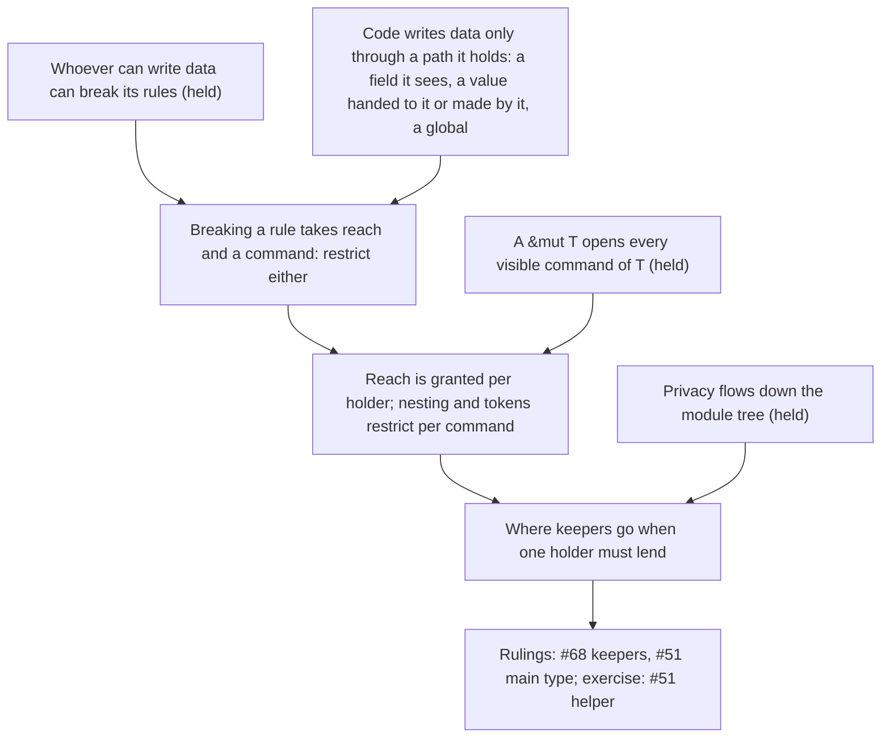

> [!quote] YOU

continue the architecture course


> [!question] Question
> How much of this goes in session 02i?
>
> Group 1 (blocking): keepers when only one file can reach the owners (#68); a main type under a subtree of its commands (#51); where a guarded command's helper goes (#51); a main type that is also one of its directory's decisions (#66).
> Group 2 (a node each): batching free today but broken by a plausible change; formal per function vs per arm; read-then-write steps; forced order vs a second builder; two ties sharing data.
> Group 3 (quick rulings): struct of borrows mirroring Game; expect inside an owner; pretty_assertions import; docstrings vs siblings; spec test constraints; checkpoints.
>
> 1. Group 1 taught as a node, then group 3 ruled; group 2 to 02j (Recommended)
> 2. Group 1 only
> 3. All three groups in this session
> 4. Groups 1 and 2, group 3 outside a session


> [!example] Answer
> 1. Group 1 taught as a node, then group 3 ruled; group 2 to 02j (Recommended)


> [!abstract] PI

Group 1 now, as one node. First a few probe questions on the concepts it rests on.


> [!question] Quiz
> Which code can break the rule "every debit of the bank's accounts is journaled"?
>
> struct Bank { accounts: Accounts, journal: Journal }   // both fields private, Bank in leaf bank.rs
>
> impl Accounts { pub(crate) fn debit(&mut self, id: AccountId, amount: Money) { ... } }
>
> Bank::transfer is the rule's keeper: it debits, then journals. Accounts and debit live in another file and are open to the whole crate.
>
> 1. Any code in the crate
> 2. Only Bank::transfer
> 3. Only code in bank.rs
> 4. Any code holding a &mut Bank


> [!success] Quiz — correct ✓
> Your answer: 3. Only code in bank.rs
> Correct answer: 3
>
> A write needs two things: a command, and the data it writes. debit is open to the whole crate, but code outside bank.rs can't reach the bank's Accounts, because the field is private. A &mut Bank doesn't help either, since it only offers Bank's own methods. So the code that can debit the bank's accounts without journaling is exactly the code that can reach the field: bank.rs. Inside that file, no tool restricts the write to transfer alone. Which function there may debit is informal knowledge.


> [!question] Quiz
> Bank's keepers move out of bank.rs. Which code can now break "every debit of the bank's accounts is journaled"?
>
> struct Bank { accounts: Accounts, journal: Journal }   // fields still private, in bank.rs
>
> impl Bank { pub(crate) fn apply(&mut self, op: Op) { /* match op: debit the accounts, or append to the journal */ } }
> pub(crate) enum Op { Debit(AccountId, Money), Journal(Entry) }
>
> The keeper now lives in transfer.rs: it calls bank.apply(Op::Debit(..)), then bank.apply(Op::Journal(..)).
>
> 1. Any code in the crate holding a &mut Bank
> 2. Any code in the crate holding a &Bank
> 3. Any code in bank.rs
> 4. Any code in bank.rs or transfer.rs


> [!success] Quiz — correct ✓
> Your answer: 1. Any code in the crate holding a &mut Bank
> Correct answer: 1
>
> The private fields still stop any direct write from outside bank.rs. But apply is a command that makes those writes, and it is open to the crate. So the reach that was limited to bank.rs now extends to every place that can call apply, which is any code holding a &mut Bank. Who can make the write is now decided at the command again, by apply's visibility and by who can build Op::Debit. A &Bank can't call a &mut self method.


> [!question] Quiz
> Can code in interest.rs debit the bank's accounts without journaling?
>
> bank/state.rs:          struct Bank { pub(super) accounts: Accounts, pub(super) journal: Journal }
> bank/transfer/keeper.rs:  fn transfer(bank: &mut Bank, ..)  // the keeper: calls debit_step, then appends to bank.journal
> bank/transfer/debit.rs:   pub(super) fn debit_step(accounts: &mut Accounts, ..)  // calls accounts.debit(..)
> bank/interest.rs:         another keeper, with a rule of its own, which gets a &mut Bank
>
> Accounts::debit is pub(crate), defined in crate::accounts.
>
> 1. No, since only state.rs can reach bank.accounts
> 2. Yes, by calling debit_step on bank.accounts
> 3. No, since debit_step is nested under transfer/
> 4. Yes, by calling Accounts::debit on bank.accounts


> [!success] Quiz — correct ✓
> Your answer: 4. Yes, by calling Accounts::debit on bank.accounts
> Correct answer: 4
>
> pub(super) on a field of a type in bank/state.rs opens it to all of bank/, so interest.rs reaches bank.accounts. Accounts::debit is open to the crate. Nesting debit_step under transfer/ restricts the helper, not the owner's command that the helper calls, so interest.rs makes the same write without it. debit_step itself is pub(super) inside transfer/, so interest.rs can't call it. To restrict the write, the restriction has to sit on the command that makes it (Accounts::debit), or on reaching the field.


> [!abstract] PI

Three of three: you recognize every case where reach and nesting interact. The map shows production with no options as your edge, so the node's first open question will check that.


> [!question] Quiz
> Can effect::resolve break "only a death pass removes a character from the board"?
>
> // game/state.rs, Game's fields private
> Step::Effect(next) => effect::resolve(prepared, &mut self.rng, &mut self.zones, &mut self.objects, &mut self.player_input),
> Step::DeathPass   => death::kill(death_pass, &mut self.zones, &mut self.effect_stack, &mut self.standings),
>
> // zones.rs
> impl Zones { pub(crate) fn leave_board(&mut self, ..) -> .. }   // today called only from the death pass
>
> 1. No, since leave_board's only caller today is the death pass
> 2. No, since only state.rs can reach the game's zones
> 3. Yes, since it holds &mut Zones and leave_board is visible to it
> 4. No, since the borrow of the zones ends when the step returns


> [!success] Quiz — correct ✓
> Your answer: 3. Yes, since it holds &mut Zones and leave_board is visible to it
> Correct answer: 3
>
> state.rs lends &mut Zones to effect::resolve for the step. While it holds that borrow, it reaches the game's zones, and every Zones command visible to it comes with them, leave_board included. The borrow ending at return limits when, not what. Today's call graph is informal knowledge: nothing fails the build if effect::resolve starts calling leave_board. And "only state.rs reaches the zones" stops being true for the length of each call it lends them to.


> [!abstract] PI

Probe: 4 of 4. You recognize both halves already: private fields limit who reaches the data, and a lent `&mut` opens every visible command on it. The map says production with no options is your edge, so each step of the node gets an open question.

## Plan

**Approach.** The three blocking gaps share one hole in the doc. "Restricting callers" only covers who can call a command. Your probe answers covered a second restriction the doc never names: reaching the data. Mark Miller's object-capability work separates the two as *permission* (what you can directly reach) and *authority* (what you can cause, including through others). I checked the sources and saved them in `research/02i-untangling-doc-gaps/reach.md`. We build up in three steps:

1. **Reach.** Breaking a rule takes both reach to the data and a command that writes it, so restricting either one restricts who can break it. Open question.
2. **Grain.** Reach is handed over one holder at a time: lending `&mut Zones` lends every `Zones` command. Nesting and tokens restrict one command at a time. Miller calls a narrower grant a *facet*.
3. **Where keepers go when one holder has to lend.** You derive the places they can go and what each costs, then rule on #68's gap and #51's "main type under its commands". The exercise is placing #51's helper of a guarded command.

#66's "main type that is also one of its directory's decisions" isn't about reach. It's the same owner as "two ties that share data", so I'd move it to 02j with that gap. After the node come the group 3 rulings.



Does this plan work for you, including moving #66's gap to 02j?


> [!quote] YOU

works


> [!abstract] PI

## Step 0: the root, paths to data

**Why we need it.** PR #68 argued: "no other module holds a game's owners, so no other module can make these writes." Nothing in the doc lets that argument count. "Restricting callers" talks only about who can call a command. Before we can judge #68's argument, we need the fact it rests on.

**The truth.** Code can write data only through a path to that data that it holds. In Rust there are four kinds of path:

- a field it can see, which privacy decides
- a value handed to it, such as a `&mut` parameter
- a value it made itself
- a global

Miller lists the same four ways an object gets a reference: introduction (someone sends it one), parenthood (it creates the object), endowment (it is born holding one) and initial conditions (already connected at the start). An object can reach nothing else. He sums it up as "only connectivity begets connectivity".

**How it connects.** Your root "whoever can write data can break its rules" says *who* can break a rule. This truth says how anyone comes to be able to write: by holding a path. One thing to keep apart: a rule is about one particular piece of data, such as *this game's* zones, not about a type.


> [!question] Quiz
> Can `shuffle_helper` break "only a death pass removes a character from the game's board"?
>
> // game/shuffle_helper.rs, a sibling of state.rs. Game's fields are private to state.rs.
> pub(super) fn shuffle_helper(seed: u64) {
>     let mut zones = Zones::new();
>     // ... fills it, then:
>     zones.leave_board(some_id);       // Zones::leave_board is pub(crate)
> }
> // shuffle_helper takes no Game, no Zones, and touches no global.
>
> 1. No, since leave_board isn't visible from shuffle_helper.rs
> 2. No, since the only zones it reaches are ones it made
> 3. Yes, since it is a sibling of state.rs inside game/
> 4. Yes, since it calls leave_board, the write the rule is about


> [!failure] Quiz — incorrect ✗
> Your answer: 4. Yes, since it calls leave_board, the write the rule is about
> Correct answer: 2
>
> Note: who is miller?
>
> The rule is about the game's board. shuffle_helper holds no path to it: Game's fields are private to state.rs, nothing hands it the game's zones, and there is no global. The zones it writes are ones it made (Miller's parenthood), and the game's rule says nothing about them. leave_board is pub(crate), so it is visible, but being visible isn't enough. Being a sibling only matters for items state.rs marks pub(super), and the fields aren't.


> [!abstract] PI

**Who Miller is.** Mark S. Miller is a computer scientist. His 2006 PhD thesis, *Robust Composition*, is the main text on the object-capability model, a way of building programs where the only way to affect something is to hold a reference to it. He designed the E language around that idea and worked on JavaScript's security features in the TC39 committee. I bring him in because he names the distinction the doc is missing: *permission*, what code can reach directly, and *authority*, what it can cause, directly or by calling other code. The quotes are in `research/02i-untangling-doc-gaps/reach.md`.

**About your answer.** You picked "Yes, since it calls leave_board". In the probe you judged reach correctly four times, so before I dig in: was that a misclick, or do you read the rule as being about every `Zones` value, not only the game's?


> [!quote] YOU

I did read it wrongly, it makes sense tho, the rule is about the game's board not every zone board


> [!abstract] PI

That's the distinction: a rule is about particular data, the game's board, not about the `Zones` type.

## Step 1: reach

**Why.** The doc's keeper rule says "the keeper must be the only code that can make the writes the rule is about". Every tool in "Restricting callers" (private, nesting, tokens, Clippy bans) limits who can *call* a command. PR #68's argument limits something else. To judge it, we need the full condition for "can make the write".

**Your turn, open-ended.** Start from the root (code writes data only through a path it holds) and from the shuffle-helper case. What does a piece of code need in order to make a write that a rule about the game's board is about? From that, what are the ways to restrict who can make it? Which of those ways does #68's argument use?


> [!quote] YOU

can u present the case again? it needs access to game board, and can u give an example rule? I am not sure u are talking about something inside the board or the board field


> [!abstract] PI

Here is the case again, with a concrete rule.

**The data.** `Game` in `game/state.rs` has a private field `zones: Zones`. `Zones` is an owner. Its private data holds each player's hand, deck, board and graveyard. "The game's board" means the board data inside the `Zones` value stored in that field. Only `Zones`' own commands write inside it, so anything that wants to change the board has to call one of them on that particular `Zones` value.

```rust
// game/state.rs
pub struct Game { zones: Zones, effect_stack: EffectStack, standings: Standings, /* ... */ }

// in Game::write, one arm per step:
Step::DeathPass => death::kill(death_pass, &mut self.zones, &mut self.effect_stack, &mut self.standings),
Step::Effect(next) => effect::resolve(prepared, &mut self.rng, &mut self.zones, &mut self.objects, &mut self.player_input),

// zones.rs
impl Zones { pub(crate) fn leave_board(&mut self, ..) -> .. }   // removes an object from a board
```

**The rule.** "A character leaves the game's board only during a death pass." (Only the state check kills, per ADR 0012.) The write it is about is `leave_board` called on the game's `Zones`, the one in `game.zones`. Calling it on a `Zones` someone built for themselves, as `shuffle_helper` did, isn't that write.

**The question.** For a piece of code to make that write, what does it need? From that, what are the ways to restrict who can make it? Which of those ways does #68's argument use ("no other module holds a game's owners, so no other module can make these writes")?


> [!quote] YOU

needs access to game's zones, it cant if the field is private and they are not on the same module and it does not recieve it as parameter and it cannot create a zones and replace the one in game, #68 uses all of this to say that no one outside the can


> [!abstract] PI

Right. Your path list is complete, and "can't build a `Zones` and swap it into `game.zones`" counts too, because that swap is itself a write to the field. The doc's first owner bullet already counts replacing an owner whole as a write.

One half is missing from your answer. Reaching the game's `Zones` isn't enough on its own. The code also needs a command it can call that makes the write, here `leave_board`. Put the two together:

> Code can make a write only if it reaches the data **and** can call a command that writes it.

So there are two ways to restrict who can break a rule:

- **Restrict reach**: keep the field private, and lend the data to as few functions as possible. This is what #68's argument relies on.
- **Restrict the command**: privacy, nesting, a token, a Clippy ban. This is all "Restricting callers" covers today.

Miller's pair maps onto this. *Permission* is what code reaches directly. *Authority* is what it can cause, either directly or by calling code that reaches more. Breaking the rule takes authority over the game's board.


> [!question] Quiz
> Which code can make the write "remove a character from the game's board"?
>
> Same rule: a character leaves the game's board only during a death pass.
>
> // zones.rs
> impl Zones { pub(crate) fn leave_board(&mut self, token: DeathToken, ..) }
> // death.rs
> pub(crate) struct DeathToken(());     // private field: only death.rs can build one, and it hands none out
> pub(in crate::game) fn kill(.., zones: &mut Zones, ..)   // builds a DeathToken, calls leave_board
>
> // game/state.rs, Game's fields private
> Step::DeathPass    => death::kill(.., &mut self.zones, ..),
> Step::Effect(next) => effect::resolve(.., &mut self.zones, ..),
>
> 1. Only kill
> 2. Any code in death.rs
> 3. kill and state.rs
> 4. kill, effect::resolve and state.rs


> [!success] Quiz — correct ✓
> Your answer: 1. Only kill
> Correct answer: 1
>
> Note: only kill cause it is the only one with reach to the game's zones and call the command by building the DeathToken, state.rs function only have reach and other functions on death.rs only have authority
>
> Both conditions must hold. Reach: state.rs (the field), and the two functions it lends &mut self.zones to, kill and effect::resolve. The command: only death.rs can build a DeathToken, so only code in death.rs can call leave_board. The intersection is code in death.rs that holds the game's zones, which is kill. effect::resolve reaches the zones but can't build a token. state.rs reaches them but can't build one either; lending isn't the same as making the write. Other code in death.rs can build tokens but holds no path to the game's zones.


> [!abstract] PI

Right, with one fix to the terms. In Miller's vocabulary the other functions in `death.rs` have no authority over the game's board. Authority is what code can actually *cause*, and they can cause nothing to the game's board, because they reach no path to it. Being able to build a `DeathToken` only means the command is open to them. So the right reading is: `state.rs` has reach but not the command, the rest of `death.rs` has the command but not reach, and `kill` has both. Since Miller's words fit our two halves this awkwardly, I'll stick to **reach** and **the command** from here on.

## Step 2: the grain of reach

**Why.** `state.rs` has to lend the game's `Zones` to `effect::resolve`, because effects draw and summon cards. The moment it does, `effect::resolve` can reach the board too. Without the token from the quiz, it could call `leave_board` and break the death-pass rule.

**Your turn, open-ended.** `effect::resolve` must still be able to draw and summon. What are the ways to keep it from removing a character from the game's board? For each one, say whether it restricts reach or restricts the command.


> [!quote] YOU

the token restrict comand, is it possible to have a pub(in death) on the command? I think that restricts reach, i dont know other ways


> [!abstract] PI

The token is right, and it restricts the command.

On `pub(in death)`: it doesn't work here, for two reasons.

- `pub(in path)` only accepts an ancestor of the module where the item is defined. `leave_board` is defined in `crate::zones`, and `death` isn't an ancestor of it. For `leave_board` to sit under `death`, it would have to leave `zones.rs`, but it writes `Zones`' private data, so it can't live anywhere else. That is the doc's case for a token: "the command has to live outside the keeper's subtree".
- Even where it compiles, visibility on a **command** restricts the command. Visibility restricts reach only when it sits on a **field**, the path to the data.

The way you didn't name restricts reach at a finer grain. `state.rs` doesn't have to lend `effect::resolve` the game's `Zones` itself. It can lend a narrower type that holds the borrow privately and offers only the commands effects need:

```rust
// zones.rs
pub(crate) struct ZoneMoves<'z> { zones: &'z mut Zones }   // private field
impl ZoneMoves<'_> {
    pub(crate) fn draw(..) { .. }
    pub(crate) fn summon(..) { .. }
}
```

`effect::resolve` reaches the game's zones only through `ZoneMoves`, so only those two commands. Miller calls this a *facet*: "access to another object whose behavior embodies the restriction". The doc already has one. The owner-defined `&mut` proof in "Checks before writes", with "methods only for the writes the check permits", is a facet built from a check.

So the grain is:

- Lending a holder grants every command of that holder that the borrower can see. Reach is granted **per holder**.
- Visibility, nesting and tokens restrict **per command**.
- Reach gets narrower than a holder only through a narrower holder, a facet.


> [!question] Quiz
> state.rs now lends effect::resolve a ZoneMoves built from &mut self.zones, instead of &mut self.zones itself. What can effect::resolve do to the game's zones?
>
> // zones.rs
> pub(crate) struct ZoneMoves<'z> { zones: &'z mut Zones }   // private field
> impl ZoneMoves<'_> { pub(crate) fn draw(..); pub(crate) fn summon(..); }
> impl Zones { pub(crate) fn leave_board(&mut self, ..); /* no token now */ }
>
> // game/state.rs
> Step::Effect(next) => effect::resolve(.., ZoneMoves::new(&mut self.zones), ..),   // effect::resolve is in game/resolve/effect.rs
>
> 1. Draw and summon only
> 2. Draw, summon and leave_board, since leave_board is pub(crate)
> 3. Nothing, since it isn't lent a &mut Zones
> 4. Every visible Zones command, since ZoneMoves holds a &mut Zones


> [!success] Quiz — correct ✓
> Your answer: 1. Draw and summon only
> Correct answer: 1
>
> effect::resolve's only path to the game's zones is the ZoneMoves value. Its zones field is private to zones.rs, so effect::resolve can't take the &mut Zones out of it. It can only call ZoneMoves' commands, draw and summon. leave_board being pub(crate) means the command is open to it, but it holds no &mut Zones to call it on: reach fails. And holding the facet is reach, just narrower than the whole holder.


> [!abstract] PI

Both halves are in place: reach and the command, and reach comes one holder at a time unless a facet narrows it.

## Step 3: where keepers go when one holder has to lend

**Why.** Here is #68's situation. `Game` in `state.rs` is the only holder of the game's owners. Its one file holds the keepers too:

```rust
// game/state.rs, all private methods of Game
fn apply_action(..)        // a legal action becomes steps; Played is matched before Summon
fn drain_effect_queue(..)  // the resolution loop: effects, then the state check between them
fn check_state(..)         // death passes until one finds no dead, then the outcome
fn run(..) / fn write(..)  // lends each step what it writes, reports its events, checkpoints
```

The issue asks for one decision per module, so these keepers have to leave `state.rs`. But each of them runs steps that write the game's owners, and only `state.rs` reaches those.

**Your turn, open-ended.** Take the root's four kinds of path: a field the code can see, a value handed to it, a value it made, a global. Which of them could give a keeper in another module reach to the game's owners? For each one that can, what would the keeper end up reaching, and which rule of the doc would it cost?


> [!quote] YOU

question too vague, can u be more specific, I am not sure how to join the two and I wont scan the doc


> [!abstract] PI

Here it is narrowed to one keeper. The state check moves to its own file, `game/state_check.rs`. It loops death passes, then decides the outcome. Each of those steps writes the game's `Zones`, `EffectStack` and `Standings`. The two doc rules that matter, quoted:

> Privacy flows down the module tree: a child reads its parent's private items, and a parent can't read a child's.

> Keep definitions in leaf modules [...]. A module with children is a directory whose `mod.rs` holds only `mod` declarations.

Of the four kinds of path, "made" and "global" are out: the state check can't make the game's zones, and there is no global. Two remain, so two questions:

1. **A field it can see.** For code in `state_check.rs` to read `Game`'s private `zones` field directly, where would `state_check.rs` have to sit relative to the module that defines `Game`? What does the first quoted rule then hand to every other module in that position, and which part of the second rule does that layout break?
2. **A value handed to it.** Suppose `state.rs` calls `state_check::run(...)` and passes something in. What could it pass, and what does the state check then reach in each case?


> [!quote] YOU

on 1 it would have to be a child of the module but parrent modules only hold mod declarations so it can hold game.
2 almost all of game to be able to write every step and report


> [!abstract] PI

**1. Right.** `state_check.rs` would have to be a child of the module that defines `Game`. Leaf definitions forbid that, since a module with children holds only `mod` declarations. The first rule adds a second cost: a child reads *all* of its parent's private items, so every keeper placed there would reach every one of `Game`'s fields, with no way to narrow it per keeper. That is #51's "main type under a subtree of its commands": it costs leaf definitions, and it makes reach as wide as possible.

**2.** What you describe is one option: `state.rs` passes every owner, as separate `&mut`s or as a struct of borrows. The state check then reaches every owner and every command on each of them. That struct of borrows is #51's other gap, "a struct of borrows that would mirror its owner".

But look at what the state check decides: *death passes until one finds none, then the outcome*. That's an order. It doesn't decide what a death pass writes, what gets reported, or when the checkpoint falls. Those belong to the step itself and to `run`.

**Next question.** Which code actually has to touch the owners, the state check or the code that runs one step? Given your answer, what is the least `state.rs` could hand the state check, and what would the state check then reach?


> [!quote] YOU

the write is the one that needs most of the game, finding the deaths only needs the players, standing, and the CardsRef , all non-mut references so it writes/reachs nothing?


> [!abstract] PI

Right on the split: `write` is the code that touches the owners, and finding the dead only reads.

But a state check that holds only shared borrows can find the dead and still can't do its job. It has to *cause* two writes, a death pass and the outcome decision, in its order, and a shared borrow can't make either happen.

So the state check needs authority to run those two steps without reach to the owners those steps write. You've already seen a kind of value that grants some commands over data without granting the data. What could `state.rs` hand the state check, and through which command would the state check run a death pass?


> [!quote] YOU

it needs to eliminate players and kill characters pushing their death rattles, it could also report but that happens between steps today. state could lend a narrower type to it so it only has reach to those comands and not the owner's whole interfaces


> [!abstract] PI

A narrower type, yes. That's a facet of `Game`. One refinement concerns what its commands should be.

If the facet offered owner commands such as `kill` and `eliminate`, the state check would call them directly. Then the reporting and the checkpoint that `run` does after each step would have to move into the state check too, which means reach to `History` and the observer. Instead, let the facet's commands be whole steps as `Game` runs them:

```rust
// game/state.rs
pub(in crate::game) struct StateCheckSteps<'g> { game: &'g mut Game }   // private field
impl StateCheckSteps<'_> {
    pub(in crate::game) fn death_pass(&mut self) -> bool { self.game.run(Step::DeathPass, ..) }
    pub(in crate::game) fn decide_outcome(&mut self)   { self.game.run(Step::DecideOutcome, ..) }
}

// game/state_check.rs
pub(..) fn check_state(steps: &mut StateCheckSteps) {
    while steps.death_pass() {}
    steps.decide_outcome();
}
```

Now `state_check.rs` holds one decision, the order. It reaches no owner, and every write still goes through `write`, `report` and the checkpoint in one place. `state.rs` keeps the data plus "what each step is lent, then report, then checkpoint". Adding an outcome check never touches it.

Before we generalize, one check on how this combines with the doc's other tools.


> [!question] Quiz
> Suppose state.rs skips per-keeper facets and lends every keeper &mut Game, whose only command visible in game is run(step). check_state is nested under the drain's parent and is pub(super). Can the drain run a death pass without going through check_state?
>
> // game/state.rs
> impl Game { pub(in crate::game) fn run(&mut self, step: Step) -> bool { .. } }   // fields private
> pub(in crate::game) enum Step { DeathPass, DecideOutcome, Effect(NextEffect), .. }
>
> // game/resolution/drain.rs
> pub(super) fn drain(game: &mut Game) { .. }          // calls state_check::check_state(game)
> // game/resolution/state_check.rs
> pub(super) fn check_state(game: &mut Game) { while game.run(Step::DeathPass) {} game.run(Step::DecideOutcome); }
>
> Rule: only the state check runs a death pass.
>
> 1. Yes, it holds &mut Game and can build Step::DeathPass itself
> 2. Yes, it can call death::kill on the game's zones
> 3. No, since the drain doesn't reach the game's zones
> 4. No, since check_state is nested and pub(super)


> [!success] Quiz — correct ✓
> Your answer: 1. Yes, it holds &mut Game and can build Step::DeathPass itself
> Correct answer: 1
>
> Nesting restricts who can call check_state, not who can call Game::run. The drain holds &mut Game, so it reaches run, and Step::DeathPass is a value any code in game can build. That's the same pattern as the probe, where nesting debit_step didn't restrict Accounts::debit. The drain doesn't reach the zones, so it can't call kill. But it doesn't need to, since run(Step::DeathPass) makes kill's writes for it. To close the hole: a token in the variant that only state_check.rs can build (the doc's "one value of a shared command"), or a facet per keeper so that only the state check's facet offers a death pass.


> [!quote] YOU

I have some concerns, what did we gain with this? the decisions on what a death_pass and decide_outcome is still lives in state, we moved the order rule out, but that is two line, I guess it could be reused so its somewhat more


> [!abstract] PI

You're right to push on this. Taken alone, the state check is a bad example, so here is an honest accounting.

**One correction first.** What a death pass *does* doesn't live in `state.rs`. It lives in `death.rs` (`find_deaths`, `kill`), and deciding the outcome lives in `standings.rs` (`decide`). `state.rs`'s arm for a death pass only knows which owners it lends, `&mut` zones, effect stack and standings, and which function it calls. "Which owners each step writes" is ticket 13's guarantee, and it can only live in the holder, since only the holder reaches the owners.

**What moving keepers out gains:**

1. **Size and independent changes.** `state.rs` has about 105 lines of public questions, 65 of setup, 53 of `apply_action`, 23 for the loop, **4 for the state check**, and 110 for lending, reporting and the checkpoint. Dealing four cards, a new action and a new pause in the loop are unrelated changes that all edit this file. The state check is the smallest piece. For four lines, the gain from this point is close to zero.
2. **The chain's rules become formal.** "Only `apply` starts the drain, only the drain runs the state check, only the state check runs a death pass" is today a convention among private methods of one `impl`. Outside the holder, it can fail the build.

**What it costs:** a facet type per keeper, or a token per guarded step. Your "still lives in state" spots a real cost of facets. For a facet to restrict anything, `Game::run` must be private to `state.rs`, so every facet is defined there, and `state.rs` then knows which steps each keeper may run. Tokens avoid that. `Game::run` is open to `game`, `Step::DeathPass` carries a token that only `state_check.rs` can build, and `state.rs` knows the token's type but not who builds it.

**Reuse** isn't a gain here. Each keeper has one caller.

The doc has a rule that sides with you for small cases: "If only one place knows it [...], leave it where it is." The state check's order is known in one place. What argues for moving it is only gain 2, plus `state.rs` holding several decisions.

So where do you land? Which of `state.rs`'s pieces, if any, should leave it, and does gain 2 alone justify moving a four-line keeper?


> [!quote] YOU

I am not sure yet, I would like to see it in practice, I think we create a wt and do the doc changes there and an issue there, then another agent will apply it afk and I will judge. at the end of this session I would like u to research other alternatives and see if my concerns are documented on the web


> [!abstract] PI

Agreed. Step 3 stays open, and the agent's PR becomes the evidence you judge it on. Here is the order I propose for the rest of the session:

1. **Doc text for steps 1 and 2**, which are settled: a write takes reach and a command, reach is granted per holder, and a facet narrows it. In the Rust section that includes your answer to #51's "main type under its commands" (privacy flows down, so it can't narrow reach, and leaf definitions forbid it anyway).
2. **Worktree**, with those doc changes, plus an update to `docs/issues/game-state-holds-several-decisions.md`. The issue states the problem and the new rules. It leaves step 3 to the agent: which pieces of `state.rs` leave it, and whether facets, tokens or nothing restrict the keepers. The PR has to show the gains and costs you listed. You review it all before I commit.
3. **#51's helper exercise and the group 3 rulings**, if you still want them today. Whatever we settle goes into the same worktree.
4. **Research** at the end: alternatives, and whether your concern (moving a small keeper out costs a facet or a token for little gain) shows up on the web.

For step 1: state the rule for the General section in your own words. It should cover reach plus a command, and the per-holder grain. If you'd rather I draft it and you rewrite, say so.


> [!quote] YOU

what is 3? lets do the general decisions here but not the exercise, the specific decisions we let the agent figure it out, I prefer u draft


> [!abstract] PI

**What item 3 was:** two things.

- **#51's helper exercise:** where a module that serves a guarded command goes. You're skipping it. I've written its general part into the draft below for you to rule on, and the placement itself is left to the agent.
- **The group 3 rulings:** six gaps from the PRs. A struct of borrows mirroring `Game` (#51), an `expect` inside an owner (#62), where `pretty_assertions` is imported (#62), docstrings where siblings have none (#62), the spec's test constraints (#68), and checkpoints (#68). The general ones come after this draft.

## Draft

**General, "Rules no owner guards"**, after "The keeper must be the only code that can make the writes the rule is about.":

> Code can make a write only if it reaches the data and can call a command that writes it, so restricting either restricts who can make it. Code reaches the data it can see and the data it is handed. Handing data over hands over every command on it. To hand over fewer, hand over a type that holds the data privately and offers only those commands.

**Rust, "Restricting callers"**, new bullets:

> - Visibility on a field restricts reach; on a command, it restricts the command. A `&mut` lends every command the borrower can see. A narrower lend is a type that holds the `&mut` in a private field and offers only the writes it allows, as the proofs in "Checks before writes" do.
> - A command can write an owner only where the owner is reached, so when one module holds the owner, the command is restricted to that module and the code it lends to, whatever its visibility.
> - A main type can't sit above its commands to share its fields with them. A parent's private items are open to every child, and a module with children holds only `mod` declarations. Lend the commands what they write instead.

**Rust, "Restricting callers"**, the nesting bullet changes (#51's helper, the general part):

> [...] Its module and the keeper's share a parent that holds only the keeper, the commands it guards, and code that reaches none of the data they write. [...]

Rewrite whatever you want. I'll put the result in the worktree.


> [!quote] YOU

I think " │ - A main type can't sit above its commands to share its fields with them. A parent's private items are open to every child, and a module with children holds only mod declarations. Lend the commands what they write instead." is already covered no? I agree with the rest but unslop them


> [!abstract] PI

The doc changes and the issue update are in the worktree (`main.architecture-02i-reach`). You'll review both before I commit.

## Group 3, the general decisions

Two of the six were settled on main while this session was open: PR #72's rulings put the `pretty_assertions` import under rustfmt, and docstrings under "only what reading the code cannot tell you". Four are left. For each I give my proposal; answer with the number and your call.

**1. A struct of borrows that mirrors its owner (#51).** Ticket 13 solved it in the code. `Game`'s fields are private, and each step is lent only the owners it writes, so no mirror struct exists. Today's reach rule explains why that works. *Proposal:* close it, no doc change.

**2. An `expect` inside an owner over its own invariant (#62, `Binder::get`).** "Checks before writes" already answers this: a command whose input no type covers checks it, and fails on the spot if only a bug can send a wrong one. I checked that only a bug can here. `DefId::new` is `pub(super)` to the binder, and the binder's constructor refuses any deck with an unknown ID. PR #71 applied the same rule to `start_next` and `leave_board`. *Proposal:* no doc change.

**3. The untangling spec's three test constraints (#68)**, which now live nowhere:
- a. "Unit tests that move with their code keep their names and bodies, apart from paths." PR #66 found it at odds with `testing.md`. *Proposal:* drop it.
- b. What counts as behavior: events and their order, checkpoints, RNG draws and their order, the order of trigger listeners and of candidates for a random pick, panics, validation results, and the public API. *Proposal:* add it to `testing.md`. Every refactor issue needs it, and the new `state.rs` issue relies on it in "Done when".
- c. "When a test in `tests/spec/` needs more than an import path change, the refactor changed behavior." *Proposal:* add it to `testing.md` next to 3b.

**4. Where checkpoints fall (#68).** Finding 31 already says placement waits for a shell, and ADR 0018 records today's placement. *Proposal:* no doc change.


> [!quote] YOU

1 good. 2 good. 3 do whatenever it is just this spec. 4 good.


> [!abstract] PI

Item 3 needs no change: the three constraints served only that spec, which is gone.

The diff is above, in `main.architecture-02i-reach`:

- `file-structure.md`: the reach paragraph in "Rules no owner guards", the two reach bullets in Rust "Restricting callers", and the nesting bullet that lets a parent hold code that reaches none of the data.
- `game-state-holds-several-decisions.md`: the block on 02i is gone, the facts point to the reach rules, your open question is stated, and the PR body has to weigh each piece of `state.rs`.

One question before you review. "Done when" still requires that **each module that holds `Game`'s data or runs its steps holds one decision**, and that **each keeper is the only code that can run the steps it guards**. Read strictly, the agent has to move even the four-line state check out and pay for a facet or token. Should it stay strict, so the PR shows the full cost and you judge from that? Or should the agent be allowed to leave a piece in `state.rs` when it argues the gain is too small?


> [!quote] YOU

stay strict


> [!abstract] PI

Updated the issue for strict. Every piece of `state.rs` leaves, and the PR body states what each one gains and what it costs:

- Facts: "The learner left open how a keeper outside `state.rs` is restricted. Every piece leaves, so he can judge in practice whether a small keeper, such as the state check's four lines, gains enough to pay for the type or token it needs."
- Done when: "The PR body says, for each piece that leaves `state.rs`, what it gains and what it costs: the decisions it sorts out and the rules it makes formal, against the types, tokens or visibility it takes."

I've started the research you asked for in the background. It covers whether your concern is documented (Ousterhout's "Better Together Or Better Apart?", shallow modules, the cost of facets and tokens) and the alternatives: orchestration kept in the holder as XMage and Forge do, order declared as data as Bevy's system sets do, typestate, facets, tokens, a Clippy ban, tests that pin the order. The report goes to `research/02i-untangling-doc-gaps/alternatives.md`.

While it runs: does the diff in `main.architecture-02i-reach` look right? If so, I'll commit it there and open the PR.


> [!quote] YOU

it does, should this be merged with or before the agent work on the issue afk?


> [!abstract] PI

Merge it before. `just wk::new` branches the agent's worktree from `origin/main`, and the issue points at the reach rules this PR adds, so both have to be on main when the agent starts. One reason to hold the merge briefly: if the research turns up something you want ruled into the issue, it's cheaper to add before merging. Committing and opening the PR now.


> [!abstract] PI

I opened PR #78: https://github.com/EMachad0/CardGameEngine/pull/78. The body lists the doc changes, the issue update, the gaps closed with no doc change, and what moves to 02j (#66's two gaps, #68's batching, formal per arm and read-then-write steps, and #51's forced order against a second builder).

The research is still running. I'll bring you its findings when it finishes, and then we can decide whether anything goes into the issue before you merge.


> [!abstract] PI

The research is in `research/02i-untangling-doc-gaps/alternatives.md`. Short version: your concern is documented, and none of the alternatives is free.

**Your concern, in the literature**

- Ousterhout: "the act of subdividing creates additional complexity that was not present before subdivision", and "The decision to split or join modules should be based on complexity." A module whose interface is about as big as its body is *shallow*, and he names wrappers with "a large amount of boilerplate for a small amount of new functionality". A facet over four lines is exactly that kind of wrapper.
- In his public exchange with Martin: "As methods get smaller and smaller there is less and less benefit to further subdivision." Martin agreed: "It is certainly possible to over-decompose code."
- On the capability side, one source justifies a facet "where there is state that connects these behaviors". Small code isn't a reason on its own. That quote comes only from a search snippet, so treat it as unconfirmed.

**What other systems do**

- **Orchestration kept in the holder.** XMage's `GameImpl.checkStateAndTriggered()` is our state check, inside the game class. The cost is size: one fork reports about 3,855 lines and 217 methods. Forge's author calls his own classes "huge".
- **Order declared as data.** Bevy has `.before()`, `.after()` and `.chain()`. The order lives in the schedule, outside `World`. That needs a scheduler, though, and "repeat until no deaths" doesn't fit a flat ordering graph well.
- **Per-step tokens.** rustc does this with `ErrorGuaranteed(pub(crate) ())`, one zero-sized type per guarded thing. Its own constructor still needed a deprecation warning to keep callers out, so visibility alone wasn't narrow enough.
- **Facets** cost one wrapper type per keeper. **Typestate** adds boilerplate, and the number of death passes is only known at runtime. **A Clippy ban** is only advice, since a local `#[allow]` turns it off. **Order-pinning tests** catch a wrong order after the fact but don't stop the call.

**One inference I don't accept.** The researcher says the state check's rule "is about order, not writes", so it could stay as a keeper pinned only by a test. Our doc already rejects that: an order rule "X before Y" restricts who can run Y, and running a step is a write.

**What this means for the issue.** It argues for your instinct: the four-line keeper probably doesn't pay for its own facet. Nothing in it forces a change before merging, though. Strict means the PR will show the real cost, and this report gives you something to compare it against. I'd merge #78 as it is and keep the report for the PR review.

Do you want anything from it added to the issue first, for example asking the agent to compare its design with keeping the keepers in the holder as XMage does? Or is this a good place to end the session?


> [!quote] YOU

we can drop the strict if we can say when it should not


> [!abstract] PI

Then we need a criterion that comes from the doc's roots, not from size. Size is the kind of proxy you've already rejected for names. Here is a concrete case to derive it from.

**Setup.** The state check moves to `state_check.rs`. `Game::run` stays open to `game`, and `Step::DeathPass` and `Step::DecideOutcome` carry a token that only `state_check.rs` can build. A step's own writes stay in its module, such as `death.rs` or `standings.rs`. Only `state.rs` can add a `Step` variant and lend it owners, because only `state.rs` reaches them.

Take two changes you might expect to the state check's decision:

1. **A new check.** A player with an empty deck loses at the state check.
2. **A new order.** The outcome is decided after every death pass, not once at the end.

For each change, which files does it edit with the state check in `state.rs`, and which with it in `state_check.rs`? Then, from the doc's line "decisions that change together count as one": when should a keeper stay in the holder?


> [!quote] YOU

worthless complex to reason question. I see they would have to change the facet and state check. I would say to not split if its spliting decisions that change together, but for all changes or any change? I think all means always split and any means never split


> [!abstract] PI

You're right, the question was too heavy. You also found the trap the doc's change test has: "all changes" means always split, because some change always edits only one side, and "any change" means never split, because some change always edits both. That's the same objection you made in the 02f doc review.

The doc already has a way out: "Judge each place against the changes you expect to the decision", and judge what you expect "by reasoning about the domain". So the measure is neither all nor any. It's the changes you expect, and the answer turns on what most of them need:

- A change that **adds a step** edits the holder whatever happens, since only the holder can lend a new step its owners. With the keeper outside, that same change edits two files instead of one.
- A change that **reorders or repeats steps the holder already offers** edits only the keeper. Outside the holder, it leaves the holder alone.

For the state check, card games mostly add checks (an empty deck loses, a limit on copies in play) and rarely reorder them. By this rule it stays.

**Draft for "Rules no owner guards"**, after the reach paragraph:

> When one module holds all the data a keeper's steps write, the keeper can live in that module or outside it. Outside, it reaches only what the module hands it, and restricting it takes a narrower type or a token per guarded step. Keep it in the module when most changes you expect to it add steps, since only that module can add a step and the change edits it anyway. Move it out when most of them reorder or repeat steps the module already offers.

**Issue change.** Strict goes away. Each piece of `state.rs` leaves unless most changes the agent expects to it add steps. The PR body lists those expected changes for every piece, whether it kept the piece or moved it out.

Should I put both in PR #78?


> [!quote] YOU

issue change yes. about the draft I think one addition does not simply fix here, we need to judge the document as a whole so it does not contradict itself your sugestion is not wrong, I would remove the "and restricting it takes a narrower type or a token per guarded step" as those are already on the doc


> [!abstract] PI

I applied both changes in the worktree (draft without that clause, issue without strict), and haven't committed them. Then I read the whole doc against the new text. I found one real contradiction, one tension that follows from it, and one small imprecision.

**1. Contradiction: "Build modules around decisions", last bullet.**

> Make a decision its own module when its knowledge sits in more than one place [...]. If only one place knows it, or the interface would mirror the fields, leave it where it is.

Every keeper in `state.rs` is known in one place, so this rule keeps all of them there, whatever the new paragraph says. Take a keeper whose expected changes mostly reorder steps: the new paragraph moves it out, and this bullet keeps it. The bullet weighs only knowledge that is spread out. It ignores the cost the issue is built on, from the coupling section: "A boundary that holds many decisions that change independently [...] has to be sorted by decision before a change." That tension was already in the doc before today. The new paragraph just makes it show.

*Proposal:* end the bullet with "leave it where it is, unless that place holds another decision that changes independently of it." Then the new paragraph's reason becomes the change-together test, so I'd reword its middle to: "Keep it in the module when most changes you expect to it add steps. Only that module can add a step, so those changes edit both, and the two count as one decision."

**2. Tension: "The keeper must be the only code that can make the writes the rule is about."** A keeper kept in the holder shares a module with other code that can run the same steps. "Restricting callers" accepts that as informal knowledge "where its locality is high", and locality is high only when the module serves one decision. Fix 1 makes that hold, so this one needs no edit of its own.

**3. Imprecise: the new Rust bullet** "only the field's module and the code the owner is lent to can write it". In Rust, the field's descendant modules can write it too. Leaf definitions mean a type's module has no descendants, so the claim holds in this codebase, but the sentence is wrong as general Rust. *Proposal:* "only the field's module, its descendants and the code the owner is lent to can write it."

Do you take 1 and 3 as proposed?


> [!quote] YOU

I think so. do the changes there for me to review


> [!abstract] PI

The changes are in `main.architecture-02i-reach` and not committed. Review them with `git diff` there.

**`file-structure.md`**

- "Build modules around decisions", last bullet: "...leave it where it is, unless that place holds another decision that changes independently of it."
- "Rules no owner guards", new paragraph after the reach one:
  > When one module holds all the data a keeper's steps write, the keeper can live in that module or outside it, where it reaches only what the module hands it. Keep it in the module when most changes you expect to it add steps. Only that module can add a step, so those changes edit both, and the two count as one decision. Move it out when most of them reorder or repeat steps the module already offers.
- Rust reach bullet: "only the field's module, its descendants and the code the owner is lent to can write it."

**The issue**

- Strict is gone. The facts point to "Rules no owner guards" for when a keeper stays.
- "Done when": the PR lists the changes it expects to each piece of `state.rs` and whether the piece left or stayed. For pieces that left, it states what the move gains and costs.
- One more edit you didn't ask for, to keep the issue consistent: the "only code that can run the steps it guards" requirement now applies to keepers that leave `state.rs`. A keeper that stays shares the file with other code, which the doc accepts as informal knowledge.

Once you approve, I'll commit, push to #78 and update its body.


> [!quote] YOU

"- Make a decision its own module when its knowledge sits in more than one place, today or in
  planned work, and an interface of questions and commands can replace that knowledge while asking
  callers to know less than the data would. If only one place knows it, or the interface would
  mirror the fields, leave it where it is, unless that place holds another decision that changes
  independently of it.
" does not read well is says if A do 1 else do 2 unless B  , it should guide the decision in a simpler way
"When one module holds all the data a keeper's steps write, the keeper can live in that module or
outside it, where it reaches only what the module hands it. Keep it in the module when most changes
you expect to it add steps. Only that module can add a step, so those changes edit both, and the
two count as one decision. Move it out when most of them reorder or repeat steps the module already
offers.
" ????????????????? steps? wtf u doing


> [!abstract] PI

You're right on both counts. "Steps" was this codebase's `Step` enum leaking into the General section. "Only that module can add a step" is true of `state.rs`'s design, not in general. And the bullet's if/else/unless was hard to follow.


> [!abstract] PI

Both are rewritten in the worktree:

**"Build modules around decisions", last bullet**, now two triggers and one exception:

> Make a decision its own module when its knowledge sits in more than one place, today or in planned work, or when it shares a module with decisions that change independently of it. Even then, leave it where it is if its interface would mirror the fields.

This drops the old clause "an interface of questions and commands can replace that knowledge while asking callers to know less than the data would". I read "mirror the fields" as the same test stated negatively. Tell me if you want it back.

**"Rules no owner guards"**, now in terms of writes, which the section already uses ("the writes the rule is about"):

> A keeper whose rule is about data one module holds can live in that module or outside it, reaching only what the module hands it. Keep it inside when most changes you expect to the rule need a new kind of write to that data. Those changes edit the module anyway, since only it reaches the data, so the keeper and the module count as one decision. Move it out when most of them only change the order of writes the module already offers.

The Rust bullet and the issue are the same as in the last round.


> [!quote] YOU

I prefer the positive sentence "an interface of questions and commands can replace that knowledge while asking callers to know less than the data would".
"most changes" ? that is not what we agreed on


> [!abstract] PI

Both fixed in the worktree. You're right about "most": that was my quantifier. What you said was not to split decisions that change together, judged by the changes you expect, and the paragraph now says only that.

**Bullet**, with your positive sentence as the second condition:

> Make a decision its own module when two things hold. Its knowledge sits in more than one place, today or in planned work, or it shares a module with decisions that change independently of it. And an interface of questions and commands can replace that knowledge while asking callers to know less than the data would.

**Keeper paragraph:**

> A keeper whose rule is about data one module holds can live in that module or outside it, reaching only what the module hands it. Keep it inside when the changes you expect to the rule need new kinds of writes to that data. Those changes edit the module anyway, since only it reaches the data, so the keeper and the module change together and count as one decision. Move it out when the changes you expect leave the module alone.

The issue already had no "most" ("lists, for each piece of `state.rs`, the changes you expect to it").


> [!quote] YOU

how does the first part differs from what was there before? I deleted some parts of the second, make sure the wording and grammar is correct


> [!abstract] PI

I don't see your edits. The file in the worktree still matches my last version word for word, and `main.file-structure` has no change to it either. Did you save, or did you edit another copy? I'll hold off editing so I don't overwrite unsaved changes in your buffer.

**How the first part differs from before.** The old bullet had two conditions joined by "and":

1. its knowledge sits in more than one place, and
2. an interface can replace that knowledge while asking callers to know less than the data would.

Then it repeated the same test in negative form: "If only one place knows it, or the interface would mirror the fields, leave it where it is."

The new bullet keeps both conditions and adds an alternative to the first: "or it shares a module with decisions that change independently of it." It drops the negative repeat, since it says nothing the conditions don't. So the added alternative is the only change in meaning. It's what lets a decision known in one place still leave a module that holds unrelated decisions, which is the case of `state.rs`'s setup and public questions.

**Grammar in the keeper paragraph as it is on disk.** Two problems:

- "can live in that module or outside it, reaching only what the module hands it": "reaching" dangles and seems to apply to both places. Better: "or outside it, where it reaches only what the module hands it."
- "Those changes edit the module anyway, since only it reaches the data, so the keeper and the module change together and count as one decision" chains "since" and "so". Better: "Only that module reaches the data, so those changes edit it anyway. The keeper and the module then change together and count as one decision."

Save your version and I'll check it, or tell me to apply these two fixes to what's on disk.


> [!quote] YOU

I forgot to save, now done. inst something like "a module holds only one decision" written somewhere that would contradict this?


> [!abstract] PI

**On "a module holds one decision".** It's there, as the definition at the top of the General section: "A module is an enforced boundary that hides one decision". It doesn't contradict the paragraph, because the very next sentence is "Decisions that change together count as one." The keeper paragraph applies that sentence. A keeper that stays changes together with the module, so the module still hides one decision. The other place that says "one decision", "Judge a parent by its own code, which should hold one decision", follows the same reading.

I also checked whether a keeper inside the module that holds all its data becomes an owner, which would clash with "a keeper is weaker than an owner". It doesn't. An owner guards an invariant, and the doc says an order rule isn't one, "since no stored data records the order its steps ran in".

**Your version, with the wording fixed:**

> A keeper whose rule is about data one module holds can live in that module or outside it, where it reaches only what the module hands it. Keep it inside when the changes you expect to it also edit the module. The two then change together and count as one decision. Move it out when the changes you expect leave the module alone.

Three fixes, and your cuts stay:

- "reaching" dangled, so it's now "where it reaches".
- After you removed "since only it reaches the data", "anyway" had no reason left, so it's now "also".
- "Keep it inside when X, so Y" read as if keeping it inside caused Y, so Y is now its own sentence.

Should I commit and push to #78?


> [!quote] YOU

"A module is an enforced boundary that hides one decision" contradicts what we are doing? independently of if we create facets or not, doesnt state hold several facets/funcionts independent of each other?


> [!abstract] PI

Yes, you're right, and it breaks my paragraph, not the definition.

**Where my argument fails.** "The changes edit the module anyway, so the two count as one decision" conflates two things. A new check edits `state.rs` because `state.rs` holds formal knowledge of every step: the `Step` variant and the arm in `write` that lends it owners. That's coupling. It doesn't make two decisions one, or every caller and callee would count as one decision. And if two keepers stay in `state.rs`, a change to the state check never touches the resolution loop. They change independently of each other, so `state.rs` holds several decisions, which the definition rules out. Facets make it worse: each one puts its keeper's step list into `state.rs`, which is more knowledge of independent decisions in the same file.

**The "when not" is already in the doc**, in "Build modules around decisions":

> Build modules around them, especially the ones likely to change or hard to get right. [...] Merge the decisions that change together. Leave stable, easy decisions where they are.

That's the doc's existing exception to one decision per module. A four-line order that's easy and that you judge stable stays where it is. This is what your concern was really asking about, and it's already a rule.

**What I propose:**

- Drop my keeper paragraph.
- Narrow the bullet's new trigger so it doesn't override "leave stable, easy decisions": "...or it is likely to change and shares a module with decisions that change independently of it."
- In the issue: every piece of `state.rs` leaves, unless the PR argues its decision is stable and easy. The PR lists the changes it expects to each piece either way.

Should I make these changes?


> [!quote] YOU

yes


> [!abstract] PI

The changes are in the worktree. Review them with `git diff` in `main.architecture-02i-reach`.

**`file-structure.md`**

- The keeper paragraph is gone.
- The bullet now reads:
  > Make a decision its own module when two things hold. Its knowledge sits in more than one place, today or in planned work, or it is likely to change and shares a module with decisions that change independently of it. And an interface of questions and commands can replace that knowledge while asking callers to know less than the data would.

  Your save had left a line break in the middle of the bullet, so I reflowed it.
- The Rust bullet with "its descendants" is as before.

**The issue**

- Facts: every piece of `state.rs` leaves it, unless its decision is stable and easy, which "Build modules around decisions" lets stay where it is.
- "Done when":
  - Each module holds one decision, "plus any stable, easy ones the PR argues for". I added that so the first bullet doesn't contradict the exception.
  - The keeper requirement applies to keepers that leave.
  - The PR lists the changes it expects to each piece. It argues stable and easy for each piece that stays, and gains and costs for each piece that leaves.

Should I commit and push to #78?


> [!quote] YOU

yes


> [!abstract] PI

I pushed `fe35fae` to #78 and rewrote the PR body to describe the whole branch: https://github.com/EMachad0/CardGameEngine/pull/78. Merge it before the agent starts on the `state.rs` issue, since the agent's worktree branches from `origin/main`.

That covers everything planned for this session:

- **Reach and the command.** A write needs both, a lend hands over every command, and a facet narrows it.
- **The "when not".** Stable, easy decisions stay where they are, and a decision likely to change leaves a module it shares with independent ones.
- **The group 3 rulings.**
- **The research.**

Shall we end the session here? If so, I'll do the close-out: update `COURSE.md`, prepare the 02j log, and commit.


> [!quote] YOU

yes


> [!abstract] PI

Here is what the close-out changes in `docs/course/architecture/COURSE.md`:

- **Knowledge map.** A reach entry under "Ownership and invariants". The probe went 4 of 4. You misread the rule as being about every `Zones` value and corrected it yourself. You derived the path half of a write open-ended, but not the command half. You named the token, proposed `pub(in death)`, and didn't know the facet. For the state check you proposed a narrower type unaided, then asked what moving four lines gains, which became the AFK PR you'll judge. Then your doc rulings: you rejected "all or any changes" as vacuous, caught that my keeper paragraph made `state.rs` hold independent keepers, and asked for the doc to be judged as a whole. "How he learns" gets this session's misfires: open questions that were too vague or too heavy, an author quoted without saying who he is, a project term ("steps") in the General section, and a quantifier ("most") you never agreed to.
- **Course plan.** 02i is done: PR #78, the `state.rs` issue unblocked, the group 3 rulings and the research. 02j is added.
- **Open threads.** #51's mirror struct and main type above its commands are closed. A thread for the `state.rs` issue's PR, to review against `research/02i-untangling-doc-gaps/alternatives.md` (XMage keeps the loop in the holder, and facets put each keeper's step list back in the holder). A thread listing 02j's gaps: #66's main type that is one of its directory's decisions and its two ties that share data, #68's batching, formal per arm and read-then-write steps, and #51's forced order against a second builder. Lessons for the teach skill, to propose to you.
- **Dependency map and sessions table.** A done node for reach, the 02i row filled in, and a 02j row.

One warning: this checkout's branch, `architecture-02`, is behind `origin/main`, and main's `COURSE.md` and `verified-facts.md` carry PR #70's notes. Merging this commit may need a small conflict resolution in those two files.

To start the next session:

```
/new
/name 02j-remaining-doc-gaps
/md-log docs/course/architecture/sessions/02j-remaining-doc-gaps.md
continue the architecture course
```

I'll commit once the edits are in.
