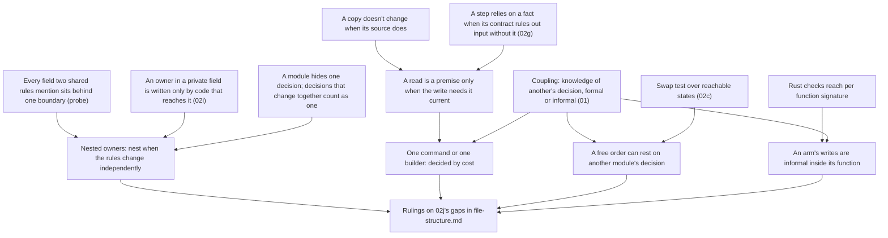

> [!quote] YOU

continue the architecture course

> [!quote] YOU

rebase on origin main it should be there now

> [!abstract] PI

Rebased onto `859fbec`, and the log's contents survived. Now reading the updated course state.

> [!abstract] PI

I'm having an explore agent check which of the six 02j gaps survived the PRs merged since #68 (#69, #74, #80). I'll scope the session once it reports back.

> [!abstract] PI

Rebased on 859fbec. An explore agent checked 02j's five gaps against today's code, which #69, #74 and #80 changed since: all five are still there. `PlayerInput` still holds both ties in `awaiting.rs`. `effect::resolve` still takes four owners across five arms. The read halves, write halves and the selector split haven't changed. The gaps pair up into four nodes.

> [!question] Question
> Which of the four nodes go in this session?
>
> 1. Two ties that share data (#66): one owner, or one owner per tie, nested. #66's main type that is also one of its directory's decisions follows from that answer.
> 2. A step that reads the state it writes (#68). #51's forced order against a second builder goes here too, since a selection reads card state and then writes the rng.
> 3. Batching that is free today but that a plausible change would break (#68).
> 4. Formal per function or per arm (#68): `effect::resolve` takes what all its arms write.
>
> 1. All four, in this order; what doesn't fit moves to 02k (Recommended)
> 2. Nodes 1 and 2 today, 3 and 4 in 02k
> 3. Only node 1 today

> [!example] Answer
> 1. All four, in this order; what doesn't fit moves to 02k (Recommended)

> [!abstract] PI

All four, then. First three probe questions, one each for nodes 1 to 3. Node 4 rests on borrow mechanics, which the map already shows you hold (02f, 02i), so it gets no probe.

This one checks whether two invariants that share a field combine into one boundary. If you hold that, node 1 starts from it and goes straight to whether one owner keeps both rules or each rule gets its own nested owner.

> [!question] Quiz
> Two rules share `balance`. Rule 1: the sum of `holds` never exceeds `balance`. Rule 2: the sum of `journal` entries equals `balance`. What is the smallest set of data one boundary must own privately so that no code outside it can break either rule?
>
> 1. `holds`, `balance` and `journal`, all behind one boundary
> 2. `balance` alone, behind one boundary
> 3. `holds` and `balance` behind one boundary, with `journal` outside
> 4. Two boundaries, one around `holds` and `balance`, one around `balance` and `journal`

> [!success] Quiz — correct ✓
> Your answer: 1. `holds`, `balance` and `journal`, all behind one boundary
> Correct answer: 1
>
> Note: from this rules alone it a bit hard to tell, for each pair I am assuming they change together so a boundary needs to hold both to hold the invariant, whether they should merge the boundary I think so, otherwise balance would be duplicated across boundaries
>
> Code that can write `holds` can break rule 1. Code that can write `journal` can break rule 2. Code that can write `balance` can break both. Every field either rule mentions has to be private to the boundary, and since the two rules share `balance`, one boundary has to hold all three. Two boundaries around one field can't both own it, and leaving `holds` or `journal` open lets outside code break its rule without touching `balance`. What happens inside that one boundary, whether a single owner keeps both rules or each rule gets its own nested owner, is the question node 1 takes up.

> [!abstract] PI

Right, and your reason holds. Each rule needs every field it mentions written only inside its boundary, and `balance` can't sit in two places, so the two boundaries merge. "Change together" works here in the data sense: an invariant makes its fields be written together. Whether the two rules are one decision or two is a separate question, and it's the one node 1 asks.

Next probe. It checks whether "Checks before writes" reaches a read that refuses nothing. Your answer tells me whether node 2 only needs a ruling on the doc's wording, or a new rule.

> [!question] Quiz
> A step reads an account's balance to compute a fee, then charges the fee. Other writes to the balance may run in between. When does the charge hold the read as informal knowledge, the way "Checks before writes" says a write holds a check's facts?
>
> 1. Only when the read could have refused the charge
> 2. Only when the read and the charge sit in different modules
> 3. Whenever the fee must fit the balance as it stands at the charge
> 4. Whenever the charge uses a value that came from the read

> [!failure] Quiz — incorrect ✗
> Your answer: 4. Whenever the charge uses a value that came from the read
> Correct answer: 3
>
> A value read earlier is a fact about the balance as it was at the read. The charge relies on that fact only if its contract needs it still true at the charge, for example a fee of 1% of the current balance. If the domain wants the fee as of the read, the value is a snapshot, and no write in between makes it wrong. So using a read's value isn't enough on its own. Refusing doesn't matter either: a read that refuses nothing can still set up a write's precondition. Where the code sits decides locality, not whether the knowledge exists.

> [!abstract] PI

Missed. You picked "whenever the charge uses a value that came from the read", which treats every value a write uses as a fact it relies on. The line is drawn by the write's contract: a fee meant as of the read is a snapshot, and nothing can make it stale. That puts your edge for node 2 between freshness, which you hold from 02h, and telling when a value that was used is a precondition. Node 2 starts there. If it was a misclick, say so in the note.

Last probe. It checks how a free order relates to coupling when the order is free only because of another module's decision. Your answer decides whether node 3 needs a derivation or just a ruling.

> [!question] Quiz
> A step runs two writes, then reports both of their events to listeners. The swap test finds the order free, because no listener today reads what the second write changes. Which listeners exist, and what they read, is another module's decision, and a listener that reads it would be a plausible addition. What does the batching hold?
>
> 1. Informal knowledge of the listeners' decision
> 2. Formal knowledge of the listeners' decision
> 3. An order rule of the batching's own
> 4. No knowledge of any decision

> [!failure] Quiz — incorrect ✗
> Your answer: 3. An order rule of the batching's own
> Correct answer: 1
>
> The batching is correct only while no listener reads what the second write changes. That fact belongs to the listeners' module, so the batching holds knowledge of it: change that decision and the batching has to change too. Adding the listener doesn't fail the build anywhere near the batching, so the knowledge is informal. It isn't an order rule, because the swap test runs against the program as it is, and today the swap changes nothing. And it isn't "no knowledge", because the swap test only says the order carries no decision of its own. It says nothing about which of other modules' decisions the order relies on.

> [!quote] YOU

honestly this one I dont know what batching means

> [!abstract] PI

The researcher is running. I'll present the plan when it reports back.

> [!abstract] PI

The researcher's report is in `research/02j-remaining-doc-gaps/scope.md`, and I've added what it confirmed to `verified-facts.md`. It corrected two of my assumptions:

- **Spec#'s methodology** (Barnett, Leino and others, 2004, a verification method for object invariants) lets an object's invariant mention the fields of objects it owns, transitively. I had assumed the owner also packs and unpacks the owned objects for them. It doesn't: each object packs and unpacks itself. Neither paper says whether one owner or nested owners is better.
- **Magic: The Gathering** doesn't match triggers against the state a step leaves. It matches each event at the moment it happens (rule 603.10), and only waits to put the triggers on the stack. So MTG is the contrast to ADR 0018, not a model of it.

## Plan

**Node 1: two ties that share data (#66).** Your probe answer is the starting point: every field either rule mentions sits behind one boundary.
- **Open question:** inside that boundary, can one rule get its own owner without letting outside code break the other? It builds on reach from 02i: an owner held in a private field can only be written by code that reaches the field.
- **Your call:** one owner or nested owners, decided by whether the two rules change independently. That settles #66's first gap. The main-type gap follows from the leaf rule, since an outer owner is "how its children combine".
- **Exercise:** do `PlayerInput`'s two ties change independently? That's a domain call, so it's yours.

**Node 2: a step that reads the state it writes (#68), then #51's second builder.** It starts from your probe miss.
- **Root:** a copy doesn't change when its source does.
- **Open question, using the fee case:** when does a later write need the copy to still be current? The doc already defines "relies" by the step's contract, but only for checks. Kleppmann calls a fact the write needs current a *premise*.
- **Your ruling:** does every read a write uses count as a check?
- **Then #51:** a selection reads the cards and writes the rng. Those are different owners, so nothing forces the split into two calls. A single command would need a second builder for `CardsRef`. You judge which rule gives way, by what each one costs.

**Node 3: batching (#68).**
- **Open question:** the swap test calls today's batching free. What does that verdict depend on?
- **Your ruling:** you place it in the coupling rules, then decide whether it stays informal, recorded in ADR 0018 as it is today, or gets made formal.

**Node 4: per function or per arm (#68).** A short one.
- **Root:** Rust checks reach per function signature, so every arm of a match reaches everything the function takes.
- **Your ruling:** you state the rule for a dispatch whose arms write different owners.

Each node ends with you stating the rule. Then I draft it into `file-structure.md`, or we close the gap with no doc change, as several gaps closed in 02i.

Does this plan work for you?

> [!quote] YOU

it does

> [!abstract] PI

Node 1. #66's gap first. `PlayerInput` holds two ties that share `pickings`. The doc's "data tied by an invariant shares one owner" applies to each tie on its own. It doesn't say whether that makes one owner for all three fields, or one owner per tie with one nested inside the other. Your probe settled the outer edge: one boundary holds every field either rule mentions. The question now is what goes inside that boundary.

Back to the bank:

- **Rule 1:** the sum of `holds` never exceeds `balance`.
- **Rule 2:** the sum of `journal` entries equals `balance`.

Here is a nested design:

- `Funds` privately owns `holds` and `balance`. Its commands are `hold`, `release`, `debit` and `credit`, and each one keeps rule 1.
- `Account` privately owns `journal` and a `Funds` value in a private field. Its own `debit` calls `Funds::debit` and appends a journal entry, and its `credit` does the same. Together they keep rule 2.
- `Funds` sits in a sibling leaf. Its type and commands are `pub(super)`, so every module in the directory can see them.

`Funds::debit` changes `balance` without adding a journal entry, so calling it on its own breaks rule 2. **Which code can break rule 2 through it, and what makes your answer true?** Answer in your own words.

> [!quote] YOU

any that can call Funds::debit, since it is pub(super) the entire module. I did not get the second part of the question

> [!abstract] PI

By "the second part" I only meant the reason behind your answer. You gave one, `pub(super)`, so you answered both parts.

The reason is half of 02i's rule. The doc says: "Code can make a write only if it reaches the data and can call a command that writes it." `pub(super)` settles the command half. Every module in the directory can call `Funds::debit`. That leaves the reach half.

Take a sibling module that can see `Funds::debit` and wants to break rule 2 for one particular account. It has to call `debit` on that account's `Funds`. **Where does it get that value?** And with that answer, which code can break rule 2?

> [!quote] YOU

it needs to get it from that particular account, and only code inside the account module can do that since its private

> [!abstract] PI

Right. To be complete, the doc's reach list also includes the account module's descendants and any code the account lends `&mut Funds` to (02i). Rule 2 needs no more protection than that: `Funds` is a private field, so code elsewhere can't reach this account's funds.

The same reasoning, one level in: `Funds`' fields are private to its own leaf. `Account`'s code can change `holds` and `balance` only through `Funds`' commands, and each of those keeps rule 1. So `Funds` keeps rule 1 even against `Account`. Each owner keeps its own rule against all other code, and the outer owner keeps the rule that ties its own data to the inner owner's.

The ownership methodologies the researcher found do the same thing formally. An object's invariant may mention the fields of objects it owns, and an owned object can change only while its owner allows it. Barnett and his co-authors say the chains of owned objects "form a hierarchy that corresponds to the hierarchy of layered abstractions".

So both designs keep both rules safe from outside code:

- **One owner:** `Account` holds `holds`, `balance` and `journal` directly, and its commands keep both rules.
- **Nested:** `Funds` keeps rule 1, and `Account` keeps rule 2 over `journal` and its `Funds`.

**Both are safe, so what should decide between them?** Answer in your own words. The doc rules you already hold are enough.

> [!quote] YOU

Nested is thoretically better because every decision gets its own module, but we need to check if the module pays for itself

> [!abstract] PI

You're right that the doc asks whether a module pays for itself. Two places already say how to judge it:

- "Make a decision its own module when [...] it is likely to change and shares a module with decisions that change independently of it. And an interface of questions and commands can replace that knowledge while asking callers to know less than the data would."
- "Leave stable, easy decisions where they are."

Your "every decision gets its own module" assumes the two rules are two decisions. The doc's "decisions that change together count as one" says when they aren't.

> [!abstract] PI

Your answer, put into the doc's terms. Nesting is safe because only the outer owner reaches the inner one. Which design to pick is the doc's existing test for when a decision gets its own module, applied to the inner rule against the outer one.

> [!question] Quiz
> Two rules share data inside one boundary. Which fact about them decides for one owner rather than nested owners?
>
> 1. The inner rule is likely to change
> 2. The outer owner is the only code that reaches the inner one
> 3. The two rules mention the same field
> 4. Every plausible change to one rule also changes the other

> [!success] Quiz — correct ✓
> Your answer: 4. Every plausible change to one rule also changes the other
> Correct answer: 4
>
> Note: I am not sure about the every here it may imply All which is hard to satisfy
>
> If every plausible change to one rule also changes the other, the two rules are one decision, and nesting would split that one decision across two modules. Sharing a field forces one boundary, as your probe answer showed, but not one owner: the nested bank design shares `balance` too. The outer owner being the only code that reaches the inner one is true of every nested design. It's what makes nesting safe, so it can't decide between the two. And an inner rule that is likely to change is the doc's reason to give it its own module, which is the opposite of one owner.

> [!abstract] PI

You're right about "every". Read literally, "every plausible change" is almost never true: someone can always think of a change that touches only one of the two rules. That's the same problem in reverse that you raised after 02f, when you rejected "a plausible change to one leaves the other alone" as a test, because such a change always exists. One wording makes "one decision" too hard to meet, and the other makes "two decisions" too easy.

The doc already has a measure between those two, in the coupling section: "Judge each place against the changes you expect to the decision." The same measure fits here. Take the changes you actually expect to the inner rule, by domain reasoning. If they leave the outer rule alone, the two rules are two decisions, and the inner one is worth its own owner if it is also likely to change. If the changes you expect touch both rules, they are one decision, and one owner keeps both. A stable, easy inner rule stays inside the one owner either way.

When I draft, I'll check the result against the Names section. It still says "If a plausible change to one part leaves the others alone, they are separate decisions", which is the existential wording.

Now state the rule in your own words: when two rules share data, what should the doc say about owners?

> [!quote] YOU

When invariants share data one module should hide both, if they leave in the same module or not depends on whether the module pays for itself.

> [!abstract] PI

Drafted in `docs/conventions/file-structure.md`, under "Owners guard invariants", right after the bullet on handing out write access:

> - When invariants share data, one owner holds all the data any of them mentions. It keeps them all itself, or holds another owner in a private field that keeps one of them. Only the outer owner reaches the inner one, so the inner owner's data counts as the outer's own. Nest an invariant in an owner of its own only when it earns a module, as "Build modules around decisions, not steps" says.

I checked it against the whole doc:

- **"An owner's rules are about its own data, so a write to another owner never serves them."** As written, this would forbid `Account::debit` writing `Funds`. The draft's sentence "the inner owner's data counts as the outer's own" is there to resolve that clash.
- **"Pays for itself".** I didn't restate it. The draft points to the existing test, "Make a decision its own module when two things hold", which already includes "likely to change" and "asking callers to know less than the data would".
- **Names, changed to match your "every" objection.** "If a plausible change to one part leaves the others alone" now reads "If the changes you expect to one part leave the others alone". The coupling section uses the same measure.

Does the draft hold? If it does, the exercise is next: do `PlayerInput`'s two ties change independently?

> [!quote] YOU

unslop it, I find it poorly written "any of them mentions", repetitive "it keepts them all itself", ambiguos "A or B", propent to get stale via the link

> [!abstract] PI

Rewritten:

> - Invariants that share data share one owner. When one of them is likely to change, and the changes you expect to it leave the others alone, give it an inner owner, held in a private field of the outer one. Only the outer owner reaches the inner one, so the inner owner's data counts as the outer's own.

I dropped the link and wrote the condition out. "Likely to change" has to be stated: for an invariant nobody expects to change, "the changes you expect to it leave the others alone" is trivially true.

If it holds, here is the exercise. It's a domain call, so it's yours. `PlayerInput` holds three pieces of data, and two ties share the middle one:

- **Tie 1, targetings and pickings.** The game awaits at most one thing from a player: a targeting while they play a card, or a picking while a card resolves.
- **Tie 2, pickings and stored picks.** A revealed card sits in a picking's options until it is picked, then in that picking's stored picks.

Today one owner keeps both ties. **What changes do you expect to each tie, and does each of those changes leave the other tie alone?** With that, say whether `PlayerInput` stays one owner or nests one tie.

> [!quote] YOU

your are restating the rule, just describe what it needs, the other part of doc describes how to test and measure that. "give it an inner owner" inner owner is not used anywhere else, "in a private field on the outer one. Only the outer owner reaches the inner one" why being so especific? here you are just interpreting other parts of the doc for this scenario. "so the inner owner's data counts as the owner's own." that is repeating other parts of the doc no? and it is a statement that holds its own by itself so it has nothing to do with what came before

> [!abstract] PI

Fair on all four points:

- **The condition.** It restated "Build modules around decisions, not steps", which already says when a decision earns a module.
- **"Inner owner".** That was a new term the doc doesn't use anywhere else.
- **The private field and reach sentences.** They applied "Rules no owner guards" to this one case.
- **The "counts as the outer's own" sentence.** It stood on its own. I added it to square the bullet with "a write to another owner never serves them", but "privately owns" already covers data that sits inside an owner the module holds.

Now it's one line:

> - Invariants that share data share one owner, which can hold an owner for one of them.

If it holds, the exercise from before still stands. What changes do you expect to each of `PlayerInput`'s two ties, and does each change leave the other tie alone?

- **Tie 1:** the game awaits at most one thing from a player.
- **Tie 2:** a revealed card sits in a picking's options until it is picked, then in the stored picks.

> [!quote] YOU

│ - Invariants that share data share one owner, which can hold an owner for
 │   one of them.
this reads like there could be only one no?

> [!abstract] PI

Yes, it does read that way. Now:

> - Invariants that share data share one owner, which can hold owners that keep some of them.

The plural allows several nested owners, and an owner that keeps more than one invariant.

The exercise still stands. What changes do you expect to each of `PlayerInput`'s two ties, and does each change leave the other tie alone?

- **Tie 1:** the game awaits at most one thing from a player.
- **Tie 2:** a revealed card sits in a picking's options until it is picked, then in the stored picks.

> [!quote] YOU

1 I dont see we waiting for multiple things but maybe? 2 multiple players choosing at the same time.

> [!quote] YOU

I dont think one require to change the other in this case

> [!abstract] PI

Your tie 1 change is a real one, and it leaves tie 2 alone. Your tie 2 change isn't a change, though. `pickings` is already kept per player, so several players can be picking at once today. That touches neither tie.

There is a planned change you should weigh. ADR 0020, which picks-as-choices ticket 04 builds next, says the resolving effect holds the picking and that no answer outlives its effect. Ticket 04 removes `picks.rs` along with `Picking`, `Picks` and `StoredPicks`, and it takes both `pickings` and `stored_picks` out of `PlayerInput`.

That change hits the shared data, `pickings`, so it touches both ties:

- **Tie 2** goes away.
- **Tie 1** ends up tying `PlayerInput`'s targetings to a picking held by the resolving effect, which is a different owner.

Two questions:

1. **With ticket 04 in view, does `PlayerInput` stay one owner, or nest one tie?** The new bullet only asks whether the changes you expect to one tie leave the other alone.
2. **#66's other gap** was a main type that is also one of its directory's decisions. After ticket 04, `PlayerInput` holds only targetings, so this case goes away. In general, once you've decided between one owner and nested owners, the existing leaf rule names the main type's leaf for the rule it keeps itself. My proposal is to close it with no doc change. Do you agree?

> [!quote] YOU

ticket 4 is already done on main, rebase this branch

> [!abstract] PI

Rebased onto `dce444d`. My uncommitted edits and the session log carried over.

On main, #83 removed tie 2. `PlayerInput` now holds only `targetings`, and the resolving effect holds the picking. Tie 1 survives as the free function `awaiting` in `player_input/awaiting.rs`, which reads both `PlayerInput` and the effect stack. So the exercise case is gone. Two decisions:

1. **The bullet.** "Invariants that share data share one owner, which can hold owners that keep some of them" still answers #66's first gap in general, but nothing in today's code shows the case. Keep it or drop it? Your call. The course rule says a concept with no problem in today's code becomes an open thread. Against that, the gap came from real code, and the bullet is a ruling rather than new teaching.
2. **#66's main-type gap.** `PlayerInput` now keeps nothing beyond its targetings, so `awaiting.rs` names its one decision. I'd close this gap with no doc change.

Separately, "the game awaits at most one thing from a player" now ties data held by two owners: `PlayerInput`'s targetings and the resolving effect's picking. `awaiting` answers "picking" first if both exist. I haven't checked whether a player can be targeting while a picking is open. If you want, I'll record that as an open thread for the next audit, under "Rules no owner guards".

> [!quote] YOU

1 keep it 2 close the gap. no need for that rule

> [!abstract] PI

Node 1 is settled:

- **The bullet stays.** "Invariants that share data share one owner, which can hold owners that keep some of them."
- **Names** now says "the changes you expect".
- **#66's main-type gap** closes with no doc change.
- **No open thread** for the "awaits at most one thing" tie.

These changes are in the worktree and not committed yet. The node 1 commit holds `file-structure.md`, four facts from the research added to `verified-facts.md`, and the research report itself, `research/02j-remaining-doc-gaps/scope.md`. Have a look with `git diff` when you get a moment, and tell me if I should commit them.

## Node 2: a step that reads the state it writes

#68's gap: "Checks before writes" covers a check and the writes it permits. It doesn't cover a step that reads card state and then writes the same owners. #68 split each such step in two: a read half that returns a value only it can build, and a write half that takes that value. Examples are `play::prepare` then `play::play`, and `death::find_deaths` then `death::kill`. Your probe answer was that a write relies on a read whenever it uses the read's value. That's where this node starts.

One unconditional truth: **a copy doesn't change when its source does.** A value read out of the data is the data as it was at the read.

The doc already defines when a step relies on something: "A later step relies on a check when, without it, the step could get input its contract rules out."

Back to the fee. A step reads the balance, computes `fee = 1%` of it, then calls `charge(fee)`. A withdrawal runs in between and lowers the balance. Here are two versions of `charge`'s contract:

- **A:** `charge` takes any fee and subtracts it. The domain wants the fee as of the moment it was assessed.
- **B:** `charge` must never overdraw, so its contract rules out a fee larger than the balance at the moment it runs.

**For each contract, can the withdrawal make `charge` get input its contract rules out? And what decides the difference?** Answer in your own words.

> [!quote] YOU

commit. contract? I dont get with charge does the action, reducing 1% would never overdraw as the fee is in % there still

> [!abstract] PI

Committed as `c07aa6a`. Only the session log is still modified.

The fee example was muddled. Strictly, 1% of the old balance can be more than what's left after a large withdrawal, but the percentage gets in the way of the point. Here's a cleaner case.

First, the word. A **contract** is what a command requires of its input and what it promises to do with it. The doc uses the word that way in "Orders between steps": "If a step gets input its contract rules out, [...]".

A step reads a customer's address from their profile, then calls `ship(parcel, address)`. In between, the customer edits their profile to a new address. Two versions of `ship`'s contract:

- **A:** ship to the address the order was placed with.
- **B:** ship to wherever the customer lives now.

Neither read refuses anything. It only fetches a value.

**For each contract, does the edit make `ship` get input its contract rules out? And what decides the difference?**

> [!quote] YOU

I breaks contract B because the order does not guarantee that the customer lives there

> [!abstract] PI

Right. Contract B needs the address to be true when `ship` runs, so the read's fact is `ship`'s precondition, and a write in between can make it false. That holds even though the read refused nothing. Contract A wants the address as it was when the order was placed. The copy is exactly the fact it needs, and no later edit can make it wrong. So the write's contract decides, not whether the write uses the value.

Kleppmann has a name for B's kind of fact: a premise, "a fact that was true at the beginning of the transaction" that "may no longer be true" by the time it commits. He also notes that a database can't tell which kind a read is, so serializable isolation treats every read as a premise. Your probe answer was the database's safe default.

> [!question] Quiz
> Which of these writes rely on their read still being true when they run?
>
> 1. A seat booking that reserves the seat read as free before it
> 2. An audit entry that records the role read before it
> 3. An admin-only command that runs on the role read before it
> 4. A receipt that prints the price read before it

> [!success] Quiz — correct ✓
> Your answer: 1. A seat booking that reserves the seat read as free before it, 3. An admin-only command that runs on the role read before it
> Correct answer: 1, 3
>
> Note: who is kleppmann and how does a premise fits in with the types of checks like precondition. 1 to avoid double booking and 3 I am not so sure but I believe what matters is if the role when the command is executed
>
> The admin command's contract rules out a caller who isn't an admin now, and the booking's contract rules out a seat that isn't free now. If the role or the seat changes in between, each gets input its contract rules out, so the read's fact is a premise. The audit entry records the role as it was when the action happened, and the receipt records the price that was charged. A later change can't make either one wrong, because the copy is the fact they want, so they are snapshots.

> [!abstract] PI

Both right, and your reason for the admin command is the right one: the role that matters is the role when the command runs.

**Who Kleppmann is.** Martin Kleppmann is a distributed-systems researcher. He wrote *Designing Data-Intensive Applications* (2017), the standard book on how databases store, replicate and transact data. Chapter 7 covers transactions, and the "premise" quote comes from its part on serializable snapshot isolation.

**How a premise fits with a precondition.** It's one fact seen from two sides:

- A **precondition** is seen from the write. It's what the write's contract requires of its input.
- A **premise** is seen from the read. It's a fact the read learned that a later write's precondition depends on.

Our doc already says this from the write's side: "A later step relies on a check when, without it, the step could get input its contract rules out. The check's facts are then the step's precondition." A **snapshot** is a fact that is part of no precondition. Nothing relies on it staying true, so nothing can make it stale. The doc doesn't need Kleppmann's word, because "precondition" already covers it.

That leaves the ruling. #68's gap says "Checks before writes" covers a check and the writes it permits, but not a step that reads state and then writes it. **What should the doc say about a read whose value a later write takes?** Put it in your own words: a new rule, a change to an existing one, or nothing.

> [!quote] YOU

Im not sure, if we cannot differ I guess we should re-read if the information must be up to date but we can pass it as paremeter if we are interested in the value how it was when first read. If the value is not supossed to change does it matter here?

> [!abstract] PI

Your three cases are all already in the doc. They just aren't reached, because the doc only says them about checks:

- **Must be up to date (a premise).** "Checks before writes" covers it. Either a proof keeps the fact fresh up to the write, or the write asks the question again. Your "re-read" is the doc's "the write asks again the question its precondition rests on". One limit: only the action's first write may refuse. A later write that finds the premise false fails on the spot, since the check before the first write already answered.
- **Wanted as it was when read (a snapshot).** Pass it as a parameter. Nothing relies on it staying true, so nothing goes stale. The doc's past-tense token names ("holds the fact only as the check saw it") are this case.
- **Not supposed to change.** It doesn't matter. "A fact about data nothing writes never goes stale". One caveat: that holds when nothing *can* write it. If code can write it but shouldn't, that's informal knowledge.

So the gap is the word "check". The doc never defines it, and #68 read it as something that can refuse. Every read-then-write step falls inside these sections once "check" covers any read. "Relies" already separates a premise from a snapshot. Proposed ruling, one sentence at the start of "Parse, don't validate":

> A check is a read whose result a later step uses, whether or not it can refuse.

With that sentence, #68's read half is a check that parses. Its value carries premises, which "Checks before writes" governs, and snapshots, which need nothing. Does that hold, and would you word it differently?

> [!quote] YOU

sounds good, modify and commit

> [!abstract] PI

Committed as `4adaa6d`.

Next is #51's gap, the second half of node 2. Under the new definition, a selector is a check: it reads card state, and a later step uses the result. The random draw is a write to the rng. So today's code is node 2's read-then-write shape:

- **Today, split.** The read half calls `select_characters(cards, ...)`, which returns a `Selection`, either each of some values or one of them at random. The write half calls `selection.resolve(&mut rng)`. The data forces the order, since only a selector can build a `Selection`.
- **One command.** `select_characters(cards, &mut rng, ...)` returns the values directly, drawing if needed. The caller is left with nothing to get wrong. "Prefer taking knowledge away from callers [...] One command that does both leaves the caller nothing to get wrong" asks for this.

The catch is in the borrows. `Game::cards(&self)` borrows the whole game, so `&mut self.rng` can't sit beside the `CardsRef` it returns. The one-command design needs a second function in `state.rs` that picks the five owners `CardsRef` reads, plus the rng, out of `Game`. "One function builds it from the owners, so only that function knows what the module reads and writes" rules that out.

One more fact. Since #84, a selector can also open a pick, where a player answers in a later action. That outcome needs two steps whatever design you choose.

**In each design, which code knows what, and which of that knowledge do the changes you expect actually touch?** With that, say which rule gives way.

> [!quote] YOU

question too open? second design sounds bad tbh. lets go to the point

> [!abstract] PI

The point: the split stays, and "prefer taking knowledge away" gives way here.

- **What the split leaves with callers.** Only that a selection becomes values through `resolve(&mut rng)`. That's one stable command, and the types make it formal. Whether a selection means each value, one at random, or a pick stays hidden in `Selection`.
- **What one command would cost.** A second function would know what card questions read. And it wouldn't even remove the split, because a pick still needs two steps.
- **Where the doc already allows this.** "Make formal only what callers must still know." The callers here still know the rng step because taking it away costs more than it saves, and "coupling costs as much as the decision changes" makes that call.

So I'd close #51's gap with no doc change. Agreed?

> [!quote] YOU

agree

> [!abstract] PI

Node 2 is closed. #51's gap needed no doc change.

## Node 3: batching

The case is real and ADR 0018 names it. A summon effect that puts a minion on each of two boards writes both entries, then reports `BoardEntered` for each. Matching runs after the step, against the board the step leaves. The swap test calls this free today because no trigger pattern matches a board entry. Add "Whenever a minion enters the board", which is Knife Juggler territory in Hearthstone, and the second minion hears the first one's entry, even though it wasn't on the board when that happened.

This is the probe question you couldn't parse. The batching relies on the trigger module's decision about which patterns exist and what they read, and nothing fails the build when that decision changes. "Free" only means the order carries no decision of its own. MTG avoids this by matching each event at the moment it happens. ADR 0018 rejected that here because every command would then hold everything the matcher reads, which was the 02f problem.

The doc gap is that "Orders between steps" says a free order "can sit anywhere" and stops there. Proposed addition, right after that line:

> It can still rest on another module's decision, such as what a listener reads. Then the code that holds it holds knowledge of that decision.

The coupling section then judges that knowledge like any other. Here the knowledge sits in every step that reports several events (`draw`, the summon, damage and card-move effects, `end_turn`), far from the trigger patterns. That's low locality, and the doc's answer is to make it formal, or pin it with a test where no type can. ADR 0018 records the consequence, but a record doesn't fail the build.

Two calls:

1. Does the sentence hold?
2. Should this case get an issue for an agent to make it formal, with the shape left to them, or stay informal with only ADR 0018 recording it?

> [!quote] YOU

I am ok with the sentence, but the summon effect order rests on a decision about reading the board entered but that is not a rule yet, but fine. I think it should get an issue adding a card and fixing the behaviour to batch

> [!abstract] PI

The sentence is in, after "can sit anywhere". You're right that the decision here is an absence: no pattern reads board entries, and nothing makes that a rule.

An issue doesn't fit, for two reasons. COURSE.md says this course adds no card game features, and a problem that today's code doesn't show waits for the card game course to create it. And `docs/issues/` only takes fixes that need no design call. This one needs a rules call: should a minion summoned alongside another hear the other's entry? `skills-and-docs.md` routes a fix like that to the open thread of the course that plans it.

> [!question] Question
> Where should the board-entry case go?
>
> Open thread text, either way: a card with a board-entry trigger pattern (Knife Juggler style) breaks the summon effect's batching under ADR 0018. Whoever adds it decides whether a minion summoned in the same step hears the other's entry, and if not, splits the step as ADR 0018 says.
>
> 1. Card-game course open thread (Recommended)
> 2. An issue anyway, overriding both rules for this case

> [!example] Answer
> 1. Card-game course open thread (Recommended)

> [!abstract] PI

Node 3 is committed as `74e37e7`: the sentence in "Orders between steps", plus a card-game open thread next to "Enter effects", for the first card with a pattern on another character's entry.

## Node 4: per function or per arm

#68's gap is that `effect::resolve` takes `&mut` to the rng, the zones and the object bag, and its arms write different subsets of them. The damage verb writes the object bag, a card move writes the zones, and a random selection writes the rng. Does "a function takes the owners it writes" apply per arm?

The one fact it rests on, which you hold: Rust checks reach per function signature. Every arm of the `match` reaches everything the function takes, and an arm that writes another arm's owner compiles. Rust has no tool for "this arm only". The Rust 2026 view-types goal names the workaround: pass the individual fields to separate functions.

So per arm can't be formal unless the arm becomes a function. Inside the function it's informal knowledge, and the coupling rule already judges that: acceptable where its locality is high, and here every arm sits in one `match`. Most arms already call a function that takes only what they write, such as `damage` and `draw`.

"Restricting callers" already says the module-level version: "No tool restricts an item to one function, only to a module. Inside that module, which code may call or build it is informal knowledge, acceptable where its locality is high." I'd add the function-level version right after it:

> Likewise, every branch of a function reaches all the function takes. Which branch writes which owner is informal knowledge too, and a branch whose writes should be formal becomes a function that takes only them.

Should I add the sentence, or close the gap with no doc change, since the coupling rule already covers it?

> [!quote] YOU

I am ok with change

> [!abstract] PI

Node 4 is committed as `129fa16`. All four nodes are done, and every gap carried into 02j is closed. Three gaps changed `file-structure.md`: the two ties that shared data, "a check is a read", and branches. One became a sentence plus a card-game open thread: batching. Two closed with no doc change: #66's main type and #51's second builder. The branch has four commits ahead of main. Like 02i, I'd skip the post-node audit, since these rulings clarify existing rules and no ticket waits on them. The next session is 03, data-oriented design and ECS, with its retrieval quiz.

> [!question] Question
> How should we wrap up?
>
> 1. End the session: close-out commit, then push and open a PR (Recommended)
> 2. End the session: close-out commit only, no PR yet
> 3. Keep going: run an audit of the crate against the new rules first

> [!example] Answer
> 1. End the session: close-out commit, then push and open a PR (Recommended)
