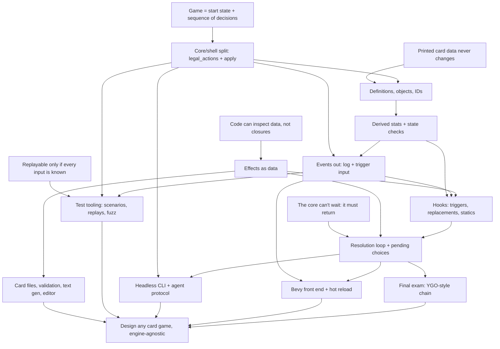

# Card game systems course

## Goal

Understand card game systems well enough to design MTG, Hearthstone, or Yu-Gi-Oh style games from scratch, plus original ones. Focus on code quality, extensibility, card data, card effects, tooling, and automated testing. The rules core is engine-agnostic Rust. Bevy is the main front end.

## How sessions work

- Teaching follows the `teach` skill, `.agents/skills/teach/SKILL.md`.
- One pi session per course session. Start with `/new`, `/name NN-topic`, `/md-log docs/course/card-game/sessions/NN-topic.md` (the file must exist first), then "continue the card-game course".
- Only the first session of a topic (06, 07, not 06b) opens with a short retrieval quiz. It may ask about any earlier session's nodes, such as 05 and 06 to 06d for 07, and adjusts the knowledge map below if something didn't stick.
- Roles in exercises. First we agree on the design in discussion. The learner writes the design-bearing code (types, traits, key function signatures and bodies). The agent writes scaffolding and tests against that API, then reviews. Tests come before the implementation. He sees little learning value in typing out plain data types, so the agent drafts those, such as `Event` and `View`, for him to edit. Design choices and bodies stay his.
- End at a node boundary, not mid-node. Commit once per node.

## Knowledge map

### Determinism and replay

- A game is a start state plus a sequence of decisions. Randomness is a seeded RNG in the state, the clock lives in the shell (a timer becomes an `EndTurn` input), and `HashMap`, `thread_rng` and `Instant::now` break replay (01). He removed an early `HashMap<PlayerId, _>` unprompted (01 exercise), and his own lint caught a `HashSet` in `validate_duplicates` (02 review).
- A seed fixes a stream: each random event takes the next number, so an unrelated extra draw shifts every later outcome. Transfers to cosmetic RNG (02 retrieval). Random over an empty set draws no number, unprompted (04a).
- Printed data is an input in the start state: a balance patch breaks old replays unless the data version is pinned (02, R2). He designed versioned codes in one append-only table (ADR 0003), held in 03 retrieval, and is unsure it beats a per-game release.
- `ObjectId` comes from a counter in `Game`; a global counter breaks replay once bot clones allocate (02).
- Chance as a player (OpenSpiel): faded by 02 ("not sure what it means"), landed again as "a Forage pick where the dice decide".

### Core and shell

- `legal_actions` is the one definition of legality and the UI reads it. `apply` is `Ok` iff the action is listed, and `Err` changes nothing (01). He writes the validate/mutate split by instinct: a membership check, then an infallible `apply_action` (01 exercise).
- State is everything (Markov): hidden deck order is state, UI hover and animation are not (01).
- Actions in, events out. One slip in 01 ("influenced by events" meaning actions).
- He proposed per-player `apply(player, action)` himself, citing simultaneous decisions (01).
- Action granularity held since 01's attacker draft. First picked `Attack(Vec<Id>)`, reading staging as imposing an order. Applied it himself in 04, rejecting one target slot in `Play` because two picks multiply.
- Leans to N-player generality: `TurnOrder` kept apart from `PlayerId` (01), explicit targeting over `opponent()`, Spark, Bolt and Zap hit every enemy hero (04a).

### Definitions, objects and IDs

- A definition never changes and is shared through a `Copy` `DefId` that can be `static`; an object has its own ID and modifiers (00, 02). Knows the `DefId` candidates (index, enum, `&'static str`, not `String`), that an index breaks on reorder and a name on rename, that an enum can't name a file-defined card, and chose a nested `Kind` over a flat struct ("atk on spells") (02 design).
- Stable card ID vs an object ID that changes on zone change (MTG 400.7). Holds the Lure `hand_index` failing case, a stale lookup returning `None`, per-game zone-reset rules, and the UI linking a reset object through an old/new event or a stable card ID (02; held in 03 retrieval).
- Runtime staleness (`Option`) vs fixed data (validate at load). Missed in 02 by over-applying the stale-ID `None` to definitions. Since then he writes load checks himself (`CardDefError` against a `card_ids!` list in 02, `DuplicateChoice` and `ChoiceNotFound` in 04b).
- Player vs piece (04c, all right): which object is P's hero is a zone fact stored once (he picked the slot and rejected a back-pointer); hero is a kind on the definition; a replacement is a new object and the card's data says what carries over (he gave flexibility as the reason, not identity); summon is not play; unify where the rules unify, decided by whether damage to a player behaves like damage to a piece; "your hero" queries key by `PlayerId`.
- Tokens: "a fact that can differ between two copies of one definition belongs on the object." Answered "I don't know" first and proposed a `TokenCardDef` kind (04c), then landed. Holds both meanings, Hearthstone's uncollectible (definition) and MTG's created by an effect (object), and that a fact isn't stored until a rule reads it.

### Derived state and one source of truth

- "Store history, derive the rest", and a stored copy of a derived fact is a mirror (02). Built `History` with `HistoryQuery` filters, "this turn" as a filter with no reset hook, Giant's discount as data and the aura derived on read (02 exercise). Held: Vulture is a new query with no new state (03 retrieval). He knows History is "basically a log" that lives in `Game`, not the shell's log.
- 02 probe, all right: a stable-ID-keyed buff survives a bounce; one mutable attack number ends at 0; an observer Giant created late costs 12; snapshot vs standing cost reductions; store damage and derive toughness; scan-on-read for a silenced aura.
- Non-commuting modifiers ("set to 1" vs "+2") need an ordering rule, and the choice is a design call (00).
- Caching: picked per-minion event-driven invalidation in 02 ("every change emits an event, so recache on every change"); the silenced Captain leaving a stale Recruit landed. Holds the ranking: no cache, then a lazy full rebuild, then incremental only with a real dependency graph.
- Edge: the mirror habit, the main gap in his designs. From scratch he defaults to a stored copy plus hooks, often for performance ("3 is better performance, and when silenced it removes the aura from the player", 02), and picks derived once shown a failing case. Stored-state form: `ObjectBag` allocating the ID twice (02 review), a `Looked` entry held by the client (03), Rally Banner enter and leave hooks patched by two more triggers (05). One-fact-in-two-places form in code: a `preconditions` list restating `choices`, a second filter with `||` where the first had `&&`, and a redundant "is this choice filled" check he only saw through a red test (04b); two drain loops already diverged and History written at three sites (05); the state check at three call sites with drifting conditions (06). Each copy drifted on its first day. Absent in 04c (rejected the back-pointer), in 05 code (no registry, one `fulfill_character_filter`) and in 06 design (spotted `waiting_on` as a mirror). Teach: one function per question, every caller asks it.

### State checks and timing

- Death is a state check, not a setter side effect (held since 01; at 00 he put it in the health setter until the "can't die this turn" expiry case).
- Death is committed because it has consequences, and deriving it creates a fixed-point cycle. Collect then commit, loop to a fixed point, outcome needs `Draw`, and N-player elimination must be committed because a restore undoes a derived one (02). Saw the Medic case depend on board order in his one-at-a-time loop ("I don't like it", 02 review), and that a hero left at 0 makes the removal loop run forever (04c).
- No state check inside a card, derived unprompted, and a checkpoint is not a state check (04).
- He holds when things run, in concept: he places drain points, separates matching from resolving (05) and places pauses (06).
- Edge: in code the state check lands in the wrong place. It ran during a pause twice (06 exercise) and only red tests caught it. In 05a he got the order right on the first try: `remove_dead` runs `kill` (death rattles, then removal), eliminates, then reports every `Died`.
- Who hears (05a): traced `kill`'s one-at-a-time bug right, but didn't know a dead hero stays in `characters_in_play` and matches its own `Died(Itself)` twice. It landed at once. He proposed "hearing is not in play, alive is" himself, and the Rally Banner test settled Alive as "not killed by a state check" over Health above 0 (ADR 0016, glossary Alive). He believed a Hearthstone minion stays on the board until its deathrattle resolves. The Death Creation Step landed it: in all four games a death rattle is read before removal and resolves after.

### Events and visibility

- D1: events are output, `E = f(s, a)`, not state, recomputable and returned; trace replay vs event-stream replay after a patch (03; held in 04 retrieval, where his first pick was a misread and his note was right).
- D2: a step is what happened plus visible values. Value changes come from diffing the whole view at checkpoints, which he linked to the state check unprompted (03).
- D3: `view(game, viewer)` is the one definition of visibility. He designed a `Views` handle exposing only `of(viewer)`, so the type system enforces it (ADR 0006). "Revealed while in hand" is a fact in `Game` read by `view` (04 retrieval). Knowledge as state was the 03 miss (a client-held `Looked` entry); the reconnect case landed.
- D4: one event, three jobs (rules record, trigger input, shell output) (03).
- 03 probe, all right: the shell's own health numbers are a mirror; a push callback fails on the borrow and on R4; IDs allocated in deck-list order leak hidden cards; an outbox field breaks `==` and `clone`; mid-resolution values travel in the stream; triggers read events inside the core.
- Proposed a log plus a reader cursor over draining (03). Holds the Scavenger case against triggers reading History through a cursor, and prefers matching at event time, resolving later.
- Step boundaries: one effect is one sentence is one step (04). His checkpoint placement beat the agent's per-`Effect` rule (03), and he traced the duplicate trailing checkpoint per-effect checkpoints add (04a). A hidden draft needs no event, only a view at a checkpoint (04b).

### Effects as data

- Code defines the vocabulary (enum plus interpreter) and data composes it. In 02 he didn't know effects could be data ("is there a point of cards as data if effects can't be data?"); his 02 code already had the vocabulary.
- E1: one source, many readers; a companion closure is a mirror; a verb costs one arm per interpreter, no `_ =>` (04). Knows the expression problem (00) and that a closure hides targets from `legal_actions` ("it loses type visibility") while a second closure drifts (04 probe).
- E2: verb plus selector plus amount; a verb takes the widest kind it acts on. Restore is its own verb, his call (04).
- E3: a list is one after another, a target set is together (Blast vs Zap). E4: selector kinds by who picks, sharing one filter relative to the caster. E5: options known before the card moves are casting, options that appear during resolution are a pending pick (04, all landed).
- Raised dependent sequencing himself ("the second effect only happens if the first succeeds", 04), a second axis beside together/then.
- Designed the 04a shape unprompted: independent axes with an `EnumSet` per axis, one `Damage`, one amount type, the owner read from the source. Holds the friendly/enemy frame (the Squire's deathrattle measures from its owner, 04a probe).
- Edge: applying a split to one side only. `PlayerSelector` mixed who picks with side, so "a random opponent" had no variant (04a). One forcing case fixed it. Watch for the same multiplication one level down.

### Targeting drafts

- 04b probe, right: "different" vs independent picks (Twin Shot vs Double Tap); a legal first pick can strand the draft (Shove); ordered picks, and filters that can't overlap need no order. The core sees actions, not clicks.
- Found the choice-reuse forcing case himself (the Pirate with Haste) and knows which games choose mid-resolution (Hearthstone Discover, MTG 608.2d, YGO non-targeting effects).
- Holds that the can-finish search runs at `Draft` and at each `Choose`, as one more reader of the effect data, and that a History-based count needs no change to it (05 retrieval).
- Edge: deriving "can the draft finish" from the selectors. He first picked a pooled candidate count across filters, then "offered, but stuck" on Prod (04b). Search is a gap: he couldn't start a backtracking search ("no idea how"), wrote it from pseudo-code, and the first version passed the candidate where the card belonged, a no-op nothing caught.

### Hooks

- Replacement ("if X would happen, do Z instead") vs trigger ("whenever X happens"); a listener can't undo an event (00).
- 05 nodes right: every hook runs on read, before a change or after it; "has trigger T" is a static, so listeners come from a scan; two replacements need an order rule or a choice; the queue is state in `Game`; the object leaves on the state check ("when we state check it is dead").
- 05 probe, right: trigger timing is a per-trigger design choice, with "before or after the death" as a third axis; Hearthstone vs MTG simultaneous deaths differ in which state the matcher reads (unsure how MTG builds its look-back); order of play is a recorded fact; a replacement re-checked on its own output never ends (614.5); a replacement sits in one damage function.
- Rally Banner was the 05 miss: he thought enter and leave hooks were enough. The trace landed, and 06 retrieval was right (the grant is read on read; a conditional grant's check belongs in `triggers()` after `modifiers()`, or it recurses).
- He designed the trigger stack (ADR 0014): consequences on top, listeners pushed after the dead minion's own triggers, one event's matches pushed oldest first. Held in 06 retrieval (Gravedigger, Mourner, Bomber).

### Resolution and pending choices

- The core returns a pending choice instead of blocking (00). Solid as state in `Game`: Discover, attacker drafts and Forage (01), the targeting draft with `Cancel` as a reset (04b), paused resolution with per-player pending picks (06).
- 06 nodes right: the paused work is data in `Game` because only `Game` survives `apply`; pauses fall between atomic steps and an effect needing an answer is split around its question; a frame per nesting level and a context per resolution, with the owner derived; two units of time, the step and the resolving effect; who may act is derived, never stored; one loop.
- 06 probe: traced every case on the current code right (Forage drawing before the pick, a naive fix still summoning Scout first, an `async` resolution leaving a clone unable to finish, `legal_actions` during a Hoarder pick). Missed Sweep under the naive stack, but his expectation (the card finishes first) was the right rule.
- "Nesting" meant only `Repeat` to him; taught `If`, `ForEach` and Choose One (06), Volley re-check right.
- Knows typestate needs an enum wrapper when the next state depends on data (06). Raised Maxx "C" himself: "after, queued" vs "after, immediate", and an immediate reaction can't ask a question.
- Edge: choices inside triggers and simultaneous picks are not taught yet.

### Testing

- Strong TDD discipline: didn't implement WildBolt because no test pinned it (01). Wrote `docs/conventions/testing.md`, moved rule tests to `tests/spec/` (02), added benchmarks before optimizing (02), and adds his own tests and tooling (a Mourner case, `pretty_assertions`, indexed event listings, 05). In 04a he wrote bodies before tests, with the existing tests pinning the refactor.
- Edge: property-based testing. He sees crashes and rejected legal moves as fuzz findings, but missed invariants you assert yourself, such as a card in two zones or replay divergence (00).
- Order twins (05a): a one-at-a-time bug leaks from what is handled earlier to what still waits, so a rule about one pass needs a test per order. The Mourner test pinned only the order that hid the bug. He transferred it to the Medic right.

### Rust

- Reading is solid (01): `Clone` for search, `self` by value loses the game on `Err`, `?` does no rollback, owned `Vec` vs a borrowed iterator. `Rc` and `&'a` block a Bevy `Resource` (02).
- Produces newtypes, a private-field `PlayerId` with `const fn new`, enum pending state, `std::mem::take`, `let`-`else`, `VecDeque` (01), `macro_rules!` (`def_ids!`, after missing the `$( ... ),*` group syntax, 02) and a generic `select_random<T: Clone>` unprompted (04a).
- Fixed misreadings: `&mut impl Trait` is a generic, not `dyn` (03); fn pointers and `Arc<dyn Fn>` are `Clone`, fn pointers `Copy` (04); an integer `as` keeps the low bits and never panics, overflow checks sit on arithmetic (04a). He then applied the last one unprompted (`u8` amounts, `try_from`, `saturating_sub`). Precise on clone vs copy (06).
- Edge: traits, generics and lifetimes don't come naturally when designing. Explain why each trait, generic or ownership choice is the one to make. He worries a generic parameter ripples through every function (03), which is a sound instinct. In 05a he asked to make `kill` a free function. `CardsRef` borrows `Zones`, so a free function can't take it beside `&mut Zones`. Left to architecture ticket 13.

### How he learns

- Abstract phrasing fails and code lands: seeds (01) went from "I don't know" to clear once shown as code.
- Name things by their code names, not rulebook phases or new labels. "I don't know" on 05's N5 and 06's N6 came from terms not tied to his code; both were right once mapped.
- A failing case or a trace moves him where argument doesn't: Lure, the stale Recruit, the reconnect case, the Rally Banner draw count, Sweep.
- Several graded misses were the question's wording (03 sink quiz, 04a code vs rules, 05 N4, 06 N3 context). His notes often carry the right reasoning; read them before grading.
- He pushes back well and is often right: `TurnOrder` (01), the versioned table (02), premature brackets, per-`Effect` checkpoints, fatigue as its own event (03), target slots (04), Hearthstone tokens (04c), remembered targets (04b). Concede when he is.
- For design he prefers guiding questions over a presented answer (02), and production-level designs not shaped by today's code, backed by research (06). His "why" questions often open a node (counters multiply, 02; minion entry order, 06). He asks for a card to pin each order rule (Gravedigger, Drummer).
- He makes interface calls quickly and well (eight in 04c) and splits large exercises into parts himself. He skips the retrieval quiz when the previous session ended hours before.
- He builds structure for cases no test reaches (`Player.playing`, hero replacement on play, `AtMost` and `AtLeast`, `Choosing`, `CharacterEntered`), keeps some by choice, and cuts them once shown broken. In 05a he chose to fix the dead-hero case, then to fix it without a test once no two-player game could reach it, then deferred it himself when it needed `Standings` interface work.
- In review he fixes every finding quickly but misses bugs no test shows; throwaway probes and red tests surface them. He dislikes call-scoped temporary fields in `Game` ("mutable temp field") and prefers passing a value through.

## Course plan

- Build a tiny Hearthstone-like game first, in `crates/rules`.
- Core track (A to G, T, K) is concept-first with one small exercise per session. Application track (H, I, J) gets one design session each. Implementation there is optional.
- Final exam (K): add a Yu-Gi-Oh style chain without rewriting the core. He knows YGO best.
- The tooling the course works toward: card data files with validation, generated rules text, test tooling (scenario DSL, replays, fuzzer), a headless CLI with a machine-readable protocol so bots and LLM agents can playtest, a visual editor, and hot reload.
- Session 04's exercise is three sessions, his split: 04a effect reshape, 04b targeting draft, 04c heroes, players and tokens as objects, all before 05. He moved 04c first. All three are done.
- Session 05 built triggers only. Replacements and new statics stay concept until a card needs one (his scope call).
- Session 06 is four sessions, his split: 06 pausable resolution and the decider (done); 06b named results and composable reveals, with the first nesting effect (`If`) and the frame stack; 06c choices inside triggers and remembered choices (his "pick a minion in your hand, give it +1/+1 every turn"); 06d simultaneous picks. Each gets its own concept and exercise. His refactors land as separate PRs before 06b.

## Open threads

- Outside a pending pick, only the active player has legal actions, so an opponent's response is never offered. Session 08.
- Signed modifiers: `ModifierEffect` amounts are `u8` since 04a, so "-2 Attack" or "costs (1) more" needs its own verb (the sign in the verb, like restore). He didn't say whether that's intended. Settle it with the first debuff or cost-increase card.
- Random with no candidates: Stray Shot stays playable into an empty board and does nothing (Bomb Lobber), his 04b call "at least for now". `can_finish_targeting` reads only declared targets. The alternative is Deadly Shot's `REQ_MINIMUM_ENEMY_MINIONS`, a play condition that no target implies.
- Hearthstone's random damage skips minions already at 0 health (the Advanced rulebook's "mortally wounded"). Our filters read the board, so a random pick after an earlier hit in the same card can land on a minion at 0. No card does that yet.
- An empty filter (`EnumSet::empty()`) matches nothing, and he chose no load check. Revisit with session H's validation.
- Enter effects: `on_board_enter` is gone since 05, so "when this enters" is a trigger pattern that doesn't exist yet. Add it with the first card that needs it. Since 06 a minion enters before its play effects run, and `play`'s push order would resolve an entry reaction before the play reactions and the body, unlike Hearthstone's After Summon phase. Decide with that card.
- `mana_cost` sums discounts with `.sum::<u8>()`, which panics in debug past 255 (unreachable).
- A targeted object that stops matching during resolution: no verb can cause it yet (filters read kind and side, and deaths wait for the state check). When bounce, control change or a filter on damage arrives, apply MTG 608.2b: skip an illegal target, and if every target is illegal the card does nothing.
- `commit_targeting` replaces what a card targeted before, so a replayed card uses what it targeted this time. A card that remembers what it targeted (his "deal 2 damage to it every turn", or "pick a minion in your hand, give it +1/+1 every turn") needs `TargetInTrigger` lifted, a rule for summoned copies (nothing targeted), and a rule for when the remembered card dies or leaves. Session 06c. MTG's forcing case for session 08: an ability activated twice is two abilities, each with what it targeted (113.7a), so targeted objects stored on the source would collide.
- `AmountBound` has only `Exactly`, with `AtMost` and `AtLeast` commented out (his call). MTG's "up to N targets" is the card that brings `AtMost` back. His first `AtMost` counted as filled before anything was targeted, so its candidates were never listed.
- Cross-target "different" is "differs from everything targeted earlier" (Forge `TargetUnique$`). XMage's tags (differ from only some of it) wait for a card that needs them. If `Cancel`-only undo proves clumsy, `Back` undoes the last `Target` and works the same on every card.
- Card wording: loose-then-tight filters (Shove) make the look-ahead hide a matching minion, and tight-first wording avoids it. A candidate for session H's card validation.
- Hero replacement (concept in 04c, not built): a new object, with the card's data saying whether damage carries over (Hearthstone hero cards keep it, Jaraxxus sets 15). Queries about "your hero" key by `PlayerId`. No event reports a swap yet.
- N-player elimination: `Standings` holds who is still playing, his committed record. Test it when setup takes more than two decks.
- Glossary terms he deferred until used more (Owner, Side, Friendly and Enemy went in during 04a, Draft and Choose in 04b): token (Hearthstone's uncollectible vs MTG's created by an effect, a flagged pair when it lands), summon (the code now says `summon`), graveyard (and the `emtomb` spelling). Character was added in 04c.
- `lib.rs`'s docstring still lists `cards` among the public data types, but the module is private now, and its layout list doesn't mention `choice`.
- Dependent sequencing (sessions 06b and 08): "if A succeeded, B" is a second axis beside together/then. Each verb reports what it did, a later effect's condition reads the report, and the report lives only while the card resolves (the resolving effect, or its context in 06b). Open 08 with the YGO conjunction table. What "succeeded" means differs per game, as MTG 118.12 in the verified facts shows, so it belongs in the data.
- Restore as its own verb (E2) has no card yet. Build it with the first card that restores.
- Picks during resolution exist since 06 (`Reveal` and `ResolvePick`). A target named during resolution ("deal 1, then choose a minion" after the hit lands) is 06c. Target is the casting-time name and Pick the resolution-time one.
- Playability with no target: a Hearthstone spell needs one (`REQ_TARGET_TO_PLAY`), and a Battlecry minion is played anyway (`REQ_TARGET_IF_AVAILABLE`). Today any card with targets needs targeting that can finish, so a minion with a targeted enter effect couldn't be played into an empty board.
- Chance as an input (OpenSpiel style) for testing random effects without seeds. Session 07.
- `ObjectId`s are allocated in deck-list order before the shuffle, so an opponent who knows the deck list can name a hidden card from its ID. Fix: allocate after the shuffle. Hidden cards' IDs are visible by policy (Arena and Hearthstone do the same).
- Cause across steps ("this hit came from that deathrattle, from that Blast"): blocks or brackets. Triggers exist since 05, and no event says which trigger caused it. Decide when a shell or a card needs it.
- Knowledge as state: a "look at the top card" effect needs a "P0 has seen X" fact in `Game`, read by `view` (Forge `mayPlayerLook`, XMage `getLookedAt`).
- If History queries get expensive, cache a query result rebuilt at a checkpoint (an XMage watcher is a patched cache of one query). Measure first.
- Session H: versioned definitions in one append-only table (his design, ADR 0003) vs a per-game snapshot of one data release with unversioned codes. Test cases from session 03: (1) a card that names another card ("Barracks: summon a Recruit") must be re-versioned whenever the named card is patched; (2) one game can mix v0 and v1 Bolts unless a "current only" rule exists; (3) random pools must exclude old versions; (4) his design needs no release number in a replay and allows deliberate version mixing. I lean per-game release, because of (1). He wasn't sure his approach was right. Hot reload as a recorded input. Load-time validation of card codes referenced in data: today `def_ids!` constants plus `validate_not_found` guarantee it, and it needs its own pass once codes come from files. Stable codes in files vs runtime index. Barracks v0 naming `base.squire.v0` is the first real instance of case (1).
- One damage function: effect damage goes through `Game::damage`, while fatigue adds its damage inline and reports only `FatigueDamaged` (his 1a, "for now"). A "whenever your hero takes damage" trigger must match both events, or `Damaged` carries the cause and `FatigueDamaged` goes (option b). Replacements and prevention need the single function first.
- Replacements (concept in 05, not built): the first "instead" or "prevent" card puts them in the one damage function, with an applied set per event (614.5) and an order rule or the affected player's choice (616.1, a per-player pending question, the mechanism from 06).
- Trigger-time targets (06c): `TargetInTrigger` rejects any `Targeted` in a trigger. Two meanings: a pick made for the trigger itself during resolution (MTG 603.3d) and a trigger reading its card's play-time target (his remembered-target card). Lift the check with the card that needs it.
- Entries left on the effect stack when the game ends stay in the final state. Since 06 `play` only queues, so nothing resolves after the outcome.
- Trigger loops have no cap. Hearthstone documents none, and Metastone throws after 20 death passes. The playouts don't include the trigger cards, because the board model doesn't model triggers, nor Sweep, Hoarder and Drummer. Session 07's fuzzing.
- Answers on the source object (`pick_targets`) are never cleared, and `ResolvePick` takes the first match, so a second resolution from the same source would move the first one's cards. No card reaches it. 06b decides where resolution values live (his call was the object "for now"; I recommended the resolving effect).
- Reveal over several players (`PlayerSelector::All`): both picks open at once, both answers land as one `PickId` on the source, and `ResolvePick` moves only the first, into the source owner's zones. Untested by his choice. Session 06d.
- Nesting effects (`Repeat`, `If`, `ForEach`, Choose One) need a frame per nesting level; a resolving effect has one cursor today. 06b brings `If` (dependent sequencing) and the frame stack.
- "Immediately" reactions (Maxx "C"): an "after" timing that runs inside the step that caused the event, beside our queued triggers. It can't ask a question (Magarena ignores immediate triggers with a choice). Session 08.
- A hero at 0 halfway through a resolving effect dies at its end, and a pick in between is still offered (MTG 704.4, his call). Untested; no card reaches it.
- A card being resolved is in no zone: a spell leaves the hand and goes nowhere. MTG has a stack zone. Decide when a card asks where a resolving card is.
- Waiting entries clone their effects at match time (kept, ADR 0011). A definition address (the card holding the list, which list, an index) is the smaller, serializable alternative, like Ink's saved call stack.
- Self-modifiers can restate printed text (a static `BuffAtk`, or a `GrantTrigger` in `modifier_effects`). Session H's validation. He rejected narrowing the type unless the static self-buff is closed too.
- ADR 0016's hero half is not built. The state check already eliminates before it reports deaths (05a), but `matched_triggers` still walks every hero, so a dead hero hears every later event and its own `Died` matches its death rattles a second time. His calls (05a): `matched_triggers` takes `&Standings`, and `alive_characters_in_order_of_play` in `triggering.rs` replaces `characters_in_order_of_play`. `Standings::playing` is `pub(super)` to `aftermath`, so `Standings` needs a question `game` can reach. No test reaches it until setup takes more than two decks, since a two-player hero death ends the game in the same state check and nothing resolves after. With N players, also decide whether a lost player's objects leave (MTG 800.4a) and whether selectors and targeting ask Alive (an eliminated player's hero stays a target, a known bug in the untangle spec).
- Naming: `PendingEffect.object_id` and `ResolvingEffect.object_id` were agreed as `source_id`; a granted `Trigger.source` is the aura's source and is used only to sort.
- Untested speculative branches in `rules` (`HistoryQueryKind::MinionDied`, whose scope and turn filters no card reads, `HistoryKind::CharacterEntered`, written and never read, `PlayerFilter::Active`, `TurnFilter::Current`, hostile auras, `has_deck_presence`, N-player `Standings`, `PlayerSelector::All` and `Random`, `CharacterSelector::Itself` and `OwnerHero`, `Effect::AddFriendlyAura`, `TriggerPattern::Damaged` with a filter, `CardKindFilter::Minions` and `Heroes`). The 04a ones are kept by his choice. Cut them or give each a test card when its session comes.
- Hand to board keeps the `ObjectId` and the bag keeps objects forever, so a "+500 until end of turn" in `obj.modifiers` would survive a bounce. Raise this when bounce arrives (the zone-reset table).
- `setup` draws and runs `start_turn` with no drain and no state check, so triggers matched during setup wait on the effect stack until the first `apply`. No card triggers at setup or at turn start yet. Decide with the first one (architecture audit, session 02b).

## Dependency map

## Sessions

| # | Nodes | Topic | Status |
|---|-------|-------|--------|
| 00 | probe | Knowledge probe and plan | done |
| 01 | R1, A | Game as a state machine, `legal_actions` + `apply` | done (exercise green: 3 rng + 20 contract tests) |
| 02 | R2, B, C | Definitions, objects, IDs; derived stats and state checks | done (green: 19 unit + 57 spec tests; review fixes applied) |
| 03 | D | Events out; return vs push | done (green: 19 unit + 84 spec; observer, views per viewer, six-engine comparison) |
| 04 | R3, E | Effects as data | done (concept only: E1 to E5; targeting draft designed) |
| 04c | B | Heroes, players and tokens as objects | done (green: 18 unit + 106 spec; ADR 0008; Barracks summons a Squire; PR #4) |
| 04a | E | Exercise: effect reshape | done (green: 17 unit + 114 spec; kind and side filters as sets, one `Damage`, Zap and Stray Shot, a checkpoint per effect; `c4aef7c`) |
| 04b | E, G | Exercise: targeting draft | done (green: 20 unit + 142 spec; ADR 0009 and 0010; choices on the card, `Draft`/`Choose`/`Cancel`/`Play`, a look-ahead search; Ping, Twin Shot, Crossfire, Shove; drafting benches; `4bb2960`) |
| 05 | F | Triggers, replacements, statics | done (green: 21 unit + 168 spec; ADRs 0011, 0012, 0014; triggers derived on read, one `emit`, a stack, collect then commit; Medic, Mourner, Drillmaster, Rally Banner, Bomber, Gravedigger; a clippy ban on `Observer::event`) |
| 06 | R4, G | Resolution loop: pausable resolution and the decider | done (green: 26 unit + 177 spec; ADR 0015; the resolving effect apart from the effect stack, one loop, per-player pending picks with a derived decider, `Reveal` and `ResolvePick` by pick id with load checks, minions enter before their play effects; Sweep, Hoarder, Drummer; five research reports and a prototype) |
| 05a | F | Mourner fix: the dead leave before any death of their pass is reported | done (green: 130 unit + 179 spec; ADR 0016 and glossary Alive; order twins for the Mourner and Medic; PR #56) |
| 06b | G | Named results and composable reveals, the first nesting effect (`If`) and frames | next, after his refactor PRs. |
| 06c | G | Choices inside triggers and remembered choices | |
| 06d | G | Simultaneous picks | |
| 07 | R5, T | Scenario DSL, replays, determinism trap, invariant fuzzing | Its retrieval quiz covers 06 (where pauses happen, the two units of time, the derived decider). |
| 08 | K | YGO chain: spell speed, right to act, LIFO, SEGOC, missing the timing | |
| app | H | Card files, validation, text generation, editor (design session) | |
| app | I | Headless CLI + agent protocol (design session) | |
| app | J | Bevy front end + hot reload (design session) | |
