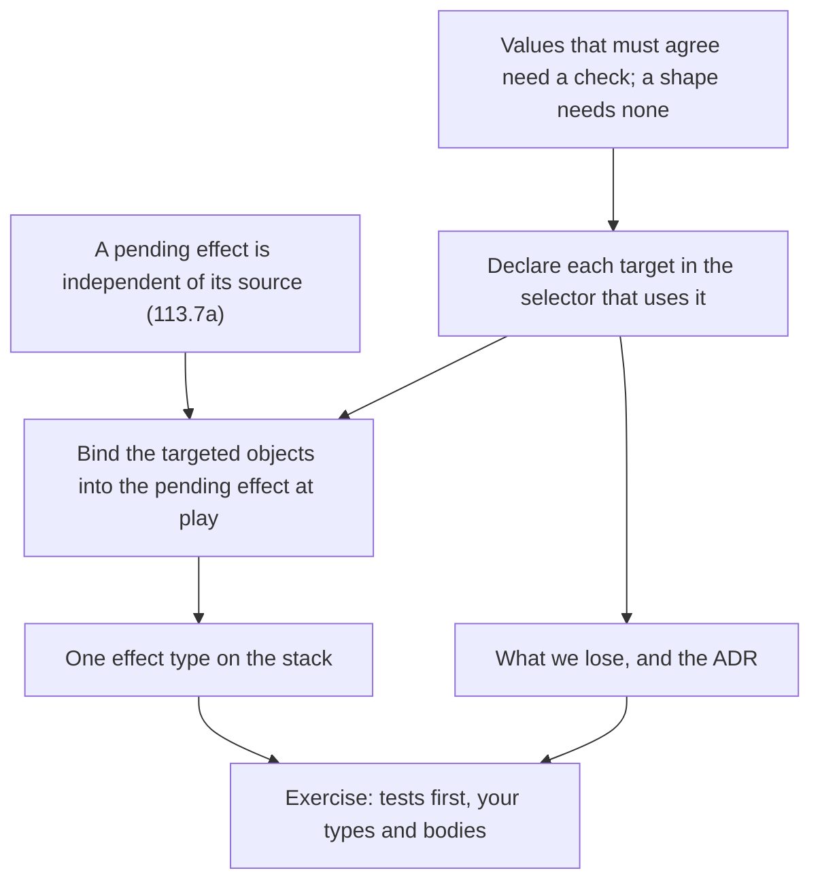

> [!quote] YOU

I think pr https://github.com/EMachad0/CardGameEngine/pull/62 did a great job designing the types around the flexibility of the definition, however I think this could be improved by redisign the effects, lets do a card game engine session on this, give me the name and md command

> [!abstract] PI

I'm calling it **`04d-effect-redesign`**. Effects are node E, which sessions 04, 04a, 04b and 04c covered. Adding a letter for a follow-up matches how 05a was numbered.

```
/new
/name 04d-effect-redesign
/md-log docs/course/card-game/sessions/04d-effect-redesign.md
continue the card-game course: session 04d, redesign effects on top of PR #62's typed card text
```

`/md-log` only links a file that already exists, so I created `docs/course/card-game/sessions/04d-effect-redesign.md` as an empty file. It isn't committed. The closing step of the session commits it along with the log.

Two things to sort out before or at the start of the session:

1. **This worktree doesn't include PR #62.** `HEAD` is at `origin/main` (087e598). PR #62 is still open on branch `card-text`, whose latest commit is 4562758. If the redesign builds on its `Effect<T>`, `CharacterSelector<T>` and `CardDef<T>` types, this worktree needs to be based on `card-text` first.
2. **It overlaps with session 06b.** `COURSE.md` lists 06b (named results, `If`, frames) as the next session. A redesign of effects will touch that ground. The new session should decide early whether 04d runs before 06b or takes over part of it. I'm not choosing that for you, because it changes the course plan.


> [!quote] YOU

continue the card-game course: session 04d, redesign effects on top of PR #62's typed card text , I would like to improve the design around the target definitions as it creates a lot of ugly code, losing some flexebility is ok


> [!question] Question
> Which target-related code feels ugly to you? Pick all that apply.
>
> From PR #62's body, the code that exists because cards declare targets:
> - the type parameter: Effect<T>, CharacterSelector<T>, CardDef<T>, NoTarget, DeclaredTarget, try_map_targeted on two types, the SelectorTarget trait
> - the Played/Triggered split: PendingText and NextEffect, with the same arms repeated in len, next_effect and continue_resolving_effect
> - card writing: base.rs writes Targeted(TargetId(n)) by counting the card's Targets list
> - the targeting draft and walk: first_unsatisfied_target, finishing_candidates, untargeted_matches, the look-ahead search
> - the parse: validity::parse rebuilding play effects to turn TargetId into DeclaredTarget
>
> 1. The T parameter spreading through card text types
> 2. The Played/Triggered duplication on the effect stack
> 3. Writing Targeted(TargetId(n)) by position in base.rs
> 4. The targeting draft and walk code
> 5. The parse step that maps TargetId to DeclaredTarget


> [!example] Answer
> 2. The Played/Triggered duplication on the effect stack
> 3. Writing Targeted(TargetId(n)) by position in base.rs
> 5. The parse step that maps TargetId to DeclaredTarget
> Other: Card Text does not exist that is not on the glossary


> [!quote] YOU

for this session specifically I am fine with u hand the answers and we discuss, I may propose somethings and u find the problems in my ideas


> [!abstract] PI

You're right about the glossary. Definitions in it use the word "text" (a card definition has "text", and an effect is "one instruction in a card's text"), but there's no entry for it. PR #62 still built names on it: `PendingText`, "play text" and "trigger text". The design below drops `PendingText`. Every name that remains is already a glossary term (play effects, a trigger's effects, pending effect, target, targeted) except `NoTarget`, which the PR had already flagged.

Expository works for this session. Here's my diagnosis and a proposal for you to attack.

## The three ugly parts come from two causes

**A target is declared in one place, used in another, and the two are joined only by a number.** A card lists its targets in `targets`, and an effect points at one with `Targeted(TargetId(n))`. The layout doesn't connect `n` to the list. So `base.rs` counts positions by hand (your item 3), and the binder needs `parse` to check that every `n` exists (your item 5). PR #62's own rule applies here. When two values depend on each other, the type can't enforce it and you need a check. Change the layout and that dependency disappears: declare the target inside the selector that uses it.

```rust
Effect::Damage {
    selector: CharacterSelector::Targeted(CharacterTarget { filter, count, bound, different }),
    amount,
}
```

A card's targets stop being a field. You get them by walking the play effects in order and collecting each `Targeted` declaration. A target's `TargetId` is its position in that walk. Code computes it, `Action::Target` still carries it, and nobody writes one in a card definition. This removes `Targets`, `DeclaredTarget`, `TargetNotFound` and the rebuild inside `parse`. The binder still runs `validate_picks`, but it stores the `CardDef` as written, so `CardDef` loses its type parameter.

**At resolution, the game looks up the targeted objects by source.** `commit_targeting` stores the objects in `PlayerInput` under `(source, TargetId)`, and the `Targeted` arm reads them back while the card resolves. So play effects need a lookup key and triggers must have none. That puts two types on the effect stack (your item 2), and it's why the `SelectorTarget` trait and an `expect` exist. The fix is to bind at play: when the card is played, replace each declaration with the objects targeted for it. The pending effect then carries its own targeted objects. A trigger's effects convert from `NoTarget` with `match never {}`, which can't fail and can never produce a `Targeted`. That leaves one type on the stack.

`T` keeps the meaning PR #62 gave it, "what a `Targeted` selector holds", across three stages:

| Stage | Type | `Targeted` holds |
|---|---|---|
| A card's play effects, written and loaded | `Effect<CharacterTarget>` | the declaration |
| A trigger's effects | `Effect<NoTarget>` | nothing, no value exists |
| A pending effect's effects | `Effect<Vec<ObjectId>>` | the objects targeted for it |

There's one conversion, at play, and it adds real information: the player's targeting. Today's parse turns `TargetId` into `DeclaredTarget` and adds nothing.

## What goes away

- `PendingText`, the split in `NextEffect`, the three matches whose arms are identical, and both `From` impls.
- The `SelectorTarget` trait. `select_characters` and `apply_effect` stop being generic and no longer take `player_input`.
- `PlayerInput.targets`, `StoredTargets`, `PlayerInput::targeted` and the `expect` at resolution. One `expect` moves into `play`, for a card with targets played without its targeting. That's where the targeted objects are first used.
- `Targets`, `DeclaredTarget`, the fallible `try_map_targeted`, the field-by-field rebuild in `parse`, and `CardDef<T>`. A plain `map_targeted` taking an `FnMut` stays.
- The `TargetId` counting in `base.rs`.

Shove, before:

```rust
play_effects: vec![
    Effect::Damage { selector: CharacterSelector::Targeted(TargetId(0)), amount: 1.into() },
    Effect::Damage { selector: CharacterSelector::Targeted(TargetId(1)), amount: 1.into() },
],
targets: Targets::from(vec![any_minion_target, friendly_minion_target]),
```

After:

```rust
play_effects: vec![
    Effect::Damage { selector: CharacterSelector::Targeted(any_minion_target), amount: 1.into() },
    Effect::Damage { selector: CharacterSelector::Targeted(friendly_minion_target), amount: 1.into() },
],
```

## Two open threads it closes along the way

- MTG 113.7a, already in verified-facts, says an ability on the stack is independent of its source. If targeted objects are stored by source, two resolutions from one source collide, and `commit_targeting` already overwrites what a card targeted last time. Objects carried by the pending effect can't collide.
- PR #62 kept played and triggered effects apart because converting trigger text means "the trigger path would then reach a `DeclaredTarget` lookup". Without a lookup, that objection goes away. It also answers ticket 14's open question about where resolution reads a played card's targeted objects from, and `PlayerInput` shrinks.

## What you lose

1. **Each target feeds exactly one effect.** "Choose a minion. Give it +1/+1. If it's a Pirate, give it Haste" can't be written. That's your own forcing case from 04b. It's also why ADR 0009 replaced ADR 0007, which had put the target rule inside the effect. So this reverses a recorded decision, and we'd need an ADR superseding the part of ADR 0010 that says targets are a list on the card. No built-in card reuses a target today. Ping, Twin Shot, Shove and Crossfire each use each target once.
2. **The order targets are asked in is the order effects resolve.** Today the targets list can be ordered differently from the effects. The Shove open thread fixed its look-ahead problem with tight-first wording. Under this design, asking for the tight target first also means resolving its effect first.
3. **The filter is gone by resolution time.** The pending effect holds objects, not the declaration. Re-checking targets at resolution, as MTG 608.2b does (an open thread), would mean binding the pair `(CharacterTarget, Vec<ObjectId>)` instead. That's an addition, not a rewrite.

If losing reuse hurts later, I'd recover it with one effect that applies several verbs to one selection: "give a minion +1/+1 and Haste". That also fixes a bug waiting to happen. Two effects each with a `Random` selector each draw their own minion, so "give a random minion +1/+1 and Taunt" can't be written correctly today either. The other option is a back-reference in Forge's style (`Defined$ Targeted`). It brings back the dependency between two values, though.

## Session plan



We argue through N1 to N4 until you're satisfied, write the ADR once the reversal is settled, then split the exercise. You write the types and function bodies, and I write the tests before them. Card behavior doesn't change, so the spec tests stay as they are.

Two decisions are yours: whether the reuse loss is acceptable, and what the bound stage holds (a bare `Vec<ObjectId>` or a newtype). Push back wherever you see a problem. I'd start with the reuse loss, since it reverses the call you made in 04b.


> [!quote] YOU

I agree, I prefer your idea about the reuse loss, having an effect that applies many effects to a target solves it and solves it better. I am concerned that I dont see a way to make an activatable effect target but this is common in card games


> [!abstract] PI

Good, then reuse comes from one effect applying several verbs to one selection. Your concern about activated abilities is the right one to test the design against, and I think the redesign is what makes them possible. Here's why.

## The line isn't "played or triggered"

The three stages in my table looked like they were about play effects. They're really about how text becomes a pending effect. Play effects were simply the only text a player starts today. MTG treats it the same way. I checked the rules and added the result to verified-facts:

- 602.2b: activating an ability follows the casting process from 601.2b to 601.2i, so you name its targets while activating, at 601.2c, exactly as when casting.
- 603.3d: putting a triggered ability on the stack follows 601.2c and 601.2d, so its controller names its targets at that point too.

In all three cases the targets are fixed at one moment: when the text becomes an object on the stack. That's where this design binds. Playing, activating and triggering are three ways in, and all three produce the same kind of pending effect.

## What an activated ability would need

The written form is the same type as play effects:

```rust
pub struct ActivatedAbility {
    pub cost: AbilityCost,
    pub effects: Vec<Effect<CharacterTarget>>,
}
```

Its targets are derived the same way: walk its effects and collect the declarations. The targeting walk doesn't change, because it already reads a list of declarations and doesn't care where they came from.

The one real change is in `Targeting`. Today its `object_id` names a card in hand. To support abilities it has to name what is being started:

```rust
enum Starting {
    Play(ObjectId),
    Activate { source: ObjectId, ability: AbilityIndex },
}
```

`play` and `activate` would then share their second half: take the targeting, bind each declaration to its objects, and push the result. The first half is where they differ. Playing pays mana and takes the card from the hand. Activating pays the ability's cost and leaves the source where it is.

## Why PR #62's storage would have broken here

Take a "deal 1 damage" ability activated twice before either resolves. Fireblast is once per turn, but MTG has plenty of abilities you can activate repeatedly. With targeted objects stored in `PlayerInput` under `(source, TargetId)`, the second commit overwrites the first, and both pending effects hit the second target. That's the 113.7a collision from the open threads. With objects bound into each pending effect, the two activations keep their own targets. The bug you'd have hit first is the one this redesign removes.

## Where the types will hurt later

Triggers that target, in 06c. MTG names a trigger's targets as it goes on the stack, per 603.3d, so in our game that's a pause that asks the trigger's controller, using the per-player picking mechanism from 06. When that arrives, `TriggerDef.effects` becomes `Effect<CharacterTarget>` too, binding happens when the controller finishes targeting, and `NoTarget` goes away. So read `NoTarget` as "the game can't ask for a trigger's targets yet", not "triggers never target". When 06c removes it, the compiler will flag every place that relied on it, which is how it should work.

## Two scope calls for you

1. **Activated abilities.** Build them now, or only make sure the design leaves room? I'd leave room. No card needs one yet, and the `Starting` enum costs nothing to add when the first one arrives.
2. **Several verbs on one selection.** In this session's exercise, or in its own session after this one? It touches every `Effect` variant and every interpreter arm, so it's about as big as the binding change itself. I'd split it out: bind first with today's `Effect`, then reshape `Effect`. That way each change is pinned by tests that don't move.

Answer in whatever shape is easiest, for example "1 leave room, 2 split".


> [!quote] YOU

1 leave room. 2 defer.
the rule here is that effect targets resolve before they go to the stack then?
how does this generalize to other choices, e.g. "choose a card in hand" or "pick a minion in your deck from 3 random options and reduce its cost by 3"
today pick follows a completely different process I would like they be more similar


> [!abstract] PI

**Q1.** Almost. I'd change one word, because the glossary uses "resolve" for carrying the text out. Targets are *named* before the text goes on the stack, and the pending effect carries what was named. The effects that use them resolve later. The targeted objects can change between those two moments, which is the 608.2b re-check from the open threads.

**Q2.** Picking is ugly for the same two reasons targeting is:

| | Targeting | Picking |
|---|---|---|
| Declared | `targets` on the card, used by `Targeted(TargetId(n))` | `Reveal { pick_id }`, used by `ResolvePick { pick_id }` |
| Joined by | a number, checked by `parse` | a number, checked by `validate_picks` |
| Answer stored | `PlayerInput.targets`, by source and `TargetId` | `PlayerInput.picks`, by source and `PickId` |
| Read by | the `Targeted` arm, with an `expect` | `ResolvePick`, first match by source |

The open thread about stored picks never being cleared is the 113.7a collision again, this time on the picking side.

So the same two fixes apply. Declare the choice inside the effect that uses it, and keep the answer with the resolution instead of the source. Once you do that, a target and a pick share one declaration, a **choice**: which objects are options, and how many to name. The only thing left that differs is when the player answers.

- A target is answered before the push. The pending effect carries the answer.
- A pick is answered when resolution reaches its effect. The resolving effect holds the answer while that effect's verbs run.

Here are your two cards in that shape, as a sketch:

```rust
// Pick a minion in your deck from 3 random options and reduce its cost by 3
Effect::Cards {
    selector: CardSelector::Picked(Choice {
        options: Options { zone: Zone::Deck, kind: minions, sample: Some(3) },
        count: 1.into(),
    }),
    verbs: vec![CardVerb::Modify(ModifierEffect::ReduceManaCost(3))],
}

// Choose a minion in your hand. Give it +1/+1
Effect::Cards {
    selector: CardSelector::Targeted(Choice {
        options: Options { zone: Zone::Hand, kind: minions, sample: None },
        count: 1.into(),
    }),
    verbs: vec![
        CardVerb::Modify(ModifierEffect::BuffAtk(1)),
        CardVerb::Modify(ModifierEffect::BuffHealth(1)),
    ],
}
```

When a choice is answered is part of the card's data, as we settled in 04b. One rule limits that: **random or hidden options wait for resolution.** `Cancel` shows why. Suppose the 3 random minions were drawn when targeting started. The player sees three cards from their deck and then cancels, and `Cancel` puts the game back as it was before targeting. If the RNG rewinds too, they've looked at their deck for free. If it doesn't, targeting again rerolls the options. Both are broken, so the draw has to happen at resolution, after the card is committed. "A minion in your hand" has neither problem, so it can be answered at either moment.

Two differences stay, and both are deliberate:

- A targeting can be cancelled, because nothing has happened yet. A pick can't, because the card is already resolving.
- A card is only offered if its targeting can finish. A pick with no options is skipped, the way a reveal from an empty deck already is.

The model needs three things the code doesn't have yet:

1. **A third subject.** A card in hand or deck isn't a character, so it needs its own selector and its own verbs: move, bury, modify.
2. **Options read in place.** Today `Reveal` takes cards out of the deck into no zone, and the pick check exists to make sure a `ResolvePick` moves them somewhere. If the options stay in the deck while the player looks at them, that zoneless state and its check both go away. What the player has seen becomes a fact the view reads, which is the "knowledge as state" open thread.
3. **The cards not picked.** Forage puts the pick in your hand and buries the rest. That's two selections from one pick, the picked card and the others, and "selector plus verbs" has room for only one. I don't have a clean shape for this yet.

All three depend on the change you deferred, letting one effect apply several verbs to one selection, because a pick's answer is used by the verbs of the same effect. Without that change, using a pick in a second effect needs a reference that crosses effects, and that's `PickId` again. So the order would be:

1. **This session:** targets declared inline and bound at the push. `Reveal` and `ResolvePick` stay as they are.
2. **The deferred session:** several verbs on one selection, the card subject, and picks as choices. It would take over 06b's "named results and composable reveals", since for picks, putting the answer's users inside the effect replaces naming the answer. `If` and frames come with it or right after.

Two calls for you:

- Should the deferred session replace the pick half of 06b?
- Do you want to start step 1's exercise now?


> [!quote] YOU

I think the defered one could be several session, put these finding on the open secion of the course and I will tackle them later.
If effects in the stack and effects in definition are different why share a Effect<T> type instead of being different types


> [!abstract] PI

I added the findings to the open threads in `docs/course/card-game/COURSE.md`, uncommitted until the close-out:

- New entries: several verbs on one selection, picks as choices, the rule that random or hidden options wait for resolution, the three missing pieces (a card subject, options read in place, the cards not picked), and activated abilities with "leave room". The verbs entry also records that you expect the group to take several sessions and overlap 06b, and that you'll schedule them later.
- Rewritten in place: the picks-stored-by-source entry, the picks-during-resolution entry, and the trigger-time targets entry. The last one now says `NoTarget` means "the game can't ask for a trigger's targets yet". It also fixes a mistake there: 603.3d has a trigger's targets named as it goes on the stack, not during resolution. I checked that against the CR today.

## Why one `Effect<T>` instead of two types

A type parameter says "these are one shape, and they differ only in the slot the parameter fills". So the question is whether definition effects and stack effects differ in one slot or in more than one.

Today they differ in one. A stack effect is the definition effect with the player's answers filled in. Every verb a definition can say has to exist on the stack, because the stack is where it gets carried out. Every field except the `Targeted` payload is copied unchanged. So the list of verbs is one fact, and it changes in both stages together.

Here's what splitting them would cost you. Take adding `Restore`:

| | One `Effect<T>` | `EffectDef` + `StackEffect` |
|---|---|---|
| Enums to add the variant to | 1 | 2 |
| Conversion arms | 1 pass-through arm in `map_targeted` | 1 arm in the conversion, the same arm |
| Walkers over both play and trigger effects | written once, generic | written once per type |

The split doesn't remove the pass-through arms you disliked. The conversion from `EffectDef` to `StackEffect` has the same 7 effect arms and 5 selector arms that `map_targeted` has. It also writes every verb a second time. The compiler would catch a missing arm, so the two wouldn't drift, but you'd be maintaining two copies of the same fact for nothing.

It's worse than two types, actually. The definition stage already has two instantiations: play effects hold `CharacterTarget`, and triggers hold `NoTarget`. Separate types would mean three enums. The alternative is to drop `NoTarget` and go back to a load check like `TargetInTrigger`, which is what PR #62 removed. The generic is already paying for itself before the stack is involved.

## When separate types would win

When the shapes change independently, meaning a variant or field exists in one stage and not the other. The likely case for us is nesting. If the stack ever holds a compiled form, such as flattened instructions with a cursor and frames for `If` and `Repeat` instead of the tree as written, the conversion becomes a real compiler. At that point two types describe the code honestly. Until then, my test is two questions. Does any variant exist in one stage only? Does any field differ besides the `Targeted` payload? Today both answers are no.

## What the generic costs

- `<T>` shows up on functions that don't care about it. After this redesign that's a short list: `Effect`, `CharacterSelector`, `map_targeted`, and the walkers that read both play and trigger effects. `CardDef`, `apply_effect` and `select_characters` lose it.
- Derives get conditional bounds. `CharacterSelector<T>` is `Copy` only when `T` is.
- `Effect<Vec<ObjectId>>` reads worse than a named type. A type alias or a newtype payload fixes that, and you still need to choose between them.

## The bigger alternative

The stack could hold no effects at all, just an address into the definition plus the answers. That's the ADR 0011 open thread: it's smaller, it's serializable, and nothing gets cloned. I'd still choose bound effects. With an address, resolution has to work out which declaration a `Targeted` is, by its position, and then look up `answers[k]`. That's an index lookup and an `expect` again. The collision would be gone, because the lookup is private to one pending effect. But it's the same kind of code we're removing.

Want to plan step 1's exercise next? The open interface calls are the payload type (bare `Vec<ObjectId>` or a newtype) and the name for `CharacterTarget` now that it lives inside the selector.


> [!quote] YOU

I think we can wrap up here with a comment on the pr with the agreed design, wdyt? or should we do some quick questions to make sure we are alligned?


> [!abstract] PI

I'd do the quick questions first, four of them. The PR comment is the spec whoever builds this will work from, possibly an agent, so if we're not aligned we'll pay for it in rework. Your notes also show that some earlier misses came from wording rather than understanding, and a short quiz catches that cheaply. The four cover the decisions that carry the design: where targeted objects live after play, where a `TargetId` comes from, what happens to a trigger's effects when they're pushed, and what we gave up.

Then the wrap-up, in this order:

1. **ADR.** This decision meets the bar in `docs/adr/README.md`. It's hard to reverse, since every card definition changes shape. It would surprise a reader without context, since ADR 0010 explicitly rejected "the rule for each target in the effect that uses it". And it's a real trade-off, since it gives up reuse across effects. I'll write a new record that supersedes 0010. It will restate the parts of 0010 that still stand (the draft, `Cancel`, the public view) and commit them on their own, as the README says.
2. **PR comment.** I'll show you the draft before posting, since it goes on GitHub where others will read it.
3. **Close-out.** Update `COURSE.md` (knowledge map, sessions table, the open threads already written), then the start block for the next session and the commit.

Should I start the questions?


> [!quote] YOU

yes


> [!question] Quiz
> Ping is played with a minion targeted. Under the agreed design, where does that minion's ObjectId live while Ping waits on the effect stack?
>
> Ping: "Deal 2 damage to a minion." One target, used by one Damage effect.
>
> 1. Inside PlayerInput, keyed by Ping's pending effect instead of its source
> 2. Inside PlayerInput, keyed by Ping's ObjectId and TargetId(0)
> 3. Inside Ping's pending effect, held by the Damage effect's Targeted selector
> 4. Inside Ping's object, keyed by TargetId and cleared once Ping finishes


> [!success] Quiz — correct ✓
> Your answer: 3. Inside Ping's pending effect, held by the Damage effect's Targeted selector
> Correct answer: 3
>
> At play, each Targeted(CharacterTarget) in the play effects is replaced by the objects targeted for it, so the pending effect's Damage holds Targeted(vec![minion]). Nothing outside the pending effect stores it. Keying by source (in PlayerInput or on the object) collides when one source resolves twice (113.7a). Keying PlayerInput by pending effect avoids the collision but keeps a lookup and an expect, and the two types on the stack, which is what binding removes.


> [!question] Quiz
> A card reads: "Draw a card. Deal 1 damage to a minion. Deal 1 damage to a friendly minion." Under the agreed design, which TargetId does the friendly-minion target get, and where does it come from?
>
> Play effects, in order: Draw (PlayerSelector), Damage with Targeted(any minion), Damage with Targeted(friendly minion). Action::Target still carries a TargetId.
>
> 1. TargetId(2), its play effect's index in the effect list, computed by code
> 2. TargetId(1), its place among the play effects' Targeted selectors, computed by code
> 3. TargetId(1), written by hand inside its CharacterTarget declaration
> 4. TargetId(1), its index in a Targets list the binder builds at load


> [!success] Quiz — correct ✓
> Your answer: 2. TargetId(1), its place among the play effects' Targeted selectors, computed by code
> Correct answer: 2
>
> A card's targets are a question, not a field: walk the play effects in order and collect each Targeted declaration. A target's id is its place in that walk, so the Draw doesn't count and the friendly minion is TargetId(1). Nobody writes it, so it can't disagree with the declarations. Storing a Targets list at load would be a mirror of what the walk derives. The effect index would work too, but it isn't what we agreed, and it leaves gaps in the ids.


> [!quote] YOU

I was going to ask if targetIds are still needed, they are because we need to match the targetting on commit right


> [!abstract] PI

Partly right. The commit does need to know which declaration each targeted object belongs to. That can be a position, though, not a `TargetId` value. If the targeting kept one list of objects per declaration, in walk order, binding would just pair the k-th `Targeted` selector with the k-th list. The same walk produces both sides, so the positions can't disagree, and nothing inside the core would need a named id.

Where `TargetId` does earn its place is the interface, where the shell has to talk about a target:

- **`Action::Target` and `LegalAction::Target`.** Today the id they carry is always the first unfilled target, because targets fill in declaration order (ADR 0010) and `AmountBound` only has `Exactly`. So right now it's redundant. It stops being redundant with "up to N" (`AtMost`). An `AtMost` target counts as satisfied with nothing picked, so a click is ambiguous: does it add to this target or start the next one? The action has to say which.
- **Replays.** Recorded actions include the `target_id`. Dropping the field would change the action format and break replays that are already stored.
- **The public view of a targeting.** A shell drawing one arrow per target needs to know which target each object fills. It can work that out from position, but an id is clearer.

So the answer is to keep `TargetId` in actions, legal actions and the view. It costs nothing, it isn't written in card definitions anymore, and `AtMost` will need it. Inside the core, whether `Targeting` stores `(ObjectId, TargetId)` pairs or one list per declaration is your call during the exercise. The pairs are what exists today. The lists make the commit a plain zip.

Say go and I'll ask question 3.


> [!quote] YOU

ok


> [!question] Quiz
> Hoarder's death rattle matches and is pushed onto the effect stack. Under the agreed design, what happens to its effects on the push?
>
> A trigger's effects are written as Effect<NoTarget>. The effect stack holds one type, Effect<objects targeted>, the same one played cards' effects become when bound at play.
>
> 1. Pushed as Effect<NoTarget>, in a second variant beside the played effects
> 2. Mapped to the stack type when the binder loads, then pushed unchanged
> 3. Mapped to the stack type, with each Targeted given an empty list of objects
> 4. Mapped to the stack type with match never {}, so none of them holds a Targeted


> [!success] Quiz — correct ✓
> Your answer: 4. Mapped to the stack type with match never {}, so none of them holds a Targeted
> Correct answer: 4
>
> NoTarget has no values, so the map's closure is match never {} and can never run. It turns Effect<NoTarget> into the stack type without being able to produce a Targeted arm. Nothing is filled with an empty list, because no Targeted exists in a trigger's effects to fill. A second variant is PendingText::Triggered, the duplication we removed. Mapping at load would store a second copy of every trigger in another type, a mirror that buys nothing, since the map is free at push.


> [!question] Quiz
> After step 1, with today's Effect variants and before the deferred verbs-on-one-selection work, which of these cards can't be written? Select all that apply.
>
> Step 1: each target is declared in the Targeted selector of the one effect that uses it, targets are asked in the order of those selectors, and each Effect has one verb (Damage, Buff, ...).
>
> 1. Ask for an enemy minion, then a friendly one. Deal 1 to the friendly one first, then 1 to the enemy
> 2. Deal 1 damage to two different minions
> 3. Deal 1 damage to an enemy minion and 1 to a friendly minion
> 4. Deal 2 damage to a minion, then give that minion +2 Attack
> 5. Deal 2 damage to a minion. Draw a card


> [!failure] Quiz — incorrect ✗
> Your answer: 4. Deal 2 damage to a minion, then give that minion +2 Attack
> Correct answer: 1, 4
>
> The damage-then-buff card needs one target in two effects, and a declaration now lives in one selector. That's the reuse loss, and verbs on one selection brings it back. The ask-then-resolve card needs the asking order to differ from the resolving order, but targets are asked in the order of the effects that declare them, so asking for the enemy first means damaging it first. Twin Shot style counts, two targets used once each, and a target followed by a draw are all fine.


> [!question] Quiz
> Under step 1, you want Shove to ask for the friendly minion first, so the look-ahead never hides a candidate. What do you change in its definition?
>
> Shove today, after step 1: play_effects = [Damage { Targeted(any minion), 1 }, Damage { Targeted(friendly minion), 1 }]. The open thread says loose-then-tight filters make the look-ahead hide a matching minion, and tight-first avoids it.
>
> 1. Nothing, since the walk asks the declaration with the tighter filter first on its own
> 2. Write TargetId(0) on the friendly declaration, so it's asked first but still resolves second
> 3. Swap the two Damage effects, so the friendly one is asked first and also resolves first
> 4. Reorder only the two declarations, leaving the Damage effects in their current order


> [!success] Quiz — correct ✓
> Your answer: 3. Swap the two Damage effects, so the friendly one is asked first and also resolves first
> Correct answer: 3
>
> Note: I missed that they were swaped on the last question
>
> Asking order is the order of the Targeted selectors in play_effects, which is also resolving order, so the only lever is the effect order, and it moves both. No TargetId is written in a definition anymore, and a declaration can't move without its effect because it lives inside the effect's selector. The walk doesn't sort by filter. It asks in declaration order, the same as before step 1. For Shove it costs nothing, since two 1-damage hits commute. It only matters for a card whose resolving order matters too.


> [!abstract] PI

The ADR is committed as `c895ad9`, which contains only the two files. `docs/adr/0017-a-target-is-declared-by-the-effect-that-uses-it.md` records the decision, and ADR 0010 is now marked `superseded by ADR-0017`. The new ADR also restates the parts of 0010 that still hold, using today's names: the targeting actions, `Cancel`, the search, and the public view.

Here's the draft PR comment for #62. Nothing is posted yet.

---

## Agreed design: each target is declared by the effect that uses it

This builds on this PR's `Effect<T>`. It is recorded as ADR 0017, which supersedes ADR 0010.

### Problem

Two root causes produce three pieces of code: a target's declaration and its use are joined only by a number, and resolution reads targeted objects by their source.

- `base.rs` writes `Targeted(TargetId(n))` by counting positions in the card's `Targets` list.
- `validity::parse` rebuilds every `CardDef` just to turn `TargetId` into `DeclaredTarget`.
- The effect stack holds two types, `PendingText::{Played, Triggered}`. The same arms repeat in `PendingText::len`, `ResolvingEffect::next_effect` and `continue_resolving_effect`, and there's a `SelectorTarget` trait plus an `expect` on the `PlayerInput` lookup.

### Design

1. **Declare each target in the selector that uses it.** Play effects hold `CharacterSelector::Targeted(CharacterTarget)`. A card's targets are found by walking its play effects in order, and a target's `TargetId` is its position in that walk. `TargetId` stays in `Action::Target`, `LegalAction::Target` and the view, and card data never writes it.
2. **Bind at play.** When the card is played, each `Targeted(CharacterTarget)` is replaced by the objects targeted for it. The pending effect carries them, and resolution reads them from the selector.
3. **One type on the stack.** When a trigger is pushed, its `Effect<NoTarget>` is mapped to the stack type with `match never {}`.

`T` keeps its meaning: what a `Targeted` selector holds.

| Stage | Type | `Targeted` holds |
|---|---|---|
| A card's play effects | `Effect<CharacterTarget>` | the declaration |
| A trigger's effects | `Effect<NoTarget>` | nothing, no value exists |
| A pending effect's effects | `Effect<Vec<ObjectId>>`, name open | the objects targeted for it |

### Removed

- `Targets`, `DeclaredTarget`, `CardDefError::TargetNotFound`, the field-by-field rebuild in `parse`, and `CardDef`'s type parameter.
- `PendingText`, the split in `NextEffect`, the duplicated arms, both `From` impls, and the `SelectorTarget` trait. `select_characters` and `apply_effect` stop being generic and no longer take `player_input`.
- `PlayerInput.targets`, `StoredTargets` and `PlayerInput::targeted`. The resolution-time `expect` moves into `play`, where it covers a card with targets played without its targeting.
- `try_map_targeted` becomes an infallible `map_targeted` that takes an `FnMut`.

### Kept

- `validate_picks`, and `Reveal` and `ResolvePick` as they are.
- The targeting walk, which now reads its declarations from the play effects.
- One generic `Effect<T>` rather than separate written and stack types. The stages differ only in what `Targeted` holds, so separate types would mean writing every verb twice.

### Given up

- Each target feeds exactly one effect. "Choose a minion. Give it +1/+1. If it's a Pirate, give it Haste" can't be written. No built-in card reuses a target.
- Targets are asked in the same order their effects resolve.
- The pending effect holds objects, not the declaration. A re-check under MTG 608.2b would need to bind both.

### Also closes

- Two resolutions from one source no longer share targeted objects, matching MTG 113.7a. `commit_targeting` stops overwriting what a card targeted before.
- Ticket 14's question of where resolution reads a played card's targeted objects: from the pending effect. `PlayerInput` loses `targets`.

### Deferred

- One effect that applies several verbs to one selection. This restores reuse, and makes "give a random minion +1/+1 and Taunt" hit the same minion.
- Picks as choices: one declaration for both targets and picks, differing only in when the player answers. This removes `PickId`, `ResolvePick` and `PlayerInput.picks`. It needs the item above, a card subject for hand and deck, options read in place, and a shape for the cards not picked.
- Activated abilities. They use the same written type as play effects. `Targeting` records whether a card is being played or an ability activated, and both share binding and the push.
- Targets on triggers, as in MTG 603.3d, bind when the controller finishes targeting. At that point `NoTarget` goes away.

Open interface calls:
- whether the stack payload is a bare `Vec<ObjectId>` or a newtype
- what to call `CharacterTarget` now that it lives inside the selector

---

Two questions before I post:

1. Should I post it as is, or with edits?
2. ADR 0017 is only committed on this local branch for now. Should the comment say so, or will you push the branch first so the reference resolves?


> [!quote] YOU

1 post it. 2 push first


> [!abstract] PI

PR #62 now has the agreed design as a comment: https://github.com/EMachad0/CardGameEngine/pull/62#issuecomment-6349335902. It links ADR 0017 at commit `c895ad9`. That commit is on the newly pushed branch `origin/card_effect_redisign`, which is PR #62's head plus the ADR commit. The push created a new branch and left `card-text` alone.

Here's the close-out. Changes to `docs/course/card-game/COURSE.md`:

- **Knowledge map, effects as data.** I'm adding 04d's evidence:
  - You traced the three ugly parts back to two causes and agreed on the design in ADR 0017.
  - You chose several verbs on one selection over a back-reference.
  - You raised activated abilities yourself.
  - You asked why `Effect<T>` is shared instead of split.
  - The alignment quiz went 4 of 5. The miss on asking order equalling resolving order was a misread option, and the Shove follow-up was right.
- **Knowledge map, targeting drafts.** Your question about whether `TargetId` is still needed. You were partly right: inside the core a position is enough, and the id is worth keeping for actions under `AtMost`, for replays and for the view. Also "named before the push" rather than "resolved".
- **How he learns.** For a design session you asked to be handed the answers and to argue them.
- **Course plan and sessions table.**
  - 04d is done, concept only.
  - 04e, building step 1, comes next.
  - 06b moves after 04e, with a note that the deferred choice work may replace its pick half.
- **Open threads.**
  - The choice work is already written in.
  - I'm rewriting in place the threads ADR 0017 touches: the `commit_targeting` overwrite, Shove's tight-first wording, and the definition-address alternative.
  - I'm adding your note that "card text", "play text" and "trigger text" aren't glossary terms.

`verified-facts.md` already has the MTG 602.2b and 603.3d entry from this session. The glossary doesn't change.

Next session, the exercise for step 1. It runs on branch `card_effect_redisign`:

```
/new
/name 04e-bind-targets
/md-log docs/course/card-game/sessions/04e-bind-targets.md
continue the card-game course
```

I'll commit once these edits are in.
