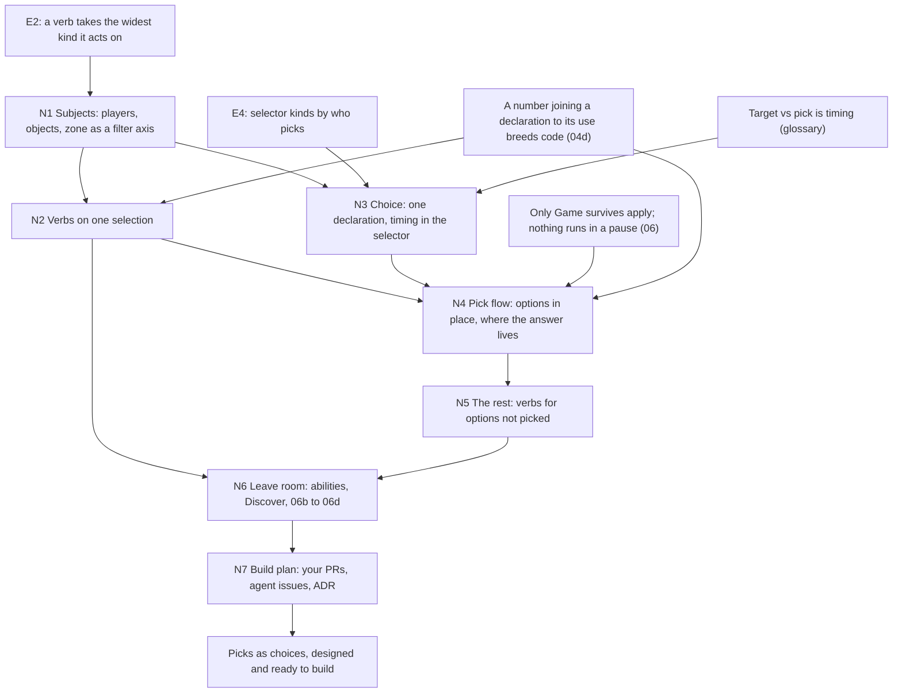

> [!quote] YOU

lets do session 04e


> [!question] Question
> What should session 04e cover?
>
> COURSE.md has the deferred choice work as four linked open threads:
> (a) several verbs on one selection (the prerequisite: without it, reusing a pick across effects brings PickId back),
> (b) picks as choices (one declaration for targets and picks, answered at different times; removes PickId, ResolvePick, PlayerInput.picks),
> (c) the three missing pieces: a card subject (hand/deck cards aren't characters), options read in place (Reveal's cards stay in the deck), and the cards not picked (Forage: pick to hand, bury the rest),
> (d) activated abilities, leave room only.
> You said they'd take several sessions and overlap 06b. 04d was concept only, and you built it yourself in PR #62.
>
> 1. Design all of (a) to (c), concept only (Recommended)
> 2. Design (a) and (b) only
> 3. Design (a) only, then build it as an exercise
> 4. Design (a) to (c), then build part as an exercise


> [!example] Answer
> Other: a to c, leaving room for d. on each we plan the implementation, new features I would implement but mechanical refactors we write issues for agents to pickup, if session becomes too long we break it


> [!question] Quiz
> Verbs on one selection lands alone: an Effect becomes one selector plus a list of verbs, the selector is read once, and every verb runs on what it chose. Which cards become writable that can't be written today? Select all.
>
> Nothing else changes: no If, no named results, no new selectors (still PlayerSelector and CharacterSelector only). Today each Effect variant has its own selector, e.g. Buff { selector: CharacterSelector::Random(filter), effect } draws its own random minion.
>
> 1. Summon a Squire, then give that Squire Taunt
> 2. Deal 1 damage to all minions, then give all minions +1 Attack
> 3. Choose a minion. Deal 2 damage to it, then give it +2 Attack
> 4. Deal 1 damage to a minion. If it survives, give it +2 Attack
> 5. Reveal your top 2 cards. Put one in your hand and the other on the bottom
> 6. Give a random friendly minion +1/+1 and Taunt, both on the same minion


> [!question] Quiz — I don't know
> Your answer: I don't know
> Correct answer: 3, 6
>
> Note: I see that all researchers failed I will investigated then we continue. I dont know what a verb is here
>
> Only the two cards whose verbs share one choice gain anything: the random minion (two Random selectors draw twice today) and the target reused by two verbs (the 04d reuse loss). The Squire is chosen by the verb, not by a selector, so it needs a verb's result to be selectable. "If it survives" needs a condition per object. Forage needs a card subject and two selections out of one pick, the chosen card and the rest. The all-minions card is writable today: two All effects read the same board, since deaths wait for the state check.


> [!abstract] PI

All four researchers failed at launch with `Agent 'researcher' requested unavailable child tools: web_search, fetch_content, source_check, get_search_content`. Explore hit the same kind of error for `[read, find]`, but it worked through bash and grep, so its code brief is fine. Each researcher still wrote a report, but only from memory, and each one marks everything in it UNVERIFIED. None of those reports reached `research/`. I won't use them as sources. Once you've fixed the tools I'll rerun the same four tasks.

**What a verb is.** It comes from E2 in session 04, where an effect is a verb, a selector and an amount. The verb is what the effect does, which is the name of the `Effect` variant: `Damage`, `Buff`, `Draw`, `Summon`. The selector says who it's done to, such as `CharacterSelector::Random(filter)`, `Targeted(..)` or `All(..)`. The amount says how much.

Today each variant carries its own selector, so every verb gets its own selection:

```rust
// two effects, two selectors, so two random draws: +1/+1 and Taunt can land on different minions
Effect::Buff { selector: Random(friendly_minions), effect: BuffStats(1, 1) },
Effect::Buff { selector: Random(friendly_minions), effect: GrantTaunt },
```

"Verbs on one selection" means one selector, read once, feeding a list of verbs:

```rust
Effect { selector: Random(friendly_minions), verbs: vec![BuffStats(1, 1), GrantTaunt] }
```

That's the reuse 04d gave up. With it, "choose a minion, deal 2 to it, then give it +2 Attack" works again: one `Targeted` selector with the verbs `[Damage(2), Buff(+2 Attack)]`.

When you're back, I'll ask that question again with this shape shown in it.


> [!quote] YOU

relaunch the researchers and lets continue


> [!question] Quiz
> Verbs on one selection lands alone. Which cards become writable that can't be written today? Select all.
>
> Today each verb carries its own selector:
>   Effect::Buff { selector: Random(friendly_minions), effect: BuffStats(1, 1) }
>   Effect::Buff { selector: Random(friendly_minions), effect: GrantTaunt }   // a second random draw
>
> Verbs on one selection:
>   Effect { selector: Random(friendly_minions), verbs: vec![BuffStats(1, 1), GrantTaunt] }
> The selector is read once, and every verb runs on what it chose.
>
> Nothing else changes: no If, no named results, no new selectors (still PlayerSelector and CharacterSelector only).
>
> 1. Reveal your top 2 cards. Put one in your hand and the other on the bottom
> 2. Summon a Squire, then give that Squire Taunt
> 3. Deal 1 damage to a minion. If it survives, give it +2 Attack
> 4. Deal 1 damage to all minions, then give all minions +1 Attack
> 5. Choose a minion. Deal 2 damage to it, then give it +2 Attack
> 6. Give a random friendly minion +1/+1 and Taunt, both on the same minion


> [!failure] Quiz — incorrect ✗
> Your answer: 2. Summon a Squire, then give that Squire Taunt, 5. Choose a minion. Deal 2 damage to it, then give it +2 Attack, 6. Give a random friendly minion +1/+1 and Taunt, both on the same minion
> Correct answer: 5, 6
>
> Only the two cards whose verbs share one choice gain anything: the random minion (two Random selectors draw twice today) and the target reused by two verbs (the 04d reuse loss). The Squire is chosen by the Summon verb, not by a selector, so it needs a verb's result to be selectable. "If it survives" needs a condition per object. Forage needs a card subject and two selections out of one pick, the chosen card and the rest. The all-minions card is writable today: two All effects read the same board, since deaths wait for the state check.


> [!quote] YOU

you are correct about the squire, I get that the sumon is not a selector


> [!question] Quiz
> Grimestreet Outfitter: "Battlecry: Give all minions in your hand +1/+1." The buff stays on the card when it's played. Under E2 (a verb takes the widest kind it acts on), what is the Buff verb's subject?
>
> Today Buff takes a CharacterSelector, so it reaches only heroes and minions in play. Hand to board keeps the ObjectId, and modifiers live on the object.
>
> 1. Every object in every zone, spell cards included, under one Buff verb
> 2. Characters in play under Buff, plus a second HandBuff verb for cards
> 3. Minion cards in hand and deck under Buff, plus a second verb for characters
> 4. Characters in play plus minion cards in hand and deck, under one Buff verb


> [!failure] Quiz — incorrect ✗
> Your answer: 1. Every object in every zone, spell cards included, under one Buff verb
> Correct answer: 4
>
> A +1/+1 on a minion card in hand behaves like a +1/+1 on a minion in play: it's a modifier on the object, and it survives the move to the board. So the rules unify them, and E2 gives one verb over everything it acts on. Two verbs would be one meaning written twice, and their interpreters would drift. A spell card has no stats for Buff to act on, so "every object" is wider than what the verb acts on.


> [!quote] YOU

makes sense, we should be buffing spells, I picked first one cause I thought we should not be limited to hand only like we could buff on graveyard too


> [!question] Quiz
> A card reads "Choose a minion card in your hand. Reduce its cost by 2." Under the timing rule, when may its player answer the choice?
>
> The rule (04d): when a choice is answered is card data, except that random or hidden options wait for resolution. The reason: answered before the push, Cancel either rewinds the RNG (the chooser saw hidden cards for free) or doesn't (targeting again rerolls). A target is answered before the push, a pick when resolution reaches its effect.
>
> 1. Only as a pick, since a card in hand is not a character
> 2. Only as a target, since the options are known before the card moves
> 3. Only as a pick, since a hand is hidden from the opponent
> 4. Either, as the card's data says, since the chooser already sees the hand


> [!failure] Quiz — incorrect ✗
> Your answer: 2. Only as a target, since the options are known before the card moves
> Correct answer: 4
>
> Note: I think as target, but I am not sure target in play and choose in hand is the same thing, at least the animations/highlights would be different
>
> The rule protects the chooser's information: Cancel can't give a free look or a reroll here, since the chooser already sees every card in their hand and nothing is random. So the rule leaves timing to the card data. Hidden from the opponent doesn't matter, because ObjectIds of hidden cards are visible by policy and the draft shows ids, not definitions. Being known before the card moves makes a target possible (E5), not required. Whether the subject is a character says what the choice selects, not when it's answered.


> [!quote] YOU

Here I thought pick was not possible because today pick is noramlly limited to a small amount of cards selected randomly, and cancel would make rerolls of the rng possible


> [!question] Quiz
> "Reduce the cost of one of 3 random minion cards from your deck by 3." A designer can write its choice as a target or as a pick. Which version lets the player reroll the 3 options?
>
> Target: answered before the push, while targeting. Pick: answered when resolution reaches its effect. In both versions the 3 options are drawn from the game's seeded RNG when the choice opens.
>
> (My replies to your two notes are in the chat above.)
>
> 1. Both versions, since each one draws its options from the RNG
> 2. Neither version, since the seeded RNG makes every redraw identical
> 3. The pick version, since Cancel during the pick redraws the options
> 4. The target version, since Cancel comes before the push and targeting again redraws


> [!success] Quiz — correct ✓
> Your answer: 4. The target version, since Cancel comes before the push and targeting again redraws
> Correct answer: 4
>
> Note: so for u target vs pick is about timing, that was not what I had in mind, for me targeting was targeting a character in play with the arrow and picking as seeing a floating list of cards and picking one
>
> Cancel belongs to targeting: it resets a choice that hasn't been pushed yet, and the card goes back to the hand. A pick opens after the card is played and paid for, so there's nothing to cancel back to, and its draw is final. That's why random options must be picks: the only version that can reroll is the target one. "Neither" fails because each draw takes the next number in the stream, so a second draw differs, unless Cancel rewinds the RNG, in which case the player has seen 3 deck cards for free.


> [!abstract] PI

You're right, and the glossary agrees with you. Its flagged pair says: "a player targets while playing a card, before it resolves, **from what is already in play**. A player picks while a card resolves, **from the cards it revealed**." That ties together two things, when the choice is answered and where the options sit. Your "arrow on the board vs a floating list of cards" is the second one. In 04d I wrote that targets and picks "differ only in when the player answers", and that dropped the second half without saying so. So the hand quiz was graded against my framing, and under the glossary, "only as a target" was the right answer. The follow-up showed your Cancel reasoning is right: only a target can be rerolled.

**The two axes come apart in real cards.** All four combinations exist:

| | options in play (arrow) | options elsewhere (list) |
|---|---|---|
| answered before the push | Ping, Zap | MTG Raise Dead, "return target creature card from your graveyard" (XMage: `addTarget(new TargetCardInYourGraveyard(..))`). Also our hand cost-reduction card |
| answered during resolution | MTG "choose a creature" with no "target" (608.2d, 115.10a: hexproof doesn't stop it). YGO non-targeting picks after the semicolon | Forage, Tracking, Discover |

**Each axis drives different things.**
- Timing drives rules: only a choice answered before the push can be cancelled, only that kind decides whether the card is playable (the can-finish search), and random or hidden options are forced to wait.
- Where the options sit drives the presentation. On your animation note: highlights do differ, but the shell can work that out from each option's zone, which `view` already knows. The core gets an `ObjectId` either way (04b: the core sees actions, not clicks).

**The research fits this.**
- **XMage:** one `Target` class family, with timing set by where it's placed.
- **Hearthstone simulators** (`hearthstone-simulators-choices.md`): Fireplace leaves Tracking's cards in the deck during the choice. SabberStone moves them to SETASIDE, which matches the wiki's note on Tracking (Classic). Metastone sends all three to the graveyard before the choice, and Spellsource shows copies in a `DISCOVER` zone.
- **None of the four** stores a lasting "player has seen this card" fact.
- **Reuse:** Metastone's `MetaSpell` with `randomTarget` picks once, and its child spells inherit that target unless they declare their own. That's verbs on one selection.

**One naming call before we go on.** It's your call, and it shapes the glossary and the type names:

1. "Target" and "pick" name **timing**: before the push vs during resolution. Where the options sit is a filter on the choice, and the shell derives the presentation. This is MTG's usage, where a target is always announced while casting. I lean this way, because the rules hang off timing.
2. "Target" and "pick" name **where the options sit**: your arrow vs list. Timing then gets its own words.
3. Something else.

Either way, the shared declaration needs a name. 04d called it a "choice".


> [!quote] YOU

I lean 2, but what would be the names, but 1 also has the benefit of helping write the card text so "pick a creature" and "target a card" can be imediately told apart but these doesnt read so nice, I am not sure between 1 or 2, choice seem fine but we also have player input defined


> [!abstract] PI

**Names under option 2.** A target is a choice whose options are on the board (the arrow), and a pick is one whose options are off the board (the list). Timing then needs its own words, something like "answered on play" and "answered on resolve". Raise Dead becomes "a pick answered on play", and MTG's resolution-time "choose a creature" becomes "a target answered on resolve".

**Why I'd still go with 1.** Under 2 the word repeats a fact the declaration already holds. The options' zone is already in the choice's filter (the zone axis you raised on the Buff question). If "target" also means "options in play", the same fact sits in two places. Then a `Targeted` choice with a graveyard filter is a contradiction the type allows: either a load check forbids it, or the word is derived from the filter and stores nothing. That's the one-fact-in-two-places pattern from your knowledge map, applied to a name. Under 1, the word carries the one fact nothing else in the declaration holds: when it's answered, and with it whether it can be cancelled and whether it gates playability.

**Card text.** Under 1 it reads the way MTG prints it: "Deal 2 damage to target minion" vs "Choose a minion. Deal 2 damage to it." Players read cancellation and hexproof off the word "target". The printed wording also doesn't have to be the code name. Session H's text generator maps each declaration to a phrase, so a pick over revealed cards can print as "Put one in your hand", and nobody reads the word "pick".

**Choice vs player input.** They live at different layers, like card definition and object:
- A **choice** is printed data on the card: which objects are options, how many, and when it's answered.
- **Player input** is game state: what the game awaits from each player right now.

Player input's definition today also covers "what each player picked while a card resolved". That half goes away with `PlayerInput.picks`, so the overlap shrinks. "Choice" is free in the glossary, since ADR 0009's "choice" was renamed away in 04b.

Which way do you want to go, 1 or 2? If something about 2 still pulls you, tell me what it is.


> [!quote] YOU

lets go with 1


> [!question] Quiz
> Suppose Forage is written with verbs on one selection, a card subject, and a pick whose options stay in the deck. What happens to the card P0 didn't pick?
>
> Forage: Effect { selector: Picked(choice: 1 of the top 2 cards of your deck), verbs: vec![MoveTo(Hand)] }
>
> The selector is read once, after P0 answers, and every verb runs on what it chose. Options stay in the deck while P0 looks. The printed card says "put one in your hand and the other on the bottom".
>
> 1. It stays in no zone, since it was revealed and never moved back
> 2. It goes to the hand too, since the verbs run on every option
> 3. It stays on top of the deck, since no verb runs on it
> 4. It goes to the bottom, since a pick buries what it doesn't take


> [!success] Quiz — correct ✓
> Your answer: 3. It stays on top of the deck, since no verb runs on it
> Correct answer: 3
>
> The selection is only what P0 picked, so MoveTo(Hand) runs on that one card and nothing touches the other. It's still on top of the deck, since options are read in place and never left it. Today's ResolvePick buries it because other_move is part of that verb, and the new shape has no such slot, so the printed "the other on the bottom" can't be written yet. One pick yields two selections, the picked and the rest, and the design needs a way to give the rest its own verbs.


> [!abstract] PI

Phase 2, the plan. The research is filed under `research/04e-picks-as-choices/`, with four new entries in `verified-facts.md`.

**The approach.** We design in dependency order, so that nothing gets decided twice:

1. **N1, subjects.** What a selector can select: players and objects, with the zone as a filter axis, as you raised. Everything else depends on what a selection holds.
2. **N2, verbs on one selection.** The shape of `Effect`: one selector, a list of verbs, one type per subject.
3. **N3, the choice.** One declaration, which objects are the options and how many to name. Where the timing lives (target vs pick), and how "random or hidden options wait" is enforced: by the type, or by a load check.
4. **N4, the pick flow.** Options read in place, so `Reveal` and the no-zone step go away. Where the answer lives, and for how long, and who answers. This is where `PickId`, `ResolvePick`, the pick check and `PlayerInput.picks` disappear.
5. **N5, the rest.** The verbs for the options not picked: Forage's bottom card, Tracking's discards. Forge's `DestinationZone2`, XMage's second `PutCards` and Spellsource's `SPELL2` all solve this the same way.
6. **N6, leave room.** We check the design against what comes later: activated abilities, Discover (options that are definitions, not objects), trigger targets (603.3d), simultaneous picks (06d), remembered choices (06c), and the Squire (a verb's result, 06b).
7. **N7, the build plan.** Your feature PRs in order, agent issues for the mechanical refactors, and the ADR.

For each node I bring the forcing cards and the options, backed by the research. You pick and push back, and a short quiz on the consequences closes the node. This is the hand-over-then-argue format you asked for in 04d. If it runs long, I suggest N1 to N3 here and N4 to N7 in a 04f. That split is your call.



Does this order and scope work for you? Tell me if anything should be added or cut before we start N1.


> [!quote] YOU

it does


> [!abstract] PI

**N1: subjects**

**Why now.** In N2 an effect becomes one selector plus a list of verbs, so the selector's type decides which verbs can follow it. Today there are two subjects: `PlayerSelector` (Draw, Reveal, Summon) and `CharacterSelector<T>` (Damage, Buff, AddFriendlyAura). The choice work needs objects that aren't in play.

**Forcing cases**
1. Forage: one of your top 2 cards goes to your hand, the other to the bottom. These are cards of any kind, in the deck.
2. Grimestreet Outfitter: Buff on minion cards in your hand. Your graveyard point belongs here too.
3. Your card: 3 random minion cards from your deck, and the chosen one costs 3 less.
4. Ping: Damage on a character in play. Damage on a card in hand means nothing.
5. "Give a random friendly minion in your hand or on your board +2/+2": one random draw across two zones. This one is hypothetical.

**What each verb acts on (E2)**

| verb | kinds | zones |
|---|---|---|
| Damage | minion, hero | in play |
| Buff | minion, hero | any |
| Move (new) | any card | hand, deck, graveyard |
| Reduce cost (new) | any card | hand, deck |
| Draw, Summon | players | n/a |

**Two shapes**

**(A) Two subjects: players and objects.**
- An `ObjectSelector<T>` replaces `CharacterSelector<T>`, and its filter gets a zone axis next to kind and side: `ObjectFilter { kind: EnumSet<CardKind>, side: EnumSet<Side>, zone: EnumSet<Zone> }`.
- "Character" becomes a filter value (kind minion or hero, in play) instead of a type.
- Case 5 is one `Random`.
- The cost: the type now lets you write Damage on a card in hand. To catch that, each verb declares the kinds and zones it acts on, and the binder checks at load that every selector's filter fits inside them.
- This is Forge's shape: one `Valid` filter language, with the zone as a parameter (`TgtZone$`, `ChoiceZone$`) that defaults to the battlefield.

**(B) Three subjects: players, characters, cards.**
- `CharacterSelector` keeps covering what's in play, and a new `CardSelector` covers hand, deck and graveyard.
- Damage on a card in hand can't be written.
- The cost: Buff has to exist under both subjects, case 5 can't be written (one random draw can't span two selector types), and every verb that works on both sides of the line is written twice.
- This is XMage's shape, with a `Target` class per zone (`TargetPermanent`, `TargetCardInHand`, `TargetCardInLibrary`), though XMage checks everything at runtime anyway.

I lean A. It keeps the axes independent, which is the shape you built in 04a. B is the split that multiplies, like `PlayerSelector` mixing who picks with side. A also puts E2 in data: a verb's kinds and zones become something the load check reads.

**For N3:** the deck is ordered, so "your top 2 cards" is a position, not a filter. Options need a slot for that, and I'll bring it up in N3.

**Your calls**
1. A or B?
2. Under A, when a verb lands on an object it can't act on: reject it at load (my lean), or skip it at runtime?
3. Under A, the zone values: one `InPlay` (kind already tells a hero from a minion, and a hero is always in play), or `Board` and `HeroSlot` kept apart?


> [!quote] YOU

I am fine with droping 5, we also moved away from load time checks on the cards just now and now u want to reintroduce one


> [!abstract] PI

You're right. The only load checks left are `PickNotFound` and `PickNotResolved`, and this design removes both. So after this work card data needs no validation pass at all. A reintroduces one, and I'm dropping it.

With case 5 gone, here are the two shapes again without a load check:

**(B) Three subjects, by type.**
- `Players`, `Characters` (in play) and `Cards` (hand, deck, graveyard), each with its own selector and verb list.
- Damage on a card in hand can't be written. That's parse, don't validate: the data is valid by construction.
- The cost is verbs that sit on both sides. That's Buff (Outfitter), and also Move, because bouncing a minion (Sap, Youthful Brewmaster) moves a character in play while Forage moves a card in the deck. Each one is two match arms calling one function, since `ModifierEffect` and the zone move are already shared types.
- The two subjects also need different choices anyway. A card choice needs the position slot ("your top 2") and a random sample, and a character choice needs neither. That fits B.

**(A) One object subject, no check.**
- Damage acts only on the characters among what was selected, so Damage on a card in hand does nothing.
- That matches your empty-filter call: `EnumSet::empty()` matches nothing, and you chose no load check for it.
- The cost: an authoring mistake fails silently, and only the card text from session H shows it.

I now lean B. It's the direction PR #62 and ADR 0017 took, types over checks, and the choice difference means the subjects split anyway.

**Your calls**
1. B or A?
2. Under B, which verbs go on both lists? I'd say Buff and Move.
3. Under B, the name. The glossary's Board says "the cards a player has in play", so a `Cards` subject meaning "not in play" clashes with it. Do we name it now or when it's built? I'd decide it in N7 along with the other type names.


> [!quote] YOU

B, buff and move for now yes, 3 defer I am not sure how to call it either but it makes sense that a card would be its "paper" representation while "character" would be when its in play, and Object would mean both


> [!abstract] PI

N1 is settled:
- **Three subjects:** players, characters (in play) and cards (hand, deck, graveyard), each with its own selector and verb list.
- **On both lists for now:** Buff and Move.
- **Naming, deferred to N7:** your framing is that a card is the paper representation, a character is the same object in play, and object covers both. Today's glossary says otherwise in one place. Board is "the cards a player has in play". So the open thread notes that clash.

This node rests on E2, a verb takes the widest kind it acts on. Here that's reached by listing a verb under each subject it acts on, rather than by one wide selector. It also follows PR #62's direction, types over load checks.


> [!question] Quiz
> Under N1's shape B, which of these cards can't be written? Select all.
>
> B: three subjects, each with its own selector and verb list.
> - Players: Draw, Summon
> - Characters (in play): Damage, Buff, Move
> - Cards (hand, deck, graveyard): Buff, Move, Reduce cost
> Selectors per subject include All, Random and the player's choice. A selector covers exactly one subject.
>
> 1. Return a random minion card from your graveyard to your hand
> 2. Deal 2 damage to a random minion card in your hand
> 3. Give a random friendly minion in your hand or on your board +2/+2
> 4. Give all minions in your hand +1/+1
> 5. Return an enemy minion to its owner's hand
> 6. Reduce the cost of a random minion on your board by 2


> [!success] Quiz — correct ✓
> Your answer: 2. Deal 2 damage to a random minion card in your hand, 3. Give a random friendly minion in your hand or on your board +2/+2, 6. Reduce the cost of a random minion on your board by 2
> Correct answer: 2, 3, 6
>
> A selector covers one subject, so one random draw across hand and board has no selector: that's case 5, which you dropped. Damage isn't on the card list and Reduce cost isn't on the character list, so neither can be written. Those are the combinations the types rule out. The bounce is a character Move, Outfitter a card Buff, and the graveyard return a card Move under a Random card selector.


> [!question] Quiz
> Effect::Characters { selector: All(friendly minions), verbs: [Damage(1), Buff(+1 Attack)] } runs on a board holding A and B. In what order do the verbs run?
>
> E3 (session 04): a list is one after another, a target set is together (Blast vs Zap).
> The selector is read once, before any verb, and yields {A, B}.
>
> 1. Damage A and buff A, then damage B and buff B
> 2. Damage A and B together, then buff A and B together
> 3. Any order, since deaths wait for the state check
> 4. Damage A, then damage B, then buff A, then buff B


> [!success] Quiz — correct ✓
> Your answer: 2. Damage A and B together, then buff A and B together
> Correct answer: 2
>
> The verbs are a list, so they run one after another. The selection is a set, so each verb hits all of it together, the way Blast hits every enemy at once. Going object by object breaks "together" for each verb. So does damaging A and B one at a time, which is Zap's shape, not Blast's. The order isn't free: events come out in that order, triggers are matched in event order, and so the order they're pushed onto the stack would change.


> [!abstract] PI

Correct. Verbs run one after another, and each verb hits the whole selection at once. That's E3 applied inside one effect.

**The other N2 calls**

1. **Checkpoints.** One per effect, with all of its verbs as one step (04: one effect is one sentence is one step), or one per verb? I lean one per effect: "give it +1/+1 and Taunt" is one sentence. No current card changes either way, since every card keeps one verb per effect until someone writes a multi-verb card.
2. **The shared Buff verb carries any `ModifierEffect`.**
   - **(a)** One verb taking any `ModifierEffect`, on both lists. A cost reduction on a character stays writable. It isn't meaningless, either: since hand to board keeps the `ObjectId` and its modifiers, it would survive a bounce. That's the zone-reset open thread.
   - **(b)** Split it, with stat modifiers only on characters and every modifier on cards. That's one more type to rule out a combination that does mean something.
   
   I lean (a). Either way the verb isn't a buff in the glossary's sense ("a buff raises attack or health"), so it needs a new name, something like Modify. I'd decide that in N7 with the other names.
3. **An empty verb list.** `verbs: vec![]` does nothing, and with a `Random` selector it still draws a number. Allow it, like the empty filter, or use a non-empty type (first verb plus the rest)? I lean allow.
4. **No call needed, just a build note.** Move on characters waits for the first bounce card, even though it's on the list. Today only Forage-style cards need Move.

A preview of N3: `CharacterSelector<T>` and `CardSelector<T>` would share one `T`, but a card choice needs a position slot and a character choice doesn't. So one `T` can't be both declarations. N3 starts there.


> [!quote] YOU

1 agree. 2 a sounds good. 3 allow fine.


> [!abstract] PI

N2 is settled:
- **Shape:** one `Effect` variant per subject, each holding a selector and a list of verbs.
- **Order:** verbs run one after another, and each verb hits the whole selection at once.
- **Checkpoints:** one per effect.
- **Modifiers:** one verb takes any `ModifierEffect`, on both the character and card lists. Its name is decided in N7.
- **Empty lists:** an empty verb list is allowed.
- **Move on characters:** waits for the first bounce card.

This node builds on N1's subjects, E3 (list vs set), and 04's rule that one effect is one step.


> [!question] Quiz
> Under N2, how is "Give a random friendly minion +1 Attack and +1 Health. Draw a card." written?
>
> N2: Effect::{Players, Characters, Cards} { selector, verbs: Vec<_> }. Verbs run one after another, each on the whole selection. One checkpoint per effect. +1 Attack and +1 Health are two ModifierEffects (BuffAtk, BuffHealth), each carried by the shared modify verb.
>
> 1. 2 effects, 1 random draw, 2 checkpoints
> 2. 1 effect, 1 random draw, 1 checkpoint
> 3. 2 effects, 1 random draw, 3 checkpoints
> 4. 3 effects, 2 random draws, 3 checkpoints


> [!success] Quiz — correct ✓
> Your answer: 1. 2 effects, 1 random draw, 2 checkpoints
> Correct answer: 1
>
> The buffs share one selection: Characters { Random(friendly minions), [Modify(BuffAtk 1), Modify(BuffHealth 1)] }, so one draw. Draw is a player verb, so it needs its own Players { Owner, [Draw(1)] } effect, since one effect holds one subject. That's two effects, and with a checkpoint per effect, two checkpoints. Three effects with two draws is today's shape, where each modifier is its own Buff effect with its own Random. One checkpoint per verb would give three.


> [!abstract] PI

Correct. The two modifiers share one selection, and Draw needs its own effect because it acts on a different subject.

**N3: the choice, and where its timing lives**

**Why now.** N2's selectors still say "the player chooses" in only one way: `Targeted(T)`. A pick has to be a selector too, so that verbs on one selection run on what was picked. Two problems come first: where the timing goes, and the shared `T` from the preview. Card options (position and random sampling) come right after.

**Where the timing goes.** Two shapes:

```rust
// (a) two variants
enum CharacterSelector<T> {
    All(CharacterFilter), Itself, OwnerHero, Random(CharacterFilter),
    Targeted(T),               // answered before the push; T is the declaration, then the bound objects
    Picked(CharacterChoice),   // answered when resolution reaches the effect; stays a declaration on the stack
}

// (b) one variant with a timing field
    Chosen { choice: T, when: Timing },   // Timing::BeforePush | Timing::OnResolve
```

I lean (a), because only targets bind at the push, so only targets go through `T`. A pick keeps its declaration on the stack until resolution reaches it, so it sits outside `T`. That also means a trigger can pick (Hoarder) while `NoTarget` still forbids it from targeting. With (b), `T` would have to hold picks too, so `NoTarget` would forbid trigger picks, and binding would have to skip the `OnResolve` ones. That's the timing stored twice, once in `T`'s stage and once in `when`. (a) also fits E4, selector kinds by who picks: nobody (`All`), chance (`Random`), the player before the push (`Targeted`), the player during resolution (`Picked`).

**The shared `T`.** The character and card selectors can't share one `T`, because their declarations differ. Fixing that takes a second type parameter, or a stage trait with associated types. But no card or planned card targets a *card* before the push. Forage, Tracking and your deck card are all picks, and the hand cost-reduction card can be a pick too. So my lean: `CardSelector` gets `Picked` and no `Targeted` until a card needs one, which means it takes no `T` and the generics question waits for that card. It also enforces "random or hidden options wait" by type: the only selector answered before the push is a character target, and characters in play are public and never sampled.

**Your calls**
1. (a) two variants, or (b) one variant with a timing field?
2. No card targets until a card needs one, so `CardSelector` has no `T` for now?


> [!quote] YOU

1 a. 2 I would prefer we add a card to complete the design


> [!abstract] PI

N3 so far:
- **Timing:** (a), two variants. `Targeted(T)` is answered before the push and bound at the push. `Picked(choice)` is answered when resolution reaches the effect. A pick sits outside `T`, so triggers can pick and still can't target.
- **Card targets:** in the design now, with a card to force them.

That brings back the shared `T`, so here are the shapes. Each one says what `Targeted` holds at each stage, for each subject that can target. Today that's characters and cards. Players target through their hero (04c).

**(i) Two type parameters**
```rust
enum Effect<C, K> { Characters { selector: CharacterSelector<C>, .. }, Cards { selector: CardSelector<K>, .. }, .. }
// written: Effect<CharacterTarget, CardTarget>, trigger: Effect<NoTarget, NoTarget>, stack: Effect<Vec<ObjectId>, Vec<ObjectId>>
```
This is the easiest to read, but it's the ripple you worried about in 03. Every generic function, `map_targeted` and every interpreter signature carries two parameters, and a third subject with targets would add a third.

**(ii) A stage trait with associated types**
```rust
trait Stage { type CharacterTarget: Clone + Debug + Eq; type CardTarget: Clone + Debug + Eq; }
struct Written;   // CharacterTarget = CharacterTarget decl, CardTarget = CardTarget decl
struct Triggered; // both NoTarget
struct Bound;     // both Vec<ObjectId>
enum Effect<S: Stage> { .. }   // CharacterSelector<S> holds Targeted(S::CharacterTarget)
```
This keeps one parameter, as today, so signatures stay `Effect<S>`. Each stage names in one place what every subject's target holds. Why a trait: it's how Rust ties several types to one marker. The bounds sit on the associated types because `#[derive(Clone)]` on `Effect<S>` only bounds `S` itself, not what `S` names. A new subject with targets costs one line per stage.

**(iii) A stage trait with a generic associated type (GAT)**
```rust
trait Stage { type Slot<D: Clone + Debug + Eq>: Clone + Debug + Eq; }
// Written::Slot<D> = D, Triggered::Slot<D> = NoTarget, Bound::Slot<D> = Vec<ObjectId>
// CharacterSelector<S> holds Targeted(S::Slot<CharacterTarget>), CardSelector<S> holds Targeted(S::Slot<CardTarget>)
```
This is the most general: a new subject needs no change to the trait. The cost is one more level of indirection to read.

I lean (ii). It's one parameter, like today, and each stage reads as a short table. (iii) only pays off with many targeting subjects.

**The forcing card**
- **Raise Dead** (MTG, verified): "Return target minion card from your graveyard to your hand." Graveyards are public, so the target's options are a graveyard filtered by kind and side.
- **Your hand card:** "Choose a minion card in your hand. Reduce its cost by 2", written as a target. Hands are hidden from the opponent. If card targets can reach hands, the type has to rule out the enemy's hand and every deck (MTG 115.2, 101.4a: hidden-zone choices aren't targets). Side and zone then stop being independent axes for targets. One fix is a target zone of `YourHand | Graveyard(sides)`.

**Your calls**
1. (i), (ii) or (iii)?
2. Which forcing card: Raise Dead, the hand card, or both? With both, it's the folded target zone above.


> [!quote] YOU

why i needs two parameters? we sont do it but I want to know why, today in Effect<T> T is what its holds for the target so the second parameter would be for pick? since picks are resolved on the stack why cant they be opaque?


> [!abstract] PI

No, the second parameter isn't for picks. You're right that picks can stay opaque, and in (a) they do. `Picked(CharacterChoice)` and `Picked(CardPick)` are fixed types. Binding passes them through unchanged, and resolution reads them when it reaches the effect. No stage changes them, so they need no parameter.

The two parameters are there because two subjects can now target, and each target holds a different type in the written stage:

| stage | character `Targeted` holds | card `Targeted` holds |
|---|---|---|
| written | `CharacterTarget { filter, count, bound, different }` | `CardTarget { zone, kind, side, count, .. }` |
| trigger | `NoTarget` | `NoTarget` |
| bound | `Vec<ObjectId>` | `Vec<ObjectId>` |

The trigger and bound rows match. Only the written row differs. Today there's one targeting subject, so one `T` covers its column. With two subjects, one `T` would have to be `CharacterTarget` and `CardTarget` at the same time. There are three ways out:
- **One parameter per column.** That's (i).
- **One `T` that's an enum of both declarations.** Then `CharacterSelector::Targeted(Decl::Card(..))` can be written, and a load check comes back.
- **Marker types that each name a whole row.** That's (ii) and (iii). `Written` says "characters hold `CharacterTarget`, cards hold `CardTarget`", so one parameter picks the row and each selector reads its own column.

So your calls are still open:
1. (ii), associated types, one line per subject per stage, or (iii), a GAT?
2. The forcing card: Raise Dead, the hand card, or both?


> [!quote] YOU

2 what are the effect? why the written cant be a player target? this seem like a state machine I wonder if our generic Effect<T> is correct, a previous session todme it is because only one field differs but I am not convinced now


> [!quote] YOU

on "2 what are the effect?" I meant what is the card text for the forcing cards?


> [!abstract] PI

**The forcing cards, written out under the N2 shape:**

Raise Dead, "Return a minion card from your graveyard to your hand":
```rust
Effect::Cards {
    selector: CardSelector::Targeted(CardTarget {
        zone: Graveyard, kind: Minion.into(), side: Friendly.into(), count: 1.into(), bound: Exactly,
    }),
    verbs: vec![CardVerb::Move(ToHand)],
}
```
It can be played only if your graveyard holds a minion card (the can-finish search), and Cancel works as usual.

The hand card, "Choose a minion card in your hand. Reduce its cost by 2":
```rust
Effect::Cards {
    selector: CardSelector::Targeted(CardTarget { zone: YourHand, kind: Minion.into(), count: 1.into(), bound: Exactly }),
    verbs: vec![CardVerb::Modify(ReduceManaCost { amount: 2.into() })],
}
```
The hand card raises something Raise Dead doesn't. During targeting, the card being played is still in the hand: `play` takes it from the hand only at the push. A spell is safe because the `Minion` filter excludes it, but a minion with "Battlecry: reduce the cost of a minion card in your hand" would find itself among its own options. MTG avoids this through ordering. 601.2a moves the card to the stack before targets are announced in 601.2c, and 115.5 says "a spell or ability on the stack is an illegal target for itself." I checked both against the current rules text and added them to `verified-facts.md`. So the hand card forces one more rule: the card being played is never one of its own options.

**Why players can't target.** Since 04c, a player is hit through their hero, and the hero is a character, so "deal 2 to the enemy hero" is a character target. Today no card names a *player* as such, the way "target player draws two cards" does. The `Players` subject has only `Owner`, `All` and `Random`. If such a card comes, `Players` gets a `Targeted` slot. Under (ii) that's one more associated type, with one line in each stage. You can add it now, the same as card targets.

**Is `Effect<T>` right?** Yes, it's a state machine, and specifically typestate. The stage is the state, and the parameter lets the compiler reject resolving a written effect or binding a bound one. There are two transitions, written → bound at the push, and triggered → bound at the push. Picks add no stage, since they're answered on the stack and the type doesn't change. 06 showed that typestate needs an enum wrapper when the next state depends on data. Here it never does, because the push always binds, so a plain parameter is enough.

04d's argument was: use one parameter when the stages differ in one slot and that slot changes everywhere at once. Now they differ in two slots, the character target and the card target, but both still change at the same moment, the push. So the argument stretches to cover it: one parameter names the stage, and each slot is a column. It would break if the slots changed at different moments. That would happen if picks bound in a second step, and they don't.

N2 also makes the alternative cheaper than it was in 04d, which is a fair reason to doubt the parameter. Verbs no longer hold selectors, so only the selectors depend on the stage. Separate types per stage would mean writing `CharacterSelector` and `CardSelector` (All, Itself, OwnerHero, Random, Targeted, Picked) once per stage, plus an `Effect` enum per stage and the conversions between them. The third option is no stage at all: `Targeted` holds `Declared | Bound` at runtime, and resolution `expect`s the bound case. That's the `expect` PR #62 removed. The generic still wins, just by less than in 04d.

**Your calls**
1. (ii) or (iii)?
2. Which forcing card: Raise Dead, the hand card (which brings the "not its own option" rule), or both?
3. Player targets now, or with the first card that names a player?


> [!quote] YOU

defer the hand card and 3, on 3 I am considering player targets may never be needed due to heroes always being present. on ii the state cant be a enum because they need to be different types right?


> [!quote] YOU

I very much dislike the dynamic dispatch present on options ii and iii


> [!abstract] PI

You're right on both counts: the hand card and player targets wait. The hand card waits for its "not its own option" rule, and a player target waits for a card that names a player. Heroes are always present, so a hero target may cover it for good. MTG has non-damage "target player" cards (draw, discard), but in our game, "the targeted hero's player" can stand in for that if it ever comes up. I'll record it as an open thread.

**Yes, the stage has to be a type, not an enum value.** A field's type is fixed when the code compiles, so `S::CharacterTarget` has to be known then. A `Stage::Written` value only exists at runtime, so it can't decide the type of a field. Each stage is its own marker type (`struct Written;`, `struct Bound;`), and that's what makes it typestate.

**There's no dynamic dispatch in (ii) or (iii).** Dynamic dispatch means `dyn Trait`: a call goes through a vtable that's picked at runtime. Here the trait has no methods at all, so there's nothing to dispatch. It's a table of types read at compile time. When the compiler builds `Effect<Written>`, it substitutes `Written::CharacterTarget = CharacterTarget`, and the result is as if you had written:

```rust
// what Effect<Written> compiles to, conceptually
enum CharacterSelectorWritten { All(CharacterFilter), /* .. */ Targeted(CharacterTarget), Picked(CharacterChoice) }
// and Effect<Bound>
enum CharacterSelectorBound   { All(CharacterFilter), /* .. */ Targeted(Vec<ObjectId>),   Picked(CharacterChoice) }
```

Each one is a concrete type, laid out inline, with no pointer and no vtable. Today's `Effect<CharacterTarget>` vs `Effect<Vec<ObjectId>>` works exactly the same way. The only difference is that today the parameter *is* the slot type, and under (ii) it names the stage, and the stage names the slot types. It's the same misreading you fixed in 03, where `&mut impl Trait` turned out to be a generic and not `dyn`.

With that cleared up:
1. (ii), associated types, or (iii), the GAT? I still lean (ii).
2. Raise Dead is the card-target forcing card, with graveyard targets only for now?


> [!quote] YOU

2 yes. 1 now that I have more context can u showcase both again and compare


> [!abstract] PI

I compiled both shapes to check the details, and found one correction to what I said earlier. `#[derive(Clone)]` bounds the projection too: it adds `S::CharacterTarget: Clone`, not only `S: Clone`. So the marker structs need their own derives. The bounds on the associated types are there so that a function generic over *any* `S` can clone without repeating `where S::CharacterTarget: Clone` in every signature.

**(ii) Associated types: each stage spells out a row**
```rust
pub trait Stage {
    type CharacterTarget: Clone + Debug + Eq;
    type CardTarget: Clone + Debug + Eq;
}
#[derive(Debug, Clone, PartialEq, Eq)] pub struct Written;
#[derive(Debug, Clone, PartialEq, Eq)] pub struct Triggered;
#[derive(Debug, Clone, PartialEq, Eq)] pub struct Bound;

impl Stage for Written   { type CharacterTarget = CharacterTarget; type CardTarget = CardTarget; }
impl Stage for Triggered { type CharacterTarget = NoTarget;        type CardTarget = NoTarget; }
impl Stage for Bound     { type CharacterTarget = Vec<ObjectId>;   type CardTarget = Vec<ObjectId>; }

pub enum CharacterSelector<S: Stage> { /* .. */ Targeted(S::CharacterTarget), Picked(CharacterChoice) }
pub enum CardSelector<S: Stage>      { /* .. */ Targeted(S::CardTarget),      Picked(CardPick) }
```

**(iii) A GAT: each stage is one rule for every subject**
```rust
pub trait Stage {
    type Slot<D: Clone + Debug + Eq>: Clone + Debug + Eq;
}
impl Stage for Written   { type Slot<D: Clone + Debug + Eq> = D; }             // keeps the declaration
impl Stage for Triggered { type Slot<D: Clone + Debug + Eq> = NoTarget; }      // has none
impl Stage for Bound     { type Slot<D: Clone + Debug + Eq> = Vec<ObjectId>; } // holds objects

pub enum CharacterSelector<S: Stage> { /* .. */ Targeted(S::Slot<CharacterTarget>), Picked(CharacterChoice) }
pub enum CardSelector<S: Stage>      { /* .. */ Targeted(S::Slot<CardTarget>),      Picked(CardPick) }
```

Both compile to the same concrete enums, with no dispatch. Binding is the same in both, a concrete `Effect<Written> -> Effect<Bound>`. So is a trigger's push, `Effect<Triggered> -> Effect<Bound>` with `match never {}`.

**Comparison**

| | (ii) associated types | (iii) GAT |
|---|---|---|
| Where the declaration type is named | in the trait's `Written` row | at the selector (`Slot<CharacterTarget>`) |
| A new subject that targets | one associated type, plus one line in each of the three stages | no change to the trait |
| What a subject's bound or trigger slot can be | anything, per subject (a player target could bind to `Vec<PlayerId>`) | the same for every subject: always `Vec<ObjectId>`, always `NoTarget` |
| Reading it | a table: stage × subject | a rule per stage, plus one level of indirection |
| Compiler errors | name `<Written as Stage>::CardTarget` | name `<Written as Stage>::Slot<CardTarget>` |

The real difference is the third row. (iii) builds in "every subject binds to objects", and (ii) leaves each subject free to bind to something else. You said player targets may never come because a hero stands in for its player. If that holds, every target binds to objects, and (iii)'s uniformity costs nothing while saving a line per subject. If player targets do come with `PlayerId`s, (iii) needs a second trait so that each declaration names its own bound type (`Bound::Slot<D> = D::Bound`), and at that point it's (ii) with more steps.

I still lean (ii) slightly, because it reads as a table you can check at a glance. But your hero argument makes (iii) a fair pick.


> [!quote] YOU

lets go with ii but it wont be called stage


> [!abstract] PI

Decided: (ii), associated types. The trait gets a name other than `Stage`, and I've added it to N7's naming batch along with the modify verb and the card subject. If you already have a name in mind, tell me and I'll use it from here on.

Quick check on N3 so far:


> [!question] Quiz
> Hoarder's death rattle picks 1 of its owner's top 2 cards. Under N3, what does its card selector hold in the trigger's effects, and what does it hold on the stack?
>
> N3: CardSelector<S> { .., Targeted(S::CardTarget), Picked(CardPick) }.
> Stages (the trait's name is still open): Written, Triggered (both targets are NoTarget), Bound (both targets are Vec<ObjectId>).
> A trigger's effects are Effect<Triggered>. The push maps them to Effect<Bound>.
>
> 1. Targeted(NoTarget) in the trigger, then Targeted(Vec<ObjectId>) on the stack
> 2. Picked(CardPick) in the trigger, then Picked(Vec<ObjectId>) on the stack
> 3. Picked(CardPick) in both, unchanged by the push
> 4. Nothing in both, since NoTarget rules out a trigger's pick


> [!success] Quiz — correct ✓
> Your answer: 3. Picked(CardPick) in both, unchanged by the push
> Correct answer: 3
>
> A pick is answered when resolution reaches its effect, not at the push, so it doesn't go through the stage. Picked holds a fixed CardPick, and the push copies it unchanged. That's why a trigger can pick while NoTarget still rules out targeting. Nothing binds a pick to objects at the push, because the answer doesn't exist yet. Targeted(NoTarget) can't be written, since NoTarget has no values.


> [!abstract] PI

Correct. A pick's declaration never changes stage. The push copies it as it is, and only `Targeted` slots get bound.

**N3b: what each declaration holds**

**Why now.** The stage trait says *where* each declaration sits. Now we fill in the declarations themselves: the options and how many. Forage, Tracking, Hoarder and your deck card all need a deck position or a random sample. The rule "random or hidden options wait" should be enforced by type, so only picks get those.

**My proposal**

```rust
// characters: one declaration for targets and picks (today's CharacterTarget). Characters are public and never sampled.
struct CharacterChoice { filter: CharacterFilter, count: EffectAmount, bound: AmountBound, different: bool }

// card targets: graveyard only for now (Raise Dead). No deck, no sampling, by type.
struct CardTarget { side: EnumSet<Side>, kind: EnumSet<CardKind>, count: EffectAmount, bound: AmountBound, different: bool }

// card picks
struct CardPick { options: CardOptions, sample: Option<u8>, count: EffectAmount, bound: AmountBound }

// where card options come from, shared with non-choice card selectors
struct CardOptions { zone: CardZone, side: EnumSet<Side>, kind: EnumSet<CardKind> }
enum CardZone { Hand, Deck(Window), Graveyard }   // a position only exists in the deck
enum Window { Every, Top(u8), Bottom(u8) }

enum CardSelector<S> { All(CardOptions), Random(CardOptions), Itself, Targeted(S::CardTarget), Picked(CardPick) }
```

Options are found in a fixed order: the zone and window first, then the side and kind filter, then the sample.

| card | selector |
|---|---|
| Forage, Hoarder | `Picked(CardPick { options: { Deck(Top(2)), Friendly, all kinds }, sample: None, count: 1 })` |
| Tracking | the same, with `Top(3)` |
| your deck card | `Picked(CardPick { options: { Deck(Every), Friendly, Minion }, sample: Some(3), count: 1 })`, verbs `[Modify(ReduceManaCost 3)]` |
| Outfitter | `All(CardOptions { Hand, Friendly, Minion })`, verbs `[Modify(BuffAtk 1), Modify(BuffHealth 1)]` |
| Raise Dead | `Targeted(CardTarget { Friendly, Minion, count: 1 })`, verbs `[Move(ToHand)]` |

**Randomness sits in two places, and they mean different things.**
- `CardSelector::Random` means chance picks the card. That's E4: who picks is chance.
- `sample` means chance narrows what's offered, and the player still picks.

Each fact is stored once.

**Your calls**
1. One `CharacterChoice` shared by character targets and character picks?
2. `CardTarget` covers the graveyard only, with no zone field until the hand card brings its rule?
3. `CardPick` and `CardOptions` as above, with the window inside `Deck` so that "top 2 of your hand" can't be written?
4. The order: zone and window, then the filter, then the sample. So "the top 3, pick a minion" offers the minions among the top 3, and "3 random minions from your deck" filters first and then samples.


> [!quote] YOU

what is sample? I would rename CardOptions CardZone and Window so the name explecitely says they are for this selector and are not read generically, design card target for hand and deck from the start so we know it fits and maybe a CardChoice starts making sense. 1 I dont see why not. 3 window inside deck makes sense.


> [!abstract] PI

**What `sample` is.** It's "offer only N random options". `sample: Some(3)` means the game takes every card that passes the zone and filter, draws 3 of them at random, and offers only those 3. Your deck card works this way: "3 random minion cards from your deck, pick one". `None` offers every option, as Forage does with its top 2. It's the Discover pattern applied to cards that already exist.

**Card targets in the hand and deck.** Designing them now shows where the timing rule bites:
- **Your own hand:** fits. You already see every card in it, and nothing is random. It brings one rule: the card being played is still in your hand while you target, so it must never be one of its own options. MTG gets this through ordering (601.2a, 115.5).
- **The enemy's hand:** can't be a target, because it's hidden from the chooser. A pick works: MTG's Duress has the opponent reveal their hand, then you choose a card from it.
- **Any deck:** can't be a target, because it's hidden, so Cancel would give a free look. Only picks can reach it.

So the type has to let picks reach the deck and the enemy's hand while targets can't. That answers whether a `CardChoice` makes sense. One `CardChoice` for both would make a deck target writable, and we'd need a check again. What targets and picks share is the "how many" half. The options half differs between card targets and card picks. That matches the glossary: a choice is "which objects are the options, and how many to name". So:

```rust
// the "how many" half, shared by every choice
struct Choice<O> { options: O, count: EffectAmount, bound: AmountBound, different: bool }

// characters: one options type for targets and picks
Written::CharacterTarget = Choice<CharacterFilter>;
CharacterSelector::Picked(Choice<CharacterFilter>)

// card targets: only zones public to the chooser
Written::CardTarget = Choice<CardTargetOptions>;
struct CardTargetOptions { zone: CardTargetZone, kind: EnumSet<CardKind> }
enum CardTargetZone { YourHand, Graveyard(EnumSet<Side>) }

// card picks, plus All and Random, read the selector's own filter
CardSelector::Picked(Choice<CardPickOptions>)
struct CardPickOptions { from: CardSelectorFilter, sample: Option<u8> }
struct CardSelectorFilter { zone: CardSelectorZone, side: EnumSet<Side>, kind: EnumSet<CardKind> }
enum CardSelectorZone { Hand, Deck(CardSelectorWindow), Graveyard }
enum CardSelectorWindow { Every, Top(u8), Bottom(u8) }
```

- **Names:** these follow the existing `PlayerSelectorFilter`, so each one says which selector reads it.
- **Side folds into the zone for targets only** (`YourHand`, `Graveyard(sides)`). That's forced, because the enemy's hand is the one combination of side and zone that's ruled out.
- **The "how many" logic** (`AmountBound`, `different`, the can-finish counting) gets written once, over any `O`. `Choice<O>` is a leaf type, so it doesn't spread through signatures the way a parameter on `Effect` would.

Noted from your reply: (1) one character options type, yes. (3) the window inside the deck, yes.

**Your calls**
1. `Choice<O>` as above, or separate structs per declaration?
2. The hand target's rule. Either the card being played is left out of its own hand options (my lean: one filter in the walk), or it leaves the hand when targeting starts and comes back on Cancel (MTG's way, which needs a "being played" place, the open thread about where a resolving card is).
3. The names `CardSelectorFilter`, `CardSelectorZone` and `CardSelectorWindow`: settle them now or in N7?
4. Still open from before: the order is the window first, then the filter, then the sample?


> [!quote] YOU

I think we can safely add limitations here:
No card chooses from other players hidden information such as deck and hand


> [!abstract] PI

Agreed. That limitation removes the one forbidden combination, and with it the side axis for hands and decks. With "no card chooses from another player's hand or deck", a choice's hand or deck is always the chooser's own, and only graveyards carry a side:

```rust
enum CardTargetZone { YourHand, Graveyard(EnumSet<Side>) }                  // targets: public to the chooser
enum CardPickZone   { YourHand, YourDeck(Window), Graveyard(EnumSet<Side>) } // picks: also your hidden deck
```

The two differ in exactly the two things the timing rule is about: picks get your deck, and picks get `sample`. Everything else is shared through `Choice<O>`. I'll record the limitation in the ADR as a design constraint, since a future card that breaks it would have to reopen the decision.

One scope question. Your wording covers *choices*. Non-choice selectors already have a real counterexample: Hearthstone's Mind Vision, "Put a copy of a random card in your opponent's hand into your hand", is `Random` over the enemy's hand. That leaks nothing to a chooser, since chance picks. So:

- **(a)** The limitation covers choices only. `All` and `Random` keep a side on hand and deck (`CardSelectorZone { Hand(sides), Deck(sides, Window), Graveyard(sides) }`), and picks get their own zone type, as above.
- **(b)** The limitation covers every card selector for now. One zone type (`YourHand, YourDeck(Window), Graveyard(sides)`) serves `All`, `Random` and picks, and Mind Vision reopens it.

I lean (b). No card needs the enemy's hand yet, and it saves a type.

Still open from before:
1. `Choice<O>`, or separate structs?
2. The hand target's own-card rule: leave it out of its options (my lean), or move it out of the hand while targeting?
3. The selector-scoped names: settle them now or in N7?
4. The order: window, then filter, then sample?


> [!quote] YOU

a, random and all should be possible, show me the whole design again. 3 N7. 4 not sure


> [!abstract] PI

Decided: (a). The limitation covers choices only, and `All` and `Random` can reach any player's hand or deck. Names go to N7.

**The whole design so far**

```rust
// N2: one effect is one subject, one selector, a list of verbs
enum Effect<S: Stage> {                                   // the trait's name: N7
    Players    { selector: PlayerSelector,       verbs: Vec<PlayerVerb> },
    Characters { selector: CharacterSelector<S>, verbs: Vec<CharacterVerb> },
    Cards      { selector: CardSelector<S>,      verbs: Vec<CardVerb> },
}
enum PlayerVerb    { Draw(EffectAmount), Summon(DefId) }
enum CharacterVerb { Damage(EffectAmount), Modify(ModifierEffect), AddFriendlyAura(ModifierEffect) /* Move comes with the first bounce card */ }
enum CardVerb      { Modify(ModifierEffect), Move(CardDestination) }      // the modify verb's name: N7
enum CardDestination { Hand, DeckTop, DeckBottom, Graveyard }             // the card's owner's zones

// N3: each stage names what each subject's Targeted slot holds
trait Stage { type CharacterTarget: Clone + Debug + Eq; type CardTarget: Clone + Debug + Eq; }
// Written:   Choice<CharacterFilter>, Choice<CardTargetOptions>
// Triggered: NoTarget,                NoTarget
// Bound:     Vec<ObjectId>,           Vec<ObjectId>

enum PlayerSelector { All(PlayerSelectorFilter), Owner, Random(PlayerSelectorFilter) }   // unchanged
enum CharacterSelector<S: Stage> {
    All(CharacterFilter), Itself, OwnerHero, Random(CharacterFilter),
    Targeted(S::CharacterTarget),            // answered before the push, bound at the push
    Picked(Choice<CharacterFilter>),         // answered when resolution reaches the effect
}
enum CardSelector<S: Stage> {
    All(CardSelectorFilter), Random(CardSelectorFilter),
    Targeted(S::CardTarget),
    Picked(Choice<CardPickOptions>),
}

// the "how many" half, shared by every choice
struct Choice<O> { options: O, count: EffectAmount, bound: AmountBound, different: bool }

// All and Random on cards: any player's hand, deck or graveyard
struct CardSelectorFilter { zone: CardSelectorZone, side: EnumSet<Side>, kind: EnumSet<CardKind> }
enum CardSelectorZone { Hand, Deck(Window), Graveyard }

// choices never reach another player's hand or deck, so side lives only on the graveyard
struct CardTargetOptions { zone: CardTargetZone, kind: EnumSet<CardKind> }
enum CardTargetZone { YourHand, Graveyard(EnumSet<Side>) }                   // public to the chooser
struct CardPickOptions { zone: CardPickZone, kind: EnumSet<CardKind>, sample: Option<u8> }
enum CardPickZone { YourHand, YourDeck(Window), Graveyard(EnumSet<Side>) }   // adds your hidden deck

enum Window { Every, Top(u8), Bottom(u8) }
```

What it removes: `Reveal`, `ResolvePick`, `PickId`, `ZoneMove`'s picked and other pair, and the pick check. N4 confirms `PlayerInput.picks` goes too. I left `Itself` off the card selector because no card needs it yet.

**On the order (call 4).** A card's options take three steps: which cards are *looked at* (the zone and window), which of those *can be chosen* (the kind filter), and how many of those are *offered* (the sample). Two real cards fix the order:

- **Window before filter.** Adamancipator Researcher (verified): "excavate the top 5 cards of your Deck, and if you do, you can Special Summon 1 excavated Level 4 or lower non-Tuner Rock monster, also place the rest on the bottom". You look at 5 cards and choose among the Rocks in them. Filtering first would mean "the top 5 Rocks", digging past everything else, and that's a different card. It also matters for N5: the rest is every card looked at, non-Rocks included.
- **Filter before sample.** Your deck card, "3 random minion cards from your deck": filter to minions, then draw 3. Sampling first would draw 3 random cards and keep only the minions, so it could offer anywhere from 0 to 3.

Both together ("top 5, then 2 random minions among them") can be written and read the same way. No card needs it.

**Your calls**
1. `Choice<O>`, or separate structs?
2. The hand target's own-card rule: leave it out of its options (my lean), or move it out of the hand while targeting?
3. The order: window, then filter, then sample?


> [!quote] YOU

1 I am fine with Choice, 2 not sure didnt we defer this? 3 sounds good


> [!abstract] PI

You're right. You deferred the hand card. Later you asked to design hand and deck targets so we'd know they fit, so `YourHand` is in the type, but the card that uses it isn't. The own-card rule comes with that card. I'll record it in the ADR as a known requirement, "the card being played is never one of its own options", and leave the mechanism for the first hand-target card, since that's the first card that can show which way is better.

N3 is settled:
- **Timing:** `Targeted(S::_)` and `Picked(Choice<_>)` are two separate variants.
- **Stages:** a trait with associated types (renamed in N7).
- **`Choice<O>`:** shared "how many" across all choices.
- **Character options:** one type for targets and picks.
- **Card targets:** your hand or a graveyard.
- **Card picks:** add your deck with a window, plus `sample`.
- **Hidden zones:** no choice reaches another player's hand or deck, but `All` and `Random` can.
- **Options order:** window, then filter, then sample.
- **Raise Dead:** the forcing card.

This rests on the glossary's choice (options plus how many), on E4 (who picks), and on the rule that random or hidden options wait.


> [!question] Quiz
> Under the N3 design, which of these can't be written? Select all.
>
> CardTargetZone { YourHand, Graveyard(sides) }, CardTargetOptions { zone, kind }
> CardPickZone { YourHand, YourDeck(Window), Graveyard(sides) }, CardPickOptions { zone, kind, sample }
> CardSelectorFilter { zone: Hand | Deck(Window) | Graveyard, side, kind } for All and Random
>
> 1. Target a card in your deck
> 2. Target one of 3 random minion cards in your graveyard
> 3. Pick a card from your opponent's hand
> 4. Move a random card from your opponent's hand to their graveyard
> 5. Target a minion card in your graveyard
> 6. Pick one of 3 random minion cards from your deck


> [!success] Quiz — correct ✓
> Your answer: 1. Target a card in your deck, 2. Target one of 3 random minion cards in your graveyard, 3. Pick a card from your opponent's hand
> Correct answer: 1, 2, 3
>
> Targets only reach zones the chooser can see (your hand, any graveyard) and have no sample, so a deck target and a sampled target have no way to be written: both would let Cancel reroll or peek. No choice reaches another player's hand, so the enemy hand pick is out. Chance isn't a chooser, so Random over the enemy's hand is fine (Mind Vision). The graveyard target is Raise Dead, and the deck pick is your card.


> [!question] Question
> N1 to N3 are settled. Continue with N4 (the pick flow) now, or close here and do N4 to N7 in session 04f?
>
> N4: options read in place, where the pick's answer lives and for how long, who answers. It removes PickId, ResolvePick, the pick check and PlayerInput.picks. N5: verbs for the options not picked. N6: the leave-room pass. N7: names, the build plan (your PRs, agent issues) and the ADR.
>
> 1. Continue with N4 now
> 2. Close here, N4 to N7 in 04f


> [!example] Answer
> 2. Close here, N4 to N7 in 04f


> [!abstract] PI

Here's the close-out. Changes to `docs/course/card-game/COURSE.md`:

- **Knowledge map, effects as data.** This session's evidence:
  - **Verbs on one selection** held: one choice shared, one random draw. The Squire miss, a verb's result used as a selection, landed.
  - **E2 and zones.** You took E2 further than I had: the zone is its own axis, as your graveyard point showed.
  - **Three subjects by type.** You chose them after pointing out that a load check went against PR #62's direction.
  - **Verb order.** You derived it from E3: verbs one after another, each on the whole selection at once.
  - **Two type parameters.** You asked why they'd be needed and held that picks can stay opaque.
  - **`Effect<T>`.** You doubted it, and the typestate argument now covers two slots, since both change at the push.
  - **Associated types over a GAT** was your call.
  - **The hidden-zone limitation** was your proposal: no choice reaches another player's hand or deck. Your request to design card targets for the hand and deck from the start led to `Choice<O>`.
- **Knowledge map, targeting drafts.** You read target vs pick as presentation, an arrow on the board vs a list of cards. The old glossary pair said the same thing. They're now split by timing, and your Cancel and reroll reasoning was right.
- **Knowledge map, Rust.** You read associated types as dynamic dispatch, the same misreading as `&mut impl Trait` in 03. It landed once I showed the enums they compile to.
- **How he learns.** An undefined name stops you ("what is a verb", "what is sample"), so define a term the first time it's used. Your pushback on the load check was right.
- **Course plan and sessions table.** 04e is done, concept only, N1 to N3. 04f takes N4 to N7 next, and 06b moves after it.
- **Open threads.**
  - The choice threads are rewritten in place with the design settled so far, and what's left for 04f.
  - New threads: player targets (deferred, since heroes stand in), the hand target's own-card rule (MTG 601.2a and 115.5, mechanism deferred), Discover's definition options for N6, Move on characters waiting for the first bounce card, and the N7 naming batch. That batch covers the stage trait, the modify verb, the card subject against the glossary's Board, and the `CardSelector*` names.
  - The ADR waits for N5.

Already written during the session:
- `docs/CONTEXT.md` now has Choice, Target and Pick, and the flagged Target and Pick pair.
- `verified-facts.md` has five new entries.
- The four research reports are in `research/04e-picks-as-choices/`.

Next session:

```
/new
/name 04f-picks-as-choices
/md-log docs/course/card-game/sessions/04f-picks-as-choices.md
continue the card-game course
```

I'll commit once these edits are in.
