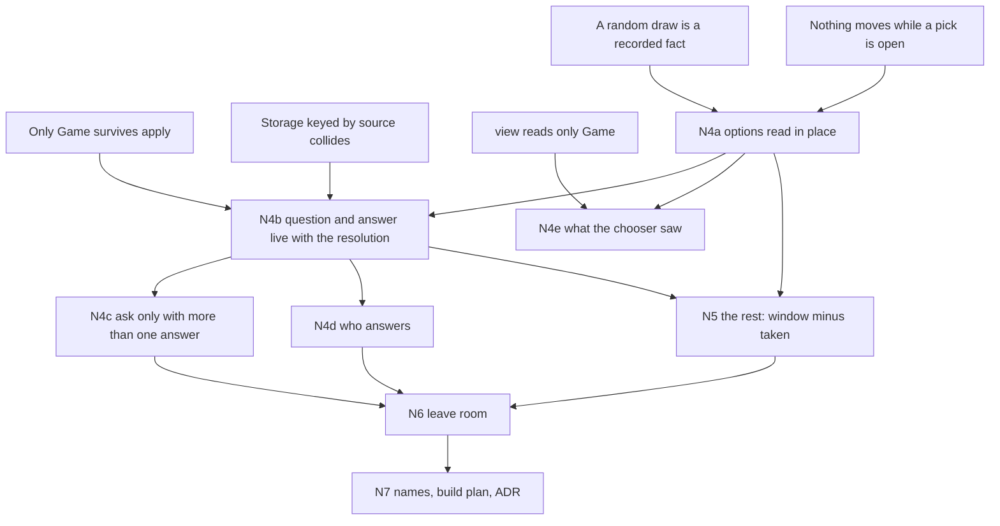

> [!quote] YOU

continue the card-game course


> [!question] Quiz
> Forage today. `reveal` takes the top 2 cards off the deck into no zone. They exist only in the pending Picking's options until ResolvePick moves them. Which of these are true? Select all.
>
> FORAGE.play_effects = [
>   Reveal      { pick_id: PickId(0), selector: Owner, amount: 2 },
>   ResolvePick { pick_id: PickId(0), picked_move: AddToHand, other_move: Bury },
> ]
> Answering the pick: Action::Pick { object_id }. PlayerInput has pickings (open questions) and picks: Vec<Picks { source, pick_id, picked, others }>.
>
> 1. While the player picks, every reader sees a deck 2 cards smaller, the view's deck_size included
> 2. The load-time pick check exists because a Reveal with no later ResolvePick would leave its cards in no zone for good
> 3. The opponent's view shows which 2 cards were revealed
> 4. ResolvePick finds the answer through the resolving effect's cursor, so the PickId is only a label
> 5. With an empty deck, Reveal opens a pick with no options and the player must pass


> [!question] Quiz — I don't know
> Your answer: I don't know
> Correct answer: 1, 2
>
> Note: I dont remember the exact details
>
> The revealed cards leave the deck (pop_front) and sit only in Picking.options, so deck_size drops by 2 for the whole pick, and only ResolvePick ever puts them anywhere. That is why validate_pick_order rejects a Reveal left unresolved (PickNotResolved). The opponent sees the object ids but def_id is None unless the viewer is picking. ResolvePick looks the answer up in PlayerInput.picks by (source, pick_id), and those entries are never removed. With an empty deck start_picking returns false: no pick opens, and ResolvePick finds no entry and does nothing.


> [!abstract] PI

No problem. That one tested code recall, and I'll go through the current flow before we change it. The next ones are about concepts.


> [!question] Quiz
> A pick asks for 2 cards, and each Pick action names one card. What must be stored in Game? Select all.
>
> Card: "Look at the top 3 cards of your deck. Put 2 of them into your hand."
>   Cards { selector: Picked(Choice { options: YourDeck(Top(3)), count: 2, .. }), verbs: [Move(Hand)] }
> Resolution reaches this effect and asks. The player sends Pick(a), later Pick(b). The Move verb runs once both are picked, and then resolution continues.
>
> 1. The question (its options and how many), from when it is asked until it is answered
> 2. The full answer [a, b], after the Move verb that uses it has run
> 3. The player who must answer, in a field of its own beside the question
> 4. Card a, between the first Pick action and the second


> [!success] Quiz — correct ✓
> Your answer: 1. The question (its options and how many), from when it is asked until it is answered, 4. Card a, between the first Pick action and the second
> Correct answer: 1, 4
>
> Only Game survives apply. The question spans several apply calls, and so does card a, since Pick(a) and Pick(b) arrive in separate calls, so both must be state. Once Move has run, nothing reads [a, b] again, so storing it would only keep a dead copy, which is what PlayerInput.picks does today. Who must answer is derived from the open question (ADR 0015) and never stored as a fact of its own.


> [!question] Quiz
> The open pick keeps its options as a stored list. Which of these are true? Select all.
>
> Two cards:
>   (W) "Look at the top 3 cards of your deck. Put one into your hand."   options: YourDeck(Top(3)), sample: None
>   (S) "Choose one of 3 random minion cards in your deck. Draw it."      options: YourDeck(Every), kind: minions, sample: Some(3)
> In both, the cards stay in the deck while the player looks. While a pick is open, the only legal actions are that pick's answers, and no verb runs until it is answered. The RNG is a seeded stream in Game.
>
> 1. W's options could be computed again on every read and give the same cards for the whole pick
> 2. S's options must be stored, since computing them again takes new numbers from the RNG
> 3. W's stored options are a mirror that can drift from the deck while the pick is open
> 4. S's options could be computed again on every read, since the RNG is seeded


> [!success] Quiz — correct ✓
> Your answer: 1. W's options could be computed again on every read and give the same cards for the whole pick, 2. S's options must be stored, since computing them again takes new numbers from the RNG
> Correct answer: 1, 2
>
> Note: W's options cant drift because there is no shuffle while picking
>
> A seed fixes a stream, not a single draw. Computing S's sample again takes the next numbers, which gives different cards and shifts every later random outcome, so the sample is a recorded fact, like order of play. W's options follow from the deck, and nothing can change the deck while the pick is open (only the pick's answers are legal and no verb runs), so a stored copy can't drift during the pick. Storing W's list is safe, and recomputing it would be too.


> [!abstract] PI

Right, and the reason is a bit broader than shuffling: no verb of any kind runs while a pick is open, so nothing can move a card in the deck.


> [!question] Quiz
> After this pick, P0 knows the top 2 cards of their own deck. The game wants P0's screen to keep showing them, even after P0 reconnects. Where must that knowledge live?
>
> Card: "Look at the top 3 cards of your deck. Put one into your hand. The rest stay on top in the same order."
> While the pick is open, view(game, P0) shows the 3 options face up. Once the pick is answered, the 2 cards left are ordinary hidden deck cards again.
> A reconnecting client gets view(game, viewer), not the old events.
>
> 1. In P0's client, which saw the options while the pick was open
> 2. In the pick's events, sent to the client again when it reconnects
> 3. In Game, as a fact that view(game, P0) reads
> 4. In the pending pick, kept open after the answer for view to read


> [!success] Quiz — correct ✓
> Your answer: 3. In Game, as a fact that view(game, P0) reads
> Correct answer: 3
>
> view(game, viewer) is the one definition of what a player sees, and it can only read Game. A client's memory is lost when it reconnects, and events are output, not state: they are returned once and not kept to be sent again. A pending pick kept open after its answer would still ask a question, so who may act would be wrong. That leaves a fact in Game, such as "P0 has seen X", read by view. That is the open thread on knowledge as state, and no engine researched so far stores one.


> [!question] Quiz
> Which of these picks have exactly one legal answer? Select all.
>
> Rule assumed: with Exactly(n) and fewer than n options, the player takes all the options, as many as possible. An answer is a set of objects.
>
> 1. Exactly 1 from YourDeck(Top(3)), and the deck is empty
> 2. Exactly 2 from YourDeck(Top(3)), and the deck holds 2 cards
> 3. Exactly 1 from YourDeck(Top(3)) filtered to minions, and the top 3 hold 1 minion
> 4. AtMost 1 from YourDeck(Top(3)), and the deck holds 1 card
> 5. Exactly 1 from YourHand, and the hand holds two copies of the same card, both unbuffed
>
> 1. 1. Empty deck, Exactly 1
> 2. 2. Two cards left, Exactly 2
> 3. 3. One minion in the top 3, Exactly 1
> 4. 4. One card left, AtMost 1
> 5. 5. Two copies in hand, Exactly 1


> [!success] Quiz — correct ✓
> Your answer: 1. 1. Empty deck, Exactly 1, 2. 2. Two cards left, Exactly 2, 3. 3. One minion in the top 3, Exactly 1
> Correct answer: 1, 2, 3
>
> 1 has one answer, the empty set. 2 and 3 have one answer each, every option. 4 has two answers, the empty set or the card, since AtMost allows taking nothing. 5 has two answers: the copies share a definition, but they are two objects, which can differ later (a buff, a discount) and sit in different hand positions. A question with one possible answer tells the game nothing, so the empty pick that today's code skips and a forced pick turn out to be the same case.


> [!question] Quiz
> Four players, and P0 plays the card. Each opponent chooses one minion, and the chosen minions are destroyed. The options filter is read the way every filter is read today, relative to the card's owner. What goes wrong?
>
> Card: "Each opponent chooses a minion they control. Destroy those minions."
> Options: CharacterFilter { side: Enemy, kind: Minion }, with Friendly and Enemy measured from the owner of the source (P0), as since 04a.
> Choosers: P1, P2 and P3, each answering their own pick.
>
> 1. P1 gets no options, since none of P1's minions is an enemy of P1
> 2. P1 can choose a minion of P2 or P3
> 3. P1 can choose a minion of P0
> 4. Nothing: Enemy from P0 matches the same minions as Friendly from P1


> [!success] Quiz — correct ✓
> Your answer: 2. P1 can choose a minion of P2 or P3
> Correct answer: 2
>
> Measured from P0, Enemy covers the minions of P1, P2 and P3 together, so each chooser is offered every opponent's minions, not only their own. With two players Enemy from the caster and Friendly from the chooser happen to match, which hides the problem. "They control" is measured from the chooser, so a choice made by someone other than the owner needs a second frame, the chooser's, for its side filter.


> [!question] Quiz
> A 1/1 minion takes the 1 damage. When the pick opens, is it offered, and what happens if the player picks it?
>
> Card: "Deal 1 damage to all minions. Then choose a minion and give it +2 Health."
>   [ Characters { selector: All(minions), verbs: [Damage(1)] },
>     Characters { selector: Picked(Choice { options: minions, count: 1, .. }), verbs: [Modify(+2 Health)] } ]
> Rules as they stand: health is derived from max health and stored damage, the state check runs only between resolving effects (ADR 0015), and Alive means "not killed by a state check" (ADR 0016). Filters read the board.
>
> 1. Not offered, since filters skip characters at 0 health
> 2. Offered. Picked, it gets +2 Health and survives the state check at the card's end
> 3. Offered. Picked, it gets +2 Health but still dies, since its death was decided when the damage landed
> 4. Not offered, since it died the moment its health reached 0


> [!success] Quiz — correct ✓
> Your answer: 2. Offered. Picked, it gets +2 Health and survives the state check at the card's end
> Correct answer: 2
>
> Note: I dont see this as a huge problem
>
> Nothing dies inside a resolving effect. Death is the state check's call, and it runs only once the card finishes. During the pick the minion is on the board and Alive, so the filter offers it. Picked, its derived health is 1 + 2 - 1 = 2, and the state check at the end finds it above 0. The damage decided nothing on its own. Hearthstone's random effects skip "mortally wounded" minions at 0 health, but our filters don't, as the open thread on random damage says.


> [!question] Quiz
> The same minion's trigger resolves twice. On the second resolution, which cards does the move step act on?
>
> Mechanism (today's code): each completed answer is appended to a list as Picks { source, pick_id, picked, others }. Entries are never removed. The move step looks up (source, pick_id) and takes the first match.
>
> Minion: "Whenever you play a spell, look at the top 2 cards of your deck. Put one into your hand, bury the other."
>   trigger effects: [Reveal { PickId(0), Owner, 2 }, ResolvePick { PickId(0), AddToHand, Bury }]
> You play two spells. Both triggers come from the same minion, so they have the same source.
>
> 1. The second resolution's cards, as intended
> 2. None, since the lookup finds two matches and gives up
> 3. The first resolution's cards again, which were already moved
> 4. Both resolutions' cards, one entry after the other


> [!success] Quiz — correct ✓
> Your answer: 3. The first resolution's cards again, which were already moved
> Correct answer: 3
>
> Note: second one bugs, but we will be scraping this
>
> Both answers carry the same key, (minion, PickId(0)), and the first match is the stale entry from the first resolution. So the move step moves cards that are already in hand and in the graveyard, and the second answer's cards stay in no zone. This is the same collision 04d removed for targets (MTG 113.7a): anything stored by source breaks once one source has two resolutions alive. No card reaches it yet, and the fix is to keep the answer with the resolution that asked for it.


> [!abstract] PI

Right, and the redesign removes it. The answer moves into the resolution that asked for it.

One last probe, on the cards not picked (N5):


> [!question] Quiz
> The top 5 hold 2 Rocks, and the player takes one of them. Which cards go to the bottom of the deck?
>
> Adamancipator Researcher (YGO, verified): "excavate the top 5 cards of your Deck, and if you do, you can Special Summon 1 excavated Level 4 or lower non-Tuner Rock monster, also place the rest on the bottom of the Deck in any order."
> Options found by window (top 5), then the kind filter (Level 4 or lower non-Tuner Rock).
>
> 1. The other 4 excavated cards, the Rock not taken and the 3 non-Rocks
> 2. Only the 3 non-Rocks, since the Rock not taken stays on top
> 3. Only the Rock not taken, since the rest means the options not taken
> 4. All 5, since the summoned Rock leaves the bottom on its own afterwards


> [!failure] Quiz — incorrect ✗
> Your answer: 3. Only the Rock not taken, since the rest means the options not taken
> Correct answer: 1
>
> "The rest" is measured against what was looked at (the window), not against what could be chosen (the options). All 5 were excavated, 1 was summoned, so the other 4 go to the bottom, Rock or not. If the rest meant only the options not taken, the 3 non-Rocks would stay on top, already seen, and the card would leak its own top cards to the next draw. So one pick produces two selections: the cards taken, and the window minus those cards.


> [!quote] YOU

nice, I think yours is the intended way I picked that one cause I tought we would move the non-picked options that would only include rocks


> [!abstract] PI

The checks are saved in `research/04f-picks-as-choices/rules-checks.md` and in `verified-facts.md`. Three of them matter for today:
- **MTG 609.3:** an effect does as much as it can. Discarding two cards with one in hand discards that one.
- **Who chooses varies:** in Edict and Innocent Blood the affected player chooses, in Duress the caster does. Metaphys Horus has the opponent choose in YGO.
- **Hearthstone's Discover:** it never offers duplicates, and the player must take one.

## Plan

**Approach.** The probe showed the concepts N4 needs are solid, so N4 is mostly derivation plus a few decisions that are yours. I'll open with today's Reveal flow in code, since you don't remember it, and then replace it one piece at a time:
- **N4a.** The cards stay where they are while the player looks.
- **N4b.** The question and its partial answer live with the resolution that asked. The full answer goes straight to the effect's verbs and is never stored. This removes `PickId`, `PlayerInput.picks` and the pick check.
- **N4c.** A pick is asked only when it has more than one possible answer.
- **N4d.** Who answers.
- **N4e.** What the chooser saw.

N5 starts from the Adamancipator miss: "the rest" is the window minus what was taken, so one pick gives two selections. Then we decide where the second selection's verbs go. N6 checks that the shape still holds for the cases we're leaving out: activated abilities, Discover, a chooser other than the owner, simultaneous picks, triggers that pick, and `If`. N7 covers the names, the build plan (your PRs, agent issues) and the ADR.

Each decision comes to you with my lean. The derived steps get one quiz each.



The five roots are things you got right in the probe, so we build on them as they are. If the session runs long, I'd split after N5 and leave N6 and N7 for 04g.

Does this plan work for you?


> [!quote] YOU

yes


> [!abstract] PI

## N4a: options read in place

Here's today's flow, since you don't remember it. Forage is two effects joined by a `PickId`:

```rust
FORAGE.play_effects = [
    Reveal      { pick_id: PickId(0), selector: Owner, amount: 2 },
    ResolvePick { pick_id: PickId(0), picked_move: AddToHand, other_move: Bury },
]
```

1. **Reveal resolves.** `zones.reveal(owner, 2)` pops the top 2 cards off the deck (`pop_front`), and they go into no zone. `start_picking` stores them as the options of a `Picking` in `PlayerInput.pickings`, and resolution pauses.
2. **`apply(Pick { object_id })`.** The `Picking` is removed, and `Picks { source, pick_id, picked: [x], others: [y] }` is pushed onto `PlayerInput.picks`. Nothing ever removes it. Then resolution resumes.
3. **ResolvePick resolves.** It looks up `(source, PickId(0))` (the first match wins), moves `picked` to the hand and buries `others`.
4. **Load time.** `validate_pick_order` checks that every Reveal has a later ResolvePick (`PickNotResolved`) and every ResolvePick has an earlier Reveal (`PickNotFound`).

That's three pieces: cards taken out of every zone, an answer stored by source, and a load check that pairs the two effects. N4a takes on the first one.

In the 04e shape, Forage's pick half is one effect, and the cards never leave the deck:

```rust
Cards {
    selector: Picked(Choice {
        options: CardPickOptions { zone: YourDeck(Top(2)), kind: all, sample: None },
        count: 1, ..
    }),
    verbs: vec![Move(Hand)],
}   // burying the other card is N5
```

The open pick holds the ids of the options, which point into the deck. A verb moves a card when it runs. Until then the card is an ordinary deck card that the chooser is looking at. That rests on two things you answered in the probe. Nothing moves while a pick is open, so ids taken when the question is asked stay valid. And a sample is a random draw, so the list has to be kept anyway.


> [!question] Quiz
> With the cards left in the deck while the player looks, which of today's pieces have nothing left to do? Select all.
>
> Today: Reveal pops the top N cards into no zone, and the open Picking holds them as options. ResolvePick later moves the picked card with picked_move and every other card with other_move. Load check: PickNotResolved (a Reveal that no ResolvePick follows) and PickNotFound (a ResolvePick with no Reveal before it).
>
> New: the cards stay in the deck. The open pick holds the ids of its options, found from the window, the kind filter and the sample when the question is asked. A verb moves a card when it runs.
>
> 1. The list of option ids stored in the open pick
> 2. Reading the window when the question is asked, to find the options
> 3. A required destination for the cards not picked
> 4. PickNotResolved, the load error for revealed cards that nothing puts back
> 5. The deck holding fewer cards while the player looks


> [!failure] Quiz — incorrect ✗
> Your answer: 3. A required destination for the cards not picked, 4. PickNotResolved, the load error for revealed cards that nothing puts back
> Correct answer: 3, 4, 5
>
> Note: I do have questions about this, why did we decide to remove the temporary zone? what do we gain with it? also about the "Nothing moves while a pick is open" that is informal knowledge and I somewhat dislike it, the deck will still have to check that the card is there, so I think we should have good reasons to remove the intermediary zone. I sayw that u researched this behaviour on other card games but I dont remember it present it again
>
> The three went away together for one reason: today the revealed cards are in no zone, so every card has to be put back somewhere, a load check makes sure something does, and the deck looks smaller until then. Left in place, a card nobody moves just stays where it was, so "look at the top 3, put one into your hand" needs no instruction for the other two. The stored list stays, because a sample is a random draw. The window is still how the options are found.


> [!abstract] PI

Good questions. One correction first: today there's no temporary zone. `pop_front` takes the cards out of the deck and puts them nowhere, so they exist only as ids in `Picking.options`, and nothing else in the game can see them. So the real comparison is between the cards staying in the deck and a real set-aside zone, which would beat today's "no zone".

**The research again.** Where do looked-at cards sit while the player chooses?

| Source | Where | Evidence |
|---|---|---|
| MTG rules | In the library | 701.20b "Revealing a card doesn't cause it to leave the zone it's in." No rule covers "look at", and only "put" or "move" changes a zone |
| YGO rulebook v10 | In the Deck | "Cards that are being excavated are still treated as being in the Deck until sent elsewhere by the card instructions" |
| XMage | In the library | `getTopCards` removes nothing: "The card is still in the library, until/unless some zone-handling code moves it" |
| Forge `Dig` | In the library | "There is no limbo or looked-at zone." `tempShowCards` shows them to the chooser only |
| Fireplace, Tracking | In the deck | The cards not chosen are removed after the choice |
| Spellsource, Dredge | In the deck | Copies are shown to the player instead |
| SabberStone, Tracking | Moved to SETASIDE | The cards not chosen stay there |
| Metastone, Tracking | Moved to the graveyard | All three go there before the choice |

Both rulebooks keep the cards in place, and so do both MTG engines. The two that move them out are implementing old Tracking ("Draw one and discard the others"), where the cards not chosen never go back to the deck anyway. Every engine whose cards not chosen return to the deck keeps them in place.

**What in place gains.**
1. **"The rest stays where it was" costs nothing.** Dredge reads "Look at the bottom 3 cards of your deck. Put one on top", and your sample card offers 3 minions from anywhere in the deck. With a set-aside zone, every card not chosen has to go back to its old position. So the zone must remember each card's position, which is a second copy of the deck order. That's a mirror, and for a sample the positions are scattered across the deck.
2. **No fake zone changes.** A trip through a set-aside zone is two moves, out and back. Each move is an event that triggers can match and that the view reports. Then you have two bad options: either looking counts as moving, which both rulebooks say it doesn't, or you get a move that doesn't count, a special case for everything that reads moves. The same applies if the zone-reset rules (an open thread) ever reset a card that leaves the deck: the round trip would need an exemption.
3. **Every reader sees the true deck.** That includes the view's `deck_size`, which is the option you didn't select. Today it drops by 2 while the player looks.

**What the set-aside zone gains.** Isolation: nothing else can draw or move those cards during the pick. That helps only if something can act during a pick.

**"Nothing moves while a pick is open."** You're right that I stated it loosely, but it isn't informal. Two pieces of code enforce it:
- While any question is open, `legal_actions` lists only that question's answers (`legal_actions.rs:72`), and `apply` refuses anything that isn't listed.
- The loop doesn't step while a question is open (ADR 0015).

It's also the rule in every game we've studied: in MTG 608.2d, choices during resolution are made "while applying the effect", and nobody acts in between. It deserves a test of its own: from the question to the last `Pick`, no zone changes.

**"The deck still has to check that the card is there."** Yes, but a set-aside zone pays the same. `Move` finds the card by id either in the deck or in the set-aside zone, and that lookup returns an `Option` both ways. In place, a failed lookup means the invariant above broke. The verb then skips the card, the same rule a bound target will need when it stops being legal (608.2b, an open thread). So it's one rule with two readers.

My lean is in place, mostly because of gain 1: a set-aside zone turns "leave it where it was" into stored positions. Does that answer your questions, or do you still lean toward a set-aside zone?


> [!quote] YOU

in place yes, how does a discover mechanic would work with it?


> [!abstract] PI

Discover covers two mechanics, and in place affects only one of them.

**1. Discover from your deck.** The current Tracking reads "Discover a card from your deck". The options are real cards that already exist, so in place applies directly, and the N3 shape covers it:

```rust
Cards {
    selector: Picked(Choice {
        options: CardPickOptions { zone: YourDeck(Every), kind: all, sample: Some(3) },
        count: 1, ..
    }),
    verbs: vec![Move(Hand)],
}
```

The 3 sampled cards stay where they are in the deck. The pick stores their ids, because a sample is a random draw. The chosen card moves to the hand, and the other two never moved. With a set-aside zone, those two would need their scattered positions remembered.

One open detail. Hearthstone's Discover never offers two copies of the same card, so "too few possible options" shows only one (verified on the wiki for Shadow Visions, which discovers a copy of a spell in your deck). If that rule holds for the real card too, `sample` has to draw distinct definitions, not distinct objects. That isn't verified for the from-deck case, and it leaves room without changing anything.

**2. Discover from a pool** ("Discover a Dragon", or a copy of a card). The options are definitions, and no object exists yet, so there's no place for them to be in. The engines in the 04e research create the options as objects first:
- Fireplace and SabberStone create real entities in SETASIDE.
- Spellsource shows copies in a `DISCOVER` zone.

Creating objects first would be awkward in our design. The options would be the result of a verb (create 3 cards), and a verb's result as a selection is the Squire case from 04e, which the design doesn't support.

The shape that fits is a fourth subject, over definitions:
- the pick stores `Vec<DefId>` (a sample, so a recorded fact)
- the answer is one `DefId`
- a verb creates the object from it, like `Summon(DefId)` does today with a fixed definition.

Nothing is created for the options not chosen: no orphan objects and no set-aside zone. The view can render a `DefId` as it is.

That's N6 work, since Discover is on the leave-room list. What N4 has to guarantee is that the open pick's option type can vary by subject: object ids for characters and cards, definition ids for a definition subject. I'll keep that in mind for N4b, which comes next: where the question and its partial answer live. OK to go on?


> [!quote] YOU

yes


> [!abstract] PI

## N4b: where the question and its answer live

Three facts from the probe settle most of this:
- The question and the partial answer span several `apply` calls, so both are state in `Game`.
- Once the effect's verbs have run, nothing reads the full answer again.
- Anything keyed by source collides when one source has two resolutions alive.

Here's the flow they give, for "Look at the top 3, put 2 into your hand":

1. Resolution reaches the `Picked` effect. The options are found (window, filter, sample), the pick opens, and the loop stops. **The cursor stays on this effect.**
2. `apply(Pick(a))` adds `a` to the open pick. The pick isn't complete yet, so the loop stays stopped.
3. `apply(Pick(b))` completes the pick, and the loop resumes. The effect at the cursor finds its pick answered, its verbs run on `[a, b]`, and then the pick is dropped and the cursor moves on.

There's one action per object, like targeting's `Choose`. A single `Pick(Vec<_>)` would make `legal_actions` list every combination, for example 10 sets for "2 of 5". The answer lives in the open pick until the verbs take it, and nothing outlives the effect. That removes `PlayerInput.picks`, and `ResolvePick` too, since verbs on one selection replaced it.

The question now is what the open pick has to store. Your edge is the stored copy, so this one is worth checking:


> [!question] Quiz
> What must the open pick store? Select all.
>
> Flow: resolution reaches a Picked effect. The pick opens and the loop stops, with the cursor still on that effect. Each Pick(x) adds one object. When the pick is complete, the loop resumes, the effect at the cursor runs its verbs on the answer, the pick is dropped and the cursor moves on.
>
> Effect at the cursor:
>   Cards { selector: Picked(Choice { options: CardPickOptions { zone: YourDeck(Every), kind: minions, sample: Some(3) }, count: 2, bound: Exactly, different: true }), verbs: [Move(Hand)] }
> The resolving effect already holds the source and the cursor. One effect resolves at a time. For now the chooser is always the source's owner.
>
> 1. The objects picked so far
> 2. The source and a PickId, to find its effect
> 3. The player who answers
> 4. The count and bound from the Choice
> 5. The ids of the options offered


> [!failure] Quiz — incorrect ✗
> Your answer: 1. The objects picked so far, 3. The player who answers, 5. The ids of the options offered
> Correct answer: 1, 5
>
> Note: 2 is the resolving effect and 4 is already on the resolving effect
>
> Store only what can't be read from somewhere else. The options are a sample, which is a random draw, and the objects picked so far come from earlier apply calls. Nothing else holds either one. The count, bound and different are in the Choice of the effect at the cursor, so a copy would be a mirror. The pick always belongs to the effect at the cursor, since one effect resolves at a time and a question stops the loop, so it needs no key. The chooser is the source's owner, read from the resolving effect, and ADR 0015 already says who may act is derived.


> [!quote] YOU

"The chooser is the source's owner, read from the resolving effect" is it? cant we have a "your oponent picks a card from their hand" ?


> [!abstract] PI

On the quiz: you were right that the key and the count are already on the resolving effect. On the chooser, the quiz assumed what the details called "for now": only the owner chooses, so it's derived. But your card is real, and it's N4d, so let's settle it now.

**"Your opponent picks a card from their hand."** Real cards do this:
- MTG discard: the affected player chooses by default (701.9b).
- Diabolic Edict: "Target player sacrifices a creature of their choice."
- Innocent Blood: "Each player sacrifices a creature of their choice."
- YGO Metaphys Horus: "Your opponent chooses 1 monster they control".

It also fits your 04e limitation. "Their hand" is the chooser's own hand, so no choice reaches another player's hidden zone.

**Where the chooser would live.** It's card data, a `chooser` on the `Choice`, read relative to the source's owner like every selector. Whether the open pick then has to store the player depends on the card:

| Card | Stored in the open pick? |
|---|---|
| The owner chooses, or "the opponent" with 2 players | No, it's read from the data and the owner |
| "Each opponent chooses" (Innocent Blood) | One open pick per chooser, so the player id tells them apart. A key, not a copy |
| "A random opponent chooses" | Yes, it's a random draw, like a sample |

A chooser also brings the frame rule from the 4-player probe: "they control" and "their hand" are measured from the chooser, not the owner.

Two decisions:

**1. Who answers.**
- **(a) Defer.** The source's owner answers every pick for now. A `chooser` field comes with the first card that needs one, together with its frame rule. Adding a field later rewrites nothing.
- **(b) Add `chooser: PlayerSelector` to `Choice` now.** The open picks are kept per player, and the frame rule is decided now, with no card to test it.

Option (a) drops one thing: today `Reveal`'s selector accepts `PlayerSelector::All`. That path is untested and already broken, since both answers land on one `PickId`. Session 06d (simultaneous picks) is where several choosers belong. My lean is (a), because the frame rule is the hard part and a card should drive it.

**2. Where the open pick lives.**
```rust
struct OpenPick { options: Vec<ObjectId>, picked: Vec<ObjectId> }

// (a) with the resolution that asked
struct ResolvingEffect { pending: PendingEffect, idx: usize, pick: Option<OpenPick> }
struct PlayerInput     { targetings: Vec<(PlayerId, Targeting)> }

// (b) where picks live today, minus source and pick_id
struct ResolvingEffect { pending: PendingEffect, idx: usize }
struct PlayerInput     { targetings: Vec<(PlayerId, Targeting)>, pickings: Vec<(PlayerId, OpenPick)> }
```
- **(a)** A pick can't exist without its resolving effect, and both are dropped together. The pick sits next to the cursor it paused. It's the same move as ADR 0017, where data lives with whatever uses it. The cost is that "what is each player being asked" is now read from two structs.
- **(b)** One struct says what each player is being asked. But a pick with no resolving effect can be represented, and the loop has to keep the two in step. And with 1a, the `PlayerId` in `pickings` is a copy of the source's owner.

My lean is 2a. Answer as "1a 2a" or push back.


> [!quote] YOU

1 a yes, which session takes about frames? 2 a yes but your version could have an OpenPick for an effect that picks nothing, do u think this could be improved?


> [!abstract] PI

**Frames are session 06b**, the one after this design: named results, `If` as the first nesting effect, and a frame per nesting level. With frames, the cursor becomes a stack of cursors, one per level, and only the top one moves. Wherever the open pick ends up, it belongs to the effect that's in flight at the top.

**On 2a: yes, it can be improved.** Here's why it's representable. `pick: Option<OpenPick>` beside `idx` depends on a rule that crosses two fields: "when `pick` is `Some`, the effect at `idx` has a `Picked` selector". The effect list is card data, so no type can know what sits at `idx`. That's your 06 point: when the next state depends on data, typestate needs an enum wrapper. There are two ways to fix it.

- **A. Guard the rule.** Only a constructor that reads a `Picked` selector can open a pick. That protects how the pick is built, but `idx` and `pick` can still drift apart later.
- **B. The pick carries its effect.** When resolution reaches a `Picked` effect, the cursor moves past it as it does today. The in-flight effect moves into the pick, built by destructuring its `Picked` selector:

```rust
struct ResolvingEffect { pending: PendingEffect, idx: usize, pick: Option<OpenPick> }

enum OpenPick {   // one variant per subject that can pick; PlayerSelector has no Picked
    Characters { choice: Choice<CharacterFilter>, verbs: Vec<CharacterVerb>,
                 options: Vec<ObjectId>, picked: Vec<ObjectId> },
    Cards      { choice: Choice<CardPickOptions>, verbs: Vec<CardVerb>,
                 options: Vec<ObjectId>, picked: Vec<ObjectId> },
}
```

With B, an `OpenPick` can only come from a `Picked` selector, and no rule between `idx` and `pick` is left to break. `Some(pick)` simply means "this effect is mid-flight, finish it before you read `idx`". It also covers three later needs:
- **N4a's Discover need.** A `Definitions` variant later holds `options: Vec<DefId>`, so the option type varies by subject with no generic parameter.
- **N5.** The rest's verbs go into the same variant.
- **06d.** Several choosers answer inside one `OpenPick`, as per-player answers within the one paused effect. That's a single paused effect, not several picks keyed by player.

The cost is a clone of the effect's `Choice` and verbs out of the pending list. That's card data, which never changes, so the copy can't drift. It's the same trade as waiting entries cloning their effects at match time (ADR 0011). This also corrects the flow I gave you in N4b: the cursor doesn't stay on the effect. It moves on, and the effect travels in the pick.

My lean is B. Go with B, or keep A?


> [!quote] YOU

what happens to next_effect while we are on this state? a invalid state is still representable inside the module like a pendingEffect that has no picks with a pick but that is better yes


> [!abstract] PI

**What happens to `next_effect`.** Today nothing calls it while a question is open. Both loops in `apply.rs` check `!self.player_input.any_awaiting()` before they step, so the guard lives in the loop and reads `PlayerInput`, which is a different struct from the effect stack.

Under B, the open pick *is* the question, so the guard should read it. Stepping the resolving effect then has four cases, decided in order:

```rust
enum Step { Run(NextEffect), Finish(OpenPick), Wait, Done }

// pick is Some and complete    -> Finish: take the pick, run its verbs on the answer
// pick is Some and incomplete  -> Wait: nothing to step, the loop stops
// pick is None, idx < len      -> Run: next_effect as today
// pick is None, idx == len     -> Done
```

One method on `ResolvingEffect` answers "what's next", and the loop asks it instead of checking `any_awaiting` and `next_effect` separately. The question has one function, and every caller asks it. `any_awaiting` keeps reading `PlayerInput` for targetings, and reads the resolving effect's pick for picks.

**Your second point is right.** No type can tie a pick to the list it came from. Inside the module, nothing stops a `ResolvingEffect` whose list never had a `Picked` effect from carrying a pick. Compared to A, there are two differences:
- **No reader depends on that relation.** In A, the resume reads the effect at `idx`, so a mismatched pair breaks it. In B, the pick carries everything it needs, so that state is odd but nothing breaks.
- **The module boundary holds the rest.** The fields are private to `effect_stack`, and only stepping a `Picked` effect builds a pick. That's the same deal as a private-field newtype. Where the type can't hold the rule, the module does.

You could close it fully by replacing `idx` with a queue of the remaining effects. Every pair of remaining effects and pick is then valid, because the pick is simply "the one before the queue". But 06b's `Repeat` needs the body again, and `idx` is the definition address ADR 0011 weighed. I'd leave that to 06b, when frames reshape the cursor.

Next, I'll check one more consequence of B, then move on to N4c. OK?


> [!quote] YOU

ok agree with B


> [!question] Quiz
> Under B, the Picked effect is the last one in its list, and its pick has just opened. If nothing but the guard changes, what does continue_resolving_effect do next?
>
> B: when stepping reaches a Picked effect, idx moves past it and the effect moves into ResolvingEffect.pick.
>
> Today's code, unchanged except that the guard reads the open pick:
>   fn is_done(&self) -> bool { self.pending.effects.len() <= self.idx }
>   fn finish_if_done(&mut self) -> bool { self.resolving.take_if(|r| r.is_done()).is_some() }
>
>   fn continue_resolving_effect(&mut self, obs) {
>       while !self.any_awaiting()                 // now true once the pick is open
>           && let Some(NextEffect { source, effect }) = self.effect_stack.next_effect()
>       { self.apply_effect(owner, source, &effect, obs); obs.checkpoint(..); }
>       self.effect_stack.finish_if_done();
>   }
>
> Card: [ Characters { All(minions), [Damage(1)] }, Cards { Picked(..), [Move(Hand)] } ]
>
> 1. next_effect returns the Picked effect a second time and opens a second pick
> 2. The pick stays open and the resolving effect waits, since is_done reads the pick
> 3. Nothing goes wrong: the loop stops on the open pick before finish_if_done runs
> 4. finish_if_done drops the resolving effect and its open pick with it, since idx is already past the end


> [!success] Quiz — correct ✓
> Your answer: 4. finish_if_done drops the resolving effect and its open pick with it, since idx is already past the end
> Correct answer: 4
>
> finish_if_done runs after the inner loop, however the loop ended. is_done reads only idx, and under B idx moved past the last effect when the pick opened, so take_if removes the whole resolving effect, open pick included. The question disappears without an answer, and the loop then runs the state check and the next pending effect. "Is this resolving effect done?" has a new answer under B (no effects left and no pick in flight), and every caller must ask it. Step::Done gives that answer in one place.


> [!abstract] PI

N4b is settled. To recap:
- The open pick is `Option<OpenPick>` on `ResolvingEffect`. It's an enum by subject that carries the effect's `Choice`, its verbs, the options and the objects picked so far.
- The cursor moves past the effect when the pick opens.
- One `Step` method answers "what's next", and "done" means no effects left and no pick in flight.

That last point gets a red test in the build: a `Picked` effect last in its list, like Forage's pick half.

## N4c and N4e: when to ask, and what each player sees

Two decisions left in N4, both policy.

**3. When a pick is asked.** In the probe you grouped the empty pick and the forced pick together: each has exactly one possible answer. Today's code skips only the empty one. Whatever the policy, the game must take the forced answer (MTG 609.3: do as much as possible). The only question is whether to stop and ask for it.
- **(a) Ask only when there's more than one possible answer.** Empty and forced picks both skip. One rule, and the fewest actions for bots, fuzzers and replays.
- **(b) Ask whenever there's at least one option**, which is today's rule. Forced picks are shown, as Hearthstone's Discover shows a one-card screen (wiki).
- **(c) Always ask, even with no options**, with an empty pick that only continues.

There's a catch. When the options come from a hidden zone through a filter or a sample, whether the game pauses depends on hidden cards. So (a) tells the opponent "at most one matching card", and (b) tells them "none". Only (c) leaks nothing through the pause. Hearthstone seems to live with (b)'s leak: community sources say Tracking with an empty deck does nothing, but that isn't verified. My lean is (a). The leak is small, and the check is one function called when the pick opens, so a game that wants (c) changes one place.

**4. What the opponent sees during a pick.** The chooser sees the options face up, read from the open pick by `view`. Afterwards, the cards that stayed in the deck go back to hidden, and remembering them belongs to the knowledge-as-state thread. The opponent is the open question. Today every viewer gets the options' object ids, and only the chooser gets their faces. With options read in place through a filter, an id tells the opponent "deck object 17 is a minion". When that card is drawn later, the opponent knows what the hidden hand card is.
- **(a) The opponent sees how many options there are**, not which objects.
- **(b) Keep today's rule:** ids to everyone, faces to the chooser.

My lean is (a). Ids of hidden cards are visible by policy, but tying an id to a filter result tells the opponent something about the card itself, not just that a card exists.

Answer as "3a 4a", or push back.


> [!quote] YOU

3 b I think it is fine as is we can change later if we want. 4 a.


> [!abstract] PI

Recorded: 3b keeps today's rule (ask whenever there's at least one option), and 4a shows the opponent only how many options there are. That settles N4:

| | Decision |
|---|---|
| N4a | Options read in place, ids stored in the open pick |
| N4b | `Option<OpenPick>` on `ResolvingEffect`, an enum by subject carrying the effect's `Choice` and verbs, one `Step` method |
| N4c | Ask whenever there's at least one option |
| N4d | The source's owner answers, and a chooser waits for its card |
| N4e | The chooser sees faces, the opponent sees the count |

It removes `Reveal`, `ResolvePick`, `PickId`, `Picks`, `PlayerInput.picks` and the pick check.

## N5: the cards not picked

Here's the problem. Under N4, Forage's pick half selects only the card taken, and the other card stays in the deck, since a card nobody moves stays put. But Forage buries it. So one pick has to produce a second selection, "the rest", with verbs of its own.

First, what "the rest" is. In the probe you read it as the options not taken, and the card meant all 5 excavated cards minus the one taken. My explanation said "measured against the window". Before we build on that, let's test it against a card with a sample.


> [!question] Quiz
> For each card, which cards are "the rest"? Select every correct statement.
>
> Options are found by window, then kind filter, then sample.
>
> (I) Impulse: "Look at the top four cards of your library. Put one of them into your hand and the rest on the bottom of your library."
>     window Top(4), no filter, no sample
> (A) Adamancipator Researcher: "excavate the top 5 cards of your Deck ... Special Summon 1 excavated ... Rock monster, also place the rest on the bottom of the Deck"
>     window Top(5), filter Rock, no sample
> (S) Made-up card: "Look at 3 random minion cards in your deck. Put one into your hand and the others on the bottom."
>     window Every, filter minions, sample Some(3)
>
> 1. Made-up card: the 2 sampled minions not taken
> 2. Impulse: the 3 cards of the top 4 not taken
> 3. Made-up card: every card in the deck except the one taken
> 4. Adamancipator: the 4 cards of the top 5 not taken, Rocks or not
> 5. Adamancipator: only the Rocks of the top 5 not taken


> [!success] Quiz — correct ✓
> Your answer: 1. Made-up card: the 2 sampled minions not taken, 2. Impulse: the 3 cards of the top 4 not taken, 4. Adamancipator: the 4 cards of the top 5 not taken, Rocks or not
> Correct answer: 1, 2, 4
>
> Note: I guess the difference between A and S is the sample
>
> The rest is what the card showed the player minus what they took. Without a sample, the card shows the whole window: Impulse shows 4 and Adamancipator shows 5, matching or not. With a sample, the player sees only the sampled cards, so the window (the whole deck) is the wrong set. My "measured against the window" from the probe holds only when there's no sample. The options not taken are the wrong set whenever a filter is narrower than what was shown, which is Adamancipator's case.


> [!question] Quiz
> Suppose the rest is worked out by reading Top(5) again just before the rest's verbs run. What goes wrong with Adamancipator?
>
> Adamancipator: window Top(5), filter Rock, take 1. Taken verbs: [Summon]. Rest verbs: [Move(DeckBottom)].
> Order within the effect: when the pick completes, the taken card's verbs run first, then the rest's verbs.
> The open pick stores the options and the cards taken, but not what was shown.
> Deck before the pick, top first: R1 (Rock), X2, R3 (Rock), X4, X5, X6, ...
> The player takes R1.
>
> 1. Nothing: the deck can't change while a pick is open, so Top(5) still gives the same 5 cards
> 2. R1 is still in Top(5), so the summoned Rock is also moved to the bottom
> 3. Summon moved R1 out of the deck, so the new Top(5) holds X6, a card the player never saw, and it goes to the bottom
> 4. The rest comes out empty, since every shown card has already been moved


> [!success] Quiz — correct ✓
> Your answer: 3. Summon moved R1 out of the deck, so the new Top(5) holds X6, a card the player never saw, and it goes to the bottom
> Correct answer: 3
>
> "Nothing moves while a pick is open" lasts only until the pick is answered. Once the taken card's verbs run, the deck changes: R1 leaves, so Top(5) is now X2, R3, X4, X5, X6. X6 was never shown, yet it would go to the bottom. So "shown" has to be recorded when the pick opens, the same way a sample has to be. With shown stored, the options don't need storing too: they are shown, filtered by the Choice's kind filter, and kinds don't change during a pick. A sample is drawn from cards already filtered, so it passes the filter whole.


> [!quote] YOU

I think the rest should be stored, the same as options


> [!abstract] PI

Fair. Storing the options costs nothing, since nothing can change them while the pick is open, and it saves `legal_actions` and `view` from running the filter again on every call. But "stored like options" can mean two layouts, and only one of them avoids a copy:

```rust
// (a) two disjoint lists: what can be taken, and what was shown but can't be
struct ... { options: Vec<ObjectId>, others: Vec<ObjectId>, picked: Vec<ObjectId> }
// rest = options not picked, plus others

// (b) the whole shown set, plus the options inside it
struct ... { shown: Vec<ObjectId>, options: Vec<ObjectId>, picked: Vec<ObjectId> }
// rest = shown not picked
```

(b) keeps every option twice. With a sample, `shown` and `options` are the same list. That copy can't drift during a pick, but it's still two places holding one fact. (a) holds each card once, and it's today's `Picks { picked, others }` split, moved to when the pick opens. Adamancipator: `options` = [R1, R3], `others` = [X2, X4, X5]. A sample or a character pick has `others` empty. The view uses both lists, since the chooser sees all 5 face up and only the Rocks can be taken. My lean is (a).

## Where the rest's verbs go

The research confirmed the cards:

| Card | Selection | The rest |
|---|---|---|
| Forage, Impulse, Adamancipator | Pick from the deck | Moved (bury, deck bottom) |
| Pot of Duality (YGO) | Pick from the top 3 | "shuffle the rest back into your Deck" |
| Duneblast (MTG) | "Choose up to one creature" | "Destroy the rest" |
| Divine Reckoning (MTG) | Each player chooses | "Destroy the rest" |
| Brawl (HS) | One minion, chosen randomly | Destroyed |

So the rest needs full verbs, not only a destination (Destroy isn't a move), and `Random` can have a rest too (Brawl). Three places to put the rest's verbs:

```rust
// (a) on the Picked selector only
Picked { choice: Choice<CardPickOptions>, rest: Vec<CardVerb> }
// (b) on the effect, for every selector
Cards { selector: CardSelector<S>, verbs: Vec<CardVerb>, rest: Vec<CardVerb> }
// (c) on each selector that takes a subset: Picked and Random now, Targeted when a card needs it
Random { filter: CardSelectorFilter, rest: Vec<CardVerb> }
```

- **(b)** lets you write `All` with a rest, and that rest is always empty. Rejecting it needs a load check, which is the direction you pointed out PR #62 moved away from.
- **(a)** covers every card we can build. Brawl, Duneblast and Divine Reckoning need a Destroy verb we don't have, and Divine Reckoning also needs several choosers (06d). Giving `Random` a rest later is a new field, so nothing gets rewritten.
- **(c)** is (a) plus `Random` now, with no card in our set to test it.

My lean is (a). Forage then reads:

```rust
Cards {
    selector: Picked {
        choice: Choice { options: CardPickOptions { zone: YourDeck(Top(2)), kind: all, sample: None },
                         count: 1, bound: Exactly, different: true },
        rest: vec![Move(Graveyard)],
    },
    verbs: vec![Move(Hand)],
}
```

An empty `rest` leaves the cards where they are, which covers Dredge and "Discover a card from your deck". The taken cards' verbs run first, then the rest's, as in Forge and XMage. Impulse and Adamancipator also say "in any order", which is a second choice, an ordering. I'd defer that and move the rest in shown order until a card needs the order.

Answer as "5a 6a", or push back.


> [!quote] YOU

5a and I prefer the "others" name to not tie it with visibility for now. 6 a sounds good. are we able to do like "chosse a card in hand and discard it, give other minions in your hand +2/+2"? what if it was "minion" instead of "card"


> [!abstract] PI

Recorded: 5a, named `others`. `others` is the better name, and your two cards show why: "the rest" isn't about visibility. It's measured against the set the card *names*.

| Card | Names | Choosable | Rest |
|---|---|---|---|
| Adamancipator | the top 5 (a window) | the Rocks in it | window minus taken |
| Duneblast | creatures | creatures | options minus taken |

So `others` is the cards in the window that fail the filter. A pick with no window (hand, graveyard, the board) has `others` empty, and its rest is just the options not taken.

**"Choose a minion in your hand. Discard it. Give the other minions in your hand +2/+2."** It can be written two ways:

```rust
// one effect: options are the hand's minions, others is empty, so the rest is the other minions
Cards {
    selector: Picked { choice: Choice { options: CardPickOptions { zone: YourHand, kind: Minion, sample: None }, count: 1, .. },
                       rest: vec![Modify(BuffStats(2, 2))] },
    verbs: vec![Move(Graveyard)],
}

// two effects: the discard moves the card out first, so All reads only the others
[ Cards { selector: Picked { choice: /* minions in hand */, rest: vec![] }, verbs: vec![Move(Graveyard)] },
  Cards { selector: All(CardSelectorFilter { zone: Hand, side: Friendly, kind: Minion }), verbs: vec![Modify(BuffStats(2, 2))] } ]
```

**"Choose a card in your hand..."** Only the two-effect form works. The options are the whole hand, so the rest is every other card, spells included, and the card says "other minions". The rest is too wide. The second `All` effect still works, because the discarded card has left the hand by the time it runs.

**What neither form can write.** The chosen card stays in the hand *and* the rest is narrower than the options: "Choose a card in your hand. Give it +1 Attack. Give the other minions in your hand +2/+2." The rest would include spells, and `All` would include the chosen card. Writing it needs either a filter on the rest, or an `All` that leaves out the chosen card, which is a named result (06b). No card we know needs it.

One loose end it exposes: what a stat buff does to a spell card isn't defined (E2 put minion cards under the buff, not spells). A rest that's too wide is a bug for that reason, not a harmless no-op. I'll add it to the open threads.

N5 is settled:
- **`others`:** stored when the pick opens.
- **The rest:** options not taken plus `others`, with its verbs on `Picked` only.
- **Order:** taken first, then the rest, which moves in shown order.
- **Deferred:** the "in any order" ordering choice.

We said we'd split after N5 if the session ran long. Continue with N6 (leave room) now, or close here and do N6 and N7 in 04g?


> [!quote] YOU

continue


> [!question] Quiz
> Which of these later additions forces an edit to Forage's card data as written?
>
> Forage, written as a struct literal in base.rs:
>   Cards {
>       selector: Picked {
>           choice: Choice { options: CardPickOptions { zone: YourDeck(Top(2)), kind: all, sample: None },
>                            count: 1, bound: Exactly, different: true },
>           rest: vec![Move(Graveyard)],
>       },
>       verbs: vec![Move(Hand)],
>   }
>
> 1. Choice gets a new field, chooser: PlayerSelector, for Diabolic Edict
> 2. OpenPick gets a Definitions variant, for Discover from a pool
> 3. CharacterVerb gets a Destroy variant, for Duneblast
> 4. CardSelector::Random(filter) becomes Random { filter, rest }, for Brawl-style cards
> 5. OpenPick keeps one answer per chooser, for simultaneous picks (06d)
>
> 1. 1. chooser field on Choice
> 2. 2. Definitions variant on OpenPick
> 3. 3. Destroy variant on CharacterVerb
> 4. 4. rest on CardSelector::Random
> 5. 5. per-chooser answers in OpenPick


> [!success] Quiz — correct ✓
> Your answer: 1. 1. chooser field on Choice
> Correct answer: 1
>
> A struct literal must name every field, so a new field on Choice breaks every Choice literal, Forage's included. A new enum variant costs nothing in data that doesn't use it, but it costs one match arm in every interpreter (E1). Changing Random's shape breaks every Random literal (Zap, Stray Shot), but Forage has none. OpenPick is internal to the effect stack, so its variants and its layout never show up in card data.


> [!abstract] PI

A field costs every literal, and a variant costs every interpreter. That's the yardstick for the pass:

| Later case | What it adds | Kind | What it touches |
|---|---|---|---|
| Activated abilities (04d) | Each activation resolves as its own resolving effect | nothing | Nothing: the pick lives with the resolution, not the source |
| Triggers that pick (06c) | Nothing: `Picked` is copied unchanged by the push (04e) | nothing | Nothing |
| Simultaneous picks (06d, Divine Reckoning) | One answer per chooser in `OpenPick`, complete when all have answered | internal | The effect stack |
| Knowledge as state | A "P0 has seen X" fact written when a pick opens | internal | `view` |
| Discover from a pool | A `Definitions` subject, `OpenPick::Definitions` with `Vec<DefId>`, and a create verb | variants | One arm per interpreter |
| Remembered choices (06c) | A verb that stores the selection on the source, and a selector that reads it | variants | One arm per interpreter |
| Player picks | `Picked` on `PlayerSelector`, plus `OpenPick::Players` | variants | One arm per interpreter |
| Choose One (06b) | A nesting effect choosing among effect lists, answered when played (MTG 601.2b). It can reuse `Choice`'s how-many half | variant | One arm per interpreter |
| Up to N (Duneblast) | `AtMost` back, plus a "done picking" action | variant, action | `legal_actions` |
| "If you do" (06b) | Verbs report what they did, and a condition reads the report | 06b's design | Not the pick: the answer is dropped and the report lives separately |
| A chooser (Edict, Horus) | `chooser` on `Choice`, and the frame measured from the chooser | **field** | **Every `Choice` literal** |
| "In any order" | An ordering question before the rest's verbs, and an order flag on `Picked` | **field**, internal | **Every `Picked` literal** |
| A rest on `Random` (Brawl) | `Random { filter, rest }` | **shape** | **Every `Random` literal** |

Most rows add a variant or change internals, so nothing written today changes. Only the last three touch existing card literals, and all three are mechanical: add `chooser: Owner`, add the flag, wrap the filter. They become agent issues when their card arrives. Session H moves card data into files, and a new field with a serde default touches no card at all, so even that cost is temporary.

So nothing in the N4 and N5 shape needs to change to leave room. My lean is to defer all three and not add `chooser` early.

Any row you'd like to check further, or do we move to N7: names, the build plan and the ADR?


> [!quote] YOU

I think the last 3 are open and not necessarily agent issues, I would keep then as open to be designed still


> [!abstract] PI

You're right. Each of the three still has a design call: the chooser's frame rule, how the ordering question works, and what a rest means on `Random`. An issue in `docs/issues/` needs a known fix and no design call, so they go into the `COURSE.md` open threads as design still to do, not as agent issues. I'll record them that way at the close-out.

## N7: names, build plan, ADR

Names come first, since the ADR and the build plan use them. Let me check the glossary terms they touch.


> [!abstract] PI

First, a correction. In N5 and the N6 quiz I wrote Forage's rest as `Move(Graveyard)`. That's wrong: the glossary and `zones.rs` define bury as putting the card on the bottom of its owner's deck (`deck.push_back`). Forage is:

```rust
Picked { choice: /* top 2, take 1 */, rest: vec![Move(DeckBottom)] },  verbs: vec![Move(Hand)]
```

Nothing in the design changes. It also raises a naming question, item 7 below.

**The naming batch.** The 04e items come first, then the new ones. My lean is listed first in each.

1. **The stage trait** (not `Stage`, your call). It names what each subject's `Targeted` slot holds at one stage, and its impls are `Written`, `Triggered` and `Bound`.
   - (a) `TargetSlots`: `impl TargetSlots for Bound { type CharacterTarget = Vec<ObjectId>; .. }`, `Effect<S: TargetSlots>`
   - (b) `Targets`
   - (c) a name of yours
2. **The modify verb**, which takes any `ModifierEffect` (stats, cost, granted triggers). The glossary's buff covers attack and health only.
   - (a) `Modify`: `Modify(BuffStats(2, 2))`, `Modify(GrantTrigger(..))`. It matches the glossary's Modifier.
   - (b) `AddModifier`
3. **The card subject.** Your framing: a card is the paper form, a character is the object in play, and object covers both. MTG splits the same way (a card vs a permanent). The glossary clashes in two entries: Board is "the cards a player has in play", and In play is "a card on a board".
   - (a) `Cards`, plus a glossary term **Card**: "an object out of play: in a hand, a deck or a graveyard". Board and In play get reworded to minions, and a flagged pair Card/Character says the same object is a card in the hand and a character on the board.
   - (b) a word other than card
4. **Scoped option types**, following your 04e request that names say which selector reads them:
   - `All` and `Random`: `CardSelectorFilter { zone: CardSelectorZone, side, kind }`, with `CardSelectorZone { Hand, Deck(CardSelectorWindow), Graveyard }`
   - Targets: `CardTargetOptions { zone: CardTargetZone, kind }`, with `CardTargetZone { YourHand, Graveyard(sides) }`
   - Picks: `CardPickOptions { zone: CardPickZone, kind, sample }`, with `CardPickZone { YourHand, YourDeck(CardSelectorWindow), Graveyard(sides) }`
   - `CardSelectorWindow { Every, Top(n), Bottom(n) }`, shared by the deck zones of `All` and `Random` and of picks.
   - Yes, or changes?
5. **The open pick.** The glossary already names it: **Picking**, "a pick the game waits on ... with the cards it revealed", with "pending pick" under Avoid. It also pairs with Targeting.
   - (a) `Picking` (an enum by subject, fields `options`, `others`, `picked`), and the definition is reworded: "A pick the resolving effect waits on, with its options, its others and what has been picked so far."
   - (b) keep `OpenPick`
6. **The rest.** `Picked { choice, rest }`.
   - (a) a glossary term **Rest**: "The cards a pick covered that the player didn't pick: the options left, plus the others in its window."
   - (b) no term, a docstring only
7. **Bury.** The glossary makes Bury the canonical name for "bottom of its owner's deck", and the verb's destination is `DeckBottom`. One concept should have one name.
   - (a) `CardDestination { Hand, DeckTop, Bury, Graveyard }`
   - (b) drop Bury from the glossary and use `DeckBottom`
8. **Glossary cleanup** that follows from the design. Not a choice, just confirm:
   - **Reveal** goes, since the effect does. In MTG and YGO, reveal means showing cards to all players, which can come back with a card that does that.
   - **Player input** becomes "the targetings players have started", since the picks move out.
   - **Resolving effect** gets "and the picking it waits on".

Internal names such as `Step` and its variants are yours to pick in the PR. Answer as "1a 2a ...", or push back.


> [!quote] YOU

1 neither, give more options, think harder based on the name rules on the file structure doc. 2 Modify. 3 a. 4 mostly yes, do u think the Card prefix is good here? 5 a. 6 b, I preder others as rest may also mean sleep. 7 I think they are diffent I would make Bury means the action of putting a card on the bottom of the deck "Bury a card" like Draw means from deck to hand.


> [!abstract] PI

Recorded: 2 `Modify`, 3a, 5a `Picking`, and 7 as you put it. Bury is the action, like Draw, so "bury a card" puts it on the bottom of its owner's deck. `DeckBottom` names the place, and `Move(DeckBottom)` is how card data writes a bury. The glossary's Bury entry already says exactly that, so it stays.

**1. The trait name, by the rules in `file-structure.md`.** A name passes when a reader can tell from the name alone whether a given type belongs to it, judged against its siblings in the effect module: `Effect`, `Choice`, the selectors, `NoTarget`, `TargetId`, `AmountBound`. The trait holds one decision: what a `Targeted` selector holds in each form of card text. Only the targets vary between forms, so the name should say "target", plus what about targets. The names that fail:
- `Stage` and `TargetPhase` say *when*, not *what*, and collide with turn steps.
- `Targeting` is taken: the glossary uses it for a card being played.
- `Binding` is one letter from `Binder`, also a glossary term.
- `Targets` reads as a list of targets. `TargetId` and `Choice` would fit under it too, so it doesn't exclude them.

The impls deserve a rename as well. `Written` and `Triggered` name kinds of text, but what differs is the state of the targets. In 06c, triggers get declared targets, so trigger text becomes the same form as play text and the third impl disappears. Named by target state, the lasting impls are `Declared` and `Bound`, with a temporary one for trigger text.

- (a) **`TargetForm`**, impls `Declared`, `Bound`, `Triggered` (until 06c). It reads `Effect<Declared>`, `Effect<Bound>`, `impl TargetForm for Bound { type CharacterTarget = Vec<ObjectId>; .. }`, and says "the form targets take here".
- (b) **`TargetBinding`**, same impls. It matches ADR 0017's "bound at the push", but it reads like a single bound target.
- (c) A name of yours.

My lean is (a).

**4. The `Card` prefix.** Yes. Its siblings are the character and player selector types (`CharacterFilter`, `PlayerSelectorFilter`), and with 3a, Card is a precise term (out of play), so it excludes both. One exception: the window isn't about cards in general but about a deck ("the top 3 of your deck"), and nothing else has a window. So name it for what it is: **`DeckWindow { Every, Top(n), Bottom(n) }`**.

**6. A collision.** If the verbs for the cards not picked are called `others`, two sets share a name:
- `Picked { choice, others }`: every card not picked.
- `Picking { options, others, picked }`: only the window cards the filter excluded.

Card text uses "the others" for the first set (old Tracking: "Draw one and discard the others"). So:
- (a) `Picked { choice, others }`, and `Picking`'s field becomes `filtered_out`: the window cards the filter excluded. (Not `unmatched`, since "match" belongs to triggers.)
- (b) `Picked { choice, unpicked }`, and `Picking` keeps `others`.

My lean is (a), since it follows card text.

**3a has a wider reach than I said.** About ten glossary entries use "card" for things in play: Object ("one card in one game"), Health ("a card on the board"), Buff, Aura, Stat, Modifier, Board and In play. With Card meaning out of play, they get "object", "character" or "minion" instead. For example, Health becomes "What a character has left before it dies", and Object becomes "One copy of a card definition in one game, in any zone". Cost ("a card in hand") is already right. I'd write all of it in one pass once you've answered, plus Modify as a new term. Reveal, Picking, Player input and Resolving effect still describe today's code, so their rewording goes with the PR that changes them.

Answer 1, 4 (`DeckWindow`), 6, and whether the 3a rewording pass is fine.


> [!quote] YOU

1 a. 4 good. 6 a. 3a is fine.


> [!abstract] PI

Both ADRs are committed:
- `e8a168e`, **ADR 0018**: an effect applies a list of verbs to one selection, and a target and a pick are one choice answered at different times.
- `4d3a4ab`, **ADR 0019**: a pick reads its options in place, and the resolving effect holds the picking until its verbs run.

## The build plan

Following your 04e rule: mechanical refactors with no behaviour change become agent issues, and new features are your PRs. Each step stays green, and each one names the card that forces it.

| # | Who | Step | Forcing card | Red tests |
|---|---|---|---|---|
| 1 | Agent issue | `Effect<S: TargetForm>` with `Declared`, `Triggered`, `Bound`, and `CharacterTarget` becomes `Choice<CharacterFilter>` | none, a refactor | none, all tests unchanged |
| 2 | Agent issue | Effects become subjects with verb lists: `Players { selector, verbs }`, `Characters { selector, verbs }`, `Buff` becomes `Modify`. `Reveal` and `ResolvePick` stay as variants of their own until step 4. Every card becomes one subject with one verb | none, a refactor | none, all tests unchanged |
| 3 | Your PR | The `Cards` subject with card targets: `CardSelector<S>` with `Targeted`, `CardVerb { Modify, Move }`, `CardTargetOptions`, and targeting and its can-finish search over graveyard cards | Raise Dead (target a minion card in your graveyard, move it to your hand) | targeting a graveyard card; nothing to target means not playable |
| 4 | Your PR | Card picks replace Reveal: `Picked { choice, others }`, `CardPickZone::YourDeck(DeckWindow::Top(n))`, `Picking` on the resolving effect, `Step`, `Pick`, the view (faces to the chooser, a count to the others). Forage, Sweep and Hoarder are ported, and the old pick machinery and its glossary entries go | Forage, plus a new card with a filter: "Look at the top 3. Put a minion among them into your hand, bury the rest" | the last-effect pick stays open; `deck_size` is unchanged during a pick; `filtered_out` goes to `others`; the opponent sees a count; an empty deck skips the pick |
| 5 | Your PR | Character picks: `Picked` on `CharacterSelector`, `Picking::Characters` | "Deal 1 damage to all minions. Then choose a minion and give it +2 Health" | the damaged minion is offered and survives |
| 6 | Your PR | Sample: `CardPickOptions.sample`, `DeckWindow::Every` | your "one of 3 random minion cards in your deck" | the sample is stored and drawn once; options are distinct |
| later | Your PR | The first card with two verbs on one selection, `All` and `Random` on cards, the hand target | each waits for its card | |

Step 4 is the big one, so you might split it into the port (4a) and the filtered card (4b). Only the variants a card reaches get built: no `Bottom(n)`, no hand target, no `All` on cards until their cards exist.

The question is the split between steps 1 and 2. Step 2 rewrites the interpreter to "select once, then run each verb", which you could count as design-bearing even though no behaviour changes. Do 1 and 2 go to agents as issues, or do you want to write 2 yourself?


> [!quote] YOU

I am fine with this, 3 4 5 should have issues too though, an agent will read it and help me, including reviewing it and refactoring if asked to make sure it complies with the file structure dock


> [!quote] YOU

also, I may miss behaviour if there are no tests for it, if new cards are needed to pin behaviour that is fine by me


> [!abstract] PI

The tickets are written but not committed. Please review them first:

- `docs/issues/picks-as-choices/spec.md`: goal, ticket table, reading list, roles, the overlap below, and what's out of scope.
- `issues/01-target-form-and-choice.md` (`ready-for-agent`): `TargetForm` and `Choice<CharacterFilter>`. No new tests.
- `issues/02-subjects-and-verb-lists.md` (`ready-for-agent`): subjects with verb lists. Six tests: shared `Random` and `Targeted` selections, verb order, a verb after one that brings a minion to 0, one checkpoint per effect, an empty verb list.
- `issues/03-card-subject-and-card-targets.md` (`ready-for-human`): Raise Dead. Seven tests.
- `issues/04-card-picks.md` (`ready-for-human`): Forage, Sweep and Hoarder ported, plus the new "top 3, take a minion, bury the rest" card. Twelve tests, including the last-effect pick, the deck unchanged during a pick, `filtered_out` buried in shown order, the opponent's count-only view, and the empty-deck skip.
- `issues/05-character-picks.md` (`ready-for-human`): the damage-then-pick card. Six tests, including options read at resolution and a death rattle that picks.

Each ticket says a test comes before the code that makes it pass, and that a test card is added wherever no existing card reaches the behaviour.

Two things I need from you:

1. **The overlap with untangle ticket 14** (`ready-for-agent`, and ticket 13 is blocked on it). It splits `PlayerInput` by decision, including the `pickings` and `picks` that ticket 04 here deletes. Doing 14 first means refactoring code that's about to go. Doing it after 04 shrinks it to targetings only. The spec just says "settle which merges first". I lean toward 14 after 04, but it's the architecture course's ticket, so I haven't edited it.
2. **AFK or not for 01 and 02.** As written, the `AGENTS.md` rule applies: the agent presents the work for your review before committing. The untangle spec explicitly authorized AFK commits and draft PRs. Do you want the same here?

Once you've reviewed them, I'll commit the folder on its own, as `issue-tracker.md` asks.


> [!quote] YOU

1 those are done, rebase on main, 2 afk.


> [!abstract] PI

Done:

- **Rebased** `picks_as_choices` onto `origin/main` (#66 and #68). It applied cleanly and your uncommitted changes came back as they were.
- **ADRs renumbered.** Main already had an ADR 0018 (a step returns its events), so ours are now:
  - `fdb08ed` **ADR 0019**: verbs on one selection, a target and a pick as one choice.
  - `1509694` **ADR 0020**: picks read in place, the picking held by the resolving effect.
  - Every reference in the tickets was updated.
- **Tickets updated for main.** The overlap note is gone, since untangle is finished. Ticket 04 now names today's code: `game/player_input/picks.rs` with the old `Picking`, `Picks` and `StoredPicks`, and `PlayerInput`'s `pickings` and `stored_picks`. It also says opening and finishing a pick are separate steps, each followed by a checkpoint (ADRs 0015 and main's 0018). Ticket 02 says a multi-verb effect stays one step with one checkpoint. The reading list includes ADR 0018.
- **AFK for 01 and 02.** The spec has a "Working AFK, tickets 01 and 02" section modelled on untangle's: its own branch, a draft PR, no questions, choices and doc gaps recorded in the PR body, never push to main or merge. Tickets 03 to 05 follow `AGENTS.md` as written.
- **Committed** the issue folder as its own commit, `e45767c`.

The branch has no upstream, so an agent starting from `main` won't see the ADRs or the tickets until this branch is pushed and merged through a PR.

That covers N4 to N7, so the whole picks-as-choices design is settled. Shall we close the session? If so, I'll write the close-out (`COURSE.md`: the knowledge map, the open threads including the three designs still to do, the sessions table) and commit it. Pushing the branch and opening the PR is then up to you, or I can do it once you say so.


> [!quote] YOU

yes


> [!abstract] PI

Here's the close-out. Changes to `docs/course/card-game/COURSE.md`:

- **Knowledge map, effects as data.** This session's evidence:
  - **Probe.** Every concept strand was right: what has to be state across `apply`, the sample as a recorded fact, knowledge as state, forced answers, the chooser's frame with four players, the source-keyed collision, and the damaged minion that's offered and survives. The "I don't know" was code recall of today's Reveal flow.
  - **The miss.** You read "the rest" as the options not taken. It landed through the sample comparison ("the difference is the sample") and the stale-window trace.
  - **Your challenges.** You challenged removing the zone and the loosely stated invariant. In place landed with the research and the stored-positions argument, and you asked how Discover fits.
  - **Your catches.** You caught the invalid state of a pick beside the cursor, which led to the picking carrying its effect. You noted the state the module still allows, and traced the `finish_if_done` trap right.
  - **Your calls.** You raised the opponent-chooses card and chose to defer it, and made the calls 3b and 4a.
- **Knowledge map, derived state.** No mirrors this session. You rejected the copied count and key, kept the options stored, and chose the disjoint `options` and `filtered_out` layout over a copy of what was shown.
- **Knowledge map, Rust.** The struct literal question was right: a field costs every literal, and a variant costs every interpreter.
- **How he learns.** Names get judged by `file-structure.md`'s rules, so give options grounded in them. You question an invariant stated loosely, so state it together with the code that enforces it. You want every behaviour pinned by a test, with new cards allowed, since you may miss behaviour no test shows.
- **Course plan.** The choice work is designed (ADRs 0019 and 0020) and gets built through `docs/issues/picks-as-choices/`: 01 and 02 AFK by agents, 03 to 05 as your PRs with an agent, outside course sessions. 06b is next, and ADR 0020 replaces its reveal half.
- **Open threads.**
  - **Removed,** now that the ADRs and tickets cover them: stored picks, the 04e design summary, "left for 04f" and the naming batch.
  - **New designs still to do:**
    - a chooser other than the owner, with the frame measured from the chooser
    - an order for the cards in `others`
    - `others` on `Random` with a Destroy verb (Brawl, Duneblast, Divine Reckoning)
    - a rest narrower than the options while the chosen card stays
    - a stat buff on a spell card
    - the leak from whether a pick opens
    - the in-place invariant as something that must be revisited
  - **Rewritten:** Discover and several choosers.
- **Sessions table.** 04f is done, concept only, N4 to N7, and 06b is next.

Already written during the session:
- `docs/CONTEXT.md`: Card, Modify, the Card/Character pair, and "card" reworded to object, character or minion.
- `verified-facts.md`: two entries.
- Research: `research/04f-picks-as-choices/` (rules checks, cards with a rest).
- ADRs 0019 and 0020, and the tickets, each committed.

Next session:

```
/new
/name 06b-named-results
/md-log docs/course/card-game/sessions/06b-named-results.md
continue the card-game course
```

I'll commit once these edits are in.
