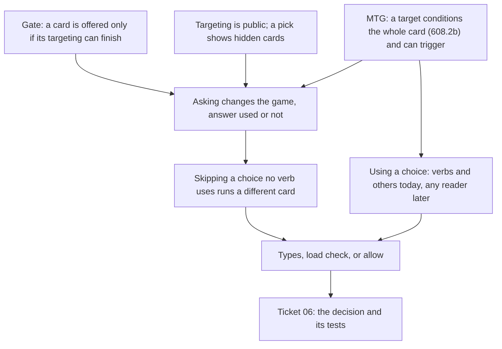

> [!quote] YOU

continue the card-game course


> [!question] Quiz
> A card's only effect is a `Characters` effect with one `Damage` verb, whose selector is `Targeted` with a filter of `EnumSet::empty()`. You chose no load check for empty filters (04b). What happens to this card in a game?
>
> Session 04g: ticket 06, a choice no verb uses. Not the first session of a topic, so no retrieval quiz. This worktree predates PR #74, so I read the code from origin/main.
>
> Why I ask: ticket 06's three options (load check, skip the choice, allow it) differ in what they do to the targeting gate, the rule that a card is offered only if its targeting can finish. This checks the gate is solid before I build on it.
>
> 1. It's offered whenever the mana is there, and then the play is rejected.
> 2. It's never offered, since its targeting can't finish.
> 3. It's offered, and its effect resolves on nothing, like Stray Shot on an empty board.
> 4. It's offered, and its targeting finishes with nothing targeted.


> [!failure] Quiz — incorrect ✗
> Your answer: 4. It's offered, and its targeting finishes with nothing targeted.
> Correct answer: 2
>
> Note: I dont remember the exact code details
>
> An empty filter matches nothing, so the target has no candidate, the can-finish search fails, and `legal_actions` never lists the card. Stray Shot is different: a `Random` selector has no targeting, so an empty board only means it resolves on nothing. And `apply` is `Ok` iff the action is listed, so a card can't be offered and then rejected.


> [!quote] YOU

do the rebase on origin main and use the new skill


> [!question] Quiz
> MTG, Defiant Strike: "Target creature gets +1/+0 until end of turn. Draw a card." In response, the targeted creature is destroyed. What happens when Defiant Strike resolves?
>
> Rebase: `pr74-doc-gaps` is rebased onto origin/main (c855a0c). It was clean and both commits replayed. I haven't pushed. PR #77 needs `git push --force-with-lease`, so tell me if you want that. I'm on the new teach skill now. The quiz tool still runs the old extension until pi reloads, so what the skill puts in `intro` goes here.
>
> Your last answer: your note was the right call. That question asked what today's code does, and the new skill rules that out. Here's the fact. `legal_actions` lists a card with targets only if `can_start_targeting` (`game/targeting_walk.rs`) finds a way to finish its targeting. So a target with no candidate makes the card unplayable whatever its verbs do, whether the cause is an empty filter or an empty board.
>
> Why I ask: this checks how a target relates to the instructions that don't use it. Your answer decides whether I teach that before we weigh ticket 06's options.
>
> 1. You draw a card, and the +1/+0 goes to a new creature you pick.
> 2. Nothing happens, and you draw no card.
> 3. The card returns to your hand, and you draw no card.
> 4. You draw a card, and the +1/+0 applies to nothing.


> [!failure] Quiz — incorrect ✗
> Your answer: 4. You draw a card, and the +1/+0 applies to nothing.
> Correct answer: 2
>
> Note: do the force push.
>
> MTG 608.2b: if every target of a spell is illegal when it tries to resolve, the spell doesn't resolve and none of its instructions happen. The WotC ruling on Defiant Strike (2020-06-23) says it outright: "the spell won't resolve. You won't draw a card." So a target can stop instructions that never use it. It doesn't retarget, since targets are fixed at casting (601.2c). And it doesn't rewind either: the rewind in 601.2 applies only to a cast that can't be finished, not to a spell that has already been cast.


> [!abstract] PI

PR #77 is force-pushed: `a9e7e68...d5361d8`. Its body still matches the branch, because the rebase changed no content, so I left it as is.


> [!question] Question
> Ticket 06 asks us to decide what happens to a target or a pick that no verb and no `others` use, and to write its tests. What else should 04g cover?
>
> On your Defiant Strike answer: MTG 608.2b says a spell whose targets are all illegal doesn't resolve, so the draw doesn't happen either. A target can cancel instructions that never touch it. Your answer is a rule a game could choose, but MTG's rule is the other one. Our engine has no rule here yet. The open thread says to apply 608.2b once a verb can make a target illegal. So this is where your edge sits: you know the gate (no candidate means the card isn't offered), but not that a target can matter to the rest of the card. I'll teach that.
>
> Research (`docs/course/card-game/research/04g-choice-no-verb-uses/unused-choices.md`):
> - I found no printed MTG or Hearthstone card that targets something and then uses the target for nothing.
> - Several cards use a target without acting on it. Soul's Majesty: "Draw cards equal to the power of target creature you control." Rabid Bite: the first target is the damage source.
> - Forge and XMage always ask for a declared target, whatever the effects read.
> - No engine lints for an unused target.
>
> Pick any number of the options below, or none.
>
> 1. What counts as using a choice (Recommended)
> 2. Play conditions
> 3. Neither, just ticket 06


> [!example] Answer
> 1. What counts as using a choice (Recommended)


> [!abstract] PI

## Plan for 04g

**Approach.** You already have the floor: a card is offered only if its targeting can finish. What you were missing is that a target can matter to parts of the card that never use it. I'll start there, because that fact decides between ticket 06's options.

1. **Asking changes the game.** First, what asking for a choice does even when nothing reads the answer. In our engine, a target gates whether the card can be played, and every player sees the targeting, since the targeting is public (ADR 0010). A pick shows the chooser hidden cards. In MTG it goes further: a target cancels the whole card under 608.2b, and being targeted fires heroic or ward. Hearthstone has its own case, Fjola Lightbane.
2. **What skipping a choice does.** From step 1, you derive it. Skipping isn't a harmless shortcut: the game would quietly run a different card from the one the data says.
3. **What counts as using a choice.** This is your extra scope. Under ADR 0019, only the verbs and `others` of the same effect can read a selection. Real cards also read a target in other ways: Soul's Majesty uses its power as a draw count, and Rabid Bite makes it the damage source. So "used" will widen later, and the rule we write now has to survive that.
4. **Three tools.** Steps 2 and 3 feed this one: types, a load check, or allowing it. Types fail here, both on `others` and on step 3's widening. That leaves a load check against allowing it as the empty filter is allowed. That's your call, because it's policy.
5. **The sink.** I draft ticket 06's text and tests from your decision, and you review it.

**Format.** Socratic where you can derive the answer from the gate (steps 2 and 4). Expository with a check for the MTG and Hearthstone facts (steps 1 and 3), since those are rulebook facts you can't derive. Every option is weighed against a real card.



Is this order and scope good, or do you want something changed before I start?


> [!quote] YOU

sounds good


> [!question] Quiz
> Two 1-mana spells. Husk has one effect, `Characters { selector: Targeted(a friendly minion), verbs: [] }`. Blank has no effects at all. In our engine today, how does Husk differ from Blank?
>
> Step 1, asking changes the game. Ticket 06's "skip it" option looks free: if no verb reads the answer, why ask at all? To judge that, keep two halves of a choice apart, the asking and the readers of the answer.
>
> What asking does in our engine:
> - The gate. A card with a target is offered only if its targeting can finish (`can_start_targeting`), so the target alone decides whether the card can be played.
> - ADR 0017. Every player's view shows an open targeting, meaning the card's id and the objects targeted so far. (I wrote ADR 0010 in the plan, but 0017 superseded it and kept this.)
> - ADR 0020. A pick shows the chooser hidden cards face up, and every other player sees how many options there are.
>
> What asking does in other games:
> - MTG 608.2b. If every target is illegal, the whole card does nothing (Defiant Strike's draw).
> - MTG heroic. Akroan Crusader: "Whenever you cast a spell that targets this creature, create a 1/1 red Soldier creature token with haste." Ward also fires on being targeted.
> - Hearthstone. Fjola Lightbane: "Whenever you target this minion with a spell, gain Divine Shield."
>
> So the answer's readers and the asking are separate things. Ticket 06's case empties the readers and leaves the asking.
>
> Why I ask: this checks that the split landed, before we use it on "skip".
>
> 1. Nothing differs, since no verb reads what was targeted.
> 2. It needs a friendly minion to be played, and every player sees the minion targeted.
> 3. It plays the same, and only the view shows the minion targeted.
> 4. It needs a friendly minion to be played, and nothing else differs.


> [!success] Quiz — correct ✓
> Your answer: 2. It needs a friendly minion to be played, and every player sees the minion targeted.
> Correct answer: 2
>
> The asking does two things here even though nothing reads the answer. First, the gate: with no friendly minion, Husk's targeting can't finish, so `legal_actions` never offers it, while Blank is always offered. Second, the view: while Husk is in targeting, ADR 0017 shows every player the card's id and the minion targeted. Once played, Husk resolves exactly like Blank.


> [!question] Quiz
> Husk's author meant "Give a friendly minion +2 Attack" and forgot to write the `Modify` verb. Under "skip", what shows the mistake?
>
> Right, the gate and the view both come from the asking.
>
> Step 2, what "skip" does. Husk differs from Blank only in its asking, and skip removes the asking. So under skip, Husk becomes Blank: it's offered on an empty board, and no player's view ever shows a targeting for it. The data describes one card, and the game runs another.
>
> Skip also adds a rule that every reader of declared targets must follow: "a `Targeted` selector is a target only if some verb reads it". Those readers are the targeting walk, `legal_actions`, the view, and the binding at the push (ADR 0017). Each one has to ask that question, or one function has to answer it for all of them.
>
> Why I ask: this checks that you can derive what skip hides. That decides whether skip stays on the table for step 4.
>
> 1. Only a test that checks the +2 Attack, since Husk plays as Blank.
> 2. Playing Husk, since its player targets a minion for nothing.
> 3. Playing Husk, since it isn't offered with no friendly minion.
> 4. Loading Husk, since the skipped target is reported then.


> [!success] Quiz — correct ✓
> Your answer: 1. Only a test that checks the +2 Attack, since Husk plays as Blank.
> Correct answer: 1
>
> Note: yea I dont think skip is good
>
> Skip turns Husk into Blank, so nothing in a game looks wrong. There's no targeting, the card is always offered, and nothing is reported. Only a test that expects the +2 Attack fails. The other three options belong to the other choices. A load check rejects Husk before any game starts. Allowing it shows the mistake in play: the player targets for nothing, and Husk isn't offered without a friendly minion. Skip is the only option that hides the mistake. It would also silently drop a target that someone wrote on purpose, say as a crude "needs a friendly minion" play condition.


> [!abstract] PI

Agreed, skip is out. Next we decide between a load check and allowing it, and both of those need a definition of "a choice nobody uses".


> [!question] Quiz
> Later, Soul's Majesty is built on 06b's named results: a `Targeted` effect with no verbs names its selection, and the next effect's draw amount reads that selection's power. Suppose we add a load check today that says "a `Targeted` selector needs a verb". What should change when Soul's Majesty arrives?
>
> Step 3, what counts as using a choice. Real cards read a target without any verb acting on it:
> - Soul's Majesty: "Draw cards equal to the power of target creature you control." The creature's power becomes the draw count, and nothing happens to the creature.
> - Rabid Bite: "Target creature you control deals damage equal to its power to target creature you don't control." The first target is the damage source.
> - Mirrorweave: "Each other creature becomes a copy of target nonlegendary creature until end of turn." The target is the one creature it doesn't change.
> - Hunter's Insight: "Choose target creature you control. Whenever that creature deals combat damage to a player or planeswalker this turn, draw that many cards." A trigger remembers the target, which is your 06c case.
>
> Under ADR 0019, only the verbs of its own effect read a selection, plus `others` for a pick. "A later effect can't reuse an earlier effect's selection", and amounts read only History. So today, "a verb or `others` reads it" and "something reads it" are the same rule. They come apart when a new kind of reader arrives: named results (06b), an amount that reads a target, or a remembered target (06c).
>
> Why I ask: this checks which of the two rules a check should be written as. That shapes how ticket 06 words its rule, whichever tool you pick.
>
> 1. Soul's Majesty's selector becomes `Picked`, which the check doesn't cover.
> 2. Nothing changes, and Soul's Majesty is rejected, since its target has no verb.
> 3. The check goes, since a selection can now be read outside its effect.
> 4. The check asks whether anything reads the selection, a verb or a named result.


> [!question] Quiz — I don't know
> Your answer: I don't know
> Correct answer: 4
>
> Note: I dont think we should have load checks, but soul's majesty should be possible, even without load checks I dont see how to represent it today
>
> The rule we actually mean is "every answer has a reader". Today the only readers are verbs and `others`, so "needs a verb (or `others`)" is the same rule. Each new kind of reader joins the set the check asks about. Rejecting Soul's Majesty would turn away a real card. Dropping the check throws away its protection the moment the rule gets interesting. Switching to `Picked` would change when the player answers: a target is named while the card is played, and that timing is exactly what Soul's Majesty needs. Forge shows the shape is real: it holds Soul's Majesty's target on a `Pump` with no pump parameters, a verbless effect whose target a later effect reads.


> [!abstract] PI

You're right that Soul's Majesty can't be written today. Under ADR 0019, only the verbs of a selection's own effect read it. `EffectAmount` is `Static` or `History`, and a later effect can't refer back to an earlier one. So no amount can read a target's power, and no verb on the character makes its owner draw. Rabid Bite fails the same way: a `Damage` source is always the card itself.

When it arrives, there are two routes, and they treat ticket 06's case in opposite ways:

- **A target declared where it's read.** This extends ADR 0017's rule that "a target is declared by the effect that uses it" to amounts and verb parameters. For example, `Draw(EffectAmount::PowerOf(target))`, with the declaration living inside the amount. Rabid Bite then declares its source target inside its `Damage`. A `Targeted` selector with no verbs stays meaningless forever, so Husk stays a mistake. The cost: `EffectAmount` becomes generic over the target form, and every reader of targets (the walk, the binding at the push, the view) has to look inside amounts and verbs too.
- **Named results (06b).** A `Targeted` effect with no verbs names its selection, and later effects read it. This is Forge's verbless `Pump`. Husk's shape then becomes the legal way to write Soul's Majesty.

So the second route needs ticket 06's case allowed. That's another reason against a load check, on top of yours, and against a type that forbids empty verbs. Allowing it rules out neither route. Choosing between them is 06b's job, not this session's.

With skip out and no load check, ticket 06 lands on **allow**, the same call as the empty filter. Two things for you to decide:

1. **Scope of "no load checks".**
   - (a) This case only.
   - (b) A direction. Prefer types, and where a type can't say it, allow. That also settles the empty filter thread, and it changes session H's validation plan, which assumed load checks once card data comes from files.
2. **What ticket 06 becomes.**
   - (a) It closes with no tests: its file goes, ticket 03 is unblocked, and an open thread in `COURSE.md` records the call next to the empty filter, with the two Soul's Majesty routes.
   - (b) It closes the same way, but keeps one test, with a test card like Husk, pinning that a target is asked whatever its verbs. That guards against someone adding "skip" later as an optimization. The cost is a promise for a shape no real card has yet.

I lean toward 1a and 2a. Session H is the place for a validation policy, and a test for a shape no card uses pins nothing a player can see.


> [!quote] YOU

1 b, I prefer the filosophy of making invalid state irrepresentable. 2 a.


> [!abstract] PI

Noted: 2a, ticket 06 closes with no tests. On 1b, read as worded, "where a type can't say it, allow" also removes the two load checks we keep: `BinderError::NotFound`, a code that names no card, and `Duplicate`, two cards with one code. Once card data comes from files, the codes are strings, so no type can rule those out. Some check runs at load whatever we do. The policy needs a line between the checks that stay and the ones that go.


> [!question] Question
> Where does the line for 1b go?
>
> What 1b changes, whatever the line:
> - Ticket 06: a choice no verb uses is asked and allowed.
> - The empty filter thread: settled as allowed.
> - Session H: its plan of load-time validation passes (loose-then-tight filter wording, self-modifiers that restate printed text) turns into "give it a type, or allow it".
>
> Where I'd record it: in an ADR. It's surprising without context, since XMage, for one, runs a card-data verification suite. It also trades catching mistakes at load against catching them in play or in tests. I'll write it once you pick the line.
>
> 1. Run vs no meaning (Recommended)
> 2. Parse only


> [!example] Answer
> 1. Run vs no meaning (Recommended)


> [!abstract] PI

ADR 0021 is committed on its own as 4643d27: "Card data is checked by its types, and loading rejects only data with no meaning". This question checks that the line landed before I write ticket 06's close and the open threads it changes.


> [!question] Quiz
> Under ADR 0021, which of these card data mistakes does loading reject?
>
> The line: types rule out what they can. Otherwise, data with a defined meaning is allowed, however pointless. Loading rejects only data the engine can give no meaning to.
>
> 1. A targeted selector whose filter matches nothing.
> 2. A summon verb that names a code no card has.
> 3. A picked selector with no verbs and no others.
> 4. A static modifier that restates the printed attack.


> [!success] Quiz — correct ✓
> Your answer: 2. A summon verb that names a code no card has.
> Correct answer: 2
>
> A summon of a code no card has has no meaning: there's no definition to create the object from. The other three each have one. The empty-filter target makes the card unplayable. The unused pick opens, gets answered, and changes nothing. The restated modifier adds an attack bonus the card already prints. Each of those is pointless, and ADR 0021 allows pointless data.


> [!abstract] PI

That's the last node. Ticket 06's close is in your working tree, uncommitted, for you to review (`git diff HEAD -- docs/issues`):

- `docs/issues/picks-as-choices/issues/06-a-choice-no-verb-uses.md` is deleted (staged with `git rm`). ADR 0021 now holds the decision.
- `docs/issues/picks-as-choices/spec.md`: row 06 is gone, ticket 03 is blocked only by 02, and the "Before any code" reading list adds ADR 0021. I added that because ticket 03 adds card targets and ticket 04 removes the pick-order check, and both touch the line ADR 0021 draws.
- `issues/03-card-subject-and-card-targets.md`: `Blocked by: 02`. The 04g block is gone, so 03 is ready for you.

ADR 0021 is already committed on its own (4643d27), as the ADR README allows. Once you approve these edits, I'll commit them on this branch, push, and rewrite PR #77's body. The PR then files and closes ticket 06 in one go, so the ticket never reaches main.

If you're ready to end the session, here's what the close-out will change in `COURSE.md`:

- **Knowledge map**:
  - Effects as data: the 04g entry. You held the asking/reading split (Husk vs Blank) and derived that skip hides a forgotten verb. You missed that a target conditions the card's other instructions (Defiant Strike, MTG 608.2b). You chose ADR 0021's line.
  - How he learns: "invalid states unrepresentable, otherwise allow", your stated philosophy. The code-recall probe at the start was mine to avoid.
- **Open threads**:
  - "A choice no verb uses" becomes the settled call, plus Soul's Majesty's two routes for 06b: a target declared inside the amount that reads it, or a named result read by a verbless targeted effect.
  - The empty filter thread closes under ADR 0021.
  - Two session H threads get reworded to "a type, or allowed": the loose-then-tight wording and the self-modifiers that restate printed text.
  - The 608.2b thread gets a note: a target makes the whole card fizzle, not just the verbs that use it.
- **Sessions**: 04g is done (concept only, ADR 0021), and 06b is next.

The close-out commit also takes the research report, `verified-facts.md`, this log, and the 06b log, which already exists and is empty.

Should I end the session?


> [!quote] YOU

create a pr and end the session


> [!abstract] PI

A PR can't be created for this branch because it already has one open, PR #77. So the session's work goes there: I'll commit the ticket edits, push, and rewrite #77's title and body so they cover the whole branch.

## Closing session 04g

**What we settled**
- A choice that no verb and no `others` use is asked and allowed.
- Skip is out, because it turns Husk into Blank and hides a forgotten verb.
- A load check is out. Its check would have to grow with every new kind of reader, and it would reject the verbless targeted effect that named results may need.
- Your philosophy is now ADR 0021 (4643d27): types rule out what they can, and anything else is allowed. Loading rejects only data with no meaning, such as a code that names no card or two cards sharing one code.
- Ticket 06 closes with no tests, and ticket 03 is unblocked.

**What changes in `COURSE.md`**
- **Knowledge map, Effects as data:** the 04g entry.
  - You held the split between asking for a choice and reading its answer, and you derived what skip hides.
  - You missed Defiant Strike: MTG 608.2b lets a target cancel instructions that never use it.
  - Your "I don't know" on readers came with the right note, that Soul's Majesty can't be written today.
  - You applied ADR 0021's line correctly.
- **Knowledge map, How he learns:** your design philosophy, invalid states unrepresentable and otherwise allowed.
- **Open threads:**
  - "A choice no verb uses" now records the call, plus Soul's Majesty's two routes for 06b: a target declared inside the amount that reads it, or a named result read from a verbless targeted effect.
  - The empty-filter thread closes.
  - The loose-then-tight wording thread and the self-modifier thread now say "a type, or allowed".
  - The card-code validation thread is marked as the kind of check ADR 0021 keeps.
  - The 608.2b thread cites Defiant Strike.
- **Sessions:** 04g is done, and 06b is next.

The close-out commit also takes the research report, `verified-facts.md`, this log and the 06b log.

## Next session

```
/new
/name 06b-named-results
/md-log docs/course/card-game/sessions/06b-named-results.md
continue the card-game course
```

Ticket 03 doesn't depend on 06b, so you can start it whenever you like.

I'll commit once the edits are in, then push and update PR #77.
