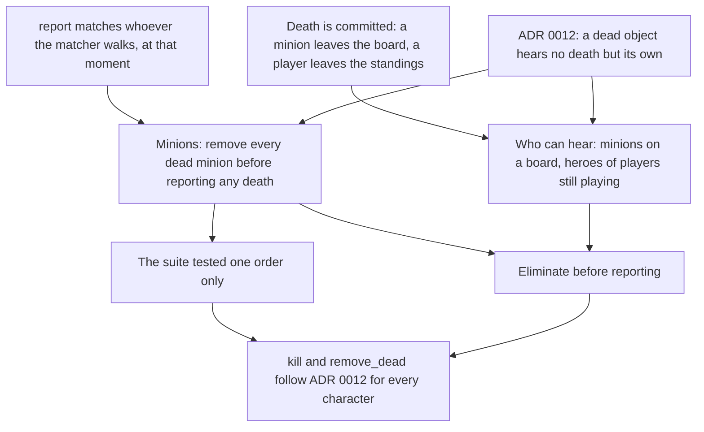

> [!quote] YOU

I want to continue the card game course and fix the mourner bug, how can we do that? i.e. name the session and write the log

> [!abstract] PI

I'll start by reading the course index, the teach skill, and the issue tracker docs.

> [!abstract] PI

I've created an empty log file for the session, so you can link it now. You don't need `/new`: `/md-log` backfills the conversation so far, so this session can be the course session. Run these:

```
/name 05a-dying-mourner
/md-log docs/course/card-game/sessions/05a-dying-mourner.md
continue the card-game course
```

**Why `05a`:** session names follow the topic rather than the date (04c ran before 04a). This bug is in the trigger rules from session 05: ADR 0012 says a minion that has been removed hears no other death. The letter also means the session skips the retrieval quiz. If you'd rather it sort after 06, I can rename the file to `06a-dying-mourner.md`.

**The session plan** follows the issue and the open thread in `COURSE.md`:

1. **Red test (my part).** I'll write a copy of `a_mourner_dying_in_the_same_pass_draws_nothing` (`crates/rules/tests/spec/triggers.rs`) where the Recruit was played before the Mourner, and confirm it fails today.
2. **Fix (your part).** We agree the design first. Then you change `Game::kill` in `crates/rules/src/game/zone_move.rs` so it removes every dead object first and only then emits each `Died` in order of play.
3. **Scope call.** We decide whether to fix the related hero bug now or leave it as an open thread. `kill` never removes a dead hero, so its own `Died` would match its triggers a second time. No hero has triggers yet.
4. **Wrap-up.** Run `just check::all`, then you review. Then a PR, not a push to `main`. It deletes `docs/issues/dying-mourner-hears-older-death.md` and the bug's line under the untangle spec's known bugs (`docs/issues/untangle-game/spec.md`). That unblocks architecture ticket 13.

**Branch state:** `mourner_bug` is at `origin/main` (`a191670`). The only change is the new empty log file, which gets committed at close-out.


> [!quote] YOU

continue the card-game course


> [!abstract] PI

The test fails the way the issue predicts: one draw. Now I'll check the two facts the hero question depends on.


> [!abstract] PI

The issue's prediction holds: today's code gives one draw where ADR 0012 says zero. Before we plan the fix, a couple of quick questions to find where your picture of `kill` stands.


> [!question] Quiz
> With today's `kill`, how many cards does P0 draw from the Mourner's trigger in this game?
>
> Setup: P0 plays a Recruit (2/2), then a Mourner (1/3, "a friendly minion died: its owner draws 1"). P0 Pings the Mourner (3 → 2), then casts Blast (2 damage to every character). Both die in one state check pass. The Recruit is older, so death_order puts it first.
>
> ```rust
> // crates/rules/src/game/resolve/aftermath/death.rs
> fn kill(&mut self, deaths: Vec<Death>, obs: &mut impl Observer) {
>     for death in deaths.iter() {
>         for MatchedTrigger { source, effects } in
>             death_rattles(CardsRef::new(self), death.object_id)
>         {
>             self.effect_stack.push(source, effects);
>         }
>     }
>
>     for death in deaths.into_iter() {
>         let object_id = death.object_id;
>         let player_id = self.objects.get(object_id).player_id;
>         let card_def = CardsRef::new(self).card_def(object_id);
>         if card_def.leaves_zone_on_death() {
>             let to_graveyard = card_def.goes_to_graveyard();
>             destroy(&mut self.zones, player_id, object_id, to_graveyard);
>         }
>         self.report(Report::Died(death), obs);
>     }
> }
>
> // report() calls matched_triggers, which walks characters_in_order_of_play(zones):
> // every hero, plus every minion still on a board.
> ```
>
> 1. No card
> 2. One card
> 3. Two cards


> [!success] Quiz — correct ✓
> Your answer: 2. One card
> Correct answer: 2
>
> The second loop removes one object, reports its death, then moves to the next. When the Recruit's Died is reported, only the Recruit has left. The Mourner is still on the board, so the matcher walks it and its "friendly minion died" pattern matches: one draw. Next the Mourner is removed and its own Died is reported. By then it is off the board, so it can't hear its own death. The red test I just added, a_mourner_dying_in_the_same_pass_as_an_older_minion_draws_nothing, fails with exactly this event list: Died Recruit, Died Mourner, Drew.


> [!quote] YOU

the mourner would never draw for itself tho, right?


> [!abstract] PI

Right, it never draws for itself, but only because of the order things happen in. The trigger's pattern doesn't exclude itself.

The Mourner's pattern is "a friendly minion died", and the Mourner is a friendly minion to its own owner. If its own `Died` were matched while it was still on the board, the filter would pass and it would draw. Two things prevent that:

1. **`death_rattles`** reads a dying object's triggers before removal, but only keeps `Died(Itself)` patterns. The Mourner's "friendly minion" trigger isn't one of those, so it isn't collected there.
2. **`destroy` runs before `report`** for the same object. By the time its own `Died` reaches the matcher, the Mourner has left the board and isn't walked.

`a_mourner_does_not_draw_for_its_own_death` pins this. It still holds after the fix: removing all the dead first only means they also leave before *each other's* deaths are matched.

The bug is the same mechanism applied unevenly. Each object is protected from its own death by being removed first, but not from the deaths reported before its own removal. That's why only the order of play decides whether the Mourner hears the Recruit.


> [!quote] YOU

continue


> [!abstract] PI

Your trace was right. The next question moves from minions to heroes.


> [!question] Quiz
> Suppose a hero card had a trigger with pattern Died(Itself), "when this dies, its owner draws 1". The hero drops to 0 Health and dies in a state check pass. With today's code, how many times is that trigger pushed onto the effect stack?
>
> No hero has triggers today. This is the latent case from the issue.
>
> ```rust
> // cards/definition.rs
> pub(crate) fn leaves_zone_on_death(&self) -> bool {
>     match self.kind {
>         CardKindDef::Spell(_) => true,
>         CardKindDef::Minion(_) => true,
>         CardKindDef::Hero(_) => false,
>     }
> }
>
> // zones.rs, walked by matched_triggers on every report
> pub(crate) fn characters_in_play(&self) -> impl Iterator<Item = ObjectId> {
>     let heroes = self.players.iter().map(|player| player.hero);
>     let minions = self.players.iter()
>         .flat_map(|player| player.board.as_slice().iter().copied());
>     heroes.chain(minions)
> }
>
> // triggering.rs, called by kill's first loop for each death
> pub(super) fn death_rattles(cards: CardsRef, object_id: ObjectId) -> Vec<MatchedTrigger> {
>     triggers(cards, object_id).into_iter()
>         .filter(|t| matches!(t.def.pattern, TriggerPattern::Died(TriggerSubject::Itself)))
>         .map(|t| MatchedTrigger { source: object_id, effects: t.def.effects })
>         .collect()
> }
>
> // kill: first loop pushes death_rattles for every death;
> // second loop: destroy if leaves_zone_on_death, then self.report(Report::Died(death), obs)
> ```
>
> 1. Zero times
> 2. Once
> 3. Twice


> [!failure] Quiz — incorrect ✗
> Your answer: 2. Once
> Correct answer: 3
>
> kill's first loop pushes it once through death_rattles, as for any dying object. Then the second loop skips destroy for a hero, because leaves_zone_on_death is false. The dead hero is still in characters_in_play when its own Died is reported, so matched_triggers walks it, and Died(Itself) matches its own death: a second push. A minion avoids the second match only because it has left the board by then, and a hero never leaves.


> [!abstract] PI

A dead hero triggering twice is the edge I was looking for. One more question to see which belief produced "once".


> [!question] Quiz
> For a dying minion with a Died(Itself) trigger (a deathrattle), what stops that trigger from being pushed a second time when the minion's own Died is reported?
>
> ```rust
> // triggering.rs
> pub(super) fn matched_triggers(cards: CardsRef, event: &Event) -> Vec<MatchedTrigger> {
>     let mut matched = Vec::new();
>     for object_id in characters_in_order_of_play(cards.zones).into_iter() {
>         let player_id = cards.objects.get(object_id).player_id;
>         for Trigger { def: TriggerDef { pattern, effects }, .. } in triggers(cards, object_id) {
>             if fulfill_trigger_pattern(cards, player_id, object_id, pattern, event) {
>                 matched.push(MatchedTrigger { source: object_id, effects });
>             }
>         }
>     }
>     matched
> }
>
> // fulfill_trigger_pattern, Died arm:
> //   TriggerSubject::Itself => trigger_object == event_object
>
> // characters_in_order_of_play = characters_in_play (every hero + every minion on a board),
> // sorted by order of play
> ```
>
> 1. matched_triggers skips Died(Itself), leaving it to death_rattles
> 2. matched_triggers skips characters at 0 Health or less
> 3. The effect stack ignores a second push from one source
> 4. The minion has left the board, so matched_triggers never walks it


> [!success] Quiz — correct ✓
> Your answer: 4. The minion has left the board, so matched_triggers never walks it
> Correct answer: 4
>
> Note: I was not aware that would happen for heroes, now I see it
>
> matched_triggers has no special case. It walks characters_in_play and tests every pattern, Died(Itself) included, and it never reads Health. The effect stack pushes whatever it's given. The only thing keeping a deathrattle from matching twice is that destroy takes the minion off the board before its Died is reported. A hero is never destroyed, so it stays in characters_in_play, gets walked, and its Died(Itself) matches its own death a second time.


> [!question] Question
> Scope for this fix: minions only, or the dead hero case too?
>
> The minion bug: kill removes and reports one death at a time, so a Mourner later in the pass hears an earlier death. A red test pins it now.
>
> The hero case: a dead hero never leaves its slot, so it stays in characters_in_play. It would hear every death in its own pass and in later passes, and its own Died(Itself) would match twice. No hero has triggers, so no card reaches this. COURSE.md already has a related open thread: "Dead heroes stay in their zone and in board_characters, so a future hero trigger would hear deaths after its hero died."
>
> Fixing heroes means a design call: what "can no longer hear" means for an object that never leaves (skip eliminated players' heroes in the matcher, eliminate before reporting, or something else). It also needs a hero card with a trigger, added to the base set only so a test can reach it.
>
> 1. Minions only, hero case joins the open thread (Recommended)
> 2. Both now


> [!example] Answer
> 2. Both now


> [!question] Question
> Given that a dead hero's triggers can't be observed in a 2-player game, how do you want to scope the hero part?
>
> What the code says:
> - 2 players: a hero dying always ends the game in the same state check (Standings::decide gives Won or Draw), and drain_effect_queue (apply.rs:92-105) stops once there's an outcome. Anything a dead hero matched stays on the effect stack, never resolves. Even its legitimate Died(Itself) trigger never runs.
> - The effect stack has no public getter and isn't in View. A crate test could only see it by comparing whole Game values or their Debug strings.
> - The public API is 2 players only: Game::new / with_deck_order take [Vec<DefId>; 2], and setup gives every player HERO, which has no triggers. Standings is already written for N players.
> - So a dead hero hearing things is only observable in a 3+ player game, which no test can build today.
>
> testing.md: a rule no test checks is not a promise.
>
> 1. Minions now, hero case waits for N-player setup (Recommended)
> 2. Minions now, then an N-player exercise for heroes
> 3. Fix the hero case now without a test


> [!example] Answer
> 3. Fix the hero case now without a test


> [!abstract] PI

The research is saved in `docs/course/card-game/research/05a-dying-mourner/dead-player-triggers.md`, and three new facts are in `verified-facts.md`.

## Plan

There are two halves.

**The minion half comes first.** It has the red test, and it rests on three things you already hold: the trace you just did, ADR 0012, and "collect then commit" from session 02.

**The hero half needs one new idea:** for a hero, "in play" and "can hear" stop meaning the same thing. One test sets the limit here. `a_hero_brought_to_zero_stays_in_its_zone` checks that `health(hero) == Some(0)`, and that health is read through `characters_in_play`. So we can't just take the dead hero out of play. The matcher needs its own question.

The steps:

1. **Minion fix (you design and write it).** You propose the shape of `kill` and write it, and the red test goes green.
2. **Why the suite missed it.** This is the same bug as the option ADR 0012 rejected ("remove one dead object per pass, outcome depends on board order") and the Medic order case from session 02. A rule about things that happen together needs a test for each order that matters. One quiz.
3. **Who can hear.** Minions on a board, plus heroes of players still in the standings. A hero's death is already recorded by its player leaving the standings, so there's no new field and no copy of that fact.
4. **Order.** Elimination is a commit too, so it moves ahead of the death reports, next to the removals.
5. **Interface calls (yours).** How the matcher reaches `Standings`, since `CardsRef` doesn't hold it, and the names.
6. **ADR check.** Whether "a dead hero hears nothing" amends ADR 0012 or clears the bar for its own ADR.

As agreed, the hero half gets no test. The commit message will say it's unpinned, and the open thread will tie a test to N-player setup.



Does this plan work for you, or do you want to change the order or the scope before we start?


> [!quote] YOU

works


> [!abstract] PI

## Step 1: the minion fix

**Why:** the red test pins the minion bug, and your trace showed where it comes from. The second loop in `kill` removes one object and reports its death before it removes the next. When a `Died` is reported, the matcher sees whichever dead objects haven't been removed yet. ADR 0012 says the matcher should see none of them.

Before you write it, pick the shape:


> [!question] Quiz
> Which change to kill makes a dead minion hear no death from its own pass, whichever minion is older?
>
> ```rust
> // crates/rules/src/game/resolve/aftermath/death.rs
> fn kill(&mut self, deaths: Vec<Death>, obs: &mut impl Observer) {
>     for death in deaths.iter() {
>         for MatchedTrigger { source, effects } in
>             death_rattles(CardsRef::new(self), death.object_id)
>         {
>             self.effect_stack.push(source, effects);
>         }
>     }
>
>     for death in deaths.into_iter() {
>         let object_id = death.object_id;
>         let player_id = self.objects.get(object_id).player_id;
>         let card_def = CardsRef::new(self).card_def(object_id);
>         if card_def.leaves_zone_on_death() {
>             let to_graveyard = card_def.goes_to_graveyard();
>             destroy(&mut self.zones, player_id, object_id, to_graveyard);
>         }
>         self.report(Report::Died(death), obs);
>     }
> }
> // deaths arrive sorted by death_order (order of play, oldest first).
> // report() runs matched_triggers over every hero plus every minion still on a board.
> ```
>
> Red test: Recruit older, Mourner younger, both die to one Blast. Expected 0 draws, today 1.
> Existing green test: Mourner older, Recruit younger. Expected 0 draws.
>
> 1. Sort the pass youngest first, so the newest minion leaves first
> 2. Report each Died first, then destroy every dead minion
> 3. Destroy every dead minion first, then report each Died in death order
> 4. Read death_rattles after each destroy, inside the second loop


> [!success] Quiz — correct ✓
> Your answer: 3. Destroy every dead minion first, then report each Died in death order
> Correct answer: 3
>
> Note: I am not sure how to handle this, what destroy means? it means it is no longer in the board? if that is the case then I think this is incorrect, take heartstone the minion only leaves the board after its death rattle triggers right? can u do some research on this topic? if the minion is alive until its death rattle executes and if reactions trigger before or after the death rattle, for hearthstone and other games, mtg, ygo and lor at least
>
> The matcher sees whatever is on the board when report runs, so every removal has to land before the first report. Reporting first lets every dead minion hear every death, its own included, so the Mourner draws twice. Sorting youngest first only moves the bug: the green test (Mourner older) would then hear the younger Recruit. death_rattles already runs over the whole pass before any removal, which ADR 0012 wants: a dying object's own triggers are read as it is at that moment, including triggers granted by auras that are dying with it. That loop isn't the problem. The fix is collect then commit from session 02, applied to the phases: each phase runs over the whole set before the next one starts. Read rattles, then remove all, then report all.


> [!abstract] PI

Session 05's research already answers this for all four games, so I didn't start a new search. In none of them is the minion still on the board while its deathrattle runs. Sources are in `docs/course/card-game/research/05-triggers/`.

## Is the minion still on the board when its deathrattle runs?

| Game | What happens | Source |
|---|---|---|
| Hearthstone | Rule 4a: the Death Creation Step kills every dying entity, "removing them from play simultaneously", and removed entities "cannot trigger, be triggered, or emit auras, and do not take up space". Rule 7: a Death Phase then resolves each death's triggers. "Death-triggered effects activate only after the death has fully resolved, and the minion or weapon removed from play." | `hearthstone-timing.md` 2 |
| MTG | "Dies" is a leaves-the-battlefield trigger. The creature is already in the graveyard, and the game "looks back in time" to find the trigger (603.10a). | `mtg-cr.md` 4 |
| YGO | "If this card is destroyed / sent to the GY" triggers activate in the GY. Since the 2020 revision, a trigger that activates on the field can't if its card was destroyed in the same event (Electrumite). | `ygo-timing.md` 1, 2 |
| LoR | A unit at 0 stays until the spell finishes (partly confirmed). Then it's removed, and Last Breath fires after the whole effect resolves. | `lor-timing.md` 2, 3 |

Two things probably make it look as if the minion stays:

- **Mortally wounded minions** in Hearthstone. A minion at 0 Health stays in play and keeps triggering until the Death Creation Step. Acolyte of Pain draws three that way. That's the window *before* death.
- **Matching vs resolving.** The deathrattle is *read* while the minion is still present (MTG looks back; our `death_rattles` runs before any removal). It *resolves* after the minion is gone. Our code has the same split: `kill`'s first loop reads, and the effect stack resolves later.

## Do reactions resolve before or after the deathrattle?

- **Hearthstone:** for each death, the deathrattle and the "whenever a minion dies" reactions are queued together and resolved in order of play. A Cult Master older than the dead minion reacts first; a younger one reacts after.
- **MTG:** each player stacks their own triggers in any order they choose, in APNAP order (603.3b).
- **YGO:** SEGOC order (turn player mandatory, opponent mandatory, turn player optional, opponent optional), and the chain resolves last to first.
- **LoR:** Last Breath comes after the other triggers the effect caused.
- **Ours (ADR 0014, your design):** the deathrattle is pushed first and reactions after, so reactions resolve first. The Mourner draws before the Bomber's deathrattle, which is close to LoR.

## What this means for the fix

"Read rattles, remove all, report all" is what Hearthstone, YGO and LoR do in the part that matters. A deathrattle is read while its minion is still there, and dead minions are gone before anyone matches the others' deaths. MTG is the exception, since it looks back so a dying watcher hears everyone. That's the option ADR 0012 rejected.

If this settles your objection, write the minion fix in `kill` (`crates/rules/src/game/resolve/aftermath/death.rs`) and tell me when it's in. I'll run the red test and the checks. If you want a gap researched, such as where a Hearthstone deathrattle summon lands, say so and I'll send a researcher.


> [!quote] YOU

Im still not sure how to solve, should died passes just ignore the owner or should in play != hearing and instead alive = hearing , I lean the second


> [!question] Quiz
> Suppose "alive" meant health > 0, so matched_triggers walked only characters with health above 0. Which existing test turns red?
>
> Context: you lean to "hearing = alive" over "hearing = in play". The question is what alive means: (1) health > 0, read on the spot, or (2) not yet killed by a state check, meaning a minion still on a board or a hero whose player is still in the standings.
>
> Damage lands before its event is matched:
> ```rust
> // game/resolve/effect.rs
> fn damage(&mut self, target: ObjectId, amount: u8, source: ObjectId, obs: &mut impl Observer) {
>     self.objects.add_damage(target, amount);
>     let report = Report::Damaged { target, amount, source };
>     self.report(report, obs);   // matched_triggers runs here
> }
> ```
>
> Rally Banner (0/5): friendly aura, grants "Damaged(Itself): its owner draws 1".
> Recruit 2/2. Blast: 2 damage to every character. Medic: deathrattle, +2 Health to surviving friendly minions.
>
> Candidates:
> - a_minion_brought_to_zero_health_still_draws_from_rally_banner: boards [RALLY_BANNER, RECRUIT], P0 casts Blast, expects 1 draw.
> - a_mourner_does_not_draw_for_its_own_death: Mourner pinged twice, expects 0 draws.
> - medic_cannot_save_a_minion_dying_in_the_same_pass: boards [MEDIC, RECRUIT], Blast, expects the Recruit's health() to be None.
> - a_hero_brought_to_zero_stays_in_its_zone: Blast drops P0's hero to 0, expects hero_id unchanged and health(hero) == Some(0).
>
> 1. medic_cannot_save_a_minion_dying_in_the_same_pass
> 2. a_minion_brought_to_zero_health_still_draws_from_rally_banner
> 3. a_mourner_does_not_draw_for_its_own_death
> 4. a_hero_brought_to_zero_stays_in_its_zone


> [!success] Quiz — correct ✓
> Your answer: 2. a_minion_brought_to_zero_health_still_draws_from_rally_banner
> Correct answer: 2
>
> Blast drops the Recruit to 0 before its Damaged is matched. With alive meaning health > 0, the matcher skips it, the granted trigger never fires, and the test sees 0 draws instead of 1. That's Hearthstone's mortally wounded rule (Acolyte of Pain keeps drawing at 0), and it's yours: death is decided by the state check, not by health reaching 0 (held since 01). So alive has to mean "not yet killed by a state check": a minion on a board, a hero whose player is still in the standings. Both are facts the state check already commits, so nothing new is stored. The Mourner test passes either way, since a dead Mourner is gone from the board. The Medic test checks a removal, not who hears. The hero test reads health() through characters_in_play, the "in play" question, which stays as it is. That's why hearing needs its own function.


> [!abstract] PI

I've committed ADR 0016 (`cb85dc8`). It records the rule, says no 2-player test can reach the hero half, and lists the options we rejected.

Four interface calls are left, and they're yours. Reply like "1a 2a 3a 4: name".

**1. Which function keeps "every commit before any report"?** That's an order rule, and `file-structure.md` wants one keeper for it.
- **a.** `kill` takes the dead players too and runs three phases: read death rattles, commit (destroy dead minions, eliminate dead heroes' players), then report each `Died`. `remove_dead` only finds the dead. One function holds the whole rule. *(recommended)*
- **b.** `remove_dead` calls `standings.eliminate` before `kill`, and `kill` splits its loop in two. The rule is spread across both: `remove_dead` has to know that `kill` reports.

**2. How does the matcher reach `Standings`?**
- **a.** As a parameter: `matched_triggers(cards, &standings, event)`, with `Game::report` passing `&self.standings`. `CardsRef` stays just the cards. *(recommended, since there's one caller today)*
- **b.** As a field on `CardsRef`, so any card question can ask whether a character is alive. That pays off once targeting and selectors ask too. N-player will need it, since an eliminated player's hero shouldn't be targetable.

**3. Where does the hearing question live?**
- **a.** In `triggering.rs`, replacing `characters_in_order_of_play`, since `matched_triggers` is its only caller. *(recommended)*
- **b.** In a new leaf module under `game/` with no data. That's `file-structure.md`'s home for a decision that reads several owners (`Zones` and `Standings`), and it's ready for a second caller.

**4. The name.** The glossary already has "In play: being a hero, or a card on a board", and "listener" is on Trigger's avoid list. One option is a glossary term **Alive**: "a character no state check has killed: a minion on a board, or a hero whose player is still playing". The function would then be something like `alive_characters_in_order_of_play`. Pick the term and the function name. I'll add the term to `docs/CONTEXT.md` and flag it against "In play".

Once you've answered, you write `kill` and the hearing function. I'll run the red test and the checks.


> [!quote] YOU

1 a. 2 a. 3 a. 4 yes but unslop it.


> [!abstract] PI

I've added to `docs/CONTEXT.md`:

> **Alive**: A minion on a board, or a hero whose player is still playing.

I also flagged it against "In play": a dead hero is in play but not alive, and for a minion the two are the same.

Your turn to write the code:

1. **`resolve/aftermath/death.rs`**: `kill` takes the dead players along with the deaths and runs three phases. First it reads the death rattles of every death. Then it destroys the dead minions and eliminates the dead heroes' players. Last, it reports each `Died` in death order. `remove_dead` stops eliminating.
2. **`triggering.rs`**: `alive_characters_in_order_of_play(zones, standings)` replaces `characters_in_order_of_play`, and `matched_triggers` takes `&Standings`.
3. **`reporting.rs`**: `Game::report` passes `&self.standings`.

One thing to watch: `Standings::playing()` is `pub(super)`, so only code inside `aftermath` can call it, and `triggering.rs` can't. `Standings` needs a question that `game` can reach. That's part of `Standings`' interface, so how it's shaped is your call.

Tell me when it's in. I'll run the red test and `just check::all`. The hero half has no test, as you decided.


> [!quote] YOU

I fixed the test, since fixing for heroes would need 2 and 3 I would like to defer it, can I transform kill into a free function?"


> [!abstract] PI

The checks pass. `just check::all` ran clean, with 178 spec tests, and the red test is now green. I renamed the older test to `a_mourner_dying_in_the_same_pass_as_a_younger_minion_draws_nothing` so it pairs with the new `..._as_an_older_minion_...`.

**Deferring the hero part is fine, and you've already built half of it.** `remove_dead` now runs `kill` (death rattles and removal), then `eliminate`, then the reports. So one function keeps the "every commit before any report" rule, and players are already eliminated before any `Died` is reported. What's left for heroes is the matcher reading `Standings` (your 2 and 3).

ADR 0016 stays as it is, because an ADR records a decision whether or not it's built yet. At close-out the open thread will say the matcher half isn't built and waits for N-player setup.

**Making `kill` a free function doesn't work cleanly yet.** `kill` reads the cards through `CardsRef` (`death_rattles`, `card_def`) and writes `Zones` (`destroy`). `CardsRef::new(&Game)` borrows `Zones`, so `fn kill(cards: CardsRef, zones: &mut Zones, ...)` won't compile. The method works because each `CardsRef` lives for one read and is gone before the write. There are two ways around that, and `file-structure.md` argues against both:

- **A second `CardsRef` constructor built from parts.** That breaks "one function builds it from the owners".
- **Doing the reads outside and passing their results in.** That splits the code by processing step.

Ticket 13 is about exactly this question. Its "done when" includes "which owners each command writes is formal" and "`Game`'s inherent `impl` blocks sit only in the module that defines it". It's blocked on this fix and starts right after it. I'd leave `kill` as a method here and keep this PR to the bug.

Do you want to keep it as a method? If so, one short quiz on why the suite missed the bug, then you review the diff and we open the PR.


> [!quote] YOU

ok, lets do it


> [!abstract] PI

## Step 2: why the suite missed it

The old test passed because it covered only one order. A loop that handles the dead one at a time leaks in one direction only: from the minions handled first to the ones still waiting. A test catches that kind of bug only when its order puts the leak where the assertion can see it. Here's the same idea applied to a different card.


> [!question] Quiz
> Suppose the state check regressed to the option ADR 0012 rejected: remove one dead minion and resolve its death rattle at once, before the next one is removed. Does medic_cannot_save_a_minion_dying_in_the_same_pass catch it?
>
> ```rust
> #[test]
> fn medic_cannot_save_a_minion_dying_in_the_same_pass() {
>     let mut b = boards(&[MEDIC, RECRUIT], &[], &[BLAST], 3);   // Medic played first, so older
>     let recruit = b.mine[1];
>
>     play_def(&mut b.game, b.p0, BLAST);
>
>     assert_eq!(b.game.health(recruit), None,
>         "every minion at 0 leaves before the Medic's +2 Health resolves");
> }
> ```
> Medic: death rattle "+2 Health to your surviving friendly minions". Recruit 2/2. Blast: 2 damage to every character, so both reach 0.
> The regressed pass goes oldest first: remove one, resolve its death rattle, then the next.
>
> 1. It catches it: the older Medic goes first, and its +2 saves the Recruit still waiting
> 2. It misses it: the Recruit is already off the board when the +2 resolves
> 3. It catches it, and would in either order of play
> 4. It misses it: the Medic would have to be younger to reach the Recruit


> [!success] Quiz — correct ✓
> Your answer: 1. It catches it: the older Medic goes first, and its +2 saves the Recruit still waiting
> Correct answer: 1
>
> The regressed pass handles the Medic first, since it's older. Its +2 resolves while the Recruit is still on the board at 0, so the Recruit reaches 2 Health and survives, and the assertion fails. With the order flipped ([RECRUIT, MEDIC]), the Recruit leaves first, the Medic's +2 finds nobody, and the bug goes through unseen. The Mourner bug was the same mechanism with the leak running the other way. The thing that hears has to be handled later, so it's still there when the earlier death is reported. The old Mourner test put it first, which is why the suite stayed green. A one-at-a-time bug leaks from what's handled earlier to what's still waiting, so a rule about one pass needs a test for each order the leak could run in. The Medic test has the catching order by luck. Its twin is cheap.


> [!abstract] PI

The checks pass: 130 unit tests and 179 spec tests. Here's the change for your review.


> [!abstract] PI

Overview of the diff:

- **`death.rs` (yours):** `kill` reads every death rattle and then removes the dead. `remove_dead` then eliminates the dead heroes' players and reports each `Died`, so one function keeps the whole "every commit before any report" order. I have no findings on it.
- **Tests (mine):**
  - The new Mourner test covers the older-minion case.
  - The Medic test has a new twin, `medic_cannot_save_an_older_minion_dying_in_the_same_pass`. It passes today and pins the other direction of the leak.
  - I renamed both originals so each pair reads as younger and older.
- **Issue:** `docs/issues/dying-mourner-hears-older-death.md` is deleted, along with its bullet under the untangle spec's known bugs. The dead-hero bullet stays, since that half is deferred.

`docs/CONTEXT.md`, `verified-facts.md`, the research report and the session log go into the close-out commit, not this one.

The commit message I'd use:

```
The dead leave the board before any death of their pass is reported

kill reads every death rattle, then removes the dead. remove_dead then
eliminates the dead heroes' players and reports each Died, so a minion
dying in a pass no longer hears an older minion's death in it. The
Mourner and Medic tests each get a twin in the other order of play.

Deletes docs/issues/dying-mourner-hears-older-death.md: fixed. The dead
hero half stays a known bug in the untangle spec. ADR 0016 records the
rule, and the matcher reading the standings waits for N-player setup.
```

Shall I commit this, push `mourner_bug`, and open a PR against `main`? Ticket 13 can start once that PR merges.


> [!quote] YOU

yes do that


> [!abstract] PI

The staged set is exactly the five files. Committing:


> [!abstract] PI

The fix is committed as `f20fc19`, right after the ADR (`cb85dc8`). The branch is pushed and the PR is open: https://github.com/EMachad0/CardGameEngine/pull/56. You're still responsible for the merge, so give it the same check you'd give a PR you opened yourself.

Four files are uncommitted on purpose; they go into the session close-out commit:

- `docs/CONTEXT.md`
- `verified-facts.md`
- `research/05a-dying-mourner/`
- this session's log

Shall we end the session here? The close-out would:

- **Update `COURSE.md`:** the knowledge map entries for state checks and testing, the open threads, and the sessions table. The open threads change in two ways: the Mourner thread goes, and the dead-hero thread gets ADR 0016's unbuilt matcher half.
- **Commit and push on this branch,** so the close-out is part of PR #56 before it merges.


> [!quote] YOU

merged, close out
