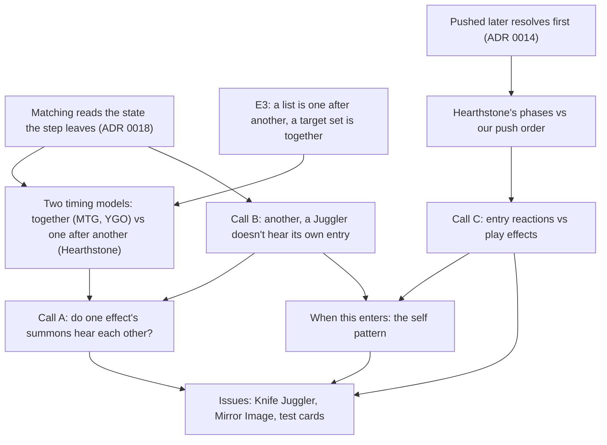

> [!quote] YOU

continue the card-game course 5b


> [!abstract] PI

Now I'll map the code and research the rules in parallel.


> [!abstract] PI

Session 05b: board entries. Knife Juggler ("After a friendly minion is summoned, deal 1 damage to a random enemy") is the forcing card. A few probes first, then the plan.

This one checks whether you hold what ADR 0018 implies for a step that puts two minions on the board. If you do, I skip that node and go straight to the design calls.


> [!question] Quiz
> Under ADR 0018, a step makes all its writes, then the game matches each event the step returned. One step puts minion A, then minion B, on the board and returns "A entered", then "B entered". When "A entered" is matched, which of the two are on the board?
>
> 1. Both A and B
> 2. A only
> 3. Neither A nor B


> [!failure] Quiz — incorrect ✗
> Your answer: 3. Neither A nor B
> Correct answer: 1
>
> Note: it should not listen for itself
>
> Matching runs once the step has made all its writes, so it reads the state the step leaves: A and B are both in. "A only" would be matching each event against the moment it happened, which ADR 0018 gave up. "Neither" would be matching against the state before the step.


> [!abstract] PI

Your note is right as a rule: Knife Juggler must not hear its own entry. Hearthstone's Juggler doesn't, and MTG writes it as "another creature". That's one of today's calls. The question asked something narrower, though: what's on the board when "A entered" is matched. Both are, since matching waits for the step's writes. So with a "friendly minion entered" pattern, B hears A's entry, and A hears its own. I'll take your pick as a read of "should hear" and show it in the first node.

This next one checks how you see minions that arrive at the same time, in the game you know best. Yu-Gi-Oh and MTG treat them one way and Hearthstone another, and the first design call is which our game follows.


> [!question] Quiz
> In Yu-Gi-Oh, one card Special Summons monsters X and Y at the same time. X reads "If a monster is Special Summoned: you can destroy that monster." Can X's effect activate for Y?
>
> 1. Only if the card summons X before Y
> 2. Yes, X can activate for Y
> 3. No, X can't activate for Y


> [!failure] Quiz — incorrect ✗
> Your answer: 1. Only if the card summons X before Y
> Correct answer: 2
>
> Monsters Summoned at the same time see each other's Summon. The Catoblepas and the Witch of Fate ruling covers exactly this: Catoblepas Special Summoned together with an opponent's Spellcaster by Magician's Circle can still activate and destroy it. MTG says the same in 603.6a: after an event puts permanents onto the battlefield, all permanents, "including the newcomers", are checked. In both games "at the same time" has no inner order, so "X before Y" doesn't arise.


> [!abstract] PI

So for you, summons happen in an order even inside one card. In Yu-Gi-Oh and MTG they don't: monsters summoned at the same time each see the others. Hearthstone is the one that goes minion by minion. That gap is where the session starts.

This one checks a different strand: Hearthstone's order for a played minion. Our code today resolves an entry reaction before the minion's own play effects. If Hearthstone's order is new to you, I teach it before you make that call.


> [!question] Quiz
> In Hearthstone, Knife Juggler is on your board. You play a minion whose Battlecry deals 1 damage to an enemy minion. Which resolves first?
>
> 1. You choose which goes first
> 2. The Battlecry, then the knife
> 3. The knife, then the Battlecry


> [!question] Quiz — I don't know
> Your answer: I don't know
> Correct answer: 2
>
> Note: I did not know ygo worked like that. I dont know how HS works in this case either.
>
> Hearthstone plays a minion in phases: it enters, then the On Play phase ("whenever you play" triggers), then the Battlecry phase, then After Play and After Summon. Knife Juggler is an "after summon" trigger, so it waits until the Battlecry, and any deaths it caused, have fully resolved. Ben Brode (2014): "If the summoned minion has a Battlecry, this will take place prior to the activation of any triggered effects or Secrets." No player chooses; the order is fixed by the phases.


> [!abstract] PI

Fair enough: both are rules facts, not something you could derive, and they're the two edges I needed. You hold matching after the step (ADR 0018), the trigger stack, and "the card finishes first". What's missing is how the games time entries: Yu-Gi-Oh and MTG summon "at the same time" with no inner order, while Hearthstone goes minion by minion, in phases.

Now the scope. COURSE.md plans 05b around Knife Juggler with three calls, and the session ends in issues for agents.


> [!question] Question
> What do you want 05b to cover? Pick all that apply.
>
> 1. How the three games time entries (Recommended)
> 2. Who hears one effect's summons (Recommended)
> 3. Juggler and its own entry (Recommended)
> 4. Entry reactions vs play effects (Recommended)
> 5. "When this enters" on the minion itself
> 6. Issues for agents at the end (Recommended)


> [!example] Answer
> 1. How the three games time entries (Recommended)
> 2. Who hears one effect's summons (Recommended)
> 3. Juggler and its own entry (Recommended)
> 4. Entry reactions vs play effects (Recommended)
> 5. "When this enters" on the minion itself
> 6. Issues for agents at the end (Recommended)
> Other: not sure we will do 5 but we should discuss it I think, I think a card like mirror image would be good for testing too, u are free to sugest other cards too


> [!abstract] PI

Probes done. What I found:

- **You hold:** matching after the step (ADR 0018), the trigger stack (pushed later, resolves first), E3 (a list happens one after another, a target set happens together), and "the card finishes first".
- **Edge 1:** you read summons as ordered even inside one card. Yu-Gi-Oh and MTG don't work that way. Monsters summoned "at the same time" each see the others' summons (Catoblepas ruling; MTG 603.6a checks "all permanents … including the newcomers"). Hearthstone is the one that goes minion by minion.
- **Edge 2:** Hearthstone's order for a played minion. It enters, then "whenever you play" triggers, then the Battlecry, then "after you play", then "after summon" (Knife Juggler). Our code today does it backwards: the Juggler's knife would resolve first.

## Plan

**Approach.** We start from what you hold. ADR 0018 already decides who is on the board when an entry is matched. I'll show what that means today with a trace: one effect summons two Jugglers, and each hears the other and itself. Then I lay out the two timing models side by side, which is the gap from probe 2:

- **Together** (MTG, YGO): one event, every newcomer checked.
- **One after another** (Hearthstone): each summon is its own sequence.

That's taught by me, since these are rulings, not something you can derive. It connects to your E3. With that in place:

- **Call B:** how a pattern says "another friendly minion". Your note already raised this. Today `Character(filter)` matches the listener itself, while the Mourner escapes only because the dead don't hear.
- **Call A:** do one effect's summons hear each other? Keep the step whole (together), or split it per minion (one after another, which touches the cursor 06b reshapes).
- **Hearthstone's phases, then a trace of our push order.** Body pushed, then Played reactions, then entry reactions, so they resolve entry, Played, body.
- **Call C:** keep that order, push entry reactions under the body, or match the entry only after the body, which is Hearthstone's "the Juggler doesn't fire if the minion died in its Battlecry".
- **"When this enters"**, as you asked: what `Entered(Itself)` would mean beside play effects, and whether it's built now or waits for its card.
- **Issues.** Knife Juggler, your Mirror Image, a test card that summons two Jugglers in one effect (it's the only kind of card where Call A shows), and a Battlecry minion for Call C.

Expository for the rulings, Socratic for the traces and the calls.



Go ahead with this plan, or change the scope or order?


> [!quote] YOU

yes


> [!abstract] PI

Node 1: two timing models.

Why now: ADR 0018 warns that a pattern on a board entry lets the second minion one summon effect makes hear the first one's entry. Knife Juggler is that pattern. Whether that's a bug depends on which timing model we want.

**Today's code, traced.** Take a test card, Juggling Act, with one effect: `Players { selector: Owner, verbs: [Summon(JUGGLER), Summon(JUGGLER)] }`. Your board is empty.
1. One step puts J1 in, then J2, and returns `BoardEntered(J1)`, `BoardEntered(J2)`.
2. `Game` reports `BoardEntered(J1)`. The listeners are every character in play, so J1 and J2. Say Juggler's pattern is `Entered(Character(friendly minion))`. Both pass that filter, so J1 hears itself and J2 hears J1.
3. Same for `BoardEntered(J2)`: J1 hears J2, and J2 hears itself.

That's four knives. Two of them are a Juggler hearing itself, which your note already rejects (Call B). The other two are the question.

**Together (Yu-Gi-Oh, MTG).** The summon is one event, and everything on the field after it gets checked, newcomers included. MTG 603.6a: "Each time an event puts one or more permanents onto the battlefield, all permanents on the battlefield (including the newcomers) are checked". The ruling on Soul Warden ("Whenever another creature enters"): "If this creature enters at the same time as one or more other creatures, its ability will trigger for each of those other creatures." Your Catoblepas probe is the Yu-Gi-Oh version.

**One after another (Hearthstone).** Each summon is its own sequence. Since patch 9.2, an "after" trigger works only if it was valid when the sequence started. Unleash the Hounds: each hound triggers every Juggler already on the board, one hound at a time. No source tests two Jugglers from one effect. The answer below is inferred from the rulebook, and it matches Fireplace's code.

**Link to E3.** In our data, a list of effects is one after another, and one effect's selection is together. Under ADR 0018 each effect is one step. So Juggling Act written as two Summon effects already follows Hearthstone today, and written as one effect with two verbs it follows MTG, apart from "another". Today the card's shape picks the model.


> [!question] Quiz
> Under Hearthstone's model, where a Juggler doesn't hear its own entry, Juggling Act summons J1 and then J2 onto your empty board. How many knives fly?
>
> 1. None
> 2. One
> 3. Two


> [!success] Quiz — correct ✓
> Your answer: 2. One
> Correct answer: 2
>
> Note: research how LoR handles this cases too
>
> One. J1's sequence starts before J2 exists, so J2 can't hear J1. J2's sequence starts with J1 already on the board, so J1 hears J2 and throws one knife. "Two" is the together model: each Juggler hears the other. "None" would mean a minion never hears the other summons of its own effect, which neither model says.


> [!abstract] PI

LoR fits the comparison. Full report saved to `docs/course/card-game/research/05b-knife-juggler/lor-entries.md`. One caveat first: Riot publishes no comprehensive rules for summon timing. Only the play/summon definition is official. The rest comes from the wiki and from player reports.

**Played vs summoned (official).** A unit played from hand is played *and* summoned. A unit an effect puts on the board is only summoned, so its **Play:** text doesn't fire, but its "When I'm summoned" does. That's the same split as Hearthstone's Battlecry vs summon, and as our `play_effects` vs a `Summon` verb.

**Order for a played unit (wiki and community).**
1. The **Play** effect.
2. The unit's own "When I'm summoned".
3. Other units' "When you summon an ally", left to right on the board, allies before enemies.

So LoR agrees with Hearthstone on the point Call C turns on: the play effect comes before the summon reactions. One exception: a Play effect that is a *Skill* goes on LoR's stack, so the summon triggers can overtake it.

**Several units from one effect.** Each summon fires its own "When you summon" trigger (Blighted Caretaker's two Saplings, Braum and his Poro).

**Summoned together, do they hear each other?** Only one player report covers it. Zoe's "When you summon an ally, grant its keywords to all allies" made the Golden and Silver Sisters each grant the other Lifesteal. That's closer to *together* than to Hearthstone, but unverified.

**"Another".** LoR prints it where it matters, like MTG: Ember Monk and Fleetfeather Tracker read "When you summon *another* ally". The wiki also says a unit isn't on the board until its summon resolves, so it likely can't hear its own summon in any case. That part is inferred.

Where the four games stand now:

| | Summoned together hear each other | Played minion: play effect vs others' entry reactions | Hears its own entry |
|---|---|---|---|
| MTG | yes (603.6a) | no Battlecry; ETBs all go on the stack together | no, "another" is printed |
| Yu-Gi-Oh | yes (Catoblepas) | (not researched) | (not researched) |
| Hearthstone | earlier hears later (inferred) | Battlecry first, Juggler after | no (inferred, Fireplace code) |
| LoR | likely yes (one report) | Play first, then summon reactions | no, "another" is printed |
| Ours today | yes, if one effect; no, if two effects | entry reactions first | yes, with a `Character` filter |

Next is node 2, Call B: how a pattern says "another".


> [!quote] YOU

the games seem to work very similar so I think we should follow
Summoned together hear each other. Play first, then summon reactions. does not hear itself.


> [!abstract] PI

Three calls, noted:
- **Call A, together.** The summon step stays whole, so there's no split and no change to the cursor 06b reshapes. In our data "together" means one effect's step. Juggling Act written as two Summon effects stays one after another, by E3. That's MTG's "create two tokens" vs "create a token, then another".
- **Call C, play effects first, then entry reactions.** This has a sub-call, which comes after this node.
- **Call B, a minion doesn't hear its own entry.** Before you pick how to say that, look at where self-hearing comes from today.

Node 2: who hears their own event. `TriggerSubject` has two forms. `Itself` matches only the listener's own object. `Character(filter)` matches any character that passes the filter, so it matches the listener too whenever the listener passes its own filter and is a listener at all. Two rules you already hold decide that second part:
- ADR 0016: a character hears only until a state check kills it.
- Under ADR 0018, a played card is in no zone during the Play step. That's why a minion isn't on the board when its own play is matched.

Real cards that hear themselves through a filter: Armorsmith, "Whenever a friendly minion takes damage, gain 1 Armor", gains Armor when it's the one damaged. MTG prints "another" (Soul Warden) because 603.6a checks the newcomers too.


> [!question] Quiz
> Take a minion whose pattern uses `Character(friendly minion)`. Which events can that pattern match on the minion's own object? Pick all that apply. Entered is the planned pattern, with the together model.
>
> 1. Its own death (Died)
> 2. Its own damage (Damaged)
> 3. Its own play (Played)
> 4. Its own entry (Entered)


> [!failure] Quiz — incorrect ✗
> Your answer: 2. Its own damage (Damaged)
> Correct answer: 2, 4
>
> Note: I think it does not hear 4 because it was not in play when that happened
>
> Damaged and Entered. A damaged minion is alive and on the board when its damage is matched, so Armorsmith hears itself. An entered minion is on the board when its entry is matched, since matching waits for the step. Died can't: by the time a state-check death is matched, the dead have left and don't hear (ADR 0016), which is why the Mourner needs no "another". Played can't either: during the Play step the card is in no zone, so it isn't a listener. So "doesn't hear itself" is already true for two events by timing, false for one by design (Armorsmith), and false for Entered unless we say otherwise.


> [!quote] YOU

I see, so u saying that it does match that is why the "another" must be explicit


> [!abstract] PI

Yes. Matching waits for the step, so the Juggler is already on the board when its own entry is matched, and a filter it passes matches it. Your "it was not in play when that happened" is Hearthstone's model, where listeners are fixed when the sequence starts. Probe 1 was the same read. Our engine, like MTG, checks the state after the event, newcomers included. So "doesn't hear itself" has to be said somewhere: in the card's data, as MTG and LoR print "another", or as an engine rule for entries.

Three shapes:
- **A third subject.** `TriggerSubject` gets a variant beside `Itself` and `Character(filter)` that matches a passing character other than the listener. The Juggler is written `Entered(<new>(friendly minion))`. It works on every pattern, so "whenever another friendly minion takes damage" works too. `Character(filter)` keeps one meaning everywhere, self included.
- **A rule for entries only.** A filter never matches the listener's own entry, and `Itself` is the only way to hear it. The Juggler is written `Entered(Character(friendly minion))`, like Hearthstone's "a friendly minion" and LoR's "an ally". But then `Character(filter)` includes the listener on Damaged (Armorsmith) and excludes it on Entered, and MTG's "Whenever a creature enters", which hears itself, needs two triggers.
- **A flag on `CharacterFilter`.** "Other than the source", shared with selectors: Dread Infernal's "deal 1 damage to ALL other characters", Stormwind Champion's "your other minions". Today the friendly aura hard-codes "other". This is the most general, but it changes every filter literal and the selectors, and no selector card needs it yet.


> [!question] Question
> How should a pattern say "another"?
>
> 1. A third subject (Recommended)
> 2. A rule for entries only
> 3. A flag on CharacterFilter


> [!example] Answer
> Other: the third one is more generic and may have uses in the future? why dont we add cards to pin its behaviour


> [!abstract] PI

Agreed: the flag, pinned by cards. The objection to it was only that no selector card forces it, and test cards fix that, the same way the issues already allow them. Real cards use "other" in selectors too. Stormwind Champion: "Your other minions have +1/+1." Coldlight Seer: "Battlecry: Give ALL other Murlocs +2 Health." Since 06 a minion enters before its play effects run, so a Battlecry like "give all other friendly minions +1 Attack" would buff the minion itself without the flag. That's a real forcing case for the selector side, next to the Juggler for the pattern side.

The filter check then needs the source object, not just the owner as now: the listener for a pattern, the object whose effect resolves for a selector.

Now its shape. `CharacterFilter` has two axes today, `kind: EnumSet<CharacterKind>` and `side: EnumSet<Side>`, your 04a design. Two ways to add "other":
- **A third set axis**, say with variants `Itself` and `Other`, where both means anyone. It matches the other two axes. But a filter with only `Itself` says what `TriggerSubject::Itself` and `CharacterSelector::Itself` already say, so one fact gets two spellings. Either those two variants fold into the filter (more change, one spelling), or both stay.
- **An exclude-only field.** Two values, "any" or "others only", so it can never pick out the source alone. `Itself` stays the one way to name the source, and there's no second spelling.


> [!question] Question
> Which shape for "other" on CharacterFilter?
>
> 1. Exclude-only field (Recommended)
> 2. Third set axis, fold Itself in
> 3. Third set axis, keep Itself


> [!example] Answer
> 1. Exclude-only field (Recommended)


> [!abstract] PI

Exclude-only it is. Now its name. One clash to avoid: `others` already means the cards a pick didn't take (your 04f name, chosen over `rest`). So a field called `others` or `others_only` would give "other" two meanings in card data. The existing word for the source is `Itself` (`TriggerSubject::Itself`, `CharacterSelector::Itself`): the object a trigger belongs to, or the object an effect came from.

The Juggler's pattern filter under each option:
- `CharacterFilter { kind: Minion, side: Friendly, include_itself: false }`
- `CharacterFilter { kind: Minion, side: Friendly, itself: Inclusion::Excluded }`
- `CharacterFilter { kind: Minion, side: Friendly, others_only: true }`

`CharacterFilter::all()` includes itself in every option.


> [!question] Question
> What do we name the field?
>
> 1. include_itself: bool (Recommended)
> 2. itself: Inclusion
> 3. others_only: bool


> [!example] Answer
> 1. include_itself: bool (Recommended)


> [!abstract] PI

`include_itself: bool`, noted.

Next, the pattern's name. Each pattern today is named after the event it matches: `Died`, `Damaged`, `Played`. A board entry is reported as `Event::BoardEntered`, and history records it as `CharacterEntered`. A played minion goes through `ActionStep::Summon` too, so in our code every minion on a board was summoned, played or not. That's Hearthstone's sense, and the glossary has no "summon" entry yet (you deferred it in 04c). The Juggler's pattern under each option:
- `TriggerPattern::BoardEntered(TriggerSubject::Character(..))`
- `TriggerPattern::Summoned(..)`, with the event renamed `Summoned` to keep the pairing
- `TriggerPattern::Entered(..)`


> [!question] Question
> What do we name the entry pattern?
>
> 1. BoardEntered (Recommended)
> 2. Summoned, and rename the event
> 3. Entered


> [!example] Answer
> 2. Summoned, and rename the event


> [!abstract] PI

`Summoned` it is: `TriggerPattern::Summoned`, with `Event::BoardEntered` renamed to match. "Summon" is in the glossary now ("To put a minion onto a board, whether it is played or an effect puts it there"), flagged against Play.

Node 3: Hearthstone's phases vs our push order. Your Call C was "play effects first, then summon reactions". Here's what each game does for a played minion:
- **Hearthstone:** it enters, then "whenever you play" triggers, then the Battlecry, then "after you play" triggers, then "after summon" triggers (Knife Juggler).
- **LoR:** the Play effect, then the unit's own "When I'm summoned", then other units' "When you summon".

Our `take_action` plays a minion in two steps:
1. **Play step.** It pays, takes the card from the hand, and pushes the card's play effects onto the effect stack inside its write (`play.rs:126-128`). Then `Played` is reported, and its matches are pushed.
2. **Summon step.** The minion goes onto the board, and its summon is reported and matched. That's `BoardEntered` today, `Summoned` once renamed.

The effect stack resolves the newest first (ADR 0014).


> [!question] Quiz
> Knife Juggler is on your board, and so is a minion with "whenever you play a minion, draw a card" (a `Played` pattern). You play a minion with one play effect. Today, in what order do these three resolve?
>
> 1. Play effect, then knife, then draw
> 2. Knife, then draw, then play effect
> 3. Draw, then play effect, then knife
> 4. Play effect, then draw, then knife


> [!success] Quiz — correct ✓
> Your answer: 2. Knife, then draw, then play effect
> Correct answer: 2
>
> Bottom to top, the stack holds the play effect (pushed inside the Play step's write), then the draw (pushed when Played is reported), then the knife (pushed when the summon is reported). Newest first gives knife, draw, play effect: the reverse of Hearthstone's order, which is draw ("whenever you play"), Battlecry, knife. To get Hearthstone's order without moving the draw, the knife has to sit below both, so a played minion's summon reactions go under everything its play pushed.


> [!abstract] PI

Right. Today it's the exact reverse of Hearthstone.

Your Call C moves the knife after the play effect. That leaves one reaction whose place you haven't set: the `Played` reaction (the draw). Today it resolves before the play effect, and Drillmaster pins that for spells: its Squire is summoned before the spell's own effects run. Hearthstone has both kinds. "Whenever you play" (Hobgoblin, Questing Adventurer) resolves before the Battlecry. "After you play" (Mirror Entity) resolves after it, still before "after summon". Our `Played` pattern has one timing, so it has to be one of the two.


> [!question] Question
> For a played minion, where do Played reactions go?
>
> 1. Before the play effects, as today (Recommended)
> 2. After the play effects, before the knife


> [!example] Answer
> 1. Before the play effects, as today (Recommended)


> [!abstract] PI

Kept, so the target order is: draw, play effect, knife.

The last sub-call is *when* the knife's match happens, not only where it's pushed. Three cases tell the options apart. In each one you play a minion M, Knife Juggler (1 health) is on your board, and M has a play effect:
1. M's play effect deals 1 damage to all other minions, which kills the Juggler.
2. M's play effect kills M itself.
3. M's play effect summons a second Knife Juggler.

Hearthstone, per the rulebook and the Juggler's notes: no knife in case 1 (a removed entity can't trigger), no knife in case 2 (the summoning is "cut short"), and none from the new Juggler in case 3 (since patch 9.2 an "after" trigger must be valid when the sequence starts).

- **Matched at the summon, pushed under the play's pushes.** The match happens in the Summon step as today, and only the push position changes. Knives fly in cases 1 and 2, since a matched trigger resolves even if its object or the summoned minion died, like a death rattle. In case 3 the new Juggler is silent. Every trigger keeps one rule: matched at the event, resolves later.
- **Matched after the play effects.** The summon is reported only once M's play effects finish. No knife in case 1. Case 2 needs a new rule for matching a summon whose minion is already dead. The new Juggler hears M in case 3, which is Hearthstone before 9.2. The step that summons no longer reports its own event, which breaks ADR 0018.
- **Matched at the summon, re-checked on resolving.** Like the first, plus a summon reaction does nothing if the summoned minion or its own object left play before it resolves (MTG's intervening "if", 603.4). It matches Hearthstone in all three cases, but it's the first trigger that re-checks, and it's a rule only summon reactions follow.


> [!question] Question
> When is a played minion's summon matched?
>
> 1. At the summon, pushed under (Recommended)
> 2. After the play effects
> 3. At the summon, re-checked on resolving


> [!example] Answer
> Other: 1 for now. 3 is up to debate if in the future it fits more generally


> [!abstract] PI

Option 1, with the re-check as an open thread for when it fits more than summons. Both calls are recorded and committed as ADRs: 0022 (minions summoned in one step hear each other; "another" is `include_itself: false`) and 0023 (a played minion's summon reactions are matched at the summon and pushed under everything the play pushed).

Node 4: "when this enters" on the minion itself. Two kinds of self text:
- **Play effects** run only when the card is played: Hearthstone's Battlecry, LoR's "Play:".
- **`Summoned(Itself)`** matches every summon of the minion, played or put there by an effect: LoR's "When I'm summoned", MTG's "When this enters". Nothing new has to be built for it. `TriggerSubject::Itself` exists, so once the `Summoned` pattern exists, `Summoned(Itself)` can be written, and ADR 0021 allows it.

Where it resolves follows from rules you've already set. ADR 0023 pushes all of a played minion's summon matches under its play. ADR 0014 pushes the matches of one event in order of play, oldest first, so the newest resolves first.


> [!question] Quiz
> Knife Juggler is on your board. You play minion M, which has a play effect and a `Summoned(Itself)` trigger. Nothing reacts to the play. In what order do the three resolve?
>
> 1. Play effect, M's own trigger, knife
> 2. M's own trigger, knife, play effect
> 3. M's own trigger, play effect, knife
> 4. Play effect, knife, M's own trigger


> [!failure] Quiz — incorrect ✗
> Your answer: 4. Play effect, knife, M's own trigger
> Correct answer: 1
>
> Both summon matches go under the play effect (ADR 0023), so the play effect comes first. Within the one summon event, matches are pushed in order of play, oldest first: the Juggler, then M. M is on top, so M's own trigger resolves before the knife. That's LoR's order too: the Play effect, then the unit's own "When I'm summoned", then the other units' "When you summon". "Knife, then M's own" would push one event's matches newest first. Putting M's own trigger before the play effect would treat it as part of the play rather than as a reaction to the summon.


> [!quote] YOU

I see now, u are correct, battlecrys are play effects right?


> [!abstract] PI

Yes. A minion's `play_effects` are its Battlecry: they run only when the card is played from the hand, never when an effect summons it. For a spell, `play_effects` is the whole card text. The slip in your pick was ADR 0014's order inside one event. The Juggler is older, so it's pushed first, and M, the newest, resolves first.

So "when this enters" costs nothing to write: `Summoned(Itself)` exists as soon as `Summoned` does. What's left is whether a test pins it. Without one, it's a reachable meaning nobody checks, the kind the untested-branches thread collects.


> [!question] Question
> What do we do with Summoned(Itself)?
>
> 1. Pin it with a test card (Recommended)
> 2. Leave it writable, untested
> 3. Rule it out by type for now


> [!example] Answer
> 1. Pin it with a test card (Recommended)


> [!abstract] PI

Yes, pinned by a test card. That was the last call. Here are the issues I'd file before closing. All three are `ready-for-agent`, in one effort folder, `docs/issues/summons/`, and each one is blocked by the one before it.

**01: "another" on a character filter** (ADR 0022)
- Calls: `CharacterFilter` gets `include_itself: bool`, and `all()` and every existing literal set it to `true`. One function answers whether a character passes a filter, and it is given the object whose text it is. Every reader asks it: trigger patterns, `All`, `Random`, `Targeted` and picks.
- Test card: **Tremor**, a minion with "Play: deal 1 damage to all other minions".
- Tests: Tremor's play effect leaves Tremor undamaged; it damages every other minion on both sides.
- Left out: the friendly aura's hard-coded "other" (open thread).

**02: Knife Juggler and the summon pattern** (ADR 0022, glossary Summon)
- Calls: `TriggerPattern::Summoned(TriggerSubject)`, and `Event::BoardEntered` becomes `Summoned`. History's `CharacterEntered` gets a name in the glossary's words; the agent picks it.
- Cards:
  - **Knife Juggler**, 2 mana 2/1: `Summoned(Character { Minion, Friendly, include_itself: false })`, then 1 damage to a `Random` enemy character.
  - **Mirror Image**: one effect with two `Summon(IMAGE)` verbs, plus a 0/2 Image definition.
  - Test cards **Juggling Act** (one effect summons two Jugglers) and **Juggling Line** (two effects, one Juggler each).
- Tests:
  1. When Barracks summons a Squire, the Juggler hits the enemy hero.
  2. The Juggler doesn't hear its own summon.
  3. It doesn't hear an enemy minion's summon.
  4. Across seeds, its knife hits only enemies.
  5. Mirror Image throws two knives.
  6. Juggling Act throws two knives.
  7. Juggling Line throws one knife.

**03: a played minion's summon reactions resolve after its play** (ADR 0023)
- Call: the summon's matches are pushed under the play effects and the reactions to the play.
- Test cards:
  - **Courier**: "Play: deal 2 damage to the enemy hero. When this is summoned, deal 3 damage to the enemy hero."
  - **Herald**: "Whenever you play a minion, draw a card."
  - **Ringmaster**: "Play: summon a Knife Juggler."
  - **Dispatch**, a spell: "Summon a Courier."
- Tests:
  1. With a Juggler on board, Courier's 2 comes before the knife.
  2. Courier on its own: its 2 comes before its 3.
  3. With a Juggler on board, Courier's 3 comes before the knife.
  4. With Herald on board, Herald's draw comes before Courier's 2.
  5. Dispatch: Courier's 3 fires and its 2 doesn't.
  6. Ringmaster on an empty board: no knife.
  7. Tremor kills a Juggler that is on board, and its knife still hits the enemy hero.
- The agent may change the amounts if events need to be told apart.

Close-out changes to `COURSE.md`:
- Two open threads close: enter effects, and the summon batching.
- New open threads: the re-check on resolving ("up to debate if it fits more generally"), the aura's hard-coded "other", and `include_itself` as the tool for the open hand-target self rule on `CardFilter`.
- Knowledge map: your "fixed when the sequence starts" reading of matching, which showed up twice, and summons as ordered. Both landed through the together/one-after-another split. Also the one slip on the order of matches within one event.

Do you agree to end the session with these three issues?


> [!quote] YOU

why are these open? the aura's hard-coded "other", and include_itself as the tool for the
   open hand-target self rule on CardFilter. how hard is to settle them rn?


> [!abstract] PI

I got the hand-target one wrong, and the aura one is worth less than I made it sound.

**The hand-target self rule is already settled, and `include_itself` doesn't belong there.** You made that call in ticket 03 of picks-as-choices: while a card is being played it's still in the hand, and it is *never* one of its own options. That rule has no exceptions, so it isn't card data, and a flag a card could set to `true` would only let a card state something meaningless. The thread is open only because nothing is built: Recycle's filter takes minion cards only, so it can't reach itself. Settling it now is small:
- a test card with a hand target over every kind, say "Bury a card from your hand, then draw";
- one exclusion where card-target candidates are listed;
- two tests: the card is not offered as its own option, and another card of the same kind is offered.

It doesn't depend on 01 to 03, so it would be ticket 04, with no design left to discuss.

**The aura's "other" isn't really open.** An aura has no filter today. `modifiers()` gives a friendly aura to every *other* minion on its side, and a hostile aura to every other minion on the other sides. The "other" is the `continue` at `modifiers.rs:21-23`. Almost every printed aura says "other": Stormwind Champion, Grimscale Oracle's "Your other Murlocs", and MTG's lords ("Other Elves you control get +1/+1"). So the hard-code matches the cards. The real question is the aura's *reach*, and nothing forces it yet:
- the first aura that is narrower than "every minion of a side" (a tribe, or adjacency like Dire Wolf Alpha) needs a filter on the aura;
- that changes the data shape: `friendly_aura_effects` and `hostile_aura_effects` would become a list of filter plus effects;
- `receives_auras`, which says heroes and spells never receive auras, would then be said twice, once by it and once by the filter's kind.

That's two or three design calls with no forcing card, so settling it now would be designing ahead of a card. I'd keep it as an open thread, reworded: "An aura's reach is fixed: every other minion of a side. The first narrower aura (a tribe, adjacency) gives auras a filter, and `include_itself: false` then says what the `continue` says today."

So, two questions:
1. Add ticket 04 for the hand-target rule, or leave it waiting for its card?
2. With that settled, do you agree to end the session with the issues?


> [!quote] YOU

Add ticket 04 for the hand-target rule and leave the aura as is. agree with closing the session open a pr


> [!abstract] PI

Closing 05b. Here's what changes.

**`COURSE.md`**
- **Knowledge map (Hooks):** a 05b entry.
  - You read summons as ordered even inside one card, and twice read matching as "who was there before the event", which is Hearthstone's sequence-start model. Both landed through the together vs one-after-another split and the Juggling Act trace.
  - "I don't know" on Hearthstone's Battlecry-before-Juggler order. That's a rules fact, now taught.
  - One slip on ADR 0014's order within one event, which landed at once.
  - Your calls: ADRs 0022 and 0023, `include_itself`, `Summoned`, and `Summoned(Itself)` pinned by a test card.
  - Under How he learns: the four-game table moved you to make three calls at once.
- **Open threads:**
  - Enter effects and the summon batching close.
  - The hand-target self rule now points to ticket 04.
  - "Summon" leaves the deferred-glossary list.
  - New: the re-check on resolving ("up to debate if it fits more generally"), and the aura's fixed reach ("leave as is").
  - The mortally-wounded thread notes that Knife Juggler doesn't reach it: each knife is its own pending effect, and the state check runs between them.
- **Sessions:** 05b is done. 06b is next, once the summons issues merge.

**Also changing**
- Four `ready-for-agent` tickets in `docs/issues/summons/`, as listed, plus ticket 04 for the hand-target rule.
- The research facts go into `verified-facts.md`.
- Two research reports are already in `research/05b-knife-juggler/`.

Start the next session after the summons PRs merge:

```
/new
/name 06b-named-results
/md-log docs/course/card-game/sessions/06b-named-results.md
continue the card-game course
```

I'll commit and open the pull request once the edits are in.
