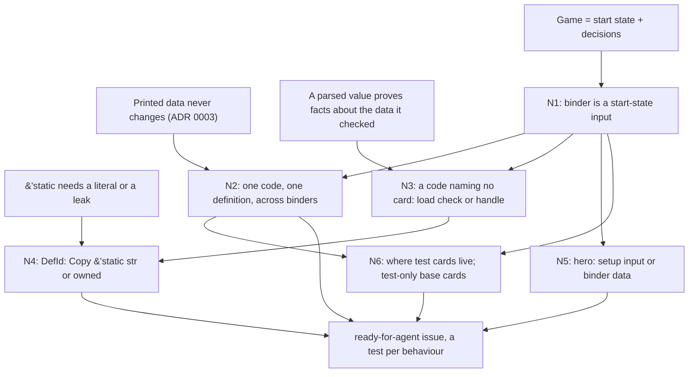

> [!quote] YOU

continue the card-game course


> [!abstract] PI

Now a code brief through an explore subagent.


> [!abstract] PI

Session H1: the binder becomes an input of `Game`. It's been two weeks, and H opens with a short retrieval quiz on 02's codes and the load checks (ADRs 0003 and 0021). This one checks ADR 0003, his versioned-code design, which node 2 builds on.


> [!question] Quiz
> Under ADR 0003, a game was recorded before a patch that changed Bolt's damage. What does the replay need, beyond its seed and its actions, to replay with the old Bolt?
>
> 1. Nothing more: its decks name base.bolt.v0, still in the table
> 2. A snapshot of every definition the game's decks named
> 3. The ObjectIds the old Bolts had during the game
> 4. The number of the data release the game was played with


> [!failure] Quiz — incorrect ✗
> Your answer: 2. A snapshot of every definition the game's decks named
> Correct answer: 1
>
> The table is append-only: the patch adds base.bolt.v1 and leaves v0 in place. The recorded decks name v0, so the replay finds the old definition by its code alone. A release number or a snapshot is what the rejected option (unversioned codes, one snapshot per game) would need. ObjectIds come from the counter in Game, so a replay hands out the same ones without recording them.


> [!abstract] PI

Not quite. The snapshot is the option ADR 0003 rejected (unversioned codes, each game pinned to one snapshot). His design keeps every version in one table. No note came with the answer, so this follow-up checks whether the append-only part faded or the question misled. Node 2 builds on it.


> [!question] Quiz
> Under ADR 0003, what does a balance patch to Bolt do to the definition table?
>
> 1. Moves base.bolt.v0 out to an archive table for replays
> 2. Renames base.bolt.v0 to base.bolt.v1 with the new damage
> 3. Rewrites base.bolt.v0 in place and bumps the table's release
> 4. Adds base.bolt.v1 and leaves base.bolt.v0 in the table


> [!success] Quiz — correct ✓
> Your answer: 4. Adds base.bolt.v1 and leaves base.bolt.v0 in the table
> Correct answer: 4
>
> The table is append-only: a change adds a new version and never edits or removes an old one. That's why a replay needs nothing but the codes its decks recorded: v0 is still there, unchanged, under the same code.


> [!quote] YOU

I was thinking defs were already input in the question


> [!abstract] PI

That makes sense. With the binder as an input (where this session is heading), "what the replay needs" includes the definitions, so a snapshot is a fair reading. My question assumed today's fixed table. Append-only held. Next, ADR 0021, which node 3 extends to codes from any crate.


> [!question] Quiz
> Under ADR 0021, which of these does loading reject?
>
> 1. A Summon whose code names no card definition
> 2. A target whose effect has no verbs to apply
> 3. A filter that no character could ever match
> 4. A pick whose others list has no verbs to apply


> [!success] Quiz — correct ✓
> Your answer: 1. A Summon whose code names no card definition
> Correct answer: 1
>
> Loading rejects only data the engine can give no meaning to: a code naming no card, or two cards with one code. A Summon of a missing card can't mean anything. A target with no verbs still gates playability and shows in the view, an empty filter matches nothing, and an unused pick still opens: each has a meaning, so each is allowed.


> [!abstract] PI

Now a probe on Rust ownership. `DefId` is `Copy` and wraps a `&'static str` today, and node 4 asks whether it stays that way once codes can come from outside the crate, such as from a file read at startup. Your answer tells me how much of node 4 is Rust and how much is design.


> [!question] Quiz
> A card code is read from a file at runtime into a `String`. What does it take to put it in a `DefId(&'static str)`?
>
> 1. Cast it with `as &'static str` once the file has been read
> 2. It can't be done: a &'static str can only point at a literal
> 3. Nothing: borrow it as &code and the compiler extends its lifetime
> 4. Leak the String, as with String::leak, so its memory is never freed


> [!success] Quiz — correct ✓
> Your answer: 4. Leak the String, as with String::leak, so its memory is never freed
> Correct answer: 4
>
> Note: I guess we could leak not sure we should
>
> 'static means the data lives until the program ends. A String's heap memory is freed when it drops, so a borrow of it can't be 'static, and the compiler never extends a lifetime or allows an `as` cast to one. String::leak (or Box::leak) gives up the memory for good and hands back a &'static mut str. Literals are the common source of &'static str, not the only one. Leaking is fine for data loaded once, and a leak on every hot reload grows memory without bound.


> [!abstract] PI

On whether to leak: that's node 4, and you're right to hesitate. We'll weigh it there. This probe checks parse, don't validate (architecture 02g) applied to the binder, the edge node 3 sits on. Suppose `DefId`'s constructor stays private and a binder hands out a `DefId` only for a code it holds.


> [!question] Quiz
> A test builds binder A and binder B, takes DefIds from A, and starts a game with B and decks of those DefIds. Can `B.get(def_id)` panic?
>
> 1. No: a private constructor proves the code has a definition
> 2. No: every binder holds the base set, so B holds A's codes
> 3. Yes: the DefId proves the code is in A, not in B
> 4. Yes, but only if A and B define one code differently


> [!success] Quiz — correct ✓
> Your answer: 3. Yes: the DefId proves the code is in A, not in B
> Correct answer: 3
>
> Note: yes but this would never happen outside a test
>
> A parsed value carries the facts its check learned about the data it checked. A's DefId proves "A has this code" and says nothing about B. A private constructor only limits who can make one, not which binder it is later used on. So the guarantee holds only if the DefId can't reach another binder: one binder per process, a DefId branded with its binder (a lifetime or an ID), or a check where the game takes the decks. The last option is node 2's problem: a code that two binders define differently panics nowhere and means two things.


> [!abstract] PI

Your note: you're mostly right, and it matters for node 3. Under ADR 0003 the production table only grows, so a `DefId` from an older binder stays valid in every newer one. Hot reload that only appends keeps it valid too. Mismatched binders really do come from tests. But this session is about to put many binders into the test suite, one per test that brings its own card. So whether a mismatch should be a panic, a load error or a type error is a real choice. A panic inside a test is at least loud, and that's an argument for the cheap option. That's your call in node 3.

**Where the probe leaves you.** You still hold append-only versioning and ADR 0021's line. Your first miss came from my question, which assumed today's fixed table while you read the definitions as an input already. That reading is node 1. You know `String::leak` and what it costs, and that a parsed value proves facts only about the data it was checked against. You hit no ceiling on the design strands, which is expected: these are design calls, not gaps.

**Research** (`research/h1-binder-as-input/engines.md`, five engines):
- **Who passes the card database into the game:** only Spellsource. `GameContext` takes a `CardCatalogue`. Forge, XMage, SabberStone and Fireplace use process-wide globals.
- **Test-only cards:** XMage (`CustomTestCard`) and Spellsource (`addTempCard`, plus a `TEST` set) build them inline in the test. They never enter the real catalogue.
- **The hero:** SabberStone and Fireplace take it as a setup input for each player. Spellsource derives it from the deck's class.

**The approach.** This is a design session, one node per call, ending in a `ready-for-agent` issue. I'll show each forcing case from today's code (`Binder::built_in()` at `setup.rs:8`, `HERO` hardcoded at `setup.rs:13`, Dud in `base.rs`), then you make the call. N1 comes first because every other node assumes the binder is an input. N2 and N3 are the two ways a code can go wrong across binders: it names two definitions, or it names none. N4 follows from N3, because how a `DefId` is built depends on who may build one. N5 and N6 hang off N1 and are short. The issue comes last and lists one test per behaviour.



Card files, reading codes from files, text generation and ADR 0003 vs a per-game release all stay in the H app session.

Is this plan OK to start with N1?


> [!quote] YOU

yes


> [!abstract] PI

N1: the binder is part of the start state. Why now: Dud, a spell whose effect has no verbs, sits in the base set only so a test can pin ADR 0021 ("a choice no verb uses is still asked"). So every real game's binder holds a card no deck should ever play. And a branch no base card reaches stays unpinned, like a hand target that could include the card being played. A test can't bring its own card, because `setup` makes the binder itself. R1 says a game is a start state plus decisions. `set_up` takes the seed and the decks as parameters but calls `Binder::built_in()` inside, so the binder is the one start-state input a test can't control. testing.md asks for the opposite: "take inputs instead of creating them inside". So the binder becomes a parameter of `Game::new`, beside the seed and the decks.


> [!question] Quiz
> With the binder as an input, a test builds one holding the base set plus `test.dud.v0`, and plays a game. What must a replay of that game record, besides the actions?
>
> ```rust
> pub(super) fn set_up(seed: u64, decks: [Vec<DefId>; 2], shuffle: bool) -> Game {
>     let mut seating = Seating::new(seed, Binder::built_in(), decks.len());
> ```
>
> 1. The seed, the decks, and the base set's release number
> 2. The seed and the binder, since the decks come from the binder
> 3. The seed, the decks, and the binder the game was built with
> 4. The seed and the decks, since each code names its version


> [!success] Quiz — correct ✓
> Your answer: 3. The seed, the decks, and the binder the game was built with
> Correct answer: 3
>
> A replay rebuilds the start state, and the binder is now part of it. A versioned code names a definition only within some table. `test.dud.v0` is in no table except the test's own binder, so the codes alone can't find it, and a base-set release doesn't hold it either. Decks are their own input: one binder serves any deck. How a replay records "the binder" is open: the whole thing, or a name that always means the same definitions. That's exactly where ADR 0003 comes back in N2. In production, a single append-only table can be named once and stays valid forever.


> [!abstract] PI

N1 holds: the binder is a start-state input, so a replay records it. N2 asks how much of it a replay has to record. ADR 0003's payoff was that a code pins one definition forever. That's why a replay of a production game needs no release number and no snapshot: the codes are enough, because there's one append-only table. Binders as inputs put that at risk. `CardDef` is already public, so once `Binder`'s constructor is public, a test can build a binder holding its own `base.bolt.v0` that deals 1, to make some test easier to set up.


> [!question] Quiz
> If any binder may give `base.bolt.v0` its own definition, what must a replay record about its binder?
>
> 1. Only the definitions whose codes are outside the base set
> 2. The base set's release number, which fixes each base code
> 3. Nothing about it, since each code already names its version
> 4. Every definition in it, since a code no longer pins one definition


> [!success] Quiz — correct ✓
> Your answer: 4. Every definition in it, since a code no longer pins one definition
> Correct answer: 4
>
> Once one code can mean two definitions, the code alone can't tell which Bolt a game used, so the replay has to carry the definitions themselves: the per-game snapshot, the option ADR 0003 rejected. "Only the extras" fails because the redefined Bolt has a base code. A release number fails because the binder isn't the release. So ADR 0003 holds across binders only if no binder can give a code a second definition, test binders included. Then a test binder is the one table plus cards whose codes it never uses, and a replay records only those extra cards.


> [!abstract] PI

Right. N2's call: how to rule out a second definition for one code, now that tests build binders. Today `Binder::new` rejects a code listed twice (`Duplicate`) and a base code with no definition (`NotFound` against `ALL_DEF_ID`). Research: Spellsource adds test cards per game (`addTempCard`) on top of the real catalogue, and XMage's test cards get a `custom` set code and never enter the repository.


> [!question] Question
> How should a test binder be built, so that no code gets a second definition?
>
> 1. Base plus extras (Recommended)
> 2. Base plus one shared test set
> 3. Any list of cards
> 4. Sets with enforced prefixes


> [!example] Answer
> 4. Sets with enforced prefixes


> [!abstract] PI

Sets with prefixes it is. One follow-up before N3. "Each code starts with its set's prefix" can be a load check or a shape. A load check would be a new rejection beyond ADR 0021's two (a code that names no card, a code used twice). Your rule from 04g prefers a type where one fits. Here one does: a card inside a set carries only its name and version, and the binder composes `set.name.version`, so no card can be written with a wrong prefix. References between cards, like a Summon naming `base.squire.v0` from a test set, still name full codes, which is N3's problem.


> [!question] Question
> How is the set prefix enforced?
>
> 1. By shape (Recommended)
> 2. By a load check


> [!example] Answer
> 1. By shape (Recommended)


> [!quote] YOU

I think base set should no longer live on the engine


> [!abstract] PI

Prefix by shape, noted. Moving the base set out of the engine changes the session's scope, so first where it goes. Three things follow from the move. `setup` can no longer name `HERO`, which settles half of N5: the hero comes from outside. Any crate holding cards makes `DefId`s, so N3 and N4 stop being hypothetical. And every test needs cards from somewhere. A limit I checked with a throwaway workspace: if `rules` takes a card crate that depends on `rules` as a dev-dependency, its crate tests in `tests/` compile, but its unit tests in `src/` fail with mismatched types, because they link a second copy of `rules`. Unit tests using Spark, Bolt or Recruit (the binder's own tests, for one) would then build their cards inline.


> [!question] Question
> Where do today's 33 base cards go?
>
> 1. Into rules' tests as its test set (Recommended)
> 2. A new card crate, a dev-dependency of rules
> 3. Split them


> [!example] Answer
> 1. Into rules' tests as its test set (Recommended)


> [!quote] YOU

what is the the "base" set is a game call, and the non-unit tests could have a shared set too


> [!quote] YOU

what is the the "base" set is a game call, the bench having its own tests is good cause adding cards degrades performance today


> [!abstract] PI

ADR 0022 is committed (fc4c018). And yes: the bench keeping its own small set keeps its numbers apart from how many cards the tests need.

N3: a code that names no card. Once sets live outside `rules`, other crates make codes in three places: decks, the hero, and card data that names another card, like Barracks' `Summon(base.squire.v0)`. A test set with a typo, `Summon(test.sqire.v0)`, passes today's checks. It panics in `Binder::get` only when a test happens to resolve that Summon. ADR 0021 says loading rejects exactly this. The catch is that the check has to know every place card data can name a code, and the next card that names one ("shuffle a Bomb into their deck", Discover from a list) adds another place.


> [!question] Quiz
> Which design makes a new card field that names a code fail the build until the binder checks that field?
>
> 1. Sets hold codes as strings; the binder parses each card into one whose codes are DefIds only it builds
> 2. Sets hold DefIds from a public DefId::new; the binder walks Summon and the hero to check each one
> 3. DefId::new checks each code against a global registry of every set's codes when it is called
> 4. Binder::get returns Option<&CardDef>, and each verb that names a code handles the None case


> [!failure] Quiz — incorrect ✗
> Your answer: 2. Sets hold DefIds from a public DefId::new; the binder walks Summon and the hero to check each one
> Correct answer: 1
>
> Note: I would like to keep how it is today panic and load check
>
> Parse, don't validate: two card types, one with plain codes, one with DefIds that only the binder can build. A new field that names a card is a string in the first type and a DefId in the second, so the binder's conversion doesn't compile until it parses that field. A walk is a validator: a new field it doesn't visit passes silently. A global registry brings back the global the binder replaced, and ties DefId to every binder at once. Option pushes a load-time fact into every verb at runtime. The cost of parsing is a second card type, the same typestate shape as Effect<T> at the push.


> [!abstract] PI

Your note is a fair call. The question asked which design makes the build fail, and the walk doesn't: a field it never visits passes in silence. You prefer it anyway: a load check plus today's panic in `Binder::get`, which under "Checks before writes" only a bug can reach once the check has passed. That's a coherent choice and fits ADR 0021 as written. Here's how it would look. A public `DefId::new`. `Binder::new` walks each card for the codes it names and returns `NotFound`. `Game::new` checks the decks and the hero against its binder and returns `Err`. The last check also covers the probe's case, a deck built for one binder used with another. One cheap middle option: the walk destructures each card type with no `..` and matches every effect enum with no `_`. A new field or variant then fails the build inside the walk without a second card type, though a new field nested in a type the walk doesn't destructure still slips through.


> [!question] Question
> Which load check for codes that name no card?
>
> 1. Walk, exhaustive (Recommended)
> 2. Walk, plain
> 3. Parse into a second card type


> [!example] Answer
> Other: parsing it onto another type is great, I am not sure it should be strings tho


> [!abstract] PI

Parsing it is. You're right to doubt strings: a plain string means the binder has to split `"base.squire.v0"` into its parts, which is a format check at load, the kind you want to avoid. So the unparsed side gets its own type too. Here's the shape so far: two types. An unparsed card reference that any crate can write, used in a set's card data (Summon), in decks and for the hero. And `DefId`, which only the binder builds when it parses a reference against its own definitions. `Game::new` would take decks as unparsed references and parse them against its binder. That rules out the probe's case of a DefId from binder A used with binder B, by construction: "take that code's input plain, and parse it where it arrives". This is N4. The open question is what the unparsed reference is made of.


> [!question] Question
> What is the unparsed card reference made of?
>
> 1. Parts, all &'static, Copy (Recommended)
> 2. Parts, owned
> 3. One &'static str


> [!example] Answer
> 1. Parts, all &'static, Copy (Recommended)


> [!abstract] PI

Settled for N3 and N4. The unparsed reference is a Copy struct of `&'static str` parts. `DefId` is built only by the binder as it parses. `Game::new` takes plain references and parses them against its own binder. The panic in `Binder::get` stays as a bug guard. A check of how that plays out.


> [!question] Quiz
> A card in the crate tests' set has `Summon` naming `{ set: "test", name: "sqire", version: 0 }`, and no set defines it. When does it fail?
>
> 1. When Game::new parses the decks and the hero against it
> 2. Never: ADR 0021 allows a Summon that names no card
> 3. When the Summon resolves and Binder::get panics on it
> 4. When the binder is built, as it parses that card's Summon


> [!success] Quiz — correct ✓
> Your answer: 4. When the binder is built, as it parses that card's Summon
> Correct answer: 4
>
> The binder's parse turns every reference in card data into a DefId, and it can build one only for a definition it holds, so the typo returns NotFound while the binder is being built, before any game exists. Game::new parses only the references it's given (decks, hero). Binder::get's panic can't fire, because a parsed card holds no unparsed reference. ADR 0021 rejects exactly this case: a code that names no card.


> [!abstract] PI

Right. Before I write it up as an ADR (two card types, references parsed by the binder), the unparsed type needs a name, since every set, deck and Summon will use it. ADR 0003 calls the stable identity of a definition its "code" (`base.bolt.v0`), and the parsed side stays `DefId`. A name should tell a reader which of the two a value is.


> [!question] Question
> What is the unparsed reference called?
>
> 1. DefCode (Recommended)
> 2. CardCode
> 3. DefRef


> [!example] Answer
> 1. DefCode (Recommended)


> [!abstract] PI

DefCode it is. One more N4 call, the one that shapes every card literal: how "two card types" is spelled in Rust. Today `Summon(DefId)` sits in `PlayerVerb`, inside `Effect<S: TargetForm>`, inside `CardDef`. The written card and the parsed card differ in one slot (DefCode vs DefId), which is the same argument that made `Effect<T>` one generic type in 04d instead of two copies. A default type parameter keeps the ripple small. `CardDef<C = DefId>`, `Effect<S, C = DefId>` and `PlayerVerb<C = DefId>` mean every existing `CardDef` or `Effect<Declared>` in the game code still names the parsed type, unchanged. Only a set writes `CardDef<DefCode>`, and only the binder's parse is generic. That parse maps each enum with no `_`, so a new slot holding a card fails the build there.


> [!question] Question
> How should the written and parsed card types be expressed?
>
> 1. A defaulted type parameter (Recommended)
> 2. An associated type on the stage trait
> 3. Two separate type trees


> [!example] Answer
> Other: can u do more research on this, I really doubt this generics approachs is correct, in my mind having a public type and an private type used everywhere inside and a conversion between the two is much cleaner, if needed spawn another session on this


> [!abstract] PI

Fair doubt, and your shape is a real option: a public written type that other crates build, a private type the engine uses everywhere, and one conversion between them. It's what I listed as "two separate trees", but I framed it badly. As public vs private, the inner type is free to differ, for example to hold whatever performs best, and that's an argument I left out. I've started a researcher on it (card engines that split a description type from a runtime type, rustc's AST to HIR lowering, cargo's manifest types, and the generic "trees that grow" route), saved to `research/h1-binder-as-input/written-and-parsed-cards.md`. It runs in the background. The nodes left don't depend on it, so we can keep going and come back when it lands. If it needs more than one call, it gets its own session.

N5 meanwhile. ADR 0022 says setup can't name a hero, so the hero comes from outside. Research: SabberStone and Fireplace take a hero for each player as a setup input. Spellsource derives it from the deck's class. Hearthstone's deck codes carry the hero too.


> [!question] Question
> Where does a player's hero come from?
>
> 1. Part of the deck input (Recommended)
> 2. A separate per-player input
> 3. Binder data


> [!example] Answer
> 1. Part of the deck input (Recommended)


> [!abstract] PI

Hero is part of the deck input: `Deck { hero, cards }`, parsed by `Game::new`.

The research is in (`research/h1-binder-as-input/written-and-parsed-cards.md`). Both shapes have strong precedent:
- **Your shape (B):** rustc's AST to HIR. RFC 1191 separates "the interface to the compiler (the AST) from its implementation (the HIR)" and resolves names during the lowering. Cargo has `TomlManifest` to `Manifest`. Both name the cost: duplicated types, and "a net negative for readability" on its own.
- **The generic shape (A):** GHC's Trees That Grow, one tree indexed by phase. Its costs in Rust: `#[derive]` puts bounds on every parameter (rust#26925), defaults work only in type position, and `impl<C>` is needed on every generic helper.
- **Which fits when:** B fits when the inner form is expected to change shape (precomputed, flattened, an index for a `DefId`) and the public form should stay put. A fits when the two trees are nearly identical.
- **Card engines:** most split a description type from a runtime type (Spellsource's `CardDesc` to `Card`). Spellsource still keeps string IDs and looks them up at play time. SabberStone resolves at build time, as our binder would.

In this repo, B means the prelude exports only the written types, with `DefCode`, and views and events report a `DefCode`. `DefId` becomes fully private, so it could later become an index. That fits your bench concern. There's also a middle form: split only the types on the path from `CardDef` down to `Summon`, and share the leaves that hold no card (filters, amounts, `ModifierEffect`) until the inner form needs them different.


> [!question] Question
> Which shape for written vs parsed cards?
>
> 1. B, split only where they differ (Recommended)
> 2. B, full split
> 3. A, a defaulted type parameter


> [!example] Answer
> 1. B, split only where they differ (Recommended)


> [!abstract] PI

ADR 0023 is committed (217e3bb), and "Code" is in the glossary. N6 is the last node: where test cards live. Settled already: the crate tests share one set in `tests/spec/`, holding today's 33 cards (Dud included), all moved out of `src/`. Unit tests build the cards they need inline, and the bench has its own set. One thing is open: whether a single test may also bring a card of its own. The motivating case was a branch no shared card reaches, like a hand target that could include the card being played.


> [!question] Question
> Can a crate test bring cards beyond the shared set?
>
> 1. Yes, as its own set beside the shared one (Recommended)
> 2. No, every test card goes in the shared set


> [!example] Answer
> 1. Yes, as its own set beside the shared one (Recommended)


> [!abstract] PI

N6 is settled: a test may add its own set beside the shared one. I'm writing the issue now, and one case came up that needs your call. A deck's `hero` is a `DefCode`, and nothing in its type says it names a hero card. A deck with `hero: test.recruit.v0` would put a minion in the hero zone. ADR 0008 says that zone always holds exactly one object. A minion there that dies is removed like any minion (`kill` skips only heroes), so the zone empties and the invariant breaks. That's data the engine can't give a meaning, but ADR 0021 lists only two rejections (a code naming no card, a code used twice).


> [!question] Question
> What happens when a deck's hero names a card that isn't a hero?
>
> 1. Game::new rejects it, and ADR 0021 is amended (Recommended)
> 2. Give it a meaning
> 3. Leave it to the panic


> [!example] Answer
> 1. Game::new rejects it, and ADR 0021 is amended (Recommended)


> [!abstract] PI

ADR 0024 is committed (399cabb), superseding 0021. The issue is written at `docs/issues/binder-as-input.md`, uncommitted, for your review. Summary:
- `DefCode` with a `set.name.vN` display. A public set type with a prefix, whose cards hold only name, version and definition.
- Written types for every type that can reach `Summon` (`CardDef`, `CardKindDef`, `MinionCardDef`, `TriggerDef`, `ModifierEffect`, `Effect`, `PlayerVerb`, `CharacterVerb`), each with a private counterpart. The rest stays shared. The conversions use no `_` and no `..`. `DefId` stays private and `Copy`.
- A public `Binder` whose one constructor returns `Duplicate` or `NotFound`. `def_ids!`, `static_card_definition` and `built_in` go.
- `Deck { hero, cards }`. `Game::new(seed, binder, decks)` returns `Result`, rejecting a missing code or a non-hero hero, all before the first write. Views report codes.
- The 33 cards move to a shared `test` set in `tests/spec/`. A test may add its own set. The bench has its own set. Unit tests build their cards inline.
- 13 tests, one per behaviour, and a Names section the agent fills in the PR.

I picked a few things myself: `version: u16`, the `test` prefix, and keeping the existing public names on the written side. Those are in the file or left to the agent's Names section.


> [!question] Question
> Is the issue ready to commit as ready-for-agent?
>
> 1. Yes, commit it
> 2. Changes first


> [!example] Answer
> 1. Yes, commit it


> [!abstract] PI

The session closes here. ADRs 0022, 0023 and 0024 and the issue are already committed (`fc4c018`, `217e3bb`, `399cabb`, `563b51a`). My close-out changes to `COURSE.md`:

- **Knowledge map:**
  - Definitions and IDs: you held that the binder is a start-state input before it was taught. Your Q1 miss was my framing. You knew a parsed value proves facts only about the data it checked, and you scoped where mismatched binders occur ("never outside a test"). Asked which design fails the build, you answered with your preference for today's walk. Then you chose parsing, rejected string codes, and proposed the public written type plus private inner type yourself. The research backed it as rustc's AST to HIR.
  - Rust: you knew `String::leak` and doubted whether to use it.
  - How he learns: when he doubts a recommended shape, he asks for research and proposes the alternative. Concede when the research supports him.
- **Course plan:** the H1 bullet now records what the session settled: the rules crate holds no cards (ADR 0022), written and parsed cards with `DefCode` (ADR 0023), the hero in the deck, the non-hero hero rejection (ADR 0024), and the shared test set with per-test sets. It names `docs/issues/binder-as-input.md` as the AFK build.
- **Open threads:**
  - The session H thread now says code validation is settled as the binder's parse. ADR 0003 vs a per-game release stays in the H app session, with your Q1 reading (a replay records its binder) as input to it.
  - The Dud and base-set mentions are updated.
- **Sessions table:** H1 done, 06b next.
- **Elsewhere:**
  - `verified-facts.md` gets four facts:
    - My throwaway workspace: a dev-dependency cycle compiles crate tests, and unit tests get mismatched types.
    - Default type parameters work only in type position.
    - Spellsource's injected `CardCatalogue`.
    - SabberStone resolving `SummonTask` at construction.
  - The glossary's new term **Code** goes in the same commit.

Start the next session with:

```
/new
/name 06b-named-results
/md-log docs/course/card-game/sessions/06b-named-results.md
continue the card-game course
```

The 06b log file already exists. I'll commit once the edits are in.
