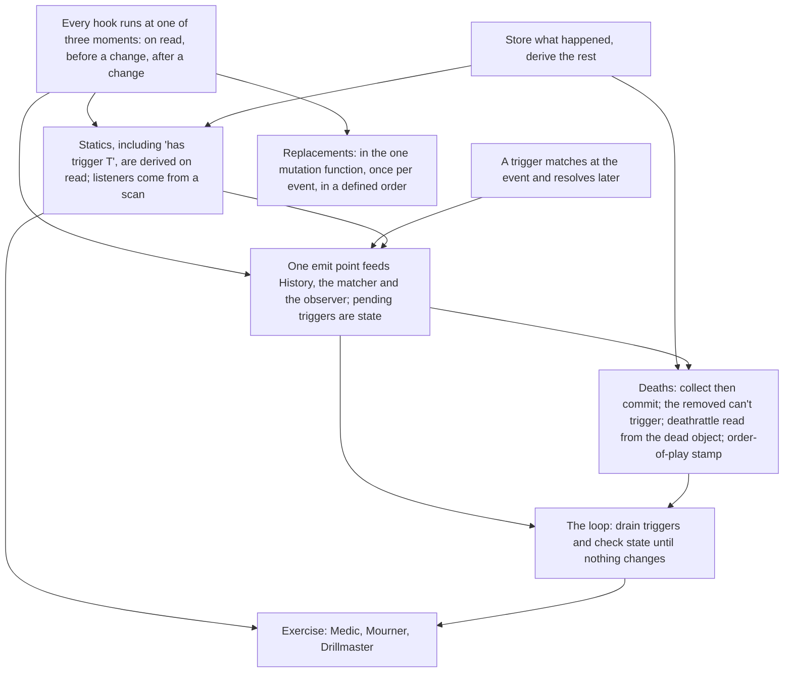

> [!quote] YOU

continue the course


> [!question] Question
> This worktree (branch `triggers`) is at main `283f374`, which doesn't include session 04b. `targeting-draft` (`bea68d6`, pushed, no PR yet) has the 04b code, its close-out and the 05 plan. How should `triggers` get 04b?
>
> `triggers` has no commits of its own, and the only change in the tree is the untracked md-log file `docs/course/sessions/05-triggers.md`. `targeting-draft` also commits that path as an empty file, so whichever option you pick, I move the log aside, update the branch, and put the log back in a single command. Nothing gets pushed and nothing touches main.
>
> 1. Fast-forward triggers onto targeting-draft (Recommended)
> 2. I merge the 04b PR into main first
> 3. Teach the concept part first, sort out git later


> [!example] Answer
> Other: it is merged


> [!question] Quiz
> Retrieval 1/3 (04b). A Draft for Duel is open. Which Choose actions does legal_actions list for choice c0?
>
> Duel: "Choose a minion. Then choose a different enemy minion. Deal 1 damage to each."
>
> choices:
>   c0: kind Minions, side any,   count 1
>   c1: kind Minions, side Enemy, count 1, different: true
>
> Board: you have one minion F. The opponent has one minion E. Nothing else.
> You applied Draft { Duel }, and nothing has been chosen yet.
>
> 1. Choose F only
> 2. Choose F and Choose E
> 3. None: Draft { Duel } was never listed
> 4. Choose E only


> [!success] Quiz — correct ✓
> Your answer: 1. Choose F only
> Correct answer: 1
>
> Note: only F cause if E c1 would have no valid target
>
> The filter alone gives F and E. But each listed Choose must leave a draft that can still finish, so the search runs again at every Choose. Choosing E for c0 takes the only enemy minion, and c1 needs a different one, so the draft would be stranded. Choosing F leaves E for c1, which finishes. Draft was listed because that one path (F, then E) exists.


> [!quote] YOU

continue


> [!quote] YOU

continue


> [!question] Quiz
> Retrieval 2/3 (04b). What has to change in can_finish_choices for the look-ahead to handle this card?
>
> New card, Volley: "Choose X minions, where X is the number of spells you cast this turn. Deal 1 damage to each."
>
> Its one choice:
>   CharacterChoice {
>       id: ChoiceId(0),
>       filter: minions, any side,
>       count: EffectAmount::History(HistoryQuery {
>           kind: SpellsPlayed, scope: Owner, turn: Current,
>       }),
>       bound: Exactly,
>       different: true,
>   }
>
> Today, can_finish_choices asks "is this choice filled?" by calling
> check_choice_count_fulfilled(object_id, choice.id, chosen_count),
> which evaluates choice.count with effect_amount.
>
> 1. Nothing: it already reads the count through check_choice_count_fulfilled
> 2. A History arm in can_finish_choices that evaluates the query itself
> 3. The count evaluated once at Draft and stored in the draft state
> 4. A load check that rejects History counts on a choice


> [!success] Quiz — correct ✓
> Your answer: 1. Nothing: it already reads the count through check_choice_count_fulfilled
> Correct answer: 1
>
> Note: I dont see the gap
>
> "Is this choice filled" has one function, and every caller asks it: legal_actions, scan_for_valid_choices and can_finish_choices all go through check_choice_count_fulfilled, which calls effect_amount. A new amount kind reaches the search through that one path, so the search needs no change. A History arm in the search would be a second copy of "evaluate this amount", the 04b mirror shape. Storing the count at Draft is a copy of a fact you can already compute, and nothing requires it. No load check is needed, because the search never assumed a constant count.


> [!abstract] PI

Saved the MTG and Hearthstone reports in `docs/course/research/05-triggers/`. Last retrieval question:


> [!question] Quiz
> Retrieval 3/3 (04b). When a Died event arrives, where should "is the dead minion friendly to the trigger's owner?" be answered?
>
> Session 05 adds a minion, Mourner: "Whenever a friendly minion dies, draw a card."
>
> Today the selectors and the draft answer "is player P on side S, seen from owner O" with:
>
>   pub(crate) fn fulfill_character_side_filter(
>       side: EnumSet<CharacterSideFilter>,
>       asking: PlayerId,
>       player_id: PlayerId,
>   ) -> bool
>
> Event::Died { object_id } carries only the dead object's id.
>
> 1. A friendly flag stored on Mourner's trigger when it enters
> 2. fulfill_character_side_filter, the function the selectors already call
> 3. A new is_friendly check written inside the trigger module
> 4. A friendly flag carried on the Died event itself


> [!success] Quiz — correct ✓
> Your answer: 2. fulfill_character_side_filter, the function the selectors already call
> Correct answer: 2
>
> "Friendly" is one question with one function, and the trigger is one more caller. A new is_friendly check is the 04b mirror: a second copy of a fact, which drifts the first time someone edits one copy and not the other (the || vs && bug). A flag stored when Mourner enters is a stored copy of a derived fact, and it goes stale the moment control changes. A flag on the event can't work at all: "friendly" is relative to an asker, and one Died event is read by triggers on both sides. The event carries the absolute fact (whose minion it was), and each reader applies its own frame.


> [!abstract] PI

Now the verified facts, one entry per report.


> [!question] Question
> What should session 05 cover, and how should the exercise be split?
>
> Node F is hooks: code that card data attaches to the rules. Three kinds, each defined by when it runs relative to an event:
> - static: no event; a fact read on demand (your Captain's aura is one already)
> - replacement: before the event; changes it or swaps it for another ("if X would happen, Z instead")
> - trigger: after the event; queued and resolved at a defined moment ("whenever X")
>
> Already planned for 05: collect-then-commit deaths with the Medic card, the order of simultaneous deathrattles, and one emission point that feeds history, triggers and the observer.
>
> Session 04's exercise ran across three sessions (04a, 04b, 04c).
>
> 1. Concept for all three; exercise on triggers only, in this session (Recommended)
> 2. Concept and exercise for all three hook kinds
> 3. Concept only now; plan the exercise split at the end, like 04


> [!example] Answer
> 1. Concept for all three; exercise on triggers only, in this session (Recommended)


> [!question] Quiz
> Probe 1. Under Hearthstone's rules, what happens to the Squire that Drillmaster summons?
>
> Your board: Drillmaster, "Whenever you cast a spell, summon a 1/1 Squire."
> You cast Blast: "Deal 2 damage to every character."
> Nothing else on the board has text.
>
> 1. Summoned before Blast's text resolves; Blast hits it and it dies
> 2. Summoned before Blast's text, but Blast's targets were fixed at cast; it survives
> 3. Summoned after Blast's text resolves; it survives
> 4. Summoned mid-Blast, after the existing characters are hit; it survives


> [!success] Quiz — correct ✓
> Your answer: 1. Summoned before Blast's text resolves; Blast hits it and it dies
> Correct answer: 1
>
> Note: design choice? but one way I see it could be done after the play but before the effect resolves, another way would for it to happen only after the effects resolve, and it could be before or after the death, resulting in different outcomes
>
> Casting is an event that happens before the spell's text resolves, and a "whenever you cast" trigger resolves in the gap between them. Hearthstone's spell sequence is On Play Phase ("whenever" triggers: Questing Adventurer, Mana Wyrm, Violet Teacher), then Spell Text Phase, then After Spell Phase ("after" triggers). So the Squire is on the board when Blast's text runs. "Every character" is not a chosen target: it's read when the effect resolves (your resolve_character_selector does the same), so the Squire is hit. MTG gives the same answer for the same reason: the cast trigger goes on the stack above the spell and resolves first.


> [!question] Quiz
> Probe 2. Which engine difference produces these two outcomes?
>
> Mourner: "Whenever a friendly minion dies, draw a card."
> One Blast kills Mourner and a friendly Recruit together.
>
> Hearthstone: the equivalent card (Cult Master) does NOT draw, and the wiki says "regardless of order of play".
> MTG: the equivalent card (a "whenever a creature dies" permanent destroyed along with the creatures) DOES trigger.
>
> 1. Which state the trigger match reads: after the dead leave (HS) or just before (MTG)
> 2. Whether a dead minion's owner is known: forgotten (HS) or remembered (MTG)
> 3. When triggers resolve: inline during the kill (HS) or queued until priority (MTG)
> 4. Which order the dead are removed: Mourner first (HS) or the Recruit first (MTG)


> [!success] Quiz — correct ✓
> Your answer: 1. Which state the trigger match reads: after the dead leave (HS) or just before (MTG)
> Correct answer: 1
>
> Note: Not sure if MTG is triggering before they die or after but with the list of died objects
>
> Both games remove the dead simultaneously (collect, then commit), so removal order can't be it, and HS says so explicitly. The difference is which snapshot of the game the trigger match looks at. Hearthstone matches death triggers after the Death Creation Step has removed everyone, and "Entities that have been removed from play cannot trigger", so Cult Master is gone and can't hear the Recruit's death. MTG 603.10a says leaves-the-battlefield abilities "look back in time": the match uses the abilities and objects as they were just before the event, so the dying permanent still hears the others. Same event, same simultaneity, different state read by the matcher.


> [!question] Quiz
> Probe 3. Under a trigger registry, which of these future cards need extra registry updates beyond enter and leave?
>
> Suppose Game keeps a trigger registry:
> - when a minion enters the board, its definition's triggers are added to a list in Game
> - when it leaves the board, they're removed
> - matching an event walks that list
>
> Which cards would force the registry to be updated at some other moment too? Pick every one that does.
>
> 1. Recall: "Return a minion to its owner's hand"
> 2. Barracks: "Summon a Squire"
> 3. Rally Banner: "Your other minions have 'Whenever this takes damage, draw a card'"
> 4. Hush: "Silence a minion" (it loses its card text)


> [!failure] Quiz — incorrect ✗
> Your answer: 4. Hush: "Silence a minion" (it loses its card text)
> Correct answer: 3, 4
>
> Note: Hush would have to disable the trigger, unless when applying the trigger we checked if the trigger caster was not silenced, Rally Banner would add triggers and Recall remove them but should work with the enter and leave updates
>
> The registry is a stored copy of a derived fact: "which objects in active zones currently have which triggers". It's correct only if every change to any input of that fact also patches it. Summon and bounce change the zone, which the enter and leave hooks already cover. Silence changes the abilities without a zone change, so it needs its own patch (SabberStone's Silence() calls ActivatedTrigger.Remove()). Rally Banner is worse: whether a minion has the trigger depends on another object being on the board, so the Banner's entry, its exit, its silence, and every other minion entering or leaving all have to patch it. XMage's registry is never pruned when a permanent loses its abilities, and the source carries a TODO saying so. It works only because it re-checks hasAbility at every event, which is a scan in disguise.


> [!question] Quiz
> Probe 4. Trace it: how many cards does this registry draw, and how many does the card's text say?
>
> Rally Banner (0/5): "Your other minions have 'Whenever this takes damage, draw a card'."
>
> The registry from Probe 3, plus Banner hooks as you described:
> - a minion entering adds its own definition's triggers; leaving removes them
> - Banner entering adds the granted trigger for each other friendly minion on the board
> - Banner leaving removes those
>
> Sequence:
> 1. Minion A (3/3) is on your board.
> 2. You play Rally Banner. Its enter hook runs.
> 3. You play minion C (3/3). Its enter hook runs.
> 4. You cast Blast: 2 damage to every character. Nobody dies.
>
> 1. Registry draws 2; the card's text says 2
> 2. Registry draws 1; the card's text says 2
> 3. Registry draws 0; the card's text says 2
> 4. Registry draws 1; the card's text says 1


> [!success] Quiz — correct ✓
> Your answer: 2. Registry draws 1; the card's text says 2
> Correct answer: 2
>
> Note: In this registry yes, but is the "Your other minions have" special behaviour is it data, like when the banner enters it adds triggers for all minions that exist plus two "When a minion enters, create the banner trigger for it" and "When a minion leaves, remove the banner trigger for it"
>
> The text is a static fact about the present: every other minion you have right now has the trigger. A and C both take damage, so 2 draws. The registry only got the granted trigger for A, because the Banner's enter hook ran when only A was there. C's enter hook adds C's own definition's triggers, and C's definition has none. To fix it, C's entry must ask "is there a Banner?", the Banner's silence must remove the grants, and a second Banner must not double them. That's one more hook for every input of the fact. It's the session 02 Captain and Recruit case, with "has this trigger" in place of "has +1 health".


> [!question] Quiz
> Probe 5. Which data would let Game reproduce Hearthstone's order of play for simultaneous deathrattles across both boards?
>
> Hearthstone resolves the deaths from one Death Creation Step "in order of play": the order the entities entered play, oldest first, across both players.
>
> What Game has today:
> - ObjectIds come from one counter in the ObjectBag. Setup allocates every deck card, in deck-list order, before the shuffle. Summon allocates a token's id when it's created.
> - Each player's board is a Vec in the order its minions were added.
> - History records CardPlayed and CharacterDied entries, in order.
>
> 1. A counter stamped on each object when it enters the board
> 2. Board Vec positions, read across both players' boards
> 3. ObjectId order, since every id comes from one counter
> 4. The order of the CardPlayed entries in History


> [!success] Quiz — correct ✓
> Your answer: 1. A counter stamped on each object when it enters the board
> Correct answer: 1
>
> Note: 4 does too but I dont think it is correct for this
>
> Order of play is a fact about the past, when each object entered play, and nothing in the present state records it, so it has to be written down when it happens. ObjectIds follow deck-list order: a card listed 30th but drawn and played on turn 2 has a higher id than one listed 1st and played on turn 9. A board Vec orders one side only, and two sides can interleave in any way. History has no CardPlayed entry for a summoned Squire, and a bounced minion played again needs its new entry time, not its first. A stamp at board entry is a record of what happened, not a mirror, since it can't be derived from the present. MTG does the same with timestamps (613.7), and SabberStone keeps an OrderOfPlay field.


> [!question] Quiz
> Probe 6. Under this naive engine, what happens when Ping hits a minion?
>
> Amplifier (on the board): "If a minion would take damage, it takes twice that much instead."
>
> A naive engine handles a damage event like this:
> 1. Find every replacement whose condition matches the event, and apply it.
> 2. Re-check the resulting event the same way, until no replacement matches.
> 3. Perform the final event.
>
> Ping: "Deal 2 damage to a minion." It targets a minion with no text.
>
> 1. The minion takes 4: the doubled event no longer matches
> 2. It never finishes: each doubled event matches Amplifier again
> 3. The minion takes 2: Amplifier sees the event after it happened
> 4. The minion takes 6: the original 2, then the doubled 4


> [!success] Quiz — correct ✓
> Your answer: 2. It never finishes: each doubled event matches Amplifier again
> Correct answer: 2
>
> The modified event, "a minion would take 4 damage", is still a minion taking damage, so Amplifier matches it again, then 8, then 16, and the engine never finishes. MTG 614.5 is the rule that closes this: "A replacement effect doesn't invoke itself repeatedly; it gets only one opportunity to affect an event or any modified events that may replace that event." Engines enforce it with a per-event applied set (XMage's getAppliedEffects, Forge's hasRun). 6 would mean the original event still happens, but a replaced event never happens (614.6), which is the difference from a trigger. 2 treats Amplifier as a listener, but a replacement runs before the mutation.


> [!abstract] PI

Right, and that's the floor on replacements: you know a replacement runs before the mutation and that the replaced event never happens. Now a harder one, on where it sits in your code.


> [!question] Quiz
> Probe 7. Where must Ward be consulted so that no damage to the hero can bypass it?
>
> Ward (on your board): "If your hero would take damage, prevent 1 of it." Each damage event is reduced by 1.
>
> Today, damage reaches an object in two places:
>
> // resolve.rs, apply_effect
> Effect::Damage { selector, amount } => {
>     ...
>     for target in targets {
>         let object = self.objects.get_mut(target);
>         object.damage += amount;
>         obs.event(&Event::Damaged { target, amount, source });
>     }
> }
>
> // zone_move.rs, draw, when the deck is empty
> obs.event(&Event::FatigueDamaged { amount: damage, player_id, object_id: hero_id });
> let object = self.objects.get_mut(hero_id);
> object.damage += damage;
>
> 1. In a trigger on Damaged that restores 1 health afterwards
> 2. In the Effect::Damage arm, just before object.damage += amount
> 3. In health(), subtracting Ward's 1 from the stored damage on read
> 4. In one damage function that Effect::Damage and fatigue both call


> [!success] Quiz — correct ✓
> Your answer: 4. In one damage function that Effect::Damage and fatigue both call
> Correct answer: 4
>
> A replacement has to sit at the mutation, before it, and "the hero takes damage" happens in two places today. Put Ward in the Effect::Damage arm only and fatigue skips it. That's 04b's lesson again: one question ("damage is dealt"), one function, and every caller goes through it. A trigger on Damaged can't prevent anything: the damage already happened, restore isn't prevention (it caps, and the Damaged event still fired), and FatigueDamaged wouldn't fire it. health() on read sees only the total, but Ward works per event: three hits of 1 should do 0, and two hits of 3 should do 4. A per-event rule can't be recovered from a sum.


> [!abstract] PI

The probe is done. Here's where your knowledge sits on each strand:

| Strand | Holds | Runs out |
|---|---|---|
| Trigger timing | A cast trigger resolves before the spell's text. You also saw on your own that the timing is a design axis. | Not reached. The edge isn't here yet. |
| Simultaneous deaths | Hearthstone vs MTG comes down to which snapshot the matcher reads. | You weren't sure how MTG builds it; settled above. |
| Where listeners come from | A silenced minion breaks a registry, and a check at event time would fix it. | **Rally Banner.** You'd patch the registry with more hooks. That's the stored-copy-plus-hooks habit, now applied to "which triggers does X have". |
| Ordering | Order of play is a recorded fact of the past: a stamp, or a board-entry record in History. | Not reached. |
| Replacements | They run before the mutation, apply once, and sit in one damage function, fatigue included. | Ordering several replacements isn't probed; I'll teach it inside its node. |

## Plan

You hold the concepts. The edge, as in every session since 02, is the design default: you store a copy and patch it with hooks. So the session opens on that. "Which triggers does this object have" gets derived on read, exactly like the Captain's `modifiers`, and finding listeners becomes a scan. Then replacements, briefly, since they're concept only. Then the trigger pipeline: one emit point that feeds History, the trigger matcher and the observer, with matched triggers waiting in `Game` as state.

Deaths come next, through your Medic red case: collect then commit, removed minions can't trigger, a deathrattle is read from the dead object, and the order-of-play stamp. Last, the loop that drains the queue and runs state checks until neither changes anything, with your before-or-after-deaths axis placed in it.

Then the exercise. We agree the shape, I write tests against your API, and you write the bodies. The cards:
- **Medic**: "Deathrattle: give your other minions +2 Health".
- **Mourner**: "Whenever a friendly minion dies, draw a card".
- **Drillmaster**: "Whenever you cast a spell, summon a Squire". It pins the drain point between `Played` and the spell's text.

Socratic where you can reason it out. I'll narrate the scan-vs-registry node first, because that's where the miss was.



Does this plan work for you, or do you want to change the scope or order before I start?


> [!quote] YOU

works, why not the banner? wont more cards would be usefull?


> [!abstract] PI

I left Banner out for one reason only. Its text grants a trigger through a static, and that's a new kind of static, while you'd scoped new statics to concept only. That was a bookkeeping call, and it's the wrong one. Banner is the card that would catch the design you defaulted to in the probe. With Banner in the tests, a registry fails the moment C is played after the Banner, and a scan passes. That makes it the most useful red test in the set.

More cards aren't useful by themselves, though. A card earns a place when it pins a behavior no other card pins, because each one costs data, tests and an interpreter arm. Here's what each would pin:

| Card | What only it pins |
|---|---|
| Medic, "Deathrattle: give your other minions +2 Health" | Collect then commit. A deathrattle is read from the dead object. |
| Mourner, "Whenever a friendly minion dies, draw a card" | A "whenever" trigger on `Died`, filtered by side. A Mourner dying in the same Blast doesn't draw. |
| Drillmaster, "Whenever you cast a spell, summon a Squire" | The queue drains between `Played` and the spell's text. |
| Rally Banner, "Your other minions have 'Whenever this takes damage, draw a card'" | Triggers derived on read, granted by a static. A trigger on `Damaged` that targets "this". A minion at 0 Health still triggers. |

Banner also forces the open thread about fatigue: a damage trigger has to hear fatigue damage too, so all damage goes through one function.

A fifth card that pinned nothing new would cost tests without teaching anything. So I'd stop at these four, unless a node turns up a behavior none of them covers.

So the plan is the same, with Banner added to the exercise and N1 feeding it directly. If that works for you, I'll start N1.


> [!quote] YOU

good


> [!abstract] PI

Starting with the root everything else hangs on.

## U1: every hook runs at one of three moments

**Why we need it.** Any card text that isn't a one-shot effect has to attach to the rules somewhere, and we have to decide where its code runs. One question decides that: when does the text act, relative to a change in the game?

**The truth.** Every hook runs at exactly one of three moments:

| Moment | Kind | What it sees | Card wording |
|---|---|---|---|
| On read | static | No change at all. It's a fact about the present that any reader computes. | "Your other minions have +1/+1", "costs (1) less for each spell" |
| Before a change | replacement | The change as proposed. It alters it or swaps it, and the original never happens. | "instead", "prevent" |
| After a change | trigger | The change, reported as an event. Its effect runs later. | "whenever", "after", "deathrattle" |

**How it connects.** You already have one of each kind in hand:
- the Captain's aura is a static, built in `lookup.rs`
- Ward from Probe 7 is a replacement
- Mourner is a trigger

Your solid point from session 01, "a listener can't undo an event", is this table read by rows: a trigger sits after the change, so undoing it is too late.

Two more roots are ones you already hold, so I'm only naming them. U2, "store what happened, derive the rest", is ADR 0005, and you've applied it since session 02. U3, "a trigger matches at the event and resolves later", is pattern 2 from session 03 (the Scavenger case), which you retrieved in session 04.


> [!question] Quiz
> U1 check. Which of these run before the change they affect?
>
> Pick every one that does.
>
> 1. Acolyte: "Whenever this minion takes damage, draw a card"
> 2. Iron Will: "If you would take fatigue damage, draw nothing and take none instead"
> 3. Captain: "Your other minions have +1 Attack"
> 4. Divine Shield: "The first time this minion would take damage, prevent it"


> [!success] Quiz — correct ✓
> Your answer: 2. Iron Will: "If you would take fatigue damage, draw nothing and take none instead", 4. Divine Shield: "The first time this minion would take damage, prevent it"
> Correct answer: 2, 4
>
> "Would ... prevent" and "would ... instead" describe a change that hasn't happened yet, and they alter it: replacements, so they run before. Hearthstone builds Divine Shield this way: it zeroes the damage while the Damage Event is created (DH2a), and a damage event that changes nothing runs no triggers (DH2b). Acolyte reacts to damage already dealt: a trigger, so it runs after. The Captain involves no change at all; its +1 is part of every read of Attack, so it runs on read.


> [!abstract] PI

U1 is in. Now the node that addresses the probe miss.

## N1: "has trigger T" is a static, so listeners come from a scan

**Why we need it.** Before a trigger can resolve, something has to answer "who is listening to this event?" Your default answer was a registry plus hooks, and Rally Banner broke it. So the question is what kind of fact "minion C has the trigger 'whenever this takes damage, draw a card'" really is.

**Deriving it.** Put that fact through U1. Does it react to a change? No. Does it alter a change that's about to happen? No. It's a fact about the present: right now, C has that trigger. So it belongs in the first row, as a static, computed on read. Banner's own text says so. "Your other minions **have** 'Whenever...'" uses the same verb as the Captain's "Your other minions **have** +1/+1". Same kind of text, so it gets the same machinery:

```rust
// exists today
fn modifiers(&self, object_id) -> Modifiers  // definition + own + auras of others on the board
// the same shape
fn triggers(&self, object_id) -> Vec<Trigger> // definition + granted by auras of others on the board
```

"Who listens to event E" then has no storage at all. Walk the objects in the zones where triggers are active, ask each one `triggers(obj)`, and keep the ones whose pattern matches E. Nothing is stored, so nothing needs patching:
- C played after the Banner: the next read finds the Banner. Draws 2.
- The Banner silenced or gone: the next read doesn't find it.
- A second Banner: the read finds two, and the rules decide what that means, in one place.

**How it connects.** This is your session 02 caching ranking applied to triggers: no cache first, then a lazy full rebuild, then incremental updates only with a real dependency graph. The four engines sit on that ladder:

| Engine | How it finds listeners | Rung |
|---|---|---|
| Metastone | scans one flat list on every event | none |
| Forge | caches a list, then rebuilds it in full from each card's current abilities after every state check | lazy full rebuild |
| XMage | keeps a registry it never prunes, and re-checks `hasAbility` at each event. That re-check is a scan in disguise, and the source carries `// TODO: what about triggered abilities?` | — |
| SabberStone | registry; `Silence()` has to call `ActivatedTrigger.Remove()` by hand | incremental |

On cost: a board holds at most a few dozen objects, and one action emits tens of events, so a scan is a few hundred cheap checks. `legal_actions` already runs a search in about 1 µs. Measure before caching.


> [!question] Quiz
> N1 check. With triggers(obj) derived on read, what must Seize's code contain so C stops drawing for anyone?
>
> Your board: Rally Banner ("Your other minions have 'Whenever this takes damage, draw a card'") and minion C.
> triggers(obj) works like modifiers(obj): the definition's triggers, plus grants from auras of other minions on the same side.
>
> The opponent casts Seize: "Take control of an enemy minion." It takes C, which moves to their board.
> Then Blast hits C.
>
> 1. The control change, plus a Banner hook that re-checks grants on control changes
> 2. Only the control change; triggers(C) no longer finds a Banner on C's side
> 3. The control change, plus removing the grant from C
> 4. The control change, plus clearing C from Game's list of listeners


> [!success] Quiz — correct ✓
> Your answer: 2. Only the control change; triggers(C) no longer finds a Banner on C's side
> Correct answer: 2
>
> The grant was never stored on C, so there's nothing to remove. The next read of triggers(C) looks for Banners on C's current side, finds none, and C has only its definition's triggers. No Banner hook is needed, because the Banner never acted at a moment: it's read on demand. Under this design Game has no listener list either. Every option after the first patches a stored copy that this design doesn't have, and each one is a hook that a future card (silence, a second Banner, a swap) would force you to write again.


> [!question] Quiz
> N2. Both replacements apply to the same 3 damage, each once. Nothing on the cards or in the rules so far says which goes first. What follows?
>
> On the board:
> - Amplifier: "If a minion would take damage, it takes twice that much instead."
> - Padding: "If a minion would take damage, prevent 1 of it."
>
> A spell deals 3 damage to a minion. Each replacement applies once, to the event as it stands when that replacement applies.
>
> 1. It takes 4 or 5 depending on the order, so the engine needs an ordering rule or a choice
> 2. It always takes 5, because doubling is applied before prevention
> 3. It always takes 4, because prevention is applied before doubling
> 4. It always takes 5, because both read the original 3 and combine as 6 minus 1


> [!success] Quiz — correct ✓
> Your answer: 1. It takes 4 or 5 depending on the order, so the engine needs an ordering rule or a choice
> Correct answer: 1
>
> Amplifier then Padding: 3 becomes 6, then 5. Padding then Amplifier: 3 becomes 2, then 4. Replacements apply in sequence, each to the event the previous one produced, so they don't commute (the session 00 "set to 1" vs "+2" lesson, now on events). Nothing given picks an order, so neither 4 nor 5 is "always". An engine must have one of two things. A rule: Hearthstone fixes the sequence (DH2a: Immune, then Divine Shield, then Predamage triggers in order of play). Or a choice: MTG 616.1 lets the affected object's controller pick, after self-replacements, and repeats on the modified event. A choice in the middle of resolving damage is a pending decision, which is session 06's subject.


> [!question] Quiz
> N3. Where should the queue of matched, not-yet-resolved triggers live?
>
> emit matches triggers at the event and queues them, and they resolve later, at defined drain points inside apply.
>
> Facts to weigh:
> - Reveal (Forage's verb) leaves the player in PendingPick, and apply returns until they Pick.
> - Any trigger's effect list may contain any verb, Reveal included.
> - In session 03 you rejected a call-scoped Option field in Game as a "mutable temp field", and passed the observer through every function instead.
> - Bots search with game.clone() and the () observer.
>
> 1. In a local Vec created in apply and passed down like the observer
> 2. Nowhere: emit resolves each match as soon as it finds it
> 3. In the observer, which already receives every event
> 4. In Game, as part of the state


> [!success] Quiz — correct ✓
> Your answer: 4. In Game, as part of the state
> Correct answer: 4
>
> Take a deathrattle that Reveals, with a Mourner trigger queued behind it. The deathrattle resolves, the player is left in PendingPick, and apply returns. The Mourner trigger hasn't resolved, and it must still be there when Pick arrives. So the queue outlives the call, which makes it state (R1: the state is everything needed to continue). The session 03 temp field held something meaningless between calls, but a non-empty queue between calls is a real game situation, and two games that differ only in their queues differ. A local Vec would be dropped at the pause. The observer belongs to the shell and is () in a bot's clone, so triggers would vanish during search, and the core can't read it back anyway (R4). Resolving inline breaks U3, and with it Drillmaster's timing and collect-then-commit.


> [!question] Quiz
> N4. Under this Hearthstone policy, how does Medic's own deathrattle get matched?
>
> Suppose our game follows Hearthstone: the dead are removed together, then the matcher reads the state AFTER removal, so a Mourner killed in the same Blast hears nothing.
>
> Blast kills Medic ("Deathrattle: give your other minions +2 Health") and a Recruit together. Both are off the board when Died { Medic } is matched. A board scan won't find Medic.
>
> Facts:
> - Object.player_id and the definition survive removal.
> - A token like the Squire has no deck presence, so it never reaches a graveyard.
>
> 1. From a graveyard scan, since Medic is in the graveyard now
> 2. From a registry entry added when Medic entered the board
> 3. From the object Died names: its own death triggers, as it was just before removal
> 4. From a board scan run before removal, for every kind of trigger


> [!failure] Quiz — incorrect ✗
> Your answer: 2. From a registry entry added when Medic entered the board
> Correct answer: 3
>
> A deathrattle listens to one event only: its own object's death. The Died event names that object, so the matcher reads the dead object's death triggers directly, as the object was just before it left (its last known information). SabberStone reads DeathrattleTask from the dead minion's card, Metastone reads getDeathrattles() from the dead actor, and MTG 603.10a looks back in time for leaves-the-battlefield abilities. A scan before removal for every trigger is the MTG policy, so the Mourner that died would hear the Recruit, which contradicts the premise. A registry is the stored copy from N1. A graveyard scan misses tokens, which never get there, and would let a graveyard Mourner hear deaths.


> [!abstract] PI

That's the first miss since the probe, and it lands right after N1 argued against registries, so I want to understand it before re-teaching rather than guess.

What made the registry look right here? For example:
- Did it seem that once Medic is off the board, nothing is left to read its deathrattle from?
- Did "added when it entered" seem like the only way to know Medic had a deathrattle at the time it died?
- Or was it something else?

Answer in your own words. It tells me which piece is missing.


> [!quote] YOU

3 was confusing to me, "From the object Died names" I agree it is when we state check it is dead


> [!abstract] PI

That's on my wording, not on you. "The object Died names" reads like a noun phrase, but I meant "the object that the `Died` event names". Your model is right: the state check finds Medic dead, so it has Medic in hand right there and reads its deathrattle off the dead object. I'm counting the question as a wording failure, not a miss.

One refinement to your model: read the death triggers **before** removing anything. Suppose a Banner-like aura granted "Deathrattle: draw" and the Banner died in the same pass. Read after removal, the grant would be gone. Read before, the dead minion has it "as it last was". So the state check becomes:

1. find every dead object
2. read each one's death triggers and its order-of-play stamp (a snapshot)
3. remove them all and emit `Died` for each
4. queue the snapshotted deathrattles plus whatever the matcher finds on the board

Here's a clean re-check that also exercises the rest of N4:


> [!question] Quiz
> N4 check. Under the state check above with the Hearthstone policy, what happens?
>
> Your board, in order of play:
> - Medic 1/1: "Deathrattle: give your other minions +2 Health."
> - Recruit 2/2
> - Mourner 1/3: "Whenever a friendly minion dies, draw a card."
>
> Blast deals 2 damage to every character.
>
> State check: find all dead, snapshot their death triggers, remove them together, emit Died for each, queue the deathrattles plus matches from the board (matched after removal). Then the queue resolves.
>
> 1. Recruit dies; Mourner draws 2 and ends at 1 Health
> 2. Recruit dies; Mourner draws 2 and ends at 3 Health
> 3. Recruit survives at 2 Health; Mourner draws 1 and ends at 3 Health
> 4. Recruit dies; Mourner draws 0 and ends at 3 Health


> [!success] Quiz — correct ✓
> Your answer: 2. Recruit dies; Mourner draws 2 and ends at 3 Health
> Correct answer: 2
>
> Note: recruit dies together with medic, mourner is the only minion to get +2 health, 2 draws since there was 2 deaths
>
> After Blast: Medic at -1, Recruit at 0, Mourner at 1. The pass finds Medic and Recruit, snapshots Medic's deathrattle, and removes both before anything resolves, so Medic's +2 can't save the Recruit. Mourner is still on the board, so the matcher finds it for both Died events: 2 draws. Medic's deathrattle reaches every other friendly minion on the board, which is only Mourner: 3 base + 2 - 2 damage = 3 Health. One-at-a-time with Medic first is what gives a surviving Recruit. 1 Health means the deathrattle never ran. 0 draws would apply the removed-can't-trigger rule to Mourner, which wasn't removed.


> [!question] Quiz
> N5. Where must settle run inside play for both behaviours below? Pick every point it must run at.
>
> play() today, for a spell:
>
>   emit Played
>   checkpoint
>   apply_effects(on_play)      // Blast: one Damage effect over every character
>   (minions: summon, then checkpoint)
>
> Required:
> 1. Drillmaster ("Whenever you cast a spell, summon a Squire") puts the Squire on the board before Blast's text, so Blast hits it.
> 2. Mourner draws for minions that Blast kills, within the same apply.
>
> 1. Before Played, when the card leaves the hand
> 2. Between the targets inside Blast's Damage effect
> 3. After the spell's text, before apply returns
> 4. After Played, before the spell's text


> [!question] Quiz — I don't know
> Your answer: I don't know
> Correct answer: 3, 4
>
> Note: "Where must settle run inside" what is settle, bad name, I think drillmaster would run right after we emit played but before the checkption and mourner would draw on the state check after the apply_effects before the checkpoint
>
> Drillmaster's trigger is queued when Played is emitted, so a settle between Played and the text resolves it and the Squire is on the board when Blast reads "every character". A settle after the text collects Blast's deaths and resolves Mourner's matches. Inside the Damage effect would split one sentence into steps: Blast is "together" (E3), and a state check in the middle of it is the setter-side-effect from session 01. Before Played, nothing is queued yet, and the card hasn't been cast. The settle after the text also covers what the current check_state call in apply does, so a single settle per drain point replaces it.


> [!quote] YOU

Also "spells text" means nothing to me here, it is clearly not generating the spell text, but I dont see a mapping from todays code to "spells text"


> [!abstract] PI

You're right on both names. I'll use code names from here on.
- **"The spell's text"** is `apply_effects(object_id, self.on_play(object_id), obs)` in `play`, the card's `on_play` effects. I used Hearthstone's rulebook phase name, which maps to nothing in your code.
- **"settle"** is my placeholder for "check state and resolve queued triggers, repeated until neither does anything". The name is yours to pick in the design below.

Read in those terms, your note is the right answer. Drillmaster's trigger resolves right after `Played` is emitted, before `on_play`. Mourner's draws come from the state check after `on_play`. I'm counting N5 as landed, and the "I don't know" as my wording again.

One detail in your placement: you put Drillmaster's resolution before the `Played` checkpoint. `apply_effects` already adds a checkpoint after each effect, so resolving the trigger first would put `Played` and the Squire's `BoardEntered` in one step, and the `Played` checkpoint after it would add an empty step. Decision 9 below covers this.

That closes the concept nodes. Here are the design decisions for the exercise. Answer them like "1a 2b ...". Once they're settled, I'll draft the plain data types, write the red tests against your API, and you write the bodies.

**1. Which state the matcher reads for deaths.**
- (a) Hearthstone: the matcher reads after removal, so a Mourner dying in the same pass hears nothing.
- (b) MTG: it reads before removal, so it hears everyone, which needs a snapshot of every board trigger before each removal.

My lean is (a): it's what the probe used, and it's cheaper.

**2. Where a deathrattle lives.**
- (a) Keep `on_death: EffectSequence`, read from the dead object.
- (b) Fold it into one `triggers: Vec<Trigger>` list, with an "I died" pattern. Under 1a, the dead object must then contribute only its "I died" triggers, so a dying Mourner can't hear itself.

(a) makes that rule structural. (b) gives one trigger list for every reader (text generation, a bot), and `on_play` and `on_board_enter` could later fold in the same way. I have no strong lean.

**3. Trigger patterns for these cards.**
- Mourner: `Died` filtered by kind and side, reusing `CharacterSelectorFilter`.
- Drillmaster: `Played` filtered by card kind (spell) and side.
- Banner's grant: `Damaged` on "this".

Side is relative to the trigger's owner, through `fulfill_character_side_filter`. Is reusing the filter fine with you, or do you want a separate type?

**4. How Banner grants a trigger.**
- (a) A new variant in the aura effects, such as `ModifierEffect::GrantTrigger(..)`. It goes through the same "auras that reach X" path the Captain uses. `ModifierEffect` loses `Copy`, because a trigger holds an `EffectSequence`.
- (b) A separate `friendly_aura_triggers` list on the minion definition. That's a second path that has to answer "which auras reach X", so it needs a shared helper, or it becomes the 04b two-functions mirror.

My lean is (a).

**5. What a queued entry holds.** `{ source: ObjectId, effects: Vec<Effect> }`, with the effects copied at match time, so a source that dies or changes before resolution doesn't matter (MTG 113.7a). The owner is read from `source.player_id`. No event payload until a card reads one.

**6. The loop.** First, its name. Second, when the state check runs:
- (a) after each trigger, as in MTG
- (b) after the whole queue drains, as in Hearthstone

None of the four cards can tell them apart, because no trigger deals damage. So pick the simpler one, and the first damaging trigger decides for real.

**7. Order of play.**
- (a) A stamp on `Object`, from a counter in `Game`, set at every board entry.
- (b) `BoardEntered` entries in History.

Either way it orders the deaths in one pass and the triggers matched from one event.

**8. History at the emit point.**
- (a) `emit` maps `Played` and `Died` onto today's `HistoryEntry` kinds.
- (b) History becomes a list of `(turn, Event)`, a bigger refactor.

My lean is (a) now and (b) as an open thread.

**9. Checkpoints around the first drain.**
- (a) `Played`, checkpoint, then drain, so `Played` gets its own step and each trigger effect gets its own.
- (b) Drain, then checkpoint.

My lean is (a).

Drain points, derived in N5: after `Played` before `on_play`, and at the end of `apply`, where the loop replaces today's `check_state` call.


> [!quote] YOU

1 do a deeper research into this topic so we are taking an informed option. 2 I think b is good but then why would on_play be separate, should we make all of this triggers? 3 I dont a problem if reusing do u think the name should change? 4 a yes. 5 sounds good, but source_id field name tho. 6 how does LoR and YGO handle this? can u search for more games to see if they agree. 7 b sounds simpler while a like an optimization, lets do a for now. 8 turn information is inside HistoryEntry I dont see why we would need to do b, a now. 9 a fine, checkpoints become more important once we have some ui. A not about this, before writing u should spawn a subagent with the improve architecture skill and do some iteration to make sure things live in the correct files/modules


> [!abstract] PI

Research on 1 and 6 is running (LoR and YGO first, then more games). Answers to your two questions:

**2: why `on_play` stays separate.** `on_board_enter`, `on_board_leave` and `on_death` are all reactions: something happened to this object, then text runs. They fold into `triggers` cleanly, with "this" patterns (`BoardEntered(Itself)`, `Died(Itself)`, ...). No card uses any of the three today, so folding them changes no behavior. The one real difference is that `on_board_enter` runs inline inside `summon` today, and as a trigger it would queue and resolve at the next drain. That's how MTG's enter triggers work.

`on_play` isn't a reaction. It's what the action does, and making it a trigger on `Played(Itself)` breaks three things:
- **Ordering.** It would sit in the same queue as Drillmaster's trigger, and it must resolve after it. You'd need a priority rule that says "the card's own text always goes last". Hearthstone has exactly such a patch for one keyword ("Some triggers have a Priority that supersedes order of play").
- **Targets.** The draft's choices belong to playing the card (E5: options known before the card moves). A trigger gets no draft.
- **Identity.** MTG draws the same line. A spell resolving is the card itself on the stack, while a triggered ability goes on the stack "as an object that's not a card" (603.3). One is the thing, the other reacts to it.

So the split I'd take is `on_play` as the card's body, and everything that reacts in `triggers`. If you agree, 2b means fold all three reaction fields.

**3: the name.** Yes, I'd change it. The type now has three readers: selectors (`All`, `Random`), choices (`CharacterChoice.filter`) and trigger patterns. "Selector" names only the first. What it actually is: which characters, by kind and side, seen from an owner. I'd suggest:
- `CharacterSelectorFilter` becomes `CharacterFilter`.
- Optionally, `CharacterSideFilter` becomes `Side`. The glossary already defines Side ("whether a player or object is friendly or enemy, from one player's point of view"), and this closes the open thread about the type also serving `PlayerSelectorFilter`.

Both renames are yours to make or skip.

**Your architecture note:** agreed. Once the decisions settle, I'll run the `improve-codebase-architecture` skill in a subagent over `crates/rules` and iterate on where the new pieces live: `emit`, the trigger matcher, the queue, the loop, and `triggers(obj)` beside `modifiers(obj)`. I'll bring the result back to you before any test is written.


> [!quote] YOU

2 agree, maybe we should rename on_play tho. 3 good renames.


> [!question] Question
> What should on_play (CardDef.on_play_effect, Game::on_play) be renamed to?
>
> It's the card's own body: what playing it from hand does. A summoned Squire never runs it (summon is not play), and the reactions move to `triggers`. The "on_" prefix reads like a hook, which is the distinction you just drew.
>
> 1. play_effects (Recommended)
> 2. effects
> 3. text


> [!example] Answer
> 1. play_effects (Recommended)


> [!abstract] PI

Recorded: **2b**, with `on_play_effect`/`on_play` renamed to `play_effects`, and the reaction fields `on_board_enter`, `on_board_leave` and `on_death` folded into `triggers`. **3** renames `CharacterSelectorFilter` to `CharacterFilter` and `CharacterSideFilter` to `Side`. I added **Trigger** to the glossary (`docs/CONTEXT.md`), since you named it this session.

Research for decisions 1 and 6:
- Done: Legends of Runeterra and Yu-Gi-Oh!, saved in `docs/course/research/05-triggers/`.
- Still running: Lorcana, Flesh and Blood and KeyForge, plus Marvel Snap, Shadowverse and Gwent.

When they're back, I'll bring both decisions as one comparison table across all the games.


> [!abstract] PI

Lorcana, Flesh and Blood and KeyForge are in and saved. Waiting on the last report (Marvel Snap, Shadowverse, Gwent) before bringing decisions 1 and 6.


> [!abstract] PI

All the research is in and saved, and every game has an entry in `verified-facts.md`.

## Decision 1: does a dying "whenever a friendly minion dies" card hear the others?

| Game | Watcher dying in the same sweep hears the others? | Source |
|---|---|---|
| Hearthstone | No | Cult Master note, Advanced rulebook 4a |
| Legends of Runeterra | No (Tortured Prodigy is a deliberate exception) | community wiki, player tests |
| Yu-Gi-Oh! | No for effects that activate on the field (yes for ones that activate in the GY) | official OCG ruling, 2020 revision |
| KeyForge | No | rulebook v18, "must be in play at the time the destroyed card leaves play" |
| Shadowverse | No | community |
| MTG | Yes | CR 603.10a, look back in time |
| Lorcana | Yes | CR 7.4.3, cards leaving together "see" each other |
| Flesh and Blood | Unsettled | — |
| Marvel Snap | Doesn't arise: destroys happen one at a time, in play order | developer answers |
| Gwent | Not found | — |

All of them agree on one thing: a dying card's own death text always resolves, using its state just before it left (MTG 608.2h, Lorcana 6.7.6, FaB 1.2.3, KeyForge's "abilities it had at the time it was tagged"). That's the snapshot step from N4.

In our design the two policies cost the same. The difference is the order of two lines in the commit step:
- 1a: remove the dead, then emit `Died`. The matcher sees a board without them.
- 1b: emit `Died`, then remove the dead. The matcher still sees them.

So pick on the rules, not on cost.

## Decision 6: when are the dead removed between triggers?

| Game | Check between triggers |
|---|---|
| MTG | after each (state-based actions before every priority, 704.3) |
| Lorcana | after each effect, each trigger included (6.7.4) |
| Flesh and Blood | after each layer (1.10.2) |
| Legends of Runeterra | between sequential triggers (tested on Round Start) |
| Hearthstone | after the whole phase; minions at 0 keep triggering (Acolyte "draws three cards, despite being mortally wounded after the first Deathrattle") |
| Shadowverse | a chain of Last Words runs uninterrupted |
| Yu-Gi-Oh!, KeyForge, Marvel Snap | no deferred check: destruction happens inside the effect |

Here's a case that tells them apart. Two "Deathrattle: deal 1 damage to all minions" minions die together. A minion at 1 Health has "whenever this takes damage, draw a card".
- 6a: after the first deathrattle it's at 0, the check removes it, and it draws 1.
- 6b: both deathrattles hit it, then it dies, and it draws 2. That's Hearthstone.

## My lean

**1a + 6b.** Both are the Hearthstone model, and they come from one principle: a minion stays on the board until the state check, and a removed one can't trigger. 1a + 6a is the more common combination across games, but it mixes two models.

Neither decision is pinned by the four cards, because no trigger deals damage. If you want 6 tested now and not left as an open thread, one more card does it: **Bomber, "Deathrattle: deal 1 damage to all minions"**. Two Bombers dying next to a Banner-granted minion is exactly the case above, so Bomber earns its place.

Answer 1, 6, and Bomber yes or no. After that I'll run the architecture subagent on placement and bring you its report.


> [!quote] YOU

1a + 6a, and the bomber.


> [!abstract] PI

ADRs 0011 and 0012 are committed (`cdefc90`). Now the architecture pass you asked for. It runs in a subagent, read-only, and the report lands in the temp directory, so nothing is written to the repo.


> [!abstract] PI

The report is open in your browser (`/var/folders/qf/.../architecture-review-20261010-162117.html`). Here it is with my review of it.

## Placement

I agree with this, unless you object:
- **`cards/filter.rs`** (new): `CharacterFilter` and `Side`, plus the membership test, moved out of `condition.rs`. Today the side check has two callers. The matcher would add a third, plus a second kind check.
- **`cards/definition.rs`**: `Trigger` and its patterns, next to `Effect`.
- **`cards/modifier.rs`**: the `GrantTrigger` variant.
- **`game/lookup.rs`**: `triggers(obj)`, built on `modifiers(obj)`, so only one function walks auras. The four `on_*` pass-through accessors go away.
- **A new `game/` child module**, owning everything that happens after a change: `emit`, matching, the queue entry type, the loop, and collect-then-commit (it absorbs `state_check.rs`). Its interface is just `emit` and the loop, and it replaces 12 event sites and 2 History pushes. This is the report's top recommendation, and mine.
- **The stamp**: a field on `Object`, with its counter in `ObjectBag` next to `next_id`.

One placement I'd question: it puts the single damage function in `zone_move.rs`. That file already holds the draw, reveal, pick and bury verbs, so it's really "verbs" under a misleading name. No card in this set takes fatigue as a damage trigger, so I'd defer the damage function and keep it as an open thread.

## Decisions it raised

Answer like before ("10 ..., 11a ...").

**10. Names.** What do you call the new module, and the loop?

**11. Heroes and order of play.** Heroes never enter the board, so they get no stamp.
- (a) Stamp heroes at setup. They become the oldest, which matches Hearthstone: verified, "heroes are older than every minion". A dying hero is then reported before dying minions, which flips the existing test `a_minion_dying_with_a_hero_is_reported_dead_first`.
- (b) Minions by stamp, then heroes. The test stays.

Hero deaths have no triggers today, so this only changes event order.

**12. The hero re-check.** `remove_dead` re-checks a hero's health after its death effects, under the comment "Hero deathrattle may update hero", before it sets `playing = false`. With death triggers queued, that inline re-check can't stay.
- (a) Eliminate the player at the state check and drop the re-check. No hero has death triggers.
- (b) Wait until the hero's death triggers resolve.

My lean is (a), with hero-saving effects as an open thread.

**13. "Left the board".** No event reports leaving the board, so an `on_board_leave` pattern would have nothing to match.
- (a) Drop the field until a card needs it.
- (b) Add a `BoardLeft` event now.

My lean is (a): no card uses it, and that's the speculative-branch pattern from the knowledge map.

**14. Medic's verb.** "Give your other minions +2 Health" is a new `Effect` that adds a modifier to objects. It would be the first code to write `Object.modifiers`. Name it, e.g. `Buff { selector, effect }`.

**15. `Copy`.** `GrantTrigger` holds a trigger, whose effects are a `Vec`, so `ModifierEffect`, `Modifier` and `Effect` lose `Copy`.
- (a) Accept it.
- (b) Keep `Copy` by referring to granted triggers indirectly (an id into a table).

My lean is (a), since effects are already cloned with `to_vec()` on read.

**16. A load check.** Triggers have no draft, so an effect inside a trigger can't use `Chosen`. `validate_choice_not_found` has to walk triggers and granted triggers anyway, so it can reject this too, as a new `CardDefError` variant. My lean is yes.

**17. A lint.** The report suggests a `disallowed-methods` entry in `clippy.toml` that bans calling `Observer::event`, so `emit` is the only way to report an event. `emit` itself carries one `#[expect]`. It turns "one function, every caller asks it" into a compile-time rule. My lean is yes.

**18. Deferred.** Moving `effect_amount` and `history_query` out of `resolve.rs`, splitting the card table from validation, the "which choice is next" duplication, and the one damage function. All four become open threads. OK?

**19. Who does the mechanical part.** I'd do the renames (`CharacterFilter`, `Side`, `play_effects`) and the `filter.rs` move as a refactor with green checks, presented for your review. Then I draft the plain data types (`Trigger`, patterns, the queue entry), then the red tests. The bodies are yours. OK?


> [!quote] YOU

10 your call. 11 a. 12 a. 13 a. 14 Buff sounds good, no? Or enhance? your call. 15 a. 16 yes. 17 fine. 18 ok. 19 good.


> [!abstract] PI

Now the imports. Let me see what still points at the old locations.


> [!abstract] PI

Drafting the types now. Data only: no bodies change behavior, and the three unused reaction fields go away along with their call sites (no card used them).


> [!abstract] PI

The draft is in, and the checks show what they should: clippy clean, 142 spec green, and the 2 new unit tests red on purpose (ChoiceInTrigger). Nothing is committed.

## What I drafted (data only)

- **`cards/filter.rs`**: `CharacterFilter`, `Side`, `CharacterKindFilter`, `fulfill_side_filter` (moved), plus `CardFilter { kind: EnumSet<CardKindFilter>, side }` for the `Played` pattern.
- **`cards/definition.rs`**:
  ```rust
  pub struct Trigger { pub pattern: TriggerPattern, pub effects: EffectSequence }
  pub enum TriggerPattern { Died(TriggerSubject), Damaged(TriggerSubject), Played(CardFilter) }
  pub enum TriggerSubject { Itself, Character(CharacterFilter) }
  ```
  `CardDef` now has `play_effects` and `triggers: Vec<Trigger>`, and `Effect::Buff { selector, effect: ModifierEffect }` is new. `on_board_enter`, `on_board_leave` and `on_death` are gone, together with their accessors and call sites. No card used them, so no behavior changed. By the same rule as 13a, there's no `BoardEntered` pattern until a card needs one.
- **`cards/modifier.rs`**: `ModifierEffect::GrantTrigger(Trigger)`. `Effect`, `Modifier` and `ModifierEffect` lost `Copy` (15a). The three `*e` sites became `.clone()`.
- **`cards/loader.rs`**:
  - the five cards: Medic 1/1 (2), Mourner 1/3 (3), Drillmaster 2/3 (3), Rally Banner 0/5 (3), Bomber 1/1 (2)
  - `CardDefError::ChoiceInTrigger(DefId, ChoiceId)`
  - the old `on_death` validation test rewritten as two red tests: a trigger, and a granted trigger, that use `Chosen`
- **`resolve.rs`**: `Effect::Buff { .. } => todo!()`. That arm is yours.

What I didn't add, so the build stays lint-clean (an unused field is a dead-code error under `-D warnings`): the queue field on `Game`, the queue entry `{ source_id, effects }` in `game/trigger.rs`, and the stamp on `Object`. They're two lines each, with shapes already decided, and you add them with the bodies.

## Three more decisions before the tests

These shape what the tests pin.

**20. Which order new matches resolve in, relative to triggers already waiting.** Ping kills Bomber A. The queue is [A's deathrattle, Mourner's draw]. A's deathrattle kills Bomber B (6a: the state check runs right after it), which matches [B's deathrattle, Mourner's draw for B].
- (a) Depth-first: the new batch goes before Mourner's waiting draw. That's Hearthstone ("begins exploring its consequences, before resolving those remaining"), MTG (new triggers go on the stack above the old ones) and LoR's stack.
- (b) First in, first out: the new batch waits behind the draw.

With these cards only the event order differs, and a test pins it. My lean is (a).

**21. Steps in a state-check pass.** Today each kill gets its own checkpoint. With collect then commit:
- (a) One checkpoint per pass, so all the deaths of a pass are one step. That's E3: together is one step.
- (b) One per death.

My lean is (a). Each trigger's effects keep a checkpoint per effect (9a).

**22. When the game ends mid-loop.** Blast kills a hero and a Bomber in one pass. The outcome is decided in that pass.
- (a) The loop stops, and the Bomber's deathrattle never resolves. In MTG a player who loses leaves at once, through a state-based action.
- (b) The queue drains first, then `GameEnded`.

My lean is (a): nothing happens after `GameEnded`, and `legal_actions` is already empty there.


> [!quote] YOU

20 a. 21 a. 22 not sure, I will see what gives clearner implementation


> [!abstract] PI

Recorded: **20a** and **21a**. **22** stays open until you see which reads cleaner. I won't pin it in the tests, and once your loop exists I'll add a test that matches what you chose.

Before writing tests, I'm checking which existing tests the agreed changes touch (11a's hero order, 21a's one step per pass).


> [!abstract] PI

Every test compiles. Checking that each red test fails on the missing behavior and not on a broken setup:


> [!abstract] PI

The red tests are in. Every failure is on the missing behavior, not on a broken setup. Clippy is clean, and nothing is committed.

## The red tests

**Spec (16 red):**

| Module | Test | Pins |
|---|---|---|
| `triggers` | `medics_deathrattle_gives_its_surviving_friendly_minions_2_health` | `Buff`, deathrattle from the dead object |
| | `mourner_draws_a_card_for_each_friendly_minion_that_dies` | `Died` pattern with a filter |
| | `drillmaster_summons_a_squire_when_its_owner_casts_a_spell` | `Played` pattern |
| | `the_spell_that_made_drillmaster_summon_hits_the_squire` | drain between `Played` and `play_effects` |
| | `a_minion_played_after_rally_banner_draws_when_it_takes_damage` | `triggers(obj)` derived on read (the registry case) |
| | `a_minion_brought_to_zero_health_still_draws_from_rally_banner` | match at the event, at 0 Health |
| | `bombers_deathrattle_deals_1_damage_to_every_minion` | Bomber |
| | `a_minion_killed_by_the_first_deathrattle_is_gone_before_the_second` | 6a |
| | `a_trigger_resolves_after_its_source_has_died` | decision 5 (effects copied) |
| | `an_older_minions_deathrattle_resolves_before_a_younger_minions_trigger` and its mirror | order of play within one event |
| | `a_deathrattles_consequences_resolve_before_triggers_already_waiting` | 20a |
| `events` | `minions_dying_together_are_reported_in_order_of_play_across_both_boards` | the stamp |
| | `one_state_check_pass_reports_its_deaths_in_one_step` | 21a |
| | `drillmasters_squire_enters_in_its_own_step_between_the_play_and_the_spell` | 9a |
| | `a_hero_dying_with_a_minion_is_reported_dead_first` (rewritten) | 11a |

**Unit (2 red):** `a_trigger_effect_naming_a_choice_is_rejected`, `a_granted_trigger_effect_naming_a_choice_is_rejected` (16).

**Guards (7, green today because nothing triggers yet):** they pin the unhappy paths: a dying Mourner hears nothing (1a), Drillmaster ignores minions and enemy spells, the Banner grants neither itself nor enemies, the Medic doesn't reach enemies, and `medic_cannot_save_a_minion_dying_in_the_same_pass`.

`a_hero_brought_to_zero_is_reported_dead_once_before_the_game_ends` now asserts that `GameEnded` is the last event, not the event right after the hero's death. A minion's death now comes between them.

## What's yours to write

- **`game/trigger.rs`**: `emit`, matching, the queue entry `{ source_id, effects }` with its `Game` field, `resolve_pending`, and the collect-then-commit pass (it absorbs `state_check.rs`). The depth-first rule (20a) is: matches produced since the last trigger resolved go before anything already waiting, in event order, and one event's matches go in order of play. Eliminate the player at the pass (12a). Decision 22 is your pick.
- **`triggers(obj)`** in `lookup.rs`, read through `modifiers(obj)`.
- **The stamp**: a field on `Object` and a counter in `ObjectBag`. It's set at board entry, and heroes get theirs at setup (11a).
- **Wiring**: the 12 `obs.event` sites and 2 History pushes go through `emit`. `resolve_pending` runs in `play` after the `Played` checkpoint, and at the end of `apply` in place of `check_state`.
- **The `Effect::Buff` arm**, and the `ChoiceInTrigger` walk in validation.

A suggested order, so each step turns a few tests green:
1. the stamp and collect-then-commit (the three `events` tests)
2. `emit`, the queue and `resolve_pending` (Medic, Mourner, Bomber, ordering)
3. the Drillmaster drain point
4. `triggers(obj)` for the Banner
5. validation

**After you're done, I'll:**
- add the `clippy.toml` ban on `Observer::event` (17); it can't go in before `emit` exists
- add a test that pins your choice for 22
- probe the agreed behaviors no test pins yet, then review

Over to you.


> [!quote] YOU

can u commit everything rn so its easier for me to see my diff


> [!abstract] PI

Committing now. One note on the repo rules: the checks can't be fully green at this commit. fmt and clippy pass, but 18 tests are red by design. `docs/conventions/testing.md` allows that as long as the commit message lists them, so it does. I'm making two commits, code and docs, so the code diff you review stays clean.


> [!abstract] PI

Done, and the working tree is clean:

- `b9f6def`: the code. That's the refactor, the trigger data types, the five cards and the tests, and the message lists all 18 red tests.
- `a8508da`: the docs. That's the research reports, the verified facts, the Trigger glossary entry and the session log so far.
- `cdefc90`: ADRs 0011 and 0012, committed earlier.

From here, `git diff` shows only your changes. Tell me when you want a review, or if a test seems to disagree with the design we settled.


> [!quote] YOU

why cant a trigger contain an effect selecting a choice?


> [!abstract] PI

Because nothing fills the choice for a trigger. `Chosen(id)` reads the targets a player put in a draft (`Draft`, `Choose`, then `Play`), and `Play` copies them onto the object as `choice_targets`. A draft only exists while a card is being played from the hand. A trigger resolves out of the queue in `resolve_pending`, where nobody drafted anything for it. So `Chosen` inside a trigger reads one of two things:
- **Nothing.** That panics at `expect("Choice not fulfilled")`, for example on a summoned copy that was never played.
- **The targets from the card's last play.** That may be stale: the minion could be dead, or the object could be a different one.

The load check turns both into a load error instead of a panic or a silent wrong target.

There are really two different things here, though, and the check bans both.

**1. A choice made for the trigger itself** ("Deathrattle: deal 2 damage to a minion"). Real games have these. MTG 603.3d: putting a trigger on the stack follows the same process as casting (601.2c, targets announced), and "if a choice is required when the triggered ability goes on the stack but no legal choices can be made for it... the ability is simply removed from the stack." That's a player decision in the middle of resolving something else, which makes it a resolution-time pick (Pick, not Choose, per the glossary pair). It needs `resolve_pending` to pause, return from `apply`, and resume when the player answers. That's session 06's machinery, and the queue in `Game` is what will make it possible. Until then, banning it is right.

**2. A trigger that refers back to the choice made when the card was played.** This is your 04b case, "choose a minion, deal 2 damage to it every turn", and the reason you kept targets on the object. It works with today's machinery, and the check forbids it anyway. The open thread already says that card needs two more rules:
- what a summoned copy does, since it has no targets
- what happens when the remembered minion dies or leaves

So the check is stricter than it needs to be for case 2. You can:
- (a) **Keep it** until the remembered-target card arrives, and lift it then together with those two rules.
- (b) **Allow it now** for cards that declare the choice (only `ChoiceNotFound` applies), and accept the summoned-copy panic until those rules exist.

I'd keep it (a): no card needs case 2 yet, and the error marks the gap. It's a policy, though, so it's your call. If you pick (b), `a_trigger_effect_naming_a_choice_is_rejected` changes, because it uses Ping, which declares its choice. That's case 2 exactly.


> [!quote] YOU

should the events emit recieves and triggers react to be the same events on events.rs that are also returned to the observer?


> [!abstract] PI

Yes, one type, for the reason from session 03's D4: one event does three jobs (rules record, trigger input, shell output). If triggers matched a separate internal type, every mutation site would emit two things that have to agree. The first site that emits one and forgets the other is a bypass, and the fatigue thread is that bug waiting to happen: a damage trigger that hears `Damaged` but not `FatigueDamaged`. One type at one `emit` means one place to get it right.

It holds as long as `Event` keeps four properties:

1. **Absolute facts and ids, never viewer-relative data.** `Died { object_id }`, not "a friendly minion died". Each reader applies its own frame, as in the retrieval question: Mourner asks `fulfill_side_filter` from its owner.
2. **What will be gone afterwards travels in the event. What's still in `Game` is looked up by id.** The amount and source of a hit go in the event. A dead minion's owner and definition don't, because the object stays in the bag. A future "gain the dead minion's Attack" would need that value in the event (or a snapshot), since an aura that buffed it may be gone too. That's D2: mid-resolution values travel in the stream.
3. **No hidden information.** The observer gets every event unfiltered, which is why `event.rs` says events carry ids only and identity comes through `View`. A trigger that needs hidden data, like "whenever your opponent draws a spell", reads it from `Game` by id, not from the payload.
4. **No "would" events.** A replacement's input is a proposed change, before the mutation, and that isn't an `Event`. It's a different type at a different moment (U1). Only what actually happened is emitted.

The cost: `Event` is public, so a field added for a trigger's sake also changes the shell interface. That's the price of one source of truth, and usually it's information the shell wants anyway.

When would you split? If the shell needed presentation-only events (animation hints) that rules mustn't read, or if a trigger needed hidden data in the payload. Engines go both ways:
- **Metastone and Spellsource**: one `GameEvent` feeds triggers and the UI.
- **Forge**: splits them. `TriggerHandler.runTrigger` takes its own parameter map, and UI events go on a separate `EventBus`.
- **XMage**: uses `GameEvent` for rules only, and the client gets `GameView` snapshots.

None of our cards pushes toward a split.


> [!quote] YOU

with the GrantTrigger modifier there is two ways to add triggers to a card, via triggers and modifiers, this smells a little no?


> [!abstract] PI

It's two sources, not two copies, and the difference matters. Run it through the mirror test: is one fact stored twice, or answered by two functions? Neither:

- `CardDef.triggers` is what's printed on the card. It never changes (R2).
- `GrantTrigger` is what other cards do to it, and it comes and goes with the Banner.
- One function, `triggers(obj)`, reads both and is the only answer to "which triggers does X have".

That's exactly how stats already work. A Recruit's 2 Attack is printed in `MinionCardDef.attack`, the Captain's +1 arrives as `BuffAtk` through `modifiers(obj)`, and `attack(obj)` adds them. Nobody calls that a smell, because the two inputs are different facts (printed vs granted) with one reader. Both spellings feed the same reader, so they can't disagree. A real mirror can.

Engines do the same:
- **Forge**: printed traits on the card state, plus `CardTraitChanges` applied on top in `updateTriggers` (from today's research).
- **Hearthstone**: printed deathrattles, plus enchantments that grant one ("Give a minion 'Deathrattle: ...'").

With Medic's `Buff`, that last case is free in our design too. A `Buff` carrying `GrantTrigger` writes it to `Object.modifiers`, and `triggers(obj)` picks it up with no new code.

The smell you're sensing is real, but narrower. `ModifierEffect` is also the type of `CardDef.modifier_effects` (the card's modifiers on itself, like the Giant's discount). So `modifier_effects: [GrantTrigger(T)]` is now a second way to write a printed trigger, a card granting itself T, next to `triggers: [T]`. Both behave the same through `triggers(obj)`, so it's a style redundancy, not a correctness bug. Stats already have the same gap, since `modifier_effects: [BuffAtk 1]` on a 2/2 is just a 3/2. That field exists for self-modifiers no plain number can hold, like the Giant's discount that reads History.

Two ways to close it:
- **A load check** that rejects static self-grants (`GrantTrigger`, plain `BuffAtk`/`BuffHealth`) in `modifier_effects`.
- **Narrow the type**, so the definition's own modifiers can't express a grant.

No card does either today, so I'd file it as an open thread for session H's validation rather than spend this exercise on it. Your call.


> [!quote] YOU

how would we Narrow the type, so the definition's own modifiers can't express a grant ?


> [!abstract] PI

Split the enum by what it changes, then give each field only the part it should be able to hold:

```rust
/// Changes a number: attack, health or cost.
#[derive(Debug, Clone, Copy, PartialEq, Eq)]
pub enum StatModifier {
    BuffAtk { amount: EffectAmount },
    BuffHealth { amount: EffectAmount },
    ReduceManaCost { amount: EffectAmount },
}

/// Anything one card can give another.
#[derive(Debug, Clone, PartialEq, Eq)]
pub enum ModifierEffect {
    Stat(StatModifier),
    GrantTrigger(Trigger),
}

pub struct CardDef {
    pub modifier_effects: Vec<StatModifier>,   // on itself: numbers only, so no grant fits
    ...
}
pub struct MinionCardDef {
    pub friendly_aura_effects: Vec<ModifierEffect>, // auras can grant
    pub hostile_aura_effects: Vec<ModifierEffect>,
    ...
}
// Effect::Buff, Effect::AddFriendlyAura and Object.modifiers keep ModifierEffect
```

`modifiers(obj)` wraps the definition's own entries as `ModifierEffect::Stat(..)` when it collects them, so every reader still walks one list. `attack`, `health` and `mana_cost` match `ModifierEffect::Stat(StatModifier::BuffAtk { amount })`, and `triggers(obj)` matches `GrantTrigger(t)`. A `From<StatModifier> for ModifierEffect` keeps the card table readable (`StatModifier::BuffAtk { .. }.into()`).

**What it buys:**
- **The self-grant can't be written.** No load check needed, and the reader of `modifier_effects` never sees a `GrantTrigger` arm it could mishandle. It's the same move as your 04a filters: a type that can't express the wrong thing beats a check that rejects it.
- **It contains the `Copy` loss from 15a.** `StatModifier` holds no `Vec`, so it stays `Copy`: the Giant's discount, the stat readers and the definition's list keep copying cheaply. Only `ModifierEffect`, the one carrying a trigger, gives it up.
- **It's the right time.** This exercise already changes `ModifierEffect` (new variant, lost `Copy`). Splitting now means changing it once, not twice.

**What it costs:** one more level of nesting in every stat match and in the aura data, and a wrapper at the point where `modifiers(obj)` merges the sources.

**What it doesn't close:** a static self-buff (`StatModifier::BuffAtk { amount: 1.into() }` on a 2/2) is still writable, since it's the same type as the Giant's dynamic discount. Making that unrepresentable would mean letting self-modifiers take only dynamic amounts (a `HistoryQuery`, not an `EffectAmount`). That overfits to the one card we have, so I'd leave it.

It's an interface change, so it's yours. If you want it, say so and I'll update the card table and the drafted types, since that part is plain data, and you write the reader changes in `lookup.rs`. Or skip it and file the redundancy for session H.


> [!quote] YOU

I dont see the point if we dont fix the static self buff. I think I disagree with an_older_minions_trigger_resolves_before_a_younger_minions_deathrattle, I dont see why it should be order dependent, the more I think bout it, I feel it should simply be a queue or stack, rn we are pushing death rattle first then emitting the death, so any other trigger that is a reaction to the death goes first, the implementation is feeling messy cause sometimes I push front and others back


> [!abstract] PI

**On narrowing:** fair. If the static self-buff stays writable, the split only moves the redundancy around. I'll skip it and file "self-modifiers can restate printed text (a static `BuffAtk`, a self-`GrantTrigger`)" as an open thread for session H's validation.

**On the ordering:** you're right, and the mess is my doing. Determinism only needs a fixed rule. It doesn't need order of play, and every game picks a different rule: Hearthstone sorts by order of play, MTG lets the controller choose, LoR goes left to right, Shadowverse goes turn player first. I wrote ADR 0012 to sort one event's matches by order of play, and then 20a asked for consequences before older waiting triggers. Those are two orderings layered on one queue, so you end up pushing front for one and back for the other. No single structure gives both.

Pick one discipline and let the rest fall out:

**1. The structure**
- **(a) A stack.** Push every match as it's found, pop the newest. Depth-first (20a) comes free: whatever a resolving trigger causes lands on top, so it resolves before anything already waiting. This is MTG's stack and LoR's.
- **(b) A queue.** Push back, pop front. Simple too, but it reverses 20a: consequences wait behind older triggers. That's closer to YGO, where triggers wait for the whole chain.

My lean is (a), since it keeps 20a with one operation.

**2. Within one death, what resolves first.** With a stack, the push order is the rule, reversed, so this is just the order of two lines in your code, not a sort.
- **(a) The dead minion's own death triggers first, then the listeners.** You'd push the snapshotted deathrattle after the matcher's finds. Shadowverse does this (Last Words before "when destroyed" triggers), and so does KeyForge ("Destroyed:" abilities before "after a creature is destroyed"). Both are in today's research.
- **(b) The listeners first.** That's what your push order does now: deathrattle pushed, then `Died` emitted, so Mourner's draw lands on top.

My lean is (a): two games agree on it, and it reads naturally ("its last words, then the mourners").

**3. Order of play itself.** Its remaining job would be the order the deaths of one pass are emitted, and with a stack, the last-emitted death's triggers resolve first.
- **(a) Keep the stamp** for that report order. Fair across seats, and 11a still holds.
- **(b) Drop the stamp** and emit in scan order: heroes, then boards in seat order. It's simpler, with no field and no counter. The cost is that P0's deaths are always reported first, even on P1's turn. Scanning from the active player instead (MTG's active player first) would remove that bias for the cost of one rotation.

Your 7 answer leaned toward simple, so (b) with the active-player rotation fits it. That one is fully yours.

Whatever you pick, I'll supersede the ordering part of ADR 0012 with a new ADR and rewrite the affected tests:
- the order-of-play pair
- `a_trigger_resolves_after_its_source_has_died`, which needs a setup where the source really dies before its trigger pops
- the depth-first test, which as written also depends on the within-event order, so it should be rebuilt to pin only depth-first


> [!quote] YOU

1 a, 2 listeners triggers after and thus are resolved first cause of the stack, 3 a since I already did it and it kinda makes sense, I think the rule we are going for is: triggers are stacked on top of one another, if there is a dependency "A happened cause of B" they A goes on top of B and is resolved first, if there is no dependency and they are the same event it is resolved on order of play, if they are different events then it is arbitrary by order the code is executed


> [!abstract] PI

Recorded: **1a** (stack), **2**: listeners resolve before the dead minion's own death triggers, **3a** (keep the stamp). Your rule, stated precisely:

1. Every matched trigger is pushed on a stack, and the newest resolves first.
2. So whatever a resolving trigger causes lands on top and resolves before anything already waiting.
3. A dying minion's own death triggers are pushed before its death is reported, so the triggers that react to the death go on top and resolve first.
4. Triggers matched by one event resolve in order of play.
5. Otherwise, the order is whatever the code's matching order produces, and no test pins it.

That clears the ADR bar (it changes game behavior, it's surprising next to Hearthstone, and it's a real trade-off), so I'm recording it now. Then I'll rewrite the tests it affects.


> [!abstract] PI

ADR 0013 is committed (`54174ef`). Before I touch the tests, a check that I won't overwrite any of your work in progress:


> [!abstract] PI

ADR 0013 is committed (`54174ef`). The four tests in `tests/spec/triggers.rs` are rewritten for the stack:

| Test | Change |
|---|---|
| `a_minion_killed_by_one_deathrattle_is_gone_before_the_next` | Renamed. Same setup and assertion; the message no longer assumes which Bomber goes first. |
| `the_triggers_reacting_to_a_death_resolve_before_the_dead_minions_own` | Replaces the order-of-play pair. Bomber is older, and the Mourner's draw still comes first. |
| `a_trigger_resolves_after_its_source_has_died` | New setup (Banner and Recruit). The Recruit's `Died` comes before its draw, because the loop checks state before popping anything. |
| `a_deathrattles_consequences_resolve_before_triggers_already_waiting` | Twin Shot kills two of three Bombers, with an enemy Banner to absorb the hits. Whichever deathrattle resolves first kills the third Bomber, and the third's deathrattle must resolve before the other one, which was waiting. It doesn't depend on which of the two goes first (your rule 5), so it pins only depth-first. |

The `last` helper is gone, since nothing uses it. Your `a_mourner_does_not_draw_for_its_own_death` is untouched.

**Two things to know:**
- **I ran `cargo fmt --all`**, which also touched `zone_move.rs` while your work there is uncommitted. Its diff against HEAD has the same line counts as before, so at most it re-wrapped lines you'd already changed. From now on I'll run `rustfmt` on my own files only.
- **Your lib doesn't compile right now.** `trigger.rs` calls `push_back` and `pop_front` on a `Vec`, which looks like you're mid-switch from `VecDeque` to the stack. I haven't touched it, so my rewritten tests are unverified until it builds.

**One question on your rule 4 (one event, order of play).** None of the five cards can observe it. Two listeners on one event are only ever two of your own Mourners, and the order of their draws is invisible. The Banner's grant only hears its own damage, and Drillmaster only hears friendly spells. So no test can pin rule 4 yet.
- **(a) Implement it anyway.** It's unpinned structure, the speculative-branch habit from the knowledge map.
- **(b) Push in scan order for now**, which is deterministic. File rule 4 for the first card that makes it visible, for example a listener that hears enemy deaths.

I'd go with (b) unless (a) costs you nothing.


> [!quote] YOU

could u add a card to pin this? I would say we sort ascending so oldest resolves last


> [!abstract] PI

Yes. One question first, because what you wrote reverses the ADR I just committed. ADR 0013 says triggers matched by one event resolve "oldest first". Sorting ascending and pushing means the oldest is at the bottom, so it resolves last: **newest first**. That fits the stack better, and LoR does the same: units put their skills on the stack in board order, so "the unit on the right will end up resolving their skill first." I'm taking your sentence as the decision. Per the ADR rules I won't edit 0013; I'll supersede it with 0014.

The card that pins it:

**Gravedigger** (2/2, cost 2): "Whenever a minion dies, deal 1 damage to each enemy hero." Put one on each side, with the enemy's played first, then kill a single minion. Both Gravediggers match the one `Died`, and the hits show which resolved first. Making the enemy's the older one separates the rules:
- **newest first (your rule):** the friendly Gravedigger hits first
- **oldest first (ADR 0013 as written):** the enemy's hits first
- **plain scan order (seat 0 first, then pushed):** the enemy's hits first

So only your rule passes.


> [!abstract] PI

Card and tests are in, and this time I formatted only `loader.rs` and `triggers.rs`. Now the ADR supersession:


> [!abstract] PI

Done, and nothing is committed except the ADR:

- **Card**: Gravedigger (2/2, cost 2), "Whenever a minion dies, deal 1 damage to each enemy hero", added to `loader.rs`.
- **Tests**, in `tests/spec/triggers.rs`:
  - `gravedigger_hits_the_enemy_hero_when_any_minion_dies`: the card's basic behavior.
  - `the_newest_of_the_triggers_matched_by_one_event_resolves_first`: the order is Recruit (P0), enemy Gravedigger (P1), friendly Gravedigger (P0). Ping the Recruit, and the friendly Gravedigger's hit must come first. Only "sort ascending, push" passes. Oldest-first and plain scan order both fail it.
- **ADR 0014** (`ea58b83`) supersedes 0013. The only change: triggers matched by one event are pushed oldest first, so the newest resolves first. 0013 is marked superseded.

The card and tests sit uncommitted in your working tree next to your changes, so they'll go in with your commit. They're unverified until `trigger.rs` builds again.


> [!quote] YOU

done, commit everything then give feedback


> [!abstract] PI

The checks stop at `cargo fmt`. Running each check separately for the full picture:


> [!abstract] PI

Checks are green: fmt, clippy, 21 unit and 167 spec. Before writing the commit message, I'm reading your diff, since that's the review anyway:


> [!abstract] PI

Before committing, two quick checks for the review: which `obs.event` calls still bypass `emit`, and whether anything outside the crate uses the new public `board_characters`.


> [!abstract] PI

Committing: your implementation plus my three mechanical fixes as one code commit, and the session log separately.
