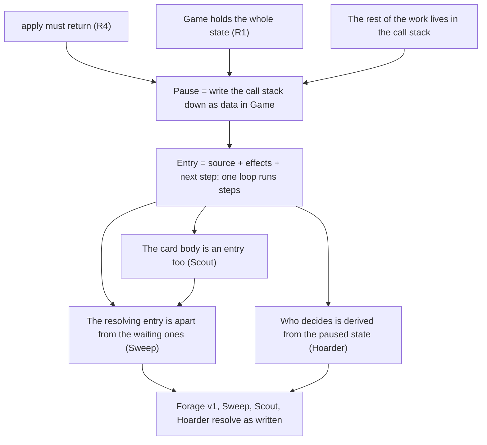
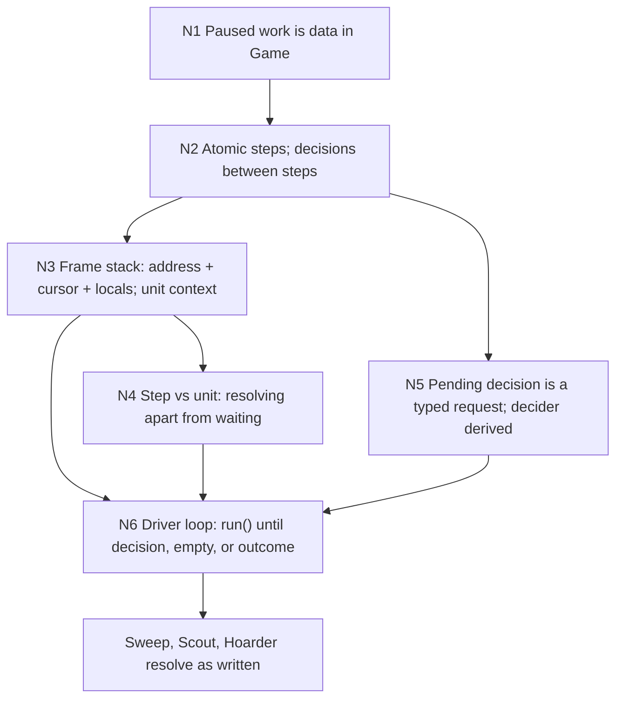

> [!quote] YOU

continue the course


> [!abstract] PI

Session 06: the resolution loop and pending choices. First, the retrieval quiz on 05: three quick questions.


> [!question] Quiz
> Rally Banner is on P0's board, and a Recruit is beside it. P1 plays Blast and the Recruit takes damage. Banner's text: "Friendly minions have 'Whenever this takes damage, draw a card.'" At which hook moment does each part run?
>
> The three moments from session 05: on read, before a change, after a change.
> "Grant" = the Recruit having the trigger. "Draw" = the draw itself.
>
> 1. Grant: after the Banner enters the board. Draw: after the change.
> 2. Grant: after the Banner enters the board. Draw: before the change.
> 3. Grant: on read. Draw: after the change.
> 4. Grant: on read. Draw: before the change.


> [!success] Quiz — correct ✓
> Your answer: 3. Grant: on read. Draw: after the change.
> Correct answer: 3
>
> The grant is a static: `triggers(obj)` reads `modifiers(obj)`, which picks up the Banner's `friendly_aura` while the Banner is on the board. Nothing is written when the Banner enters, so nothing needs undoing when it leaves or is silenced. The draw is a trigger: `emit` matches the `Damaged` event after `object.damage += amount` has happened, and the draw resolves later from `effect_stack`. A hook that runs before the change would be a replacement ("if it would take damage...").


> [!question] Quiz
> A hypothetical Warden: "Friendly minions with exactly 1 Attack have 'Deathrattle: summon a Squire.'" P0's board: Warden, then a Squire (1/1). P0 plays a Captain (friendly minions get +1/+1), so the Squire is 2/2. P1 then kills the Squire; the Captain is still alive. With triggers derived on read as today (`triggers(obj)` reads `modifiers(obj)`), what happens, and what did the Captain's code need for it?
>
> Assume `ModifierEffect::GrantTrigger` could be made conditional on the target's Attack. The death triggers are read in `kill`, before removal.
>
> 1. No Squire is summoned. The Captain needed no change.
> 2. No Squire is summoned. The Captain's board entry must re-check the Warden's grants.
> 3. A Squire is summoned. The Captain's board entry must re-check the Warden's grants.
> 4. A Squire is summoned. The Captain needed no change.


> [!success] Quiz — correct ✓
> Your answer: 1. No Squire is summoned. The Captain needed no change.
> Correct answer: 1
>
> Note: I think the only missing piece is being able to filter on the atk
>
> When `kill` reads the Squire's death triggers, `triggers(obj)` asks for its Attack right then. The Captain's aura makes it 2, so the grant doesn't apply and no Squire comes. Nobody had to tell the Warden that the Captain arrived: the grant isn't stored anywhere, so there's nothing to patch. With a registry, "which triggers does the Squire have" would be a stored copy, and every input to it (the Captain's aura here, the Attack it changes) would need its own hook. That's N1: "has trigger T" is a static, so listeners come from a scan.


> [!question] Quiz
> P0's board, in order of play: Mourner, Gravedigger, Bomber. P1 Pings P0's Bomber, and it dies. In what order do the three triggers resolve?
>
> (On your note: yes, an Attack filter is the only missing piece. Check it in `triggers()` after `modifiers()` returns; inside `modifiers()`, attack() -> modifiers() -> attack() would recurse.)
>
> Mourner: whenever a friendly minion dies, draw a card.
> Gravedigger: whenever a minion dies, deal 1 damage to enemy heroes.
> Bomber: deathrattle (`Died(Itself)`), deal 1 damage to all minions.
> Mourner is 1/3 and Gravedigger 2/2, so nobody else dies.
>
> 1. Bomber, Gravedigger, Mourner
> 2. Mourner, Gravedigger, Bomber
> 3. Gravedigger, Mourner, Bomber
> 4. Bomber, Mourner, Gravedigger


> [!success] Quiz — correct ✓
> Your answer: 3. Gravedigger, Mourner, Bomber
> Correct answer: 3
>
> Note: bomber is last cause the other two are reacting to it, gravedigger before mourner because order of play
>
> ADR 0014. `kill` pushes the Bomber's own deathrattle first, before `Died` is emitted, so it sits at the bottom. `emit(Died)` then matches the listeners in order of play, oldest first: Mourner, then Gravedigger. The stack is [Bomber, Mourner, Gravedigger] from bottom to top, and it pops from the top: Gravedigger, Mourner, Bomber. The reactions to a death resolve before the dead minion's own deathrattle, and among one event's matches the newest resolves first.


> [!question] Quiz
> A hypothetical Forage v1: "Reveal the top 2 cards of your deck, pick one into your hand. Then draw a card." Encoded as `[Reveal { Owner, 2 }, Draw { Owner, 1 }]`. P0 plays it with today's code. What does P0's observer see?
>
> Today's code, trimmed:
>
> ```rust
> // apply_effects
> effects.iter().for_each(|e| {
>     self.apply_effect(owner, source, e, obs);
>     obs.checkpoint(Views::new(self));
> });
>
> // reveal: pops `count` cards off the deck, then
> player.interaction_state = PlayerInteractionState::PendingPick { options };
> self.emit(Event::Revealed { .. }, obs);
>
> // legal_actions in PendingPick lists only Pick { object_id } for each option
> ```
>
> 1. Revealed in the `apply` for Play. Picked and then Drew in the next `apply`.
> 2. Revealed in the `apply` for Play. Picked in the next `apply`, and Drew never happens.
> 3. Revealed and Drew in the `apply` for Play. Picked in the next `apply`.


> [!success] Quiz — correct ✓
> Your answer: 3. Revealed and Drew in the `apply` for Play. Picked in the next `apply`.
> Correct answer: 3
>
> Note: rn we cant "pause" mid effect
>
> `reveal` only sets a field and returns. Nothing stops the `for_each`, so the Draw runs right away in the same `apply`, and the third card goes to hand before P0 has picked. The pick comes in the next `apply`, and by then the card has finished. The text says "pick, then draw", but the code draws first. Pausing is not something the code does today. The rest of the card lives in the `for_each` iterator, and nothing in `Game` remembers where the card was.


> [!abstract] PI

Right, and that's the problem this session solves. Now a harder one.


> [!question] Quiz
> A first fix: when `reveal` sets `PendingPick`, `apply_effects` stops, pushes the card's remaining effects onto `effect_stack` as a `PendingEffect`, and returns; the drain stops while a pick is pending, and after `Pick` it pops again. Forage v1 now draws after the pick. Then a minion, Scout, with `play_effects = [Reveal { Owner, 2 }]` (a battlecry Discover) is played. When does Scout enter the board?
>
> Today's `play`, trimmed:
>
> ```rust
> fn play(&mut self, player_id, object_id, obs) {
>     hand.remove(object_id);
>     self.emit(Event::Played { .. }, obs);
>     self.drain_effect_queue(obs);
>     let effects = self.play_effects(object_id).to_vec();
>     self.apply_effects(object_id, &effects, obs);   // stops at the Reveal, pushes [] and returns
>     if self.binder.has_board_presence(def_id) {
>         self.summon(player_id, object_id, obs);
>         obs.checkpoint(Views::new(self));
>     }
> }
> ```
>
> 1. In the `apply` for Play, before P0 picks.
> 2. In the `apply` for Pick, after P0 picks.
> 3. Never: the summon is skipped once the pick is pending.


> [!success] Quiz — correct ✓
> Your answer: 1. In the `apply` for Play, before P0 picks.
> Correct answer: 1
>
> Note: if it is a play effect then it is before summon
>
> `apply_effects` returning early only ends `apply_effects`. Control goes back to `play`, which carries on to `summon`. The fix saved the rest of the effect list, but the rest of the work also includes the lines of `play` after the call, and above that whatever `apply_action` and `apply` still had to do. All of it lives in Rust's call stack, one frame per function. Pausing means every frame between the pause point and `apply` has to be written down as data, not only the innermost one.


> [!question] Quiz
> Same fix as before (on a pending pick, `apply_effects` pushes the remaining effects as a `PendingEffect` and returns). P0 plays Sweep: `[Damage { All minions, 1 }, Reveal { Owner, 2 }, Draw { Owner, 1 }]`. A Bomber (1/1) is on the board, and nothing else. What happens to the Bomber?
>
> The drain, as today, plus the pause:
>
> ```rust
> fn drain_effect_queue(&mut self, obs) {
>     self.check_state(obs);              // kill pushes the dead's own deathrattles
>     while self.outcome().is_none()
>         && !self.pick_pending()          // new
>         && self.effect_queue_pop(obs)   // pops the top of effect_stack
>     {
>         self.check_state(obs);
>     }
> }
> // apply(Play) runs apply_action (which runs play), then drain_effect_queue.
> // apply(Pick) runs pick, then drain_effect_queue.
> ```
>
> Bomber: deathrattle, deal 1 damage to all minions.
>
> 1. It dies before P0 picks, and its deathrattle resolves before Sweep's Draw.
> 2. It dies after P0 picks, and its deathrattle resolves before Sweep's Draw.
> 3. It dies after P0 picks, and its deathrattle resolves after Sweep's Draw.
> 4. It dies before P0 picks, and its deathrattle resolves after Sweep's Draw.


> [!failure] Quiz — incorrect ✗
> Your answer: 4. It dies before P0 picks, and its deathrattle resolves after Sweep's Draw.
> Correct answer: 1
>
> Note: it would resolve after because the drain only happens after the pick
>
> In the `apply` for Play: Damage puts the Bomber at 0, Reveal pauses, and `[Draw]` goes onto the stack. Then `apply` runs the drain, and its first line is `check_state`, which runs even though the pick is pending. The Bomber dies while P0 is still choosing, and `kill` pushes its deathrattle on top of `[Draw]`. After the pick, the drain pops the top: the deathrattle resolves, then Sweep's Draw. Without the pause, Sweep would finish (Draw included) before any state check, and the deathrattle would come after. The call stack used to guarantee that a card finishes before deaths are checked, and a pushed remainder is just one more stack entry, with nothing to tell it apart from a trigger.


> [!question] Quiz
> Same Sweep scenario. The `apply` for Play has just returned, and P0 hasn't picked yet. What is in `effect_stack`, bottom to top?
>
> Order of calls inside the `apply` for Play:
> 1. `apply_effects`: Damage (Bomber now at 0), then Reveal sets `PendingPick`, then `[Draw]` is pushed as a `PendingEffect` and `apply_effects` returns.
> 2. `drain_effect_queue`: `check_state` finds the Bomber at 0, `kill` pushes its deathrattle (`self.effect_stack.push(..)`), then emits `Died`. The `while` doesn't pop, because a pick is pending.
>
> `effect_stack` is a `Vec`: `push` appends at the end, `pop` takes from the end.
>
> 1. [Draw, Bomber deathrattle]
> 2. [Draw]
> 3. [Bomber deathrattle, Draw]


> [!success] Quiz — correct ✓
> Your answer: 1. [Draw, Bomber deathrattle]
> Correct answer: 1
>
> Note: honestly this design seems confusing to me, later we need to explore how to properly do this
>
> `[Draw]` was pushed in step 1, the deathrattle in step 2, so the deathrattle is on top. After the pick, the drain's first pop takes the deathrattle, and Sweep's Draw comes after it. The stack only knows the order things were pushed. It can't tell "the rest of the card that's being resolved" from "a trigger waiting its turn".


> [!abstract] PI

Saved. Back to the probe: the next strand is where the paused work can live.


> [!question] Quiz
> Instead of writing the paused work down as data, you could make resolution an `async fn` that `.await`s the pick, with the shell holding the future and resuming it after `Pick`. Spellsource does the same thing with virtual threads. The game stays deterministic. What do you lose?
>
> What we rely on today: `Game: Clone + PartialEq`; `applied()` clones; the playouts compare states; a bot searches by cloning `Game` and trying actions.
>
> 1. Two runs with one seed and one action list can end in different states.
> 2. A clone of `Game` taken during a pick can't finish the card.
> 3. Every pending pick holds an OS thread until it's answered.


> [!success] Quiz — correct ✓
> Your answer: 2. A clone of `Game` taken during a pick can't finish the card.
> Correct answer: 2
>
> The rest of the card lives in the future's captured locals, outside `Game`. A clone of `Game` has the `PendingPick` but not the work after it, so a bot can't search from a paused state, `==` can't see the difference between two paused games, and you can't save one to disk. That breaks session 01's "the state is everything". It's still deterministic: one future resumes in one order. And Rust's `async` needs no threads; a future is a state machine the compiler writes for you. That last point is the hint for this session. The compiler turns an `async fn` into an enum of "where I stopped plus the live locals". We want that enum, but written by us, stored in `Game`, and `Clone`.


> [!question] Quiz
> A hypothetical Hoarder (P1's minion): "Deathrattle: its owner reveals the top 2 cards of their deck and picks one." On P0's turn, P0 kills the Hoarder, and P1 now has `PendingPick`. With today's `legal_actions`, what does `legal_actions(P0)` return?
>
> Today's `legal_actions(player_id)`, trimmed:
>
> ```rust
> if self.outcome().is_some() { return Vec::new(); }
> match &self.get_player(player_id).interaction_state {
>     Idle => {
>         if self.turn_order.get_active_player_id() != player_id { return Vec::new(); }
>         // a Play or Draft per affordable card in hand, then EndTurn
>     }
>     PendingPick { options } => { /* a Pick per option */ }
>     Draft { .. } => { /* Choose ..., Play when filled, Cancel */ }
> }
> ```
>
> 1. P1's Pick actions.
> 2. Nothing.
> 3. P0's affordable plays and EndTurn.


> [!success] Quiz — correct ✓
> Your answer: 3. P0's affordable plays and EndTurn.
> Correct answer: 3
>
> `legal_actions(P0)` reads only P0's `interaction_state`, which is `Idle`, and it's P0's turn. So P0 can play a card or end the turn while P1 is still picking. "Who is the game waiting on" isn't stored anywhere as one fact. Each player's state answers it for that player alone, and nothing stops two of them from both saying yes. Today no card makes the non-active player pick, so nothing reaches this.


> [!question] Question
> Which of these should session 06 cover? The first two are the session's core.
>
> 1. Pausable resolution: a paused card or trigger stored as data in `Game` and resumed by `Pick`. Forage v1 ("reveal 2, pick 1, then draw") draws after the pick, and Sweep finishes before the Bomber's deathrattle.
> 2. One "who are we waiting on" fact: while P1 picks for the Hoarder, P0 can't act.
> 3. Results read later in the same resolution: "deal 3 to a random enemy minion; if it died, draw" and "pick a card, then deal damage equal to its cost". The open thread on dependent sequencing.
> 4. Choices inside triggers: a trigger that makes its owner pick a target while it resolves (Choose belongs to casting and Pick to resolution). This lifts `ChoiceInTrigger` for that meaning.
> 5. Simultaneous picks: "each player reveals 2 and picks 1". MTG 101.4 makes the choices in APNAP order (active player first) and then applies them together.
>
> Concept for all of the chosen ones, then an exercise. As in 04, the exercise can be split into its own sessions.
>
> 1. 1. Pausable resolution (Recommended)
> 2. 2. One 'who are we waiting on' fact (Recommended)
> 3. 3. Results read later in the same resolution
> 4. 4. Choices inside triggers
> 5. 5. Simultaneous picks


> [!example] Answer
> 1. 1. Pausable resolution (Recommended)
> 2. 2. One 'who are we waiting on' fact (Recommended)
> 4. 4. Choices inside triggers
> 5. 5. Simultaneous picks
> Other: I think this should be split into 06a 06b and so on


> [!question] Question
> How should the split go?
>
> Your picks: 1 pausable resolution, 2 one "who are we waiting on" fact, 4 choices inside triggers, 5 simultaneous picks. Item 3 (results read later) stays an open thread.
>
> A. Each part gets its own concept and exercise. This session (06) covers 1 and 2: the paused-work data in `Game` and the decider fact, then the exercise. 06b is choices inside triggers and 06c is simultaneous picks. Both rest on the shape 06 builds, so their concepts are taught once that shape exists in code.
>
> B. Same as session 04: all four concepts today, then the exercises in 06a, 06b and 06c. Items 4 and 5 would be taught against a design that isn't built yet.
>
> 1. A. Concept and exercise per part: 06 = 1 + 2, then 06b, 06c (Recommended)
> 2. B. All concepts today, exercises in 06a, 06b, 06c


> [!example] Answer
> 1. A. Concept and exercise per part: 06 = 1 + 2, then 06b, 06c (Recommended)


> [!abstract] PI

Split A: this session covers pausable resolution and the decider fact, with concept and exercise. 06b is choices inside triggers and 06c is simultaneous picks. Here's the plan.

## Approach

You already hold the three roots: `apply` must return (R4), `Game` is the whole state (R1), and, from the probe just now, the rest of the work lives in Rust's call stack. So we skip the foundations and go straight to the derived steps, each driven by one of the probe's failing cases:

1. **Pausing means writing the call stack down as data.** Forage v1 drew before the pick. The fix is what the compiler does for an `async fn` (an enum of "where I stopped plus the live locals"), but written by us, stored in `Game`, and `Clone`. Engines split three ways here: block a thread (Forge, XMage, Metastone), suspend a fiber (Spellsource), or store the paused work as data (SabberStone). SabberStone also has your Forage v1 bug: the tasks listed after a `DiscoverTask` run before the pick.
2. **An entry's shape: source, effects, next step.** One loop runs one step at a time until the stack is empty, the game has ended, or a pick is open. Resuming isn't special: `Pick` stores the answer and the loop runs again.
3. **The card's body is an entry too.** The Scout case: `summon` sat in `play`'s Rust lines, so the pause couldn't hold it. If everything that resolves is an entry, one loop resolves everything. This also closes the open thread where `play_effects` runs after a game-ending drain.
4. **The resolving entry sits apart from the waiting ones.** The Sweep case. The call stack used to guarantee that a card finishes before deaths are checked and before its consequences resolve. We'll work out where that guarantee lives in data, and check it against MTG 603.3 (triggers wait until resolution ends).
5. **Who decides is derived, not stored.** The Hoarder case. It's one function over the paused state, the way OpenSpiel's `CurrentPlayer()` is, so it can't drift from a second copy. That's the mirror lesson again.

Mostly Socratic, with a quiz per node. The shapes in 2 to 5 are your design calls, and I'll bring the forcing cases. Then the exercise: you write the entry type, the loop and the step function, and I write red tests first, using three new cards: Sweep, Scout and Hoarder.

## Dependency map



Okay to start with node 1?


> [!quote] YOU

yes


> [!abstract] PI

## Node 1: pausing means writing the call stack down as data

**Why we need it.** Forage v1 drew before the pick. To get "reveal, pick, then draw", the `apply` for Play has to stop at the Reveal and return (R4), and the next `apply`, for Pick, has to carry on from that point. Between those two calls nothing survives except `Game` (R1). So whatever the next `apply` needs in order to carry on has to be a field in `Game`.

**What the call stack held.** Here's the call stack at the moment `reveal` returns in Forage v1, with what each call still has to do:

| Call | Still to do |
|---|---|
| `apply` | run `drain_effect_queue`, return `Ok` |
| `apply_action` | nothing after `play` returns |
| `play` | the `has_board_presence` check, and `summon` for a minion |
| `apply_effects` | `effects[1..]` of Forage (the Draw), with `source` and `owner` |
| `apply_effect` | the rest of the Reveal's target loop (empty, one target) |

Each row is a position in a function plus the locals that are still alive. Together they're "the rest of the work". When `apply` returns, Rust drops all of it.

**The compiler already does this.** An `async fn` that awaits the pick is compiled into a hidden enum, roughly:

```rust
enum ResolveFuture {
    AwaitingPick { source: ObjectId, owner: PlayerId, effects: Vec<Effect>, next: usize },
    Done,
}
```

That's the right content, but it lives outside `Game` and isn't `Clone`, so a bot can't search from a paused state (your last probe answer). We write the same enum ourselves and store it in `Game`.

**What engines do** (checked this session, in `verified-facts.md`):
- **Block a thread.** Forge, XMage and Metastone call the player in the middle of resolution, and the game thread waits for a human's answer. Forge's `GameCopier` doesn't copy a choice in progress, so its search AI replays the whole card from a fresh copy for each set of answers it tries.
- **Suspend.** Spellsource's game logic parks on a fiber, now a virtual thread, until the network answer arrives.
- **Data.** SabberStone stores `Controller.Choice` with an `AfterChooseTask`, the work to run after the pick, and the game can be cloned mid-choice. But it only saved that one task: any tasks listed after a `DiscoverTask` run before the pick. That's your Forage v1 bug in a shipped engine. It saved the innermost piece and not the rest of the stack.

The connection: R4 says `apply` returns, R1 says only `Game` survives the return, and the call stack holds the rest. Together they force the rest of the work to be data in `Game`.


> [!question] Quiz
> Between the `apply` for Play and the `apply` for Pick, which of these must `Game` hold so Forage v1 ("reveal 2, pick 1, then draw") can finish as written?
>
> Select every one that's needed.
>
> 1. The observer passed to the `apply` for Play.
> 2. The `Views` from the last checkpoint.
> 3. That Forage's Draw is still to run.
> 4. The revealed cards P0 may pick.


> [!success] Quiz — correct ✓
> Your answer: 3. That Forage's Draw is still to run., 4. The revealed cards P0 may pick.
> Correct answer: 3, 4
>
> Note: what u are proposing is a state machine no? I see the option where playing a card always push its effects on the stack (in reverse so they execute in the correct order) even if its does not have any pausing, should we use the typestate pattern? not sure if AwaitingPick is the correct design here, this implies we would have a AwaitingChoice instead of a more generic MidResolution, by having the ObjectId and idx we would also not need to clone the effects. I am not confident what u are presenting is the best solution, spend more time, spawn some subagents, researching and tinking trough the design and how to correctly implement this, dont get stuck in the code we have today, remember the goal is for me to understand how to properly implement it in a production level, not just implementing.
>
> The revealed cards are already in `Game` today (`PendingPick { options }`). "The Draw is still to run" is the piece today's code drops, and it's what we have to add. The observer belongs to one `apply` call: the shell passes a fresh one to the `apply` for Pick, and a bot's clone has none (session 03, ADR 0011's rejected option). `Views` are computed from `Game` on demand, so storing them would make a mirror.


> [!abstract] PI

Good pushback. Answers first, then the research.

**A state machine?** Yes. `Game` already is one (R1: state plus action gives the next state). What changes is that the control flow inside a resolution, meaning where we are in a card, becomes part of that state. Today it sits in Rust's call stack between two calls.

**Typestate?** I don't think it fits, and here's the reason. Typestate puts the state in the type (`Game<Idle>`, `Game<Picking>`), so the compiler rejects a `Play` on a `Game<Picking>`. That only works when the caller knows statically which state comes next. Ours doesn't: whether `apply(Play)` ends idle or picking depends on the card, the deck order and the RNG. So `apply` would have to return an enum over the `Game<S>` types, and the shell, a bot's `Vec<Game>` and the playouts each need a single type to hold. That puts us back at a runtime enum, with extra types on top. I'll have the research confirm or correct this.

**`AwaitingPick` vs a generic `MidResolution`:** agreed. The enum I showed was the compiler's output for one `async fn`, there to show what has to be stored, not a proposal. The design should keep two axes apart: where resolution is (generic) and what decision it's waiting on (a pick now, targets in 06b, later order, yes/no, modes). It's the same split as the selectors in 04a.

**`ObjectId` plus an index, no clone:** right for a card's body, since printed data never changes (R2). There's one catch, granted triggers. Rally Banner's granted draw lives on the Banner's definition. If the Banner dies before the draw resolves, the minion no longer has that trigger, and that's why ADR 0011 copies the effects at match time. A reference that survives has to point into static data, (definition, which list, step), not into the object. Or it's an `Arc<[Effect]>`, where a clone only bumps a counter.

**Pushing effects in reverse:** a real option, but it changes behavior, not only representation. If each effect is its own entry, the state check runs between entries (ADR 0012), so Sweep's Bomber dies between the Damage and the Reveal. And whatever the Damage triggers lands on top of the Reveal and resolves before it. One frame per card, with a step index, keeps the card as the unit for state checks and trigger timing. Which unit a game wants is a rules question, so it goes into the research too.

You're right that I moved too fast. I'm launching five researchers, one per angle, plus a throwaway prototype outside the repo that tests the candidate design against Sweep, Scout, Hoarder and nested effects. Once they're back, I'll write up the design space with its trade-offs and re-plan before we go on.


> [!abstract] PI

Six agents are running:

1. Jinteki.net (Netrunner): continuations keyed by `eid`, prompts, checkpoints.
2. MTG engines: Magarena (choices made before an event executes?), Forge sub-ability chains, XMage's effect loop and when its AI copies the game.
3. Decision protocols: MTG Arena's GRE request types, Hearthstone's `EntityChoices`/`Options`, OpenSpiel's simultaneous nodes.
4. Rust and CS patterns: sans-IO state machines, the limits of typestate, resumable interpreters (wasmi, Lua's `lua_yieldk`), defunctionalized continuations, whether coroutines can be `Clone`, and Ink's serializable call stack.
5. Hearthstone simulators: Fireplace's choice callbacks, SabberStone's `TaskQueue`, Metastone's nesting.
6. A prototype in `/tmp/resolution-proto`, outside the repo. It covers variant A (a resolving unit as a frame stack, plus a stack of waiting triggers) and variant B (your push-in-reverse), tested on Sweep, Scout, Hoarder, a pause inside a loop, and a clone taken mid-pick.

When they're back I'll save the research, write up the design space with its trade-offs, and come back with a revised plan.


> [!abstract] PI

Saved to `docs/course/research/06-resolution/rust-cs-resumable-patterns.md`. The key findings:

- **Typestate:** a step whose next state depends on data has to return a wrapper enum anyway (Hobden).
- **Async in Rust:** a future from an `async` block can't be `Clone`, even on nightly. `coroutine_clone` explicitly excludes them (rust-lang/rust#95360).
- **Ink:** saves its whole call stack to JSON mid-story. Each frame is a path into immutable compiled content, an index and its local variables, never a closure. That's very close to the "(definition, which list, step)" reference you raised.
- **Lua:** its manual says it plainly: once a yield removes a C function's frame, Lua "cannot return to `foo` any more", so the code to resume has to be handed over as a continuation function plus a context value.

Four agents are still running.


> [!abstract] PI

Saved to `docs/course/research/06-resolution/jinteki-continuations.md`. Jinteki.net is the counterexample we needed, a production engine that took the closure route:

- **Where the paused work lives:** in the game state, as Clojure closures keyed by an integer `eid`. So the state can never be serialized. Restoring from a replay rebuilds only the board: open prompts and the work waiting behind them are lost.
- **What the maintainers say about it:** their wiki calls the design "callback hell", and names async calls placed outside tail position as "the single biggest issue with dropped and incorrect effects".
- **No single "who decides" fact.** Each side's own prompt queue gates that side, and the opponent is blocked only if the card remembered to set a `:waiting-prompt`. That's the same per-player shape as our Hoarder bug.
- **A values-between-steps problem.** A value from an earlier step survives only as a variable a closure captured. Their proposal for a shared context ("this misses out on passing that information around") was never adopted.

Three agents are still running.


> [!quote] YOU

continue


> [!abstract] PI

Saving the MTG engines report, and the four new reports' facts to `verified-facts.md`.


> [!abstract] PI

The reports are saved. The Hearthstone-simulator researcher hit a rate limit, and SabberStone, the part that mattered, is already covered by the first report, so I'm not re-running it. You stopped the prototype, so nothing below relies on it.

## What the research changed

**1. Five families, not three.** What it costs to keep the paused work in each place:

| Paused work lives in | Engines | Copyable mid-decision | Cost seen in the source |
|---|---|---|---|
| A blocked thread's call stack | Forge, XMage, Metastone | no | XMage's AI: "TODO: implement choices simulation?". Forge's AI replays the card from a fresh copy for each answer set |
| A suspended fiber | Spellsource | no | Needs a runtime. Reproduces games by replay instead |
| Closures stored in the state | Jinteki.net | no | Its wiki calls it "callback hell". Async calls outside tail position are "the single biggest issue with dropped and incorrect effects", and a restore loses open prompts |
| A queue of events whose choices are made before they run | Magarena | yes, its MCTS copies at every choice | Card authors split effects by hand at choice points. A choice inside an immediate trigger is silently ignored |
| A stack of frames stored as data | Argentum (Kotlin), phase-rs (Rust), Ink; SabberStone partly | yes, Argentum's MCTS forks mid-decision | More types. SabberStone saved one task and dropped the rest |

The fifth family is the production answer for us. phase-rs is Rust and calls its frames "typed, serializable suspension frames for ability resolution". Argentum's paused state is `Suspension(question: PendingDecision, answer: AnswerContinuation)`, and its paused effect is `EffectContinuation(remainingEffects, effectContext)`.

**2. Magarena shows a second axis: where a pause may happen.** Its steps are atomic. A step's choices are made before the step runs, and a step never stops halfway through. "Reveal, then choose" becomes two steps, the second of which carries the question. That keeps every step validate-then-mutate, the same discipline as `apply`. Your push-in-reverse idea belongs on this axis.

**3. Two units of time, not one.** The step is where a pause can happen. The resolution unit, one card or one trigger, is the boundary where the state check runs and waiting triggers may resolve. Forge freezes the stack while a spell resolves and holds new triggers in `waitingTriggers` until it finishes (MTG 603.3). Sweep failed because the naive fix merged these two units. Push-in-reverse works only if each entry knows which unit it belongs to, and then the frame is back.

**4. The decision is a typed request stored in the state, and "who decides" is derived from it.** Arena has about 30 request kinds plus `decisionPlayer`; Hearthstone has `EntityChoices`; Manabrew has `AgentPrompt { promptId, decidingPlayerId, input }`; OpenSpiel has `CurrentPlayer()`. Jinteki.net gates each side by its own prompt queue, which is our Hoarder bug in production.

**5. Your earlier points, checked:** typestate needs an enum wrapper here (Hobden). A frame should hold a stable address into immutable data, like Ink's path, index and temporaries. That matches your "ObjectId plus index", with the granted-trigger catch.

## Revised plan

Node 1 holds (the paused work is data in `Game`), and the evidence above backs it. The rest is redone along the four design axes. You make the call on each one, and each has its forcing case:

- **N2: steps are atomic, and a decision sits between two steps.** Reveal splits into a step that asks and a step that applies the answer. Forcing case: a pause inside a `Repeat`.
- **N3: the continuation is a stack of frames.** Each frame holds a stable address into effect data, a cursor and frame-local data. A unit context holds the source, the owner, the choices and the results. Forcing cases: nesting, and the granted trigger.
- **N4: two units of time.** The resolving unit sits apart from the waiting stack, and the state check runs at unit boundaries. Forcing cases: Sweep, and your push-in-reverse variant.
- **N5: the pending decision is a typed request in `Game`.** `decider()` and `legal_actions` read it. Forcing case: Hoarder.
- **N6: the driver loop.** The sans-IO shape: `apply` validates the answer, then `run()` steps until a decision is pending, the stack is empty, or the game is over. The card's body becomes a unit, so Scout enters as its last step.



Then the exercise: you design and write the types and the loop, and I write red tests first, using Sweep, Scout and Hoarder.

Okay to go on with N2?


> [!quote] YOU

"The Hearthstone-simulator researcher hit a rate limit, and SabberStone, the part that mattered, is already covered by the first report, so I'm not re-running it. You stopped the prototype, so nothing below relies on it." I had to stop because of lack of internet, the rate limit was cause of that too, rerun everything that failed.


> [!abstract] PI

I've rerun both: the Hearthstone-simulator researcher (Fireplace, SabberStone's `TaskQueue`, Metastone) and the prototype in `/tmp/resolution-proto`. I'll save the report, read the prototype's code and results, and fold both into the plan before we start N2.


> [!abstract] PI

Saved, with the facts added to `verified-facts.md`. What this report adds:

- **Fireplace has the Forage v1 bug too.** Only the work chained with `.then()` on the Discover waits for the pick. A sibling action later in the same list either runs at once or parks a closure that nothing ever runs, and `Play.do` sends its after-play broadcasts before the pick. Two shipped Hearthstone simulators made the same mistake: they saved the innermost piece and not the rest of the stack.
- **"Two units of time" shows up in all three, under different names.** SabberStone processes deaths only in `DeathProcessingAndAuraUpdate`, after the whole power. Metastone checks deaths only after a top-level spell (`!childSpell`). Fireplace processes them when its action-block counter returns to 0. Each needs some marker for where the unit ends: a phase, a flag, a counter.
- **N4 has a third timing option.** SabberStone resolves damage triggers nested inside the power through `StartEvent`/`EndEvent`, the same as Hearthstone's depth-first rule. So a trigger can resolve nested and immediately (Hearthstone, SabberStone, Metastone) or after the unit (MTG 603.3, Forge's frozen stack, our ADR 0011). Either way, deaths wait for the unit boundary. That goes into N4 as a known alternative to ADR 0011, not a change.

The prototype is still running. Once it's back, I'll read the code, report what it found, and then ask again about going on with N2.


> [!abstract] PI

Before I quote any of this, let me check the prototype myself.


> [!abstract] PI

I ran it myself: `cargo test` passes 10 of 10 in `/tmp/resolution-proto`.

## What the prototype showed

**The design holds.** A unit holding a stack of frames, kept apart from the waiting stack, with a typed decision and a derived `decider()`, passes every hard case: Sweep, Scout, Hoarder, a pause inside a `Repeat`, a pause four lists deep, a game cloned mid-pick that continues identically, and an illegal action that changes nothing. When it ran the state check after every step as an experiment, 3 tests failed. So the tests pin "state check only at unit boundaries".

**Your push-in-reverse idea, measured.** Untagged, it kills the Bomber between Sweep's Damage and its Reveal. Mourner's draw then takes the card Sweep would have revealed, so Sweep reveals different cards. Tagged with a unit id, it matches the main design exactly. But each generalization brings the frame back: a trigger matched mid-unit has to go below the run, which is a separate waiting stack; a `Repeat` whose count comes from an earlier answer can't be unrolled when it's pushed; and the owner, source and answers need a per-unit table. So the representation is a free choice, and the two units of time are not.

**Your stable-address point, built.** A frame stores no list, just a cursor and its own locals. The unit stores `Body { def, slot }`, and the current list is found by walking the cursors down from the root, like Ink's path plus index. Everything derives `Clone` and `PartialEq` with no lifetimes. It also explains a line in our code: `play_effects(object_id).to_vec()` clones because a recursive `for e in self.list(..) { self.mutate() }` fails the borrow checker (E0502). A cursor-based step function doesn't have that problem.

**New design questions it raised**, each now part of a node:
- **N2:** "an answer is present" is the only marker that a Reveal is in its second half. A card that asks twice, or uses an answer later, needs an explicit phase or answers keyed by question.
- **N3:** a card being resolved is in no zone, so "where is card X?" has no answer. MTG has a stack zone. And a granted trigger's address has to name the granting card (the Banner's aura list), not the minion.
- **N4:** a hero at 0 or below dies only at the unit boundary, so a pick can be offered to a player who has already lost. That's consistent with ADR 0012, but it's a choice.
- **N5:** `Answer` copies the request's options. Should the answer point at the request instead?
- **Already ours:** it kept `events` in `Game`, which breaks `==` between identical positions reached by different routes. We put events in the observer in session 03 (D1), so that holds.

The plan stands as revised (N2 to N6), now with these questions and the prototype's evidence behind each node. Okay to go on with N2?


> [!quote] YOU

yes, bear in mind I do know what is the design yet


> [!abstract] PI

Understood. What I wrote above was the map, not the lesson. We'll build the design one node at a time, and nothing below assumes you've taken the summaries in.

## N2: where may a pause happen?

**Why we need this.** N1 says the paused work has to be data in `Game`. Before we can design that data, we need to know what it has to hold, and that depends on where a pause can happen. Whatever is alive at the pause point has to be written down.

Compare two places a pause could happen, using today's `reveal`:

```rust
pub(crate) fn reveal(&mut self, player_id: PlayerId, count: u8, obs: &mut impl Observer) {
    let player = self.get_player_mut(player_id);
    let mut options = Vec::new();
    for _ in 0..count {
        let Some(card) = player.zones.deck.pop_front() else { break };
        options.push(card);
    }
    // (A) pause here, inside the function?
    ...
}
```

- **Pause inside the function, at (A).** The saved data has to hold `reveal`'s locals (`options`, the loop's progress), plus the locals of `apply_effect`'s target loop around it, plus every caller above that. Each function that might pause adds its own locals to the saved data, and the next new effect adds more. This is what Forge and XMage do, and they can afford it because they block a thread: Java keeps those locals alive for them. We can't.
- **Pause only between steps.** A step is a piece of work that, once it starts, runs to the end without needing input from anyone. If pauses only happen between steps, "where are we?" is answered by "which step is next?", which is a cursor. No function's half-finished locals ever need saving, because no function is ever half finished.

The second option costs one thing: an effect that needs an answer can't be a single step. Magarena works this way. A step's choices are fixed before the step runs, and when a choice depends on cards revealed during resolution, the effect is split so that the question comes at the end of one step and the answer is used by the next.


> [!question] Quiz
> Pauses happen only between steps, and a step never waits for input once it starts. How does Forage's "reveal the top 2, pick one into your hand, put the other on the bottom" become steps?
>
> A step: work that runs to the end with no input from anyone.
> The pause is the gap between two steps.
>
> 1. No resolution steps: P0 picks during the draft, before Forage resolves, like Ping's target.
> 2. One step that reveals, pauses for the answer inside itself, then finishes.
> 3. Two steps: reveal the cards and post the question, then apply the answer. The pause sits between them.


> [!success] Quiz — correct ✓
> Your answer: 3. Two steps: reveal the cards and post the question, then apply the answer. The pause sits between them.
> Correct answer: 3
>
> Step 1 moves the top 2 cards out of the deck and posts "P0, pick one of these". Then the run stops, because the next step can't start without the answer. `apply(Pick)` checks the answer against the posted question, and step 2 puts the pick in hand and the other card on the bottom. Neither step ever waits halfway. "One step that pauses inside" is the Forge shape, and it needs the step's locals saved. The draft doesn't work either (session 04, E5): the options don't exist until resolution reveals them, so the choice can't be made while casting.


> [!question] Quiz
> A new card, Mind Games: "Reveal the top 3 cards of your deck. Your opponent picks one; put it into your hand. Put the rest on the bottom." P0 plays it. Under "pauses only between steps", what's the shape?
>
> 1. Two steps. Step 1 reveals and posts the question to P1. The pause sits between the steps, and P1 answers.
> 2. One step. It reveals, waits inside for P1's answer, then moves the cards.
> 3. No resolution steps. P1 picks during P0's draft, before Mind Games resolves.
> 4. Two steps. Step 1 reveals and posts the question to P0, who relays P1's choice.


> [!success] Quiz — correct ✓
> Your answer: 1. Two steps. Step 1 reveals and posts the question to P1. The pause sits between the steps, and P1 answers.
> Correct answer: 1
>
> Note: we have talked about only "the card u choose goes to hand and the rest is burried" cards, should/could we handle other effects on the picked/not-picked cards?
>
> The split is the same as Forage's. Only the decider changes: the question is addressed to whoever the card says decides, here P1. While it's pending, P1 is the only player with actions, even though it's P0's turn (Hoarder's lesson, which N5 turns into one derived fact). Routing the answer through P0 would make P0's `legal_actions` describe a choice P0 doesn't own. The draft is out for the same reason as before: the three cards don't exist as options until step 1 reveals them.


> [!abstract] PI

Good question, and the answer is yes. It's also where N2 leads next.

**Today's Reveal is one verb that hard-codes three things**: reveal N, the owner picks one, the pick goes to hand and the rest to the bottom. Real cards vary every one of them:
- **Tracking** (Hearthstone): "Look at the top 3 cards of your deck. Draw one and discard the others." The rest go to the graveyard, not the bottom.
- **Fact or Fiction** (MTG): the opponent splits five revealed cards into two piles, you take one pile into your hand, and the other goes to the graveyard. Two decisions by two players, over piles.
- "Pick one, then deal damage equal to its cost": a later effect reads the pick.

Adding a variant per combination is the `DamagePlayer`/`DamageMinion` multiplication from session 04. The fix is the same as there: break the verb into parts.
1. A step that gathers cards into a named set ("revealed").
2. A decision whose answer is stored under a name ("picked").
3. Ordinary verbs whose card selector reads those names: hand ← picked, graveyard ← revealed minus picked, damage = cost of picked.

That's E2's verb + selector + amount, with a new kind of selector that reads values the current resolution produced. Engines do this:
- **Argentum** carries the values forward in the paused effect's context (`storedCollections`, `chosenValues`).
- **Magarena** passes them between chained events through the event's `ref`.
- **SabberStone** has a fixed menu instead: `ChoiceAction` (HAND, CAST, SUMMON, ...) plus one `AfterChooseTask`.
- **Jinteki.net** keeps them only in variables its closures captured, and its own wiki complains that this "misses out on passing that information around".

It also fixes the awkward spot the prototype found. If a decision is its own effect, it's a single step: it posts the question and the run stops. `apply(Pick)` validates the answer, stores it under its name and moves the cursor on. No step needs a "first half or second half" marker, because the second half is the player's action itself.

**The catch is scope.** This is item 3, "results read later in the same resolution", which you left out of this session. The named values live in the per-unit context, which is N3's subject. So:

- **(a)** Bring item 3 into this session. N3 covers the unit context and named results, and the exercise splits Reveal into gather, decide and move. Sweep, Scout and Hoarder still pin the timing.
- **(b)** Keep Reveal as one verb now (a two-step effect with a phase marker) and break it up in a later session.

I'd take (a). It answers your question properly, and it removes the phase marker instead of building one we'd tear out. Which do you want?


> [!quote] YOU

b but on 06 something so we do it soon


> [!abstract] PI

Noted: Reveal stays one verb this session, and composable reveals get their own 06 session soon. There's an ordering point. Choices inside triggers (06b as planned) also need a stored answer that a later effect reads: "pick a minion, deal 2 to it" is a trigger asking, then reading the answer. So named results should come first. I'll propose this order for the close-out: **06b** named results and composable reveals, **06c** choices inside triggers, **06d** simultaneous picks. Say so if you want it different.

That leaves one design call to close N2. With Reveal as one verb, something has to know whether its question is still open or already answered.


> [!question] Question
> With Reveal kept as one verb, where does the answer get applied?
>
> 1. The action applies it. Reveal is ONE step: it reveals, posts the question and moves the cursor past itself. The run loop then stops, because a question is open. `apply(Pick)` validates the answer, does what today's `pick` does (hand, then bury the rest), clears the question and calls `run()`, which carries on at the next effect. No step needs a phase marker, because the second half is the action itself. This is closest to today's `reveal`/`pick` split, and it points the same way as the composable version (the action records the answer).
>
> 2. An "answer present" marker. Reveal is two steps. The first posts the question and leaves the cursor in place. `apply(Pick)` stores the answer in the paused unit, and the next step sees an answer and applies it. This is the prototype's choice. It breaks once an effect asks twice, because one marker can't tell which question an answer belongs to.
>
> 3. An explicit phase. Two steps, as in 2, with a field on the frame (`Asking` or `Applying`). That handles several questions per effect, at the cost of one more piece of state per frame.
>
> 1. 1. The action applies the answer; Reveal is one step (Recommended)
> 2. 2. Two steps, 'answer present' marks the second
> 3. 3. Two steps, explicit phase on the frame


> [!example] Answer
> Other: I am fine with reveal being more then one step if it get us closer to item 3, I just wanted to reduce scope so we have only reveal for now


> [!question] Quiz
> P0 plays Twice: `[ Repeat { times: 2, body: [ Reveal 2 ] }, Draw 1 ]`. P0 is answering the SECOND Reveal. What must the saved data hold so the card finishes correctly (one more pick applied, no third Reveal, then the Draw)?
>
> 1. The position in the outer list only.
> 2. The position in the outer list, the position in the Repeat's body, and the iterations left.
> 3. The position in the Repeat's body and the iterations left.


> [!success] Quiz — correct ✓
> Your answer: 2. The position in the outer list, the position in the Repeat's body, and the iterations left.
> Correct answer: 2
>
> Each nesting level has its own "where am I". The outer list needs to know it's on the Repeat (so the Draw comes next, after it). The Repeat's body needs its own index (here at the Reveal). The Repeat needs its iterations left (0), or it would run its body a third time. With only the outer position, resuming would restart the Repeat from scratch. With only the inner state, it wouldn't know that a Draw comes after the loop. One entry per nesting level, each holding a position plus that level's own data (like the iteration count): that's a stack of frames. It's the call stack again, but now it's the interpreter's own stack, one frame per nested effect list, instead of one per Rust function.


> [!question] Quiz
> Rally Banner grants a Recruit "Whenever this takes damage, draw a card." Blast hits; the Recruit's draw trigger matches and waits. Before it resolves, the Banner dies. Which of these, stored in the waiting trigger, still let it resolve the draw?
>
> Select every one that works.
>
> Today: `triggers(obj)` = the object's definition triggers plus `GrantTrigger` modifiers from auras that currently reach it. Card definitions never change during a game (R2, ADR 0003).
>
> 1. A copy of the effects, taken when the trigger matched.
> 2. The Banner's `DefId` and which list on it (its granted trigger).
> 3. The Recruit's `ObjectId` and an index into `triggers(recruit)`, read when it resolves.


> [!success] Quiz — correct ✓
> Your answer: 1. A copy of the effects, taken when the trigger matched., 2. The Banner's `DefId` and which list on it (its granted trigger).
> Correct answer: 1, 2
>
> Note: why it waits? I dont see any waiting effect on the question, 2 could work but does not sound good because we would have to store this for every granted trigger and 3 would not work because banner is no longer findable on board after the wait.
>
> A copy works, and that's what ADR 0011 does today. A definition address works too, because definitions never change (R2), and ADR 0003's append-only versions keep it valid even across a data patch. The object-plus-index version fails: by the time it resolves, the Banner is gone, so `triggers(recruit)` no longer lists the grant and the index points at nothing, or worse, at another trigger. The object is runtime state, which comes and goes. The definition is the stable thing. So your idea works once "object" becomes "definition": the address names where the list is printed, which for a granted trigger is the Banner's card, not the Recruit.


> [!abstract] PI

On your note.

**Why it waits.** You're right, my question never said, and it also skipped how the Banner dies. Here's the missing part. A trigger matched during a card doesn't resolve right away. `emit` pushes it onto `effect_stack`, and nothing pops until the card finishes (ADR 0011). After Blast finishes, `drain_effect_queue` runs `check_state` before its first pop (ADR 0012). Say the Banner already had 3 damage: Blast's 2 kills it. During Blast, the Recruit's `Damaged` event matched the granted trigger while the Banner was alive. Then the state check removes the Banner, and only then does the draw pop. Matched while the aura existed, resolved after it was gone. That's the gap the address has to survive.

**"We'd have to store this for every granted trigger."** It's no more storage than the copy. The address goes in the same place the copy goes today, the waiting entry, one per match, and nothing else in the game stores anything. It's actually smaller: two small values (which definition, which list and index) against a cloned `Vec<Effect>`. What it does cost is a small enum naming which list (the card's own triggers, or an aura's granted trigger), and a lookup when it resolves.

So both work, and the trade-off is real:

| | Copy (today, ADR 0011) | Address (definition + list + index) |
|---|---|---|
| Size per waiting entry | the whole effect list | two small values |
| Self-contained | yes, no lookup | needs the definitions to resolve |
| Saving a game to disk | the effects are written into the save | a short reference, like Ink's path |
| Survives a data patch mid-game | yes | yes, because ADR 0003's versions never change |

A middle ground: if definitions held effects as `Arc<[Effect]>`, a copy would only bump a counter.

Nothing forces a switch now. The copy keeps working for paused frames too. We can decide copy or address when we design the exercise, and only if you want to. Shall I go on to the last part of N3, the per-resolution data (the unit context)?


> [!quote] YOU

I am fine with how it is today, we should call is clone no? cause effect is not copy


> [!question] Quiz
> Twice (`[ Repeat { times: 2, body: [ Reveal 2 ] }, Draw 1 ]`) is paused while P0 answers its second Reveal. A damaged Bomber is on the board. Which of these belong in the unit context, the per-resolution data dropped when Twice finishes?
>
> (On your question: yes, "clone". `Effect` is `Clone`, not `Copy`. Today's behavior stays: a waiting trigger holds a clone of its effects.)
>
> Three layers: the unit context (one per resolution), the frames (one per nesting level), the game state (outlives both). Select every fact that belongs in the unit context.
>
> 1. The Repeat's iterations left.
> 2. The damage on the Bomber.
> 3. Twice's source object and its owner.
> 4. The answer P0 gives to the Reveal, once `apply(Pick)` stores it.


> [!failure] Quiz — incorrect ✗
> Your answer: 4. The answer P0 gives to the Reveal, once `apply(Pick)` stores it.
> Correct answer: 3, 4
>
> Note: "one per nesting level" is not clear to me, by nesting u literally mean "Repeat" nesting? only Repeat?
>
> The source, the owner and the answer are facts about this resolution, which every level reads and nothing needs once Twice is done. The iterations left belong to the Repeat's frame: a Repeat nested inside another Repeat would need its own count, so there's one per nesting level. The Bomber's damage is game state. It outlives Twice, and `health()` reads it long after Twice is gone.


> [!question] Quiz
> Volley: `[ Repeat { times: 2, body: [ Repeat { times: 3, body: [ Damage { Random enemy minion, 1 } ] } ] } ]`. Mid-resolution, the outer loop is on its second pass and the inner one on its first. Where do the two "iterations left" counts live?
>
> Nesting = any effect that holds its own effect list (Repeat; in production also If, ForEach, Choose One). Entering its list pushes a frame, leaving it pops one. Frames hold a position plus that level's own data.
>
> Twice paused on its second Reveal:
> frame 0: root list, position 0 (on the Repeat)
> frame 1: the Repeat's body, position 0 (on the Reveal), iterations left: 0
>
> Unit context: the source's ObjectId and the Reveal's answer (the owner is derived from the source).
>
> 1. One count in each Repeat's frame.
> 2. One count in the unit context, shared by both loops.
> 3. One count on Volley's object, in the game state.


> [!success] Quiz — correct ✓
> Your answer: 1. One count in each Repeat's frame.
> Correct answer: 1
>
> Note: I guess this would live on the frame
>
> Each Repeat is its own nesting level with its own count: the outer one at 0 left, the inner one at 2 left. A single shared count can't hold both. When the inner loop finishes, its frame is popped and its count goes with it, and the outer frame's count says whether to run the body again. On the object, the count would outlive the resolution, so a second Volley would start from a leftover count. That's the "fact stored at the wrong lifetime" shape.


> [!question] Quiz
> Which rule gives back both guarantees once a card's body can pause? (1) Triggers the card causes resolve only after the card finishes. (2) The state check runs only after the card finishes, never during a pause.
>
> The naive fix that broke Sweep: the rest of the card was pushed onto `effect_stack` as one more entry, and the drain ran `check_state`, then popped from the top.
>
> 1. Hold the resolving unit apart from the waiting stack. Pop the next waiting entry, and run the state check, only when no unit is resolving.
> 2. Keep the rest of the card on the stack, and skip the state check while a pick is pending.
> 3. Keep the rest of the card on the stack, and push every new trigger below it.


> [!success] Quiz — correct ✓
> Your answer: 1. Hold the resolving unit apart from the waiting stack. Pop the next waiting entry, and run the state check, only when no unit is resolving.
> Correct answer: 1
>
> Note: do we care about this guarantees? why? e.g. a card like Maxx C should draw after every special summon and not at once after the card resolves no? still I see the split as defensible
>
> Holding the resolving unit apart restores both guarantees. Nothing waiting can run while a unit resolves, and the state check runs only in the gap between units. Each other option fixes one guarantee only. Skipping the check during the pick keeps the Bomber alive while P0 picks (2), but after the pick the drain checks state, the deathrattle is pushed on top of Sweep's Draw, and it resolves first, which breaks (1). Pushing below fixes the order (1), but the drain's `check_state` still runs during the pause and kills the Bomber while P0 is choosing, which breaks (2). This is the prototype's variant B, measured: the run of entries left over from the card is the unit, and keeping it in line takes a unit tag on every entry.


> [!abstract] PI

Good challenge. Here's the honest answer.

**Do we care?** These guarantees are not laws of card games. They're one rules choice, and it's ours:
- Guarantee 1 is ADR 0011's "matched at the event, resolved later". It's MTG 603.3, where a triggered ability waits until "the next time a player would receive priority", and it's what Forge does by freezing the stack while a spell resolves.
- Guarantee 2 is ADR 0012 plus MTG 704.4: no state check during a resolution.

Why we want them as the default: a card resolves as one unit. A player who's picking sees a board that only this card has touched, not one that a deathrattle rearranged halfway through. And the timing is defined in one place, so it's the same on every card.

**But games differ, and the design has to be able to express that.** The Hearthstone Advanced rulebook resolves triggers immediately and depth-first, "before resolving those remaining for the current trigger/Event", with only deaths waiting for the outermost Phase. SabberStone builds exactly that with `StartEvent`/`EndEvent`: damage triggers resolve nested inside the running power. And your Maxx "C", if its draw happens at each summon, mid-resolution, as you describe, is the same kind of reaction. It isn't a trigger waiting its turn. It happens as part of the event.

In session 05's vocabulary, that splits the "after a change" moment in two:
- **After, queued**: the reaction waits for the unit to end. This is our triggers.
- **After, immediate**: the reaction runs inside the step that caused the event, as part of `emit`. It's like a replacement, but after the change instead of before.

The unit split doesn't rule out the second kind. It only decides where queued reactions wait. An immediate reaction would be a separate mechanism, and it carries one production-tested limit: **it can't ask a question.** A step is atomic (N2), so a reaction running inside a step can't pause for a choice. Magarena has exactly this limit, and its source says so: an immediate trigger whose event has a choice is skipped (`if (event.hasChoice()) { // ignore }`). Maxx "C"'s draw asks nothing, so it would fit.

So here's where things stand. The split you called defensible is our default, chosen in ADRs 0011 and 0012. "Immediately" reactions are a second timing we'd add when a card needs one, and session 08, the YGO chain, is where that comes up. I'll put it in the open threads.

Next is N4's node check: a trace with Sweep, a Hoarder and a Mourner. Ready?


> [!quote] YOU

yes


> [!question] Quiz
> P1's board: Mourner (1/3), then Hoarder (1/1). P0 plays Sweep: `[Damage all minions 1, Reveal 2, Draw 1]`. Under the rule (the resolving unit is held apart, and the state check and the waiting stack run only between units), in what order do these happen?
>
> Mourner: whenever a friendly minion dies, its owner draws a card.
> Hoarder: deathrattle, its owner reveals the top 2 of their deck and picks one (a pause).
> ADR 0014: a dying minion's own deathrattle is pushed before the reactions to its death, so the reactions resolve first.
>
> 1. Hoarder dies, Mourner draws, P1 picks, P0 picks, Sweep draws.
> 2. P0 picks, Sweep draws, Hoarder dies, Mourner draws, P1 picks.
> 3. P0 picks, Sweep draws, Hoarder dies, P1 picks, Mourner draws.
> 4. P0 picks, Hoarder dies, Mourner draws, P1 picks, Sweep draws.


> [!success] Quiz — correct ✓
> Your answer: 2. P0 picks, Sweep draws, Hoarder dies, Mourner draws, P1 picks.
> Correct answer: 2
>
> Sweep is one unit. Its Damage leaves the Hoarder at 0, but nothing dies mid-unit, so P0 picks with the Hoarder still on the board. Then Sweep's Draw runs and the unit ends. Now the state check runs: the Hoarder dies, `kill` pushes its own deathrattle, and the `Died` event pushes the Mourner's draw on top. The waiting stack pops the Mourner first (it reacts to the death), then the Hoarder's deathrattle, a new unit that pauses for P1's pick, during P0's turn. The second option checks state during the pause. The third treats the pick as a unit boundary, but it's only a step boundary inside Sweep. The fourth breaks ADR 0014's order.


> [!question] Quiz
> Three ways to fix the Hoarder bug. Which one adds a mirror?
>
> Today: each `Player` has `interaction_state: Idle | PendingPick { options } | Draft { .. }`, and `legal_actions(p)` reads only player p's state.
>
> 1. Add `waiting_on: Option<PlayerId>` to `Game`, set when a pick is posted and cleared when it's answered, and have `legal_actions` read it. Each player keeps its `PendingPick`.
> 2. Add a `decider()` function that scans the players' states and returns the one with a pick pending, else the active player, and have `legal_actions` read it.
> 3. Move the pending pick out of `Player` into one `pending` field on `Game`, and have `legal_actions` read it.


> [!success] Quiz — correct ✓
> Your answer: 1. Add `waiting_on: Option<PlayerId>` to `Game`, set when a pick is posted and cleared when it's answered, and have `legal_actions` read it. Each player keeps its `PendingPick`.
> Correct answer: 1
>
> `waiting_on` restates something the players' `PendingPick`s already say, so there are two places to keep in step. Forget to clear one, or set the wrong player, and they disagree. The scan derives the answer from the one place it's stored, and so does the single field. Those two differ in where the pending pick is stored, not in how many places say who decides. Per player fits simultaneous picks (Hearthstone's mulligan has both players' choices open at once, 06d). One field on `Game` fits strictly sequential ones.


> [!abstract] PI

N5 has landed. `waiting_on` would be the mirror. The scan and the single field are both one source, and they differ only in where the pick is stored. Per player or on `Game` is an exercise call, along with whether the pending question belongs to the paused unit (Argentum keeps the question in a `Suspension` frame on its continuation stack).

## N6: the loop that drives it all

**Why we need it.** We have the pieces: atomic steps, frames plus a unit context, a resolving unit held apart from the waiting stack, and one pending decision. Something has to run them, and it's the only place resolution happens. Today two functions resolve things: `play` (the body) and the drain (triggers). In session 05 you merged two copies of the drain because they had drifted. With the body as a unit, `play` stops resolving and only queues.

**The shape.** This is the sans-IO pattern that quinn-proto and str0m use. Input goes in, the machine runs until it needs more input, and it returns. str0m's contract: "Every mutation ... must be followed by a complete drain of `poll_output`". For us:

```
apply(p, action):
    reject unless action is in legal_actions(p)           // as today
    record the input   // Play: queue the card's unit. Pick: store the answer, clear the question.
    run()

run():
    loop:
        if the game is over or a question is pending: return
        if a unit is resolving:
            if it has a next step: do that one step
            else: drop it, then check state           // the only place deaths happen
        else if a unit is waiting: pop it, make it the resolving unit
        else: return                                    // settled
```

When `apply` returns, the game is settled: over, waiting on a question, or with nothing left to resolve. The prototype asserts exactly that (`debug_assert!`) at the end of every `apply`.

**The card's body as a unit.** Today `play` emits `Played`, drains (so Drillmaster's Squire arrives first, as Hearthstone's "whenever you cast" triggers do), then runs the body inline. With the body as a unit, that order has to come out of the stack.


> [!question] Quiz
> P0 has a Drillmaster ("whenever you cast a spell, summon a Squire") and plays Sweep. Today the Squire arrives before Sweep's effects, so Sweep's Damage hits it. With Sweep's body as a unit and `run()` as the only resolver, what must `play` do to keep that order?
>
> The waiting stack pops from the top. `emit(Played)` pushes the Drillmaster's matched trigger onto the waiting stack. `run()` only pops a waiting unit when no unit is resolving.
>
> 1. Make Sweep's unit the resolving unit directly, then emit `Played`, then return and let `apply` call `run()`.
> 2. Emit `Played`, then push Sweep's unit onto the waiting stack, then return and let `apply` call `run()`.
> 3. Push Sweep's unit onto the waiting stack, then emit `Played`, then return and let `apply` call `run()`.


> [!question] Quiz — I don't know
> Your answer: I don't know
> Correct answer: 3
>
> Note: what do u mean by "unit"? effect sequence?
>
> Sweep's unit is pushed first, so the Drillmaster's trigger lands on top of it and pops first: the Squire is summoned, its unit ends, the state check runs, and then Sweep's unit pops and its Damage hits the Squire. That's today's order, now produced by the stack. If `Played` is emitted first, Sweep's unit sits on top and resolves first, so the Squire arrives after the Damage. If Sweep is made the resolving unit directly, the Drillmaster's trigger waits for it to finish, with the same result. The order of play-time triggers against the card's body is no longer a line order in `play`. It's a push order, and that's the one place to change it if a game wants "after you cast" instead.


> [!question] Quiz
> P0 has a Drillmaster ("whenever you cast a spell, summon a Squire") and plays Sweep. Today the Squire arrives before Sweep's effects, so Sweep's Damage hits it. Now Sweep's body becomes a `PendingEffect` too, and `run()` is the only thing that resolves. What must `play` do to keep that order?
>
> Unit = one resolution of one effect sequence for one source. A waiting unit is a `PendingEffect` on `effect_stack`; the resolving unit is the one popped and in progress (a field on `Game` in the new design).
>
> `effect_stack` pops from the top. `emit(Played)` pushes the Drillmaster's matched trigger as a `PendingEffect` onto `effect_stack`. `run()` pops from `effect_stack` only when no unit is resolving.
>
> 1. Emit `Played`, then push Sweep's body `PendingEffect` onto `effect_stack`, then let `apply` call `run()`.
> 2. Push Sweep's body `PendingEffect` onto `effect_stack`, then emit `Played`, then let `apply` call `run()`.
> 3. Make Sweep's body the resolving unit directly, then emit `Played`, then let `apply` call `run()`.


> [!warning] Quiz — cancelled
> (user skipped)


> [!quote] YOU

I didnt mean to cancel, correct answer is "Push Sweep's body `PendingEffect` onto `effect_stack`, then emit `Played`, then let `apply` call `run()`." so that reactions to played are pushed after


> [!abstract] PI

Right, and your reason is the rule: whatever reacts to `Played` is pushed after the body, so it resolves first. That closes N6 and the six nodes. Here's the whole design in a few lines:

- **N1:** the paused work is data in `Game`, because `apply` must return and only `Game` survives.
- **N2:** a pause happens only between atomic steps, and an effect that needs an answer is split around its question.
- **N3:** that data is the unit's frames (one cursor per nesting level, one in total today) plus a unit context (the source, the answer).
- **N4:** the resolving unit sits apart from `effect_stack`. Deaths and waiting triggers happen only between units.
- **N5:** one pending decision, and "who may act" is derived from it.
- **N6:** one loop. `apply` validates, records the input and calls `run()`, which steps until settled. `play` only queues: the body first, then `Played`.

## Exercise design

**Already settled:** Reveal is two steps, with the answer stored in the unit (option 2). Waiting entries keep a clone of their effects. Effects are flat, so a unit has one cursor, not a frame stack.

**Your calls.** Answer as "1a 2b ..." or push back:

1. **Name and shape of a unit.**
   - (a) One type for waiting and resolving units: today's `PendingEffect` gains a cursor and a context, and a waiting one simply hasn't started.
   - (b) Two types: `PendingEffect` for waiting, a new type for the resolving one.
   
   I'd take (a), since a waiting unit is a resolving unit at cursor 0. The name is yours.
2. **Where the pending pick lives.**
   - (a) Per player, as today, plus a `decider()` that scans the players.
   - (b) One field on `Game`.
   - (c) Inside the resolving unit: the revealed cards, the question and the answer together, gone when the unit ends, and `decider()` reads the unit.
   
   I'd take (c): the revealed cards are stored once and need no cleanup, and that's how Argentum does it. The draft stays per player either way, since it happens at casting time, outside resolution.
3. **How a minion enters the board after its body runs (Scout).**
   - (a) The unit knows it's a minion's play and enters the board as its last step.
   - (b) A hidden effect appended to the body.
   - (c) A separate unit, which I'd advise against: a state check and triggers would slip in between the body and the entry.
   
   I'd take (a).
4. **A hero at 0 halfway through a unit.**
   - (a) It dies at the unit boundary, and a pick in the meantime is still offered (MTG 704.4, today's behavior).
   - (b) The outcome is also checked at each pause.
   
   I'd take (a).
5. **Reveal over several players (`PlayerSelector::All`).**
   - (a) A load check rejects it until 06d.
   - (b) Leave it untested.
   
   I'd take (a).
6. **Cards:**
   - Sweep (spell, 2: `[Damage all minions 1, Reveal 2, Draw 1]`)
   - Scout (minion 2/2, 2: play effect `[Reveal 2]`)
   - Hoarder (minion 1/1, 1: deathrattle `[Reveal 2]` for its owner)
   
   Change any names or numbers you like.

Once these are settled, I'll write the ADR (the paused resolution is data in `Game`; this one clears the bar) and then the red tests against your API.


> [!quote] YOU

so repeat and Frames are not included? it should not be but when will it be? 1 b. 2 not sure, c if we dont need to add new fields, otherwise I dont know. 3 maybe split play and summon effects? 4 a, may not be ideal but out of scope. 5 b. 6 fine, your call what are the best cards to add to pin behaviour.


> [!abstract] PI

I wrote and committed ADR 0015, "a paused resolution is data in the game, run by one loop" (`2330184`). It covers the core design, not the exercise details.

**Repeat and frames.** They're not in this exercise, because no card nests yet. They'll come with the first effect that holds its own list. The natural candidate is `If`, from dependent sequencing: "deal 3 to a random enemy minion; if it died, draw a card". It reads a stored result, so it fits 06b (named results), and `If` brings the frame stack with it. I'll record that 06b brings the first nesting effect, and frames with it. A `Repeat` card can join it there if you want one.

**Your answers:**

- **1b:** two types, `PendingEffect` for waiting units and a new type for the one resolving.
- **2:** (c) adds no more fields than (a). Both need a field for the answer on the resolving unit, since option 2 says the action stores it there. (a) also keeps `PendingPick` on `Player` and needs a scan. (c) puts the question in that same new type and removes `PendingPick` from `Player`. Since the new type exists anyway under 1b, (c) is the one with no fields beyond it. I'm taking **2c**. `revealed(player)` and the views will read the resolving unit instead of the player.
- **4a:** noted.
- **5b:** noted, with one risk. With 2c there's one question slot per unit, so a Reveal over two players would overwrite the first question, and nothing would guard against it. It goes into the open threads for 06d.

**3 needs one clarification.** "Split play and summon effects" could mean either of these:
- **(i)** The minion's unit is its play effects plus an `EnterBoard` step at the end. That would be a new `Effect` variant that no card prints and that `play` appends when it builds the unit. That's option (b), and validation then has to reject it in card data.
- **(ii)** The unit knows it's a minion's play, and entering the board is its last step, outside the `Effect` list. That's option (a).

Either way it stays inside the same unit, so no state check or trigger can slip in between. Which did you mean, or something else?

**6, the cards** (my call, as you asked). Three new ones, plus existing cards for the setups:

| Test | Cards | What it pins |
|---|---|---|
| Sweep draws after its pick | Sweep | the rest of a card waits for the answer (N2, N6) |
| Sweep's Bomber dies after Sweep | Sweep, Bomber | still on the board at 0 during the pick; its deathrattle after Sweep's Draw (N4) |
| A trigger caused mid-card waits | Sweep, Rally Banner, Recruit | the Recruit's granted draw resolves after Sweep's Draw (guarantee 1) |
| Scout enters after the pick | Scout | the body as a unit, and entering the board as its last step |
| Hoarder's owner decides on the opponent's turn | Sweep, Hoarder | `legal_actions(P0)` is empty while P1 picks (N5) |
| The waiting stack resumes after a trigger's pick | Sweep, Hoarder, Mourner | the Mourner draws, then P1 picks (the N4 check) |
| Drillmaster's Squire before Sweep's Damage | Sweep, Drillmaster | the body pushed before `Played` (N6) |
| A game cloned mid-pick continues identically | Sweep | the paused work is all in `Game` (N1) |

The new cards:
- **Sweep:** spell, 2 mana, `[Damage all minions 1, Reveal 2, Draw 1]`.
- **Scout:** minion, 2/2, 2 mana, play effect `[Reveal 2]`.
- **Hoarder:** minion, 1/1, 1 mana, deathrattle `[Reveal 2]` for its owner.

Once you've answered 3, I'll write the red tests against the API you sketch.


> [!quote] YOU

on 3 I missunderstood the question, why should it enter after the effects? e.g. heartstone battlecry


> [!abstract] PI

You're right, and that shifts item 3.

**Hearthstone summons the minion first, then resolves its Battlecry.** The wiki's Target page: "once the board position is selected, the minion is summoned and the Battlecry has no effect". Lord Jaraxxus is "summoned as a minion, then his Battlecry transforms him" (both in `verified-facts.md`). MTG has the same order: a creature resolves and enters, and its enters-the-battlefield triggers come after.

**Our code does the reverse** (`play_effects`, then `summon`), and as far as I can find that order was never decided. No ADR or test pins it, and no minion has play effects yet. So it's free to change now, and Scout is the first card it affects.

That also simplifies item 3. If the minion enters first, entering doesn't need to be a step at all. `play` can do it before queuing the body, and since `play` runs before anything can pause, no unit has to remember it. `play` becomes:

```
pay; move the card from hand to board; emit BoardEntered    // entry reactions pushed
push the body unit (play_effects)
emit Played                                                  // play reactions pushed on top
```

Then `run()` resolves the play reactions (Drillmaster's Squire), then the body (Scout's Reveal, with Scout on the board), then the entry reactions. That's the same layering as Hearthstone's phases (play, then Battlecry, then after-summon). The Scout test becomes "Scout is on the board while its own pick is pending".

One detail to pin when a card cares: with the minion already on the board when `Played` is emitted, its own triggers can hear its own `Played`. Whether a minion reacts to its own play is a per-card rule. Hearthstone has "whenever you play a card" minions, and I haven't checked whether they react to themselves, so we leave it unpinned until such a card exists.

Do you want this: the minion enters in `play`, before its body is queued?


> [!quote] YOU

yes, can u create a card to pin this? like draw a card for each friendly minion u have


> [!abstract] PI

Yes. Here's a card that pins the order with verbs we already have, so no new amount type is needed:

**Drummer:** minion, 1/1, 2 mana, "Battlecry: give your minions +1 Health" (`Buff { All(friendly minions), BuffHealth 1 }`). If it enters first, it buffs itself to 1/2. If its body runs first, it stays 1/1. Today's code gives 1/1, so the test starts red.

Your version, "draw a card for each friendly minion", pins it the same way, but it needs a new `EffectAmount` kind that counts the board. That's design-bearing code for you to write. I'm taking Drummer unless you'd rather design the counting amount now.

Next I'll write the red tests. First I'm reading the testing conventions and the spec helpers.


> [!abstract] PI

The cost table isn't exhaustive, so the new cards won't break it, and I'll add their costs to it. Writing the card data and the red tests now.


> [!abstract] PI

Moving `first` (the index of the first matching event) from `triggers.rs` into `support.rs`, so both modules share one copy instead of each keeping its own.


> [!abstract] PI

Seven red, two green: the clone test and "acts again" pass today, as expected. Checking that each red one fails for the right reason:


> [!abstract] PI

The red tests are in. Here's what's there for you to review (nothing is committed).

**Cards** (`src/cards/loader.rs`, data only):
- **Sweep:** spell, 2 mana, `[Damage all minions 1, Reveal 2, Draw 1]`.
- **Hoarder:** 1/1, 1 mana, deathrattle `[Reveal 2]` for its owner.
- **Drummer:** 1/1, 2 mana, play effect: your minions get +1 Health.

I dropped Scout. With the minion entering first, it only re-checked what Drummer already pins.

**Tests** (`tests/spec/resolution.rs`, a new module):

| Test | Pins | Today |
|---|---|---|
| `sweeps_draw_waits_for_its_pick` | the rest of a card waits for the answer | red: Drew before the pick |
| `a_minion_at_0_health_stays_on_the_board_while_the_card_that_hit_it_waits` | no deaths mid-unit | red: the Bomber is already gone |
| `a_deathrattle_resolves_after_the_rest_of_the_card_that_killed_its_minion` | the deathrattle comes after Sweep's Draw | red: nothing left to resolve after the pick |
| `a_trigger_a_paused_card_set_off_waits_until_the_card_finishes` | Rally Banner's granted draw waits behind the paused Sweep | red: 2 draws before the pick |
| `only_the_player_a_pick_waits_for_has_actions` | the Hoarder case: P0 has none, P1 has only the picks, every other action is rejected | red: P0 can play and end the turn |
| `the_active_player_acts_again_once_the_opponents_pick_is_made` | the pair of the previous test | green |
| `a_reaction_to_a_death_resolves_before_the_deathrattle_that_pauses` | the N4 trace: Sweep's draw, the Hoarder's death, the Mourner's draw, the Hoarder's reveal | red |
| `a_minion_is_on_the_board_when_its_play_effects_resolve` | Drummer ends at 1/2 | red: 1/1 |
| `a_game_cloned_during_a_pick_resolves_like_the_original` | the paused work is all in `Game` (N1) | green, as a guard |

Each red test fails on today's behavior, not on a setup problem; I read every failure message. I also added the three cards to the hand-written cost table, and moved `first` from `triggers.rs` into `support.rs` so there's one copy.

**Checks:** `fmt` and `clippy --all-targets` are clean. 21 unit tests pass, and 170 of 177 spec tests pass, with the 7 failures being the red tests above.

**For your `play`, three tests constrain the order of its lines:**
- the existing `a_minion_is_reported_entering_the_board_after_its_play`: `Played`, then `BoardEntered`
- the existing `drillmasters_squire_enters_in_its_own_step_between_the_play_and_the_spell`: play reactions before the body
- Drummer: the minion is on the board before its body runs

One order of "push the body", "emit `Played`" and "enter the board" satisfies all three. Working it out is part of your design.

**Your part, per the decisions:**
- the new resolving type (1b), holding the source, a clone of the effects, the cursor, the question and the answer (2c, which removes `PendingPick` from `Player`)
- Reveal as two steps, with the stored answer as the marker
- `run()` as the only resolver
- `play` queuing instead of resolving
- `legal_actions` and `revealed()` reading the resolving unit

Do you want to implement now, in this session, or close here and pick it up next session?


> [!quote] YOU

did part of it, was moving the pick out of PendingPick into resolving effect, I am not convinced this is a good idea, if we eventually want to have simultaneos choices, we need them to be player scoped, that is why pending pick and draft currently live on player the only problem I see on the current system is that the pick interacts directly with the zones instead of the resolving_effect, and I am not even sure the response should live on the resolving effect and not on the object like current choose


> [!abstract] PI

Let me look at what you have so far before I answer.


> [!abstract] PI

I read your partial diff. Your three points first, then one heads-up.

**1. Simultaneous choices: you're right, and I'm withdrawing 2c.** The question ("what is P being asked right now") is per player, just as the draft is. With 06d coming, two players can each have an open question at the same time, and a single slot on the resolving effect would have to grow into a per-player map, which is just `Player` in another place. So `PendingPick` stays on `Player`. Who may act is then derived by scanning the players. That's the scan from N5, which is one source, so nothing new is stored.

**2. The pick touching the zones: agreed, that's the real fix.** With Reveal as two steps, `apply(Pick)` should only validate, take the question off the player and record the answer. The Reveal's second step reads that answer and moves the cards. The answer has to carry the rest of the options too (which cards to bury), since the question is gone by then. That's a move, not a copy.

**3. Where the answer is recorded: on the resolving effect or on the object.** Both work for this exercise. The difference is lifetime:

| | On `ResolvingEffect` | On the object (like `choice_targets`) |
|---|---|---|
| Lifetime | dropped when the resolution ends | outlives it, so something must clear it |
| A stale answer | can't happen | if it isn't cleared, the next resolution from the same object sees "answer present" and skips its question, as with a bounced and replayed Scout-like minion |
| 06b's named values ("revealed", "picked", "the damage dealt") | the same place, one slot per name | each becomes a field on `Object` that needs clearing |

It's the Volley answer again: a value that belongs to one resolution, stored on the object, has the wrong lifetime. Your draft targets already hit this once: `Play` has to `clear()` `choice_targets` first, or a replayed card would resolve against its first play's targets.

`Choose` is a different case, and your reason for keeping it on the object (a card remembering its target) still holds. One forcing case for later: in MTG, an ability activated twice is two separate abilities on the stack, each with its own targets (113.7a: an ability on the stack is independent of its source). If a pinger's targets lived on the pinger, the second activation would overwrite the first's. That's session 08, the stack and chains, not now.

I'd put the answer on `ResolvingEffect`, but it's your call.

**Heads-up from the diff.** Your loop calls `check_state` after every effect inside the resolving effect. That's the mid-unit state check that `a_minion_at_0_health_stays_on_the_board_while_the_card_that_hit_it_waits` pins against (N4: deaths only between units). You'd find it from the red test anyway.

So: the question stays per player, the step moves the cards, and the answer goes on the resolving effect or on the object. Which one?


> [!quote] YOU

rn I will put it on the object, when is the session where we will discuss remembering/reseting targets/picks as a card like "pick a minion in hand, give it +1/+1 every turn" sounds reasonable, did some changes I believe events::a_pick_reports_the_picked_card_then_buries_the_rest and events::a_pick_and_its_burials_share_one_step are now incorrect, can u fix?


> [!abstract] PI

When remembered picks and targets come up: that's the open thread for your "deal 2 damage to it every turn" card. It needs three things: a trigger that reads its own card's choice, a rule for summoned copies, and a rule for when the remembered minion leaves. "Pick a minion in your hand, give it +1/+1 every turn" is the same shape, and a good forcing card for it. I'll propose **06c, choices inside triggers and remembered choices**, built around your card. 06c already covers "a trigger reading its card's play-time choice", and resetting comes in with the zone-reset table. 06b (named values per resolution) comes first, and it's where we revisit putting the answer on the object.

Now the two tests. Let me look at them and at what your code does.


> [!abstract] PI

Both are fixed, and the `events` module is green (31 of 31). What they pin now:
- `a_pick_reports_the_picked_card_then_buries_the_rest`: `Picked`, then `AddedToHand`, then `Buried`.
- `a_pick_is_its_own_step_and_the_cards_it_moves_share_the_next` (renamed): `[Picked]` as one step, then `[AddedToHand, Buried]` as the next.

Two things I noticed in your work in progress, for whenever you get to them:
- **Most of the `triggers` failures have one cause.** Your loop drops a finished unit with `self.resolving_effect = None; continue;` and doesn't check state there. Deaths caused by one trigger aren't processed before the next unit pops. That's the "drop it, then check state" line from N6.
- **`pick_targets` is never cleared.** `ResolvePick` takes the first entry with a matching `pick_id`. A second resolution from the same source would move the first one's cards. No current card reaches this. It's the stale-answer risk from the table, and 06b will revisit it.
- **`pick_fulfilled` is unused**, so clippy's dead-code check will flag it.


> [!quote] YOU

can u help me understand why the other tests are red?


> [!abstract] PI

The `triggers` tests pass now, so you must have fixed the state check since my last run. Three are left. Looking at each:


> [!abstract] PI

Two causes cover all three.

### Cause 1: a state check while Sweep is paused (2 tests)

The tests: `a_minion_at_0_health_stays_on_the_board_while_the_card_that_hit_it_waits` and `a_reaction_to_a_death_resolves_before_the_deathrattle_that_pauses`.

Three places call `check_state`, and only one respects N4's "only between units":

| Where | When it runs | Correct? |
|---|---|---|
| `continue_resolving_effect`, after `resolving_effect = None` | a unit has just finished | yes, between units |
| `apply`, line 52, after the drain | also when the drain stopped for a pause, with Sweep still in `resolving_effect` | no |
| `drain_effect_queue`, line 227, first line | also at the start of `apply(Pick)`, with Sweep still resolving (its `ResolvePick` and Draw are left) | no |

Here's the trace for the Hoarder test:
- **`apply(Play)`:** Sweep's Damage leaves the Hoarder at 0, the Reveal pauses, and the drain exits. Then line 52 runs `check_state`, and the Hoarder dies while P0 is choosing. Its deathrattle and the Mourner's draw are pushed onto `effect_stack`.
- **`apply(Pick)`:** you get `Picked`, `AddedToHand`, `Buried`, then Sweep's `Drew` (P0). Sweep finishes, so the Mourner's `Drew` (P1) pops, then the Hoarder's `Revealed`.

The resolution order after the pick is right. The only thing wrong is that the death moved into the pause, so `Died` shows up in the play's events instead of the pick's, and the test can't find it. The Bomber test is the same story: line 52 removes the Bomber before P0 picks.

You still need the leading check for state changed outside any unit, such as `EndTurn`'s fatigue. So the rule isn't "remove these calls", it's "check only when `resolving_effect` is `None`". The call in `continue_resolving_effect` already meets that, and the other two need the same condition.

### Cause 2: `legal_actions` doesn't ask who's being asked (1 test)

The test: `only_the_player_a_pick_waits_for_has_actions`.

`legal_actions(P0)` reads only P0's `interaction_state`. P0 is `Idle` and active, so its plays and `EndTurn` are listed while P1's pick is pending. That's the Hoarder bug from the probe.

You already wrote the question that's missing: `is_pending_interaction` ("is anyone being asked something?"), which the drain uses. `legal_actions` needs to ask the same function: in the `Idle` branch, if anyone has a pending interaction, return nothing. One question, one function, every caller asks it. That's the 04b lesson, and it's N5's derived decider.


> [!quote] YOU

done


> [!abstract] PI

I've read the whole change. With your decisions it's correct for this exercise's scope: `play` only queues (body, then `Played`, then the entry), there's one loop, the state check happens only when a unit finishes, and `legal_actions` asks `is_pending_interaction`. It also closes three open threads: where a half-finished effect lives, a trigger that Reveals during the drain, and `play_effects` running after a game-ending drain. Your `Reveal { pick_id }` plus `ResolvePick` is most of the way to 06b already.

I found no reachable bug. Here's what's left, roughly by weight:

1. **`reveal` silently does nothing when the player isn't `Idle`.** When can that happen? If it never can, an `expect` or a `debug_assert!` says so and catches the day it does. If it can, it's an effect dropped without a trace, which is the bug class Jinteki.net's wiki calls its biggest ("dropped and incorrect effects").
2. **The trailing `check_state` in the drain isn't followed by another loop.** Anything it queues waits until the next `apply`. Today nothing reaches it: only `EndTurn`'s fatigue can kill outside a unit, and no trigger reacts to a hero's death. Putting the check first, guarded by "no unit is resolving", covers both `EndTurn` and the pause without that gap.
3. **No load check pairs `Reveal` and `ResolvePick` by `pick_id`.** A Reveal with no `ResolvePick` leaves its cards in no zone forever. A `ResolvePick` with no Reveal does nothing. Your `ChoiceNotFound` check is the pattern to follow: a `PickNotFound` plus a "revealed but never resolved" check. Optional now, or it waits for session H.
4. **Reveal over several players (your 5b, untested).** Your design opens both picks at once, which is a simultaneous pick. Each answer is pushed as `PickId(0)` on the same object, though. `ResolvePick` moves only the first one, and into the source owner's zones, so P1's card would go to P0's hand. This goes to the 06d thread.
5. **Stale `pick_targets`** (known, accepted): never cleared, and `find` takes the first. 06b revisits it.
6. **Minor:** every minion play now queues an empty body unit. That's harmless, since an empty unit only costs one extra state check.

What do you want to do: fix 1 (and 2 or 3) now, or close the session with them recorded as open threads? Closing means I update `COURSE.md` (knowledge map, open threads, the 06b/c/d plan) and commit the docs and logs. Your code and tests stay yours to commit.


> [!quote] YOU

you do 3, fixed 1 2 6, 4 and 5 stay defered, commit everything including my code, dont clone the session yet I am planning a refactor


> [!abstract] PI

I'll do 3 test-first, then run the checks and commit everything. The session stays open. First, the current state of your fixes and the TDD skill:


> [!abstract] PI

Slice 1, red: the test, plus the error variant it names, so that it compiles and fails.


> [!abstract] PI

Red: `validate` returns `Ok`. Green, minimally: a `ResolvePick` needs a Reveal with its `pick_id` somewhere in the same list.


> [!abstract] PI

Green. Slice 2, red: a `ResolvePick` placed before its Reveal would run before the pick, so it has to count as not found too.


> [!abstract] PI

Red. Green: walk the list in order and only count Reveals already seen. I'm listing every `Effect` variant instead of `_ =>`, the way `chosen_id` does, so a new verb has to be decided here too.


> [!abstract] PI

Green. Slice 3, red: a Reveal whose pick is never resolved leaves its cards in no zone.


> [!abstract] PI

Red. Green: a `ResolvePick` closes its Reveal, and any Reveal still open at the end of the list is an error.


> [!abstract] PI

Green. Slice 4, red: the check also has to cover trigger effect lists. Hoarder's deathrattle is one.


> [!abstract] PI

Red. Green: check each trigger's list as well.


> [!abstract] PI

Green. Slice 5, red: a trigger granted by an aura, like Rally Banner's, is an effect list too.


> [!abstract] PI

All green: `just check::all` exits 0, with 26 unit tests and 177 spec tests passing. Here's the final check, for your review:


> [!abstract] PI

Committing everything, as you asked: your code, the pick checks, the updated event tests, the session log, and the research with its verified facts.
